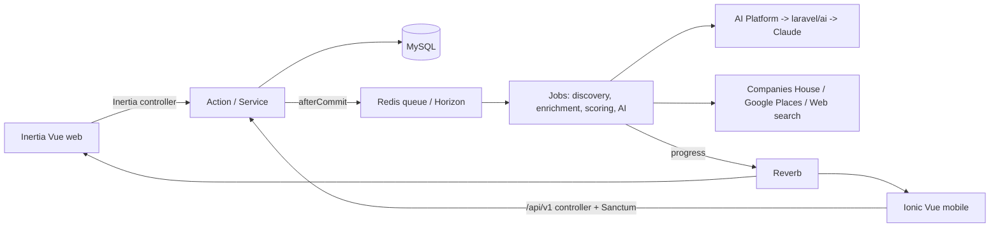
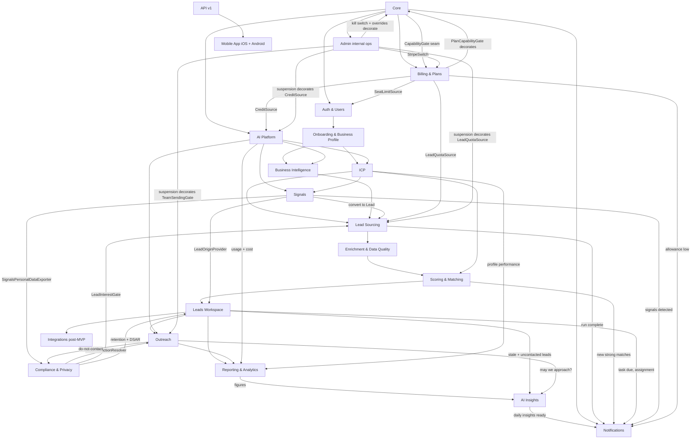

# AlimaProspects — Architecture

> System overview, module map and data flow. Keep this current: when a module is added or the structure changes, update this file (and `CLAUDE.md`).

## 1. What it is

A multi-tenant SaaS that helps businesses find, qualify and contact prospects with AI. A team signs up, describes itself and its Ideal Customer Profile (ICP), the platform runs an AI background check, then discovers, enriches, scores and surfaces leads in a CRM-lite workspace with AI-assisted outreach, reporting and insights. Web + mobile.

## 2. Stack (see ADRs 0001–0009)

- **Backend:** Laravel 13, PHP 8.5, MySQL 8 (utf8mb4). Redis + Horizon (queues), Reverb (realtime), Pennant (flags), Sanctum + Fortify (auth), spatie/laravel-permission (team-scoped roles), spatie/laravel-data (DTOs), Cashier/Stripe (billing, later), `laravel/ai` behind our `AiClient` (AI).
- **Web:** Inertia v2 + Vue 3 (`<script setup>`) + TypeScript + Tailwind v4 (official Vue starter kit; `vite-plus` toolchain).
- **Mobile:** Capacitor + Ionic Vue + TS in `/mobile` (its own npm project; **built in Phase 18**), consuming `/api/v1` with a scoped Sanctum token. A field companion rather than a second web app — see `modules/mobile-app.md` for what it deliberately leaves on the web, and `runbooks/mobile-dev.md` for how to run it.
- **Shared FE:** `resources/js/shared/` for web + mobile — `types/` (the API payload types, moved here in Phase 17 and re-exported by `@/types`), `api/` (the error envelope, pagination shapes and a typed `fetch` client), `tokens.ts` (brand tokens), and `brand/artwork.ts` (the master logo path data, moved here in Phase 18 so one mark serves both apps and the native icons). The mobile project reaches it by Vite alias (`@shared`), never by copy; `lang/` is shared the same way (`@lang`).
- **Obs:** Sentry (BE/FE/mobile — three projects, scrubbed), Pulse (ops, behind the admin door), and `security:posture` as a deploy gate. **Wired in Phase 20, ADR 0017**; §5 and `docs/runbooks/observability.md` have the detail.
- **Shared FE adds `observability/`** (Phase 20): the browser Sentry init and its scrubber, compiled by both the web app and the mobile app, because a scrubbing rule that exists in two files is wrong in one of them.
- **CI:** GitHub Actions. `tests` (Pint, Larastan L7, Pest, vue-tsc, build) and — since Phase 20 — `security`, on a **weekly schedule** as well as on pull requests: `composer audit`, `npm audit` for both projects, and gitleaks over the full history. A dependency that was clean when a pull request merged is not clean for ever, and nobody opens a pull request to tell us.

## 3. Request → logic → response

**Rule:** both Inertia and API controllers are thin and call the **same Actions**. Writes run in `DB::transaction()`; external calls / jobs / events fire `afterCommit`.

## 4. Module map

Code is organised by domain module under `app/Modules/<Module>/` (ADR 0002). MVP unless marked.

| #   | Module                        | Status                      | Doc                                      |
| --- | ----------------------------- | --------------------------- | ---------------------------------------- |
| 1   | Core                          | MVP                         | `modules/core.md`                        |
| 2   | Auth & Users                  | MVP                         | `modules/auth-users.md`                  |
| 3   | Onboarding & Business Profile | MVP                         | `modules/onboarding-business-profile.md` |
| 4   | ICP                           | MVP                         | `modules/icp.md`                         |
| 5   | Business Intelligence         | MVP                         | `modules/business-intelligence.md`       |
| 6   | AI Platform                   | MVP                         | `modules/ai-platform.md`                 |
| 7   | Lead Sourcing                 | MVP                         | `modules/lead-sourcing.md`               |
| 8   | Enrichment & Data Quality     | MVP                         | `modules/enrichment-data-quality.md`     |
| 9   | Scoring & Matching            | MVP                         | `modules/scoring-matching.md`            |
| 10  | Leads Workspace               | MVP                         | `modules/leads-workspace.md`             |
| 10c | Signals (trigger events)      | v1 (S0–S6) + v2 S7 landed   | `modules/signals.md`                     |
| 11  | Outreach                      | MVP (built, Phase 11)       | `modules/outreach.md`                    |
| 12  | Reporting & Analytics         | MVP (built, Phase 13)       | `modules/reporting-analytics.md`         |
| 13  | AI Insights                   | MVP (built, Phase 14)       | `modules/ai-insights.md`                 |
| 14  | Notifications                 | MVP (built, Phase 12)       | `modules/notifications.md`               |
| 15  | Billing & Plans               | MVP (built, Phase 16)       | `modules/billing-plans.md`               |
| 16  | Compliance & Privacy          | MVP (built, Phase 15)       | `modules/compliance-privacy.md`          |
| 17  | Admin (internal ops)          | MVP (built, Phases 19a–19c) | `modules/admin.md`                       |
| 18  | Integrations                  | Post-MVP                    | `modules/integrations.md`                |
| 19  | Mobile App                    | Built (Phase 18)            | `modules/mobile-app.md`                  |

## 5. Cross-cutting concerns

- **Tenancy (Core):** single DB, `team_id` on every tenant table, `BelongsToTeam` global scope + policy double-check, multi-team membership with an active team (ADR 0006). The scope is a **no-op when no team is active**, which is deliberate and is what the Admin panel's cross-tenant reads depend on — so the one place that removes the active team (`Admin\Http\Middleware\PlatformContext`) refuses to run on a route not named `admin.*`, and `tests/Feature/Admin/AdminRouteContractTest.php` asserts from the other side that no route outside `admin.*` carries it. Reading **one** tenant from the panel goes through `TeamContext::run()` rather than a hand-written `where`, so there is one implementation of tenancy rather than two that can disagree.
- **Plan-driven capabilities (Core + Billing + Admin, Phase 19b, ADR 0015):** whether a team may use
  a feature is **one question with one implementation** — `Core\Contracts\CapabilityGate`, decorated
  three times in provider order: Core's permissive default, Billing's plan-backed gate, Admin's
  governed gate. Resolution is **suspension → global kill switch → per-team override → plan →
  permissive default**, and the order is itself the decision. The same seam shape as `CreditSource`,
  `LeadQuotaSource` and `SeatLimitSource`: the module that owns the question ships the contract and a
  permissive default, and the modules with an opinion decorate it — so Signals has never heard of a
  plan, a grant or a suspension. Enforcement is in the **guards**, because a queued job and a
  scheduled watch have no request; `capability:` middleware is the courtesy half. A **plan grant**
  (`team_plan_grants`) outranks a live Stripe subscription, which is what makes "turn Stripe off" and
  "take a plan away" two different acts, and `teams.billing_mode` stops checkout and metering while
  granting nothing. Platform-wide knobs live in `platform_settings`, **schema'd by
  `config/admin.php`** — an undeclared key throws, which is what keeps it from becoming a junk drawer
  and what lets the settings screen be generated rather than hand-written.
- **Platform reporting (Admin, Phase 19c, ADR 0016):** the business's own figures — MRR and its movements,
  retention, the onboarding funnel, allowance consumption, provider cost and **gross margin per
  tenant** — come from `platform_daily_metrics`, a nightly rollup that is a **record over the
  ledgers** rather than a counter (ADR 0012's rule for `usage_meters`, applied again). It exists
  because a cross-tenant aggregate over `ai_requests` is the one query in this product with no
  `team_id` to narrow it. Admin asks its **own** questions over it rather than reusing Reporting's
  Actions, which are scoped by design and whose cohort rules are written for one team's window —
  running them unscoped would silently answer a different question with no customer to notice. What
  is shared is the plumbing: `DateRange` and its UTC discipline, `Ratio`'s refusal to divide by
  nothing, the table and chart DTOs, and `ReportCsvExporter`. The rollup is scheduled **before**
  every nightly prune, because a swept period cannot be recomputed, and a test asserts that ordering
  against the real schedule.
- **Internal operations (Admin, Phase 19a, ADR 0014):** a bespoke Inertia panel at `/admin` on a platform-admin identity (`users.admin_role`), separated from the tenant app by a middleware stack rather than a second auth guard. It owns no business rule: where a module owns an operation the panel calls that module's Action, and its generic registry writes only fields a descriptor declared. It reaches other modules the way Compliance and Billing do — by **decorating** their existing seams, so a suspended tenant stops sourcing, spending and sending without Admin knowing what a plan is. Every cross-tenant read is audited as a privacy event.
- **The API (`/api/v1`)** — see `docs/api/README.md`, `docs/api/openapi.json` for the generated contract, and **ADR 0013** for why it is shaped this way. Six properties hold of _every_ endpoint, asserted over the whole route table in `tests/Feature/Api/V1/RouteContractTest.php` rather than endpoint by endpoint: it is versioned (there is no unversioned surface; `routes/api.php` is empty and each module declares its own), behind Sanctum (bar the token exchange), scoped by a token ability (`Auth\Enums\TokenAbility`, bar identity and a token's own lifecycle), answering with an API Resource and never a model, failing in the one envelope (`Core\Http\Responses\ApiError`), and throttled per token. Hardened in **Phase 17**; the mobile app (Phase 18) is its first full consumer, and the first caller that is not same-origin — which is what `config/cors.php` exists for (§6a of the API README: `exposed_headers`, or the client cannot read the version pin or a 429's `Retry-After` at all).
- **i18n / RTL (ADR 0007):** EN + AR, RTL-aware components and brand tokens from the design-system phase.
- **Page chrome:** every authenticated screen renders in `AppLayout` (teal rail + cream surface) and opens with **`PageHero`** — the Ink card carrying the screen's sidebar number, its statement with an Acid Lime tail, the one Orange rule, the screen's actions (`hero` Button variant for secondaries on Ink) and **one panda peek**. The hero carries the page's single `<h1>`; the shell topbar's title is a label.
- **The peek is the same on every screen** — Soft Lilac, set into the bottom end corner of the hero and cropped by the card on two edges, matching the reference screens in `resources/screenshots/`. It does not vary by page: a screen is told apart by its number, its statement and its headline figure, not by moving the panda. Offsets are logical, so the peek sits on the reading-end side and the **layout** mirrors under RTL while the mark never does. The artwork is never altered — §4's "Never" list includes turning the pupils.
- **The hero's headline figure** (`stat`) is the one number that matters on that screen, set large in Lime against the end edge — the reference's "NEEDS ATTENTION / 14". Counts are zero-padded to two digits. Screens with no such number simply omit it and the statement runs wider.
- **A hero statement is one translation key**, with a `|` marking where the Lime tail begins (`t('Find your next|leads.')`). Two keys would force every language to accept English word order; a translator moves the `|`. Components take finished strings — pages call `t()` — which is the convention across the app.
- **Lists:** every tenant list is the shell in `resources/js/components/list/` — `ListToolbar` (search, ordering, the filters folded behind a disclosure, the record count, and `ActiveFilters`’ summary of what is in force) over `ListTable`/`ListHead`/`ListRow`/`ListCell`/`ListRowLink`. Ordering, filtering and paging are **server-side**: the URL is the truth about what is on screen, so a list can be shared, bookmarked and walked back through with the browser’s own buttons, and nothing in the set holds list state. The filters fold away but **what they are doing is always said in words** — a filtered list that cannot say why it is short is a list that lies about what it holds. Density is the member’s own setting (`useListDensity`), and `useNavigating()` is what lets a list dim while the server rebuilds it. Decisions in brand-tokens.md §7h; catalogued on `/design`.
- **Forms:** the long forms are `resources/js/components/forms/` — `FormSection` per part, `FormField` per field (which is where the `for`/`id`/`aria-describedby`/`aria-invalid` wiring comes from, by construction rather than by being typed out forty times), `FormErrorSummary` announcing what the server rejected and linking each failure into its field, `FormActions` keeping the save within reach, and `useUnsavedGuard` + `UnsavedChangesDialog` holding back a navigation that would discard a draft. Never `window.confirm`: it cannot be translated, cannot be set in the brand’s type, and says “Leave site?” about a navigation that never leaves the site.
- **Charts:** hand-built in `resources/js/components/charts/`, no charting dependency, on the validated `--chart-*` tokens (brand-tokens.md §7.7) and the `dataviz` guidance. At most two series per chart; everything else is single-series magnitude.
- **AI safety:** scraped/web content is **data, never instructions**; structured JSON output validated; per-team cost/credit logging (AI Platform). **Bounded on input since Phase 20** (ADR 0017), in two places for two problems: an oversized untrusted block is _truncated_ (a scraped page arriving too big is a normal Tuesday) and the whole rendered prompt being over the limit is _refused_ with a 413 before the transport — a near-context-limit call is slow, is charged to the team's allowance whatever comes back, and is the shape a prompt-injection attempt takes when the aim is to push the system instructions out of the model's attention. Characters, not tokens, because a token count is only knowable by making the call the bound exists to avoid.
- **Signal types are data, not an enum (Signals, S7, ADR 0018):** a `SignalDefinition` is a row a team owns — its name, its search templates, its include/exclude rules and its own thresholds — so a new kind of trigger event is configuration rather than a deploy. The exception to `CLAUDE.md` §2's "enums for every type column" is deliberate and has a test: **does the application branch on the value?** It does for `SignalStatus`, `SignalRunStatus`, `SignalWatchCadence` and `SignalDismissReason`, which stay enums; it never did for the event type, which only ever got carried, displayed, templated and grouped by. The table holds two scopes — `team_id = null` is a **platform preset** every team can read and only the platform can write — and `Signals\Services\PlatformPresetReader` is the single place that removes the tenancy scope to read them, replacing it with a stricter one, the same way `Admin\Support\PlatformContext` isolates that trick (ADR 0016). A team **clones** a preset rather than referencing it, so a platform edit never silently changes what a team is paying to run.
- **Compliance:** suppression/opt-out/retention/DSAR enforced by the system (Compliance & Privacy + `docs/compliance.md`). **Built in Phase 15**, and it reaches other modules through three seams rather than by them knowing about it: `LeadSourcingContractsLeadInterestGate` (no recorded lawful basis, no discovery), `OutreachContractsLeadRestrictionResolver` (how a prospect may be approached, from their jurisdiction as well as any flag on the lead), and `SignalsServicesSignalsPersonalDataExporter` (which Signals answers a data-subject request with). The do-not-contact table stays in Outreach — see that module's doc for why.
- **Observability (Phase 20, ADR 0017):** structured logs with `team_id`/`user_id`/`request_id`;
  channels `ai`, `lead_sourcing`, `outreach`, `notifications`, `insights`, `signals`, `compliance`,
  `billing`. `compliance` is kept for 90 days, the longest of any channel: "did you honour the
  erasure, and when" is a question an authority may ask a year later.
  **Sentry** is wired for three surfaces (backend, browser, mobile — three projects, because a 500
  in a worker, a `TypeError` in a browser and a crash on a handset are triaged by different people)
  and sends **an id, a tenant and a stack trace, and nothing about a person**: `send_default_pii` is
  off, and `Core\Observability\SentryOptions` redacts every sensitive key at any depth across request
  data, extra context, breadcrumb metadata and the user bag — aimed at _our own_ `Log::error`
  contexts, which is the realistic leak, rather than at the vendor's collection. Expected refusals
  (a wrong password, a 404, a throttle, a plan refusal, an exhausted allowance) are filtered
  declaratively by `ignore_exceptions`, because an error tracker full of the application working is
  one nobody reads. Session replay is off and stays off. **Pulse** is live at `/pulse`, behind the
  admin panel's own door (platform admin or 404, enforced 2FA, the IP allowlist, then
  `AdminAbility::ManageOperations`), with queues, slow queries and an **AI usage** card of ours.
  Pulse answers _"is something happening right now"_ at a per-minute resolution over a 7-day window;
  `/admin` answers _"which tenant, and what did it cost"_ — **a clock and a tenant**, and neither
  can answer the other's question. See `docs/runbooks/observability.md`.
- **Response security headers (Core, Phase 20, ADR 0017):** `SecurityHeaders` is **global**
  middleware, so `/up`, a CSV download, a 500 page, the Pulse dashboard and an `/api/v1` error
  envelope all carry `nosniff`, frame denial, a referrer policy, a feature-denying
  `Permissions-Policy`, the cross-origin policies and — on HTML — a **nonce-based
  Content-Security-Policy** with no `unsafe-inline` on scripts. Affordable only because this app has
  no third-party script: exactly two inline tags, both ours, both nonce'd. It is skipped in two
  places on purpose — under the Vite dev server (Vue injects component styles with no nonce, so a
  policy that held locally would hold by breaking the page) and on the vendor dashboards, which
  inject inline Livewire we cannot nonce. HSTS follows the **connection**, not the environment.
  `php artisan security:posture [--strict]` asserts the production settings that are correct in
  `.env.example` and silently wrong on a hurriedly configured box, and fails a deploy on them.

## 6. Environments

Local = Laravel Herd (Windows), PHP 8.5. Prod = Hetzner Ubuntu LTS (Nginx, PHP-FPM 8.5, MySQL 8, Redis, Supervisor for Horizon + Reverb, Let's Encrypt, scheduled backups). Deploy steps land in `docs/runbooks/deployment.md` at the deploy phase.
