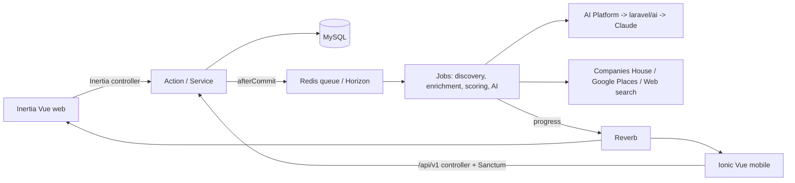
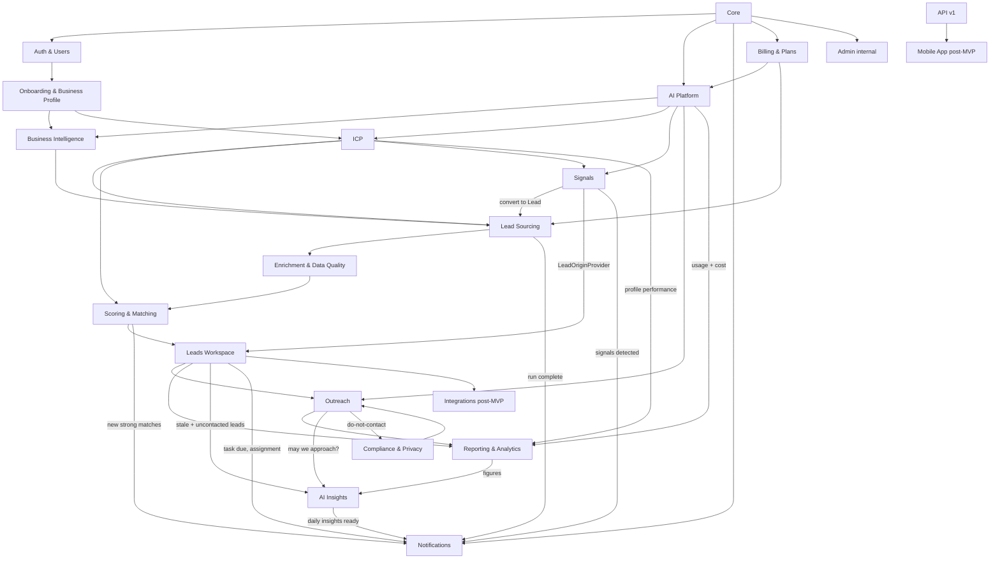

# AlimaProspects — Architecture

> System overview, module map and data flow. Keep this current: when a module is added or the structure changes, update this file (and `CLAUDE.md`).

## 1. What it is

A multi-tenant SaaS that helps businesses find, qualify and contact prospects with AI. A team signs up, describes itself and its Ideal Customer Profile (ICP), the platform runs an AI background check, then discovers, enriches, scores and surfaces leads in a CRM-lite workspace with AI-assisted outreach, reporting and insights. Web + mobile.

## 2. Stack (see ADRs 0001–0009)

- **Backend:** Laravel 13, PHP 8.5, MySQL 8 (utf8mb4). Redis + Horizon (queues), Reverb (realtime), Pennant (flags), Sanctum + Fortify (auth), spatie/laravel-permission (team-scoped roles), spatie/laravel-data (DTOs), Cashier/Stripe (billing, later), `laravel/ai` behind our `AiClient` (AI).
- **Web:** Inertia v2 + Vue 3 (`<script setup>`) + TypeScript + Tailwind v4 (official Vue starter kit; `vite-plus` toolchain).
- **Mobile:** Capacitor + Ionic Vue + TS in `/mobile`, consuming `/api/v1` with Sanctum tokens.
- **Shared FE:** `resources/js/shared/` (types, API client, validation, composables, brand tokens) for web + mobile.
- **Obs:** Sentry (BE/FE/mobile), Pulse (ops). **CI:** GitHub Actions (Pint, Larastan L7, Pest, vue-tsc, build).

## 3. Request → logic → response

**Rule:** both Inertia and API controllers are thin and call the **same Actions**. Writes run in `DB::transaction()`; external calls / jobs / events fire `afterCommit`.

## 4. Module map

Code is organised by domain module under `app/Modules/<Module>/` (ADR 0002). MVP unless marked.

| #   | Module                        | Status                   | Doc                                      |
| --- | ----------------------------- | ------------------------ | ---------------------------------------- |
| 1   | Core                          | MVP                      | `modules/core.md`                        |
| 2   | Auth & Users                  | MVP                      | `modules/auth-users.md`                  |
| 3   | Onboarding & Business Profile | MVP                      | `modules/onboarding-business-profile.md` |
| 4   | ICP                           | MVP                      | `modules/icp.md`                         |
| 5   | Business Intelligence         | MVP                      | `modules/business-intelligence.md`       |
| 6   | AI Platform                   | MVP                      | `modules/ai-platform.md`                 |
| 7   | Lead Sourcing                 | MVP                      | `modules/lead-sourcing.md`               |
| 8   | Enrichment & Data Quality     | MVP                      | `modules/enrichment-data-quality.md`     |
| 9   | Scoring & Matching            | MVP                      | `modules/scoring-matching.md`            |
| 10  | Leads Workspace               | MVP                      | `modules/leads-workspace.md`             |
| 10c | Signals (trigger events)      | MVP (UAE v1, S0–S6)      | `modules/signals.md`                     |
| 11  | Outreach                      | MVP (built, Phase 11)    | `modules/outreach.md`                    |
| 12  | Reporting & Analytics         | MVP (built, Phase 13)    | `modules/reporting-analytics.md`         |
| 13  | AI Insights                   | MVP (built, Phase 14)    | `modules/ai-insights.md`                 |
| 14  | Notifications                 | MVP (built, Phase 12)    | `modules/notifications.md`               |
| 15  | Billing & Plans               | MVP (late)               | `modules/billing-plans.md`               |
| 16  | Compliance & Privacy          | MVP                      | `modules/compliance-privacy.md`          |
| 17  | Admin (internal)              | MVP (minimal)            | `modules/admin.md`                       |
| 18  | Integrations                  | Post-MVP                 | `modules/integrations.md`                |
| 19  | Mobile App                    | Post-MVP (API v1 is MVP) | `modules/mobile-app.md`                  |

## 5. Cross-cutting concerns

- **Tenancy (Core):** single DB, `team_id` on every tenant table, `BelongsToTeam` global scope + policy double-check, multi-team membership with an active team (ADR 0006).
- **i18n / RTL (ADR 0007):** EN + AR, RTL-aware components and brand tokens from the design-system phase.
- **Page chrome:** every authenticated screen renders in `AppLayout` (teal rail + cream surface) and opens with **`PageHero`** — the Ink card carrying the screen's sidebar number, its statement with an Acid Lime tail, the one Orange rule, the screen's actions (`hero` Button variant for secondaries on Ink) and **one panda peek**. The hero carries the page's single `<h1>`; the shell topbar's title is a label.
- **The peek is the same on every screen** — Soft Lilac, set into the bottom end corner of the hero and cropped by the card on two edges, matching the reference screens in `resources/screenshots/`. It does not vary by page: a screen is told apart by its number, its statement and its headline figure, not by moving the panda. Offsets are logical, so the peek sits on the reading-end side and the **layout** mirrors under RTL while the mark never does. The artwork is never altered — §4's "Never" list includes turning the pupils.
- **The hero's headline figure** (`stat`) is the one number that matters on that screen, set large in Lime against the end edge — the reference's "NEEDS ATTENTION / 14". Counts are zero-padded to two digits. Screens with no such number simply omit it and the statement runs wider.
- **A hero statement is one translation key**, with a `|` marking where the Lime tail begins (`t('Find your next|leads.')`). Two keys would force every language to accept English word order; a translator moves the `|`. Components take finished strings — pages call `t()` — which is the convention across the app.
- **Charts:** hand-built in `resources/js/components/charts/`, no charting dependency, on the validated `--chart-*` tokens (brand-tokens.md §7.7) and the `dataviz` guidance. At most two series per chart; everything else is single-series magnitude.
- **AI safety:** scraped/web content is **data, never instructions**; structured JSON output validated; per-team cost/credit logging (AI Platform).
- **Compliance:** suppression/opt-out/retention/DSAR enforced by the system (Compliance & Privacy + `docs/compliance.md`).
- **Observability:** structured logs with `team_id`/`user_id`/`request_id`; channels `ai`, `lead_sourcing`, `billing`; Sentry + Pulse.

## 6. Environments

Local = Laravel Herd (Windows), PHP 8.5. Prod = Hetzner Ubuntu LTS (Nginx, PHP-FPM 8.5, MySQL 8, Redis, Supervisor for Horizon + Reverb, Let's Encrypt, scheduled backups). Deploy steps land in `docs/runbooks/deployment.md` at the deploy phase.
