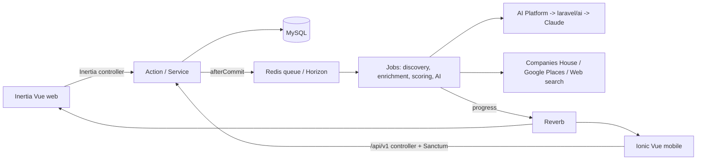
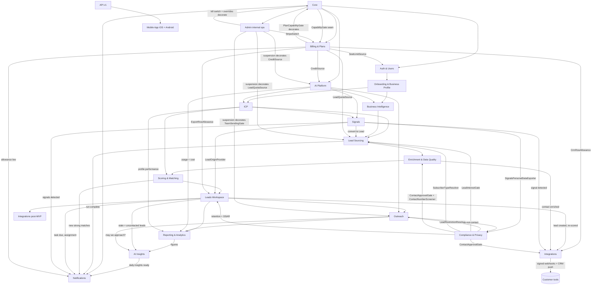

# AlimaProspects — Architecture

> System overview, module map and data flow. Keep this current: when a module is added or the structure changes, update this file (and `CLAUDE.md`).

## 1. What it is

A multi-tenant SaaS that helps businesses find, qualify and contact prospects with AI. A team signs up, describes itself and its Ideal Customer Profile (ICP), the platform runs an AI background check, then discovers, enriches, scores and surfaces leads in a CRM-lite workspace with AI-assisted outreach, reporting and insights. Web + mobile.

## 2. Stack (see ADRs 0001–0009)

- **Backend:** Laravel 13, PHP 8.5, MySQL 8 (utf8mb4). Redis + Horizon (queues), Reverb (realtime), Pennant (flags), Sanctum + Fortify (auth), spatie/laravel-permission (team-scoped roles), spatie/laravel-data (DTOs), Cashier/Stripe (billing, later), `laravel/ai` behind our `AiClient` (AI).
- **Web:** Inertia v2 + Vue 3 (`<script setup>`) + TypeScript + Tailwind v4 (official Vue starter kit; `vite-plus` toolchain).
- **Mobile:** Capacitor + Ionic Vue + TS in `/mobile` (its own npm project; **built in Phase 18**), consuming `/api/v1` with a scoped Sanctum token. A field companion rather than a second web app — see `modules/mobile-app.md` for what it deliberately leaves on the web, and `runbooks/mobile-dev.md` for how to run it.
- **Shared FE:** `resources/js/shared/` for web + mobile — `types/` (the API payload types, moved here in Phase 17 and re-exported by `@/types`), `api/` (the error envelope, pagination shapes and a typed `fetch` client), `tokens.ts` (brand tokens), and `brand/artwork.ts` (the master logo path data, moved here in Phase 18 so one mark serves both apps and the native icons). The mobile project reaches it by Vite alias (`@shared`), never by copy; `lang/` is shared the same way (`@lang`).
- **Obs:** Sentry (BE/FE/mobile — three projects, scrubbed), Pulse (ops, behind the admin door), and `security:posture` as a deploy gate. **Wired in Phase 20, ADR 0017**; §5 and `docs/runbooks/observability.md` have the detail.
- **Shared FE adds `observability/`** (Phase 20): the browser Sentry init and its scrubber, compiled by both the web app and the mobile app, because a scrubbing rule that exists in two files is wrong in one of them.
- **CI:** GitHub Actions. `tests` (Pint, Larastan L7, Pest, vue-tsc, build) and — since Phase 20 — `security`, on a **weekly schedule** as well as on pull requests: `composer audit`, `npm audit` for both projects, and gitleaks over the full history. A dependency that was clean when a pull request merged is not clean for ever, and nobody opens a pull request to tell us.

## 3. Request → logic → response

**Rule:** both Inertia and API controllers are thin and call the **same Actions**. Writes run in `DB::transaction()`; external calls / jobs / events fire `afterCommit`.

## 4. Module map

Code is organised by domain module under `app/Modules/<Module>/` (ADR 0002). MVP unless marked.

**Data comes in through exactly two seams**, and every source added since has gone behind one of
them: a **company record** through `LeadSourcing\Contracts\LeadSourceProvider` (ADR 0008) and an
**event** through `Signals\Contracts\SignalSourceProvider` + `SignalSourceRegistry` (ADR 0023). The
free-sources expansion (`lead-sources-plan.md`, ADR 0025) adds registers and public feeds — the FSA
hygiene register, CQC, the FCA register, the Charity Commission, OpenStreetMap, Companies House
streaming, public contract awards, the Gazette — and adds **no third way in**; the only genuinely new
shape it introduces is the reference-dataset import described in §5.

| #   | Module                        | Status                      | Doc                                      |
| --- | ----------------------------- | --------------------------- | ---------------------------------------- |
| 1   | Core                          | MVP                         | `modules/core.md`                        |
| 2   | Auth & Users                  | MVP                         | `modules/auth-users.md`                  |
| 3   | Onboarding & Business Profile | MVP                         | `modules/onboarding-business-profile.md` |
| 4   | ICP                           | MVP                         | `modules/icp.md`                         |
| 5   | Business Intelligence         | MVP                         | `modules/business-intelligence.md`       |
| 6   | AI Platform                   | MVP                         | `modules/ai-platform.md`                 |
| 7   | Lead Sourcing                 | MVP                         | `modules/lead-sourcing.md`               |
| 8   | Enrichment & Data Quality     | MVP                         | `modules/enrichment-data-quality.md`     |
| 9   | Scoring & Matching            | MVP                         | `modules/scoring-matching.md`            |
| 10  | Leads Workspace               | MVP                         | `modules/leads-workspace.md`             |
| 10c | Signals (trigger events)      | v1 (S0–S6) + v2 S7–S16      | `modules/signals.md`                     |
| 11  | Outreach                      | MVP (built, Phase 11)       | `modules/outreach.md`                    |
| 12  | Reporting & Analytics         | MVP (built, Phase 13)       | `modules/reporting-analytics.md`         |
| 13  | AI Insights                   | MVP (built, Phase 14)       | `modules/ai-insights.md`                 |
| 14  | Notifications                 | MVP (built, Phase 12)       | `modules/notifications.md`               |
| 15  | Billing & Plans               | MVP (built, Phase 16)       | `modules/billing-plans.md`               |
| 16  | Compliance & Privacy          | MVP (built, Phase 15 + PL5) | `modules/compliance-privacy.md`          |
| 17  | Admin (internal ops)          | MVP (built, Phases 19a–19c) | `modules/admin.md`                       |
| 18  | Integrations                  | MVP (built, PL7)            | `modules/integrations.md`                |
| 19  | Mobile App                    | Built (Phase 18)            | `modules/mobile-app.md`                  |

## 5. Cross-cutting concerns

- **Tenancy (Core):** single DB, `team_id` on every tenant table, `BelongsToTeam` global scope + policy double-check, multi-team membership with an active team (ADR 0006). The scope is a **no-op when no team is active**, which is deliberate and is what the Admin panel's cross-tenant reads depend on — so the one place that removes the active team (`Admin\Http\Middleware\PlatformContext`) refuses to run on a route not named `admin.*`, and `tests/Feature/Admin/AdminRouteContractTest.php` asserts from the other side that no route outside `admin.*` carries it. Reading **one** tenant from the panel goes through `TeamContext::run()` rather than a hand-written `where`, so there is one implementation of tenancy rather than two that can disagree.
- **Platform reference datasets (L0, ADR 0025 §2):** a bulk public file — HM Land Registry's
  CCOD/OCOD being the first — is imported into tables with **no `team_id`**, read-only to tenants and
  refreshed by a scheduled import that writes a `reference_dataset_imports` ledger row and swaps
  versions atomically (import a new version, flip a pointer, delete the old). It is the second
  documented exception to ADR 0006 after `signal_definitions`' platform presets, and for the same
  reason: the data belongs to nobody, so asserting a tenant over it would be a lie the scope then
  enforces. The flow is one direction only — a tenant query **joins** a reference table and never
  writes one — and the nightly retention sweeps do not touch them, because a version is replaced
  rather than aged.
- **Plan-driven capabilities (Core + Billing + Admin, Phase 19b, ADR 0015):** whether a team may use
  a feature is **one question with one implementation** — `Core\Contracts\CapabilityGate`, decorated
  three times in provider order: Core's permissive default, Billing's plan-backed gate, Admin's
  governed gate. Resolution is **suspension → global kill switch → per-team override → plan →
  permissive default**, and the order is itself the decision. The same seam shape as `CreditSource`,
  `LeadQuotaSource` and `SeatLimitSource`: the module that owns the question ships the contract and a
  permissive default, and the modules with an opinion decorate it — so Signals has never heard of a
  plan, a grant or a suspension. Enforcement is in the **guards**, because a queued job and a
  scheduled watch have no request; `capability:` middleware is the courtesy half. A **plan grant**
  (`team_plan_grants`) outranks a live Stripe subscription, which is what makes "turn Stripe off" and
  "take a plan away" two different acts, and `teams.billing_mode` stops checkout and metering while
  granting nothing. Platform-wide knobs live in `platform_settings`, **schema'd by
  `config/admin.php`** — an undeclared key throws, which is what keeps it from becoming a junk drawer
  and what lets the settings screen be generated rather than hand-written.
- **The export allowance is the sixth seam (PL6, ADR 0033):** `LeadsWorkspace\Contracts\ExportRowAllowance`
  joins the five before it, and the pattern's cheapness is the argument for it — the whole of it is a
  reserve/commit mapping onto `UsageAllowance`. It is bound **inside** `billing.enforce_plans`,
  unlike PL4's `CreditReserver`, and that asymmetry is the decision: a contact reveal is money
  leaving the building per unit, so its reserve is a cost guard that stands whatever the switch says;
  a row of a team's own data leaving costs us nothing, so a ceiling on it is a plan feature.
- **The CRM allowance is the seventh seam (PL7, ADR 0034):** `Integrations\Contracts\CrmRowAllowance`,
  beside PL6's and bound **inside** `billing.enforce_plans` for the same reason — a record pushed to
  a customer's CRM costs us nothing, so a ceiling on it is a plan feature rather than a cost guard.
  `BillingMetric::CrmSync` had existed since PL4 with an allowance on every plan and nothing spending
  it; this is what spends it, one unit per record that actually moved. A **skip** (nothing changed)
  and a **refusal** (the company is on the do-not-contact list) both release the hold, because
  charging for the framework being careful would make the `synced_hash` optimisation cost money.
- **Anything that leaves Alima goes through Integrations (PL7, ADR 0034):** outbound webhooks and the
  CRM framework are one module, and it **listens outwards** — four hookups on other modules' events
  and models, and nothing imports it, exactly as nothing imports Billing or Compliance. Two rules
  travel with the data rather than with the screen. First, the export's argument applies again: a
  record in somebody's CRM, like a row in a spreadsheet, is beyond every later check, so
  `ContactApprovalGate::allowsDomain()` is asked **before** a connector is reached and a value nobody
  paid to reveal is omitted rather than masked. Second, the webhook payload is built with the app's
  **own API resources**, so masking is automatic rather than remembered. A connector is a registry
  entry (ADR 0008's pattern, fourth appearance), the signature is `SignalWebhookSecret`'s
  construction pointed outwards, and `SafeUrl` is re-asked **and pinned** at send time because DNS
  changes after a form is submitted.
- **A plan limit is asked for at the point of spend, and the fourth seam decorates (Signals, S16):** `Signals\Contracts\SignalQuotaSource` joins `CreditSource`, `LeadQuotaSource` and `SeatLimitSource` as a seam Billing fills in by binding over the owning module's own default — but it is the first that **decorates** rather than replaces, because it answers eight figures and a plan definition is allowed to be partial. So a figure has three states: a number, an explicit `null` meaning _unlimited_, and an **absent key** meaning the plan has taken no position, which is the only one that falls through to the module's own floor. Its stub is therefore the one of the four that is **not** permissive: the floors it reports are cost guards Signals shipped with, and turning plan enforcement off must not turn those off too. Enforcement is in `SignalSpendGuard`, not middleware, for ADR 0012's reason — the scheduler, a nightly sync and a queued run all spend a team's allowance with no request behind them — and a **ceiling refuses while a partial allowance clamps**, which is the difference between a team getting nothing and getting what they are still entitled to.
- **Platform reporting (Admin, Phase 19c, ADR 0016):** the business's own figures — MRR and its movements,
  retention, the onboarding funnel, allowance consumption, provider cost and **gross margin per
  tenant** — come from `platform_daily_metrics`, a nightly rollup that is a **record over the
  ledgers** rather than a counter (ADR 0012's rule for `usage_meters`, applied again). It exists
  because a cross-tenant aggregate over `ai_requests` is the one query in this product with no
  `team_id` to narrow it. Admin asks its **own** questions over it rather than reusing Reporting's
  Actions, which are scoped by design and whose cohort rules are written for one team's window —
  running them unscoped would silently answer a different question with no customer to notice. What
  is shared is the plumbing: `DateRange` and its UTC discipline, `Ratio`'s refusal to divide by
  nothing, the table and chart DTOs, and `ReportCsvExporter`. The rollup is scheduled **before**
  every nightly prune, because a swept period cannot be recomputed, and a test asserts that ordering
  against the real schedule.
- **Internal operations (Admin, Phase 19a, ADR 0014):** a bespoke Inertia panel at `/admin` on a platform-admin identity (`users.admin_role`), separated from the tenant app by a middleware stack rather than a second auth guard. It owns no business rule: where a module owns an operation the panel calls that module's Action, and its generic registry writes only fields a descriptor declared. It reaches other modules the way Compliance and Billing do — by **decorating** their existing seams, so a suspended tenant stops sourcing, spending and sending without Admin knowing what a plan is. Every cross-tenant read is audited as a privacy event.
- **The API (`/api/v1`)** — see `docs/api/README.md`, `docs/api/openapi.json` for the generated contract, and **ADR 0013** for why it is shaped this way. Six properties hold of _every_ endpoint, asserted over the whole route table in `tests/Feature/Api/V1/RouteContractTest.php` rather than endpoint by endpoint: it is versioned (there is no unversioned surface; `routes/api.php` is empty and each module declares its own), behind Sanctum (bar the token exchange), scoped by a token ability (`Auth\Enums\TokenAbility`, bar identity and a token's own lifecycle), answering with an API Resource and never a model, failing in the one envelope (`Core\Http\Responses\ApiError`), and throttled per token. Hardened in **Phase 17**; the mobile app (Phase 18) is its first full consumer, and the first caller that is not same-origin — which is what `config/cors.php` exists for (§6a of the API README: `exposed_headers`, or the client cannot read the version pin or a 429's `Retry-After` at all).
- **i18n / RTL (ADR 0007):** EN + AR, RTL-aware components and brand tokens from the design-system phase.
- **Page chrome:** every authenticated screen renders in `AppLayout` (teal rail + cream surface) and opens with **`PageHero`** — the Ink card carrying the screen's sidebar number, its statement with an Acid Lime tail, the one Orange rule, the screen's actions (`hero` Button variant for secondaries on Ink) and **one panda peek**. The hero carries the page's single `<h1>`; the shell topbar's title is a label.
- **The peek is the same on every screen** — Soft Lilac, set into the bottom end corner of the hero and cropped by the card on two edges, matching the reference screens in `resources/screenshots/`. It does not vary by page: a screen is told apart by its number, its statement and its headline figure, not by moving the panda. Offsets are logical, so the peek sits on the reading-end side and the **layout** mirrors under RTL while the mark never does. The artwork is never altered — §4's "Never" list includes turning the pupils.
- **The hero's headline figure** (`stat`) is the one number that matters on that screen, set large in Lime against the end edge — the reference's "NEEDS ATTENTION / 14". Counts are zero-padded to two digits. Screens with no such number simply omit it and the statement runs wider.
- **A hero statement is one translation key**, with a `|` marking where the Lime tail begins (`t('Find your next|leads.')`). Two keys would force every language to accept English word order; a translator moves the `|`. Components take finished strings — pages call `t()` — which is the convention across the app.
- **Lists:** every tenant list is the shell in `resources/js/components/list/` — `ListToolbar` (search, ordering, the filters folded behind a disclosure, the record count, and `ActiveFilters`’ summary of what is in force) over `ListTable`/`ListHead`/`ListRow`/`ListCell`/`ListRowLink`. Ordering, filtering and paging are **server-side**: the URL is the truth about what is on screen, so a list can be shared, bookmarked and walked back through with the browser’s own buttons, and nothing in the set holds list state. The filters fold away but **what they are doing is always said in words** — a filtered list that cannot say why it is short is a list that lies about what it holds. Density is the member’s own setting (`useListDensity`), and `useNavigating()` is what lets a list dim while the server rebuilds it. Decisions in brand-tokens.md §7h; catalogued on `/design`.
- **Forms:** the long forms are `resources/js/components/forms/` — `FormSection` per part, `FormField` per field (which is where the `for`/`id`/`aria-describedby`/`aria-invalid` wiring comes from, by construction rather than by being typed out forty times), `FormErrorSummary` announcing what the server rejected and linking each failure into its field, `FormActions` keeping the save within reach, and `useUnsavedGuard` + `UnsavedChangesDialog` holding back a navigation that would discard a draft. Never `window.confirm`: it cannot be translated, cannot be set in the brand’s type, and says “Leave site?” about a navigation that never leaves the site.
- **Charts:** hand-built in `resources/js/components/charts/`, no charting dependency, on the validated `--chart-*` tokens (brand-tokens.md §7.7) and the `dataviz` guidance. At most two series per chart; everything else is single-series magnitude.
- **AI safety:** scraped/web content is **data, never instructions**; structured JSON output validated; per-team cost/credit logging (AI Platform). **Bounded on input since Phase 20** (ADR 0017), in two places for two problems: an oversized untrusted block is _truncated_ (a scraped page arriving too big is a normal Tuesday) and the whole rendered prompt being over the limit is _refused_ with a 413 before the transport — a near-context-limit call is slow, is charged to the team's allowance whatever comes back, and is the shape a prompt-injection attempt takes when the aim is to push the system instructions out of the model's attention. Characters, not tokens, because a token count is only knowable by making the call the bound exists to avoid.
- **Signal types are data, not an enum (Signals, S7, ADR 0018):** a `SignalDefinition` is a row a team owns — its name, its search templates, its include/exclude rules and its own thresholds — so a new kind of trigger event is configuration rather than a deploy. The exception to `CLAUDE.md` §2's "enums for every type column" is deliberate and has a test: **does the application branch on the value?** It does for `SignalStatus`, `SignalRunStatus`, `SignalWatchCadence` and `SignalDismissReason`, which stay enums; it never did for the event type, which only ever got carried, displayed, templated and grouped by. The table holds two scopes — `team_id = null` is a **platform preset** every team can read and only the platform can write — and `Signals\Services\PlatformPresetReader` is the single place that removes the tenancy scope to read them, replacing it with a stricter one, the same way `Admin\Support\PlatformContext` isolates that trick (ADR 0016). A team **clones** a preset rather than referencing it, so a platform edit never silently changes what a team is paying to run.
- **An AI that writes configuration gets a preview (Signals, S9, ADR 0020):** every other prompt
  in the product returns content somebody reads once; the signal composer returns a **standing
  instruction to spend money every day**. Three rules follow, and they generalise to any future
  prompt that writes settings rather than prose. The AI **drafts and never saves** — the member reads,
  edits and commits, so a prompt never has write access to a recurring cost. The model's output is
  bounded **three times**: by the schema, by the _save path's own validation rules_
  (`DraftSignalDefinition::fromAi()`), and by `UntrustedContent` around the one input a customer
  wrote. And the output is **previewed against reality before it is kept**, because the S0 spike
  established that nobody can tell whether a query template works by reading it — which makes the
  preview the feature and the composer the convenience. The preview persists nothing except a
  `signal_previews` ledger row, because a user-triggered spend loop needs a cap and a cost with no
  row cannot be capped.
- **A feed and a monitor are the same machinery pointed differently (Signals, S10, ADR 0021):** a
  watch carries either places or a **watchlist**, never both, because conflating them multiplies one
  cost by the other. The generalisable parts are three. **Matching is a column of the row being
  written**, not a correction applied afterwards, and the lead's timeline entry is written in the
  same transaction as the signal — a record saying an event happened with no event behind it is the
  worse state. **A per-run ceiling over a long list has to rotate, not trim**: trimming keeps the
  first N forever, so the eighty-ninth account is never searched at all, which is the failure nobody
  sees; a cursor makes the list a ring and the screen says how long it takes to come round. And
  **a weak match is no match** — two confidences, both explained in words on the card, with the
  override a first-class button, because the member is the one who knows whether two companies with
  the same name are the same company. The name rule behind it has exactly one definition
  (`LeadSourcing\Support\CompanyNameKey`), read by both the deduplicator and the matcher.
- **An article is not an event (Signals, S11):** a `Signal` is one article and a `SignalCluster` is
  the thing that happened, and the feed lists and counts the second. Three parts of it generalise.
  **An identity has to be the identity of the thing, not of the handle you were given**: a Google
  redirect hands back an opaque token, so `url_hash` stopped identifying an article and a varying
  token re-admitted the same one on every run — `signals.dedupe_hash` is a content identity behind
  a known redirector and the canonical URL hash everywhere else, the unique index moved with it,
  and the team's skip list learned to match an **outlet's name** as well as a host, because behind
  a redirect every item's host is `google.com`. **Put the cheap deterministic grouping before the
  expensive judgement**: candidate articles are grouped by headline overlap (Dice over the
  significant words, no AI) and one representative is classified, so a story that travels well costs
  one call instead of eight — and because the cards are consolidated _again_ afterwards by the
  event's own subject, the savings depend on that grouping being generous and the correctness does
  not, which is what makes `signals.cluster_before_ai` a safe flag rather than a rollback. And
  **a rejection is worth remembering, keyed by the question as well as the subject**: a round-up
  inside the recency window cost an AI batch every day it stayed there, so a verdict is kept for 30
  days against the article _and_ the set of signal types that were offered — add a type and it is
  asked again, change nothing and nobody pays twice. The counters on a cluster are a **record over
  its rows** rather than a tally the app increments, the same shape `usage_meters` has over the
  ledgers (ADR 0012).
- **Some data arrives already true (Signals, S13b, ADR 0023 §6):** a Companies House filing is
  not a sentence to be interpreted — the registry has parsed the form, so `description_values`
  carries the officer's name and the date and `transaction_id` is a stable identity. `SourceItem`
  therefore carries an optional `classification`, and a source that populates it skips the AI batch
  entirely: classifying a registry fact with a language model would spend money to make a certainty
  less certain. Two rules keep that from becoming "trust me". Only code **we** wrote against an
  authoritative provider may populate it — never the inbound webhook, whose events are classified
  by the same prompt as a news snippet _precisely because_ a customer supplied them. And a skipped
  classification still passes the type's own thresholds, because a source asserts a confidence and
  does not assert that the team wants the event. The general shape is worth keeping: **a trust
  boundary is a property of where data came from, not of what it looks like** — and the two
  sources that look most alike on arrival, a parsed filing and a pushed event, sit on opposite sides
  of it.
- **Accepting is not processing (Signals, S13b, ADR 0023 §7):** the inbound webhook stores the
  event and the next watch run reads it back through an ordinary source. That keeps one pipeline for
  thresholds, clustering, scoring and jurisdiction — a second ingestion path would be a second
  place for all four to drift, in the one place a caller's own assertions are most tempting to
  believe — and it stops a customer's retry loop from being able to trigger an AI call. The cost
  is latency measured in one watch cadence, which is the right trade whenever the expensive half of
  a pipeline is already written and the cheap half is the part exposed to the outside.
- **A provider's health and a query's validity are different questions (Signals, S13a, ADR 0023):**
  a signal source sits behind `Signals\Contracts\SignalSourceProvider` and a
  `SignalSourceRegistry`, mirroring Lead Sourcing's pair (ADR 0008) deliberately — same shape, same
  hardening, a breaker **keyed per source** so a team running news and web search does not lose
  their news when `/search` is unwell. Two things about it generalise. First, **the enum/row test
  cuts the other way here than it did at S7.** A signal _type_ is a row because nothing branches on
  it; a signal _source_ is an enum because a class exists per case — `fetch()` for a registry filing
  is not a different configuration of the news one, it is different code with a different
  credential — so a team cannot invent one and a case with nothing behind it is a bug, which is what
  `SignalSourceKind::isAvailable()` says out loud. Second, and more widely useful: a 4xx from a
  provider has **two meanings** and conflating them is expensive. Serper answers a `site:` or quoted
  template with a 400, and treating that as a provider failure made one team's bad template fail
  their whole run — three times over, re-paying for every other query in it — and report an outage
  that was not happening. So a breaker answers _is this provider up?_ and
  `SignalsException::sourceQueryRejected()` answers _was that a sensible thing to ask it?_: not
  retryable, breaker untouched, caught per query, counted on the run, and the rest of the plan
  proceeds. Any later integration that lets a customer compose part of a request has the same split
  to make. **S13b's review found that two was the wrong number** (ADR 0023 §4a), and the way it was
  wrong generalises further than the fix: both of those questions are about **us** — our credential,
  our template, our parameters — which was exhaustive only while every source was addressed by a
  string we had composed. A source addressed by a **subject** (a company number) or by a stored
  **configuration** (a feed's URL) has a third answer: the request was well formed, the provider is
  healthy, and the addressee is not there. Missing it cost two separate outages-by-construction, in
  opposite directions: as a provider failure a struck-off company number failed a whole watch on
  every run for ever, and as a _query_ rejection a moved feed failed a run too, because a feed is
  asked exactly one query so "some refused" and "all refused" are the same event. **A 4xx has as
  many meanings as there are parties to the request** — the provider, the question, and the thing
  the question is about — and a rule that collapses any two of them is cheap until a source arrives
  whose addressee is somebody else's configuration.
- **Removing a read scope and removing a write's auto-assignment are two different jobs (Signals,
  S15):** a platform preset is a `signal_definitions` row that belongs to nobody, and the module had
  solved reading one — `PlatformPresetReader` is the single door that drops the tenancy scope and
  replaces it with the stricter `team_id is null`. Writing one looked solved by `'team_id' => null`
  and a docblock saying the Action runs outside any team context. It was not: **`BelongsToTeam`'s
  `creating` hook fills a null `team_id` from the ambient `TeamContext`**, so a preset written while
  any team was active became that team's own type — right columns, wrong owner, unique against the
  wrong scope, and never visible in the library. Nothing downstream would notice, because every
  consumer of a preset reads through the door that only sees `team_id is null`. It could not fire in
  production, because `PlatformContext` drops the context on every admin request and an operator is
  in no team; it fired on the first test fixture that created one with a team active. The general
  lesson is that a trait which **adds** data on write is a second, independent mechanism from the
  scope that **hides** it on read, and an intention expressed as a literal `null` is not
  enforcement. The second half is about the fix: the model already carried
  `SignalDefinition::$isPlatformPreset` for exactly this case, and the first attempt added a new
  helper that forgot and restored the context instead — two doors onto one invariant, where the
  whole point of a door is that there is one. Look for the existing mechanism before building a
  second.
- **A measured figure and an allocated one belong in different columns (Signals, S15):** a signal
  type's search cost is measured — a query names exactly one type — and its AI cost is an
  apportionment, because one classification call serves every type on the watch at once and that
  sharing is the saving. Both are legitimate; presenting their sum as one number would let a screen
  show an allocation as a measurement, and the first question anybody asks of a cost-per-lead figure
  is how it was arrived at. The companion rule is that an allocation's parts must **sum to the
  whole** (the integer-division remainder goes to the largest contributor), because the point of a
  breakdown is that it reconciles against the total it sits under.
- **A cache key in a multi-tenant product is a tenancy decision (Signals, S13b review):** the feed
  source cached its poll-interval floor and its conditional-GET validators under the feed's URL
  alone, on reasoning that reads as obviously correct — three watches pointed at one newsletter
  should be three readings of one fetch, not three requests to a small publisher who will block us
  for it. It is correct **inside** a team and a silent cross-tenant failure between them, because
  nothing cached the _entries_ for the second reader to read: team A's poll stamped the floor and
  banked the ETag, and team B's fetch of the same public newsletter returned an empty list or a 304,
  so their signals never existed. No error, no row, nothing to notice, for as long as the busier
  team kept polling. Worth stating generally because the global query scope — the thing this
  codebase relies on for tenancy — stands behind Eloquent and nowhere near a cache key, and the
  failure direction is _denial_ rather than leakage, which is the half nobody tests for. The rule:
  **anything keyed by a value a tenant chose is keyed per tenant too, unless the thing being cached
  is readable by all of them.**
- **A ranking nobody can interrogate is worse than date order (Signals, S12):** the feed is ordered
  by a `heat` a member can open and read the working of, and three parts of how that was built
  generalise. **Unknown is not zero.** `SignalScorer` weighs eight components and leaves one it
  cannot judge — no amount in the article, no history for the outlet, no active ICP — out of _both_
  sides of the average, because scoring it zero would make the number measure how much Alima knows
  about an event rather than how much the event is worth; the same reasoning
  `Scoring\Services\DeterministicScorer` documents, and the reason `signals.heat` itself is
  nullable rather than defaulting to 0. **An explanation is of the decision that was taken, not of
  the decision that would be taken now**, so `signals.score_breakdown` is stored with the row and
  the card reads it back rather than recomputing: a member retuning their weights must not change
  what yesterday's feed says about why it was ordered that way, and the figures in it are literal
  while only Alima's own sentences carry a translation flag. **A system that learns proposes and
  never applies.** `signal_source_stats` is a tally of what a team does with each outlet and
  `SignalTuningAdvisor` turns a one-sided tally into a suggestion a member accepts or declines —
  accepting is an ordinary audited edit to the same columns they could have typed — because a
  feature that silently retunes itself is a feature nobody can debug, and a declined suggestion is
  kept precisely so it is never raised twice. The one place it reaches outside the module is
  `Core\Support\RobotsPolicy`, which is Core's and not Signals' because the next module that
  fetches a page will want it.
- **Where we search is not which law applies (Signals, S8, ADR 0019):** `Signals\Enums\SearchRegion`
  answers "where do we look" — a Serper country code and a language — and `Core\Enums\Market`
  answers "which rules apply". One column was doing both jobs, which was harmless only while every
  watch was UAE-only. `Market` deliberately **does not grow** to cover the new regions: every case
  on it asserts a legal position the business has taken, so `SearchRegion::market()` is **nullable**
  and a region with no position behind it contributes nothing to a lead's restriction and is not
  offered to a watch at all. The general rule it establishes is in `docs/compliance.md` §3.11: **a
  restriction follows the subject, not the search** — derived from where the person is, with
  "unknown" failing toward the restriction rather than away from it, and "most restrictive" asked of
  `OutreachRestriction::allowsDirectMarketing()` rather than hard-coded. Any later source that
  infers a person from a published place is held to the same rule.
- **Compliance:** suppression/opt-out/retention/DSAR enforced by the system (Compliance & Privacy + `docs/compliance.md`). **Built in Phase 15 and completed in PL5** (ADR 0032, which added the public request door, TPS/CTPS screening and the PECR subscriber type), and it reaches other modules through **six** seams rather than by them knowing about it — the three Phase 15 built: `LeadSourcingContractsLeadInterestGate` (no recorded lawful basis, no discovery), `OutreachContractsLeadRestrictionResolver` (how a prospect may be approached, from their jurisdiction as well as any flag on the lead), and `SignalsServicesSignalsPersonalDataExporter` (which Signals answers a data-subject request with). And the three PL5 added: `EnrichmentContractsContactApprovalGate` (may we hold and reveal this person's details at all — and, since PL6, may we put this **company** in a file at all, which is the one place honouring the list at the point of sending is not good enough, because a row in a spreadsheet is beyond every later check), `EnrichmentContractsContactNumberScreener` (what a do-not-call register says about a number — a _second_ seam rather than part of the gate, because a screening records a fact and never refuses) and `LeadSourcingContractsSubscriberTypeResolver` (which kind of subscriber a prospect is, where a regime draws that distinction). The do-not-contact table stays in Outreach — see that module's doc for why.
- **Observability (Phase 20, ADR 0017):** structured logs with `team_id`/`user_id`/`request_id`;
  channels `ai`, `lead_sourcing`, `outreach`, `notifications`, `insights`, `signals`, `compliance`,
  `billing`. `compliance` is kept for 90 days, the longest of any channel: "did you honour the
  erasure, and when" is a question an authority may ask a year later.
  **Sentry** is wired for three surfaces (backend, browser, mobile — three projects, because a 500
  in a worker, a `TypeError` in a browser and a crash on a handset are triaged by different people)
  and sends **an id, a tenant and a stack trace, and nothing about a person**: `send_default_pii` is
  off, and `Core\Observability\SentryOptions` redacts every sensitive key at any depth across request
  data, extra context, breadcrumb metadata and the user bag — aimed at _our own_ `Log::error`
  contexts, which is the realistic leak, rather than at the vendor's collection. Expected refusals
  (a wrong password, a 404, a throttle, a plan refusal, an exhausted allowance) are filtered
  declaratively by `ignore_exceptions`, because an error tracker full of the application working is
  one nobody reads. Session replay is off and stays off. **Pulse** is live at `/pulse`, behind the
  admin panel's own door (platform admin or 404, enforced 2FA, the IP allowlist, then
  `AdminAbility::ManageOperations`), with queues, slow queries and an **AI usage** card of ours.
  Pulse answers _"is something happening right now"_ at a per-minute resolution over a 7-day window;
  `/admin` answers _"which tenant, and what did it cost"_ — **a clock and a tenant**, and neither
  can answer the other's question. See `docs/runbooks/observability.md`.
- **Response security headers (Core, Phase 20, ADR 0017):** `SecurityHeaders` is **global**
  middleware, so `/up`, a CSV download, a 500 page, the Pulse dashboard and an `/api/v1` error
  envelope all carry `nosniff`, frame denial, a referrer policy, a feature-denying
  `Permissions-Policy`, the cross-origin policies and — on HTML — a **nonce-based
  Content-Security-Policy** with no `unsafe-inline` on scripts. Affordable only because this app has
  no third-party script: exactly two inline tags, both ours, both nonce'd. It is skipped in two
  places on purpose — under the Vite dev server (Vue injects component styles with no nonce, so a
  policy that held locally would hold by breaking the page) and on the vendor dashboards, which
  inject inline Livewire we cannot nonce. HSTS follows the **connection**, not the environment.
  `php artisan security:posture [--strict]` asserts the production settings that are correct in
  `.env.example` and silently wrong on a hurriedly configured box, and fails a deploy on them.

## 6. Environments

Local = Laravel Herd (Windows), PHP 8.5. Prod = Hetzner Ubuntu LTS (Nginx, PHP-FPM 8.5, MySQL 8, Redis, Supervisor for Horizon + Reverb, Let's Encrypt, scheduled backups). Deploy steps land in `docs/runbooks/deployment.md` at the deploy phase.
