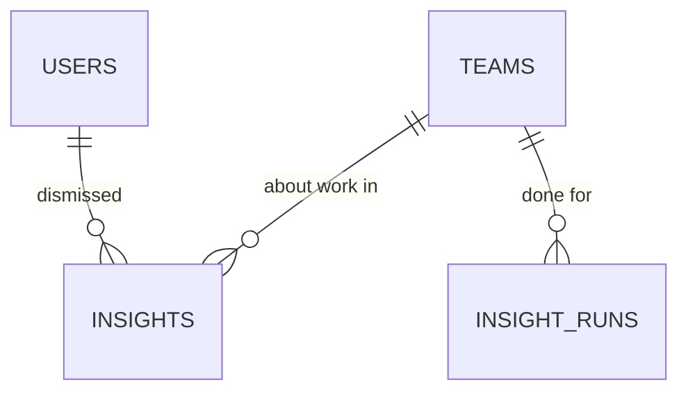

# AI Insights

> Status: **MVP built (Phase 14, 2026-10-30)** — the stale-lead alert, the "contact today" list, the model's weekly read, a dismissable feed and the daily notification · Last updated: 2026-10-30

## Purpose

Interprets a team's prospecting and says what to do about it. Three stored, dismissable insights a
day: the companies the team picked up and went quiet on, the strong matches nobody has approached
yet, and the model's read of the week's figures.

It owns **no facts**. Reporting is the source of every number it quotes (`docs/modules/reporting-analytics.md`),
Leads Workspace owns the leads it points at, and Outreach decides whether a prospect may be
approached. What this module owns is the **opinion**: which of those facts is worth a member's
attention this morning, and in what order.

It explicitly does **not**: send anything to a prospect (that is Outreach), change anything (the
one-click ICP tweak is post-MVP), or act as a source of truth — an insight's payload is a snapshot
of its `generated_at`, and the lead it names may have moved on since.

## What was built (Phase 14)

- **`insights`** — one dismissable row per insight, team-scoped, with the ids and counts behind it.
- **Two deterministic insights**, which cost nothing and cannot fail: `FindStaleLeadsAction` and
  `BuildContactTodayAction`.
- **One AI insight**: `InsightGenerator` hands a week of figures to `insights.periodic_digest` and
  stores at most three observations.
- **`GeneratePeriodicInsightsJob`**, queued per team, unique per team, dispatched by
  `insights:generate` — hourly, firing per team at its own local hour.
- **`insights:prune`**, the retention sweep.
- **`NotificationType::InsightsReady`**, raised once per run with the counts, plus a new section in
  the notification digest.
- The **feed** at `/insights` (EN/AR), with Open and Dismissed tabs and a dismiss, and the matching
  `/api/v1/insights` for the mobile app.

### Post-MVP

The full insight suite the module was originally scoped for (best segments, message-angle
performance), **one-click ICP apply** (which brings the `applied` status with it), and learning from
what members apply and dismiss.

## Code map

- **Backend:** `app/Modules/AiInsights/`
    - **Actions:** `FindStaleLeadsAction`, `BuildContactTodayAction` (one insight each),
      `StoreInsightsAction` (the only writer), `DismissInsightAction`, `ListInsightsAction`.
    - **Services:** `InsightGenerator` (orchestration — the one place that knows the order things
      happen in), `ActivitySnapshotBuilder` (reads Reporting), `InsightRetention` (how long a row
      lives).
    - **Jobs:** `GeneratePeriodicInsightsJob` (`ShouldBeUnique` per team).
    - **Console:** `GenerateInsightsCommand` (`insights:generate`), `PruneInsightsCommand`
      (`insights:prune`).
    - **Models:** `Insight` (`BelongsToTeam`, `scopeFeedOrder`), `InsightRun` (the once-a-day
      marker — see Data model).
    - **Enums:** `InsightType`, `InsightStatus`, `InsightSeverity`.
    - **Data:** `InsightDraft` (what a generator returns before it is a row), `ActivitySnapshot`
      (the figures the model is given).
    - **Http:** `Controllers/Web/InsightController`, `Controllers/Api/V1/InsightController`,
      `Controllers/Concerns/ResolvesInsights`, `Requests/ListInsightsRequest`,
      `Resources/InsightResource`.
    - **Policies:** `InsightPolicy`. **Providers:** `AiInsightsServiceProvider` (routes, policy,
      commands, schedule).
    - **No `Exceptions/`**, deliberately: the module has nothing to refuse. Dismissing is
      idempotent, the feed is a read, and generation is a job whose only failure modes belong to
      the AI Platform and are already typed there. An empty exception class would imply a domain
      error that does not exist.
- **Routes:** `app/Modules/AiInsights/routes/web.php` (`insights.index`, `insights.dismiss`) and
  `routes/api.php` (`insights.index`, `insights.show`, `insights.dismiss`). **There is no
  "generate now" endpoint** — see Key flows.
- **Frontend:** `resources/js/pages/insights/Index.vue`,
  `resources/js/components/insights/InsightCard.vue`, types in `resources/js/types/ai-insights.ts`,
  and `resources/js/lib/bidi.ts` (added here, useful everywhere — see Brand). Sidebar item 09.
- **Tests:** `tests/Feature/AiInsights/` (`GenerateInsightsTest`, `InsightFeedTest`,
  `InsightsApiTest`, `InsightsTenancyTest`, `InsightPolicyTest`, `GenerateInsightsCommandTest`,
  `InsightsRetentionTest`), `tests/Unit/AiInsights/` (`InsightEnumsTest`, `ActivitySnapshotTest`),
  fixtures in `tests/Support/InsightFixtures.php`. `InsightPolicyTest` asks the policy **directly**
  rather than through a route: the tenancy tests prove a cross-tenant request 404s by way of the
  global scope, and the policy is what has to hold on its own if anybody later changes how
  `ResolvesInsights` reads a row (ADR 0006).
- **Config / env:** `config/ai-insights.php` — `INSIGHTS_GENERATE_AT_HOUR`,
  `INSIGHTS_STALE_AFTER_DAYS`, `INSIGHTS_STALE_MAX_ITEMS`, `INSIGHTS_CONTACT_TODAY_MAX_ITEMS`,
  `INSIGHTS_AI_ENABLED`, `INSIGHTS_AI_MAX_ITEMS`, `INSIGHTS_RETENTION_DISMISSED_DAYS`,
  `INSIGHTS_RETENTION_UNACTIONED_DAYS`. Log channel: **`insights`**.
- **Prompt:** `insights.periodic_digest` v1 (reasoning tier), seeded by `AiPromptTemplateSeeder`.

## Data model

**`insights`** — `team_id` (`BelongsToTeam`), `type`, `status`, `severity`, `headline`, `body`,
`payload`, `period_start`/`period_end`, `prompt_key`/`prompt_version`/`model`/`cost_micros`,
`generated_at`, `dedupe_key`, `dismissed_by`/`dismissed_at`. Unique on `(team_id, dedupe_key)`;
indexed on `(team_id, status, generated_at)`.

**`insight_runs`** — one row per team per **team-local date**: `local_date`, `generated_at`,
`insights_created`, `ai_called`, `cost_micros`. Unique on `(team_id, local_date)`.

It exists because the _absence_ of insights is a real outcome, and an expensive one to get wrong.
An earlier version asked `max(insights.generated_at)` whether a team was due — which means a day
with no stale leads, nobody to call and a model with nothing to say leaves no trace, looks due
again an hour later, and pays for the Reporting aggregates and an AI call every hour until
midnight. The marker is written whatever the run found. It is also the only record of what the
feature costs, which is the figure the thresholds will be tuned against.

Beyond those two, every row is **derived**: it could be rebuilt tomorrow from the leads and the
Reporting read-model, which is what makes the retention sweep uncontroversial and what keeps this
module off everybody else's dependency list — nothing in the platform reads `insights`.

### Prose is the AI's only, and why the column is nullable

`headline` and `body` are null for `stale_leads` and `contact_today`. Those two are worded **on the
client** from `type` + `payload`, so they read in English or Arabic depending on how the member has
the app set (ADR 0007) and the numbers in the sentence are the stored ones. Only the AI digest
carries stored prose, written once in the team's locale — the same limitation the notification
emails have, for the same reason (`docs/modules/notifications.md`, Known limitations). A client
branches on `is_written_by_ai`, never on whether a headline happens to be present.

### What a payload may contain

Ids, counts and **company** names. Never a contact detail, and never a person: an insight points at
a lead, and the lead owns that data (`docs/compliance.md` §5a). The retention sweep exists partly
because of the company names it does hold.

## Key flows

### Generating a day's insights

`insights:generate` runs **hourly** and, per team, converts `now()` into that team's timezone before
comparing it with `ai-insights.generate_at_hour` (07:00 by default). A single nightly `dailyAt`
would reach Dubai at lunchtime and drift every time the clocks changed in London — the same problem
and the same fix as `notifications:digest`. The comparison is `>=` the hour, not `==`, so a worker
that was down at seven still produces the day's insights at nine.

`GeneratePeriodicInsightsJob` (unique per team) then runs `InsightGenerator::forTeam()`, and **the
order in that method is the design**:

1. The two deterministic insights are built first, from SQL.
2. The model is asked for its read of the week — _outside any transaction_, because an external
   call inside one is forbidden (CLAUDE.md) and because the figures were gathered before it.
3. `StoreInsightsAction` opens one transaction and writes whatever there is.
4. The notification is raised **after** that commit, and only if something was created, so the count
   it states is a count of rows that exist.

An AI failure — a provider outage, an exhausted allowance, a response that will not validate — is
caught at step 2 and costs the feed its commentary, not its contents. A try/catch around the whole
run instead would mean a bad morning at the provider is the reason a team never hears that four
companies are going cold.

### Idempotence, in two layers

- **The run marker** (`insight_runs`, above). `insights:generate` queues nothing for a team that
  already has a row for its local date, and `InsightGenerator` returns immediately if one appears
  between the sweep and the worker. This is the layer that protects the **spend**.
- **The dedupe key** on each insight — `<type>:<the team's local date>[:n]`, unique per team. If a
  run happens anyway (a retry, a DST fold, a `--team`), `StoreInsightsAction` uses
  **`firstOrCreate`, never `updateOrCreate`**: the row that is there is left exactly as it is. That
  is what stops a member's dismissal being undone at noon by a sweep writing a fresh `generated_at`
  over it. This layer protects the **rows**.

Neither is enough alone, and a forced run goes past the first on purpose — so it is the generator's
third check that keeps even that cheap: **the model is not asked when the day already has a
digest.** Without it a support request would spend real money, and because the model is not
deterministic a longer answer than the morning's would slip extra cards past the dedupe keys at
indexes the first run never reached.

Every date here is cut in the **team's** timezone, so a Dubai team gets one run per Dubai day
rather than two between 20:00 and midnight UTC.

### What "stale" means, and what it deliberately does not

A lead goes stale only once the team has **started** it: approached it, been assigned it, or moved
it off the default column. The obvious query — any lead with no recent activity — produces the one
insight nobody can act on, because a team that sourced four hundred companies on Monday has four
hundred "stale leads" a fortnight later. That is a backlog, not a follow-up problem, and saying so
daily is the fastest way to teach a team to ignore the feed. Won and Lost stages are excluded for
the same reason: silence is the correct state for a closed lead.

"Last touched" is `lead_activities.occurred_at`, which every meaningful event writes to (an approach
included), falling back to `leads.created_at`. One source, so the rule cannot disagree with itself.
The alert names the **most neglected first** and carries the real total, not the length of the list.

### "Contact today" asks Outreach, it does not guess

Candidates are strong fits (A or B against the active ICP, not excluded) that nobody has approached
and that are not in a terminal stage, best fit first. Every candidate then goes through
`OutreachGuard::decideAll()`, and the answer is read the way Outreach reads it:

- A **compliance** block on every channel would drop the lead. In practice nothing in v1 reaches
  that state, because a LinkedIn introduction stays open under both a prior-consent restriction and
  a suppression — the branch is what keeps the list correct when a market arrives whose restriction
  closes an introduction too.
- A **configuration** block (no contact chosen, no verified sender, sending switched off) does
  **not** drop the lead. Those are the team's own setup and change by teatime; hiding a lead over
  them means the team never hears about it.
- A lead whose only open channels are introductions is kept and marked `restricted`, so the card
  says "introduction only" instead of suggesting an email the guard would refuse.

The stored decision is a snapshot for the card's wording, **never permission**: the guard is asked
again when a draft is written and again when it is sent.

### The figures the model sees

`ActivitySnapshotBuilder` reads **Reporting**, not the tables — `DashboardReportBuilder` over a
fixed `Last7Days` window — so an insight and the dashboard beside it cannot disagree about what
"contacted" means. What goes into the prompt is **numbers only**: no company name, no member name,
no ICP title, nothing a member typed. Three things follow from that:

- It is the one AI call in the platform that needs no `UntrustedContent` wrapper, because there is
  no outside text in it to delimit.
- The input stays a few hundred tokens whatever size the team is.
- The digest can say "your LinkedIn reply rate is three times your email rate" and **cannot** say
  "chase Acme". Naming a company is the deterministic insights' job, and they do it from the
  database.

A week in which nothing happened is **not** sent to the model at all (`ActivitySnapshot::isQuiet()`),
which is the cost guard mvp.md's risk note asks for: a trial account that did nothing must not be
billed daily for the model saying so. Two details in that test are worth knowing, because the
obvious version of it is wrong in both directions:

- It compares `!== 0`, not `> 0`. A `*_change` figure is **negative** when a team did plenty last
  week and nothing this week — the week most worth explaining — and under `> 0` that week reads as
  quiet and the model is never asked about the one thing that happened, which is that the work
  stopped.
- A **standing total** cannot make a week busy on its own. Three tasks that have been overdue for
  months are not activity, and counting them would buy an AI call every morning for a dormant
  account.

### Reading and clearing

The feed is server-driven: the tab and the page live in the query string. Ordering is severity
first, then newest — an insight feed sorted purely by time puts "your reply rate is up" above "four
companies are going cold", which is the wrong way round for somebody reading one screen before their
first call.

Dismissing is not deleting. The row stays under the Dismissed tab, the dismissal is audited
(`insight.dismissed`, with the type and nothing it said), and it keeps the first member and
timestamp if it happens twice. The retention sweep is what eventually removes it.

### There is no "generate now" button

A run spends AI credit, and the insights are a daily rhythm rather than something to refresh — a
button would be a way to spend the team's allowance on the same numbers twice. For a demo or a
support request, `php artisan insights:generate --team=<id>` runs one team now, whatever the hour;
the dedupe key still applies, so it is safe to repeat.

### Retention

`insights:prune`, nightly at 03:50: dismissed rows after 30 days, unactioned ones after 60.
Insights are swept harder than anything else in the platform and are the one thing that can afford
it — they are derived, and a week-old "contact these five today" is actively misleading rather than
merely old. A window runs from **when the clock on that status started**: `dismissed_at` for a dismissed
insight, `generated_at` for one still open. Measuring a dismissal from `generated_at` is tidier and
wrong in a way a member would notice — an insight cleared on day 40 of its life is past a 30-day
window the moment it is cleared, so it reads "clears in 0 days" and is gone by morning, out of the
tab that exists for somebody who cleared the wrong card.

`InsightRetention` is also what the feed's countdown reads, so the promise on screen and the rule
that deletes the row are one rule rather than two copies of it. The countdown is shown on every
dismissed card and on an open one only inside its last week, so the line appears when it means
something rather than sitting on every card every day.

## External dependencies

**Anthropic Claude via the AI Platform** (`AiClient`, reasoning tier), one call per team per day at
most. Timeouts, schema retries, cost logging and the credit guard are the AI Platform's
(`docs/modules/ai-platform.md`); this module adds the quiet-week skip, the `max_items` ceiling and
the switch (`INSIGHTS_AI_ENABLED=false`) that turns the commentary off without losing the feature.
Nothing else external.

## Permissions

`InsightPolicy`. Any member — Read-only included — may read the team's insights. Owners, Admins and
Members may dismiss one; **Read-only may not**, because dismissing changes what the rest of the team
sees: an insight belongs to the team, and there is no per-member copy of it. Another team's insight
is a **404, not a 403** — the global scope hides the row before the policy is consulted, so the
request cannot learn that it exists.

Generation is nobody's permission: it is a scheduled system job.

## Brand

Cream canvas, `bg-card` surfaces, and the severity chip is each card's one accent, using the
semantic status tokens through the badge variants. **Signal Orange appears nowhere** — it is
decorative only and never a status colour (`brand-tokens.md` §2.1), which is exactly the mistake a
card with a "Slipping" badge invites.

The highest level is a **Teal `brand` chip, not a filled-Ink one**. Ink fill at a pill radius is
the shape of a primary button (`action.primary`), and a non-interactive chip reading as a control
two lines above the real Dismiss button is worse than a quieter accent. Severity is never carried
by colour alone: each chip has its own word **and** its own icon (WCAG 1.4.1).

### No sentence puts a number in front of a noun

Every figure on a card is appended after a label — "Days quiet: 3", not "Quiet for 3 days". English
only needs that for "1 days"; Arabic needs it badly, because the noun takes four different forms
(يوم, يومان, أيام, يومًا) depending on the count, so any single string with a number before the noun
is wrong for most values. A label plus a number is right for all of them.

Numbers, times and timezone identifiers interpolated into a sentence go through
`resources/js/lib/bidi.ts`, which wraps them in Unicode isolates. A left-to-right run dropped into
an Arabic sentence otherwise lets the bidi algorithm move the punctuation around it — the colon
ends up on the wrong side of the figure. The isolates are invisible and inert in English.

## Known limitations / TODO

- **The AI digest is written once, in the team's locale.** A member reading the app in English in an
  Arabic team gets an Arabic headline. The two deterministic insights are unaffected — they store
  keys and params. The fix is the per-user locale column Notifications is also waiting on.
- **No `applied` status and no one-click apply.** The status is deliberately absent until something
  can produce it; the ICP tweak is post-MVP.
- **The model cannot name a company**, by design (see Key flows). If an insight that names one is
  ever wanted, it needs a prompt whose input carries names — and with it an `UntrustedContent`
  wrapper and a fresh look at what is sent to a provider.
- **`payload.count` and `payload.metrics` are a snapshot.** Nothing refreshes them; a lead named in
  this morning's list may have been approached since. The card links to the lead, which is current.
- **Insights are not in Reporting.** How many are generated, dismissed and ignored — and what the
  feature costs — is exactly what would tell us whether the thresholds are right, and there is no
  report for it yet. The data is all there: `insights.generated_at` / `dismissed_at` / `type`, and
  `insight_runs.cost_micros` per day per team.
- **`ActivitySnapshotBuilder` builds the whole dashboard report** to use about fifteen numbers from
  it. That is Reporting's documented trade (one pass, so nothing can disagree), and at MVP volumes
  it is a couple of dozen indexed aggregates in a queued job once a day. If it ever matters, the
  escape hatch is `report_rollups`, not a second set of queries here.
- **A forced run can still add a card.** `insights:generate --team=` skips the AI call when the day
  has a digest, but the two deterministic insights are rebuilt — so if a lead went stale between
  the morning run and the forced one, the day's stale alert is a row that did not exist earlier.
  That is the right answer for a support request and worth knowing before using the flag as a demo.
- **The stale and contact-today thresholds are guesses.** Fourteen days and five items are the
  product's opening position, in config precisely because the first real teams will move them.

## Dependencies

Core (tenancy, audit), Reporting (every figure), Leads Workspace + Lead Sourcing + Scoring (the
leads it names), Outreach (`OutreachGuard`, which decides who may be approached), AI Platform (the
one prompt), Notifications (`NotificationDispatcher`).

## Review (2026-10-30)

Reviewed by `laravel-module-reviewer` and `brand-reviewer` at the end of Phase 14. Fixed from their
findings:

- **The sweep could re-run a team seventeen times a day, and pay for it each time.** The due check
  read `max(insights.generated_at)`, so a run that legitimately produced nothing left no trace and
  looked due again an hour later — every hour from the team's 07:00 until midnight, each time
  running the Reporting aggregates and an AI call. This is what `insight_runs` is for, and it is
  the finding worth remembering: the dedupe keys were protecting the rows, and nothing was
  protecting the money. A forced run is now cheap too, because the digest is skipped when the day
  already has one.
- **`isQuiet()` read a collapse as quiet.** A team that did plenty last week and nothing this week
  has negative `*_change` figures and zeroes everywhere else, so `> 0` called it quiet and never
  asked the model about the one thing that had happened. Now `!== 0`, with standing totals
  (overdue tasks) excluded so a dormant account still cannot buy a daily call.
- **Retention measured a dismissal from `generated_at`**, so an insight cleared on day 40 of its
  life was already past its window: "clears in 0 days", gone by morning, out of the tab that exists
  for somebody who cleared the wrong card. The clock now starts at `dismissed_at`.
- **The feed lost keyboard focus when the last open insight was dismissed** — the focus target was
  inside the `v-if` that the dismissal unmounted, which is the exact failure its own comment
  described. It moved to the section wrapper, which always exists.
- **Arabic plurals.** "Quiet for :days days" and "Clears in :days days" put a number in front of a
  noun: "1 days" in English, and in Arabic a form that is only right from eleven upwards. Every
  figure is now a label followed by a number, and those numbers are bidi-isolated along with the
  time and timezone in the empty state (`lib/bidi.ts`).
- **Arabic terminology.** The Open tab used the shared "Open" key, which translates as the
  imperative "افتح"; it is now "Still open" / «مفتوحة». The new keys had introduced "تجاهل" as a
  second verb for dismissing — aligned to the existing "استبعاد" / «المُستبعدة», including the
  toast that points at the tab by name. "تعريف فقط" became "للتعريف فقط".
- **The severity chip for "Do this" was filled Ink**, which at a pill radius is the shape of a
  primary button and sat two lines above the real one. Now a Teal `brand` chip, and every severity
  carries an icon as well as its word.
- **Every Dismiss button had the same accessible name** in a feed of them (WCAG 2.4.6, 4.1.2). Each
  now carries the insight's own title in its `aria-label`.
- `lead_activities` was being read by `lead_id` alone in the stale sub-select, which cannot use the
  `(team_id, lead_id, occurred_at)` index as a prefix; `BuildContactTodayAction` asked the Outreach
  guard outside the team context its own read used; the insights-ready notification is now raised
  in `DB::afterCommit()` rather than relying on the caller not wrapping the generator in a
  transaction.
- Tests added from their gaps: the policy asked directly (cross-team and per role), guest access to
  the web feed, the staleness boundary an hour either side of a fortnight, a payload whose count
  exceeds the names it lists, a team skipped for an unusable timezone instead of taking its chunk
  down, and the run marker's own behaviour.

Carried to the brand owner rather than decided here: the `--info` token (`brand-tokens.md` §7.6) is
still unapproved and the Info chip depends on it; the dark-mode values for the 12% status tints are
unmeasured; and the Arabic brand name «أليما» (§7a) is still pending.

Accepted without change, with reasons: the AI digest's dedupe key stays per index rather than one
slot per day (the "already has a digest" check makes the non-determinism it was worried about
unreachable), and `ActivitySnapshotBuilder` keeps building the whole dashboard report (Reporting's
documented trade — one pass, so nothing can disagree).

## Changelog

| Date       | Phase | Change                                                                                                                                                                                                                                                                                                                                                                                                                                                                         | Files                                                                                                                                                                                                                                                                                                                                                                                                                                                                                                                                                                                                 |
| ---------- | ----- | ------------------------------------------------------------------------------------------------------------------------------------------------------------------------------------------------------------------------------------------------------------------------------------------------------------------------------------------------------------------------------------------------------------------------------------------------------------------------------ | ----------------------------------------------------------------------------------------------------------------------------------------------------------------------------------------------------------------------------------------------------------------------------------------------------------------------------------------------------------------------------------------------------------------------------------------------------------------------------------------------------------------------------------------------------------------------------------------------------- |
| 2026-10-30 | 14    | Module built: `insights` + the stale-lead alert, the "contact today" list (gated by `OutreachGuard`) and the model's weekly read over figures-only input, generated per team on its own clock and idempotent per local day, `InsightsReady` notification + a digest section, the dismissable EN/AR feed and `/api/v1/insights`, retention sweep, 50 feature + 12 unit tests. `insights.periodic_digest` v1 refined in place (seeded a phase early, no caller) and is now live. | `app/Modules/AiInsights/**`, `database/migrations/2026_10_30_150001_create_insights_table.php`, `database/factories/InsightFactory.php`, `database/seeders/AiPromptTemplateSeeder.php`, `config/ai-insights.php`, `config/logging.php`, `bootstrap/providers.php`, `app/Modules/Notifications/{Enums/NotificationType,Services/NotificationPresenter,Services/DigestBuilder}.php`, `resources/js/{pages/insights,components/insights,types/ai-insights.ts}`, `resources/js/components/AppSidebar.vue`, `lang/{en,ar}.json`, `tests/{Feature,Unit}/AiInsights/**`, `tests/Support/InsightFixtures.php` |
