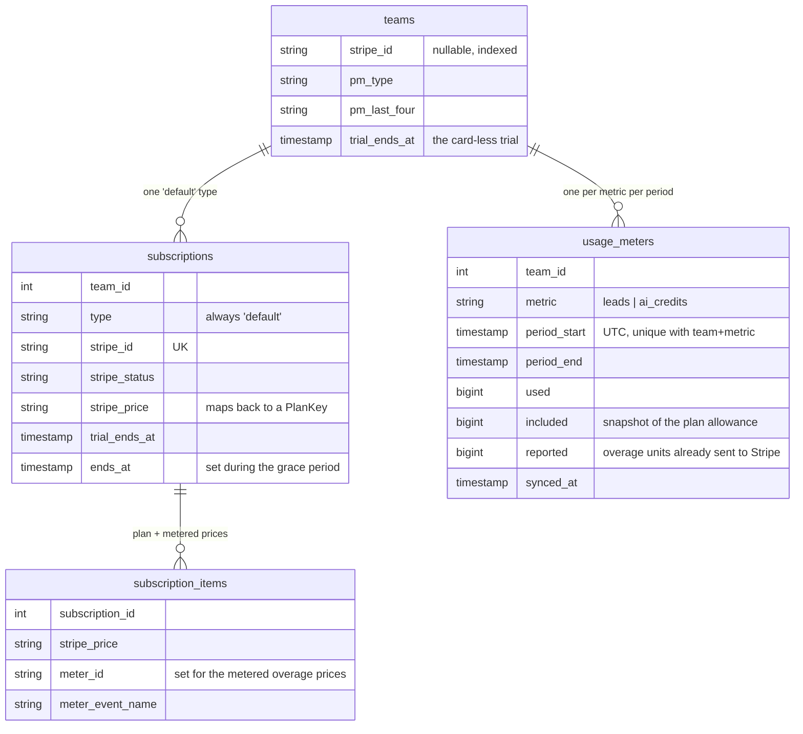

# Billing & Plans

> Status: **MVP — built (Phase 16, 2026-10-30)** · Last updated: 2026-10-30 · See also ADR 0012

## Purpose

Monetisation via **Stripe (Laravel Cashier)**: the price list, the card-less trial, seats, the monthly lead and AI-credit allowances, metered overage, the Stripe customer portal, and the enforcement that makes all of it mean something. It owns subscription and entitlement state; other modules **read** entitlements from it without knowing it exists.

It explicitly does **not** own: card details, billing addresses, tax numbers or invoice documents — those live at Stripe and are reached through the customer portal (see **External dependencies**); the _ledgers_ usage is counted from (`ai_requests` is AI Platform's, `discovery_runs` is Lead Sourcing's); or team membership (Auth's — this module only says how many seats a plan includes).

**The billable party is the team, not the user.** Cashier's customer columns are on `teams` and `Cashier::useCustomerModel()` points at `Core\Models\Team`. One person may own two teams on two plans, and two owners may share one subscription; a `stripe_id` on `users` would break the moment either happened (ADR 0006).

## Code map

- **Backend:** `app/Modules/Billing/…`
    - **Services** — `PlanRegistry` (the price list from config, singleton + memoised), `PlanResolver` (team → `Entitlements`, memoised per request **or job** — bound `scoped()`, because a singleton would hold the memo for the life of a `queue:work` process and three of the four enforcement points run there), `UsageLedger` (live usage from the authoritative ledgers; snapshots into `usage_meters`), `PlanCreditSource` (the real `AiPlatform\Contracts\CreditSource`), `PlanLeadQuotaSource` (the real `LeadSourcing\Contracts\LeadQuotaSource`), `PlanSeatLimit` (the real `Auth\Contracts\SeatLimitSource`), `OverageReporter` (claim → report → release), `UsageAlerter` (the `credit_low` notification, de-duplicated per period), `StripeBillingGateway` (every call that leaves the building).
    - **Actions** — `StartCheckoutAction`, `SwapPlanAction`, `CancelSubscriptionAction`, `ResumeSubscriptionAction`, `OpenBillingPortalAction`, `RefreshUsageAction` (sync + alert in one pass, which is the one operation the screen performs before it renders).
    - **Contracts** — `BillingGateway`. **Support** — `EnforcesPlanLimits` (the one rule every plan limit is decided by). **Testing** — `FakeBillingGateway`.
    - **Models** — `UsageMeter`. **Enums** — `PlanKey`, `BillingMetric`, `SubscriptionState`. **Data** — `PlanData`, `Entitlements`, `BillingPeriod`, `MetricUsage`, `InvoiceData`. **Exceptions** — `BillingException`.
    - **Listeners** — `SyncSubscriptionFromStripe` (on Cashier's `WebhookHandled`).
    - **Console** — `billing:sync-usage` (hourly), `billing:report-overage` (daily 04:10). Both take `--team=`.
    - **Gates** — `billing.view` (any member), `billing.manage` (Owner/Admin). Defined in the provider because the subject is the `Team`, which already has `Auth\Policies\TeamPolicy`.
- **Added to other modules** (each one a seam, not a dependency):
    - `Auth\Contracts\SeatLimitSource` + `Auth\Services\UnlimitedSeatLimit` (the permissive default) + `Auth\Services\SeatCounter` (who occupies a seat — Auth's own business), wired into `InviteTeamMemberAction` and `AcceptInvitationAction`; `InvitationException::noSeatsAvailable()`.
    - `AiPlatform\Services\AiUsageLogger::usedMicrosBetween()` and `LeadSourcing\Services\LeadUsageCounter` — each module answers for its own table, so Billing never writes a query against another module's schema.
    - `Core\Models\Team` — Cashier's `Billable` trait and the `trial_ends_at` cast.
    - `Notifications` — `NotificationType::CreditLow` is now metric-aware and points at `/billing`.
- **Routes:** `app/Modules/Billing/routes/web.php` — `billing.index`, `billing.checkout`, `billing.swap`, `billing.cancel`, `billing.resume`, `billing.portal`. Cashier registers `stripe/webhook` and `stripe/payment/{id}` itself. **No `/api/v1` surface** — see **Known limitations**.
- **Frontend:** `resources/js/Pages/billing/Index.vue`, `resources/js/Components/billing/{PlanCard,UsageBar}.vue`, `resources/js/types/billing.ts`. A "Plan & billing" item in the sidebar's **Account** group, beside Compliance.
- **Shared:** `resources/js/types/billing.ts`, exported from `types/index.ts`.
- **Tests:** `tests/Feature/Billing/{PlanPricingTest,PlanEnforcementTest,SeatEnforcementTest,OverageReportingTest,WebhookSyncTest,BillingScreenTest}.php` (79 tests), `tests/Support/BillingFixtures.php`.
- **Config / env:** `config/billing.php` — `currency`, `trial.{days,plan}`, `default_plan`, `alerts.thresholds`, `sales_email`, `plans.*.{name,blurb,amount,stripe_price,seats,leads,credits,overage,features}`, `overage.{multiplier,leads,ai_credits}`. `config/cashier.php` (published; reads both `STRIPE_KEY`/`STRIPE_SECRET` and the dashboard's `STRIPE_PUBLISHABLE_KEY`/`STRIPE_SECRET_KEY`). Log channel `billing`. Every env key is documented in `.env.example`.

## Data model

Cashier's two tables, keyed on `team_id`, plus `usage_meters` and four columns on `teams`.



**`usage_meters` is a record, not a counter**, and that is the central design decision. The authoritative numbers already exist — `ai_requests.cost_micros` and `discovery_runs.leads_created` — and the guards read those directly, so a limit can never be wrong because a worker died between doing the work and incrementing a row. What the ledgers cannot do is remember what a _closed_ period cost after Compliance's retention sweep has pruned it, or remember how much overage has already been billed. That is what a row here is for, and `reported` is the idempotency key for Stripe.

**A closed period's row is sealed, and that is what makes the first half of that claim true.** `UsageLedger::sync()` refuses to write a row that has already been synced at or after its `period_end`. Without the seal, re-syncing a settled month would overwrite `used` with whatever the ledgers _still_ hold — which, once retention has pruned them, is less than the month actually cost — and overwrite `included` with the allowance of whatever plan the team is on **now**, so a team that downgraded on the 1st would have last month's overage sized against this month's allowance. The condition is "synced at or after the period ended" rather than simply "the period is over", because the last hourly sync of a month runs before midnight: one write after the month closes captures its final hour and seals it, and everything after that leaves it alone. `billing:sync-usage` therefore syncs the previous period as well as the current one, which is a no-op every time but the first.

`used` and `included` are in the metric's own unit — whole leads, or AI **credits** (never micro-units). `BillingMetric::fromMicros()`/`toMicros()` is the only place that boundary is crossed; a column holding two units silently would be a factor-of-1,000 bug on an invoice.

## Key flows

### 1. Enforcement — where a limit bites, and why not in middleware

`mvp.md` asked for an `EnforcesPlanLimits` **middleware**. It is built as a concern consulted by the existing guards instead, and the reason is that three of the four places a limit has to bite have no request behind them: a queued discovery job, a scheduled signals watch and the nightly insight generation all spend a team's allowance from a worker. A middleware would guard the one case that is cheapest to guard — somebody clicking a button — and leave the three that actually run up a bill.

So the limit is enforced at the point of spend, through the seams built in Phase 5 and Phase 7:

```
AiCreditGuard ─ CreditSource ─────── PlanCreditSource ──┐
DiscoveryLimitGuard ─ LeadQuotaSource ─ PlanLeadQuotaSource ├─ EnforcesPlanLimits ─ UsageLedger ─ the module's own ledger
InviteTeamMemberAction ─ SeatLimitSource ─ PlanSeatLimit ──┘                        └─ PlanResolver ─ subscriptions
```

Neither `AiCreditGuard` nor `DiscoveryLimitGuard` nor any of their callers changed in this phase. That was the whole point of the seams, and `PlanEnforcementTest` deliberately tests _through the guards_ rather than through this module's services, because a test that called `PlanCreditSource` directly would pass whether or not the promise had been kept.

### 2. Allowance, ceiling, and what "exhausted" means

Three numbers, and the difference between them is what decides whether a paying team keeps working:

| Plan                      | Allowance          | Ceiling                          | Past the allowance          |
| ------------------------- | ------------------ | -------------------------------- | --------------------------- |
| Free (and the trial plan) | `plans.*.leads`    | the allowance                    | work **stops**              |
| Starter / Team / Scale    | `plans.*.leads`    | `allowance × overage.multiplier` | work continues, **metered** |
| Enterprise                | unlimited (`null`) | none                             | n/a                         |

The sources report the **ceiling** as the limit, not the allowance, because `isExhausted()` is what the guards refuse on and a metered team past its included allowance is working and being billed — refusing them there would be charging for something we then decline to do. The ceiling exists so a metered plan cannot quietly become an unbounded invoice: without it the first thing a customer would hear about a runaway month is the invoice.

`LeadQuota::clamp()` matters more than the refusal: a run asked for 200 companies with 40 of the allowance left fetches 40, so the last of an allowance is usable instead of producing an error.

### 3. The billing period is the calendar month, in UTC

Not the Stripe invoice period, and the difference looks enough like an oversight to be worth writing down. Anchoring allowances to the invoice date would mean the reset day moves whenever a team changes plan, that a trial and a subscription measure different windows, and that every usage query needs a round trip to Stripe to find out where the window starts. A calendar month is what a customer can predict without reading an invoice, it is what the AI ledger has measured since Phase 5, and overage is reported as it accrues so it still lands on whatever invoice is open.

UTC is not a detail either: the bounds reach a `where created_at >= ?` on tables written by workers in UTC, so building them in a team's timezone would shift every team's reset by its offset and double-count the overlap (same rule as Reporting's `DateRange::constrain()`).

### 4. Subscribing, swapping, cancelling

1. **Checkout.** `StartCheckoutAction` → `BillingGateway::checkoutUrl()` → Stripe Checkout, with the remaining card-less trial carried onto the subscription (`trialUntil`), so upgrading on day three of a fortnight's trial does not throw away the other eleven days. **Nothing local is written but the audit entry** — the subscription row is created by the webhook once the payment goes through, because a team that opened checkout and closed the tab has not bought anything.
2. **Swap.** `SwapPlanAction` refuses a downgrade that would leave more members than the target plan has seats (`BillingException::tooManySeats`) — the only alternative is deciding which colleagues lose their account. Usage is _not_ treated the same way: a team that has used 600 companies and moves to a 500 plan keeps what it found and simply stops.
3. **Cancel / resume.** Cancellation is at period end, so the team keeps working until the date it paid for and the decision stays reversible. `SubscriptionState::GracePeriod` is therefore an **entitled** state.
4. **Portal.** Card, address, VAT number and the invoice documents are Stripe's. A form of ours collecting a card number would put this application in PCI scope to reimplement a screen Stripe maintains, translates and keeps current with card-network rules.

Every gateway call runs **outside** any transaction (CLAUDE.md §2), which is why `BillingGateway` exists as one interface: having all the external calls in one place makes that obvious.

### 5. Webhooks — how a change made outside the app gets in

Cashier's own controller syncs `subscriptions` and `subscription_items`; `SyncSubscriptionFromStripe` listens for the `WebhookHandled` event it fires afterwards and (a) drops `PlanResolver`'s memo, (b) re-snapshots the meters so `included` follows the new plan, and (c) writes an audit row with **no actor** and `source: stripe_webhook`, because "why did my plan change on the 4th" has to be answerable.

A listener rather than a subclassed controller, so Cashier keeps its route, its signature verification and its handlers. An allow-list of five event types, because Cashier fires that event for _every_ webhook — re-reading a team's plan on each `invoice.payment_succeeded` would be queries for no change. A webhook for an unknown customer is logged and ignored, never thrown: a 500 makes Stripe retry for three days.

### 6. Overage — reported exactly once

Stripe **sums** the usage events it is sent over a period, so the reporter sends increments, never totals. Per metric: sync the meter → **claim** the unreported units → call Stripe with a deterministic identifier → release the claim only if Stripe definitely refused.

Three things make "exactly once" true, and all three are needed. Two of them were missing in the first cut of this phase and were put in after review, which is worth recording because each looked like a detail:

1. **The claim is a conditional `UPDATE`, not an increment.** `WHERE used - included - reported >= ?`, with the affected-row count as the answer. An unconditional `increment()` is atomic as an operation but the _amount_ was computed from a row read a moment earlier — so the 04:10 schedule and somebody running the command by hand would both read `reported = 0`, both add the same units, and both send them.
2. **The meter-event identifier is derived from `reported` before the claim**, not random. Stripe dedupes meter events on it, so every attempt at one claim carries the same identifier and a retry is discarded at their end rather than summed. Cashier's own `reportUsageFor()` stamps a fresh `Str::uuid()` on every call, which is exactly right for a fire-and-forget report and exactly wrong here — so `StripeBillingGateway` mirrors Cashier's v2 meter-event call with our identifier instead of using the helper.
3. **An ambiguous failure keeps the claim.** A timeout, a dropped connection or a 5xx may mean Stripe recorded the event and the response was lost coming back; releasing on that re-sends it. Only a definite refusal — a 4xx, which means nothing was recorded — releases, which is why `BillingException` has a separate `billing.overage_refused` code. Collapsing "it was refused" and "we don't know" into one error is how the same units get billed twice.

So the failure modes are: a refusal costs nothing, and an ambiguous failure risks **under**-billing one claim, loudly, with an error in the `billing` log for a human to reconcile. That is the direction to err — the other one takes money from somebody who did not agree to it.

Units are billed in `BillingMetric::overageUnit()` — singly for leads, per thousand for credits — and the remainder below a whole unit is deliberately not claimed, so it rolls into the next run rather than being rounded away or double-counted.

`billing:report-overage` reports the current period plus **every closed period whose meter still shows unreported overage**, which it finds by querying the rows. The obvious alternative — "also do last month for the first day or two" — quietly loses a month if the command does not run on those days, or if Stripe is down when it does. Asking the table instead means an outage delays the revenue rather than dropping it.

### 6a. Seats

A licence, not a consumable, so there is no overage and no ceiling: silently letting a team add an eleventh person and billing them for it would be a charge nobody agreed to, where an extra hundred companies is work they asked for.

Two rules fell out of building it, and both are about _when_ the check runs rather than what it checks:

- **A pending invitation occupies a seat.** Counting only accepted members would let a three-seat team send ten invitations and surface the problem to the tenth person, who did not cause it and cannot fix it. An expired invitation does not count — it cannot be accepted, so it is not holding anything, and counting it would make a team's last seat unusable forever because somebody ignored an email in March.
- **The check runs again on acceptance.** An invitation is valid for a week, and in that week the team may have downgraded, filled the seat with somebody else, or had a plan lapse. Checking only at invitation would let a team end up with more members than it pays for, which is the one outcome a seat limit exists to prevent. The invitation is **refused, not consumed**, so it still works once a seat is freed.

Both checks run **inside the transaction, behind `lockForUpdate()` on the team row**. Two invitations sent in the same moment, or two people accepting at once, would otherwise both see the last free seat and both take it — a count is true for exactly as long as it takes to read.

### 7. Trials

Every new team starts a `trial.days` card-less trial of the `trial.plan` entitlements, set by a `Team::created` listener in this module's provider rather than by a line in `Auth\Actions\CreateTeamAction` — the length of a trial is a billing decision, and it means a team created by a seeder or a factory starts on the same footing instead of silently landing on the free plan. When the trial lapses without a subscription the team drops to `default_plan` (Free): it keeps its data and a small working allowance, it is not locked out.

A **past-due** team stays entitled. Stripe retries a card for a fortnight and then cancels the subscription, at which point the state becomes `Cancelled` and entitlement ends on its own; cutting a team off on the first failed retry turns an expired card into a support incident and a churn event. `Cashier::keepPastDueSubscriptionsActive()` is set so Cashier's own `valid()` agrees rather than contradicting us from underneath.

### 8. Allowance warnings

`UsageAlerter` sends `NotificationType::CreditLow` to Owners and Admins at the `alerts.thresholds` percentages remaining, at most **once per team, per metric, per period, per threshold** — the check runs on every usage sync, which is hourly plus every visit to the billing screen, so without the lock the first busy afternoon past 80% would send a notification an hour until the month turned over. The lock is an atomic `Cache::add` held until the period ends, which is exactly when the warning becomes relevant again; losing it to a flushed cache sends one extra notification, where a column would need a migration to express something nothing else reads.

The notification type is one case for both metrics, carrying a `metric` in its payload. `credit_low` keeps its stored value — it is already written into notification rows — but its copy is now metric-aware, because "new searches stop" and "scoring and drafting stop" are different pieces of news.

## External dependencies

**Stripe**, through Laravel Cashier `^16.9`, entirely behind `Billing\Contracts\BillingGateway`:

| Operation           | Stripe surface                 | Notes                                                                    |
| ------------------- | ------------------------------ | ------------------------------------------------------------------------ |
| `checkoutUrl`       | Checkout Session               | Plan price + the metered overage prices as items                         |
| `portalUrl`         | Billing Portal Session         | Card, address, tax id, invoice PDFs, cancellation                        |
| `swapPlan`          | Subscription update            | Prorated by Stripe                                                       |
| `cancel` / `resume` | Subscription update            | At period end; resume only inside the grace period                       |
| `reportOverage`     | Meter event (`reportUsageFor`) | The price must have a meter attached, and be an item on the subscription |
| `invoices`          | Invoice list                   | PDF links are Stripe's own signed, expiring URLs                         |
| Webhooks            | `customer.subscription.*`      | Verified by signature when `STRIPE_WEBHOOK_SECRET` is set                |

Every method catches `Throwable` and rethrows `BillingException`: Stripe's messages are written for developers, change without notice and occasionally name the merchant account, so the detail goes to the `billing` log and the member gets a sentence they can act on. The invoice fetch on the billing screen additionally **degrades** — if Stripe is unreachable the history goes missing and the rest of the page still answers the question the Owner came with.

**The Stripe products do not exist yet.** The three plan prices in `config/billing.php` are readable placeholders (`price_alima_starter_monthly_gbp`), overridable per environment, so the pricing screen renders in full and only a real checkout fails. The two **metered** overage prices deliberately have no default at all: a metered price must exist in Stripe with a meter attached, and a placeholder would be attached to every checkout session as a second line item — so configuring the plan prices alone would still fail, for a reason pointing at a price nobody has heard of. Unset, no metered item is attached, checkout works on the plan prices alone, and overage is measured and capped but not yet billed. See **Known limitations** for what has to be created.

## Permissions

| Ability                                         | Owner | Admin | Member | Read-only |
| ----------------------------------------------- | ----- | ----- | ------ | --------- |
| See the plan, the allowances and the usage bars | ✅    | ✅    | ✅     | ✅        |
| See the price list                              | ✅    | ✅    | ✅     | ✅        |
| See the invoice history                         | ✅    | ✅    | —      | —         |
| Start a checkout, swap, cancel, resume          | ✅    | ✅    | —      | —         |
| Open the Stripe customer portal                 | ✅    | ✅    | —      | —         |

**Viewing is wide on purpose.** When discovery stops on a Tuesday afternoon, the person it stopped for should be able to see that the month's allowance is gone rather than file a bug. Spending money is narrow, and sits with the same pair who already manage members and seats, so a team does not have to learn a second idea of who is in charge. Invoices are excluded from the wide read because they are money, and because fetching them is a round trip to Stripe a Member has no use for.

## Deviations from the plan

- **`EnforcesPlanLimits` is a concern, not middleware.** See **Key flows §1**: three of the four enforcement points have no request behind them.
- **Seats are a flat count per plan, not a subscription quantity.** The pricing is £49 for one seat, £129 for three, £379 for ten — flat prices that _include_ N seats, not a per-seat rate, so `quantity` stays 1 and a team needing more seats changes plan. Extra seats on top of a plan are post-MVP.
- **No per-seat proration or seat purchase UI**, for the same reason.
- **A `free` plan was added**, which the phase plan did not mention. A team whose trial lapses has to land somewhere, and "locked out of the app until you pay" loses a customer who was about to.
- **Allowances are measured over the calendar month**, not the Stripe billing cycle. See **Key flows §3**.
- **Notifications were wired.** `NotificationType::CreditLow` has existed unused since Phase 12 with no producer; Billing is its obvious owner, and an allowance that stops work without warning reads as a fault rather than a plan.

## Known limitations / TODO

- **🔑 The Stripe products and prices do not exist.** Before this can take a real payment somebody must create, in Stripe: three recurring GBP monthly prices (Starter £49, Team £129, Scale £379); **two metered prices with meters attached** for lead and credit overage; and set the `STRIPE_PRICE_*` keys in the environment (`STRIPE_PUBLISHABLE_KEY`, `STRIPE_SECRET_KEY` and `STRIPE_WEBHOOK_SECRET` are already configured in test mode). Until then checkout fails with `billing.gateway_failed` and the `billing` log says why. Nothing else is blocked — the whole module is tested against `FakeBillingGateway`.
- **⚖️ Pricing is provisional.** The figures above are the rough intent, not a signed-off price list. They are in config precisely so changing one is a reviewed diff rather than a migration.
- **⚖️ VAT is not handled** (UK VAT, UAE VAT), as `mvp.md` defers. Cashier supports `calculateTaxes()` with Stripe Tax; switching it on needs a decision about whether prices are tax-inclusive and whether a VAT number is collected at checkout. The portal already collects a tax id if Stripe is configured to.
- **No annual plans, coupons or discount UI.** Post-MVP; `PlanRegistry` keyed on `PlanKey` would need a second axis for the interval.
- **Enterprise has no self-serve path at all.** The card emails `sales_email`. A per-customer price set in `STRIPE_PRICE_ENTERPRISE` is the current mechanism, which works for one Enterprise customer and not two — a per-team price override column is the fix when there is a second.
- **No `/api/v1` surface.** Deliberate: billing is web-only (ADR 0001), and an endpoint handing a Checkout URL to an API token would be a way to start a subscription with nobody present. Revisit at Phase 17 only if a real client needs to _read_ entitlements.
- **Nothing notifies a team that a payment failed.** The screen shows a banner and Stripe's own dunning emails the customer; there is no `NotificationType` for it. A small Phase 19 addition, alongside the assessment-review notification Compliance wants.
- **`usage_meters` rows are never pruned.** Two rows per team per month is small, and they are billing records, so a retention rule for them is a legal question rather than a storage one. ⚖️
- **Concurrent discovery runs can overshoot the lead ceiling.** The clamp is computed from usage _already recorded_, so two runs dispatched at once each see the full headroom and a team can finish a few companies past the ceiling. Bounded by a run's `requested_limit`, and the excess is still metered on a plan with overage; the fix is to reserve against the `requested_limit` of in-flight `Pending`/`Running` runs, which is a change to Lead Sourcing's job rather than to Billing and deserves its own think. A **failed** run's companies are counted — `DiscoverLeadsJob` records `leads_created` the moment the rows exist, not only on completion, so a run that dies after persisting does not give them away free.
- **`StripeBillingGateway` is not covered by a test.** Every test runs against `FakeBillingGateway`, which is the point — but it means the one class that talks to Stripe is verified by reading it, not by running it. Nothing can change that until the products exist; the first thing to do once they do is exercise checkout, swap, portal and a metered report against Stripe test mode and write down what came back.
- **A Stripe webhook redelivery writes a second audit row.** The sync itself is idempotent (absolute values), but the audit entry is not deduped on the event id. Harmless, slightly noisy, and worth fixing if the audit log ever gets read in anger.
- **A withdrawn Stripe price falls back to the cheapest paid plan.** `PlanResolver::fallbackPaidPlan()` keeps a grandfathered customer working rather than dropping them to free, erring low to protect the margin while the mismatch is noticed. There is no alert for it — the audit row and the `billing` log are the only trace.
- **No admin view over subscriptions, MRR or failed payments.** Phase 19.

## Changelog

| Date       | Phase | Change                                                                                                                                                                                                                                                                                                                                                                                                                                                                                                                                                                                                                                                                                                                                                                                                                                                                                                                                                                                                                                                                                                                                                                                                                                               | Files                                                                                                                                                                                                                                                                                                                                                                                                                                                                                                                                                                                                                                                                                                                                                                                                                                                                                                                                                                                                                                                                                                                                                                      |
| ---------- | ----- | ---------------------------------------------------------------------------------------------------------------------------------------------------------------------------------------------------------------------------------------------------------------------------------------------------------------------------------------------------------------------------------------------------------------------------------------------------------------------------------------------------------------------------------------------------------------------------------------------------------------------------------------------------------------------------------------------------------------------------------------------------------------------------------------------------------------------------------------------------------------------------------------------------------------------------------------------------------------------------------------------------------------------------------------------------------------------------------------------------------------------------------------------------------------------------------------------------------------------------------------------------- | -------------------------------------------------------------------------------------------------------------------------------------------------------------------------------------------------------------------------------------------------------------------------------------------------------------------------------------------------------------------------------------------------------------------------------------------------------------------------------------------------------------------------------------------------------------------------------------------------------------------------------------------------------------------------------------------------------------------------------------------------------------------------------------------------------------------------------------------------------------------------------------------------------------------------------------------------------------------------------------------------------------------------------------------------------------------------------------------------------------------------------------------------------------------------- |
| 2026-10-30 | 16    | Module built: Cashier `^16.9` with the **team** as the billable party; five plans in config with seats + lead + credit allowances; a 14-day card-less trial started by a `Team::created` listener; `usage_meters` as the period record over the existing ledgers; the three stubs replaced by `PlanCreditSource`, `PlanLeadQuotaSource` and `PlanSeatLimit` with **no guard or caller changed**; a new `Auth\Contracts\SeatLimitSource` seam + `SeatCounter` enforcing seats on invite **and** on acceptance; metered overage with claim-before-report idempotency and a hard ceiling; Stripe Checkout, swap, cancel/resume and the customer portal behind `BillingGateway`; webhook sync via Cashier's `WebhookHandled`; `billing:sync-usage` (hourly) and `billing:report-overage` (daily); the `credit_low` notification wired and made metric-aware; the EN/AR billing screen; 79 feature tests against `FakeBillingGateway`. Reviewed before completion by `laravel-module-reviewer` and `brand-reviewer`, which is where the conditional overage claim, the deterministic meter-event identifier, the ambiguous-failure rule, the sealed closed period, the `scoped()` resolver, the seat locking and the one-primary-CTA plan grid came from. | `app/Modules/Billing/**`, `app/Modules/Auth/{Contracts/SeatLimitSource,Services/UnlimitedSeatLimit,Services/SeatCounter,Actions/InviteTeamMemberAction,Actions/AcceptInvitationAction,Exceptions/InvitationException,Providers/AuthServiceProvider}.php`, `app/Modules/AiPlatform/{Services/AiUsageLogger,Services/StubCreditSource,Contracts/CreditSource}.php`, `app/Modules/LeadSourcing/{Services/LeadUsageCounter,Services/StubLeadQuotaSource,Contracts/LeadQuotaSource,Providers/LeadSourcingServiceProvider}.php`, `app/Modules/Core/Models/Team.php`, `app/Modules/Notifications/{Enums/NotificationType,Services/NotificationPresenter}.php`, `database/migrations/2026_10_30_1700{01,02,03}_*.php`, `database/factories/UsageMeterFactory.php`, `config/{billing,cashier}.php`, `bootstrap/providers.php`, `composer.json`, `phpunit.xml`, `.env.example`, `resources/js/{Pages/billing,Components/billing,types/billing.ts,types/index.ts,Components/AppSidebar.vue}`, `lang/{en,ar}.json`, `tests/Feature/Billing/**`, `tests/Support/BillingFixtures.php`, `tests/Feature/{AiPlatform,Signals}/**`, `tests/Unit/Notifications/NotificationPresenterTest.php` |
