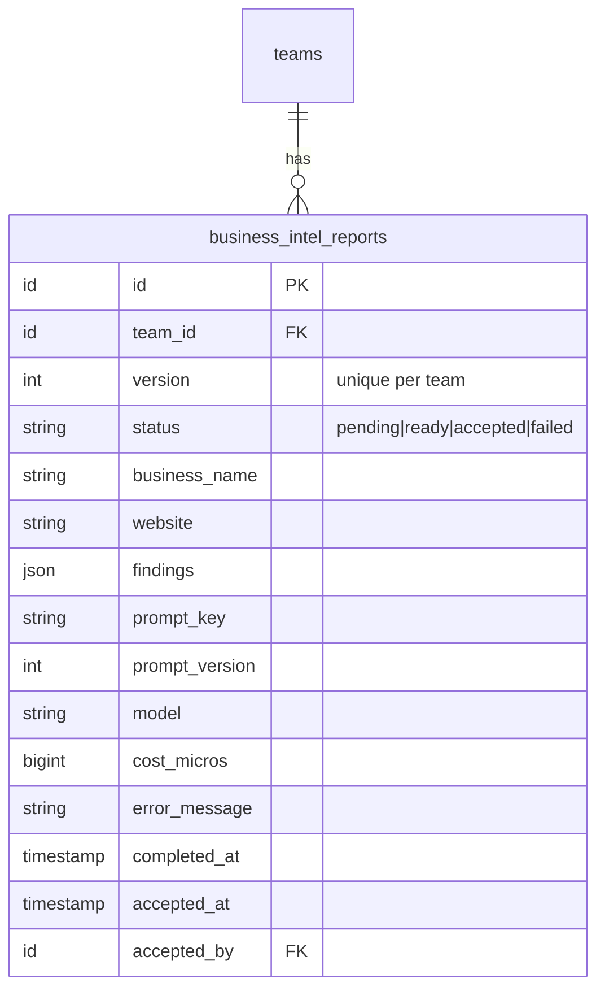

# Business Intelligence (AI background check)

> Status: **MVP** · Owner: Product · Last updated: 2026-10-29

## Purpose

Runs an AI background check on the **signed-up business** (from its website + public sources) and produces a stored, **versioned** profile: summary, offering, positioning, likely competitors, target customers and suggested industries. The team reviews / accepts it; on accept it fills **blank** Business Profile fields (never overwriting what the team entered) and can seed a suggested ICP. It does **not** research prospects (that is Lead Sourcing/Enrichment) — only the tenant's own business.

## Code map

- **Backend:** `app/Modules/BusinessIntelligence/…`
    - **Models:** `BusinessIntelReport` (`BelongsToTeam`; `version`, `status`, `business_name`, `website`, `findings` JSON, prompt provenance `prompt_key`/`prompt_version`/`model`, `cost_micros`, `error_message`, `completed_at`, `accepted_at`/`accepted_by`).
    - **Enums:** `BackgroundCheckStatus` — `pending`, `ready`, `accepted`, `failed` (`label()`, `isTerminal()`).
    - **Web fetch:** uses the shared, SSRF-hardened `App\Modules\Core\Contracts\WebContentFetcher` (bound in Core to `HttpWebContentFetcher`) — minimal, defensive homepage fetch, short timeout, byte/char caps, strips script/style + tags to plain text, swallows errors to `''`. Moved out of this module in Phase 8 so Enrichment reuses the same fetcher. `App\Modules\Core\Testing\FakeWebContentFetcher` for tests.
    - **Data (DTOs):** `BackgroundCheckFindings` (`fromAi()` hydrates + cleans the validated AI output; `toStorage()` for persistence), `AcceptBackgroundCheckData` (`applyToProfile`, `seedIcp`).
    - **Jobs:** `RunBackgroundCheckJob` (`ShouldQueue`, `ShouldBeUnique` per team; `tries=3`, `backoff`, `timeout=120`): (re)uses a pending report, fetches web text, runs `business_intel.background_check` via `AiClient`, stores validated findings as a new version, broadcasts progress. External work runs **outside** DB transactions.
    - **Events:** `BackgroundCheckProgressed(teamId, status, percent, step, version)` — `ShouldBroadcast` on `PrivateChannel('teams.{teamId}')` as `background-check.progressed`. Non-sensitive status only.
    - **Actions:** `GetLatestReportAction` (team-scoped read), `RerunBackgroundCheckAction` (opens a new pending version, dispatches the job `afterCommit`; refuses while one is pending), `AcceptBackgroundCheckAction` (merges blank profile fields, optionally seeds an ICP via the ICP module's `CreateIcpAction`, marks accepted — all in one transaction).
    - **Policies:** `BusinessIntelReportPolicy` (`view` = any member; `manage` = Owner/Admin, used for rerun + accept).
    - **Requests:** `AcceptBackgroundCheckRequest` (`apply_to_profile`, `seed_icp`).
    - **Resources:** `BusinessIntelReportResource` (API only; the web controller serialises plain arrays for Inertia).
    - **Exceptions:** `BackgroundCheckException` (`notReviewable`, `alreadyRunning`).
    - **Provider:** `BusinessIntelligenceServiceProvider` (registers the policy + routes; the `WebContentFetcher` it uses is bound in Core).
- **Routes:**
    - Web (`auth` + `verified`): `business-intel.show` (`GET /business-intel`), `business-intel.rerun` (`POST /business-intel/rerun`), `business-intel.accept` (`POST /business-intel/{report}/accept`).
    - API (`auth:sanctum`): `api.v1.business-intel.show` (`GET /api/v1/business-intel` — latest report, read-only).
    - Broadcast: `teams.{teamId}` private channel (member-only) in `routes/channels.php`.
- **Frontend:**
    - Page `resources/js/pages/business-intel/Review.vue` — states for never-run (empty), running (live progress bar over Reverb), failed, and ready/accepted (findings cards + a diff against the team's own profile + the accept panel). Renders in the default `AppLayout`.
    - `AppSidebar.vue` has a "Background check" entry (Scan icon).
- **Shared:** `resources/js/types/business-intel.ts`. i18n keys added to `lang/en.json` + `lang/ar.json` (parity).
- **Tests:** `tests/Feature/BusinessIntelligence/{RunBackgroundCheckJobTest,BackgroundCheckReviewTest,WebContentFetcherTest}.php`, `tests/Unit/BusinessIntelligence/BackgroundCheckFindingsTest.php`.
- **Config / env vars:** the web fetch is configured in the shared `config/web-fetch.php` → `{timeout,connect_timeout,max_bytes,max_chars,user_agent}` (env `WEB_FETCH_*`). (`config/business-intelligence.php` was removed in Phase 8.)

## MVP vs post-MVP

MVP: single re-runnable, versioned background check with review/accept, merge-into-profile (blanks only) and optional ICP seeding, live progress over Reverb. Post-MVP: scheduled refresh, competitor deep-dives, multi-page crawl via the Lead Sourcing web-search provider, applying `icp.refine_suggestions` output directly.

## Data model

`business_intel_reports` — many per team (one per run), the highest `version` being the latest. `findings` holds the validated `business_intel.background_check` output; `prompt_key`/`prompt_version`/`model`/`cost_micros` trace the exact AI run. `business_name`/`website` snapshot the business as it was when the check ran.

## Key flows

**Trigger.** Completing onboarding (`CompleteOnboardingAction`) dispatches `RunBackgroundCheckJob` `afterCommit`. A re-run from the review screen goes through `RerunBackgroundCheckAction`, which opens a new pending version (so the UI shows "in progress" at once) and dispatches the job; it throws `alreadyRunning` if a check is already pending.

**Run.** `RunBackgroundCheckJob` runs inside `TeamContext->run($teamId)`. It (re)uses the team's pending report (so retries reuse the same row, else opens the next version), then — **outside any transaction** — fetches the homepage text via `WebContentFetcher` and calls `AiClient->structured('business_intel.background_check', …)` with the fetched text wrapped in `UntrustedContent` (treated as data, never instructions). The validated output is stored as `findings` with its prompt/model/cost provenance and the report flips to `ready`. Progress (`10% → 45% → 100%`) broadcasts on `teams.{teamId}`. Credit exhaustion and un-validatable output are terminal (report → `failed`, no retry); other errors bubble so the queue retries, and `failed()` marks the report failed after the final attempt.

**Review / accept.** The review screen diffs the AI findings against the team's own profile. `AcceptBackgroundCheckAction` (Owner/Admin) merges findings into **blank** Business Profile fields only (industry ← first suggested industry; value proposition ← offering), optionally seeds a non-active "Suggested from background check" ICP (industries + target customers as weighted criteria via `CreateIcpAction`), and marks the report `accepted` — all in one transaction, with a row lock + re-check of `ready` to stay idempotent.

**Tenancy.** Reports are `BelongsToTeam`-scoped; the controllers resolve the active team and reports by `team_id`, so another team's report 404s. `BusinessIntelReportPolicy` double-checks ownership on every endpoint (ADR 0006). The `teams.{teamId}` broadcast channel authorises members only.

## External dependencies

- **AI Platform** (`AiClient`, `business_intel.background_check` prompt v1, credit guard, usage logging, injection-safe wrapping).
- **Onboarding/Business Profile** (source of `business_name`/`website`; accept target).
- **ICP** (`CreateIcpAction` for seeding).
- **Reverb** (progress broadcasting).
- Outbound HTTP to the business's own site (bounded, best-effort). Lead Sourcing (Phase 7b) will supply a richer fetch behind `WebContentFetcher`.

## Permissions

| Ability                   | Owner | Admin | Member | Read-only |
| ------------------------- | ----- | ----- | ------ | --------- |
| View the background check | ✅    | ✅    | ✅     | ✅        |
| Run / re-run              | ✅    | ✅    | ❌     | ❌        |
| Accept findings           | ✅    | ✅    | ❌     | ❌        |

Policy: `BusinessIntelReportPolicy`, authoritative role via `User::roleOn($team)`. The `BelongsToTeam` global scope blocks cross-tenant reads/writes; the policy double-checks ownership.

## Known limitations / TODO

- The web fetch is a single-page, best-effort homepage read bounded by `config/web-fetch.php`; it never follows beyond a few redirects and returns `''` on any failure. A multi-page crawl / public-sources fetch could later back the same `WebContentFetcher` contract.
- Accept merges only two profile fields today (industry, value proposition) and only when blank; richer field mapping can follow.
- The credit guard is still the Phase 5 stub until Billing (Phase 16); an exhausted allowance marks the report `failed` with a friendly message.
- `business_intel.background_check` is seeded at v1; improving it means adding a new version row (never editing in place).

## Changelog

| Date       | Phase | Change                                                                                                                                                                                                                                                                                                                                                                                                                              | Files                                                                                                                                                                                                                                                                                                                                                                                         |
| ---------- | ----- | ----------------------------------------------------------------------------------------------------------------------------------------------------------------------------------------------------------------------------------------------------------------------------------------------------------------------------------------------------------------------------------------------------------------------------------- | --------------------------------------------------------------------------------------------------------------------------------------------------------------------------------------------------------------------------------------------------------------------------------------------------------------------------------------------------------------------------------------------- |
| 2026-10-29 | 6     | Initial module: `business_intel_reports`, `BackgroundCheckStatus`, `WebContentFetcher` + HTTP/fake impls, findings/accept DTOs, `RunBackgroundCheckJob` (Reverb progress, injection-safe, idempotent), Get/Rerun/Accept Actions, policy, web + API + broadcast routes, the Inertia review screen (EN/AR + RTL), sidebar entry, tests. Onboarding now dispatches `RunBackgroundCheckJob` (stub `RequestBackgroundCheckJob` removed). | `app/Modules/BusinessIntelligence/**`, `database/migrations/2026_10_29_120001_*`, `database/factories/BusinessIntelReportFactory.php`, `config/business-intelligence.php`, `routes/channels.php`, `app/Modules/Onboarding/Actions/CompleteOnboardingAction.php`, `resources/js/pages/business-intel/*`, `resources/js/types/business-intel.ts`, `tests/{Feature,Unit}/BusinessIntelligence/*` |
| 2026-10-29 | 8     | The `WebContentFetcher` seam (contract, `HttpWebContentFetcher`, fake) moved to **Core** so Enrichment reuses it; the job now imports `App\Modules\Core\Contracts\WebContentFetcher` and the provider no longer binds it. Fetch config moved from `config/business-intelligence.php` (removed) to `config/web-fetch.php` (`WEB_FETCH_*`). Behaviour unchanged.                                                                      | `app/Modules/Core/{Contracts/WebContentFetcher,Services/HttpWebContentFetcher,Testing/FakeWebContentFetcher}.php`, `app/Modules/Core/Providers/CoreServiceProvider.php`, `app/Modules/BusinessIntelligence/{Jobs/RunBackgroundCheckJob,Providers/BusinessIntelligenceServiceProvider}.php`, `config/web-fetch.php`, `tests/Feature/Core/WebContentFetcherTest.php`                            |
