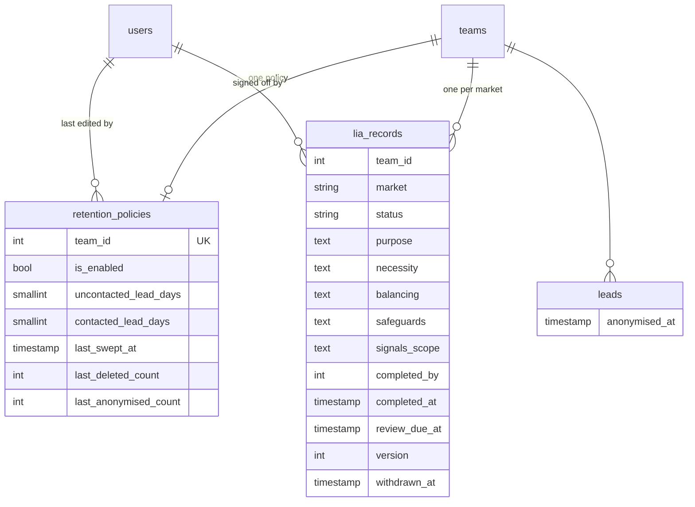
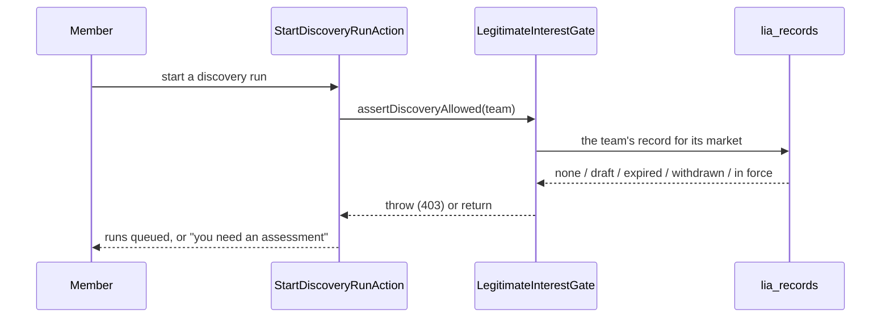

# Compliance & Privacy

> Status: **MVP — built (Phase 15, 2026-10-30)** · Last updated: 2026-10-30 · See also `docs/compliance.md`

## Purpose

Makes the UK/UAE data-protection obligations in `docs/compliance.md` **enforced by the system rather than remembered by a team**: the recorded lawful basis that gates lead discovery, the market-aware consent gate that decides how a prospect may be approached, data-retention windows and the nightly sweep that applies them, data-subject access and erasure, the team data export, the hosted privacy notice, and the hosted one-click unsubscribe.

It owns those guarantees; other modules call its seams. It explicitly does **not** own the do-not-contact list's storage or the send-time checks — those are Outreach's (Phase 11) and stay there (see **Deviations**). It is not an admin module either: a read-only operator view over compliance activity is Phase 19.

## Code map

- **Backend:** `app/Modules/Compliance/…`
    - **Services** — `LegitimateInterestGate` (the real `LeadSourcing\Contracts\LeadInterestGate`), `MarketConsentGate` (the real `Outreach\Contracts\LeadRestrictionResolver`), `DataRetention` (windows + the two candidate queries), `LeadAnonymiser` (strips one lead), `PersonalDataLocator` (DSAR locate), `TeamDataArchiver` (the export ZIP).
    - **Actions** — `SaveLiaRecordAction` (save / sign / withdraw), `SaveRetentionPolicyAction`, `PurgeExpiredDataAction` (one team's sweep), `EraseSubjectDataAction`, `ExportTeamDataAction`, `RecordOptOutAction` (the recipient's own opt-out).
    - **Models** — `LiaRecord`, `RetentionPolicy`. **Enums** — `LiaStatus`, `RetentionAction`, `SubjectDataCategory`. **Data** — `LiaRecordData`, `RetentionPolicyData`, `SubjectRecord`, `SubjectDataReport`. **Exceptions** — `ComplianceException`.
    - **Jobs / console** — `PurgeExpiredDataJob` (per team, `ShouldBeUnique`), `PurgeExpiredDataCommand` (`compliance:purge`, scheduled 03:40, `--dry-run` / `--sync` / `--team=`).
    - **Policies** — `LiaRecordPolicy`, `RetentionPolicyPolicy`. **Gates** — `compliance.export`, `compliance.dsar` (both Owner/Admin; defined in the provider because the subject is the `Team`, which already has `Auth\Policies\TeamPolicy`).
- **Routes:** `app/Modules/Compliance/routes/web.php` — `compliance.index`, `compliance.retention.update`, `compliance.lia.{edit,update,withdraw}`, `compliance.export.store` (`throttle:compliance-export`), `compliance.dsar.{index,erase}`; and **public**: `privacy-notice`, `unsubscribe.{show,store}` (signed) + `unsubscribe.done`. No `/api/v1` surface — see **Known limitations**.
- **Frontend:** `resources/js/Pages/compliance/{Index,Lia,Dsar}.vue`, `resources/js/Pages/public/{PrivacyNotice,Unsubscribe}.vue`, `resources/js/types/compliance.ts`. A "Compliance" item in the sidebar's **Settings** chapter (administration, not daily work — the do-not-contact list stays under Outreach, where a member reaches for it while working a lead).
- **Shared:** `resources/js/types/compliance.ts` (exported from `types/index.ts`); `csrfToken` added to the Inertia shared props, for the one case that needs a real browser form POST (a file download).
- **Tests:** `tests/Feature/Compliance/**` (103 feature) + `tests/Unit/Compliance/ComplianceRulesTest.php` (4 unit), `tests/Support/ComplianceFixtures.php`.
- **Config / env:** `config/compliance.php` — `retention.defaults.{uncontacted_lead_days,contacted_lead_days}`, `retention.{min_days,max_days,chunk}`, `lia.{review_after_months,section_limit,section_minimum}`, `dsar.{min_query_length,max_results}`, `export.rate_limit`, `privacy_notice.{contact_email,hosting_location,version,updated_on}`. The one-click unsubscribe link's switch and lifetime live in `config/outreach.php` → `unsubscribe`, because the link is part of that footer even though the endpoint is here. Log channel `compliance` (90-day retention — the longest of any channel).

## Data model

Two new tables. The third in the plan (`suppressions`) is Outreach's `outreach_suppressions`, built in Phase 11 — see **Deviations**.

- `retention_policies` — **one row per team** (unique `team_id`). Storage limitation is a single promise, not a set of overlapping ones. A team with **no row is still swept** from the configured defaults: the rule applies from the first day, not from the first visit to the settings screen. The row records a team's departure from the default, including switching the sweep off.
- `lia_records` — unique `(team_id, market)`. A team trading in both the UK and the UAE works under two regimes (ADR 0007) and one assessment cannot honestly cover both. `completed_at` null means a draft, which does **not** open the gate; `version` moves on each affirmation (not each save), so an audit entry can say which assessment was in force when a run happened.
- `leads.anonymised_at` — set by the sweep or by a DSAR erasure. It is what makes both **idempotent**, and what the lead screen reads to say the personal data was removed instead of showing a company with mysteriously no contacts. Not fillable: both writers use `forceFill`.

## Key flows

### 1. The lawful basis gates discovery

`LeadSourcing` already called the gate through a contract (the Phase 7 seam); Phase 15 only swapped the binding, so the discovery Action did not change. **In force** is narrower than "active": the status says the team affirmed it, and the review date has to still hold. Three refusals, three different sentences — none, expired (`lead_sourcing.lia_expired`), withdrawn — because a team with a lapsed review needs to re-affirm what they have, not write it again.

### 2. The market-aware consent gate decides how a prospect may be approached

`OutreachGuard` asks `LeadRestrictionResolver` rather than reading `leads.raw.outreach_restriction` itself, because _which_ restriction applies is a compliance judgement. Three inputs, **strictest wins, and the answer can only get stricter**:

1. **The flag recorded on the lead** — always honoured (`docs/compliance.md` §5a: a restriction may be added to a lead but never dropped from one).
2. **The prospect's own jurisdiction** (`leads.country`) — the primary rule, because the restriction protects the person being approached and the regime that protects them is the one where they are.
3. **The team's market**, only when the lead's country is unknown — a presumption, and the stricter one by design (§2).

This is the hole Phase 15 closed. Signals stamps the flag on the leads it converts, but a company sourced from a UAE business listing by Lead Sourcing carried **none**, so a team could cold email a Dubai prospect that UAE PDPL requires prior consent to approach. The same resolver feeds `LeadResource` and `DraftMessageAction`, so the flag a client is sent, the prompt's instructions and the guard's refusal cannot disagree. A known UK country never _lifts_ a restriction — that was the Signals deviation, where keying on the company's country dropped the flag the moment a Dubai founder's lead was filed under a UK holding company.

### 3. The nightly retention sweep

`compliance:purge` (03:40, after the per-module sweeps) walks every team and queues one `PurgeExpiredDataJob` each, so one team's backlog cannot hold up everybody else's promise. Two branches, and the split **is** the policy:

| Branch              | Candidate                                                                                                                       | What happens                                                                                     |
| ------------------- | ------------------------------------------------------------------------------------------------------------------------------- | ------------------------------------------------------------------------------------------------ |
| **Untouched**       | No approach, no drafted message, no note, no task, no owner, and still in the default board column — measured from `created_at` | **Deleted** (cascades contacts, scores, timeline, messages, attempts; its signals deleted first) |
| **Everything else** | Worked at some point, and quiet since — the newest of `updated_at`, the last logged approach and the last timeline entry        | **Anonymised**                                                                                   |

The two cover every lead between them, which is the point: a rule with a gap keeps somebody's data for ever and nothing fails. "Untouched" is deliberately strict — deleting a company somebody has been nursing through a pipeline because nobody pressed "log a call" would be the sweep destroying live work.

`LeadAnonymiser` removes the contacts, the text and recipient of every message, every attempt note, the team's notes and tasks, the free-text values in timeline entries (`excerpt`, `title`, `headline`), the converted news signals, and the provider payload in `raw` — **preserving the outreach restriction key**, because clearing `raw` wholesale would quietly reopen cold email on a lead that must never have it. What stays is the company's own facts, its score, its stage, and one row per approach carrying the channel, the outcome and the date: the team's evidence of who they contacted and when.

Signals are **deleted** rather than scrubbed, in both branches. A signal's value is its headline and its link and both name the person; the foreign key is `nullOnDelete` and `signals:prune` never sweeps a converted signal, so a signal left behind would outlive its lead with a named individual on it and nothing would ever remove it.

`--dry-run` reports and changes nothing, and the settings screen shows the same two counts — retention is irreversible, so a team must be able to see what a window change will cost before it costs it. Audited with **no actor**: nobody did this, the policy did.

### 4. Data-subject access and erasure

`PersonalDataLocator` searches **one team** — a request is answered per controller, and a platform-wide search would disclose one customer's data to another. Three kinds of identity, and the report says which was used because they are not equally reliable: an **address** is exact (normalised through the same `SuppressionType` code the do-not-contact list uses, so the two agree about what "the same address" means); a **phone number** is exact once normalised, compared in PHP because the column holds whatever a web page printed; a **name** is a guess, and the results are candidates for a human to confirm.

It covers contact records, company records whose own name matches (a sole trader — the case a contacts-only search misses), drafted and sent messages, logged approaches, news signals via `Signals\Services\SignalsPersonalDataExporter` (**this phase closed that module's one open dependency** — it was built in S6 with no caller), and the do-not-contact list.

`EraseSubjectDataAction` **re-locates before erasing**, because an enrichment pass may have added a contact since the member read the report. It deletes contacts, clears message text and recipients, clears attempt notes, hands signals back to Signals' own exporter, and **anonymises** a company matched by name rather than deleting it — the match is fuzzy and deleting a real business on a fuzzy match would be its own failure. ⚖️

Then it **suppresses the identity** — the part that is easy to leave out and makes the rest pointless. Without it the next discovery run re-sources the same company, AI re-derives the same address, and the person who asked to be forgotten hears from us again. The entry is on the **team's own** list (the request was made to that controller) with reason `erasure`, holds a one-way hash and a mask, and **cannot be lifted** — `SuppressionReason::isLiftable()` is the second condition `OutreachSuppression::isRemovable()` now checks, beside scope.

A **do-not-contact entry is reported and never erased**. A subject asking for it gone is asking for something that works against them: it holds a hash rather than their address, and removing it would let the next search reach them again. The screen says so beside the row.

Both the search and the erasure are audited (§3.8), with counts and the match type — never the identity, which would put the person's address in an append-only table no retention sweep touches.

### 5. The team data export

`TeamDataArchiver` writes a ZIP of CSVs — twelve files plus a README — read in chunks by id so a team with fifty thousand leads produces a file rather than an out-of-memory error. CSV because the people who ask for this open it in a spreadsheet: a UTF-8 BOM so Arabic reads, and `Core\Support\CsvCell` on every cell so a company called `=HYPERLINK(...)` is text rather than a formula. The do-not-contact list is exported **masked** and platform-wide opt-outs are left out — they belong to the people who made them, not to one tenant's export. Audited **before** the file is sent, so a failed download still leaves the record. A POST rather than a GET: a GET would be prefetched by the browser, warmed by a link checker and cached in between, each an unasked-for copy of a tenant's whole prospect database.

### 6. The hosted privacy notice and one-click unsubscribe

`GET /privacy` is public and bilingual — the people it is written for are not users, and a notice behind a login is not a notice. It names Alima as the processor and explains that the business which made contact is the controller (it names itself in the footer); a per-tenant notice would mean a URL that discloses which team is looking at whom. `SenderIdentityResolver` falls back to this route when `outreach.privacy_notice_url` is unset, via `Route::has()` rather than a dependency on this module, so a deployment has a working notice without setting a variable.

The unsubscribe endpoint closes the gap §3.3 recorded. The footer's link and the `List-Unsubscribe` header now carry an **HTTPS** target with `List-Unsubscribe-Post: List-Unsubscribe=One-Click` beside it, so a mail client's own unsubscribe button works — and a recipient who uses it instead of reaching for "report spam" protects the deliverability of every team on the platform. The link is a **signed, expiring URL carrying the message id and nothing else**: it cannot be guessed, reversed into an address or walked.

**The GET does nothing.** Mail clients, link checkers and corporate security gateways fetch every URL in an email, so an endpoint that acted on GET would unsubscribe people who never clicked and then report success to a team wondering why their list evaporated. RFC 8058 agrees: one-click is a POST, and it is CSRF-exempt (`bootstrap/app.php`) because a mail client has no session — the signature stands in its place.

`RecordOptOutAction` writes a **global** suppression for the address _and_ the phone number on the contact (somebody who unsubscribes from email has not invited a call instead), marks a still-pending approach `opted_out` and updates its timeline entry in place, and audits it with **no actor** because the recipient is not a user. It leaves an outcome a member already recorded alone — they know something the click does not — while the suppression stands either way.

## External dependencies

None. Every provider call this module could have made is one it deliberately does not: no identity-verification service for DSARs (⚖️ open), no third-party retention or consent platform. The only infrastructure requirement is **`ext-zip`**, now declared in `composer.json`.

## Permissions

| Ability                                                        | Owner                        | Admin | Member | Read-only |
| -------------------------------------------------------------- | ---------------------------- | ----- | ------ | --------- |
| See the compliance centre, read the assessment and the windows | ✅                           | ✅    | ✅     | ✅        |
| Write / sign / withdraw the assessment (`LiaRecordPolicy`)     | ✅                           | ✅    | —      | —         |
| Change the retention windows (`RetentionPolicyPolicy`)         | ✅                           | ✅    | —      | —         |
| Export the team's data (`compliance.export` gate)              | ✅                           | ✅    | —      | —         |
| Search and erase subject data (`compliance.dsar` gate)         | ✅                           | ✅    | —      | —         |
| The hosted privacy notice and unsubscribe                      | _public — no authentication_ |       |        |           |

The read is deliberately wide: the assessment is the answer to "why are we allowed to have this person's details", and a member working a list is the one who will be asked. The writes are narrow for one reason each — signing is a statement on the business's behalf, the retention form's output deletes records, and an export hands somebody a copy of every prospect the team holds.

Both policies authorise against a **transient, team-stamped** model when no row exists yet (`ResolvesCompliance`), so the first visit is authorised like every other instead of skipping the check because there was nothing to check.

## Deviations from the plan

- **No `suppressions` table.** The plan's data model listed one; Phase 11 had already built `outreach_suppressions` with both scopes, the hash-only storage and the send-time checks, and `docs/compliance.md` §3.2 recorded that Compliance would "take ownership of the table and add the DSAR and retention tooling over it". A second do-not-contact list would be a split list, and a split list is an opt-out silently ignored. Ownership here means the guarantees, not a physical move: Compliance writes to it (erasures, recipient opt-outs), reads from it (DSAR, export) and added the unliftable-reason rule, while Outreach keeps the storage and the enforcement point.
- **The market consent gate was widened beyond the plan's wording.** Task 3 asked for a "market-aware outreach consent gate"; it is built as a resolver over the lead's own jurisdiction as well as the team's market, because keying it on either alone leaves a real hole (see **Key flows §2**).
- **The hosted one-click unsubscribe was added.** Not in the task list, but `docs/compliance.md` §3.3 and `OutreachMessageMail` both parked it on this phase's §3.7 work, and an opt-out that depends on a human reading a mailbox and remembering to log it is an opt-out honoured by discipline rather than by the system.

## Known limitations / TODO

- **⚖️ Legal review is outstanding** and is part of the pre-launch review ADR 0007 already requires. Specifically: the privacy-notice wording, the retention defaults, whether an erasure's suppression should be team- or platform-scoped, the DSAR identity-verification process for people who are not our users, and what evidence of consent or a prior relationship should be able to lift a UAE prior-consent restriction per lead. `config/compliance.php` keeps the notice particulars and the retention defaults in the environment so counsel can change them without a deployment touching code.
- **No per-lead consent override.** A UAE-sourced prospect's restriction cannot currently be lifted by recording that consent or a prior relationship exists. The restriction narrows the approach rather than ending it — LinkedIn and a call script stay open — but a team with genuine consent has no way to say so. Post-MVP, and it needs the legal sign-off above before it is built.
- **No `/api/v1` surface.** Deliberate: writing a legitimate-interest assessment, setting retention windows and erasing a person's records are administrative acts with no mobile use case, and a DSAR endpoint is a lookup over exactly the people entitled to be left alone. The public privacy notice and unsubscribe endpoint are the module's only machine-reachable routes. Revisit at Phase 17 if a real client needs it.
- **The export is synchronous.** Fine at MVP volumes and metered per member, but it reads every table the team owns, which makes it the first thing that will feel slow. A queued export writing to object storage with a signed link is the next step; `TeamDataArchiver`'s shape — one closure per file, driven off a list — makes that a change of destination rather than a rewrite.
- **The DSAR phone search reads every numbered contact** for the team and compares in PHP, because the column holds whatever a page printed and no `LIKE` over that finds a normalised number. Bounded by the result cap and by the size of the table; a normalised `phone_e164` column is the fix if it ever matters.
- **A sole trader's company name is not erased.** `EraseSubjectDataAction` anonymises a company matched by name rather than deleting it, because the match is fuzzy. The team is told the record remains and can delete it from the workspace. ⚖️
- **No admin view over compliance activity.** A read-only operator view of retention runs, exports and erasures is Phase 19, alongside `signal_runs`.
- **`credit_low`-style producer gap, inverted:** nothing yet _notifies_ a team that their assessment is due for review. The screen says so and the gate closes, but a team that has stopped visiting the compliance centre finds out when sourcing stops. A `NotificationType` for it is a small Phase 19 addition.

## Changelog

| Date       | Phase | Change                                                                                                                                                                                                                                                                                                                                                                                                                                                                                                                                                                                                                                                                                                                                                                                                                                                                                                   | Files                                                                                                                                                                                                                                                                                                                                                                                                                                                                                                                                                                                                                                                                                                                                                                                                                                                                                                                                                                                                                                                                                                                                                   |
| ---------- | ----- | -------------------------------------------------------------------------------------------------------------------------------------------------------------------------------------------------------------------------------------------------------------------------------------------------------------------------------------------------------------------------------------------------------------------------------------------------------------------------------------------------------------------------------------------------------------------------------------------------------------------------------------------------------------------------------------------------------------------------------------------------------------------------------------------------------------------------------------------------------------------------------------------------------- | ------------------------------------------------------------------------------------------------------------------------------------------------------------------------------------------------------------------------------------------------------------------------------------------------------------------------------------------------------------------------------------------------------------------------------------------------------------------------------------------------------------------------------------------------------------------------------------------------------------------------------------------------------------------------------------------------------------------------------------------------------------------------------------------------------------------------------------------------------------------------------------------------------------------------------------------------------------------------------------------------------------------------------------------------------------------------------------------------------------------------------------------------------- |
| 2026-10-30 | 15    | Module built: `lia_records` + the real `LegitimateInterestGate` replacing Lead Sourcing's stub; `MarketConsentGate` over a new `Outreach\Contracts\LeadRestrictionResolver` seam, closing the gap where a UAE-sourced lead carried no restriction; `retention_policies` + `leads.anonymised_at` + `compliance:purge` (nightly, per-team job, chunked, `--dry-run`, audited) with the delete/anonymise split; DSAR locate + erase over contacts, companies, messages, approaches, signals (**first caller of `SignalsPersonalDataExporter`**) and the do-not-contact list, with an unliftable `erasure` suppression so an erasure sticks; team data export as a ZIP of CSVs; the hosted privacy notice; **RFC 8058 one-click unsubscribe** with `List-Unsubscribe-Post`, replacing the `mailto:`-only footer; the compliance centre, assessment and request screens in EN/AR; 103 feature + 4 unit tests. | `app/Modules/Compliance/**`, `app/Modules/Outreach/{Contracts/LeadRestrictionResolver,Services/RecordedLeadRestriction,Services/OutreachGuard,Services/SenderIdentityResolver,Actions/DraftMessageAction,Mail/OutreachMessageMail,Enums/SuppressionReason,Models/OutreachSuppression,Providers/OutreachServiceProvider,Http/Controllers/Web/OutreachController}.php`, `app/Modules/LeadSourcing/{Exceptions/LeadSourcingException,Models/Lead,Http/Resources/LeadResource}.php`, `app/Modules/Core/Support/TeamContext.php`, `app/Http/Middleware/HandleInertiaRequests.php`, `database/migrations/2026_10_30_1600{01,02,03}_*.php`, `database/factories/{LiaRecordFactory,RetentionPolicyFactory}.php`, `config/{compliance,outreach,logging}.php`, `bootstrap/{app,providers}.php`, `composer.json`, `resources/views/emails/outreach/message{,-text}.blade.php`, `resources/js/{Pages/compliance,Pages/public,types/compliance.ts,types/index.ts,types/global.d.ts,app.ts,Components/AppSidebar.vue}`, `lang/{en,ar}.json`, `tests/{Feature,Unit}/Compliance/**`, `tests/Support/ComplianceFixtures.php`, `tests/Feature/{LeadSourcing,Outreach}/**` |
| 2026-10-31 | 19b   | **The producer gap, inverted, is closed.** The compliance screen said a lawful-basis review was due and `LegitimateInterestGate` closed when it lapsed, but nothing ever _told_ anybody — so a team that had stopped visiting the compliance centre found out when their next discovery run was refused. The gate was working perfectly and the experience was indefensible. `compliance:notify-reviews` sends two notices per cycle to Owners and Admins (a warning while there is still time, and one when the gate has actually closed), through `NotificationDispatcher::toAdmins()` because it is a legal record a Member cannot complete. `lia_records.review_notified_at` is what lets the window be wide enough to survive a missed scheduler morning without becoming a daily reminder for a fortnight.                                                                                         | `app/Modules/Compliance/Console/NotifyAssessmentReviewsCommand.php`, `app/Modules/Compliance/{Models,Providers}/**`, `database/migrations/2026_10_31_190009_*`, `tests/Feature/Notifications/ProducerGapTest.php`                                                                                                                                                                                                                                                                                                                                                                                                                                                                                                                                                                                                                                                                                                                                                                                                                                                                                                                                       |
