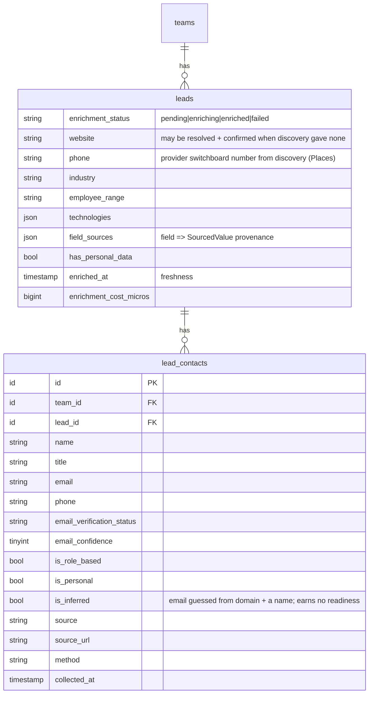

# Enrichment & Data Quality

> Status: **MVP** · Owner: Product · Last updated: 2026-10-29

## Purpose

Turns raw discovered records into clean, trustworthy leads: company normalisation, contact
derivation, **free-tier email verification**, **de-duplication**, **per-field source attribution**
and **data-freshness timestamps**. Because **no paid enrichment provider is in MVP** (ADR 0008), the
facts come from **AI extraction of the lead's public web text** (`lead.enrich_extract`, cheap tier,
injection-safe). It does **not** source leads (Lead Sourcing) or score them (Scoring). Confidence is
**stored, never asserted** — MX presence proves a domain is routable, not that a mailbox exists.

## Code map

- **Backend:** `app/Modules/Enrichment/…`
    - **Enums:** `EnrichmentStatus` — `pending`, `enriching`, `enriched`, `failed` (`label()`,
      `isTerminal()`); `EmailVerificationStatus` — `unknown`, `invalid_syntax`, `disposable_domain`,
      `no_mx_record`, `mx_found` (`label()`, `confidence()` = soft 0–100).
    - **Data (DTOs):** `SourcedValue` (per-field provenance: source / method / source_url /
      collected_at; `METHOD_{PROVIDER,AI_EXTRACT,MERGE,WEB_RESOLVED,AI_INFERRED}`; `fromAiExtract()`,
      `fromWebResolved()`, `toStorage()`, `fromStorage()`); `ExtractedFacts` (`fromAi()` hydrates +
      bounds the validated `lead.enrich_extract` output, including `people` — named individuals the
      page mentions, used for contact inference); `InferredContact` (a candidate email the inferrer
      built from a domain + a named person); `EmailVerificationResult` (status + confidence +
      role/personal flags).
    - **Casts:** `SourcedValueMap` — Eloquent cast for `leads.field_sources` (`array<string,
      SourcedValue>` ↔ JSON).
    - **Services (Q4):** `LeadReadiness` — how ready a lead is to be **contacted**, 0–100,
      deterministic, no AI and no network. Explicitly **not** a second fit score: `lead_scores.score`
      is blind to missing data by design, which is why an A-grade lead can have no website, no
      contact and no routable email, and readiness is the one figure allowed to punish a gap. Seven
      factors, weights in `config/enrichment.php` (normalised by the ones in play, so a `0` switches
      a factor off and adding one cannot inflate a lead). **Null, not zero**, for a lead we hold
      nothing about beyond its name.
    - **Contracts/Services:** `DnsResolver` seam with `SystemDnsResolver` (MX→A→AAAA via PHP's
      resolver, no SMTP probe) + `Testing\FakeDnsResolver`; `EmailVerifier` (syntax → disposable →
      MX/DNS, classifies role vs personal); `CompanyNormaliser` (canonical website / ISO country /
      trimmed name); `LeadDeduplicator` (collapses duplicates by number / domain / shared email);
      `WebsiteTextGatherer` (reads the homepage **plus** the conventional contact/about pages so an
      email that lives off the homepage is still found — one AI call over the combined, capped text);
      `EmailPatternInferrer` (builds one candidate email per named person from the company domain and
      the configured pattern — a guess, never read off a page). Website resolution for a website-less
      lead goes through Lead Sourcing's `CompanyWebsiteResolver` contract (the web-search provider is
      that module's; `Testing\FakeCompanyWebsiteResolver` for tests).
    - **Models:** `LeadContact` (`BelongsToTeam`; `lead_id`, name/title/email/phone, email
      verification status + confidence, `is_role_based`/`is_personal`/**`is_inferred`**, source
      attribution). The `Lead` model (Lead Sourcing) gains the enrichment columns, a `phone` (a
      provider's switchboard number from discovery), `contacts()` and a `domain()` helper.
    - **Actions:** `EnrichLeadAction` (orchestrates normalise → **resolve a website if there is none**
      → gather homepage + contact pages → AI extract → **confirm a resolved site is this company** →
      verify emails → **infer contacts for named people when no routable email was found** → write
      facts/contacts/provenance/freshness → de-duplicate; external work outside transactions;
      idempotent; terminal on credit/validation errors).
    - **Jobs:** `EnrichLeadJob` (`ShouldQueue`, `ShouldBeUnique` per lead; `tries=3`, `backoff`,
      `timeout=85`): runs `EnrichLeadAction` inside `TeamContext->run`; `failed()` marks the lead
      failed.
    - **Listeners:** `EnrichDiscoveredLeads` — on Lead Sourcing's `DiscoveryRunCompleted`, queues one
      `EnrichLeadJob` per still-pending lead in the run (registered via `Event::listen`).
    - **Resources:** `LeadContactResource` (used by `LeadResource` when contacts are loaded).
    - **Provider:** `EnrichmentServiceProvider` (binds `DnsResolver`; wires the listener). The web
      fetcher and the `CompanyWebsiteResolver` it uses are bound in Core and Lead Sourcing
      respectively.
- **Routes:** none — Enrichment is a backend pipeline (surfaced through the Leads Workspace from
  Phase 10 and the existing `LeadResource`).
- **Tests:** `tests/Feature/Enrichment/{EmailVerifier,ExtractedFacts,EnrichLeadAction,LeadDeduplicator,LeadContactTenancy,EnrichmentTrigger,LeadReadiness,EmailPatternInferrer,WebsiteTextGatherer}Test.php`;
  `tests/Feature/LeadSourcing/SerperCompanyWebsiteResolverTest.php`.
- **Config / env vars:** `config/enrichment.php` → `max_contacts_per_lead` (`ENRICHMENT_MAX_CONTACTS`),
  `role_local_parts`, `disposable_domains`; **website resolution** `resolve_websites`
  (`ENRICHMENT_RESOLVE_WEBSITES`), `resolve_match_threshold`; **multi-page fetch** `contact_paths`,
  `max_pages_per_lead` (`ENRICHMENT_MAX_PAGES`), `max_combined_chars`; **inferred contacts**
  `infer_emails` (`ENRICHMENT_INFER_EMAILS`), `inferred_email_pattern`, `max_inferred_contacts`,
  `inferred_email_confidence`. Web fetch config is shared in `config/web-fetch.php`.

## MVP vs post-MVP

MVP: AI extraction + MX/DNS + disposable-domain email verification + cross-provider de-duplication +
per-field source attribution + freshness + personal-data flagging. Post-MVP: Apollo/PDL/Hunter
providers, paid/SMTP email verification, technographics, scheduled re-enrichment, a duplicate-merge
review UI.

## Data model

Enrichment adds columns to `leads` and a child `lead_contacts` table (both team-scoped). No separate
`enrichment_runs` table in MVP — status, cost and freshness live on the lead.



`leads.field_sources` records provenance for every AI-enriched field; the discovered scalar columns
keep the record-level `source`/`source_url`/`collected_at` already written at discovery. A
`unique(lead_id, email)` on `lead_contacts` de-dupes contacts per lead (null emails stay distinct).

## Key flows

**Trigger.** A completed `DiscoverLeadsJob` fires `DiscoveryRunCompleted`; `EnrichDiscoveredLeads`
queues an `EnrichLeadJob` per `pending` lead in the run (already-enriched leads are skipped, so a
re-run never doubles up).

**Enrich.** `EnrichLeadAction` (inside `TeamContext->run`) marks the lead `enriching`, normalises its
company fields, then — **outside any transaction** — fetches the lead's public web text via the
shared `WebContentFetcher` and runs `lead.enrich_extract` through `AiClient` with the text wrapped in
`UntrustedContent` (data, never instructions). Extracted emails are verified with `EmailVerifier`
(free-tier, no SMTP). In one short transaction it fills only **empty** fields — with one deliberate exception, below — (recording
`SourcedValue` provenance per field), upserts `LeadContact`s with their verification result and
role/personal classification, flags `has_personal_data`, stamps `enriched_at` + cost, sets
`enrichment_status = enriched` (and `LeadStatus::Enriched`), then de-duplicates. Credit exhaustion /
un-validatable output are terminal (lead → `failed`, no retry); other errors bubble so the queue
retries, and `failed()` marks the lead failed after the final attempt.

**Website resolution — unlocking a website-less lead.** A Companies House record never carries a
website and a Places listing often doesn't, and the whole pipeline hangs off one. So when a lead has
no website, `EnrichLeadAction` asks Lead Sourcing's `CompanyWebsiteResolver` (Serper, ADR 0010) for a
candidate homepage before giving up. A resolved site is **never trusted on the search alone**: the
page is fetched and extracted like any other, then `siteConfirmsCompany()` checks the page's own
company name and the domain against the lead's distinctive name tokens
(`CompanyNameKey::bare()`), at or above `resolve_match_threshold`. A miss — the search found a
competitor or a directory — **discards the site and everything extracted from it** rather than pin a
wrong domain (the direction S10 warned to fail in); the AI cost already spent is still recorded. A
confirmed site is written to `website` with its own `METHOD_WEB_RESOLVED` provenance. Best-effort and
never fatal: the resolver returns null for a disabled or unconfigured provider or any failure. Off
with `resolve_websites=false`.

**Multi-page gather — the contacts that live off the homepage.** `WebsiteTextGatherer` reads the
homepage **and** the conventional contact/about pages (`contact_paths`) where emails actually sit,
and hands the combined, capped (`max_combined_chars`) text to **one** `lead.enrich_extract` call —
the fetches are free, the model call is not. The homepage counts as one of `max_pages_per_lead`; if
it yields nothing the site is treated as absent and no sub-page is tried. Paths resolve against the
site **origin**, so a homepage at `/en/home` still probes `/contact`.

**The discovered phone (Places).** Google Places now returns a company's switchboard number (added to
its field mask), stored on `leads.phone` at discovery — company data, not a named person's. When the
page states no phone, enrichment hangs this one on the lead's first contact, or makes a phone-only
contact (`METHOD_PROVIDER`) when there is no email at all.

**Inferred contacts — a name on the page, but no email (4).** When the page names people
(`ExtractedFacts::$people`, added in `lead.enrich_extract` **v2**) but states no routable email,
`EmailPatternInferrer` builds **one** candidate per person from the company domain and
`inferred_email_pattern`, and enrichment keeps only the guesses the domain can route to (MX). They
are stored flagged **`is_inferred`**, personal, with `METHOD_AI_INFERRED` and a confidence capped at
`inferred_email_confidence`. An inferred address is a **guess** — the MVP has no SMTP probe (ADR
0008), so it cannot be told from any other pattern on the same domain — so it **earns nothing toward
readiness** and whether it may be contacted is still `OutreachGuard`'s call. Verification runs
outside the writes transaction; off with `infer_emails=false`.

**The one field enrichment overwrites rather than fills — `company_name` (Q1).** For the bottom tier
of `LeadSource::rank()` the stored name was never a company name: a `web_search` lead's is the
result's **page title** and a `signal` lead's is a subject lifted from an article. The extraction
reads the company's own homepage and states the name properly, so `correctProvisionalName()` takes it
— for rank 1 only. Companies House gives the registered name, Places the business's own listing, and
a member who typed one outranks everything; none is touched, and nothing here can **blank** a name.
The overwrite records its own `SourcedValue` provenance, because an overwrite is not a fill. The
**dedupe key moves with it** when the stored key was name-derived (`CompanyNameKey::isNameDerived()`
→ `dedupeKeyFor()`): a `name:`-keyed lead left holding a key built from a name it no longer has
would silently stop de-duplicating for ever. Number- and domain-keyed leads — nearly all of them —
are untouched.

**`leads.locations` (Q1): the places the company says it operates in.** `ExtractedFacts::$locations`
was dropped on the floor until Q1 and is now stored _as itself_, deliberately **not** parsed into
`locality`/`region`/`country`. Those three describe one postal address a provider gave us; an
extracted location is free text a company wrote about itself ("London", "Dubai & Abu Dhabi",
"remote, UK"), and turning one into the other needs a guess that would be worse than the honest null
already there. Scoring reads them alongside the address for a Geography criterion — which until Q1
abstained on **every** web-sourced lead, since such a lead has no address at all.

**Readiness (Q4).** Stamped in the same transaction, **after de-duplication and on the survivor** —
a merge moves contacts across and fills gaps from the loser, so a figure taken before it describes a
row that no longer exists (hence `load('contacts')`, not `loadMissing`). It sits outside
`applyFacts`, so every lead that reaches a successful enrichment gets a figure whether or not the AI
was called; a `failed` lead keeps its null, which is the honest answer. Nothing else computes it: the
workspace's create, import and signal-conversion paths all queue an `EnrichLeadJob`, so they reach it
without a second implementation.

**De-duplication.** `LeadDeduplicator` matches other team leads by exact company number, exact website
domain, or a shared contact email — **never a fuzzy name** — and merges each into the most
authoritative survivor (`LeadSource::rank()`, oldest on a tie), keeping the best source per field
(fill a null, overwrite only on a higher rank, never null a value), moving contacts across
(de-duped by email), unioning provenance, and adopting the strongest `dedupe_key`.

**Tenancy.** `LeadContact` is `BelongsToTeam`-scoped (global scope + auto-assign); the deduplicator
queries are team-scoped and run inside `TeamContext`. A cross-tenant contact read returns nothing
(proven by `LeadContactTenancyTest`). Policies arrive with the Leads Workspace endpoints (Phase 10).

## External dependencies

- **Core** — `WebContentFetcher` (SSRF-safe fetch, used by `WebsiteTextGatherer`), `TeamContext`,
  `BelongsToTeam`.
- **AI Platform** — `AiClient`, `lead.enrich_extract` v2 (cheap tier; v1 kept for traceability),
  credit guard, usage logging, injection-safe wrapping.
- **Lead Sourcing** — the `Lead` model + `LeadSource` ranks; the `DiscoveryRunCompleted` event; the
  `CompanyWebsiteResolver` contract (Serper-backed) for resolving a website-less lead's homepage.
- **DNS** — outbound MX/A lookups for email verification (behind `DnsResolver`, faked in tests).
- Feeds **Scoring** (Phase 9) — `EnrichLeadAction` fires `Events\LeadEnriched(teamId, leadId)` `afterCommit` for the **surviving** lead, which Scoring listens to in order to grade it — and the **Leads Workspace** (Phase 10).

## Tech-stack detection — decided in L0 (2026-11-06)

`lead-sources-plan.md` L13 adds technology detection, and L0 settled its shape: it is the one
"source" in that plan with **no third-party terms**, because it is ours. It runs over pages this
module **already** fetches through `Core\Services\HttpWebContentFetcher` — which honours
`robots.txt` via `Core\Support\RobotsPolicy` — so it adds no outbound HTTP surface, no key, no
circuit breaker and no cost. Two bounds, both inherited rather than invented: it uses **no AI** (a
header, a cookie name and a script host are patterns, and a pattern match is free), and it **stores
the fact, never the body**, which is the rule Signals' S12 full-article fetch set for exactly the
same reason — a page body is somebody else's copyright and a retention question we do not need to
have. See ADR 0025 §4 and the L0 findings in `docs/modules/lead-sourcing.md`.

## Paid enrichment: the contracts (PL2)

> `pre-launch.md` phase **PL2**, ADR 0029. Contracts, DTOs, a registry, four fakes and **one**
> reference adapter. No orchestration — that is PL3 — and **nothing is enabled**.

The module gains the ability to be told things by a vendor rather than only to read them off a page.
What it does **not** gain is a vendor: ADR 0027 §2 is still `DECISION PENDING`, every provider is
`enabled => false`, and the one real adapter has never made a live call.

### Four capabilities, four contracts

| Capability     | Contract                    | Asks                                        | Ships                                           |
| -------------- | --------------------------- | ------------------------------------------- | ----------------------------------------------- |
| `people_find`  | `PersonFinder`              | who are the decision-makers at this company | contract + fake                                 |
| `email_find`   | `EmailFinder`               | what is this person's address               | contract + fake                                 |
| `email_verify` | `EmailVerificationProvider` | will mail to this address arrive            | contract + fake + **ZeroBounce (experimental)** |
| `phone_find`   | `PhoneFinder`               | what is this person's number                | contract + fake                                 |

Narrow on purpose. Several vendors sell all four as one call; buying it that way means paying for
three answers to get the one that was wanted, and a vendor that is good at mobiles and poor at
emails cannot then be used for mobiles alone. A vendor that genuinely does two things implements
two contracts and appears in two waterfalls.

**`EmailVerificationProvider`, not the plan's `EmailVerifier`** — that name belongs to the shipped
free-tier check, which still runs for every lead, and a contract sharing it would make every import
in this module a question about which one was meant.

### Only one real adapter, and that is the finding

PL0's ADR 0027 asked for "one reference adapter for a mainstream email finder + verifier". PL2
ships the **verifier** and not the finder, because ZeroBounce's request and response could be
pinned from the vendor's own published v2 documentation and no email finder's response fields
could. A reference adapter built on a guessed response shape is worse than none: it looks finished,
PL3 would be written against it, and the first live call would prove the mapping wrong with a bill
attached. That is ADR 0027 §1's "silence is not permission" turned on our own code.

So `email_find`, `phone_find` and `people_find` ship with an empty waterfall. The contracts and the
fakes are what PL3 needs; the adapters arrive with the vendor decision.

### A miss is an answer; a failure is an exception

The distinction the whole waterfall rests on:

- **Nothing found** → `EnrichmentResult` with a null `value` (or an empty `PeopleResult`). A miss
  is the _ordinary_ outcome — it is the reason a waterfall exists — and an exception for the
  ordinary outcome turns orchestration into `try`/`catch`.
- **The provider failed** → `EnrichmentProviderException`, with three named causes because they are
  three different decisions: `notConfigured` fails identically for ever, `unavailable` is worth the
  next provider, and `unreadable` means our mapping is wrong and every result already stored from
  that vendor is suspect.
- **"I could not tell"** → `EmailVerificationStatus::Unverifiable`. Also an answer, and one a
  waterfall can act on by trying the next verifier.

This is ADR 0023 §4a's lesson in a new direction. There, the question was whether a 4xx meant the
provider was unwell or the query was silly. Here it is whether "no" is an answer or a failure. Both
times, conflating them costs money.

### The reveal rule — the part most likely to be got wrong

Masking exists so the product can show that a contact **exists** and charge to show **which**. That
only makes sense for something a vendor was paid for.

`LeadContact::requiresEmailReveal()` therefore asks **whether a vendor was paid**, not whether a
value exists. An address the free-tier extraction read off the company's own contact page is
already visible to the member on that page, cost nothing, and is what Outreach has been sending to
since Phase 11 — masking it would have been theatre and a regression shipped inside a feature.

A **switchboard** number is never masked either, even from a vendor: it is the company's published
number, a business fact rather than a person's contact detail, and charging to reveal something a
prospect prints on its homepage is a toll rather than a product.

The resource sends **one** field per value, already masked. There is no `masked_email` beside a
plain `email`: that is a mask any client can step over, and the first one that does gives away what
PL4 charges for.

### One identity, two tables

`Core\Support\ContactIdentity` is the single definition of "the same address, the same number, the
same domain" — and `Outreach\Enums\SuppressionType` now delegates to it.

That is not a tidy-up. Two tables hash an identity: `outreach_suppressions`, which records who asked
to be left alone, and `lead_contacts`, which from PL2 records what a vendor found. If they
normalised differently the failure would not be a missed index — it would be **an email sent to
somebody who opted out**, with nothing to show it had happened. `ContactIdentityTest` asserts the
two agree on every form.

Two deliberate non-features of it: it does **no** E.164 formatting (its job is matching, and a
match must survive a number written four ways — the dialable form is `phone_e164`, a different
column for a different job), and it uses **no salt** (the whole point is recognising the same
identity arriving from somewhere else later, which a salted hash cannot do).

### `EmailVerificationStatus` got wider, and four call sites got safer

A paid verifier can say things the free check cannot, so the enum gained `Unverifiable`, `Risky`,
`Undeliverable`, `AcceptAll` and `Verified` — cases on the **same** enum rather than a second
`EmailStatus` beside it, because a column with two vocabularies is a column every reader has to ask
which one it is speaking, and the one that forgets shows a verified address as unchecked.

That created a bug and fixed it in the same change. Four places compared `=== MxFound`, which was
correct while `MxFound` was the best outcome that existed; the moment a vendor could return
something **better**, every one of them would have scored a verified address _lower_ than a merely
routable one. All four now ask `isRoutable()` (and `LeadDeduplicator` asks
`routableValues()` in SQL): `LeadReadiness`, `LeadDeduplicator`, and the two inference checks in
`EnrichLeadAction`.

`AcceptAll` is worth reading twice. A catch-all domain cannot **disprove** an address, which looks
like a pass and is not one — which is why `enrichment.stop_on.email_verify` defaults to `verified`
and not to it.

### Data model additions

`lead_contacts` gains the person's parts (`first_name`, `last_name`, `department`, `seniority`,
`linkedin_url`), the identity and provenance of each value (`email_hash`, `email_verified_at`,
`email_source`, `phone_e164`, `phone_hash`, `phone_type`, `phone_source`, `phone_found_at`), the
reveal stamps (`revealed_email_at`, `revealed_phone_at`) and its own pipeline state
(`enrichment_state`, `enriched_at`).

Three pairs look like one question and are two:

| Pair                           | The difference                                                |
| ------------------------------ | ------------------------------------------------------------- |
| `email` / `email_hash`         | the value / the **identity** that matches a suppression entry |
| `phone_e164` / `phone_hash`    | what a member **dials** / what **matches**, bare digits       |
| `revealed_*_at` / `*_found_at` | when a member **spent** / when we **got** it                  |

`enrichment_state` is per **contact**, not per lead: `leads.enrichment_status` tracks the free-tier
pass over the company, and a lead can be fully enriched while one of its four contacts is still
having its mobile looked for. One column answering both would make "enriched" mean nothing on
either.

### Traps

- **Neither reveal stamp is fillable.** A reveal is a metered act (PL4) and only the Action that
  charged for it may claim one happened. `Model::shouldBeStrict()` makes an attempt **throw**
  outside production, which is what a test asserts.
- **`setEmail()` / `setPhone()` write the value and its hash together.** A value written without
  its hash matches nothing on the do-not-contact list. Never assign `email` directly.
- **Bind a vendor adapter explicitly in the provider.** `CircuitBreaker::class` is _Lead Sourcing's_
  singleton, prefixed `lead_sourcing:cb`. An autowired adapter shares that door — one vendor's
  outage closing Companies House, and an open breaker landing on the wrong row of the operations
  screen. Enrichment's own is `enrichment.breaker` (`enrichment:cb`), and PL2 found this the hard
  way: a breaker test passed vacuously against the wrong binding.
- **`seniority` is free text, not an enum.** Nothing branches on it (ADR 0018 §1); a team writes
  "Head of Ops" because that is what the job is called where they sell, and
  `Scoring\Support\SeniorityLadder` is what makes it comparable.
- **No `full_name` and no `job_title`.** `name` and `title` are those columns and have shipped.
  The plan lists both; adding them would have been two names for one thing.
- **`tps_status` and `pecr_subscriber_type` are not here.** The plan lists them under PL2 "filled in
  PL5"; a column with no writer is dead schema, so PL5 adds them with the enum and the service that
  fills them.
- **No libphonenumber yet.** `phone_e164` exists and stays null until PL3, which is where the plan
  puts the dependency — normalising needs a country, and a half-normalised number dials somewhere
  else.
- **Order is config, not registration order.** `enrichment.waterfall.*` decides; a key naming an
  unregistered provider is ignored at runtime and reported by
  `EnrichmentProviderRegistry::unknownIn()`, which a test asserts is empty for the shipped config.

## The waterfall (PL3)

> `pre-launch.md` phase **PL3**, ADR 0030. Behind the Pennant flag `prelaunch.enrichment`.

The orchestration PL2's contracts were for: ask vendors in order, record every call, stop at the
first **good-enough** answer. With no vendor enabled (ADR 0027 §2) three of the four waterfalls are
empty and this runs against the fakes — which is deliberate, because the fakes are the providers
PL4 will meter.

### Data model

| Table                 | What one row is                                                               |
| --------------------- | ----------------------------------------------------------------------------- |
| `enrichment_runs`     | What a member asked for: `scope`, `state`, `summary`, `error_code`, who asked |
| `enrichment_attempts` | **One call to one vendor.** Append-only, with its cost. The money table       |

`summary` is a convenience snapshot. **If it and the attempts disagree, the attempts are right** —
they are written as each call returns (ADR 0012's rule for a derived figure).

### Three kinds of nothing

`AttemptOutcome` keeps a **miss** (the vendor looked and did not know), an **error** (it let us
down) and a **skip** (we never called) apart. Only `Hit` and `Miss` count towards a hit rate; only a
call actually made can have cost anything, and the recorder forces a skip's cost to zero whatever a
caller passes. Folding them together would make an outage look like a vendor that is bad at its job.

### When it stops

```
breaker open?            → skip, cost 0
rate limited?            → skip, cost 0, try the next provider (never sleep)
query unanswerable?      → skip, cost 0, never call
provider throws?         → error, try the next provider
provider misses?         → miss, charged, try the next provider
provider hits?           → stop — unless the verdict is not good enough
```

The last line is the whole phase. `enrichment.stop_on.email_verify` defaults to `verified` and
**not** `accept_all`: a catch-all domain cannot _disprove_ an address, which reads as a pass and is
not one.

### Code map (PL3 additions)

- **Enums:** `EnrichmentScope` (people/email/phone/verify), `EnrichmentRunState` (with
  **`Refused`**, which is not a failure), `AttemptOutcome`.
- **Models:** `EnrichmentRun` (`spentMicros()` reads the attempts), `EnrichmentAttempt`.
- **Services:** `EnrichmentWaterfall` (the judgement), `AttemptRecorder` (never fails a run),
  `ProviderRateLimiter`, `PhoneNormaliser`, `UnmeteredCreditReserver`, `AllowAllContactApproval`,
  `NoContactScreening`.
- **Contracts:** `CreditReserver` (PL4's seam, the fifth of ADR 0012's kind),
  `ContactApprovalGate` and `ContactNumberScreener` (PL5's two — and they are **two** on purpose:
  the gate answers _may we hold and show this_ before any money moves, and the screener records _a
  fact about the number_ after. A TPS registration stops an unsolicited marketing call rather than
  possession, so a screening folded into the gate would have to refuse, and refusing would enforce a
  rule that does not exist. Both are bound by Compliance in PL5; both defaults are the status quo,
  and `NoContactScreening`'s "do nothing" leaves a number `unchecked`, which is not `clear`). The
  gate answers **three** questions since PL6: the two about a person, and `allowsDomain()` about a
  **company**, which the CSV export asks because the unit leaving the building there is a company
  rather than a person (ADR 0033 §2). **PL7's CRM push asks the same three**, before any connector is
  reached, and for the same reason one level further out: a record in somebody's Pipedrive is beyond
  every later check, exactly as a row in a spreadsheet is (ADR 0034 §2). Two paths now, one question,
  and a third would be another caller rather than another method.
- **Actions:** `RequestLeadEnrichmentAction`, `RequestBulkEnrichmentAction`,
  `RevealContactValueAction`.
- **Jobs:** `RunEnrichmentWaterfallJob` — where the reservation brackets the spending.
- **Events:** `LeadEnrichmentUpdated` on `teams.{id}` — **counts only**.
- **HTTP:** web + `/api/v1` controllers for request, bulk and the two reveals, all behind
  `throttle:enrichment`; `LeadContactPolicy` (`view`, `reveal`, `enrich`).
- **Admin:** `Admin\Services\Platform\EnrichmentProviderStats` + a `ZeroBounce`
  `PlatformProvider` case, so the breaker is visible and the hit rate is per **hit** rather than
  per call.
- **Config:** `max_people_per_run`, `max_bulk_leads`, `rate_limit_per_member`.

### Key flows

1. **A member clicks Find** → `RequestLeadEnrichmentAction` checks the flag, the capability, an
   in-flight run and whether there is anything to do → a queued run, or a **refused** one carrying
   its code → `RunEnrichmentWaterfallJob` from `afterCommit`.
2. **The job** reserves the allowance, runs the waterfall, commits what the attempts say was spent,
   releases the rest, broadcasts on the way in and the way out.
3. **A member clicks Show** → `RevealContactValueAction`: idempotent, gated by the approval seam
   _before_ the charge, stamped and reserved in one transaction, audited.
4. **Bulk** → one decision per lead through the same Action, capped, **refused** rather than
   truncated.

### Traps

- **`enrichment_attempts` has no retention sweep.** Nothing in this module prunes it, and it is the
  one table that grows per vendor call. ADR 0030 flags it for PL12.
- **A reservation lives in the job, not the request.** Taken at request time it would be held for
  the depth of the queue and released by nobody if the worker died. Released in a `finally`.
- **The commit reads the attempts, never the summary.** A worker that died between its last call
  and its summary still owes for the calls it made.
- **`AttemptRecorder` swallows its own failures.** A deliberate inversion: the row is written after
  the money left, so throwing would lose the record of a charge _and_ the member's result. PL3
  proved the risk by passing a non-fillable `created_at` — every write threw, the swallow hid it,
  and the table silently stayed empty.
- **A capability refusal leaves no run; a spent allowance does.** The first says the feature is not
  theirs (a sales fact), the second is a cost event a team must be able to see. S16's asymmetry.
- **`07700 900xxx` is Ofcom's reserved-for-drama range** and libphonenumber calls it invalid — so a
  test fixture using one exercises the refusal path, not the normalisation. It cost an hour here.
- **The broadcast carries counts.** It reaches every member with a screen open; a revealed address
  in it would be a paid reveal given away.
- **A masked address is not a recipient.** The mobile draft screen filters on
  `requires_email_reveal`, or it would offer `j***@acme.com` as somebody to write to.
- **`$tries = 1` on the job.** A retry re-pays for a waterfall that already ran.

## The waterfall (PL3)

> `pre-launch.md` phase **PL3**, ADR 0030. Behind the Pennant flag `prelaunch.enrichment`.

The orchestration PL2's contracts were for: ask vendors in order, record every call, stop at the
first **good-enough** answer. With no vendor enabled (ADR 0027 §2) three of the four waterfalls are
empty and this runs against the fakes — which is deliberate, because the fakes are the providers
PL4 will meter.

### Data model

| Table                 | What one row is                                                               |
| --------------------- | ----------------------------------------------------------------------------- |
| `enrichment_runs`     | What a member asked for: `scope`, `state`, `summary`, `error_code`, who asked |
| `enrichment_attempts` | **One call to one vendor.** Append-only, with its cost. The money table       |

`summary` is a convenience snapshot. **If it and the attempts disagree, the attempts are right** —
they are written as each call returns (ADR 0012's rule for a derived figure).

### Three kinds of nothing

`AttemptOutcome` keeps a **miss** (the vendor looked and did not know), an **error** (it let us
down) and a **skip** (we never called) apart. Only `Hit` and `Miss` count towards a hit rate; only a
call actually made can have cost anything, and the recorder forces a skip's cost to zero whatever a
caller passes. Folding them together would make an outage look like a vendor that is bad at its job.

### When it stops

```
breaker open?            → skip, cost 0
rate limited?            → skip, cost 0, try the next provider (never sleep)
query unanswerable?      → skip, cost 0, never call
provider throws?         → error, try the next provider
provider misses?         → miss, charged, try the next provider
provider hits?           → stop — unless the verdict is not good enough
```

The last line is the whole phase. `enrichment.stop_on.email_verify` defaults to `verified` and
**not** `accept_all`: a catch-all domain cannot _disprove_ an address, which reads as a pass and is
not one.

### Code map (PL3 additions)

- **Enums:** `EnrichmentScope` (people/email/phone/verify), `EnrichmentRunState` (with
  **`Refused`**, which is not a failure), `AttemptOutcome`.
- **Models:** `EnrichmentRun` (`spentMicros()` reads the attempts), `EnrichmentAttempt`.
- **Services:** `EnrichmentWaterfall` (the judgement), `AttemptRecorder` (never fails a run),
  `ProviderRateLimiter`, `PhoneNormaliser`, `UnmeteredCreditReserver`, `AllowAllContactApproval`,
  `NoContactScreening`.
- **Contracts:** `CreditReserver` (PL4's seam, the fifth of ADR 0012's kind),
  `ContactApprovalGate` and `ContactNumberScreener` (PL5's two — and they are **two** on purpose:
  the gate answers _may we hold and show this_ before any money moves, and the screener records _a
  fact about the number_ after. A TPS registration stops an unsolicited marketing call rather than
  possession, so a screening folded into the gate would have to refuse, and refusing would enforce a
  rule that does not exist. Both are bound by Compliance in PL5; both defaults are the status quo,
  and `NoContactScreening`'s "do nothing" leaves a number `unchecked`, which is not `clear`).
- **Actions:** `RequestLeadEnrichmentAction`, `RequestBulkEnrichmentAction`,
  `RevealContactValueAction`.
- **Jobs:** `RunEnrichmentWaterfallJob` — where the reservation brackets the spending.
- **Events:** `LeadEnrichmentUpdated` on `teams.{id}` — **counts only**.
- **HTTP:** web + `/api/v1` controllers for request, bulk and the two reveals, all behind
  `throttle:enrichment`; `LeadContactPolicy` (`view`, `reveal`, `enrich`).
- **Admin:** `Admin\Services\Platform\EnrichmentProviderStats` + a `ZeroBounce`
  `PlatformProvider` case, so the breaker is visible and the hit rate is per **hit** rather than
  per call.
- **Config:** `max_people_per_run`, `max_bulk_leads`, `rate_limit_per_member`.

### Key flows

1. **A member clicks Find** → `RequestLeadEnrichmentAction` checks the flag, the capability, an
   in-flight run and whether there is anything to do → a queued run, or a **refused** one carrying
   its code → `RunEnrichmentWaterfallJob` from `afterCommit`.
2. **The job** reserves the allowance, runs the waterfall, commits what the attempts say was spent,
   releases the rest, broadcasts on the way in and the way out.
3. **A member clicks Show** → `RevealContactValueAction`: idempotent, gated by the approval seam
   _before_ the charge, stamped and reserved in one transaction, audited.
4. **Bulk** → one decision per lead through the same Action, capped, **refused** rather than
   truncated.

### Traps

- **`enrichment_attempts` has no retention sweep.** Nothing in this module prunes it, and it is the
  one table that grows per vendor call. ADR 0030 flags it for PL12.
- **A reservation lives in the job, not the request.** Taken at request time it would be held for
  the depth of the queue and released by nobody if the worker died. Released in a `finally`.
- **The commit reads the attempts, never the summary.** A worker that died between its last call
  and its summary still owes for the calls it made.
- **`AttemptRecorder` swallows its own failures.** A deliberate inversion: the row is written after
  the money left, so throwing would lose the record of a charge _and_ the member's result. PL3
  proved the risk by passing a non-fillable `created_at` — every write threw, the swallow hid it,
  and the table silently stayed empty.
- **A capability refusal leaves no run; a spent allowance does.** The first says the feature is not
  theirs (a sales fact), the second is a cost event a team must be able to see. S16's asymmetry.
- **`07700 900xxx` is Ofcom's reserved-for-drama range** and libphonenumber calls it invalid — so a
  test fixture using one exercises the refusal path, not the normalisation. It cost an hour here.
- **The broadcast carries counts.** It reaches every member with a screen open; a revealed address
  in it would be a paid reveal given away.
- **A masked address is not a recipient.** The mobile draft screen filters on
  `requires_email_reveal`, or it would offer `j***@acme.com` as somebody to write to.
- **`$tries = 1` on the job.** A retry re-pays for a waterfall that already ran.

## Known limitations / TODO

- **Readiness is a measure of our data, and a member could still read it as a verdict.** The list
  shows it with a neutral meter, no letter and no status colour precisely so it does not, but the
  risk is presentational and permanent — anywhere it is shown next to the fit grade, it has to stay
  visibly a different kind of thing. It is also not recomputed when a member edits a lead by hand or
  adds a contact: it moves on the next enrichment, so it can read stale. A `readiness_at` stamp is
  stored for exactly that reason, and no screen surfaces it yet.
- No paid enrichment / SMTP verification (ADR 0008): contact coverage and email confidence are
  deliberately modest. `confidence()` tops out at 60 (`mx_found`) — routable, not proven deliverable.
- Contacts are email-first (plus one phone), derived from the page the AI read; it does not yet match
  named people to titles beyond what the extraction returns.
- **`ExtractedFacts::$phone` only ever reaches a contact**, never the lead, so a company's
  switchboard number is stored against a contact or not at all. Q1 took the two discarded facts whose
  absence was doing damage (the name and the locations) and left this one: it needs a column on
  `leads` and a decision about which number wins.
- **`CompanyNormaliser` normalises a country by taking its first two characters**, so a provider
  returning "United Kingdom" would be stored as "UN". Nothing live hits it — Companies House
  hard-codes `GB` and Places returns a code — but an ISO lookup belongs here before a source does.
- The disposable-domain list in `config/enrichment.php` is small and static; extend as needed.
- De-duplication is automatic and pairwise within the matched set; there is no manual merge/undo UI
  yet (post-MVP), and a lead merged away is deleted (its unique contacts move to the survivor).
- `lead.enrich_extract` is seeded at **v2** (v1 kept); improving it means adding a new version row.
- An **inferred** contact's confidence is capped (`inferred_email_confidence`) and it earns no
  readiness, but the MVP still cannot prove the mailbox exists — a paid/SMTP verifier is the post-MVP
  upgrade that would turn a guess into a check. Whether an inferred contact may be **approached** is
  `OutreachGuard`'s decision, unchanged.
- A **resolved** website is confirmed by name-token overlap, which is deliberately conservative: it
  will sometimes reject a real site rather than risk pinning a wrong one. Tune `resolve_match_threshold`
  if the reject rate is too high in practice.
- A `failed` lead is terminal and not retried automatically; `EnrichLeadAction::execute($lead, force: true)` can re-run it, but no UI/trigger wires `force` yet — a manual re-enrich lands with the Leads Workspace (Phase 10). The de-dup trigger listener only picks up `pending` leads.
- `LeadContact` has no policy yet (there is no endpoint this phase); add one before exposing contacts directly, since the global scope alone is not an authorisation check (ADR 0006).

## Changelog

| Date       | Phase | Change                                                                                                                                                                                                                                                                                                                                                                                                                                                                                                                                                                                                                                                                                                                                                                                                                                                                                                                                                                                                                                                                                                                                                                                                                                                                                                                                                                                                                                                         | Files                                                                                                                                                                                                                                                                                                                                                                                                                                                                                                                                                                                                                                                                                  |
| ---------- | ----- | -------------------------------------------------------------------------------------------------------------------------------------------------------------------------------------------------------------------------------------------------------------------------------------------------------------------------------------------------------------------------------------------------------------------------------------------------------------------------------------------------------------------------------------------------------------------------------------------------------------------------------------------------------------------------------------------------------------------------------------------------------------------------------------------------------------------------------------------------------------------------------------------------------------------------------------------------------------------------------------------------------------------------------------------------------------------------------------------------------------------------------------------------------------------------------------------------------------------------------------------------------------------------------------------------------------------------------------------------------------------------------------------------------------------------------------------------------------- | -------------------------------------------------------------------------------------------------------------------------------------------------------------------------------------------------------------------------------------------------------------------------------------------------------------------------------------------------------------------------------------------------------------------------------------------------------------------------------------------------------------------------------------------------------------------------------------------------------------------------------------------------------------------------------------- |
| 2026-10-29 | 8     | Initial module: enrichment columns on `leads` + `lead_contacts`; `EnrichmentStatus`/`EmailVerificationStatus` enums; `SourcedValue`/`ExtractedFacts`/`EmailVerificationResult` DTOs + `SourcedValueMap` cast; `DnsResolver` seam + `EmailVerifier` (syntax/disposable/MX, role-vs-personal); `CompanyNormaliser`; `LeadDeduplicator` (number/domain/email, best-source-per-field); `EnrichLeadAction` + idempotent `EnrichLeadJob` (AI extraction via `lead.enrich_extract`, injection-safe, external calls outside transactions); `DiscoveryRunCompleted` event (Lead Sourcing) + `EnrichDiscoveredLeads` listener; `LeadContactResource`; tests (faked AI/DNS/fetcher, dedupe, tenancy, trigger). Shared `WebContentFetcher` moved to Core (see core.md).                                                                                                                                                                                                                                                                                                                                                                                                                                                                                                                                                                                                                                                                                                    | `app/Modules/Enrichment/**`, `database/migrations/2026_10_29_14000{1,2}_*`, `database/factories/LeadContactFactory.php`, `config/enrichment.php`, `config/web-fetch.php`, `app/Modules/LeadSourcing/{Models/Lead,Jobs/DiscoverLeadsJob,Events/DiscoveryRunCompleted,Http/Resources/LeadResource}.php`, `bootstrap/providers.php`, `tests/Feature/{Enrichment,Core}/*`                                                                                                                                                                                                                                                                                                                  |
| 2026-10-29 | 9     | `EnrichLeadAction` now fires `LeadEnriched(teamId, leadId)` `afterCommit` for the surviving lead (post-de-duplication), which Scoring listens to in order to grade a freshly enriched lead. No data-model change.                                                                                                                                                                                                                                                                                                                                                                                                                                                                                                                                                                                                                                                                                                                                                                                                                                                                                                                                                                                                                                                                                                                                                                                                                                              | `app/Modules/Enrichment/{Events/LeadEnriched,Actions/EnrichLeadAction}.php`                                                                                                                                                                                                                                                                                                                                                                                                                                                                                                                                                                                                            |
| 2026-11-06 | Q1    | **The facts we already extract are kept.** `applyFacts()` filled four fields and dropped `ExtractedFacts::$companyName` and `$locations` on the floor — extracted, validated and paid for on every run since Phase 8. `company_name` is now **overwritten** (not filled) for the bottom tier of `LeadSource::rank()` only, where the stored name was a page title or an article's subject rather than a name; it records its own provenance, cannot blank a name, and takes the lead's `dedupe_key` with it when that key was name-derived. The locations are stored in a new `leads.locations` **as themselves** rather than guessed into `locality`/`region`/`country`.                                                                                                                                                                                                                                                                                                                                                                                                                                                                                                                                                                                                                                                                                                                                                                                      | `app/Modules/Enrichment/Actions/EnrichLeadAction.php`, `app/Modules/LeadSourcing/{Support/CompanyNameKey,Data/SourcedLead,Models/Lead,Http/Resources/LeadResource}.php`, `database/migrations/2026_11_11_100001_*`, `resources/js/shared/types/lead-sourcing.ts`, `tests/Feature/Enrichment/EnrichLeadActionTest.php`                                                                                                                                                                                                                                                                                                                                                                  |
| 2026-11-06 | Q4    | **A lead has two numbers now.** New `Services/LeadReadiness` + `leads.readiness`/`readiness_at`: how ready a lead is to be **contacted**, 0-100, deterministic, no AI and no network, from seven things we already store with the weights in `config/enrichment.php`. It exists because the fit score is blind to missing data by design, so an A-grade lead could have no website, no contact and no routable email and nothing told it apart. Stamped in `EnrichLeadAction`'s write transaction **after de-duplication, on the survivor** (a merge moves contacts and fills gaps, so an earlier figure describes a row that no longer exists), and outside `applyFacts` so it lands whether or not the AI was called. **Null, not zero**, for a bare lead.                                                                                                                                                                                                                                                                                                                                                                                                                                                                                                                                                                                                                                                                                                   | `app/Modules/Enrichment/{Services/LeadReadiness,Actions/EnrichLeadAction}.php`, `app/Modules/LeadSourcing/Models/Lead.php`, `config/enrichment.php`, `database/migrations/2026_11_11_100002_*`, `tests/Feature/Enrichment/LeadReadinessTest.php`                                                                                                                                                                                                                                                                                                                                                                                                                                       |
| 2026-11-07 | —     | **Much more of a lead actually gets enriched.** Four additions, all config-gated: (1) **website resolution** — a website-less lead (every Companies House record, many Places ones) now resolves a homepage via Lead Sourcing's new `CompanyWebsiteResolver` (Serper), confirmed against the page by name-token overlap before it is trusted (a miss is discarded, never pinned); (2) **multi-page gather** — `WebsiteTextGatherer` reads the homepage **and** the contact/about pages in one extract, so an email off the homepage is found; (3) the **Places phone** — Google Places' field mask now requests the switchboard number, stored on `leads.phone` at discovery and used as a contact; (4) **inferred contacts** — when a page names people (`lead.enrich_extract` **v2** adds `people`) but states no routable email, `EmailPatternInferrer` guesses one address per person from the domain, keeps the routable ones, and stores them `is_inferred` with a capped confidence that earns no readiness.                                                                                                                                                                                                                                                                                                                                                                                                                                            | `app/Modules/Enrichment/{Actions/EnrichLeadAction,Services/WebsiteTextGatherer,Services/EmailPatternInferrer,Services/LeadReadiness,Data/{ExtractedFacts,InferredContact,SourcedValue},Models/LeadContact}.php`, `app/Modules/LeadSourcing/{Contracts/CompanyWebsiteResolver,Services/SerperCompanyWebsiteResolver,Services/GooglePlacesProvider,Data/SourcedLead,Models/Lead,Providers/LeadSourcingServiceProvider,Testing/FakeCompanyWebsiteResolver}.php`, `database/{seeders/AiPromptTemplateSeeder,factories/LeadContactFactory}.php`, `database/migrations/2026_11_12_10000{1,2}_*`, `config/enrichment.php`, `tests/{Feature/Enrichment/*,Feature/LeadSourcing/*,TestCase}.php` |
| 2026-11-08 | —     | **Malformed extracted values sanitised.** A lead came back with `employee_range` = `11-50','locality':'London'}]}<br>Skip<br>` — the model leaking its own JSON structure and page markup into a loosely-typed string field, stored verbatim and shown as garbage (and the scorer reads it as a numeric band). `ExtractedFacts::text()` now strips HTML and decodes entities on every extracted field, and a new `employeeRange()` normaliser reduces a junk-bearing size band to its leading figure (`11-50`) or drops it. A one-off cleanup re-runs stored values through the normaliser.                                                                                                                                                                                                                                                                                                                                                                                                                                                                                                                                                                                                                                                                                                                                                                                                                                                                    | `app/Modules/Enrichment/Data/ExtractedFacts.php`, `tests/Feature/Enrichment/ExtractedFactsTest.php`                                                                                                                                                                                                                                                                                                                                                                                                                                                                                                                                                                                    |
| 2026-11-14 | PL2   | **Paid enrichment, contracted but not connected.** Four capability contracts (`PersonFinder`, `EmailFinder`, `EmailVerificationProvider`, `PhoneFinder`) over a shared `EnrichmentProvider`, with `ProviderCapability`, `EnrichmentProviderRegistry` (config-ordered, enabled-only, refuses a mis-registered provider at registration), the query/result DTOs (`PersonQuery`, `CompanyQuery`, `PersonCriteria`, `EnrichmentResult`, `PeopleResult`, `FoundPerson`, `CostProfile` in **micros**), `EnrichmentProviderException` with three named causes, four `Fake*` providers, and **one experimental adapter** (`ZeroBounceEmailVerifier`, disabled, `Http::fake()` fixtures only — no finder adapter ships, because no finder's response shape could be confirmed from a vendor's own docs). `lead_contacts` gained the person's parts, per-value identity/provenance, the reveal stamps and its own `enrichment_state`; `LeadContactResource` now **masks what a vendor was paid for** and nothing else (ADR 0029). `EmailVerificationStatus` gained the five vendor outcomes plus `isRoutable()`, which fixed four `=== MxFound` comparisons that would have scored a verified address below a routable one. New `Core\Support\ContactIdentity` is now the one definition of an identity, and `SuppressionType` delegates to it — so a vendor-found address and a suppression entry cannot hash differently. See **ADR 0029** and this doc's PL2 section. |
| 2026-11-15 | PL3   | **The waterfall.** `enrichment_runs` + append-only `enrichment_attempts` (the money table); `EnrichmentScope`, `EnrichmentRunState` (with `Refused`, which is **not** a failure) and `AttemptOutcome` (three kinds of nothing, kept apart so an outage does not look like a bad vendor); `EnrichmentWaterfall` — the one piece of judgement, stopping at the first _good-enough_ answer rather than the first answer; `AttemptRecorder`, `ProviderRateLimiter` (skip, never sleep), `PhoneNormaliser` (libphonenumber, refusing rather than guessing); `CreditReserver` and `ContactApprovalGate` as PL4's and PL5's seams with permissive defaults; `RequestLeadEnrichmentAction`, `RequestBulkEnrichmentAction` (capped and **refused** rather than truncated), `RevealContactValueAction` (idempotent, gated before the charge, audited); `RunEnrichmentWaterfallJob` bracketing the spend and committing from the **attempts**; `LeadEnrichmentUpdated` carrying counts only; web + API routes behind `throttle:enrichment`; `LeadContactPolicy`; a Contacts panel with Reveal on web and mobile, a bulk Find on the leads list, and per-vendor hit rate and **cost per hit** on the admin provider panel. Added `giggsey/libphonenumber-for-php-lite`. See **ADR 0030**.                                                                                                                                                                                  |
| 2026-11-15 | PL3   | **The waterfall.** `enrichment_runs` + append-only `enrichment_attempts` (the money table); `EnrichmentScope`, `EnrichmentRunState` (with `Refused`, which is **not** a failure) and `AttemptOutcome` (three kinds of nothing, kept apart so an outage does not look like a bad vendor); `EnrichmentWaterfall` — the one piece of judgement, stopping at the first _good-enough_ answer rather than the first answer; `AttemptRecorder`, `ProviderRateLimiter` (skip, never sleep), `PhoneNormaliser` (libphonenumber, refusing rather than guessing); `CreditReserver` and `ContactApprovalGate` as PL4's and PL5's seams with permissive defaults; `RequestLeadEnrichmentAction`, `RequestBulkEnrichmentAction` (capped and **refused** rather than truncated), `RevealContactValueAction` (idempotent, gated before the charge, audited); `RunEnrichmentWaterfallJob` bracketing the spend and committing from the **attempts**; `LeadEnrichmentUpdated` carrying counts only; web + API routes behind `throttle:enrichment`; `LeadContactPolicy`; a Contacts panel with Reveal on web and mobile, a bulk Find on the leads list, and per-vendor hit rate and **cost per hit** on the admin provider panel. Added `giggsey/libphonenumber-for-php-lite`. See **ADR 0030**.                                                                                                                                                                                  |
