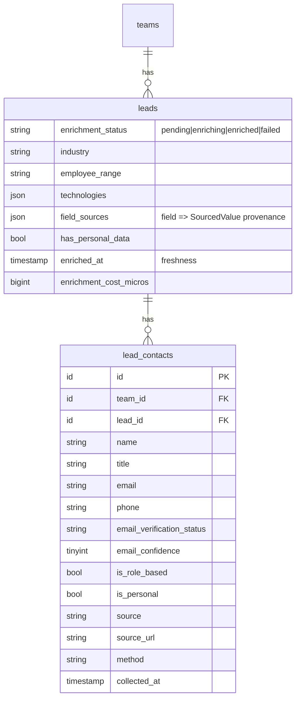

# Enrichment & Data Quality

> Status: **MVP** · Owner: Product · Last updated: 2026-10-29

## Purpose

Turns raw discovered records into clean, trustworthy leads: company normalisation, contact
derivation, **free-tier email verification**, **de-duplication**, **per-field source attribution**
and **data-freshness timestamps**. Because **no paid enrichment provider is in MVP** (ADR 0008), the
facts come from **AI extraction of the lead's public web text** (`lead.enrich_extract`, cheap tier,
injection-safe). It does **not** source leads (Lead Sourcing) or score them (Scoring). Confidence is
**stored, never asserted** — MX presence proves a domain is routable, not that a mailbox exists.

## Code map

- **Backend:** `app/Modules/Enrichment/…`
    - **Enums:** `EnrichmentStatus` — `pending`, `enriching`, `enriched`, `failed` (`label()`,
      `isTerminal()`); `EmailVerificationStatus` — `unknown`, `invalid_syntax`, `disposable_domain`,
      `no_mx_record`, `mx_found` (`label()`, `confidence()` = soft 0–100).
    - **Data (DTOs):** `SourcedValue` (per-field provenance: source / method / source_url /
      collected_at; `METHOD_{PROVIDER,AI_EXTRACT,MERGE}`; `fromAiExtract()`, `toStorage()`,
      `fromStorage()`); `ExtractedFacts` (`fromAi()` hydrates + bounds the validated
      `lead.enrich_extract` output); `EmailVerificationResult` (status + confidence + role/personal
      flags).
    - **Casts:** `SourcedValueMap` — Eloquent cast for `leads.field_sources` (`array<string,
      SourcedValue>` ↔ JSON).
    - **Contracts/Services:** `DnsResolver` seam with `SystemDnsResolver` (MX→A→AAAA via PHP's
      resolver, no SMTP probe) + `Testing\FakeDnsResolver`; `EmailVerifier` (syntax → disposable →
      MX/DNS, classifies role vs personal); `CompanyNormaliser` (canonical website / ISO country /
      trimmed name); `LeadDeduplicator` (collapses duplicates by number / domain / shared email).
    - **Models:** `LeadContact` (`BelongsToTeam`; `lead_id`, name/title/email/phone, email
      verification status + confidence, `is_role_based`/`is_personal`, source attribution). The
      `Lead` model (Lead Sourcing) gains the enrichment columns, `contacts()` and a `domain()` helper.
    - **Actions:** `EnrichLeadAction` (orchestrates normalise → fetch → AI extract → verify emails →
      write facts/contacts/provenance/freshness → de-duplicate; external work outside transactions;
      idempotent; terminal on credit/validation errors).
    - **Jobs:** `EnrichLeadJob` (`ShouldQueue`, `ShouldBeUnique` per lead; `tries=3`, `backoff`,
      `timeout=85`): runs `EnrichLeadAction` inside `TeamContext->run`; `failed()` marks the lead
      failed.
    - **Listeners:** `EnrichDiscoveredLeads` — on Lead Sourcing's `DiscoveryRunCompleted`, queues one
      `EnrichLeadJob` per still-pending lead in the run (registered via `Event::listen`).
    - **Resources:** `LeadContactResource` (used by `LeadResource` when contacts are loaded).
    - **Provider:** `EnrichmentServiceProvider` (binds `DnsResolver`; wires the listener). The web
      fetcher it uses is the shared `App\Modules\Core\Contracts\WebContentFetcher`.
- **Routes:** none — Enrichment is a backend pipeline (surfaced through the Leads Workspace from
  Phase 10 and the existing `LeadResource`).
- **Tests:** `tests/Feature/Enrichment/{EmailVerifier,ExtractedFacts,EnrichLeadAction,LeadDeduplicator,LeadContactTenancy,EnrichmentTrigger}Test.php`.
- **Config / env vars:** `config/enrichment.php` → `max_contacts_per_lead` (`ENRICHMENT_MAX_CONTACTS`),
  `role_local_parts`, `disposable_domains`. Web fetch config is shared in `config/web-fetch.php`.

## MVP vs post-MVP

MVP: AI extraction + MX/DNS + disposable-domain email verification + cross-provider de-duplication +
per-field source attribution + freshness + personal-data flagging. Post-MVP: Apollo/PDL/Hunter
providers, paid/SMTP email verification, technographics, scheduled re-enrichment, a duplicate-merge
review UI.

## Data model

Enrichment adds columns to `leads` and a child `lead_contacts` table (both team-scoped). No separate
`enrichment_runs` table in MVP — status, cost and freshness live on the lead.

`leads.field_sources` records provenance for every AI-enriched field; the discovered scalar columns
keep the record-level `source`/`source_url`/`collected_at` already written at discovery. A
`unique(lead_id, email)` on `lead_contacts` de-dupes contacts per lead (null emails stay distinct).

## Key flows

**Trigger.** A completed `DiscoverLeadsJob` fires `DiscoveryRunCompleted`; `EnrichDiscoveredLeads`
queues an `EnrichLeadJob` per `pending` lead in the run (already-enriched leads are skipped, so a
re-run never doubles up).

**Enrich.** `EnrichLeadAction` (inside `TeamContext->run`) marks the lead `enriching`, normalises its
company fields, then — **outside any transaction** — fetches the lead's public web text via the
shared `WebContentFetcher` and runs `lead.enrich_extract` through `AiClient` with the text wrapped in
`UntrustedContent` (data, never instructions). Extracted emails are verified with `EmailVerifier`
(free-tier, no SMTP). In one short transaction it fills only **empty** fields (recording
`SourcedValue` provenance per field), upserts `LeadContact`s with their verification result and
role/personal classification, flags `has_personal_data`, stamps `enriched_at` + cost, sets
`enrichment_status = enriched` (and `LeadStatus::Enriched`), then de-duplicates. Credit exhaustion /
un-validatable output are terminal (lead → `failed`, no retry); other errors bubble so the queue
retries, and `failed()` marks the lead failed after the final attempt.

**De-duplication.** `LeadDeduplicator` matches other team leads by exact company number, exact website
domain, or a shared contact email — **never a fuzzy name** — and merges each into the most
authoritative survivor (`LeadSource::rank()`, oldest on a tie), keeping the best source per field
(fill a null, overwrite only on a higher rank, never null a value), moving contacts across
(de-duped by email), unioning provenance, and adopting the strongest `dedupe_key`.

**Tenancy.** `LeadContact` is `BelongsToTeam`-scoped (global scope + auto-assign); the deduplicator
queries are team-scoped and run inside `TeamContext`. A cross-tenant contact read returns nothing
(proven by `LeadContactTenancyTest`). Policies arrive with the Leads Workspace endpoints (Phase 10).

## External dependencies

- **Core** — `WebContentFetcher` (SSRF-safe fetch), `TeamContext`, `BelongsToTeam`.
- **AI Platform** — `AiClient`, `lead.enrich_extract` v1 (cheap tier), credit guard, usage logging,
  injection-safe wrapping.
- **Lead Sourcing** — the `Lead` model + `LeadSource` ranks; the `DiscoveryRunCompleted` event.
- **DNS** — outbound MX/A lookups for email verification (behind `DnsResolver`, faked in tests).
- Feeds **Scoring** (Phase 9) and the **Leads Workspace** (Phase 10).

## Known limitations / TODO

- No paid enrichment / SMTP verification (ADR 0008): contact coverage and email confidence are
  deliberately modest. `confidence()` tops out at 60 (`mx_found`) — routable, not proven deliverable.
- Contacts are email-first (plus one phone), derived from the page the AI read; it does not yet match
  named people to titles beyond what the extraction returns.
- The disposable-domain list in `config/enrichment.php` is small and static; extend as needed.
- De-duplication is automatic and pairwise within the matched set; there is no manual merge/undo UI
  yet (post-MVP), and a lead merged away is deleted (its unique contacts move to the survivor).
- `lead.enrich_extract` is seeded at v1; improving it means adding a new version row.
- A `failed` lead is terminal and not retried automatically; `EnrichLeadAction::execute($lead, force: true)` can re-run it, but no UI/trigger wires `force` yet — a manual re-enrich lands with the Leads Workspace (Phase 10). The de-dup trigger listener only picks up `pending` leads.
- `LeadContact` has no policy yet (there is no endpoint this phase); add one before exposing contacts directly, since the global scope alone is not an authorisation check (ADR 0006).

## Changelog

| Date       | Phase | Change                                                                                                                                                                                                                                                                                                                                                                                                                                                                                                                                                                                                                                                                                                                                                      | Files                                                                                                                                                                                                                                                                                                                                                                 |
| ---------- | ----- | ----------------------------------------------------------------------------------------------------------------------------------------------------------------------------------------------------------------------------------------------------------------------------------------------------------------------------------------------------------------------------------------------------------------------------------------------------------------------------------------------------------------------------------------------------------------------------------------------------------------------------------------------------------------------------------------------------------------------------------------------------------- | --------------------------------------------------------------------------------------------------------------------------------------------------------------------------------------------------------------------------------------------------------------------------------------------------------------------------------------------------------------------- |
| 2026-10-29 | 8     | Initial module: enrichment columns on `leads` + `lead_contacts`; `EnrichmentStatus`/`EmailVerificationStatus` enums; `SourcedValue`/`ExtractedFacts`/`EmailVerificationResult` DTOs + `SourcedValueMap` cast; `DnsResolver` seam + `EmailVerifier` (syntax/disposable/MX, role-vs-personal); `CompanyNormaliser`; `LeadDeduplicator` (number/domain/email, best-source-per-field); `EnrichLeadAction` + idempotent `EnrichLeadJob` (AI extraction via `lead.enrich_extract`, injection-safe, external calls outside transactions); `DiscoveryRunCompleted` event (Lead Sourcing) + `EnrichDiscoveredLeads` listener; `LeadContactResource`; tests (faked AI/DNS/fetcher, dedupe, tenancy, trigger). Shared `WebContentFetcher` moved to Core (see core.md). | `app/Modules/Enrichment/**`, `database/migrations/2026_10_29_14000{1,2}_*`, `database/factories/LeadContactFactory.php`, `config/enrichment.php`, `config/web-fetch.php`, `app/Modules/LeadSourcing/{Models/Lead,Jobs/DiscoverLeadsJob,Events/DiscoveryRunCompleted,Http/Resources/LeadResource}.php`, `bootstrap/providers.php`, `tests/Feature/{Enrichment,Core}/*` |
