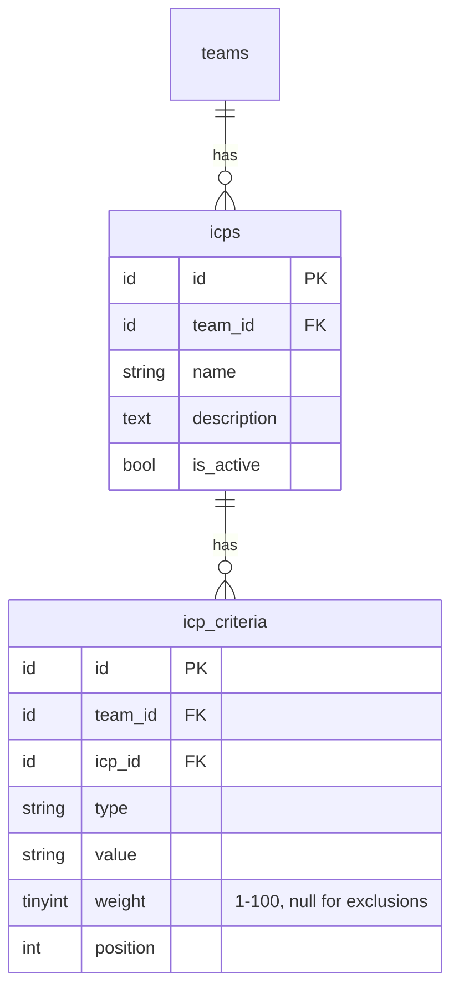

# Ideal Customer Profile (ICP)

> Status: **MVP** · Owner: Product · Last updated: 2026-10-29

## Purpose

Lets a team define one or more **Ideal Customer Profiles** — the structured, weighted criteria that drive lead discovery and scoring. Owns ICP records, their criteria and weights, and exclusions, plus which profile is **active**. It does **not** compute scores (Scoring & Matching) or source leads (Lead Sourcing); it provides the definition both consume. Changing the active profile's definition emits `IcpUpdated` so Scoring can re-score.

## Code map

- **Backend:** `app/Modules/ICP/…`
    - **Models:** `Icp` (`BelongsToTeam`; `name`, `description`, `is_active`; `hasMany criteria` ordered by `position`), `IcpCriterion` (`BelongsToTeam`; `type`, `value`, `weight`, `position`).
    - **Enums:** `CriterionType` — `industry`, `company_size`, `geography`, `job_title`, `seniority`, `technographic`, `buying_signal` (weighted signals) + `exclusion` (unweighted disqualifier). `label()`, `placeholder()`, `isExclusion()`, `signals()`.
    - **Data (DTOs):** `IcpData` (`rules()` is the one definition of what a write may contain, shared by the form request and the AI draft; `fromValidated()` assembles it, normalising weight — exclusions → null, blank signals → 50), `CriterionData`, `DraftIcp` (what the composer drafted: `viable`, `reason`, `summary`, `profile` — never a saved row).
    - **Actions:** `ComposeIcpAction` (a sentence → a **draft** profile through the `icp.compose_profile` reasoning prompt; saves nothing), `CreateIcpAction` (first ICP auto-activates), `UpdateIcpAction` (replaces criteria wholesale), `SetActiveIcpAction`, `DeleteIcpAction` (promotes the newest remaining ICP if the active one is deleted), `GetIcpsAction` + `FindIcpAction` + `FindActiveIcpAction` (team-scoped reads, criteria eager-loaded). Shared criterion/activation writes live in the `WritesIcpCriteria` support trait.
    - **Events:** `IcpUpdated(teamId, activeIcpId)` — fired `afterCommit` whenever the active ICP's definition changes, the active ICP switches, or the active ICP is deleted. Consumed by Scoring (Phase 9): `RescoreTeamOnIcpChange` re-scores the team's leads. When `activeIcpId` is null the team has no definition left to score against, so nothing is re-scored and existing scores stay attached to the ICP that produced them.
    - **Policies:** `IcpPolicy` (`view` = any member; `create`/`update`/`delete` = Owner/Admin; `activate` uses `update`).
    - **Requests:** `SaveIcpRequest` (name/description/is_active + the full criteria set; its rules are `IcpData::rules()`), `ComposeIcpRequest` (the brief, bounded 20–1,000 characters).
    - **Exceptions:** `IcpException::composerUnavailable()` (503) — no AI credit, or no schema-valid draft after the client's own retry.
    - **Resources:** `IcpResource`, `IcpCriterionResource` (API only; the web controller serialises plain arrays for Inertia), `IcpDraftResource` (a draft shaped **exactly like the save payload**, so the editor binds to it and posts it back unchanged).
    - **Provider:** `IcpServiceProvider` (registers the policy + routes).
- **Routes:**
    - Web (`auth` + `verified`): `icp.index` (`GET /icp`), `icp.create` (`GET /icp/create`), `icp.store` (`POST /icp`), `icp.compose` (`POST /icp/compose`, `throttle:10,60`), `icp.edit` (`GET /icp/{icp}/edit`), `icp.update` (`PUT /icp/{icp}`), `icp.activate` (`POST /icp/{icp}/activate`), `icp.destroy` (`DELETE /icp/{icp}`).
    - API (`auth:sanctum`): `api.v1.icps.{index,store,show,update,activate,destroy}` under `/api/v1/icps`.
- **Frontend:**
    - Pages `resources/js/pages/icp/Index.vue` (saved ICPs as cards, active state, inline delete confirm, empty state) and `Edit.vue` (the weighted editor — name/description, active toggle, signal rows with importance sliders, exclusions, and on a **new** profile the composer box: a brief, three examples and _Draft my profile_). Both render in the default `AppLayout`.
    - `AppSidebar.vue` has an "Ideal customers" entry (Target icon).
- **Shared:** `resources/js/types/icp.ts`. i18n keys added to `lang/en.json` + `lang/ar.json` (parity).
- **Tests:** `tests/Feature/Icp/IcpTest.php`, `tests/Feature/Icp/ComposeIcpTest.php`, `tests/Unit/Icp/CriterionTypeTest.php`.
- **Config / env vars:** none.

## MVP vs post-MVP

MVP: multiple saved ICPs per team with exactly one active, **drafting a whole profile from a typed description** (`icp.compose_profile`), full criteria + weights + exclusions, CRUD on web + API, the re-score event, plus accepting an AI-suggested ICP seeded from a Business Intelligence background check (Phase 6; corrected in Phase 7c to seed only **customer-side** signals and to exclude the team's own trade). Post-MVP: ICP templates library, A/B ICPs, and the `icp.refine_suggestions` prompt (seeded, no consumer yet).

## Data model

`icps` (one or more per team, one active) each own many `icp_criteria`. Both carry `team_id` (tenancy). `weight` is 1–100 for signals and null for exclusions; `position` preserves editor order.

## Key flows

**Create / edit.** The editor posts the whole profile (name, description, `is_active`, and the ordered criteria). `SaveIcpRequest` validates; the controller builds an `IcpData` (normalising weights) and calls `CreateIcpAction`/`UpdateIcpAction`. In `TeamContext->run` + `DB::transaction`, the Action deactivates other ICPs when this one is to be active, writes the ICP, replaces its criteria via `WritesIcpCriteria::syncCriteria`, audit-logs, and — when the ICP ends up active — dispatches `IcpUpdated` `afterCommit`. A brand-new team's first ICP is activated automatically.

**Draft it from a sentence.** The new-profile screen takes a description — _"we are a design agency
looking for startup food businesses that need branding on their packaging"_ — and posts it to
`icp.compose`. `ComposeIcpAction` clamps the brief in characters, wraps it as `UntrustedContent`, and
runs the `icp.compose_profile` reasoning prompt inside `TeamContext->run` (which is what makes the
credit guard and the cost row land on the right team), handing the model the team's **own**
`BusinessProfile` so it can tell the seller from the buyer. `DraftIcp::fromAi()` re-validates the
output against `IcpData::rules()` and the draft is **flashed** back to the editor, which fills its
fields; `is_active` is deliberately not part of a draft. **Nothing is saved** — the member edits and
presses save, which is the ordinary `icp.store` path (ADR 0020's arrangement, applied here). A
refusal (`viable: false`) carries the model's own reason as a toast and fills nothing in. There is no
plan capability on it: the hand-written editor is the same screen, so gating the shortcut would only
make the cheaper plans worse than they were before it existed — the AI credit allowance and a
per-member route throttle are the ceilings.

**Activate / delete.** `SetActiveIcpAction` makes one ICP active (deactivating the rest) and always emits `IcpUpdated`. `DeleteIcpAction` removes an ICP (criteria cascade); if it was the active one, the newest remaining ICP is promoted to active and `IcpUpdated` fires with the promoted id (or null when none remain). Deleting a non-active ICP emits nothing.

**Tenancy.** `FindIcpAction` resolves `{icp}` inside the team context so another team's ICP 404s rather than binding cross-tenant; `IcpPolicy` double-checks ownership on every action (ADR 0006). Route params are numeric-constrained.

## External dependencies

None. `IcpUpdated` is the integration point for Scoring & Matching (Phase 9).

## Permissions

| Ability                           | Owner | Admin | Member | Read-only |
| --------------------------------- | ----- | ----- | ------ | --------- |
| View ICPs                         | ✅    | ✅    | ✅     | ✅        |
| Create / edit / activate / delete | ✅    | ✅    | ❌     | ❌        |

Policy: `IcpPolicy`, authoritative role via `User::roleOn($team)`. The `BelongsToTeam` global scope blocks cross-tenant reads/writes; the policy double-checks ownership.

## Known limitations / TODO

- **An ICP describes the team's _customers_, and nothing in the schema enforces that.** `CriterionType::Industry` means "the industry my customer is in", but the column takes any string, so an industry signal naming the team's **own** trade is structurally valid and silently turns discovery into a competitor search — which is exactly what happened when Business Intelligence seeded one (`business-intelligence.md`, Phase 7c). Two mitigations now sit downstream rather than here: the background check only ever seeds customer-side findings as signals (and puts the team's own trade in as an `Exclusion`), and `DiscoveryQueryShaper` is told to prefer the business profile where the two disagree. The composer added a third mitigation of the same kind rather than a fix: `icp.compose_profile` is told the inversion explicitly and given the team's own profile to tell the two apart, but it is a prompt, so its output is a draft a member reads. An ICP saved before Phase 7c can still carry the wrong value, and nothing retro-fixes it — a member sees it in the editor. Validating a signal against the team's own profile at save time is the obvious next step and was not taken, because a team that genuinely sells to its own trade is a real case.
- **Exclusions are enforced in three places with three strengths.** `DeterministicScorer` treats a match as a hard disqualifier (grade D, no AI call); `DiscoveryQuery` turns them into negative search terms, pushed to the API by web search and applied by `LeadCandidateFilter` for the other providers; nothing re-checks them when a lead arrives by CSV import or manual entry. Discovery-side exclusion is a substring match on name/domain, so it is both blunter and earlier than the scorer's.
- Criteria are replaced wholesale on every save (the editor posts the full set) — fine for the MVP editor; a future diff/merge would preserve per-criterion history.
- One active ICP per team is enforced in the Actions, not by a DB constraint (MySQL has no partial unique index).
- `IcpUpdated` has no listener yet; Scoring & Matching (Phase 9) consumes it.
- The API ICP list (`GET /api/v1/icps`) is intentionally **unpaginated** — ICPs per team are few and bounded (one active, a handful saved). Revisit if ICP templates/A-B land post-MVP.
- The one-active-ICP invariant is enforced in the Actions (with a per-transaction row lock), not by a DB constraint.

## Changelog

| Date       | Phase | Change                                                                                                                                                                                                                                                                                                                                                                                                                                                                                                                                                                                                                                                                                                                                                                                                                                                                                                                                                                                                                                                                                                                                                                                                                                  | Files                                                                                                                                                                                                                                                                                                                                                                                     |
| ---------- | ----- | --------------------------------------------------------------------------------------------------------------------------------------------------------------------------------------------------------------------------------------------------------------------------------------------------------------------------------------------------------------------------------------------------------------------------------------------------------------------------------------------------------------------------------------------------------------------------------------------------------------------------------------------------------------------------------------------------------------------------------------------------------------------------------------------------------------------------------------------------------------------------------------------------------------------------------------------------------------------------------------------------------------------------------------------------------------------------------------------------------------------------------------------------------------------------------------------------------------------------------------- | ----------------------------------------------------------------------------------------------------------------------------------------------------------------------------------------------------------------------------------------------------------------------------------------------------------------------------------------------------------------------------------------- |
| 2026-10-29 | 4     | Initial module: `icps` + `icp_criteria`, `CriterionType` enum, Create/Update/SetActive/Delete + Get/Find Actions, `IcpUpdated` event, policy, web + API CRUD, the weighted Inertia editor + list (EN/AR + RTL), sidebar entry, tests.                                                                                                                                                                                                                                                                                                                                                                                                                                                                                                                                                                                                                                                                                                                                                                                                                                                                                                                                                                                                   | `app/Modules/ICP/**`, `database/migrations/2026_10_29_1000*`, `database/factories/Icp*Factory.php`, `resources/js/pages/icp/*`, `resources/js/types/icp.ts`, `tests/{Feature,Unit}/Icp/*`                                                                                                                                                                                                 |
| 2026-10-29 | 9     | Added `FindActiveIcpAction` (the team's active ICP with criteria + team eager-loaded), shared by Scoring and the score screen. `IcpUpdated` now has a consumer: Scoring's queued `RescoreTeamOnIcpChange`; its null-`activeIcpId` case is documented as "nothing to score against" rather than "clear the scores".                                                                                                                                                                                                                                                                                                                                                                                                                                                                                                                                                                                                                                                                                                                                                                                                                                                                                                                      | `app/Modules/ICP/{Actions/FindActiveIcpAction,Events/IcpUpdated}.php`                                                                                                                                                                                                                                                                                                                     |
| 2026-10-30 | 7c    | No code change in this module; recorded here because the **meaning** of an industry signal was being broken from outside it. A background-check field that described the team's own trade was seeded as `CriterionType::Industry` — read everywhere as the _customer's_ industry — so the active ICP told discovery to search for companies like the team. Fixed at both ends: Business Intelligence now seeds only customer-side findings as signals and puts the team's own trade + competitors in as `Exclusion`s, and Lead Sourcing's query shaper prefers the business profile when an ICP signal contradicts it. The ICP module's own invariant is documented under Known limitations: an industry signal is a _customer's_ industry, and nothing in the schema enforces that.                                                                                                                                                                                                                                                                                                                                                                                                                                                    | `docs/modules/icp.md` (and see `business-intelligence.md`, `lead-sourcing.md`)                                                                                                                                                                                                                                                                                                            |
| 2026-11-01 | UI    | **The profile list and the editor, rebuilt.** The cards listed a profile’s signals as equal-looking chips with a number on the end — backwards for a screen whose whole subject is the weighting. Each signal now carries a `MeterBar`, heaviest first, scaled to the profile’s own heaviest criterion; the **active** profile is hoisted to the front at full width, because it is the one deciding how every lead in the account is graded; and the card says when it was last edited. The editor moved onto `components/forms` (error summary, field wiring, sticky save bar, `useUnsavedGuard`), swapped its hand-rolled `fieldClass` textarea and reka `Select` for `Textarea`/`NativeSelect`, says what a weight **means** ("Important · 50") and carries a live **"what this profile will do"** summary — this is the one form in the product whose output is a behaviour rather than a record. New `lib/importance.ts` holds the three bands so the editor and the list cannot drift. No server change.                                                                                                                                                                                                                         | `resources/js/pages/icp/{Index,Edit}.vue`, `resources/js/lib/importance.ts`, `resources/js/components/MeterBar.vue`, `lang/{en,ar}.json`                                                                                                                                                                                                                                                  |
| 2026-11-06 | ICP   | **Draft a profile from a sentence.** A new profile started from a blank page and a member had to know both what a criterion type means and what weight to give it. The editor now takes a description — _"we are a design agency looking for startup food businesses that need branding on their packaging"_ — and fills itself in: `ComposeIcpAction` + the new `icp.compose_profile` **reasoning** prompt return a `DraftIcp` the member edits and saves, and the call **persists nothing** (ADR 0020's arrangement: the AI drafts, the member owns). The prompt's real job is the **inversion** — a brief describes the seller as much as the buyer, which is the failure `business_intel.background_check` v2 and `lead_sourcing.shape_query` already exist because of — so it is given the team's own `BusinessProfile`, told never to return their trade as an industry signal, and told to put it in an exclusion instead. `IcpData::rules()` was extracted so the draft is re-validated against exactly the rules the save path uses; `is_viable: false` with a reason is a first-class answer. No plan capability (the hand-written editor is the same screen); the ceilings are the AI credit allowance and `throttle:10,60`. | `app/Modules/ICP/{Actions/ComposeIcpAction,Data/{DraftIcp,IcpData},Exceptions/IcpException,Http/{Requests/ComposeIcpRequest,Resources/IcpDraftResource,Controllers/Web/IcpController},routes/web}.php`, `database/seeders/AiPromptTemplateSeeder.php`, `resources/js/pages/icp/Edit.vue`, `resources/js/shared/types/icp.ts`, `lang/{en,ar}.json`, `tests/Feature/Icp/ComposeIcpTest.php` |
