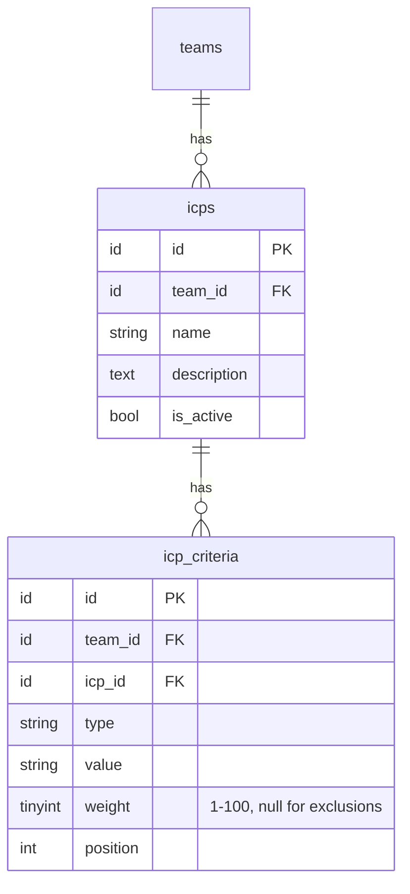

# Ideal Customer Profile (ICP)

> Status: **MVP** · Owner: Product · Last updated: 2026-10-29

## Purpose

Lets a team define one or more **Ideal Customer Profiles** — the structured, weighted criteria that drive lead discovery and scoring. Owns ICP records, their criteria and weights, and exclusions, plus which profile is **active**. It does **not** compute scores (Scoring & Matching) or source leads (Lead Sourcing); it provides the definition both consume. Changing the active profile's definition emits `IcpUpdated` so Scoring can re-score.

## Code map

- **Backend:** `app/Modules/ICP/…`
    - **Models:** `Icp` (`BelongsToTeam`; `name`, `description`, `is_active`; `hasMany criteria` ordered by `position`), `IcpCriterion` (`BelongsToTeam`; `type`, `value`, `weight`, `position`).
    - **Enums:** `CriterionType` — `industry`, `company_size`, `geography`, `job_title`, `seniority`, `technographic`, `buying_signal` (weighted signals) + `exclusion` (unweighted disqualifier). `label()`, `placeholder()`, `isExclusion()`, `signals()`.
    - **Data (DTOs):** `IcpData` (`fromValidated()` assembles it from the request; normalises weight — exclusions → null, blank signals → 50), `CriterionData`.
    - **Actions:** `CreateIcpAction` (first ICP auto-activates), `UpdateIcpAction` (replaces criteria wholesale), `SetActiveIcpAction`, `DeleteIcpAction` (promotes the newest remaining ICP if the active one is deleted), `GetIcpsAction` + `FindIcpAction` (team-scoped reads, criteria eager-loaded). Shared criterion/activation writes live in the `WritesIcpCriteria` support trait.
    - **Events:** `IcpUpdated(teamId, activeIcpId)` — fired `afterCommit` whenever the active ICP's definition changes, the active ICP switches, or the active ICP is deleted. Consumed by Scoring (Phase 9); no listener yet.
    - **Policies:** `IcpPolicy` (`view` = any member; `create`/`update`/`delete` = Owner/Admin; `activate` uses `update`).
    - **Requests:** `SaveIcpRequest` (name/description/is_active + the full criteria set).
    - **Resources:** `IcpResource`, `IcpCriterionResource` (API only; the web controller serialises plain arrays for Inertia).
    - **Provider:** `IcpServiceProvider` (registers the policy + routes).
- **Routes:**
    - Web (`auth` + `verified`): `icp.index` (`GET /icp`), `icp.create` (`GET /icp/create`), `icp.store` (`POST /icp`), `icp.edit` (`GET /icp/{icp}/edit`), `icp.update` (`PUT /icp/{icp}`), `icp.activate` (`POST /icp/{icp}/activate`), `icp.destroy` (`DELETE /icp/{icp}`).
    - API (`auth:sanctum`): `api.v1.icps.{index,store,show,update,activate,destroy}` under `/api/v1/icps`.
- **Frontend:**
    - Pages `resources/js/pages/icp/Index.vue` (saved ICPs as cards, active state, inline delete confirm, empty state) and `Edit.vue` (the weighted editor — name/description, active toggle, signal rows with importance sliders, exclusions). Both render in the default `AppLayout`.
    - `AppSidebar.vue` has an "Ideal customers" entry (Target icon).
- **Shared:** `resources/js/types/icp.ts`. i18n keys added to `lang/en.json` + `lang/ar.json` (parity).
- **Tests:** `tests/Feature/Icp/IcpTest.php`, `tests/Unit/Icp/CriterionTypeTest.php`.
- **Config / env vars:** none.

## MVP vs post-MVP

MVP: multiple saved ICPs per team with exactly one active, full criteria + weights + exclusions, CRUD on web + API, the re-score event. Post-MVP: ICP templates library, A/B ICPs, and accepting an AI-suggested ICP from Business Intelligence (`icp.refine_suggestions`, Phase 5/6).

## Data model

`icps` (one or more per team, one active) each own many `icp_criteria`. Both carry `team_id` (tenancy). `weight` is 1–100 for signals and null for exclusions; `position` preserves editor order.

## Key flows

**Create / edit.** The editor posts the whole profile (name, description, `is_active`, and the ordered criteria). `SaveIcpRequest` validates; the controller builds an `IcpData` (normalising weights) and calls `CreateIcpAction`/`UpdateIcpAction`. In `TeamContext->run` + `DB::transaction`, the Action deactivates other ICPs when this one is to be active, writes the ICP, replaces its criteria via `WritesIcpCriteria::syncCriteria`, audit-logs, and — when the ICP ends up active — dispatches `IcpUpdated` `afterCommit`. A brand-new team's first ICP is activated automatically.

**Activate / delete.** `SetActiveIcpAction` makes one ICP active (deactivating the rest) and always emits `IcpUpdated`. `DeleteIcpAction` removes an ICP (criteria cascade); if it was the active one, the newest remaining ICP is promoted to active and `IcpUpdated` fires with the promoted id (or null when none remain). Deleting a non-active ICP emits nothing.

**Tenancy.** `FindIcpAction` resolves `{icp}` inside the team context so another team's ICP 404s rather than binding cross-tenant; `IcpPolicy` double-checks ownership on every action (ADR 0006). Route params are numeric-constrained.

## External dependencies

None. `IcpUpdated` is the integration point for Scoring & Matching (Phase 9).

## Permissions

| Ability                           | Owner | Admin | Member | Read-only |
| --------------------------------- | ----- | ----- | ------ | --------- |
| View ICPs                         | ✅    | ✅    | ✅     | ✅        |
| Create / edit / activate / delete | ✅    | ✅    | ❌     | ❌        |

Policy: `IcpPolicy`, authoritative role via `User::roleOn($team)`. The `BelongsToTeam` global scope blocks cross-tenant reads/writes; the policy double-checks ownership.

## Known limitations / TODO

- Criteria are replaced wholesale on every save (the editor posts the full set) — fine for the MVP editor; a future diff/merge would preserve per-criterion history.
- One active ICP per team is enforced in the Actions, not by a DB constraint (MySQL has no partial unique index).
- AI-suggested ICP (accept from Business Intelligence) is deferred until the AI Platform + BI phases.
- `IcpUpdated` has no listener yet; Scoring & Matching (Phase 9) consumes it.
- The API ICP list (`GET /api/v1/icps`) is intentionally **unpaginated** — ICPs per team are few and bounded (one active, a handful saved). Revisit if ICP templates/A-B land post-MVP.
- The one-active-ICP invariant is enforced in the Actions (with a per-transaction row lock), not by a DB constraint.

## Changelog

| Date       | Phase | Change                                                                                                                                                                                                                                | Files                                                                                                                                                                                     |
| ---------- | ----- | ------------------------------------------------------------------------------------------------------------------------------------------------------------------------------------------------------------------------------------- | ----------------------------------------------------------------------------------------------------------------------------------------------------------------------------------------- |
| 2026-10-29 | 4     | Initial module: `icps` + `icp_criteria`, `CriterionType` enum, Create/Update/SetActive/Delete + Get/Find Actions, `IcpUpdated` event, policy, web + API CRUD, the weighted Inertia editor + list (EN/AR + RTL), sidebar entry, tests. | `app/Modules/ICP/**`, `database/migrations/2026_10_29_1000*`, `database/factories/Icp*Factory.php`, `resources/js/pages/icp/*`, `resources/js/types/icp.ts`, `tests/{Feature,Unit}/Icp/*` |
