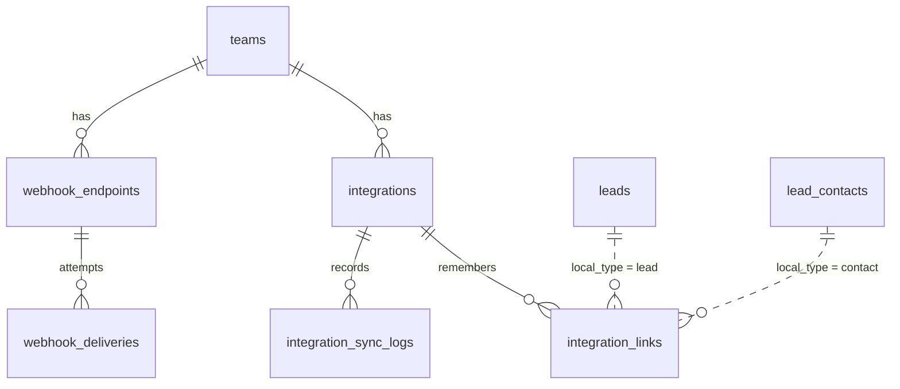

# Integrations

> Status: **MVP** · Owner: Platform · Last updated: 2026-11-09

## Purpose

Everything that leaves Alima for somewhere a customer works: **outbound webhooks**, and the
**framework a CRM connector plugs into**. PL7 built both; the connectors themselves are PL8
(Pipedrive) and PL9 (HubSpot).

What it does **not** own. It owns no business rule. Whether a prospect may be approached is
`OutreachGuard`'s answer and whether their details may be held is `ContactApprovalGate`'s — this
module asks both and implements neither. It does not decide what a lead is worth, how a note is
written for a screen, or what a plan includes; it asks Scoring, PL1 and Billing. And it **listens
outwards**: no module imports `App\Modules\Integrations`, exactly as no module imports Billing or
Compliance.

Read **ADR 0034** before changing anything here.

## Code map

- **Contracts:** `Contracts/CrmConnector` (what PL8/PL9 implement), `Contracts/CrmRowAllowance`
  (the seventh ADR 0012 seam; Billing binds the real one).
- **Services:** `CrmConnectorRegistry` (the factory seam — ADR 0008's pattern, fourth appearance),
  `OAuthStateService`, `TokenRefresher`, `CrmNoteComposer`, `WebhookDispatcher`,
  `WebhookFailureCounter`, `UnmeteredCrmRows` (the permissive default).
- **Actions:** `SyncLeadToCrmAction` (the one push), `ConnectIntegrationAction`,
  `DisconnectIntegrationAction`, `SaveWebhookEndpointAction`, `RotateWebhookSecretAction`.
- **Jobs:** `DeliverWebhookJob` (one delivery, signed, pinned, retried), `PushLeadToCrmJob`
  (unique per integration+lead).
- **Listeners / observers:** `RelayWebhookEvents` (queued; four events into four webhook events),
  `AutoSyncScoredLead` (the auto-sync rule), `Observers/LeadWebhookObserver` (`lead.created`).
- **Models:** `Integration`, `IntegrationLink`, `IntegrationSyncLog`, `WebhookEndpoint`,
  `WebhookDelivery`.
- **Enums:** `CrmProvider`, `IntegrationStatus`, `SyncOutcome`, `SyncTarget`, `WebhookEvent`,
  `DeliveryState`.
- **Data:** `CrmCredentials`, `CrmRecord` — plain readonly value objects, because nothing validates
  them and nothing casts them from a request.
- **Exceptions:** `IntegrationException` (`unauthorized`, `needsReauth`, `connectorUnavailable`,
  `invalidState`).
- **Console:** `integrations:prune-deliveries` (nightly, 03:55).
- **Policies:** `IntegrationPolicy`, `WebhookEndpointPolicy`.
- **Routes:** `routes/web.php` only — `integrations.index`, `integrations.webhooks.*`,
  `integrations.deliveries.redeliver`, `integrations.crm.*`. **No `api.php`, deliberately**: see
  _Permissions_.
- **Frontend:** `resources/js/pages/integrations/Index.vue`, types in
  `resources/js/shared/types/integrations.ts`, sidebar entry in `AppSidebar.vue` — **gated on
  `prelaunch.webhooks`**, which the shell reads from the `prelaunch` shared prop
  (`HandleInertiaRequests`). Every route here answers 404 while the flag is off, so an ungated
  rail item was a link to a 404 on every team not yet switched on.
- **Tests:** `tests/Feature/Integrations/{WebhookTest,CrmSyncTest,OAuthStateTest}.php`, with
  `tests/Support/FakeCrmConnector.php`.
- **Config / env:** `config/integrations.php` (`webhooks.timeout`, `webhooks.connect_timeout`,
  `webhooks.max_consecutive_failures`, `webhooks.retain_days`, `webhooks.user_agent`,
  `oauth.state_ttl`); the flag `prelaunch.webhooks` in `config/prelaunch.php`.

## Data model

Five tables, and the thing to hold on to is that they age at **three** rates.

- `integrations` — one connection per team per provider (unique), with both tokens under the
  `encrypted` cast and `$hidden` as well. Live state a member edits. **Disconnecting does not delete
  the row.**
- `integration_links` — "their id for our row", plus `synced_hash`. A **memory**, and the one table
  that must never be pruned: lose a link and the next push creates the organisation again inside
  somebody else's CRM.
- `integration_sync_logs` — one row per push, whatever happened. **History**: nothing reads it to
  decide anything, which is why it is the one of the three that may be swept.
- `webhook_endpoints` — url, encrypted `secret`, `hint`, `events` json, `is_active` (the member's
  switch), `failure_count` (consecutive), `disabled_at` (ours).
- `webhook_deliveries` — one row per attempt at one endpoint, written **before** the request. The
  fastest-growing table in the product.

`integration_links.local_id` is a plain unsigned integer with `local_type` beside it rather than a
polymorphic relation: the two cases are closed (`SyncTarget`), and the external side of the pair is
a free string because the provider's own noun belongs to the provider — `organization` at Pipedrive,
`company` at HubSpot.

## Key flows

### Outbound webhooks, as PL7 does it

Something happens → `RelayWebhookEvents` (queued) composes the `data` with the app's own API
resource, inside the team's context → `WebhookDispatcher` writes one `webhook_deliveries` row per
subscribed endpoint → `DeliverWebhookJob` signs and posts it after the commit.

Five things about it are easy to get wrong.

**The payload is composed at the moment of the event and stored.** That is what makes a redelivery
twelve hours later send what happened rather than what the lead looks like now, and it is also what
keeps the masking honest: the resources that build it already send one already-masked field per
value (ADR 0029), so an unrevealed address cannot reach a customer's Zapier because somebody forgot
to think about it here.

**The payload closure is lazy and the endpoint lookup is memoised.** `lead.created` fires once per
company and a discovery run finds hundreds; a team with **no** endpoints has to cost one query per
run rather than one resource resolution per lead. A team that subscribes pays per company, by
design, and `WebhookEvent::isHighVolume()` warns them on the screen.

**The signature is the inbound one, outbound.** `X-Alima-Signature: t=<ts>,v1=<hmac>` over
`timestamp.body` — the timestamp inside the signature's scope so a captured request cannot be
refreshed, and the raw bytes, because a re-encoded payload would let anybody who can reorder keys
keep a valid signature over different content. The secret is **encrypted, not hashed** (producing a
signature means recomputing an HMAC) and shown once, by the call that mints it. Rotation replaces
it. Exactly the construction `SignalWebhookSecret` uses, deliberately.

**The SSRF guard runs twice and pins the second time.** On save it is usability (a member deserves
the answer beside the field) and stricter than the shared guard — https only. At send time it is the
protection: approve the addresses, **pin** them for the request, refuse redirects, and refuse a host
that will not resolve, because an endpoint we cannot pin is one we will not post lead data to. A
guard refusal is permanent and counts toward the auto-disable.

**The retry schedule is the queue's own** (`$backoff`, 1m → 12h), a non-2xx throws on purpose to
reach it, and `next_retry_at` is written for the screen and read by nothing. Twenty **consecutive
deliveries** — not attempts — switch an endpoint off and tell the team's admins; a success resets
the count, and re-enabling clears it.

### Pushing a lead to a CRM

`SyncLeadToCrmAction`, and the order is the design:

1. **May we?** `ContactApprovalGate::allowsDomain()`. This is the one path besides the export where
   honouring the list at the point of sending is not good enough — a record in somebody's Pipedrive
   is beyond every later check. A refusal is a **logged row**, not a silence.
2. **Has anything changed?** `synced_hash`, over the fields a CRM can see. Without it an auto-sync
   rule firing on every re-score would re-push every organisation a team owns, nightly.
3. **Can they afford it?** One unit of `BillingMetric::CrmSync`, held before the call and settled
   after it. A skip and a refusal both release the hold.
4. Then the connector: upsert the company, write the link, attach the note, upsert the people whose
   details may actually leave, and open a deal if the team asked for one. **A failed deal does not
   fail the push** — losing the organisation because a stale pipeline id was in the settings is the
   wrong trade.

Everything in 1–3 happens **before any connector is reached**, which is why `CrmConnector` is a
narrow contract rather than a "do the sync" method.

**The link is written twice, and that is the design.** Immediately after the company upsert with an
**empty** `synced_hash`, so a retry updates the organisation we just created rather than making a
second one; then again with the real fingerprint once the note and the people are through. An empty
hash can never equal a `sha256`, so a push that died halfway is a real attempt next time rather than
a `Skipped` that strands the company in the customer's CRM with no note and no contacts (ADR 0034
§5).

### Connecting, and the account check

`POST integrations/crm/{provider}/connect` mints a `state` and redirects away; the provider calls
back; `OAuthStateService::consume()` approves it; `ConnectIntegrationAction` stores the tokens.

`connect` is a POST although it only redirects, because it **creates** a single-use state and a GET
that creates is a GET a link prefetcher fires. The callback is a GET because the provider decides
that, and it is the one route here with no CSRF token — the `state` is what stands in for one.

The load-bearing part is the **account check**: `external_account_id` comes back with the tokens, and
a mismatch on reconnect **clears the links**. Reconnecting to a different Pipedrive account with the
old links in place would have Alima updating organisation 4821 inside a company that has never heard
of us. A provider that reports no account is treated as a change.

### The auto-sync rule

`AutoSyncScoredLead` on `LeadScored`. Off by default, both thresholds optional with absent meaning
"do not care", and an **unjudged confidence fails a floor rather than passing it** — null is not zero
(ADR 0028), and failing toward not pushing is the safe direction.

## External dependencies

**A customer's own endpoint**, which is the one "provider" here we know nothing about: https only,
10s request / 5s connect timeout, no redirects, SSRF-guarded and pinned at send time, signed. There
is no circuit breaker, because a breaker answers "is the provider up" and each endpoint is its own
provider — `webhook_endpoints.failure_count` is the per-endpoint equivalent and the auto-disable is
its open state.

**A CRM's OAuth and REST API**, through a connector. Per-provider credentials belong in
`config/services.php` with every other vendor's and arrive with the connector (PL8/PL9), as does its
own breaker key under a `cb` prefix and its `Admin\Enums\PlatformProvider` case — an open breaker
with no platform case is an outage invisible to operations (ADR 0023).

## Permissions

| Who           | May                                                                                                                                       |
| ------------- | ----------------------------------------------------------------------------------------------------------------------------------------- |
| Owner / Admin | everything: add, edit, test, rotate, remove an endpoint; connect, configure and disconnect a CRM                                          |
| Owner / Admin | **starting _and finishing_ an OAuth connection** (`IntegrationPolicy::connect`, a class-level ability because there is no row to own yet) |
| Member        | push **one** lead to a connected CRM (`IntegrationPolicy::sync`)                                                                          |
| Read-only     | nothing here                                                                                                                              |

`WebhookEndpointPolicy` is Owner/Admin **for viewing as well as writing**, which is stricter than
most policies here and deliberate: the list of endpoints is itself worth withholding, because a
member who can read it knows exactly which third party the team's data is flowing to. `sync` is the
one thing an ordinary member may do — pushing one company somebody is looking at is working a lead,
not configuring an integration, and everything that makes it safe is in the Action.

**There are no `/api/v1` routes, and that is a decision.** `/api/v1` is how a customer's script reads
Alima and webhooks are how Alima reaches their script; letting a token register an endpoint would let
a credential decide where the team's whole lead flow is sent. Billing makes the same argument.

## Known limitations / TODO

- **No connector ships.** PL8 (Pipedrive) and PL9 (HubSpot). `CrmProvider::isAvailable()` answers
  false for both and the screen says "not available yet" rather than offering a Connect button that
  404s. The whole framework is exercised by `tests/Support/FakeCrmConnector.php`.
- **No "Send to CRM" button**, although the route exists and is tested. It waits for something to
  send to.
- **No PKCE.** Deliberately with the connector: the challenge method a provider accepts is provider
  knowledge, and `authorizeUrl()` composes the whole URL.
- **A company suppressed by its registration number is still pushed.** PL5 added
  `SuppressionType::CompanyNumber` and nothing in the product reads it — not `OutreachGuard`, not the
  gate — so the sync is consistent with the export rather than uniquely wrong. Tracked in
  `docs/prelaunch/progress.md`.
- **`synced_hash` is over the fields we believe a connector sends**, not over its actual request. A
  connector that mapped a field the list does not name would not re-push when that field changed.
  Upgrade when the first connector's field mapping becomes configurable per team.
- **No per-team delivery cap.** The volume follows directly from what a team ticked; revisit if a
  receiver is ever why our queue backs up.
- `signal.detected` relays the newest 50 signals of a run and does not mention the tail.

## Changelog

| Date       | Phase | Change                                                                                                                                                                                                                                                                                                                                         | Files                                                                                                                           |
| ---------- | ----- | ---------------------------------------------------------------------------------------------------------------------------------------------------------------------------------------------------------------------------------------------------------------------------------------------------------------------------------------------- | ------------------------------------------------------------------------------------------------------------------------------- |
| 2026-11-09 | PL7   | New module. Outbound webhooks (signed, retried, auto-disabled, logged, SSRF-pinned) and the CRM framework: `CrmConnector` + registry, OAuth state, token refresh, `SyncLeadToCrmAction` with suppression, metering and hash skip, the auto-sync rule and the CRM note. Seventh ADR 0012 seam (`CrmRowAllowance`). Behind `prelaunch.webhooks`. | `app/Modules/Integrations/**`, `config/integrations.php`, two migrations, `resources/js/pages/integrations/Index.vue`, ADR 0034 |
