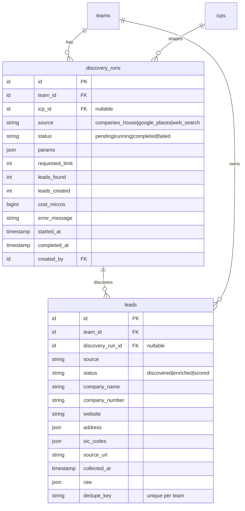

# Lead Sourcing

> Status: **MVP** · Owner: Product · Last updated: 2026-10-31

## Purpose

Discovers candidate **company-level** leads for a team through a pluggable **`LeadSourceProvider`** interface. Owns discovery "runs" (queued, tracked, progress-reported, per-plan-limited) and the raw discovered `leads` before enrichment. It does **not** enrich, dedupe (beyond a placeholder), or score — those are downstream modules — and **never scrapes sources whose terms forbid it**. All three MVP providers are live: **Companies House** (Phase 7), **Google Places** and **web search** (Phase 7b; web search backed by Serper, ADR 0010), behind one contract.

## Code map

- **Backend:** `app/Modules/LeadSourcing/…`
    - **Models:** `DiscoveryRun` (`BelongsToTeam`; `source`, `status`, `icp_id`, `params` JSON, `requested_limit`, `leads_found`/`leads_created`, `cost_micros`, `error_message`, `started_at`/`completed_at`, `created_by`); `Lead` (`BelongsToTeam`; company-level facts — `company_name`/`company_number`/`company_status`/`company_type`/`incorporated_on`/`website`, flattened address + `address` JSON + `sic_codes`, source attribution `source`/`source_url`/`collected_at`/`raw`, and a `dedupe_key` unique per team).
    - **Enums:** `LeadSource` — `companies_house`, `google_places`, `web_search`, **`ai`** (`label()`, `description()`, `isAvailable()`, `availableValues()`, `rank()` — `ai` ranks **0**, below every index, so any other source corrects its fields on a merge); `DiscoveryRunStatus` — `pending`, `running`, `completed`, `failed` (`label()`, `isTerminal()`); `LeadStatus` — `discovered`, `enriched`, `scored` (lead only ever `discovered` here; downstream phases advance it).
    - **Contracts:** `LeadSourceProvider` (`source()`, `discover(DiscoveryQuery): list<SourcedLead>`, `costMicros(int)`); `LeadQuotaSource` (billing seam); `LeadInterestGate` (LIA/compliance seam); **`CompanyWebsiteResolver`** (`resolve(companyName, location?): ?string` — the seam Enrichment uses to find a homepage for a website-less lead; default `SerperCompanyWebsiteResolver`, `Testing\FakeCompanyWebsiteResolver` in tests).
    - **Services:** `AbstractHttpLeadSourceProvider` (shared HTTP hardening — per-provider circuit breaker that trips only on transient 5xx/429/connection failures, config-error-vs-transient key checks, failure → `LeadSourcingException`) extended by the three providers: `CompaniesHouseProvider` (official `/search/companies`, free, UK company records), `GooglePlacesProvider` (Places API New Text Search — local/SMB by location+category, strong for UAE; its field mask also requests the **phone** (international preferred over national), rating and business status — the phone lands on `SourcedLead::$phone` → `leads.phone` and becomes a contact at enrichment), `WebSearchProvider` (Serper driver — organic results → company candidates by domain, ADR 0010). **`AiLeadSourceProvider`** (Phase 7c — the one provider with **no HTTP of its own**: it calls `lead_sourcing.ai_discovery` through `AiClient`, which owns the transport, retries, credit allowance and cost ledger, and maps the named companies to `SourcedLead`s. Returns `costMicros() === 0` **on purpose** — the spend is already on `ai_requests`, where `PlatformRollup` reads Claude cost from, so repeating it on `discovery_runs` would count one request twice in the platform margin). `LeadSourceProviderRegistry` (resolves a provider by `LeadSource`); `DiscoveryLimitGuard` + `StubLeadQuotaSource` (unlimited until Billing); `AllowAllLeadInterestGate` (permits all until Compliance). **`DiscoveryQueryShaper`** (Phase 7c — calls `lead_sourcing.shape_query` once per source _before_ the fan-out, turning the team's own business profile into a search for its **customers**; skipped when the member typed terms, when the team has no profile, or when `lead-sourcing.query_shaping.enabled` is false, and **degrades** to `DiscoveryQuery::fromIcp()` on any AI error including exhausted credits); **`DiscoveryPayloadBuilder`** (the business / ICP / provider-brief blocks that prompt consumes); **`LeadCandidateFilter`** (drops candidates matching the query's negative terms **before** persistence — word-bounded on the company name, substring on the domain for terms of 5+ characters). `Core\Support\CircuitBreaker` (cache-backed, opens after N consecutive failures; extracted to Core in Signals S2 with a `prefix`, bound here with prefix `lead_sourcing:cb` — shared with Signals). **`SerperCompanyWebsiteResolver`** (implements `CompanyWebsiteResolver` over Serper, reusing the web-search credentials and the `web_search` breaker key; best-effort and never throws — null for a disabled/unconfigured provider, an open breaker or any failure — because website resolution is a convenience Enrichment falls back to, not something allowed to fail a run).
    - **Data (DTOs):** `DiscoveryQuery` (`fromIcp()` is the **deterministic fallback** — terms/location from the active ICP's industry/geography signals, exclusions from its `exclusion` criteria; `withShapedTerms()` overlays the AI-shaped terms + negative terms and sets `shaped`; `fromParams()`/`toParams()` round-trip the run's stored params, now including `exclude_terms`, `customer_description` and `shaped`); `SourcedLead` (provider-agnostic company record; `dedupeKey()`, `domain()`, `toLeadAttributes()`; carries **`industry`** + **`employeeRange`** since Phase 7c — the two dimensions `Scoring\DeterministicScorer` reads directly and no index-backed provider fills); `StartDiscoveryData` (validated input); `LeadQuota` (`remaining()`, `isExhausted()`, `clamp()`).
    - **Jobs:** `DiscoverLeadsJob` (`ShouldQueue`, `ShouldBeUnique` per run; `tries=3`, `backoff`, `timeout=85`): claims the run (Pending → Running), calls the provider **outside any transaction**, persists leads (de-duped per team on `dedupe_key`), records counts + cost, broadcasts progress. A provider failure bubbles so the queue retries; `failed()` marks the run `failed`.
    - **Events:** `DiscoveryRunProgressed(teamId, runId, status, percent, step, leadsFound)` — `ShouldBroadcast` on `PrivateChannel('teams.{teamId}')` as `discovery-run.progressed`. Non-sensitive counts/status only — never lead records.
    - **Actions:** `StartDiscoveryRunAction` (gatekeeps provider availability + LIA + plan limit, resolves the ICP + query, then **fans out** — one Pending run per selected source, each dispatching its own job `afterCommit`; returns the `Collection<DiscoveryRun>`), `GetDiscoveryRunsAction` (team-scoped list), `FindDiscoveryRunAction` (team-scoped find with leads).
    - **Policies:** `DiscoveryRunPolicy` (`view` = any member; `create` = Owner/Admin).
    - **Requests:** `StartDiscoveryRequest` (`sources` — one or more live providers, `distinct`; `icp_id` team-scoped, `terms`/`location`, `limit` bounded by config).
    - **Resources:** `DiscoveryRunResource`, `LeadResource`.
    - **Exceptions:** `LeadSourcingException` (`providerUnavailable`, `unknownProvider`, `nothingToSearch`, `quotaExhausted`, **`aiAllowanceExhausted`** — distinct from `quotaExhausted`, because the AI allowance and the lead allowance are fixed by doing different things; `providerMisconfigured` now also covers the AI source with **an unseeded prompt row**, which is a configuration error and must not burn the job’s retries — `interestAssessmentRequired`, `providerFailed`).
    - **Testing:** `Testing\FakeLeadSourceProvider` (configurable in-memory provider for the pipeline tests).
    - **Provider:** `LeadSourcingServiceProvider` (binds the quota + LIA seams, the circuit breaker, the provider registry with Companies House registered, and the limit guard; registers the policy + routes).
- **Routes:**
    - Web (`auth` + `verified`): `lead-sourcing.index` (`GET /discovery`), `lead-sourcing.store` (`POST /discovery`), `lead-sourcing.show` (`GET /discovery/{run}`).
    - API (`auth:sanctum`): `api.v1.lead-sourcing.runs.index` (`GET /api/v1/discovery-runs`), `.runs.store` (`POST`), `.runs.show` (`GET /api/v1/discovery-runs/{run}`).
    - Broadcast: reuses the `teams.{teamId}` private channel in `routes/channels.php`.
- **Frontend:**
    - `resources/js/pages/lead-sourcing/Index.vue` — the new-discovery form (accessible **multi-select** source picker — tick one or more providers — ICP, terms/location, limit) + recent-runs list that subscribes to Reverb so freshly-started runs update their status badge live. Starting fans out and redirects here. `Show.vue` — run states: running (live progress bar over Reverb), failed, completed (leads table + per-run estimated provider cost). Both render in the default `AppLayout`.
    - `AppSidebar.vue` has a "Lead discovery" entry (Radar icon).
- **Shared:** `resources/js/types/lead-sourcing.ts`. i18n keys added to `lang/en.json` + `lang/ar.json` (parity).
- **Tests:** `tests/Feature/LeadSourcing/{CompaniesHouseProviderTest,GooglePlacesProviderTest,WebSearchProviderTest,SerperCompanyWebsiteResolverTest,DiscoverLeadsJobTest,StartDiscoveryRunTest,DiscoveryApiTest,DiscoveryTenancyTest,DiscoveryGuardsTest}.php`, `tests/Unit/LeadSourcing/{LeadSourceTest,SourcedLeadTest,DiscoveryQueryTest,CircuitBreakerTest}.php`.
- **Config / env vars:** `config/lead-sourcing.php` → `defaults.{limit,max_limit}`, `query_shaping.enabled` (env `LEAD_SOURCING_QUERY_SHAPING`, default true), `circuit_breaker.{threshold,cooldown}`, and per-provider `providers.{companies_house,google_places,web_search}.*` (base_url, api_key, timeouts, retry, and `cost_micros_per_request` for the paid providers) — env `COMPANIES_HOUSE_*`, `GOOGLE_PLACES_*`, `WEB_SEARCH_*`, `LEAD_SOURCING_*`. The AI source has **one** key and no credentials of its own: `providers.ai.max_results` (env `AI_LEAD_SOURCE_MAX_RESULTS`, default 20) — a ceiling on **output tokens**, not on requests; the Anthropic key lives in `config/ai.php`.

## MVP vs post-MVP

MVP: the `LeadSourceProvider` framework + registry, `discovery_runs` + `leads`, queued runs with Reverb progress, per-plan limit + LIA gate seams (stubbed), lead-level source attribution, and a placeholder dedupe (Phase 7); plus the **Companies House**, **Google Places** and **web-search (Serper)** providers with per-provider cost and cross-provider dedupe (Phase 7b). Post-MVP: paid B2B providers, Brave/Bing web-search drivers, saved searches, scheduled recurring discovery.

## Data model

`discovery_runs` — one row per run, team-scoped, optionally tied to the `icps` row that shaped it. `leads` — company-level rows, team-scoped, owned by the run that found them, unique per team on `dedupe_key` (the Phase 7 dedupe placeholder; full de-duplication is Phase 8).



## Key flows

**Start.** `StartDiscoveryRunAction` runs inside `TeamContext->run($team)`. It gatekeeps first — **every** selected provider must be live and registered, `LeadInterestGate->assertDiscoveryAllowed()` (LIA, stubbed allow-all), `DiscoveryLimitGuard->ensureWithinAllowance()` (plan limit, stubbed unlimited) — then resolves the ICP (the one asked for, else the team's active ICP) and the run size (clamped to config max and the remaining quota) **once** (shared across sources), builds a `DiscoveryQuery` per source (terms from explicit input or the ICP's industry signals; identical across sources, so one `nothingToSearch` check covers the fan-out), and in a single transaction **fans out — one `pending` `DiscoveryRun` per source** (so Companies House + Google Places queue in parallel, each with its own status/cost/retries), auditing `lead_sourcing.run_started` per run and dispatching a `DiscoverLeadsJob` per run **`afterCommit`**. It returns the `Collection` of runs. No external call happens inside the transaction. The web `store` redirects to the index (which shows all the new runs updating live); the API `store` returns the runs as a 201 resource collection.

**Run.** `DiscoverLeadsJob` (unique per run) claims the run (`pending → running`, locked), then — **outside any transaction** — calls `LeadSourceProviderRegistry->for($source)->discover($query)`. The Companies House provider hits `/search/companies` with HTTP Basic auth (API key as username), bounded timeouts, `Http::retry`, and a circuit breaker; it maps each result into a `SourcedLead` carrying the public record URL. The job persists the leads in a short transaction via `updateOrCreate` keyed on `(team_id, dedupe_key)` (so the same company found again updates in place), records `leads_found`/`leads_created`/`cost_micros`, flips the run to `completed`, and logs on the `lead_sourcing` channel. Progress (`15% → 60% → 100%`) broadcasts on `teams.{teamId}`. A provider failure bubbles so the queue retries with backoff; `failed()` marks the run `failed` after the final attempt.

**View.** The index lists recent runs with their status + lead counts and hosts the new-discovery form. The run screen shows live progress while the job works (subscribing to `discovery-run.progressed`, filtered by `run_id`) and, on completion, reloads to show the leads table.

**Tenancy.** Both models are `BelongsToTeam`-scoped; controllers resolve the active team and rows by `team_id`, so another team's run/lead 404s. `DiscoveryRunPolicy` double-checks ownership on every endpoint (ADR 0006). The `teams.{teamId}` broadcast channel authorises members only.

## External dependencies

- **ICP** (source of the active profile that shapes the query).
- **AI Platform** — **two** uses now, and they are different in kind. `DiscoveryQueryShaper` uses it to write a better query and **degrades** to the deterministic one on any AI error, because discovery still works without it. `AiLeadSourceProvider` _is_ a source, so an AI error there **fails the run**: there is no degraded answer, and handing a member an empty list would read as "no companies match you" when nothing was ever asked.
- **Billing** (`LeadQuotaSource`, Phase 16) and **Compliance** (`LeadInterestGate`, Phase 15) — currently stubs; the seams are real so swapping the bindings needs no caller change.
- **Reverb** (progress broadcasting).
- External provider APIs (outbound HTTP, bounded + circuit-broken): **Companies House** (free), **Google Places API (New)** and **Serper** web search (both paid, metered to `cost_micros`; keys in `.env`). Feeds **Enrichment**, **Scoring**, **Leads Workspace**.

## Permissions

| Ability                     | Owner | Admin | Member | Read-only |
| --------------------------- | ----- | ----- | ------ | --------- |
| View discovery runs + leads | ✅    | ✅    | ✅     | ✅        |
| Start a discovery run       | ✅    | ✅    | ❌     | ❌        |

Policies: `DiscoveryRunPolicy` and (since Phase 9) `LeadPolicy` (`view` = any member), authoritative role via `User::roleOn($team)`. The `BelongsToTeam` global scope blocks cross-tenant reads/writes; the policies double-check ownership.

## Phase 9 additions

Scoring & Matching extended this module's own surfaces rather than duplicating them:

- `Lead::scores()` (all scores) and `Lead::activeScore()` (the score against the team's **active**
  ICP — eager-load this wherever only a grade is needed).
- `LeadPolicy::view` — any member of the owning team; the backstop behind the global scope now that
  a lead is exposed on its own screen (ADR 0006). Mutating abilities arrive with Phase 10.
- `LeadResource` carries a `score` summary (score, grade, label, excluded, scored_at) when
  `activeScore` is loaded; `FindDiscoveryRunAction` eager-loads it, and the run screen shows a
  **Fit** column linking to the score screen.

## Free sources — spike findings (L0)

Phase L0 of `lead-sources-plan.md`, run **2026-11-06**. Seventeen candidate free sources, one row
each: what it is, what it costs, what its terms allow, and whether we may build on it. The decisions
this produced are **ADR 0025** (which the plan file calls "ADR 0018" — see the numbering note there).

**Live** below means a real request was made from this machine on 2026-11-06 and the response is
quoted. **Documented** means the terms were read but no call was made, because a key or an account is
needed. Nothing here is inferred from a third-party blog without saying so.

### Verdicts

| #   | Source                                   | Seam                   | Market | Auth                   | Verdict                           |
| --- | ---------------------------------------- | ---------------------- | ------ | ---------------------- | --------------------------------- |
| 1   | Companies House **Streaming API**        | SignalSource (push)    | UK     | Free stream key        | ✅ Go — needs key                 |
| 2   | HM Land Registry **CCOD / OCOD**         | Reference dataset      | UK     | Free account + licence | ⚠️ Go with conditions             |
| 3   | **DIFC** public register                 | Provider               | UAE    | None                   | ❌ Drop — robots.txt              |
| 4   | **ADGM** public register                 | Provider               | UAE    | None                   | ❌ Drop — no machine access       |
| 5   | **DMCC** member directory                | Provider               | UAE    | None                   | ❌ Drop — robots.txt              |
| 6   | **Food Standards Agency** ratings API    | Provider               | UK     | None                   | ✅ Go — live, no key              |
| 7   | **CQC** syndication API                  | Provider               | UK     | Free subscription key  | ⚠️ Go — needs key                 |
| 8   | **FCA** Financial Services Register API  | Provider               | UK     | Free key               | ⚠️ Go with conditions — needs key |
| 9   | **Charity Commission** API               | Provider               | UK     | Free key               | ✅ Go — needs key                 |
| 10  | **OpenStreetMap** (Overpass)             | Provider               | Both   | None                   | ⚠️ Go with conditions             |
| 11  | **Adzuna** API                           | SignalSource (pull)    | UK     | Free key               | ❌ Drop — terms forbid our use    |
| 12  | **Reed** API                             | SignalSource (pull)    | UK     | Free key               | ❌ Drop — no terms published      |
| 13  | **Contracts Finder** + **Find a Tender** | SignalSource (pull)    | UK     | None                   | ✅ Go — live, no key              |
| 14  | **PlanIt** planning applications         | SignalSource (pull)    | UK     | None                   | ❌ Drop — robots.txt              |
| 15  | **The Gazette**                          | SignalSource + hygiene | UK     | None                   | ✅ Go with conditions — live      |
| 16  | **Dubai Pulse** DLD transactions         | Market context         | UAE    | Account + permission   | ⚠️ Blocked on a permission grant  |
| 17  | **Tech-stack detection** (in-house)      | Enrichment             | Both   | None                   | ✅ Go                             |

Five dropped, so **L4, L8 and L10 are ❌ Dropped** in the plan's status table. L6 is **superseded**:
the `SignalSourceProvider` seam it would have built already exists (ADR 0023, S13a).

### 1. Companies House Streaming API — ✅ Go, needs a key

- **Endpoint:** `https://stream.company-information.service.gov.uk/{companies,filings,officers,persons-with-significant-control,charges,insolvency-cases}`, HTTP Basic with a **streaming** key (a different application from the REST key the existing provider uses). Resumable by `timepoint`.
- **Limits (documented):** two concurrent connections per key; opening a third closes the oldest; repeatedly reconnecting gets the client rate limited. The REST limit on the same service is **600 requests per 5 minutes**, and applications that "regularly exceed or try to bypass" it "may be banned without notice".
- **Commercial use / storage / attribution:** the developer guidelines state **none of the three**. The data is Crown copyright. This is the same posture we already operate the REST API under, so L7 adds no new licence question — but it also means there is no written permission to point at, which `docs/compliance.md` §5 records as the existing position rather than a new one.
- **Freshness:** real time. That is the whole point of it, and why it is a supervised worker (ADR 0025 §6) rather than a poll.

### 2. HM Land Registry CCOD / OCOD — ⚠️ Go with conditions

- **Access:** `https://use-land-property-data.service.gov.uk/datasets/ccod` (and `/ocod`). **Anonymous access is 403.** An account is required; the licence is accepted inside it.
- **Licence:** the GOV.UK guidance page carries only the site-wide "all content is available under the Open Government Licence v3.0, except where otherwise stated", while the dataset listing itself says **"See individual licence"**. Those are not the same statement, and the individual licence is the operative one. Third-party summaries describe a non-exclusive, revocable HM Land Registry licence with audit rights, records-of-end-users obligations, and a restriction on the **address** fields because they derive from Ordnance Survey and Royal Mail data.
- **Consequence for L3:** the phase plans on the **count of titles a company owns**, not on title addresses, until the licence has been read in-account. ⚖️ in `docs/compliance.md` §5.
- **Shape:** monthly CSV, millions of rows; proprietors are by definition non-private individuals (individual owners are not in these datasets).

### 3–5. DIFC, ADGM, DMCC — ❌ Drop

- **DIFC** (`www.difc.com/robots.txt`, live): `Disallow: /search/`, `Disallow: /search-result`, `Disallow: /api/`, `Disallow: /ajax/`. The public register **is** a search. Automated querying is disallowed.
- **DMCC** (live): `dmcc.ae/public-register` embeds `https://dmccsf.my.salesforce-sites.com/DMCCPublicDirectoryPage` in an iframe, and that host's `robots.txt` ends `Disallow: /` for every agent except googlebot.
- **ADGM** (live): `www.adgm.com/robots.txt` allows `/` but disallows `/api/`; the register itself is the Salesforce "Online Registry Solution" at `newreg.adgm.com` (a Lightning app, data over `aura` POSTs). The public-registers page offers no API, no CSV and no bulk file.
- **The alternative found:** Dubai Pulse publishes `dld_free_zone_companies_licensing-open` / `-open-api`. That is a sanctioned machine route to UAE free-zone company data, and it needs the same permission request as row 16. ADR 0007's "no free UAE registry" gap stays open until that request is answered.

### 6. Food Standards Agency ratings — ✅ Go (live, no key)

- **Endpoint:** `https://api.ratings.food.gov.uk/Establishments`, **no auth, no sign-up**. `x-api-version: 2` is **required** — without the header the API returns no data. `Accept-Language: cy-GB` for Welsh.
- **Live response (trimmed):** `?businessTypeId=1&pageSize=2&pageNumber=1` →
  `{"establishments":[{"BusinessName":"\"Riverview Cafe\" …","BusinessType":"Restaurant/Cafe/Canteen","BusinessTypeID":1,"FHRSID":1750671,"PostCode":"TS17 6BJ","LocalAuthorityName":"Stockton On Tees","RatingValue":"5","RatingDate":"2026-08-12T00:00:00","geocode":{"longitude":"-1.3089165","latitude":"54.5634314"}}],"meta":{"totalCount":141464,"totalPages":70732}}`
- **Coverage:** **141,464** establishments for `businessTypeId=1` (Restaurant/Cafe/Canteen) alone, with `Distance`, `geocode` and spatial search available, and `rel=next`/`last` pagination links returned.
- **What it does not give:** no website, no phone (the field exists and is usually empty), no company number. Those are Enrichment's job, and the absence is why this source maps to a lead with a name and an address and little else.
- **Licence:** Crown copyright under the **OGL v3** (the FSA site statement; corroborated by reusers, not quoted from an FSA API terms page, which does not appear to exist). `food.gov.uk/robots.txt` is `Disallow:` — nothing disallowed.
- **Condition:** the rating is point-in-time, and presenting a stale one as current may be an offence. Store `RatingDate`; never render the value as a current rating (ADR 0025 §5).

### 7. CQC — ⚠️ Go, needs a free key

- **Endpoint:** `https://api.service.cqc.org.uk/public/v1/{providers,locations}`, Azure API Management; key from `api-portal.service.cqc.org.uk`.
- **Terms (documented):** the data is under the **OGL 3.0**. CQC asks every consumer to add a `partnerCode` query parameter identifying the organisation. Rate limits are applied per subscription key; the figures are behind the portal.
- **Personal data:** registered managers are named in the register. Never ingested (ADR 0025 §3).

### 8. FCA Financial Services Register — ⚠️ Go with conditions, needs a free key

- **Endpoint:** `https://register.fca.org.uk/services/V0.1/…`, free, registration on the FCA developer portal; `X-Auth-Email` + `X-Auth-Key` headers.
- **Limits:** ~**10 requests per 10 seconds** (third-party client documentation, not an FCA page).
- **The condition:** the API terms oblige us to secure the key and let the FCA revoke access at any time, and they are **silent on commercial reuse and attribution** — while the FCA separately _sells_ register data extracts. Silence next to a paid product is not the same as silence next to an open dataset. ⚖️: confirm with `RegisterAPISupport@fca.org.uk` before L2 ships this source, and build the other three registers first.
- **Personal data:** the register's individuals endpoints are approved persons. Never ingested.

### 9. Charity Commission — ✅ Go, needs a free key

- **Endpoint:** `https://api.charitycommission.gov.uk/register/api/…`; account on `api-portal.charitycommission.gov.uk`, then subscribe to the Register of Charities product for a key.
- **Terms (read in full):** Crown copyright under the **OGL v3**; §3 requires that we "acknowledge the source of the data"; keys must not be embedded in code or source trees (environment variables — which is what we do anyway), should be IP/domain-restricted and regenerated per release; keys idle for 12 months may be deactivated; CCEW may set rate and quota limits.
- **Two clauses that shape the code**, both in §6: we must **delete an individual's personal data when CCEW notifies us to**, and must not use or share personal data **for marketing without consent**. Trustees are individuals. The provider stores none of them, which turns both clauses into statements about data we never hold.

### 10. OpenStreetMap / Overpass — ⚠️ Go with conditions

- **Endpoint:** `https://overpass-api.de/api/interpreter` (POST). **Live.** A default `curl` user agent gets `406`; a descriptive one works, which is itself the policy speaking.
- **Licence:** every response carries it — `"copyright":"The data included in this document is from www.openstreetmap.org. The data is made available under ODbL."` Attribution is **"© OpenStreetMap contributors"**.
- **The condition, in the service's own words.** The fourth query in a row returned `502` with: _"This public endpoint is intended for browser-based and human-operated tools. For automated or high-volume use, run a local Overpass API instance."_ So: `OSM_OVERPASS_URL` configurable from the start, concurrency capped at 1, exponential backoff on 429/502, and production volume means our own instance.
- **The finding that decides L5's design.** Area resolution by **name** is the whole ballgame, and it fails quietly:

    | Query                                               | Cafés returned |
    | --------------------------------------------------- | -------------- |
    | `area["name"="London"]["admin_level"="6"]`          | **79**         |
    | `area["name"="Greater London"]`                     | **4,717**      |
    | `area["name"="Dubai"]["boundary"="administrative"]` | **0**          |
    | `area["name:en"="Dubai"]`                           | **773**        |

    A wrong area name returns `0` with HTTP 200 — the same shape as "no results". L5 must resolve a
    location to an **OSM relation id** and store it, not compose a name into the query. This is the
    same lesson as the Signals S0/S10 query spikes: nobody can tell whether a query template works by
    reading it.

### 11. Adzuna — ❌ Drop

Permitted uses are "Personal job search", "Publishing Adzuna ad listings", "Publishing Jobsworth
salary estimates" and "Personal and academic research". Then, quoted: **"Any other use, including
commercial analysis, resale of data, and sales prospecting or lead generation"** requires "our
written agreement". Sales prospecting and lead generation is the product. Attribution would also
require an Adzuna logo of at least 116 × 23 px beside every displayed advert. Dropped; revisit only
with a signed agreement.

### 12. Reed — ❌ Drop pending permission

`https://www.reed.co.uk/api/1.0/search` (HTTP Basic, key as username, empty password, 100 results per
request) is documented, and the developer page carries **no terms of use, no rate limit and no
attribution requirement — and no link to any**. The website terms warn against commercial use.
Storing a third party's job content in a commercial prospecting database on the strength of an
undocumented endpoint is not a decision to make silently. Dropped pending a written answer from Reed.

Rows 11 and 12 are the whole of L8, so **L8 is dropped**. Hiring intent would have to come from a
source that sells it, which is paid enrichment and out of scope (ADR 0008).

### 13. Contracts Finder + Find a Tender — ✅ Go (live, no key)

- **Endpoints (both live, no auth):**
  `https://www.contractsfinder.service.gov.uk/Published/Notices/OCDS/Search?publishedFrom=…&publishedTo=…`
  and `https://www.find-tender.service.gov.uk/api/1.0/ocdsReleasePackages?updatedFrom=…`.
- **Licence, from the payload itself:** `"license":"http://www.nationalarchives.gov.uk/doc/open-government-licence/version/3/"`, `"publisher":{"name":"Cabinet Office","scheme":"GB-GOR"}`, `"publicationPolicy":"https://www.gov.uk/government/publications/open-contracting"`. OCDS 1.1 with the EU profile and the pagination extension.
- **The finding that makes this the most valuable source in the plan.** An award release carries the supplier's **Companies House number** as a scheme-qualified identifier:
  `"awards":[{"suppliers":[{"id":"GB-COH-6835794","name":"Welfare Call (LAC) Ltd"}],"value":{"amount":185828,"currency":"GBP"}}]`, with `parties` giving the buyer and supplier roles. So a contract-award signal matches a lead **by company number**, exactly — no `CompanyNameKey` guess, no weak confidence, and ADR 0021's `matched_lead_id` rule is satisfied by an identifier rather than by a name. One request returned 100 releases for a four-day window.
- **Freshness:** `publishedDate` within hours; both support an updated-since window, which is what a poll needs.

### 14. PlanIt — ❌ Drop

`www.planit.org.uk/robots.txt`, live, applies to `User-agent: *`:

```
Disallow: /api/applics/
Disallow: /api/areas/
Disallow: /ukplapi/
Disallow: /planapplic/
Disallow: /find/
```

The JSON API we would have called is behind a `Disallow` for every agent. `docs/compliance.md` §4
says we respect robots.txt, and a volunteer-run aggregator asking not to be polled is the clearest
case there is. **L10 is dropped.** If planning intent is wanted later it belongs to a per-council or
a paid aggregator route, both out of scope.

### 15. The Gazette — ✅ Go with conditions (live, no key)

- **Endpoint (live):** `https://www.thegazette.co.uk/insolvency/notice/data.feed?start-publish-date=…&end-publish-date=…&results-page-size=…` → Atom, with OpenSearch paging links and `data.json` / `data.htm` alternates. A four-day window returned **884 pages** at two per page.
- **Licence:** OGL v3 (the site's own re-use statement), Crown copyright, the Gazette **logo excluded**. Critically: **the OGL does not cover personal data.** That single sentence is why this source is corporate notices only.
- **robots.txt conditions, live:** `Crawl-delay: 10`, and `Disallow: /notice/*/data.xml`, `/data.rdf`, `/data.ttl`, `/data.pdf`, plus the agent, bundle and provenance paths. So we read the **search feed**, never a per-notice data URL, at no more than one request every ten seconds.
- **Two jobs, not one:** an insolvency notice is a signal for whoever sells to administrators, and it is **lead hygiene** for everybody else — a company in liquidation should not be in an outreach sequence. L11 does both, and the hygiene half is the more valuable.

### 16. Dubai Pulse DLD transactions — ⚠️ Blocked on a permission grant

- **Access:** `dubaipulse.gov.ae` dataset pages (`/data/dld-transactions/…`) carry a **"Request Permission"** button with terms to accept; the grant arrives within a stated 14-day window and issues an **API key and secret in two separate emails**, used as OAuth client credentials for a ~30-minute bearer token. There is no anonymous route; `dubaipulse.gov.ae/robots.txt` is empty.
- **Content:** sales, mortgage, inheritance, merge and separation transactions with area, price and type — and **no buyer identities**, which is what makes it market context rather than a lead source. It is used to say "this area is moving", never "this person bought".
- **Also behind the same door:** `dld_free_zone_companies_licensing-open-api` (see rows 3–5).

### 17. Tech-stack detection — ✅ Go

In-house, so there are no third-party terms. It runs over pages the app **already** fetches through
`Core\Services\HttpWebContentFetcher`, which honours `robots.txt` via `Core\Support\RobotsPolicy`,
and it is bounded by the same rule the S12 article fetch set: **store the fact, never the body.** No
new HTTP surface, no new source, no AI — a header, a cookie name and a script host are patterns, and
a pattern match costs nothing.

### What is still blocked on the user

| Source                           | What is needed                                                             |
| -------------------------------- | -------------------------------------------------------------------------- |
| Companies House Streaming (L7)   | A **streaming** API key (a separate application from the REST key)         |
| HM Land Registry CCOD/OCOD (L3)  | An account on `use-land-property-data.service.gov.uk` + accept the licence |
| CQC (L2)                         | A subscription key + a chosen `partnerCode`                                |
| FCA (L2)                         | A developer-portal key, **and** a written answer on commercial reuse       |
| Charity Commission (L2)          | A developer-hub account + subscribe to the Register of Charities product   |
| Dubai Pulse (L12, and UAE zones) | A permission request per dataset, answered within ~14 days                 |
| Adzuna / Reed (L8, if ever)      | A written agreement. Until then the phase stays dropped                    |

## Known limitations / TODO

- **The AI source can be confidently wrong, and nothing downstream can tell.** It names companies from what the model knows, with no index to check against: a fabricated company is a fabricated prospect, and the failure looks exactly like a real lead. Four things bound it — the prompt's repeated instruction to name fewer rather than pad, `LeadSource::rank() === 0` (every other source corrects its fields; Enrichment treats the name as provisional), a stored `leads.raw.claim` naming the model and prompt version, and dropping a country or website that is not shaped like one. None of them **verifies** a company exists. Enrichment fetching the site is the de facto check, and a lead whose site cannot be fetched is the signal worth watching. A web-search-grounded variant (the model reading real results instead of recalling) is the obvious next step and is not built.
- **Its headcount band is an estimate presented as data.** `employee_range` feeds `DeterministicScorer`'s range overlap, so a wrong band moves a grade. The prompt asks for an omission rather than a guess, and an absent band is `Unknown` (out of both sides of the ratio) rather than a miss — but a _wrong_ band is indistinguishable from a right one.
- **Query shaping costs one model call per source per run** (`lead_sourcing.shape_query`, reasoning tier). It runs in `StartDiscoveryRunAction`, never in the job, so a queue retry can't re-bill it — but a three-source fan-out is three calls. Identical calls hit the AI Platform's cache. Shaping **one** query and letting each provider adapt it would be cheaper and is worth revisiting once there is real usage data.
- **The shaper writes one query per provider, not several.** For web search in particular, two or three targeted queries would beat one broad query, but `DiscoveryQuery` carries a single `terms` string and the providers make one request each. Multi-query runs are deferred.
- **Exclusion matching is cheap, not clever** (`LeadCandidateFilter`). The company **name** is matched on Unicode word boundaries — so excluding `design` drops "Apex Design" but keeps "Designer Outlet", and a multi-word exclusion matches as a phrase — while the **domain** keeps a substring test (no word boundaries to respect, and a trade word is usually welded into the host), restricted to terms of 5+ characters so `art` doesn't eat `smartgroup.ae`. The alternative is a model call per candidate to decide whether "Studio Eight Design" is a design studio. The 3-character floor and the 8-exclusion cap in `DiscoveryQuery` are the rest of the guard; a team whose customers' names legitimately contain their own trade word as a whole word will still lose those leads, which the run screen shows as "Leaving out: …". The rejected count reaches the `lead_sourcing` log as `leads_excluded`, not the UI — surfacing it on the run would need a column and was deferred.
- **A run's `leads_found` counts kept leads, while `cost_micros` meters what the provider returned.** The request is billed whether or not we keep the results, so a run that excluded everything shows 0 found and a non-zero cost. That is deliberate; the two numbers answer different questions.
- **An ICP seeded before Phase 7c may still name the team's own trade** as an industry signal. The shaper is told to prefer the business profile where the two disagree (`DiscoveryPayloadBuilder::icpBlock()`), and the background check no longer produces such an ICP, but nothing retro-fixes one already saved. A member sees it in the ICP editor; a migration that rewrites stored criteria was rejected as too invasive to guess at.
- De-duplication is a placeholder — a per-team unique `dedupe_key` (number → domain → provider external id → provider-scoped name slug+hash). Number and domain are source-agnostic; external-id and name fallbacks are provider-scoped. A merge preserves the first discoverer (`discovery_run_id`) and the **more authoritative** source's identity/attribution (`LeadSource::rank()`: registry > places > web), only ever filling gaps from a weaker source and never nulling a value. It collapses the same company across providers **only when they share a key type**: Companies House is number-keyed with no website, while Places/web-search are domain-keyed, so those two dedupe with each other but not with Companies House until Enrichment links number↔domain. Fuzzy dedupe + per-field `SourcedValue` arrive in Phase 8. (The key format changed from Phase 7's `companies_house:no:…`; pre-release there is no stored data, so no data migration ships — a note for any environment seeded before this change.)
- The plan-limit guard (`LeadQuotaSource`) and LIA gate (`LeadInterestGate`) are stubs until Billing (Phase 16) and Compliance (Phase 15); the seams are wired so only the bindings change. **Fan-out note:** picking N sources creates N runs, each with its own `requested_limit`, but `StartDiscoveryRunAction` checks/clamps the allowance **once**. Billing must reserve against `limit × sources` (or split the limit) — harmless while the quota stub is unlimited (`@todo` in the action).
- **Web search is Serper-only** (ADR 0010): the `provider` config selects the driver, but Brave/Bing aren't implemented and fail fast with a config error. Web-search leads are coarse (title → name, origin → website; no number/status/SIC codes) and **low-confidence** — a page title may not be a company name, which is why Enrichment is now allowed to **replace** a rank-1 lead's name with the one the company's own homepage states (Q1; see `enrichment-data-quality.md`). That also moves the lead's `dedupe_key` when the key was name-derived, so the name-key formula lives in `CompanyNameKey::dedupeKeyFor()` and `SourcedLead::dedupeKey()` calls it rather than holding a second copy. Aggregator/social/directory domains (LinkedIn, Facebook, Yelp, …) are skipped via a config denylist so they don't all collapse into one `domain:` lead.
- **Google Places returns at most 20 results** per Text Search request (no pagination in the MVP): a larger requested limit is silently capped at 20. A missing provider API key fails the run fast as a non-retryable misconfiguration (it never burns the queue's retries); a transient 5xx/429/timeout is retried with backoff and trips the shared breaker.
- Companies House `/search/companies` returns no SIC codes or website; Google Places returns no company number. Those gaps (and contacts) come from Enrichment.
- **Companies House search is by company name, not sector**, and does not filter company status: an ICP industry term matches companies with that word in their name, and dissolved/liquidated companies can be returned (`company_status` is stored but not filtered). Scoring (Phase 9) / the advanced-search endpoint can tighten this; deliberately deferred for the MVP.
- Provider **cost is indicative** — `cost_micros_per_request` config values approximate live pricing; verify against the providers' current rates. Google Places / Serper bill per request (one per run), not per lead. The run screen shows the estimate as **USD with Latin digits** (`$0.032`), isolated with `<bdi dir="ltr">` under RTL; whether UAE/Arabic users should see AED or a locale-formatted number is **flagged for brand-owner/product approval** (`brand-tokens.md §7`), not invented here.
- The expensive `POST /discovery(-runs)` currently relies on the shared `throttle:api` limiter + the (stubbed) quota guard; a dedicated per-team rate limit on run creation should land with Billing (Phase 16), alongside making the quota check transactional (today it is checked before the transaction, which is racy only once real limits exist).
- `robots.txt` is not fetched: all three providers are official APIs used within their terms; any real page crawling (Enrichment) must honour robots/ToS.

## Changelog

| Date       | Phase | Change                                                                                                                                                                                                                                                                                                                                                                                                                                                                                                                                                                                                                                                                                                                                                                                                                                                                                                                                                                                                                                                                                                                                                                                                                                                                                                                                                                                                                                                                                                                                                                                                                                                                                                                                                                                                                                                                                                                                                                                                     | Files                                                                                                                                                                                                                                                                                                                                                                                                                                                                                                                                                                                                                             |
| ---------- | ----- | ---------------------------------------------------------------------------------------------------------------------------------------------------------------------------------------------------------------------------------------------------------------------------------------------------------------------------------------------------------------------------------------------------------------------------------------------------------------------------------------------------------------------------------------------------------------------------------------------------------------------------------------------------------------------------------------------------------------------------------------------------------------------------------------------------------------------------------------------------------------------------------------------------------------------------------------------------------------------------------------------------------------------------------------------------------------------------------------------------------------------------------------------------------------------------------------------------------------------------------------------------------------------------------------------------------------------------------------------------------------------------------------------------------------------------------------------------------------------------------------------------------------------------------------------------------------------------------------------------------------------------------------------------------------------------------------------------------------------------------------------------------------------------------------------------------------------------------------------------------------------------------------------------------------------------------------------------------------------------------------------------------- | --------------------------------------------------------------------------------------------------------------------------------------------------------------------------------------------------------------------------------------------------------------------------------------------------------------------------------------------------------------------------------------------------------------------------------------------------------------------------------------------------------------------------------------------------------------------------------------------------------------------------------- |
| 2026-10-29 | 7     | Initial module: `discovery_runs` + `leads`, `LeadSource`/`DiscoveryRunStatus`/`LeadStatus` enums, `LeadSourceProvider` contract + registry + Companies House provider (circuit-broken HTTP), quota + LIA seams (stubs), `DiscoverLeadsJob` (Reverb progress, idempotent, dedupe placeholder), Start/Get/Find Actions, policy, web + API routes, the Inertia discovery + run screens (EN/AR + RTL), sidebar entry, tests. Post-review hardening: breaker trips on transient (5xx/429) failures only; re-discovery preserves the original run + never nulls enriched fields; name dedupe key clamped + hashed; job enforces the run-size cap; `source_url` clamped; API start returns 201; accessible source picker (focus ring + non-colour selected cue) in a real `<form>`; EN/AR parity for provider/status labels; added tenancy, guard and circuit-breaker tests.                                                                                                                                                                                                                                                                                                                                                                                                                                                                                                                                                                                                                                                                                                                                                                                                                                                                                                                                                                                                                                                                                                                                      | `app/Modules/LeadSourcing/**`, `database/migrations/2026_10_29_13000{1,2}_*`, `database/factories/{DiscoveryRun,Lead}Factory.php`, `config/lead-sourcing.php`, `resources/js/pages/lead-sourcing/*`, `resources/js/types/lead-sourcing.ts`, `tests/{Feature,Unit}/LeadSourcing/*`                                                                                                                                                                                                                                                                                                                                                 |
| 2026-10-29 | 7b    | Added the **Google Places** (Places API New Text Search) and **web-search (Serper, ADR 0010)** providers behind `LeadSourceProvider`; extracted `AbstractHttpLeadSourceProvider` for the shared HTTP/circuit-breaker hardening (all three now share it). Flipped `LeadSource::isAvailable()` so all three are selectable; made the `dedupe_key` cross-provider-aware; per-provider `cost_micros` surfaced on the run screen (bidi-isolated). Post-review hardening: rank-aware dedupe merge preserves the richer source's attribution + the first discoverer; place-id + case-insensitive name keys; stored URLs restricted to http(s); retry only on transient (5xx/429/connection) conditions; missing API key is a non-retryable misconfiguration (fail fast); breaker trips only on transient failures; web search skips aggregator domains + stores the site origin; zero cost on a no-op run. Added `GooglePlacesProviderTest`, `WebSearchProviderTest`, `ProviderRegistryTest`, cross-provider dedupe/upgrade/fast-fail job tests, and `CircuitBreakerTest`.                                                                                                                                                                                                                                                                                                                                                                                                                                                                                                                                                                                                                                                                                                                                                                                                                                                                                                                                        | `app/Modules/LeadSourcing/Services/{AbstractHttpLeadSourceProvider,GooglePlacesProvider,WebSearchProvider,CompaniesHouseProvider}.php`, `app/Modules/LeadSourcing/{Enums/LeadSource,Data/SourcedLead,Providers/LeadSourcingServiceProvider}.php`, `config/lead-sourcing.php`, `docs/decisions/0010-web-search-provider.md`, `resources/js/pages/lead-sourcing/Show.vue`, `lang/*`, `tests/{Feature,Unit}/LeadSourcing/*`                                                                                                                                                                                                          |
| 2026-10-29 | 8     | Hand-off to Enrichment: `DiscoverLeadsJob` now fires `DiscoveryRunCompleted` on success (consumed by Enrichment's listener). The `Lead` model gained the enrichment columns (`enrichment_status`, `industry`, `employee_range`, `technologies`, `field_sources`, `has_personal_data`, `enriched_at`, `enrichment_cost_micros`), a `contacts()` relation and a `domain()` helper; `LeadResource` now exposes enrichment fields + contacts. See `enrichment-data-quality.md`.                                                                                                                                                                                                                                                                                                                                                                                                                                                                                                                                                                                                                                                                                                                                                                                                                                                                                                                                                                                                                                                                                                                                                                                                                                                                                                                                                                                                                                                                                                                                | `app/Modules/LeadSourcing/{Jobs/DiscoverLeadsJob,Events/DiscoveryRunCompleted,Models/Lead,Http/Resources/LeadResource}.php`, `database/migrations/2026_10_29_140001_*`, `tests/Feature/LeadSourcing/DiscoverLeadsJobTest.php`                                                                                                                                                                                                                                                                                                                                                                                                     |
| 2026-10-29 | 8     | **Multi-provider discovery.** The start payload takes `sources` (array, `distinct`) instead of a single `source`; `StartDiscoveryRunAction` fans out to one Pending `DiscoveryRun` per selected source (each its own job/cost/retries — no migration, the one-source-per-run model is unchanged) and returns a `Collection`. Web `store` redirects to the index; API `store` returns a 201 resource collection. The picker became an accessible multi-select checkbox grid and the recent-runs list now reflects live Reverb progress. EN/AR parity for the new strings.                                                                                                                                                                                                                                                                                                                                                                                                                                                                                                                                                                                                                                                                                                                                                                                                                                                                                                                                                                                                                                                                                                                                                                                                                                                                                                                                                                                                                                   | `app/Modules/LeadSourcing/{Actions/StartDiscoveryRunAction,Data/StartDiscoveryData,Http/Requests/StartDiscoveryRequest,Http/Controllers/Web/DiscoveryController,Http/Controllers/Api/V1/DiscoveryController}.php`, `resources/js/pages/lead-sourcing/Index.vue`, `lang/{en,ar}.json`, `tests/Feature/LeadSourcing/{StartDiscoveryRunTest,DiscoveryApiTest,DiscoveryGuardsTest}.php`                                                                                                                                                                                                                                               |
| 2026-10-29 | 9     | Scoring surfaces: `Lead::scores()` + `Lead::activeScore()` relations, a `LeadPolicy` (`view` = any member) registered in the module provider, a `score` summary on `LeadResource` when `activeScore` is loaded, that relation eager-loaded by `FindDiscoveryRunAction`, and a **Fit** column on the run screen linking to the score screen.                                                                                                                                                                                                                                                                                                                                                                                                                                                                                                                                                                                                                                                                                                                                                                                                                                                                                                                                                                                                                                                                                                                                                                                                                                                                                                                                                                                                                                                                                                                                                                                                                                                                | `app/Modules/LeadSourcing/{Models/Lead,Policies/LeadPolicy,Providers/LeadSourcingServiceProvider,Http/Resources/LeadResource,Actions/FindDiscoveryRunAction}.php`, `resources/js/pages/lead-sourcing/Show.vue`                                                                                                                                                                                                                                                                                                                                                                                                                    |
| 2026-10-29 | 10b   | **Fixed (shipped broken in Phase 7): the run detail screen listed no companies.** `DiscoveryRunResource` nested `LeadResource::collection(...)` for its `leads`, and the Inertia controller serialises with `->resolve()`, which only resolves the **top** level — so the prop arrived as `run.leads = { data: [...] }` while `lead-sourcing/Show.vue` reads `run.leads.length`. Every completed run therefore showed the "No companies matched" empty state however many leads it had created. The nested collection is now resolved to a plain list (the same fix `LeadResource.contacts` got in Phase 10), and the shape is pinned by a new `DiscoveryWebTest` plus a real leads assertion in `DiscoveryApiTest` — which had a test _named_ "shows a single run with its leads" that asserted only the id and status. Also gave `LeadSource` a non-provider `Import` case (Phase 10b CSV import), ranked above every provider so a re-discovery fills an imported lead's gaps instead of renaming it, and `isAvailable()` false so it can never be picked for a run.                                                                                                                                                                                                                                                                                                                                                                                                                                                                                                                                                                                                                                                                                                                                                                                                                                                                                                                                    | `app/Modules/LeadSourcing/{Http/Resources/DiscoveryRunResource,Enums/LeadSource,Models/Lead,Http/Resources/LeadResource,Policies/LeadPolicy}.php`, `tests/Feature/LeadSourcing/{DiscoveryWebTest,DiscoveryApiTest}.php`, `tests/Unit/LeadSourcing/LeadSourceTest.php`                                                                                                                                                                                                                                                                                                                                                             |
| 2026-10-29 | S4    | **Signals hand-off.** Added the non-provider `LeadSource::Signal` case (label "Signal", `isAvailable()` false so it can never be picked for a run, `rank()` 1 — level with web search, so a registry, a places listing or the team's own import all outrank a converted signal and may correct it on a merge, while it may only fill their gaps). `isAvailable()`/`rank()` became exhaustive `match`es so the next case can't be forgotten. `LeadResource` now sends **`outreach_restriction`** on every lead (value, label, guidance, `allows_direct_marketing`, read from `raw` via the new `Core\Enums\OutreachRestriction`) — on every lead rather than just the detail screen, because Outreach (Phase 11) and mobile both have to honour it and a flag you must ask for separately is a flag that gets missed. **Also fixed:** the discovery picker listed _every_ `LeadSource` case, so `import` already rendered as a permanently greyed-out card and `signal` would have added a second; it now lists the providers only. See `signals.md` for the conversion flow.                                                                                                                                                                                                                                                                                                                                                                                                                                                                                                                                                                                                                                                                                                                                                                                                                                                                                                                               | `app/Modules/LeadSourcing/{Enums/LeadSource,Http/Resources/LeadResource,Http/Controllers/Web/DiscoveryController}.php`, `app/Modules/Core/Enums/OutreachRestriction.php`, `resources/js/types/lead-sourcing.ts`, `lang/{en,ar}.json`, `tests/Unit/LeadSourcing/LeadSourceTest.php`, `tests/Feature/LeadSourcing/DiscoveryWebTest.php`                                                                                                                                                                                                                                                                                             |
| 2026-10-30 | fix   | **`leads.source_url` widened to 2048** (from the default 255), matching `signals.source_url`, and `SourcedLead::safeUrl()` now takes the **destination column's** width instead of clamping every URL to `MAX_TEXT`. An article URL routinely exceeds 255 — Serper answers some with a ~280-character Google redirect — and clamping to fit meant a lead stored a **cut URL that no longer resolves**, rendered as a working link. `website` keeps its own 255, because a clamp wider than the column throws on insert. Driven by a crash converting a signal (`docs/modules/signals.md`).                                                                                                                                                                                                                                                                                                                                                                                                                                                                                                                                                                                                                                                                                                                                                                                                                                                                                                                                                                                                                                                                                                                                                                                                                                                                                                                                                                                                                 | `database/migrations/2026_10_30_120001_widen_source_url_columns.php`, `app/Modules/LeadSourcing/Data/SourcedLead.php`, `tests/Unit/LeadSourcing/SourcedLeadTest.php`                                                                                                                                                                                                                                                                                                                                                                                                                                                              |
| 2026-10-30 | 7c    | **Fixed: discovery searched for the team's own competitors.** `DiscoveryQuery::fromIcp()` searched the active ICP's industry values verbatim, and those values were the team's own trade (seeded from a background-check field that meant two things — see `business-intelligence.md`), so a graphic design studio was shown graphic design studios. Added **`DiscoveryQueryShaper`** + the `lead_sourcing.shape_query` prompt, which inverts seller into buyer once per source before the fan-out and degrades to the deterministic query on any AI error; **`DiscoveryPayloadBuilder`** (business / ICP / provider-brief blocks, with the ICP marked as a guide the profile overrides); and **`LeadCandidateFilter`**, which drops candidates matching the query's negative terms before persistence so an excluded company is never enriched or counted. `DiscoveryQuery` gained `excludeTerms` (from the ICP's exclusions, merged with the shaper's), `customerDescription` and `shaped`, all round-tripped through the run's `params`. `WebSearchProvider` pushes up to five exclusions to Serper as `-"term"` (quotes stripped from the term first, since it arrives from a model response). Post-review: name matching is word-bounded rather than a plain substring — `design` was throwing away "Designer Outlet Ltd" — the domain test is held back for terms under 5 characters, the shaper logs an exception class rather than a provider message that can echo the team's own profile text, and tests were added for cross-tenant ICP access, credit exhaustion degrading, non-AI failures bubbling, Arabic word boundaries and cost metering past the run cap. The run screen now states who it looked for and what it left out. Cost is metered on what the provider returned, not on what survived filtering.                                                                                                                                                                              | `app/Modules/LeadSourcing/Services/{DiscoveryQueryShaper,DiscoveryPayloadBuilder,LeadCandidateFilter,WebSearchProvider}.php`, `app/Modules/LeadSourcing/{Data/DiscoveryQuery,Actions/StartDiscoveryRunAction,Jobs/DiscoverLeadsJob}.php`, `database/seeders/AiPromptTemplateSeeder.php`, `config/lead-sourcing.php`, `.env.example`, `resources/js/pages/lead-sourcing/Show.vue`, `resources/js/types/lead-sourcing.ts`, `lang/{en,ar}.json`, `tests/Feature/LeadSourcing/{DiscoveryQueryShapingTest,DiscoverLeadsJobTest,WebSearchProviderTest}.php`, `tests/Unit/LeadSourcing/{DiscoveryQueryTest,LeadCandidateFilterTest}.php` |
| 2026-10-31 | 17    | The API runs list accepts `per_page` through Core's shared `PaginatedIndexRequest` (it already paged, at a fixed 15, with no way to ask for more or less). Routes declare their scope: `discovery:read` to list, `discovery:write` to start a run.                                                                                                                                                                                                                                                                                                                                                                                                                                                                                                                                                                                                                                                                                                                                                                                                                                                                                                                                                                                                                                                                                                                                                                                                                                                                                                                                                                                                                                                                                                                                                                                                                                                                                                                                                         | `app/Modules/LeadSourcing/Http/Controllers/Api/V1/DiscoveryController.php`, `app/Modules/LeadSourcing/routes/api.php`                                                                                                                                                                                                                                                                                                                                                                                                                                                                                                             |
| 2026-11-01 | UI    | **The runs list says when, and the run’s companies are reachable.** The list said what had run and how many it found and **nothing about when**, so three completed runs of one source were three identical rows and the one started two minutes ago was indistinguishable from last month’s. Each row now carries its own time (relative, exact on hover), how many of the leads it found were **new**, and — while it is still going — the live step and percentage that were already arriving over Reverb and were only being used to flip a badge. On the run screen, the company name is now a link to the lead: it was plain text, which left the one thing a reader wants to open as the one thing they could not click. The discovery form’s fields went through `FormField` for the `aria-invalid`/`aria-describedby` wiring they lacked, and its hand-rolled `<select>` became a `NativeSelect`. No server change.                                                                                                                                                                                                                                                                                                                                                                                                                                                                                                                                                                                                                                                                                                                                                                                                                                                                                                                                                                                                                                                                               | `resources/js/pages/lead-sourcing/{Index,Show}.vue`, `resources/js/components/{list,forms}/*`, `lang/{en,ar}.json`                                                                                                                                                                                                                                                                                                                                                                                                                                                                                                                |
| 2026-11-06 | L0    | **Free lead sources — the licence/ToS/limits spike** (`lead-sources-plan.md` L0, ADR 0025). Seventeen candidate free sources verified, with live calls to every one that needs no key: ✅ six (Companies House streaming, FSA, Charity Commission, Contracts Finder + Find a Tender, The Gazette, in-house tech-stack detection), ⚠️ five with conditions (CCOD/OCOD, CQC, FCA, Overpass, Dubai Pulse), ❌ six dropped (DIFC, ADGM, DMCC, Adzuna, Reed, PlanIt) — five of those on their own terms or `robots.txt`. Plan phases L4, L8 and L10 are dropped and L6 is superseded by ADR 0023, so fourteen phases become ten. No application code: the findings section below, ADR 0025, `docs/compliance.md` §3.14 and the commented `.env.example` block are the whole deliverable.                                                                                                                                                                                                                                                                                                                                                                                                                                                                                                                                                                                                                                                                                                                                                                                                                                                                                                                                                                                                                                                                                                                                                                                                                        | `docs/decisions/0025-free-lead-sources.md`, `docs/modules/{lead-sourcing,signals,enrichment-data-quality}.md`, `docs/compliance.md`, `docs/architecture.md`, `CLAUDE.md`, `mvp.md`, `lead-sources-plan.md`, `.env.example`, `CHANGELOG.md`                                                                                                                                                                                                                                                                                                                                                                                        |
| 2026-11-06 | Q1    | No behaviour change at discovery; recorded here because the **name-key formula moved**. `SourcedLead::dedupeKey()`'s `name:` branch now calls `CompanyNameKey::dedupeKeyFor()`, because Enrichment gained a second caller for it: correcting a rank-1 lead's company name has to move a name-derived dedupe key, and a lead left holding a key built from a name it no longer has would silently stop de-duplicating for ever. `leads` gained `locations` and `LeadResource` exposes it (additive).                                                                                                                                                                                                                                                                                                                                                                                                                                                                                                                                                                                                                                                                                                                                                                                                                                                                                                                                                                                                                                                                                                                                                                                                                                                                                                                                                                                                                                                                                                        | `app/Modules/LeadSourcing/{Support/CompanyNameKey,Data/SourcedLead,Models/Lead,Http/Resources/LeadResource}.php`, `database/migrations/2026_11_11_100001_*`, `docs/api/openapi.json`                                                                                                                                                                                                                                                                                                                                                                                                                                              |
| 2026-11-06 | Q4    | `leads` gained `readiness` + `readiness_at` (computed by Enrichment, not here) and `LeadResource` exposes `readiness` (additive). Indexed `(team_id, readiness)` for the workspace's ordering.                                                                                                                                                                                                                                                                                                                                                                                                                                                                                                                                                                                                                                                                                                                                                                                                                                                                                                                                                                                                                                                                                                                                                                                                                                                                                                                                                                                                                                                                                                                                                                                                                                                                                                                                                                                                             | `app/Modules/LeadSourcing/{Models/Lead,Http/Resources/LeadResource}.php`, `database/migrations/2026_11_11_100002_*`, `docs/api/openapi.json`                                                                                                                                                                                                                                                                                                                                                                                                                                                                                      |
| 2026-11-06 | 7c    | **The AI lead source.** A fourth provider behind the same `LeadSourceProvider` contract, and the first with no index behind it: `AiLeadSourceProvider` asks `lead_sourcing.ai_discovery` (reasoning tier) to **name the companies themselves**, with a trade, an approximate headcount band, a place, an ISO-2 country, a homepage and one line of why. Why it exists: the index-backed providers return a name and a website and nothing else, which left the ICP's Industry and Company size criteria `Unknown` — out of **both** sides of `DeterministicScorer`'s ratio — so a discovered lead was graded on its geography alone and could not reach an A or a B before enrichment. `SourcedLead` gained `industry` + `employeeRange` for that reason, and they flow through the existing merge rules untouched (a null never overwrites, a weaker source only fills gaps). Four deliberate decisions: it ranks **0**, below every index, because it is the only source that can be fluently wrong about a company that does not exist — so every other source corrects it on a merge and Enrichment treats its name as provisional; `costMicros()` returns **0**, not because the call is free but because `ai_requests` already carries the cost that `PlatformRollup` reads Claude spend from, and metering it twice would double-count one request in the platform margin; an AI failure **fails the run** rather than degrading like the query shaper does, with an exhausted AI allowance given its own `aiAllowanceExhausted` code because it is not the lead allowance; and the schema has **no person on it at all** (ADR 0025), so there is nothing to filter out afterwards. A country that is not two letters and a website that is not a host are dropped rather than stored, since `leads.country` is a two-character column and "United Kingdom" would have been kept as "UN". No migration, no frontend change beyond the shared type — the picker has always been built from the enum. | `app/Modules/LeadSourcing/{Services/AiLeadSourceProvider,Enums/LeadSource,Data/SourcedLead,Exceptions/LeadSourcingException,Services/DiscoveryPayloadBuilder,Providers/LeadSourcingServiceProvider}.php`, `database/seeders/AiPromptTemplateSeeder.php`, `config/lead-sourcing.php`, `resources/js/shared/types/lead-sourcing.ts`, `resources/js/components/leads/ActivityTimeline.vue`, `docs/{ai-prompts.md,api/openapi.json}`, `tests/Feature/LeadSourcing/AiLeadSourceProviderTest.php`                                                                                                                                       |
| 2026-11-07 | —     | **Two things in service of enrichment.** (1) New `CompanyWebsiteResolver` contract + `SerperCompanyWebsiteResolver` (Serper, reusing the web-search credentials + `web_search` breaker; best-effort, never throws) — the seam Enrichment uses to find a homepage for a website-less lead, so a Companies House record can be enriched at all. Lives here because web search is this module's provider; bound in `LeadSourcingServiceProvider`, faked in tests by the base `TestCase` so no test reaches the live API. (2) `GooglePlacesProvider`'s field mask now requests the **phone** (international preferred), rating and business status; the phone flows through new `SourcedLead::$phone` → `leads.phone` (a company switchboard number — company data, stored at discovery) and becomes a contact at enrichment.                                                                                                                                                                                                                                                                                                                                                                                                                                                                                                                                                                                                                                                                                                                                                                                                                                                                                                                                                                                                                                                                                                                                                                                  | `app/Modules/LeadSourcing/{Contracts/CompanyWebsiteResolver,Services/SerperCompanyWebsiteResolver,Services/GooglePlacesProvider,Data/SourcedLead,Models/Lead,Providers/LeadSourcingServiceProvider,Testing/FakeCompanyWebsiteResolver}.php`, `database/migrations/2026_11_12_100001_*`, `tests/{Feature/LeadSourcing/{GooglePlacesProviderTest,SerperCompanyWebsiteResolverTest},TestCase}.php`                                                                                                                                                                                                                                   |
