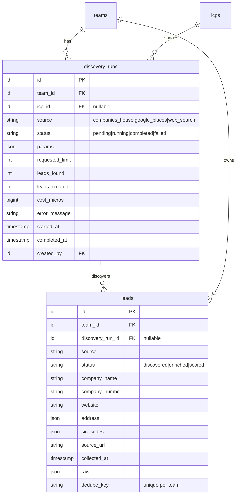

# Lead Sourcing

> Status: **MVP** · Owner: Product · Last updated: 2026-10-29

## Purpose

Discovers candidate **company-level** leads for a team through a pluggable **`LeadSourceProvider`** interface. Owns discovery "runs" (queued, tracked, progress-reported, per-plan-limited) and the raw discovered `leads` before enrichment. It does **not** enrich, dedupe (beyond a placeholder), or score — those are downstream modules — and **never scrapes sources whose terms forbid it**. All three MVP providers are live: **Companies House** (Phase 7), **Google Places** and **web search** (Phase 7b; web search backed by Serper, ADR 0010), behind one contract.

## Code map

- **Backend:** `app/Modules/LeadSourcing/…`
    - **Models:** `DiscoveryRun` (`BelongsToTeam`; `source`, `status`, `icp_id`, `params` JSON, `requested_limit`, `leads_found`/`leads_created`, `cost_micros`, `error_message`, `started_at`/`completed_at`, `created_by`); `Lead` (`BelongsToTeam`; company-level facts — `company_name`/`company_number`/`company_status`/`company_type`/`incorporated_on`/`website`, flattened address + `address` JSON + `sic_codes`, source attribution `source`/`source_url`/`collected_at`/`raw`, and a `dedupe_key` unique per team).
    - **Enums:** `LeadSource` — `companies_house`, `google_places`, `web_search` (`label()`, `description()`, `isAvailable()`, `availableValues()`); `DiscoveryRunStatus` — `pending`, `running`, `completed`, `failed` (`label()`, `isTerminal()`); `LeadStatus` — `discovered`, `enriched`, `scored` (lead only ever `discovered` here; downstream phases advance it).
    - **Contracts:** `LeadSourceProvider` (`source()`, `discover(DiscoveryQuery): list<SourcedLead>`, `costMicros(int)`); `LeadQuotaSource` (billing seam); `LeadInterestGate` (LIA/compliance seam).
    - **Services:** `AbstractHttpLeadSourceProvider` (shared HTTP hardening — per-provider circuit breaker that trips only on transient 5xx/429/connection failures, config-error-vs-transient key checks, failure → `LeadSourcingException`) extended by the three providers: `CompaniesHouseProvider` (official `/search/companies`, free, UK company records), `GooglePlacesProvider` (Places API New Text Search — local/SMB by location+category, strong for UAE), `WebSearchProvider` (Serper driver — organic results → company candidates by domain, ADR 0010). `LeadSourceProviderRegistry` (resolves a provider by `LeadSource`); `DiscoveryLimitGuard` + `StubLeadQuotaSource` (unlimited until Billing); `AllowAllLeadInterestGate` (permits all until Compliance). `Core\Support\CircuitBreaker` (cache-backed, opens after N consecutive failures; extracted to Core in Signals S2 with a `prefix`, bound here with prefix `lead_sourcing:cb` — shared with Signals).
    - **Data (DTOs):** `DiscoveryQuery` (`fromIcp()` derives terms/location from the active ICP's industry/geography signals; `fromParams()`/`toParams()` round-trip the run's stored params); `SourcedLead` (provider-agnostic company record; `dedupeKey()`, `domain()`, `toLeadAttributes()`); `StartDiscoveryData` (validated input); `LeadQuota` (`remaining()`, `isExhausted()`, `clamp()`).
    - **Jobs:** `DiscoverLeadsJob` (`ShouldQueue`, `ShouldBeUnique` per run; `tries=3`, `backoff`, `timeout=85`): claims the run (Pending → Running), calls the provider **outside any transaction**, persists leads (de-duped per team on `dedupe_key`), records counts + cost, broadcasts progress. A provider failure bubbles so the queue retries; `failed()` marks the run `failed`.
    - **Events:** `DiscoveryRunProgressed(teamId, runId, status, percent, step, leadsFound)` — `ShouldBroadcast` on `PrivateChannel('teams.{teamId}')` as `discovery-run.progressed`. Non-sensitive counts/status only — never lead records.
    - **Actions:** `StartDiscoveryRunAction` (gatekeeps provider availability + LIA + plan limit, resolves the ICP + query, then **fans out** — one Pending run per selected source, each dispatching its own job `afterCommit`; returns the `Collection<DiscoveryRun>`), `GetDiscoveryRunsAction` (team-scoped list), `FindDiscoveryRunAction` (team-scoped find with leads).
    - **Policies:** `DiscoveryRunPolicy` (`view` = any member; `create` = Owner/Admin).
    - **Requests:** `StartDiscoveryRequest` (`sources` — one or more live providers, `distinct`; `icp_id` team-scoped, `terms`/`location`, `limit` bounded by config).
    - **Resources:** `DiscoveryRunResource`, `LeadResource`.
    - **Exceptions:** `LeadSourcingException` (`providerUnavailable`, `unknownProvider`, `nothingToSearch`, `quotaExhausted`, `interestAssessmentRequired`, `providerFailed`).
    - **Testing:** `Testing\FakeLeadSourceProvider` (configurable in-memory provider for the pipeline tests).
    - **Provider:** `LeadSourcingServiceProvider` (binds the quota + LIA seams, the circuit breaker, the provider registry with Companies House registered, and the limit guard; registers the policy + routes).
- **Routes:**
    - Web (`auth` + `verified`): `lead-sourcing.index` (`GET /discovery`), `lead-sourcing.store` (`POST /discovery`), `lead-sourcing.show` (`GET /discovery/{run}`).
    - API (`auth:sanctum`): `api.v1.lead-sourcing.runs.index` (`GET /api/v1/discovery-runs`), `.runs.store` (`POST`), `.runs.show` (`GET /api/v1/discovery-runs/{run}`).
    - Broadcast: reuses the `teams.{teamId}` private channel in `routes/channels.php`.
- **Frontend:**
    - `resources/js/pages/lead-sourcing/Index.vue` — the new-discovery form (accessible **multi-select** source picker — tick one or more providers — ICP, terms/location, limit) + recent-runs list that subscribes to Reverb so freshly-started runs update their status badge live. Starting fans out and redirects here. `Show.vue` — run states: running (live progress bar over Reverb), failed, completed (leads table + per-run estimated provider cost). Both render in the default `AppLayout`.
    - `AppSidebar.vue` has a "Lead discovery" entry (Radar icon).
- **Shared:** `resources/js/types/lead-sourcing.ts`. i18n keys added to `lang/en.json` + `lang/ar.json` (parity).
- **Tests:** `tests/Feature/LeadSourcing/{CompaniesHouseProviderTest,GooglePlacesProviderTest,WebSearchProviderTest,DiscoverLeadsJobTest,StartDiscoveryRunTest,DiscoveryApiTest,DiscoveryTenancyTest,DiscoveryGuardsTest}.php`, `tests/Unit/LeadSourcing/{LeadSourceTest,SourcedLeadTest,DiscoveryQueryTest,CircuitBreakerTest}.php`.
- **Config / env vars:** `config/lead-sourcing.php` → `defaults.{limit,max_limit}`, `circuit_breaker.{threshold,cooldown}`, and per-provider `providers.{companies_house,google_places,web_search}.*` (base_url, api_key, timeouts, retry, and `cost_micros_per_request` for the paid providers) — env `COMPANIES_HOUSE_*`, `GOOGLE_PLACES_*`, `WEB_SEARCH_*`, `LEAD_SOURCING_*`.

## MVP vs post-MVP

MVP: the `LeadSourceProvider` framework + registry, `discovery_runs` + `leads`, queued runs with Reverb progress, per-plan limit + LIA gate seams (stubbed), lead-level source attribution, and a placeholder dedupe (Phase 7); plus the **Companies House**, **Google Places** and **web-search (Serper)** providers with per-provider cost and cross-provider dedupe (Phase 7b). Post-MVP: paid B2B providers, Brave/Bing web-search drivers, saved searches, scheduled recurring discovery.

## Data model

`discovery_runs` — one row per run, team-scoped, optionally tied to the `icps` row that shaped it. `leads` — company-level rows, team-scoped, owned by the run that found them, unique per team on `dedupe_key` (the Phase 7 dedupe placeholder; full de-duplication is Phase 8).

## Key flows

**Start.** `StartDiscoveryRunAction` runs inside `TeamContext->run($team)`. It gatekeeps first — **every** selected provider must be live and registered, `LeadInterestGate->assertDiscoveryAllowed()` (LIA, stubbed allow-all), `DiscoveryLimitGuard->ensureWithinAllowance()` (plan limit, stubbed unlimited) — then resolves the ICP (the one asked for, else the team's active ICP) and the run size (clamped to config max and the remaining quota) **once** (shared across sources), builds a `DiscoveryQuery` per source (terms from explicit input or the ICP's industry signals; identical across sources, so one `nothingToSearch` check covers the fan-out), and in a single transaction **fans out — one `pending` `DiscoveryRun` per source** (so Companies House + Google Places queue in parallel, each with its own status/cost/retries), auditing `lead_sourcing.run_started` per run and dispatching a `DiscoverLeadsJob` per run **`afterCommit`**. It returns the `Collection` of runs. No external call happens inside the transaction. The web `store` redirects to the index (which shows all the new runs updating live); the API `store` returns the runs as a 201 resource collection.

**Run.** `DiscoverLeadsJob` (unique per run) claims the run (`pending → running`, locked), then — **outside any transaction** — calls `LeadSourceProviderRegistry->for($source)->discover($query)`. The Companies House provider hits `/search/companies` with HTTP Basic auth (API key as username), bounded timeouts, `Http::retry`, and a circuit breaker; it maps each result into a `SourcedLead` carrying the public record URL. The job persists the leads in a short transaction via `updateOrCreate` keyed on `(team_id, dedupe_key)` (so the same company found again updates in place), records `leads_found`/`leads_created`/`cost_micros`, flips the run to `completed`, and logs on the `lead_sourcing` channel. Progress (`15% → 60% → 100%`) broadcasts on `teams.{teamId}`. A provider failure bubbles so the queue retries with backoff; `failed()` marks the run `failed` after the final attempt.

**View.** The index lists recent runs with their status + lead counts and hosts the new-discovery form. The run screen shows live progress while the job works (subscribing to `discovery-run.progressed`, filtered by `run_id`) and, on completion, reloads to show the leads table.

**Tenancy.** Both models are `BelongsToTeam`-scoped; controllers resolve the active team and rows by `team_id`, so another team's run/lead 404s. `DiscoveryRunPolicy` double-checks ownership on every endpoint (ADR 0006). The `teams.{teamId}` broadcast channel authorises members only.

## External dependencies

- **ICP** (source of the active profile that shapes the query).
- **AI Platform** — not used for discovery (it is deterministic); AI query shaping / web-search enrichment slot in later behind the same contracts.
- **Billing** (`LeadQuotaSource`, Phase 16) and **Compliance** (`LeadInterestGate`, Phase 15) — currently stubs; the seams are real so swapping the bindings needs no caller change.
- **Reverb** (progress broadcasting).
- External provider APIs (outbound HTTP, bounded + circuit-broken): **Companies House** (free), **Google Places API (New)** and **Serper** web search (both paid, metered to `cost_micros`; keys in `.env`). Feeds **Enrichment**, **Scoring**, **Leads Workspace**.

## Permissions

| Ability                     | Owner | Admin | Member | Read-only |
| --------------------------- | ----- | ----- | ------ | --------- |
| View discovery runs + leads | ✅    | ✅    | ✅     | ✅        |
| Start a discovery run       | ✅    | ✅    | ❌     | ❌        |

Policies: `DiscoveryRunPolicy` and (since Phase 9) `LeadPolicy` (`view` = any member), authoritative role via `User::roleOn($team)`. The `BelongsToTeam` global scope blocks cross-tenant reads/writes; the policies double-check ownership.

## Phase 9 additions

Scoring & Matching extended this module's own surfaces rather than duplicating them:

- `Lead::scores()` (all scores) and `Lead::activeScore()` (the score against the team's **active**
  ICP — eager-load this wherever only a grade is needed).
- `LeadPolicy::view` — any member of the owning team; the backstop behind the global scope now that
  a lead is exposed on its own screen (ADR 0006). Mutating abilities arrive with Phase 10.
- `LeadResource` carries a `score` summary (score, grade, label, excluded, scored_at) when
  `activeScore` is loaded; `FindDiscoveryRunAction` eager-loads it, and the run screen shows a
  **Fit** column linking to the score screen.

## Known limitations / TODO

- De-duplication is a placeholder — a per-team unique `dedupe_key` (number → domain → provider external id → provider-scoped name slug+hash). Number and domain are source-agnostic; external-id and name fallbacks are provider-scoped. A merge preserves the first discoverer (`discovery_run_id`) and the **more authoritative** source's identity/attribution (`LeadSource::rank()`: registry > places > web), only ever filling gaps from a weaker source and never nulling a value. It collapses the same company across providers **only when they share a key type**: Companies House is number-keyed with no website, while Places/web-search are domain-keyed, so those two dedupe with each other but not with Companies House until Enrichment links number↔domain. Fuzzy dedupe + per-field `SourcedValue` arrive in Phase 8. (The key format changed from Phase 7's `companies_house:no:…`; pre-release there is no stored data, so no data migration ships — a note for any environment seeded before this change.)
- The plan-limit guard (`LeadQuotaSource`) and LIA gate (`LeadInterestGate`) are stubs until Billing (Phase 16) and Compliance (Phase 15); the seams are wired so only the bindings change. **Fan-out note:** picking N sources creates N runs, each with its own `requested_limit`, but `StartDiscoveryRunAction` checks/clamps the allowance **once**. Billing must reserve against `limit × sources` (or split the limit) — harmless while the quota stub is unlimited (`@todo` in the action).
- **Web search is Serper-only** (ADR 0010): the `provider` config selects the driver, but Brave/Bing aren't implemented and fail fast with a config error. Web-search leads are coarse (title → name, origin → website; no number/status/SIC codes) and **low-confidence** — a page title may not be a company name. Aggregator/social/directory domains (LinkedIn, Facebook, Yelp, …) are skipped via a config denylist so they don't all collapse into one `domain:` lead.
- **Google Places returns at most 20 results** per Text Search request (no pagination in the MVP): a larger requested limit is silently capped at 20. A missing provider API key fails the run fast as a non-retryable misconfiguration (it never burns the queue's retries); a transient 5xx/429/timeout is retried with backoff and trips the shared breaker.
- Companies House `/search/companies` returns no SIC codes or website; Google Places returns no company number. Those gaps (and contacts) come from Enrichment.
- **Companies House search is by company name, not sector**, and does not filter company status: an ICP industry term matches companies with that word in their name, and dissolved/liquidated companies can be returned (`company_status` is stored but not filtered). Scoring (Phase 9) / the advanced-search endpoint can tighten this; deliberately deferred for the MVP.
- Provider **cost is indicative** — `cost_micros_per_request` config values approximate live pricing; verify against the providers' current rates. Google Places / Serper bill per request (one per run), not per lead. The run screen shows the estimate as **USD with Latin digits** (`$0.032`), isolated with `<bdi dir="ltr">` under RTL; whether UAE/Arabic users should see AED or a locale-formatted number is **flagged for brand-owner/product approval** (`brand-tokens.md §7`), not invented here.
- The expensive `POST /discovery(-runs)` currently relies on the shared `throttle:api` limiter + the (stubbed) quota guard; a dedicated per-team rate limit on run creation should land with Billing (Phase 16), alongside making the quota check transactional (today it is checked before the transaction, which is racy only once real limits exist).
- `robots.txt` is not fetched: all three providers are official APIs used within their terms; any real page crawling (Enrichment) must honour robots/ToS.

## Changelog

| Date       | Phase | Change                                                                                                                                                                                                                                                                                                                                                                                                                                                                                                                                                                                                                                                                                                                                                                                                                                                                                                                                                                                                                                                                       | Files                                                                                                                                                                                                                                                                                                                                                                                                                    |
| ---------- | ----- | ---------------------------------------------------------------------------------------------------------------------------------------------------------------------------------------------------------------------------------------------------------------------------------------------------------------------------------------------------------------------------------------------------------------------------------------------------------------------------------------------------------------------------------------------------------------------------------------------------------------------------------------------------------------------------------------------------------------------------------------------------------------------------------------------------------------------------------------------------------------------------------------------------------------------------------------------------------------------------------------------------------------------------------------------------------------------------- | ------------------------------------------------------------------------------------------------------------------------------------------------------------------------------------------------------------------------------------------------------------------------------------------------------------------------------------------------------------------------------------------------------------------------ |
| 2026-10-29 | 7     | Initial module: `discovery_runs` + `leads`, `LeadSource`/`DiscoveryRunStatus`/`LeadStatus` enums, `LeadSourceProvider` contract + registry + Companies House provider (circuit-broken HTTP), quota + LIA seams (stubs), `DiscoverLeadsJob` (Reverb progress, idempotent, dedupe placeholder), Start/Get/Find Actions, policy, web + API routes, the Inertia discovery + run screens (EN/AR + RTL), sidebar entry, tests. Post-review hardening: breaker trips on transient (5xx/429) failures only; re-discovery preserves the original run + never nulls enriched fields; name dedupe key clamped + hashed; job enforces the run-size cap; `source_url` clamped; API start returns 201; accessible source picker (focus ring + non-colour selected cue) in a real `<form>`; EN/AR parity for provider/status labels; added tenancy, guard and circuit-breaker tests.                                                                                                                                                                                                        | `app/Modules/LeadSourcing/**`, `database/migrations/2026_10_29_13000{1,2}_*`, `database/factories/{DiscoveryRun,Lead}Factory.php`, `config/lead-sourcing.php`, `resources/js/pages/lead-sourcing/*`, `resources/js/types/lead-sourcing.ts`, `tests/{Feature,Unit}/LeadSourcing/*`                                                                                                                                        |
| 2026-10-29 | 7b    | Added the **Google Places** (Places API New Text Search) and **web-search (Serper, ADR 0010)** providers behind `LeadSourceProvider`; extracted `AbstractHttpLeadSourceProvider` for the shared HTTP/circuit-breaker hardening (all three now share it). Flipped `LeadSource::isAvailable()` so all three are selectable; made the `dedupe_key` cross-provider-aware; per-provider `cost_micros` surfaced on the run screen (bidi-isolated). Post-review hardening: rank-aware dedupe merge preserves the richer source's attribution + the first discoverer; place-id + case-insensitive name keys; stored URLs restricted to http(s); retry only on transient (5xx/429/connection) conditions; missing API key is a non-retryable misconfiguration (fail fast); breaker trips only on transient failures; web search skips aggregator domains + stores the site origin; zero cost on a no-op run. Added `GooglePlacesProviderTest`, `WebSearchProviderTest`, `ProviderRegistryTest`, cross-provider dedupe/upgrade/fast-fail job tests, and `CircuitBreakerTest`.          | `app/Modules/LeadSourcing/Services/{AbstractHttpLeadSourceProvider,GooglePlacesProvider,WebSearchProvider,CompaniesHouseProvider}.php`, `app/Modules/LeadSourcing/{Enums/LeadSource,Data/SourcedLead,Providers/LeadSourcingServiceProvider}.php`, `config/lead-sourcing.php`, `docs/decisions/0010-web-search-provider.md`, `resources/js/pages/lead-sourcing/Show.vue`, `lang/*`, `tests/{Feature,Unit}/LeadSourcing/*` |
| 2026-10-29 | 8     | Hand-off to Enrichment: `DiscoverLeadsJob` now fires `DiscoveryRunCompleted` on success (consumed by Enrichment's listener). The `Lead` model gained the enrichment columns (`enrichment_status`, `industry`, `employee_range`, `technologies`, `field_sources`, `has_personal_data`, `enriched_at`, `enrichment_cost_micros`), a `contacts()` relation and a `domain()` helper; `LeadResource` now exposes enrichment fields + contacts. See `enrichment-data-quality.md`.                                                                                                                                                                                                                                                                                                                                                                                                                                                                                                                                                                                                  | `app/Modules/LeadSourcing/{Jobs/DiscoverLeadsJob,Events/DiscoveryRunCompleted,Models/Lead,Http/Resources/LeadResource}.php`, `database/migrations/2026_10_29_140001_*`, `tests/Feature/LeadSourcing/DiscoverLeadsJobTest.php`                                                                                                                                                                                            |
| 2026-10-29 | 8     | **Multi-provider discovery.** The start payload takes `sources` (array, `distinct`) instead of a single `source`; `StartDiscoveryRunAction` fans out to one Pending `DiscoveryRun` per selected source (each its own job/cost/retries — no migration, the one-source-per-run model is unchanged) and returns a `Collection`. Web `store` redirects to the index; API `store` returns a 201 resource collection. The picker became an accessible multi-select checkbox grid and the recent-runs list now reflects live Reverb progress. EN/AR parity for the new strings.                                                                                                                                                                                                                                                                                                                                                                                                                                                                                                     | `app/Modules/LeadSourcing/{Actions/StartDiscoveryRunAction,Data/StartDiscoveryData,Http/Requests/StartDiscoveryRequest,Http/Controllers/Web/DiscoveryController,Http/Controllers/Api/V1/DiscoveryController}.php`, `resources/js/pages/lead-sourcing/Index.vue`, `lang/{en,ar}.json`, `tests/Feature/LeadSourcing/{StartDiscoveryRunTest,DiscoveryApiTest,DiscoveryGuardsTest}.php`                                      |
| 2026-10-29 | 9     | Scoring surfaces: `Lead::scores()` + `Lead::activeScore()` relations, a `LeadPolicy` (`view` = any member) registered in the module provider, a `score` summary on `LeadResource` when `activeScore` is loaded, that relation eager-loaded by `FindDiscoveryRunAction`, and a **Fit** column on the run screen linking to the score screen.                                                                                                                                                                                                                                                                                                                                                                                                                                                                                                                                                                                                                                                                                                                                  | `app/Modules/LeadSourcing/{Models/Lead,Policies/LeadPolicy,Providers/LeadSourcingServiceProvider,Http/Resources/LeadResource,Actions/FindDiscoveryRunAction}.php`, `resources/js/pages/lead-sourcing/Show.vue`                                                                                                                                                                                                           |
| 2026-10-29 | 10b   | **Fixed (shipped broken in Phase 7): the run detail screen listed no companies.** `DiscoveryRunResource` nested `LeadResource::collection(...)` for its `leads`, and the Inertia controller serialises with `->resolve()`, which only resolves the **top** level — so the prop arrived as `run.leads = { data: [...] }` while `lead-sourcing/Show.vue` reads `run.leads.length`. Every completed run therefore showed the "No companies matched" empty state however many leads it had created. The nested collection is now resolved to a plain list (the same fix `LeadResource.contacts` got in Phase 10), and the shape is pinned by a new `DiscoveryWebTest` plus a real leads assertion in `DiscoveryApiTest` — which had a test _named_ "shows a single run with its leads" that asserted only the id and status. Also gave `LeadSource` a non-provider `Import` case (Phase 10b CSV import), ranked above every provider so a re-discovery fills an imported lead's gaps instead of renaming it, and `isAvailable()` false so it can never be picked for a run.      | `app/Modules/LeadSourcing/{Http/Resources/DiscoveryRunResource,Enums/LeadSource,Models/Lead,Http/Resources/LeadResource,Policies/LeadPolicy}.php`, `tests/Feature/LeadSourcing/{DiscoveryWebTest,DiscoveryApiTest}.php`, `tests/Unit/LeadSourcing/LeadSourceTest.php`                                                                                                                                                    |
| 2026-10-29 | S4    | **Signals hand-off.** Added the non-provider `LeadSource::Signal` case (label "Signal", `isAvailable()` false so it can never be picked for a run, `rank()` 1 — level with web search, so a registry, a places listing or the team's own import all outrank a converted signal and may correct it on a merge, while it may only fill their gaps). `isAvailable()`/`rank()` became exhaustive `match`es so the next case can't be forgotten. `LeadResource` now sends **`outreach_restriction`** on every lead (value, label, guidance, `allows_direct_marketing`, read from `raw` via the new `Core\Enums\OutreachRestriction`) — on every lead rather than just the detail screen, because Outreach (Phase 11) and mobile both have to honour it and a flag you must ask for separately is a flag that gets missed. **Also fixed:** the discovery picker listed _every_ `LeadSource` case, so `import` already rendered as a permanently greyed-out card and `signal` would have added a second; it now lists the providers only. See `signals.md` for the conversion flow. | `app/Modules/LeadSourcing/{Enums/LeadSource,Http/Resources/LeadResource,Http/Controllers/Web/DiscoveryController}.php`, `app/Modules/Core/Enums/OutreachRestriction.php`, `resources/js/types/lead-sourcing.ts`, `lang/{en,ar}.json`, `tests/Unit/LeadSourcing/LeadSourceTest.php`, `tests/Feature/LeadSourcing/DiscoveryWebTest.php`                                                                                    |
| 2026-10-30 | fix   | **`leads.source_url` widened to 2048** (from the default 255), matching `signals.source_url`, and `SourcedLead::safeUrl()` now takes the **destination column's** width instead of clamping every URL to `MAX_TEXT`. An article URL routinely exceeds 255 — Serper answers some with a ~280-character Google redirect — and clamping to fit meant a lead stored a **cut URL that no longer resolves**, rendered as a working link. `website` keeps its own 255, because a clamp wider than the column throws on insert. Driven by a crash converting a signal (`docs/modules/signals.md`).                                                                                                                                                                                                                                                                                                                                                                                                                                                                                   | `database/migrations/2026_10_30_120001_widen_source_url_columns.php`, `app/Modules/LeadSourcing/Data/SourcedLead.php`, `tests/Unit/LeadSourcing/SourcedLeadTest.php`                                                                                                                                                                                                                                                     |
