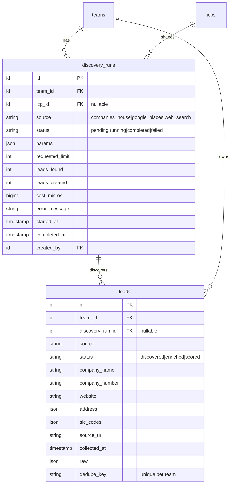

# Lead Sourcing

> Status: **MVP** · Owner: Product · Last updated: 2026-10-29

## Purpose

Discovers candidate **company-level** leads for a team through a pluggable **`LeadSourceProvider`** interface. Owns discovery "runs" (queued, tracked, progress-reported, per-plan-limited) and the raw discovered `leads` before enrichment. It does **not** enrich, dedupe (beyond a placeholder), or score — those are downstream modules — and **never scrapes sources whose terms forbid it**. Phase 7 ships the framework + the **Companies House** provider; Phase 7b adds Google Places + web search behind the same contract.

## Code map

- **Backend:** `app/Modules/LeadSourcing/…`
    - **Models:** `DiscoveryRun` (`BelongsToTeam`; `source`, `status`, `icp_id`, `params` JSON, `requested_limit`, `leads_found`/`leads_created`, `cost_micros`, `error_message`, `started_at`/`completed_at`, `created_by`); `Lead` (`BelongsToTeam`; company-level facts — `company_name`/`company_number`/`company_status`/`company_type`/`incorporated_on`/`website`, flattened address + `address` JSON + `sic_codes`, source attribution `source`/`source_url`/`collected_at`/`raw`, and a `dedupe_key` unique per team).
    - **Enums:** `LeadSource` — `companies_house`, `google_places`, `web_search` (`label()`, `description()`, `isAvailable()`, `availableValues()`); `DiscoveryRunStatus` — `pending`, `running`, `completed`, `failed` (`label()`, `isTerminal()`); `LeadStatus` — `discovered`, `enriched`, `scored` (lead only ever `discovered` here; downstream phases advance it).
    - **Contracts:** `LeadSourceProvider` (`source()`, `discover(DiscoveryQuery): list<SourcedLead>`, `costMicros(int)`); `LeadQuotaSource` (billing seam); `LeadInterestGate` (LIA/compliance seam).
    - **Services:** `CompaniesHouseProvider` (official `/search/companies` API, free; defensive HTTP — configurable timeouts, `Http::retry`, shared circuit breaker; maps results → `SourcedLead` with the public record URL as attribution); `LeadSourceProviderRegistry` (resolves a provider by `LeadSource`); `DiscoveryLimitGuard` + `StubLeadQuotaSource` (unlimited until Billing); `AllowAllLeadInterestGate` (permits all until Compliance). `Support\CircuitBreaker` (cache-backed, opens after N consecutive failures).
    - **Data (DTOs):** `DiscoveryQuery` (`fromIcp()` derives terms/location from the active ICP's industry/geography signals; `fromParams()`/`toParams()` round-trip the run's stored params); `SourcedLead` (provider-agnostic company record; `dedupeKey()`, `domain()`, `toLeadAttributes()`); `StartDiscoveryData` (validated input); `LeadQuota` (`remaining()`, `isExhausted()`, `clamp()`).
    - **Jobs:** `DiscoverLeadsJob` (`ShouldQueue`, `ShouldBeUnique` per run; `tries=3`, `backoff`, `timeout=85`): claims the run (Pending → Running), calls the provider **outside any transaction**, persists leads (de-duped per team on `dedupe_key`), records counts + cost, broadcasts progress. A provider failure bubbles so the queue retries; `failed()` marks the run `failed`.
    - **Events:** `DiscoveryRunProgressed(teamId, runId, status, percent, step, leadsFound)` — `ShouldBroadcast` on `PrivateChannel('teams.{teamId}')` as `discovery-run.progressed`. Non-sensitive counts/status only — never lead records.
    - **Actions:** `StartDiscoveryRunAction` (gatekeeps provider availability + LIA + plan limit, resolves the ICP + query, opens a Pending run, dispatches the job `afterCommit`), `GetDiscoveryRunsAction` (team-scoped list), `FindDiscoveryRunAction` (team-scoped find with leads).
    - **Policies:** `DiscoveryRunPolicy` (`view` = any member; `create` = Owner/Admin).
    - **Requests:** `StartDiscoveryRequest` (`source` must be a live provider, `icp_id` team-scoped, `terms`/`location`, `limit` bounded by config).
    - **Resources:** `DiscoveryRunResource`, `LeadResource`.
    - **Exceptions:** `LeadSourcingException` (`providerUnavailable`, `unknownProvider`, `nothingToSearch`, `quotaExhausted`, `interestAssessmentRequired`, `providerFailed`).
    - **Testing:** `Testing\FakeLeadSourceProvider` (configurable in-memory provider for the pipeline tests).
    - **Provider:** `LeadSourcingServiceProvider` (binds the quota + LIA seams, the circuit breaker, the provider registry with Companies House registered, and the limit guard; registers the policy + routes).
- **Routes:**
    - Web (`auth` + `verified`): `lead-sourcing.index` (`GET /discovery`), `lead-sourcing.store` (`POST /discovery`), `lead-sourcing.show` (`GET /discovery/{run}`).
    - API (`auth:sanctum`): `api.v1.lead-sourcing.runs.index` (`GET /api/v1/discovery-runs`), `.runs.store` (`POST`), `.runs.show` (`GET /api/v1/discovery-runs/{run}`).
    - Broadcast: reuses the `teams.{teamId}` private channel in `routes/channels.php`.
- **Frontend:**
    - `resources/js/pages/lead-sourcing/Index.vue` — the new-discovery form (source picker, ICP, terms/location, limit) + recent-runs list. `Show.vue` — run states: running (live progress bar over Reverb), failed, completed (leads table). Both render in the default `AppLayout`.
    - `AppSidebar.vue` has a "Lead discovery" entry (Radar icon).
- **Shared:** `resources/js/types/lead-sourcing.ts`. i18n keys added to `lang/en.json` + `lang/ar.json` (parity).
- **Tests:** `tests/Feature/LeadSourcing/{CompaniesHouseProviderTest,DiscoverLeadsJobTest,StartDiscoveryRunTest,DiscoveryApiTest}.php`, `tests/Unit/LeadSourcing/{LeadSourceTest,SourcedLeadTest,DiscoveryQueryTest}.php`.
- **Config / env vars:** `config/lead-sourcing.php` → `defaults.{limit,max_limit}`, `circuit_breaker.{threshold,cooldown}`, `providers.companies_house.{base_url,api_key,record_base_url,timeout,connect_timeout,retry_times,retry_sleep_ms}` (env `COMPANIES_HOUSE_*`, `LEAD_SOURCING_*`).

## MVP vs post-MVP

MVP (Phase 7): the `LeadSourceProvider` framework + registry, `discovery_runs` + `leads`, the Companies House provider, queued runs with Reverb progress, per-plan limit + LIA gate seams (stubbed), lead-level source attribution, and a placeholder dedupe. Phase 7b: Google Places + web-search providers, per-provider cost, cross-provider dedupe. Post-MVP: paid B2B providers, saved searches, scheduled recurring discovery.

## Data model

`discovery_runs` — one row per run, team-scoped, optionally tied to the `icps` row that shaped it. `leads` — company-level rows, team-scoped, owned by the run that found them, unique per team on `dedupe_key` (the Phase 7 dedupe placeholder; full de-duplication is Phase 8).

## Key flows

**Start.** `StartDiscoveryRunAction` runs inside `TeamContext->run($team)`. It gatekeeps first — the provider must be live and registered, `LeadInterestGate->assertDiscoveryAllowed()` (LIA, stubbed allow-all), `DiscoveryLimitGuard->ensureWithinAllowance()` (plan limit, stubbed unlimited) — then resolves the ICP (the one asked for, else the team's active ICP), builds a `DiscoveryQuery` (terms from explicit input or the ICP's industry signals; run size clamped to config max and the remaining quota), refuses with `nothingToSearch` if there's nothing to search, opens a `pending` `DiscoveryRun`, audits `lead_sourcing.run_started`, and dispatches `DiscoverLeadsJob` **`afterCommit`**. No external call happens inside the transaction.

**Run.** `DiscoverLeadsJob` (unique per run) claims the run (`pending → running`, locked), then — **outside any transaction** — calls `LeadSourceProviderRegistry->for($source)->discover($query)`. The Companies House provider hits `/search/companies` with HTTP Basic auth (API key as username), bounded timeouts, `Http::retry`, and a circuit breaker; it maps each result into a `SourcedLead` carrying the public record URL. The job persists the leads in a short transaction via `updateOrCreate` keyed on `(team_id, dedupe_key)` (so the same company found again updates in place), records `leads_found`/`leads_created`/`cost_micros`, flips the run to `completed`, and logs on the `lead_sourcing` channel. Progress (`15% → 60% → 100%`) broadcasts on `teams.{teamId}`. A provider failure bubbles so the queue retries with backoff; `failed()` marks the run `failed` after the final attempt.

**View.** The index lists recent runs with their status + lead counts and hosts the new-discovery form. The run screen shows live progress while the job works (subscribing to `discovery-run.progressed`, filtered by `run_id`) and, on completion, reloads to show the leads table.

**Tenancy.** Both models are `BelongsToTeam`-scoped; controllers resolve the active team and rows by `team_id`, so another team's run/lead 404s. `DiscoveryRunPolicy` double-checks ownership on every endpoint (ADR 0006). The `teams.{teamId}` broadcast channel authorises members only.

## External dependencies

- **ICP** (source of the active profile that shapes the query).
- **AI Platform** — not used in Phase 7 (discovery is deterministic); AI query shaping / web-search enrichment slot in later behind the same contracts.
- **Billing** (`LeadQuotaSource`, Phase 16) and **Compliance** (`LeadInterestGate`, Phase 15) — currently stubs; the seams are real so swapping the bindings needs no caller change.
- **Reverb** (progress broadcasting).
- **Companies House** public-data API (outbound HTTP, bounded + circuit-broken). Feeds **Enrichment**, **Scoring**, **Leads Workspace**.

## Permissions

| Ability                     | Owner | Admin | Member | Read-only |
| --------------------------- | ----- | ----- | ------ | --------- |
| View discovery runs + leads | ✅    | ✅    | ✅     | ✅        |
| Start a discovery run       | ✅    | ✅    | ❌     | ❌        |

Policy: `DiscoveryRunPolicy`, authoritative role via `User::roleOn($team)`. The `BelongsToTeam` global scope blocks cross-tenant reads/writes; the policy double-checks ownership.

## Known limitations / TODO

- Only **Companies House** is live; Google Places + web search are listed but gated off (`isAvailable()`), added in Phase 7b.
- De-duplication is a placeholder — a per-team unique `dedupe_key` (company number → domain → name slug), applied via `updateOrCreate`. Cross-provider/fuzzy dedupe and per-field source attribution (`SourcedValue`) arrive with Enrichment (Phase 8).
- The plan-limit guard (`LeadQuotaSource`) and LIA gate (`LeadInterestGate`) are stubs until Billing (Phase 16) and Compliance (Phase 15); the seams are wired so only the bindings change.
- Companies House `/search/companies` returns no SIC codes or website — those (and contacts) come from Enrichment.
- **Search is by company name, not sector**, and does not filter company status: an ICP industry term matches companies with that word in their name, and dissolved/liquidated companies can be returned (`company_status` is stored but not filtered). Scoring (Phase 9) / the advanced-search endpoint can tighten this; deliberately deferred for the Phase 7 MVP.
- The expensive `POST /discovery(-runs)` currently relies on the shared `throttle:api` limiter + the (stubbed) quota guard; a dedicated per-team rate limit on run creation should land with Billing (Phase 16), alongside making the quota check transactional (today it is checked before the transaction, which is racy only once real limits exist).
- `robots.txt` is not fetched: the only provider is an official API used within its terms; real web crawling (Phase 7b) must honour robots/ToS.

## Changelog

| Date       | Phase | Change                                                                                                                                                                                                                                                                                                                                                                                                                   | Files                                                                                                                                                                                                                                                                             |
| ---------- | ----- | ------------------------------------------------------------------------------------------------------------------------------------------------------------------------------------------------------------------------------------------------------------------------------------------------------------------------------------------------------------------------------------------------------------------------ | --------------------------------------------------------------------------------------------------------------------------------------------------------------------------------------------------------------------------------------------------------------------------------- |
| 2026-10-29 | 7     | Initial module: `discovery_runs` + `leads`, `LeadSource`/`DiscoveryRunStatus`/`LeadStatus` enums, `LeadSourceProvider` contract + registry + Companies House provider (circuit-broken HTTP), quota + LIA seams (stubs), `DiscoverLeadsJob` (Reverb progress, idempotent, dedupe placeholder), Start/Get/Find Actions, policy, web + API routes, the Inertia discovery + run screens (EN/AR + RTL), sidebar entry, tests. Post-review hardening: breaker trips on transient (5xx/429) failures only; re-discovery preserves the original run + never nulls enriched fields; name dedupe key clamped + hashed; job enforces the run-size cap; `source_url` clamped; API start returns 201; accessible source picker (focus ring + non-colour selected cue) in a real `<form>`; EN/AR parity for provider/status labels; added tenancy, guard and circuit-breaker tests. | `app/Modules/LeadSourcing/**`, `database/migrations/2026_10_29_13000{1,2}_*`, `database/factories/{DiscoveryRun,Lead}Factory.php`, `config/lead-sourcing.php`, `resources/js/pages/lead-sourcing/*`, `resources/js/types/lead-sourcing.ts`, `tests/{Feature,Unit}/LeadSourcing/*` |
