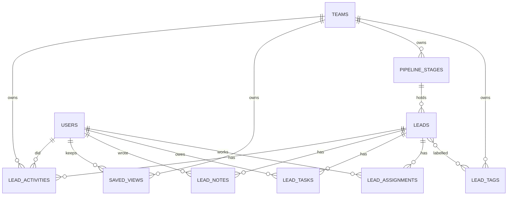

# Leads Workspace (CRM-lite)

> Status: **MVP** · Last updated: 2026-10-29

## Purpose

The day-to-day workspace where a team works its leads:

- the **leads index** — server-driven filters, search, sorting, paging and saved views;
- the **lead detail** page — company facts with source attribution and freshness, contacts, the
  current fit grade, and the team's own work on the lead;
- the **kanban board** — a team-customisable pipeline the leads are dragged along;
- **tags, notes, tasks and assignment** — the collaboration state a team keeps about a company;
- **bulk actions** over a selection, and **CSV import/export**;
- the **activity timeline** that aggregates everything that has happened to a lead, from wherever in
  the platform it happened.

It owns pipeline + collaboration state. It does **not** source leads (Lead Sourcing), fill them in
(Enrichment), grade them (Scoring) or write messages to them (Outreach) — it is the one screen that
brings all of that together, and the one place the team's own work on a lead is recorded.

The module listens **outwards**: Lead Sourcing, Enrichment and Scoring know nothing about it.

## Code map

- **Backend:** `app/Modules/LeadsWorkspace/`
    - **Reading the list**
        - `Services/LeadQueryBuilder.php` — what a filter _means_, in one place: the index, the API,
          a saved view, a bulk selection and the CSV export all read through it.
        - `Actions/ListLeadsAction.php` — one page of that query: the eager loads a row needs, the
          page size, and keeping the filters on the links.
        - `Actions/FindLeadAction.php` — the detail read: contacts, run, scores (+ ICP + the
          viewer's own feedback), notes, tasks, stage, tags, assignees and the head of the timeline,
          all eager-loaded.
        - `Data/LeadFilters.php` — the one filter shape the request, the query, the Inertia props and
          a stored view all speak.
        - `Support/LeadFilterOptions.php` — the filter bar's enum-derived option lists.
    - **The board**
        - `Actions/EnsureDefaultPipelineStagesAction.php` — gives a team a board the first time it
          needs one, from config. Lazy, idempotent, race-safe.
        - `Actions/ListPipelineAction.php` — the board: stages in order, each with its cards and a
          true total.
        - `Actions/{SavePipelineStageAction,DeletePipelineStageAction,ReorderPipelineStagesAction}.php`
        - `Actions/MoveLeadStageAction.php` — one lead to another column.
    - **The team's work on a lead**
        - `Actions/SyncLeadTagsAction.php` — the whole tag set by name; tags created on first use.
        - `Actions/{CreateLeadNoteAction,DeleteLeadNoteAction}.php`
        - `Actions/{CreateLeadTaskAction,CompleteLeadTaskAction,DeleteLeadTaskAction}.php`
        - `Actions/SetLeadAssigneesAction.php` — the whole assignee set; the Action works out the
          difference.
        - `Actions/RecordLeadActivityAction.php` — the only writer of a timeline entry; idempotent
          per (lead, type, subject).
    - **In and out in bulk**
        - `Actions/BulkUpdateLeadsAction.php` — one action over a selection, by reusing the
          single-lead Actions so the history is identical either way.
        - `Actions/ImportLeadsAction.php` + `Services/LeadCsvImporter.php` — CSV in, with column
          mapping and de-duplication.
        - `Actions/ExportLeadsAction.php` + `Services/LeadCsvExporter.php` — CSV out, streamed.
    - **Saved views:** `Actions/{SaveViewAction,ListSavedViewsAction,DeleteSavedViewAction}.php`
    - **Models:** `LeadActivity`, `SavedView`, `PipelineStage`, `LeadTag`, `LeadNote`, `LeadTask`,
      `LeadAssignment`
    - **Enums:** `LeadActivityType`, `LeadSort`, `LeadSortDirection`, `StageOutcome`,
      `LeadTaskStatus`, `BulkLeadAction`
    - **Data:** `LeadFilters`, `LeadTaskData`, `BulkLeadRequestData`, `LeadImportResult`
    - **Policies:** `SavedViewPolicy`, `PipelineStagePolicy`, `LeadNotePolicy`, `LeadTaskPolicy`
      (plus `LeadSourcing\Policies\LeadPolicy`, which owns `view`/`work`/`import`/`export`)
    - **Listeners** (all `ShouldQueue`):
      `RecordDiscoveryActivity`, `RecordEnrichmentActivity`, `RecordScoringActivity`
    - **Exceptions:** `LeadsWorkspaceException`
    - **Http:** `Controllers/Web/{LeadController,SavedViewController,PipelineController,LeadCollaborationController,LeadTransferController}`,
      `Controllers/Web/Concerns/ResolvesWorkspace`,
      `Controllers/Api/V1/{LeadController,LeadWorkController}`, 11 `Requests/`, 7 `Resources/`
    - `Providers/LeadsWorkspaceServiceProvider.php`
- **Routes** — web (all `auth`+`verified`):

    | Method   | Path                             | Name                   |
    | -------- | -------------------------------- | ---------------------- |
    | `GET`    | `/leads`                         | `leads.index`          |
    | `GET`    | `/leads/{lead}`                  | `leads.show`           |
    | `GET`    | `/leads/pipeline`                | `leads.pipeline`       |
    | `POST`   | `/leads/pipeline/stages`         | `leads.stages.store`   |
    | `PUT`    | `/leads/pipeline/stages/order`   | `leads.stages.reorder` |
    | `PUT`    | `/leads/pipeline/stages/{stage}` | `leads.stages.update`  |
    | `DELETE` | `/leads/pipeline/stages/{stage}` | `leads.stages.destroy` |
    | `POST`   | `/leads/views`                   | `leads.views.store`    |
    | `DELETE` | `/leads/views/{view}`            | `leads.views.destroy`  |
    | `POST`   | `/leads/bulk`                    | `leads.bulk`           |
    | `GET`    | `/leads/import`                  | `leads.import`         |
    | `POST`   | `/leads/import`                  | `leads.import.store`   |
    | `GET`    | `/leads/export`                  | `leads.export`         |
    | `PUT`    | `/leads/{lead}/stage`            | `leads.stage.move`     |
    | `PUT`    | `/leads/{lead}/tags`             | `leads.tags.sync`      |
    | `PUT`    | `/leads/{lead}/assignees`        | `leads.assignees.set`  |
    | `POST`   | `/leads/{lead}/notes`            | `leads.notes.store`    |
    | `DELETE` | `/leads/notes/{note}`            | `leads.notes.destroy`  |
    | `POST`   | `/leads/{lead}/tasks`            | `leads.tasks.store`    |
    | `PUT`    | `/leads/tasks/{task}`            | `leads.tasks.complete` |
    | `DELETE` | `/leads/tasks/{task}`            | `leads.tasks.destroy`  |

    Notes and tasks are addressed by their **own** id rather than the lead's: they are already
    team-scoped, and carrying the lead in the URL would be a second thing to keep in step. Every
    literal path is declared before `leads/{lead}`, which is numeric-only, so neither can swallow the
    other however the file is re-ordered later. `/leads/bulk`, `/leads/import` and `/leads/export`
    carry the `leads-bulk` rate limiter.

- **Routes** — API (`auth:sanctum`, under `/api/v1`): `leads.index`, `leads.show`, `leads.stages`,
  and `leads.{stage.move,tags.sync,assignees.set,notes.store,tasks.store,tasks.complete}` — the
  mobile app's half of the workspace, through the same Actions as the web.
- **Frontend:** `resources/js/pages/leads/{Index,Show,Pipeline,Import}.vue`,
  `resources/js/components/leads/{LeadFilterBar,SavedViewBar,ActivityTimeline,BulkActionBar,LeadWorkPanel,LeadNotes,LeadTasks}.vue`,
  the shared `resources/js/components/Pagination.vue`, and
  `resources/js/types/{leads-workspace,enrichment}.ts`. The app sidebar gained a **Leads** item;
  the list and board link to each other.
- **Shared / changed elsewhere:** `LeadSourcing\Models\Lead` gained `activities()`,
  `pipelineStage()`, `tags()`, `notes()`, `tasks()` and `assignments()`;
  `LeadSourcing\Http\Resources\LeadResource` gained `contacts_count`, `stage`, `tags`, `assignees`
  and `open_tasks_count`, and now resolves `contacts` to a plain list;
  `LeadSourcing\Policies\LeadPolicy` gained `work`, `import` and `export`;
  `Scoring\Events\LeadScored` is new and `ScoreLeadAction` fires it `afterCommit`.
- **Tests:** `tests/Feature/LeadsWorkspace/` (LeadsIndex, LeadDetail, SavedViews, LeadsApi,
  LeadTimeline, LeadsWorkspaceTenancy, Pipeline, LeadCollaboration, BulkLeadAction, LeadCsv,
  LeadWorkApi), `tests/Unit/LeadsWorkspace/LeadFiltersTest.php`, shared set-up in
  `tests/Support/LeadsWorkspaceFixtures.php`.
- **Config / env vars:** `config/leads-workspace.php` — `default_stages` (the board a team starts
  with, config rather than env because it is a list), `LEADS_MAX_STAGES`,
  `LEADS_BOARD_COLUMN_LIMIT`, `LEADS_MAX_BULK`, `LEADS_BULK_RATE_LIMIT`,
  `LEADS_CSV_MAX_UPLOAD_KB`, `LEADS_CSV_MAX_IMPORT_ROWS`, `LEADS_CSV_EXPORT_CHUNK`. Page size is
  bounded by the request (1–100, default 25).

## Data model

**`lead_activities`** — the timeline. `team_id` + `lead_id` (both cascade), `user_id`
(**null on delete**, so history outlives an account, and null to begin with for anything the
platform did on its own), `type` (`LeadActivityType`), a **nullable polymorphic `subject`**, a
`properties` JSON bag, and `occurred_at`. Indexed for the timeline query with `id` as a stable
tie-break, plus **unique (`lead_id`, `type`, `subject_type`, `subject_id`)** behind the Action's
upsert so two concurrent retries of the same listener can't both insert. Rows with a null subject
are exempt (SQL treats NULLs as distinct), which is exactly the append-always semantics documented
for subject-less entries.

Two decisions worth stating:

- **`properties` holds values, never a sentence.** The workspace is EN/AR (ADR 0007), so every
  timeline line is composed at render time from `type` + `properties`. A stored English string would
  also freeze yesterday's phrasing into a team's history.
- **An entry's subject sets its lifetime.** `discovered` is subjected to the run, `enriched` to the
  lead, `scored` to the `lead_scores` row, `note_added`/`task_created`/`task_completed` to the note
  or task — so a re-grade updates its entry the way the score row itself is updated in place, and a
  deleted note takes its entry (and its quoted excerpt) with it. `stage_changed`, `assigned`,
  `unassigned`, `tags_changed` and `imported` have **no** subject, so each one is appended: the
  whole path a lead took is worth keeping, not just where it ended up. The trade-off on `enriched`
  is explicit — one entry showing the latest run, not twelve near-identical rows.

**`saved_views`** — `team_id` (cascade), `user_id` (**cascade**: a view is a personal preference and
goes with the account), `name`, `filters` JSON (the canonical `LeadFilters` form), `is_shared`.
**Unique (`team_id`, `user_id`, `name`)** — saving again under the same name replaces the filters,
because re-saving a tweaked view is the common case and a constraint error is a poor way to say so.
The **team is part of the key**, and part of the upsert's lookup, because a user can belong to
several (ADR 0006): their "Grade A in the UK" in one team is a different view from the one in
another, and a team-scoped lookup on (user, name) alone would miss the other team's row and then
collide with it.

**`pipeline_stages`** — `team_id` (cascade), `name`, `slug`, `position`, `is_default`, `outcome`
(`StageOutcome` or null). **Unique (`team_id`, `slug`)**; indexed on (`team_id`, `position`).
`position` is deliberately **not** unique: a reorder rewrites the whole set and has to pass through
an intermediate state. Exactly one stage per team is the default, enforced in the Action rather than
the schema, because a partial unique index isn't portable between SQLite and MySQL.

**`leads.pipeline_stage_id`** — nullable, `nullOnDelete`. **Null means "wherever the default stage
is".** Lead Sourcing creates leads without knowing the board exists, and a team that has never
opened the board has no stages at all, so a lead's position is only recorded once someone has
actually decided something about it. Every query that cares folds null into the default column,
which means no backfill now and none when a team adds stages later. `nullOnDelete` is the backstop,
not the plan: `DeletePipelineStageAction` moves the leads first.

**`lead_tags`** + **`lead_lead_tag`** — `team_id` (cascade), `name`, `slug`; **unique
(`team_id`, `slug`)**. The slug is the normalised name (trimmed, lower-cased, space-collapsed), so
"Warm", "warm" and " warm " are one tag. Deliberately **not** `Str::slug()`, which strips Arabic
entirely and would collapse every Arabic tag to an empty string. The pivot carries no `team_id` —
both ends are already team-scoped and the tag is only reachable through one of them.

**`lead_notes`** — `team_id` + `lead_id` (cascade), `user_id` (**null on delete**: a note is the
team's record of a conversation and must outlive the account that wrote it), `body`. No `update`
path: a note is amended by adding another one, so the thread stays honest about what was known when.

**`lead_tasks`** — `team_id` + `lead_id` (cascade), `created_by`/`assigned_to`/`completed_by` (all
**null on delete**, so an open task doesn't vanish because the person it was given to left), `title`,
`status`, `due_at`, `remind_at`, `reminded_at`, `completed_at`. `remind_at` is separate from `due_at`
because "remind me the day before" is the common case, and `reminded_at` is already here so the
Phase 12 sweep can be idempotent from its first release rather than needing a migration to become so.

**`lead_assignments`** — `team_id` + `lead_id` + `user_id` (cascade; the assignment _is_ the
relationship), `assigned_by` (null on delete), `assigned_at`. **Unique (`lead_id`, `user_id`)** —
assigning again is a no-op, not a second row. A table rather than a column on `leads`, because a
lead can be shared (a researcher and a closer on the same company is normal) and because it records
who handed it over and when.

## Key flows

### The leads index

`GET /leads` → `ListLeadsRequest` validates the query string → `ListLeadsAction` runs
`LeadQueryBuilder` in the team's context → one page of `LeadResource` plus the filter state, the
option lists, the team's board/tags/members, and the member's saved views.

Three properties the implementation holds to:

1. **Server-driven.** Filtering, sorting and paging all happen in SQL, so the screen never holds
   more than a page and a shared URL reproduces exactly what the sender saw. Every filter change is
   a `router.get` with `replace: true`, so the browser's own back button walks the filter history.
2. **A fixed query count.** The grade badge comes from an eager-loaded `activeScore`, the stage,
   tags and assignees from eager loads, and the contact and open-task counts from `withCount`
   sub-queries — so a page of 100 costs what a page of 10 does. Both the index and the detail screen
   have a test that calls `Model::preventLazyLoading()` explicitly, and the index has one that
   asserts the query count is **identical** for a page of 5 and a page of 15 (which catches a
   per-row query that isn't a lazy relation load).
3. **Nothing from the request reaches the builder as SQL.** Sorts are enum cases mapped to columns;
   `LeadFilters` narrows every value to an enum, a positive integer id, or a trimmed, length-capped
   string.

| Filter                | Matched against                                                                                       |
| --------------------- | ----------------------------------------------------------------------------------------------------- |
| `search`              | company name/number/website/industry/locality + contact name/email/title                              |
| `grades`              | the lead's score **against the active ICP** (an ungraded lead has no grade to be in a graded list by) |
| `sources`             | `leads.source`                                                                                        |
| `enrichment_statuses` | `leads.enrichment_status`                                                                             |
| `country`             | a two-letter value is an ISO code; anything longer also matches region/locality                       |
| `stages`              | `leads.pipeline_stage_id` — **widened to `IS NULL`** when the default stage is among them             |
| `tags`                | **every** tag asked for, not any: narrowing by two tags means both                                    |
| `assignees`           | any of the named members                                                                              |
| `unassigned`          | nobody is working it — a filter in its own right, not an empty assignee list                          |

| Sort        | Ordering                                                                                                                      |
| ----------- | ----------------------------------------------------------------------------------------------------------------------------- |
| `newest`    | `id` (the default)                                                                                                            |
| `company`   | `company_name`                                                                                                                |
| `fit`       | a **correlated sub-query** over the active ICP's score, so an ungraded lead sorts as null rather than being dropped by a join |
| `freshness` | `coalesce(enriched_at, collected_at, created_at)` — when the lead's _data_ last moved, not when someone last touched it       |

`id` always breaks the tie. Without it, rows sharing a sort value swap between pages and a
paginated list silently repeats or skips leads. For `newest` and `company` — the two orderings that
are a total order on their own — the tie-break follows the asked-for direction, so `direction=asc`
means something on the sort the list opens with; for the other two it stays a fixed secondary key.

**Search is a contains-match, not full-text.** SQLite (local/CI) and MySQL (prod) disagree about
full-text, and a team's index is small enough that correctness beats cleverness for now. It is
emitted as one raw `LIKE ... ESCAPE '!'` group per table so a term containing `%` or `_` is matched
literally — a search for `100%` finds "100% Pure Ltd" rather than every lead in the team. `!` rather
than the conventional backslash because the engines disagree about whether a backslash inside a
string literal is itself an escape. The raw groups are **parenthesised in the SQL**: a raw clause is
dropped in verbatim, and an un-bracketed `or` inside the contacts sub-query would break the
`leads.id = lead_contacts.lead_id` correlation and match one contact against every lead in the team
(there is a regression test for exactly that).

### Saved views

A view stores the canonical filter form and is opened as a real link (`/leads?view=12`), so it is
shareable and the back button works. Opening a view uses **its** filters, not the URL's — the view
_is_ the request, and otherwise a stale query string would quietly override it.

Filters are re-read through `LeadFilters::fromArray()` on the way out as well as in, and unknown
keys and unknown enum values are **dropped, not rejected**: a view written by an older release still
opens, minus the filter that no longer exists. A **stale or foreign view id yields no view rather
than an error** — a bookmark that no longer resolves should open the leads list, not a 403.

### The board

`GET /leads/pipeline` → `EnsureDefaultPipelineStagesAction` (which creates the board if this is the
team's first visit) → `ListPipelineAction`.

**The board is a summary, not the list.** Each column loads at most
`leads-workspace.board_column_limit` cards but reports its **real** count, so a column with 400
leads says 400 and links to the filtered list rather than asking the browser to render 400 cards.
That is also what keeps it a fixed number of queries.

A card is dragged (HTML5 drag-and-drop) **or** moved with its own "Move to" select — the second is
not a fallback but the route that works with a keyboard, a screen reader and a phone, and both call
the same endpoint. `MoveLeadStageAction` writes the move, the timeline entry and the audit row in
**one transaction**, so the history can never disagree with where the lead actually is; a move to
the column the lead is already in (including the default column it was implicitly in) records
nothing, because a drag that lands where it started is not something the team did.

Changing the board itself is Owner/Admin: a stage's `slug` is set once and never moves, so a rename
can't break a saved view or a Phase 13 report; removing a column **moves its leads** to the default
one first; the last column and the default column can't be removed at all; and a reorder ignores
ids that aren't the team's own and keeps any stage the caller left out on the end, so a stale board
that a teammate has since added a column to reorders what it knew about instead of failing or losing
the new column.

### The team's work on a lead

Each control sends the **whole** new value — the stage, the full tag set, the full assignee set —
and the Action works out the difference. A half-applied change can't leave the screen and the data
disagreeing, and the timeline entry can say what actually changed rather than what was submitted.

- **Tags** are created on first use and matched on their normalised form. A timeline entry is
  written only when the set actually changed, so re-saving from a screen that changed nothing
  doesn't look like the team did something.
- **Notes** are append-only. The audit entry records **that** a note was written and how long it
  was, never its text — a note is the team's own words about a company and may well contain personal
  detail (CLAUDE.md logging rules). Deleting a note deletes the timeline entry that quoted it, since
  the excerpt is a copy of the text.
- **Tasks** can be ticked off by any member, not only the assignee: a task that only one absent
  person can close is a task that stays open. Completing is idempotent, so a double-tap on a phone
  doesn't leave two "Task done" entries; re-opening clears the completion but **keeps** the
  timeline entry, because the task genuinely was done at that moment and history isn't edited.
- **Assignment** names who was added and who was taken off, so a handover is legible months later.
  A member who isn't in the team is dropped rather than failing the whole change.

### Bulk actions

`POST /leads/bulk` with an action, a selection of lead ids, and **only** the field that action needs
(`requiredIf` on the enum's `requires()`), so a caller can't move leads to a stage while claiming to
tag them.

`BulkUpdateLeadsAction` resolves the ids through a **team-scoped** read — an id from another team is
simply not in the set, and the count returned is what actually changed — and then **reuses the
single-lead Actions**. That is the deliberate trade: a selection of 500 leads costs 500 small
transactions rather than one big `update`, in exchange for a bulk tag, assignment or move writing
exactly the same timeline and audit entries as doing it one lead at a time. A bulk action that
recorded history differently would be a second, quietly diverging implementation of the same thing.
`leads-workspace.max_bulk_leads` is what makes that affordable, and the request validates the same
cap so a caller is told rather than silently truncated.

**`suppress` and `add to outreach` are deliberately absent.** Suppression needs the list that
arrives with Compliance & Privacy (Phase 15) and outreach needs the Outreach module (Phase 11);
offering a button that silently did nothing would be worse than not offering it.

### CSV import

The member picks a file, **the browser reads its header row**, and the mapping form is filled in
from whatever Alima recognised. The headers are read client-side rather than in a first request
because a two-step server flow would mean storing the upload between the steps — and a file full of
someone's leads is the last thing to leave lying around. The upload is then read **in place** from
its own temp path.

`LeadCsvImporter` is deliberately conservative about what a "CSV" is, because the file comes from
whatever the team happened to export from:

| Reality                               | What it does                                                              |
| ------------------------------------- | ------------------------------------------------------------------------- |
| Excel writes a UTF-8 BOM              | stripped, so it doesn't become part of the first header name              |
| Excel on Windows writes Windows-1252  | converted, so "Café" isn't stored as "Café"                              |
| European Excel writes semicolons      | delimiter sniffed from the header line (`,` `;` tab)                      |
| A row has fewer cells than the header | padded, not dropped — trailing empties are normal                         |
| A huge file                           | capped by `csv.max_import_rows`, and the result **says** it stopped early |

`ImportLeadsAction` then, per row in its own transaction (so one bad row doesn't roll the file back):

1. **De-duplicates on the way in** by the same `dedupe_key` Lead Sourcing uses — company number,
   else website domain, else the normalised name.
2. **Fills in, never overwrites.** Only fields the existing lead doesn't already hold are taken from
   the CSV: the spreadsheet is the team's older hand-kept copy, and whatever enrichment has since
   found is better data, not worse.
3. **Records the source honestly.** An imported lead is enrichment-`pending` so the normal pipeline
   fills it in later, and the timeline entry plus the audit row say it came from an import. Its
   contact is stored with `csv_import` as its source and **nothing is marked verified** — it has had
   no MX check and no provenance beyond "they typed it".
4. Reports back what happened — created / merged / skipped / truncated — because "40 imported, 3
   merged, 1 skipped" is the only answer that tells a member whether to go looking for something.

The mapping's **keys** are checked against `ImportLeadsAction::FIELDS`, so a crafted payload can't
name a column on `leads` that an import has no business setting.

### CSV export

`GET /leads/export` honours whatever the leads list is filtered to — an export is "give me what I'm
looking at", not "give me everything" — and **streams** in `csv.export_chunk` rows, walking by
keyset on `id` rather than by offset so an export that takes a while can't skip or repeat a lead
because someone added one while it ran. It writes a UTF-8 BOM, which is the difference between
"Café Ltd" and "Café Ltd" in the one application most teams will open it in.

The column set is **the same one the importer reads**, so an export can be edited in a spreadsheet
and imported straight back without anyone working out a mapping — a round trip is the most common
reason a team exports at all, and there is a test that does exactly that and ends with two merges
and zero new leads. The contact on each row is the lead's most role-based, least personal one,
because that is the one a team is allowed to use (docs/compliance.md).

### The timeline

| Event (module)                          | Listener (queued)          | Entry                                     |
| --------------------------------------- | -------------------------- | ----------------------------------------- |
| `LeadSourcing\DiscoveryRunCompleted`    | `RecordDiscoveryActivity`  | `discovered`, subject = the run           |
| `Enrichment\LeadEnriched`               | `RecordEnrichmentActivity` | `enriched`, subject = the lead            |
| `Scoring\LeadScored` (added this phase) | `RecordScoringActivity`    | `scored`, subject = the `lead_scores` row |

Everything else is written synchronously by the Action that did it, inside that Action's own
transaction.

Every listener is `ShouldQueue` with `$tries`, `$backoff`, `$timeout`, `$afterCommit` and a
`failed()` that logs to the `lead_sourcing` channel; each runs in the team's context and writes only
history. The timeline is a read model, so nothing upstream should slow down — or fail — because the
workspace wanted to record something: a listener whose lead, run or score has been pruned or merged
away returns quietly, and one that gives up entirely logs for someone to notice rather than
escalating. Losing an entry costs the team some history, never any data.

`Scoring\Actions\ScoreLeadAction` dispatches `LeadScored` with `DB::afterCommit()`, so a listener
never reads a score that isn't there yet. The event carries the grade and score as well as the ids,
so a listener that only wants to announce a strong match (Phase 12) needs no query at all.

## External dependencies

None. No provider, no outbound HTTP, no AI call, no metered cost. The module reads what the earlier
phases produced:

- **Lead Sourcing** — the `Lead` model and its new workspace relations, `LeadSource`,
  `LeadResource`, `LeadPolicy`, `DiscoveryRunCompleted`.
- **Enrichment** — `LeadContact`, `LeadContactResource`, `EnrichmentStatus`, `LeadEnriched`.
- **Scoring** — `LeadScore::activeFor()`, `LeadScoreResource`, `ScoreGrade`, `LeadScored`.
- **ICP** — only indirectly, through `activeScore` and the score's own ICP.
- **Core** — `TeamContext`, `BelongsToTeam`, `AuditLogger`.
- **Auth** — the `team_user` pivot, for the assignee pickers and their validation.

It feeds **Outreach** (Phase 11), **Notifications** (Phase 12 — the task reminder sweep) and
**Reporting** (Phase 13 — `pipeline_stages.outcome` is there so a funnel doesn't have to guess from
stage names).

## Permissions

Leads are authorised by `LeadSourcing\Policies\LeadPolicy`:

| Ability  | Owner | Admin | Member | Read-only | Covers                                                             |
| -------- | ----- | ----- | ------ | --------- | ------------------------------------------------------------------ |
| `view`   | ✅    | ✅    | ✅     | ✅        | the list, the board, a lead                                        |
| `work`   | ✅    | ✅    | ✅     | ❌        | stage moves, tags, notes, tasks, assignment, and the bulk versions |
| `import` | ✅    | ✅    | ❌     | ❌        | CSV import                                                         |
| `export` | ✅    | ✅    | ❌     | ❌        | CSV export                                                         |

`work` is one ability rather than six because it is one job: a team that trusts a member to move a
lead trusts them to note why. Import and export are **not** `work` — both move a team's lead data in
or out in bulk, which is a different kind of act: an import can add thousands of rows, and an export
takes the whole list, contact details included, out of the platform (docs/compliance.md).

| Ability                       | Owner                                      | Admin | Member | Read-only |
| ----------------------------- | ------------------------------------------ | ----- | ------ | --------- |
| `PipelineStagePolicy::view`   | ✅                                         | ✅    | ✅     | ✅        |
| `PipelineStagePolicy::manage` | ✅                                         | ✅    | ❌     | ❌        |
| `SavedViewPolicy::create`     | ✅                                         | ✅    | ✅     | ❌        |
| `SavedViewPolicy::view`       | ✅                                         | ✅    | ✅     | ✅        |
| `SavedViewPolicy::delete`     | own, or any as Owner/Admin                 |       |        |           |
| `LeadNotePolicy::view`        | ✅                                         | ✅    | ✅     | ✅        |
| `LeadNotePolicy::delete`      | own, or any as Owner/Admin                 |       |        |           |
| `LeadTaskPolicy::complete`    | ✅                                         | ✅    | ✅     | ❌        |
| `LeadTaskPolicy::delete`      | creator or assignee, or any as Owner/Admin |       |        |           |

The **board is shared furniture**: renaming, reordering, adding or removing a column changes how
every member sees every lead, which is a different thing from moving one lead between columns. A
shared saved view is shared to _use_, not to edit — but an Owner or Admin can tidy up one a departed
member left behind, and the same reasoning gives them note deletion.

Cross-tenant requests **404 before any policy runs**: every controller resolves the lead, stage,
note, task or view through a team-scoped read inside `TeamContext`, so the request can't even learn
that the row exists. Proven by `LeadsWorkspaceTenancyTest`, plus cross-tenant cases in the pipeline,
collaboration, bulk, CSV and API tests.

## Known limitations / TODO

- **`suppress` and `add to outreach` bulk actions are deferred** to Compliance & Privacy (Phase 15)
  and Outreach (Phase 11), which is where they get a meaning. See `BulkLeadAction`.
- **Task reminders are stored, not sent.** `remind_at` is written and `reminded_at` is ready for an
  idempotent sweep, but nothing sweeps it until Notifications (Phase 12). The task form says so
  rather than implying a nudge that isn't coming.
- **Bulk actions are one-at-a-time under the hood**, by design (see above), and capped at
  `max_bulk_leads`. A selection larger than that needs a queued job, which is the obvious next step
  if teams start wanting it.
- **A CSV import runs in the request.** It is bounded (file size, row count, rate limiter) and
  reports what it did, but a genuinely large list wants a queued import with progress over Reverb.
- **Import maps a flat field set and one contact per row.** Richer shapes — several contacts, custom
  fields — are post-MVP; so is a saved mapping per team.
- **Selection is per page.** "Select all" that silently meant 4 000 leads across 40 pages would be
  an easy way to do something nobody intended, so it selects the page you can see.
- **Search will need a real index eventually.** A contains-match over five columns plus an `EXISTS`
  over contacts is fine for a few thousand leads per team and will not be fine for a few hundred
  thousand. The columns it filters on (`source`, `enrichment_status`, stage, tag, assignee, grade)
  are indexed; the `LIKE` columns are not.
- **Sorting by fit puts ungraded leads at one end**, because a null sorts together. Descending (the
  default) puts them last, which is what a member wants; ascending puts them first, which is
  arguably wrong but is at least consistent.
- **The timeline is capped at 50 entries** (`FindLeadAction::TIMELINE_LIMIT`) with no "load more",
  and notes and tasks are not paginated either. The full history is in the tables for anyone who
  needs it.
- **One `enriched` entry per lead, not one per enrichment.** See the data-model note above.
- **No live updates.** A lead enriched, graded or moved by a teammate while a screen is open doesn't
  move; the member reloads. Reverb on the workspace is a Phase 12 concern — and it is what the board
  will want most, since two people dragging the same lead is a real scenario.
- **No manual re-enrich from the workspace.** Deferred from Phase 8 and still deferred.
- **`LeadContact` still has no policy.** Contacts are exposed on the detail screen, through
  `/api/v1` and in the CSV export, but only ever via a lead the viewer already passed
  `LeadPolicy::view` on, and only through a team-scoped read. A dedicated policy belongs with the
  Phase 15 compliance work, where contact-level visibility rules (personal vs role data) are
  decided — and the export is the strongest argument for getting there.
- **Saved views are per-member only.** There is no team-wide default view, and `is_shared` offers a
  view read-only rather than making it editable by the team.
- **Stage colours are not configurable.** A team names and orders its columns but can't tint them;
  that would mean letting a team pick colours, which the brand doesn't allow without a token set to
  pick from.
- **Grade B's tint depends on the `info` token**, still PENDING brand-owner approval
  (`brand-tokens.md §7.6`) — carried over from Phase 9 via `GradeBadge`. The same review asks the
  brand owner to confirm (a) using the status ramp (`success`/`info`/`warning`) to encode grades
  A–C at all, and (b) the unratified dark-mode `warning`/`info` values everything here inherits.
- **No shared `Select` base component.** The sort control, the stage pickers and the bulk-action
  picker are hand-rolled `<select>`s, as the ICP editor and discovery form already are. Extracting
  `ui/select` is a cross-cutting follow-up, not a change to make in one phase's screens alone.
- **Carried-over app-wide brand debt**, flagged by the brand reviews and deliberately not changed
  here, because fixing it only on the newest screens would make the app less consistent, not more:
  panel titles styled as eyebrows (as on the Phase 9 score screen), three font weights per layout
  where the brand allows two, `text-sm`/`text-xs` body copy against a 16/18px BODY scale,
  `rounded-2xl` panels where the radius tokens are sm/md/lg, hardcoded English breadcrumb titles,
  and the repeated `focus-visible:ring-[3px]` that wants to be one utility. These belong in a single
  pass across every screen.
- **Jargon in the enum labels.** "Enriched"/"Enriching" and "Discovery run" are the product's own
  words for these states and are shared with `/api/v1`; the brand review would prefer "Details
  added"/"Adding details"/"Search run". Renaming them is a cross-module copy change.
- **Arabic copy is unreviewed by a native speaker.** The 205 new AR keys are at parity with EN and
  translated in good faith; a native review of the bundle (including whether "Alima" reads well as a
  sentence subject in Arabic) is still outstanding.

## Changelog

| Date       | Phase | Change                                                                                                                                                                                                                                                                                                                                                                                                                                                                                                                                                                                                                                                                                                                                                                                                                                                                                                                                                                                                                                                                                                                                                                                                                                                                                                                                                                                                                                                                                                                                                                                                                                                                                                                                                                                                                                                                                                                                                                                                                                                                                                                                                                                                                                                              | Files                                                                                                                                                                                                                                                                                                                                                                                                                                                                                                                                                |
| ---------- | ----- | ------------------------------------------------------------------------------------------------------------------------------------------------------------------------------------------------------------------------------------------------------------------------------------------------------------------------------------------------------------------------------------------------------------------------------------------------------------------------------------------------------------------------------------------------------------------------------------------------------------------------------------------------------------------------------------------------------------------------------------------------------------------------------------------------------------------------------------------------------------------------------------------------------------------------------------------------------------------------------------------------------------------------------------------------------------------------------------------------------------------------------------------------------------------------------------------------------------------------------------------------------------------------------------------------------------------------------------------------------------------------------------------------------------------------------------------------------------------------------------------------------------------------------------------------------------------------------------------------------------------------------------------------------------------------------------------------------------------------------------------------------------------------------------------------------------------------------------------------------------------------------------------------------------------------------------------------------------------------------------------------------------------------------------------------------------------------------------------------------------------------------------------------------------------------------------------------------------------------------------------------------------------- | ---------------------------------------------------------------------------------------------------------------------------------------------------------------------------------------------------------------------------------------------------------------------------------------------------------------------------------------------------------------------------------------------------------------------------------------------------------------------------------------------------------------------------------------------------- |
| 2026-10-29 | 10    | Initial module: `lead_activities` + `saved_views`; `LeadActivityType`/`LeadSort`/`LeadSortDirection` enums; the `LeadFilters` DTO (one filter shape for request, query, props and stored view, narrowing every value and dropping what it no longer recognises); `ListLeadsAction` (server-driven filters/search/sort/paging, escaped `LIKE`, correlated fit sub-query, stable tie-break, fixed query count) and `FindLeadAction` (fully eager-loaded detail read with a capped timeline); `RecordLeadActivityAction` + three queued listeners feeding the timeline from discovery, enrichment and scoring; saved views with `SavedViewPolicy` and an audit trail; web + `/api/v1` list and detail endpoints; the leads index and detail screens, a reusable `Pagination`, `LeadFilterBar`, `SavedViewBar` and `ActivityTimeline`, plus a **Leads** sidebar item; EN/AR strings at parity. Also added `Scoring\Events\LeadScored` (fired `afterCommit`) and `Lead::activities()`, and gave `LeadResource` a `contacts_count`. **Reviewed** by the `laravel-module-reviewer` + `brand-reviewer` agents; actioned findings are listed in `CHANGELOG.md`.                                                                                                                                                                                                                                                                                                                                                                                                                                                                                                                                                                                                                                                                                                                                                                                                                                                                                                                                                                                                                                                                                                              | `app/Modules/LeadsWorkspace/**`, `database/migrations/2026_10_29_16000{1,2}_*`, `database/factories/{LeadActivityFactory,SavedViewFactory}.php`, `app/Modules/Scoring/{Events/LeadScored,Actions/ScoreLeadAction}.php`, `app/Modules/LeadSourcing/{Models/Lead,Http/Resources/LeadResource}.php`, `bootstrap/providers.php`, `resources/js/{pages/leads/*,components/leads/*,components/Pagination.vue,components/AppSidebar.vue,types/*}`, `lang/{en,ar}.json`, `tests/{Feature,Unit}/LeadsWorkspace/*`, `tests/Support/LeadsWorkspaceFixtures.php` |
| 2026-10-29 | 10b   | Pipeline, collaboration and CSV: `pipeline_stages` (+ nullable `leads.pipeline_stage_id`, where **null means the default column**), `lead_tags` + pivot, `lead_notes`, `lead_tasks`, `lead_assignments`; `StageOutcome`/`LeadTaskStatus`/`BulkLeadAction` enums and 8 new `LeadActivityType` cases; `LeadQueryBuilder` extracted from `ListLeadsAction` so the list, the API, a saved view, a bulk selection and the export share one definition of a filter — and so the null-means-default fold is resolved from the team inside the query rather than remembered by each caller; stage/tag/assignee/unassigned filters; the lazy, race-safe `EnsureDefaultPipelineStagesAction` plus save/delete/reorder and a self-healing "always exactly one default column" invariant; `ListPipelineAction` (a true count per column, a capped number of cards) and `MoveLeadStageAction` (move + timeline + audit in one transaction, no-op on a move that changes nothing); tags/notes/tasks/assignment Actions that each take the whole new value and work out the difference; `BulkUpdateLeadsAction` reusing the single-lead Actions so bulk history is identical to one-at-a-time; `ImportLeadsAction` + `LeadCsvImporter` (BOM, Windows-1252, delimiter sniffing, ragged rows, clamped values, per-row isolation, de-dupe that fills gaps but never overwrites, `LeadSource::Import` ranked above every provider, safe URLs, validated emails) and `ExportLeadsAction` + `LeadCsvExporter` (streamed keyset paging, a UTF-8 BOM, formula-injection neutralised, the importer's own column set); `PipelineStagePolicy`/`LeadNotePolicy`/`LeadTaskPolicy` and `LeadPolicy::work`/`import`/`export`; 21 web + 7 API routes behind a `leads-bulk` rate limiter; the kanban board (drag **and** an equivalent pick-then-Move route, inline rename, a removal confirmation that says where the leads go, a live region), the CSV import screen (headers read in the browser so no upload is ever stored), bulk selection with an always-mounted live region, and the work/notes/tasks panels on the lead; EN/AR strings at parity (569 keys each). **Reviewed** by the `laravel-module-reviewer` + `brand-reviewer` agents; actioned findings are listed in `CHANGELOG.md`. | `app/Modules/LeadsWorkspace/**`, `database/migrations/2026_10_29_17000{1..6}_*`, `database/factories/{PipelineStage,LeadTag,LeadNote,LeadTask,LeadAssignment}Factory.php`, `config/leads-workspace.php`, `.env.example`, `app/Modules/LeadSourcing/{Enums/LeadSource,Models/Lead,Http/Resources/LeadResource,Policies/LeadPolicy}.php`, `resources/js/{pages/leads/*,components/leads/*,types/*}`, `lang/{en,ar}.json`, `tests/{Feature,Unit}/LeadsWorkspace/*`, `tests/Unit/LeadSourcing/LeadSourceTest.php`                                        |
