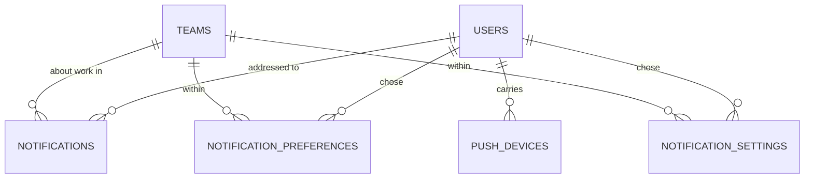

# Notifications

> Status: **MVP built (Phase 12, 2026-10-30)** — in-app (Reverb) + email + **push (FCM)** + per-user preferences + digests · Last updated: 2026-10-31

## Purpose

Delivers notifications across channels — **in-app (bell + Reverb toast)**, **email**, and **mobile push (FCM, relaying to APNs for iOS)** — with per-user, per-team preferences, a mute, and daily/weekly round-ups.

It owns notification types, delivery, preferences, push devices and retention. Other modules raise notifications **through** it rather than sending directly: a producer says _what happened and to whom_, and everything about _whether and how_ it is delivered is settled here.

## What was built (Phase 12)

- **`NotificationDispatcher`** — the one entry point other modules call (`send`, `toTeam`, `toAdmins`).
- **`TeamNotification`** — one notification class for every type, with `via()` resolving the member's preferences and `toDatabase`/`toBroadcast`/`toMail`/`toPush`.
- Seven types, a per-type × per-channel preference grid, a digest frequency and hour, and a mute.
- **Push**, end to end: device registration, FCM HTTP v1, and deletion of tokens the provider permanently rejects.
- Producers for discovery runs, new A-grade leads (aggregated), signals, lead assignment and **task reminders** — which closes the Phase 10b deferral.
- `notifications:task-reminders`, `notifications:digest` and `notifications:prune`, scheduled.
- The bell in the app header as a shared Inertia prop, a full history screen, and `settings/notifications`. EN/AR at parity.

### Post-MVP

SMS, Slack/Teams, a hosted one-click unsubscribe for the digest, per-user locale (see Limitations), reply/open tracking for outreach notifications.

## Code map

- **Backend:** `app/Modules/Notifications/`
    - **Services:** `NotificationDispatcher`, `NotificationPreferences`, `NotificationPresenter`, `NotificationReader`, `DigestBuilder`, `FcmPushSender`.
    - **Notifications / Channels:** `Notifications/TeamNotification`, `Channels/TeamDatabaseChannel`, `Channels/PushChannel`.
    - **Actions:** `SaveNotificationPreferencesAction`, `MarkNotificationsReadAction`, `RegisterPushDeviceAction`.
    - **Models:** `Notification` (extends `DatabaseNotification`), `NotificationPreference`, `NotificationSetting`, `PushDevice`.
    - **Enums:** `NotificationType`, `NotificationChannel`, `NotificationGroup`, `DigestFrequency`, `PushPlatform`.
    - **Data:** `NotificationContent`, `NotificationPreferencesData`, `DigestSummary`, `PushMessage`, `PushResult`.
    - **Listeners:** `AnnounceDiscoveryRun`, `AnnounceTopLeads` (+ `Jobs/AnnounceTopLeadsJob`), `AnnounceSignals`, `AnnounceLeadAssignment`.
    - **Console:** `SendTaskRemindersCommand`, `SendDigestsCommand`, `PruneNotificationsCommand`.
    - **Mail:** `DigestMail` + `resources/views/emails/notifications/digest.blade.php`.
    - **Contracts / Testing:** `PushSender`, `Testing/FakePushSender`.
- **Routes:** `routes/web.php` (`notifications.index`, `notifications.read`, `notifications.read-all`, `notifications.preferences.{edit,update}`) and `routes/api.php` (the same, plus `notifications.unread` and `push-devices.*`).
- **Frontend:** `resources/js/components/notifications/NotificationBell.vue` (mounted in `AppSidebarHeader`), `resources/js/pages/notifications/Index.vue`, `resources/js/pages/settings/Notifications.vue`, types in `resources/js/types/notifications.ts`. The bell is a **shared prop** (`notifications` in `global.d.ts`).
- **Tests:** `tests/Feature/Notifications/` (delivery, producers, digest, push, screens), `tests/Unit/Notifications/` (enums, presenter), fixtures in `tests/Support/NotificationFixtures.php`.
- **Config / env:** `config/notifications.php` — `NOTIFICATIONS_TOP_LEADS_WINDOW`, `NOTIFICATIONS_RETENTION_READ_DAYS`, `NOTIFICATIONS_RETENTION_DEVICE_DAYS`, `NOTIFICATIONS_BELL_LIMIT`, `FCM_CREDENTIALS`, `FCM_PROJECT_ID`, `FCM_TIMEOUT`. Mail theme: `config/mail.php` → `markdown.theme = alima`. Log channel: `notifications`.

## Data model

- **`notifications`** — Laravel's table plus **`team_id`**. A notification belongs to one user but is _about work in one team_, and a member of three teams must not see the other two's in the bell while working in this one (ADR 0006). `data` holds **structured values, never a formed sentence** — the same rule `lead_activities.properties` follows.
- **`notification_preferences`** — `(user_id, team_id, type)` unique, with an `in_app`/`mail`/`push` boolean each. **A row means the member has an opinion**; with no row the type's own defaults apply, so adding a type needs no backfill and never arrives switched off for everyone.
- **`notification_settings`** — `(user_id, team_id)` unique: `digest`, `digest_hour` (in the **team's** timezone), `digest_sent_at`, `muted_until`. Separate from the preferences table because they answer a different question at a different cardinality.
- **`push_devices`** — `user_id`, `token` (hidden), `token_hash` (unique), `platform`, `last_used_at`. **No `team_id`**: a phone belongs to a person, and whether to send is the per-team preference's call.

### Three models carry `team_id` without `BelongsToTeam`

All three are deliberate, and all three are listed here so the next reviewer does not have to work it out:

- **`Notification`** — see below.
- **`NotificationPreference`** and **`NotificationSetting`** — rows are keyed per **user _and_ team** and are always read for a named member in a named team, so a tenant global scope would add nothing to the queries and would make "my settings in this team" ambiguous. More importantly, `notifications:digest` reads **every** tenant's settings on purpose: it is a platform sweep, and a global scope would silently reduce it to whichever team happened to be active. The isolation is pinned by `NotificationTenancyTest` instead.

### Why `Notification` has no `BelongsToTeam`

The rows are written by **Laravel's own channel**, outside our team context — so the trait's auto-assignment would never fire, and its global scope would then hide every row it had failed to stamp. `team_id` is set explicitly by `TeamDatabaseChannel`.

Because of that, the member-and-team condition **is** the enforcement rather than a double-check on top of one — so it lives in exactly one place, `Notification::scopeOwnedBy()`, and both the reader and `MarkNotificationsReadAction` go through it. It was copy-pasted into three queries first; a query that forgot one predicate would fail open, and three copies is three chances to forget. `NotificationTenancyTest` pins every endpoint that touches it, including "mark all read" — the operation that would do the most damage if it ever reached across teams.

### The bell index is named by hand

`notifications_bell_index` covers `(notifiable_type, notifiable_id, team_id, read_at)`. The name
Laravel would generate from those four columns is **65 characters and MySQL's limit is 64**, so it
is given explicitly — and **the test suite is no guide here**, because it runs on SQLite
(`phpunit.xml`), which does not enforce the limit. Any further composite index on this table needs
a hand-written name for the same reason.

### Why `token_hash` exists

MySQL cannot index 512 characters of utf8mb4 under the 3072-byte key limit, and a token is only ever matched for equality — so the unique index and every lookup use the hash, and `token` itself is `Hidden`, never logged and never returned.

## Key flows

### Raising one

A producer calls `NotificationDispatcher::{send,toTeam,toAdmins}` with a type and a payload of **ids, counts and names**. The dispatcher drops anyone who is no longer a member (the producers are queued listeners reading ids off an event, so a member may have left in between), then hands one `TeamNotification` to the facade. `via()` resolves each member's channels, so a switched-off channel is **never sent** rather than sent and discarded.

### Resolving channels (`NotificationPreferences`)

1. **Still a member, and entitled to this type?** An admin-only type (`credit_low`) does not reach a plain member however their preferences read — checked first, because it is authorisation rather than a preference.
2. **Their row, or the type's defaults.**
3. **The mute**, which removes **email and push only** and leaves the bell alone: "stop buzzing me" is not "hide what happened".

### One class, not one per type

What genuinely varies between types is the **wording**, and that lives in `NotificationPresenter` where it can be read as a whole. The per-type classes Laravel's docs show would each need their own copy of the three hard parts — resolving preferences, stamping the team, keeping the in-app payload free of prose — and each new type would be a fresh chance to forget one.

### Aggregating the A-grade announcement

The obvious implementation is unusable: a discovery run can grade fifty leads in a minute, and one notification per A grade means fifty emails and a member who switches the category off before lunch.

So `AnnounceTopLeads` (not queued, almost free) dispatches `AnnounceTopLeadsJob` with a delay. The job is **`ShouldBeUnique` per team**, so the next forty-nine dispatches find one already queued and do nothing. When it runs it counts what was graded A across the window and sends **one** notification with the count and a couple of names. The delay is what gives the window something to aggregate — firing immediately would announce the first lead alone and then be locked out of mentioning the rest.

`SignalsDetected` needs none of this: Signals had the same problem and solved it at source, so its event already carries a count for the whole batch.

### Digests, and the timezone the risk register warns about

The member picks an hour; the **team** picks a timezone. So `notifications:digest` runs **hourly** and, per candidate, converts `now()` into that team's timezone before comparing. A single nightly run at 08:00 UTC would mail Dubai at noon and drift every time the clocks changed in London.

Idempotence is `digest_sent_at` plus `DigestFrequency::isDue()`, which requires a gap of half a window — an hour is seen once, but a retry, an overlapping run or a DST fold could show it twice. The weekly digest goes out on **Monday**, when a sales team plans.

Two rules keep a digest worth opening: **only what the member asked for** (each section is gated on `wants()` for the type it summarises — a digest that ignored preferences would re-enable everything a member turned off), and **only what happened** (a zero section is omitted, and an empty digest is not sent). The row is still stamped on a quiet day, so the sweep doesn't retry all afternoon.

### Task reminders

`notifications:task-reminders`, hourly, is the sweep `lead_tasks.remind_at` was built for in Phase 10b and has been storing reminders for, unsent, ever since. `reminded_at` is stamped **before** the notification is raised: a reminder that arrives twice is worse than one stamped and lost — the second is a bug someone can see on the task, the first is us crying wolf. An unassigned task's reminder goes to whoever set it. A reminder whose window has passed is **not** skipped: a member whose worker was down until Monday still wants Friday's reminder, and the task still being open is the only test that matters.

### Push, and the lifecycle of a token

`PushChannel` sends to every device the member has registered, then **deletes the tokens the provider permanently rejected**. That second step is what keeps push working: a device whose app was uninstalled returns `UNREGISTERED` for ever, and a row we keep is a notification that silently goes nowhere — which nobody ever notices, because nothing fails. `notifications:prune` catches the rest (an app a member stopped opening, a phone replaced without signing out).

Registration is idempotent on the token and **re-assigns the owner**: FCM re-issues a token on reinstall, and the same token can legitimately turn up for a different user — a shared tablet, a handset passed on. Leaving the old owner on it would send the new owner's notifications to the previous one.

The channel never throws. Push is the least important channel — a member who misses one still has the bell and often the email — so a provider outage must not fail the queued notification and drag the other channels into a retry with it.

## External dependencies

**Firebase Cloud Messaging, HTTP v1.** The legacy endpoint (`/fcm/send`, authenticated with `FCM_SERVER_KEY`) was **retired by Google in June 2024** and now 404s for everyone, so `FCM_SERVER_KEY` is no longer a usable credential; v1 authenticates with a **service-account key** (`FCM_CREDENTIALS`, a path to the downloaded JSON). The RS256 assertion is signed with `openssl_sign` rather than by adding a JWT dependency, and the access token is cached for 55 minutes of its hour.

One request **per token** — v1 has no multicast and the batch endpoint is deprecated — behind its own `CircuitBreaker`, so an outage at Google doesn't slow every notification down to a timeout each. One success closes the circuit, so a single dead token can't trip it for everybody. Nothing that could reach a device is logged: counts and status codes only.

With no credentials configured, push is simply not sent. A deployment without the mobile app has no reason to hold Firebase keys, and the settings screen tells the member that push needs a registered device.

**Mail** goes out over Resend, like the rest of the platform (see `docs/modules/outreach.md`).

## Permissions

There is **no policy class**, and that is deliberate: every notification is addressed to exactly one member, so authorisation here is the query. `NotificationReader` and `MarkNotificationsReadAction` scope to the member **and** the team, and somebody else's notification is a **404** rather than a 403 — they have no business learning it exists.

| Ability                                | Who                                                                                            |
| -------------------------------------- | ---------------------------------------------------------------------------------------------- |
| Read / mark read own notifications     | the addressee, in that team                                                                    |
| Change own preferences and digest      | any member, for their own settings in the active team                                          |
| Register / unregister own push devices | the device's owner (API only)                                                                  |
| Receive `credit_low`                   | **Owner/Admin only** — enforced in `NotificationPreferences`, before preferences are consulted |

The preference screen shows an admin-only type **greyed with a reason** rather than hiding it: a plain member who couldn't see "AI credit is running low" wouldn't know somebody is being told.

## Brand

The mail theme is **shared**: `config/mail.php` points `markdown.theme` at `resources/views/vendor/mail/html/themes/alima.css`, which is Laravel's default theme recoloured to `docs/brand/brand-tokens.md` — Cloud Cream canvas, warm `bg.surface` card, Midnight Ink type and buttons, brand radii, Poppins ahead of the system stack, and **no Signal Orange anywhere** (every colour in a transactional email carries a status, and Orange is decorative only, §2.1). Setting it in config rather than per Mailable means the invitation email and the notification mails cannot drift apart.

Only colour, type and radius are changed; the layout is Laravel's own and is what the `<x-mail::*>` components are built against.

An **outreach message to a prospect deliberately does not use this theme** — that one is the team talking, not Alima. See `docs/modules/outreach.md`.

## Known limitations / TODO

- **Locale is the team's, not the member's.** Email and push are rendered once, at send time, under `teams.locale`, because that is the only per-recipient locale the platform stores. A member reading the app in English in an Arabic team gets Arabic notifications. The **in-app** channel is unaffected — it stores keys and params and renders in whatever the member has the app set to. A per-user locale column is the fix and is post-MVP.
- **`credit_low` has no producer yet.** The type, the preferences, the admin-only gate and the copy are all built and tested, but nothing raises it: `AiCreditGuard` only knows "exhausted or not", and "running low" needs the usage figure Billing (Phase 17) will own. Wire `NotificationDispatcher::toAdmins($team, NotificationType::CreditLow, ['remaining_percent' => …])` there. (Same shape as the `SignalsPersonalDataExporter` deferral in Signals.)
- **No in-app notification for an outreach reply.** Reply tracking is post-MVP in Outreach, so there is nothing to notify from.
- **The digest email has no one-click unsubscribe link**, only a link to the settings screen. A hosted endpoint is deferred with the prospect privacy notice (compliance.md §3.7).
- **The bell's live updates need Reverb running.** Without it the count is correct on every page load and simply doesn't move in between; nothing breaks.
- Notifications written in the same second have no stable order in the bell (the id is a UUID). Harmless, and worth knowing when writing a test.
- **A producer that fails mid-fan-out can duplicate.** The announcement listeners have `tries`, backoff and `failed()`, but no idempotency key: if one throws _after_ `Notification::send` has queued some recipients, the retry re-raises to all of them with fresh ids. The window is small (the facade mostly just enqueues) and the cost is a duplicate notification rather than a duplicate action, so it is recorded rather than fixed. A deterministic dedupe key on the event identity is the fix.
- **`via()` costs about three indexed queries per recipient** (role, preference, settings). Fine for the team sizes this product has; a per-send memo is the obvious optimisation and was left out because a stale cache in a long-running queue worker would be a worse bug than the queries.
- **Push tokens are stored in plaintext**, `Hidden` on the model and never logged or returned. An encrypted cast was considered and rejected: a rotated `APP_KEY` would make every token undecryptable and push would fail silently, which is worse than the exposure an `at-rest` database already protects against.

## Dependencies

Core, Reverb, Auth & Users. Consumes events from Lead Sourcing, Scoring, Leads Workspace and Signals. Consumed by most modules through `NotificationDispatcher`. FCM service-account credentials required for push.

## Review (2026-10-30)

Reviewed by `laravel-module-reviewer` and `brand-reviewer` at the end of Phase 12. Fixed from their findings, plus one I found while checking the broadcast myself:

- **The bell's live updates never fired.** `TeamNotification` defined `broadcastType()` thinking it named the event; the hook is `broadcastAs()`. So the notification broadcast under its framework FQCN and `Echo.listen('.notification.created')` matched nothing — _and_ `broadcastType()`'s return was merged over the payload's `type`, so the one notification that did arrive could not be classified. Invisible to every other test in the module, because the database channel is unaffected. `NotificationBroadcastTest` now pins the event name, the payload and the channel.
- **The digest and reminder sweeps isolated per item.** `Mail::send` in an unguarded loop meant one failure aborted the sweep: the member it happened to lost their digest (already stamped) and so did everybody the loop had not reached, who are skipped until the next hourly run — by which time their hour has passed.
- `Notification::scopeOwnedBy()` (above), and the empty `Policies/` directory removed, since it implied a policy that does not exist and never will.
- `PushDeviceResource`, so the push endpoints obey "API Resources only" — and so the token has a second place that refuses to emit it.
- **The Arabic digest rendered left-to-right.** The published mail theme had `text-align: left` on two rules and a `border-left` on the panel, and Laravel's unpublished layout has no `dir` attribute, so `text-align: start` resolved to left even for Arabic. The layout is now published with a `dir`-aware `<html>` and an RTL `<style>` block for the one directional border (Outlook ignores logical properties).
- **The unread marker was lime-only and unannounced.** Acid Lime on cream is ~1.3:1, it was the only cue (WCAG 1.4.1, 1.4.11), and an `aria-label` on a bare `` has no role, so screen-reader users never learned a row was unread. Now: a weight change on the title, a `ring` on the dot, and a real `sr-only` label.
- **The bell dropdown was not keyboard-navigable.** Rows were plain `Link`/`div` inside `DropdownMenuContent` rather than `DropdownMenuItem`, so arrow-key roving focus and typeahead did not work — and a notification with no URL was a `
`, unreachable by keyboard entirely.
- The settings grid's `opacity-60` moved off the row and onto the checkbox cells: disabled controls are exempt from contrast rules, the "Owners and admins only" explanation beside them is not.
- The mute date now goes through `useFormat().dateTime()` rather than `toLocaleString()`, on a page whose own copy makes a point of the team's clock.
- The mail theme's remaining off-palette values (`#18181b`, Tailwind green/red button borders, `#fafafa`, a black shadow, Ink links where `action.brand` belongs) and the `#DDD9CC` border token.
- API cross-tenant tests for notifications, preferences, settings, the digest builder, the aggregating job and the prune sweep (`NotificationTenancyTest`).

Accepted without change, with reasons recorded under Known limitations: listener retry duplication, the per-recipient `via()` queries, and plaintext push tokens.

## Changelog

| Date       | Phase | Change                                                                                                                                                                                                                                                                                                                                                                                                                                                                                                                              | Files                                                                                                                                                                                                                                                                                                                                                                                                                                                                                                                                                                                                       |
| ---------- | ----- | ----------------------------------------------------------------------------------------------------------------------------------------------------------------------------------------------------------------------------------------------------------------------------------------------------------------------------------------------------------------------------------------------------------------------------------------------------------------------------------------------------------------------------------- | ----------------------------------------------------------------------------------------------------------------------------------------------------------------------------------------------------------------------------------------------------------------------------------------------------------------------------------------------------------------------------------------------------------------------------------------------------------------------------------------------------------------------------------------------------------------------------------------------------------- |
| 2026-10-30 | 12    | Module built: `NotificationDispatcher` + `TeamNotification` (one class, preference-resolved `via()`), 7 types × 3 channels with per-team preferences, mute, daily/weekly digests on the team's clock, **push over FCM HTTP v1** with device registration and dead-token pruning, producers for discovery/top leads (aggregated)/signals/assignment/**task reminders** (closing the Phase 10b deferral), the bell as a shared Inertia prop, history + settings screens, EN/AR, branded shared mail theme, 71 feature + 23 unit tests | `app/Modules/Notifications/**`, `app/Modules/LeadsWorkspace/Events/LeadAssigned.php`, `app/Modules/LeadsWorkspace/Actions/SetLeadAssigneesAction.php`, `database/migrations/2026_10_30_1400{01..03}_*`, `database/factories/{NotificationPreference,NotificationSetting,PushDevice}Factory.php`, `config/notifications.php`, `config/mail.php`, `config/logging.php`, `resources/views/vendor/mail/html/themes/alima.css`, `resources/views/emails/notifications/digest.blade.php`, `resources/js/{components,pages,types}/**notifications**`, `lang/{en,ar}.json`, `tests/{Feature,Unit}/Notifications/**` |
| 2026-10-31 | 17    | The API notification list now reads `per_page` through Core's shared `PaginatedIndexRequest` instead of paging at a fixed 25 — a bell that pages differently from every other list is a pager the client has to special-case. Every route in the module declares its token scope: reading is `notifications:read`, and marking read or registering a handset is `notifications:write` (registering a device is a write on the member's notification settings, not a scope of its own).                                              | `app/Modules/Notifications/Http/Controllers/Api/V1/NotificationController.php`, `app/Modules/Notifications/routes/api.php`                                                                                                                                                                                                                                                                                                                                                                                                                                                                                  |
