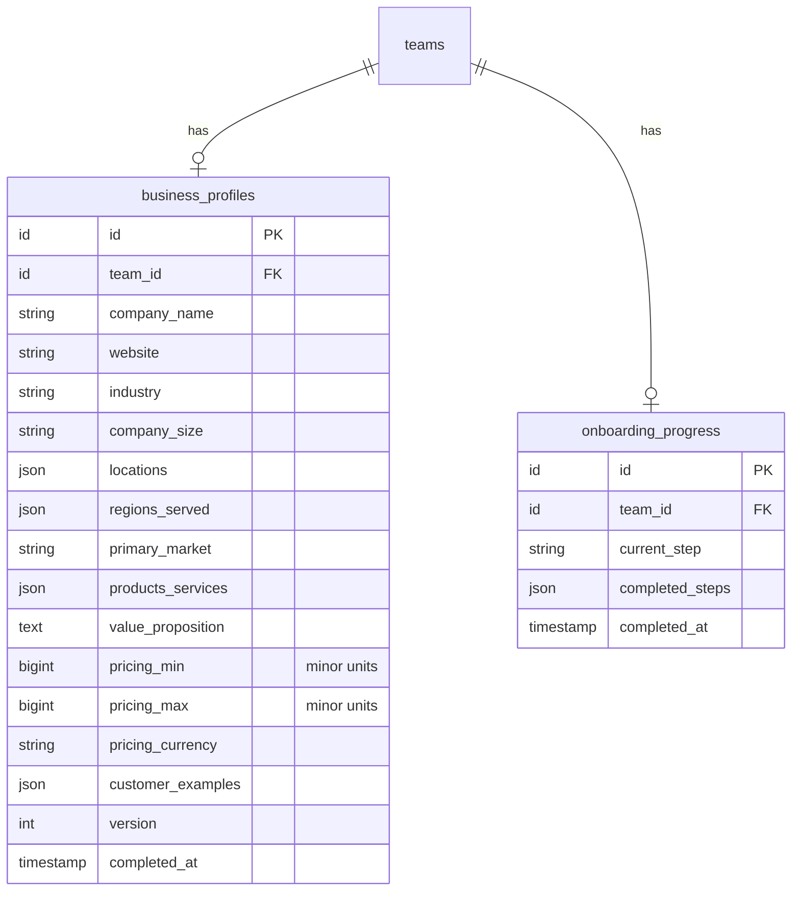

# Onboarding & Business Profile

> Status: **MVP** · Owner: Product · Last updated: 2026-10-29

## Purpose

The guided, resumable wizard a new team completes to describe itself, and the stored **Business Profile** that result feeds the AI background check, ICP suggestions, scoring and outreach personalisation. Owns the wizard state (progress saved per step) and the canonical, business-authored self-description of the tenant. It does **not** own the AI-researched profile (Business Intelligence) — this is the business's own words; BI augments it. Market selection here sets the team's compliance/regional default.

## Code map

- **Backend:** `app/Modules/Onboarding/…`
    - **Models:** `BusinessProfile`, `OnboardingProgress` (both `BelongsToTeam`, one row per team).
    - **Actions:** `SaveOnboardingStepAction` (resumable per-step save), `CompleteOnboardingAction` (stamps complete, applies the primary market to the team, dispatches the background check `afterCommit`).
    - **Jobs:** `RequestBackgroundCheckJob` — **stub** (`ShouldBeUnique` per team); Phase 6 (Business Intelligence) implements `handle()`.
    - **Enums:** `OnboardingStep` (wizard flow), `CompanySize`, `ServedRegion`. Cross-cutting enums added to Core: `Market` (uk/uae, drives defaults), `Currency` (minor-unit aware).
    - **Policies:** `BusinessProfilePolicy` (`view` = any member, `update` = Owner/Admin).
    - **Requests:** `SaveOnboardingStepRequest` (rules chosen per `{step}`).
    - **Resources:** `BusinessProfileResource`, `OnboardingProgressResource`.
    - **Exceptions:** `OnboardingException` (`onboarding.incomplete`).
    - **Provider:** `OnboardingServiceProvider` (registers the policy; shares an `onboarding` status prop on every Inertia page).
- **Routes:**
    - Web: `onboarding.show` (`GET /onboarding`), `onboarding.step` (`POST /onboarding/step/{step}`), `onboarding.complete` (`POST /onboarding/complete`) — all `auth` + `verified`.
    - API: `api.v1.onboarding.show` (`GET /api/v1/onboarding`, `auth:sanctum`) — read-only profile + progress.
- **Frontend:**
    - Page `resources/js/pages/onboarding/Wizard.vue` (resumable multi-step wizard).
    - Layout: **the standard app shell** (`AppLayout`). `onboarding/` pages fall through the
      `app.ts` switch like any other screen, and the wizard opens with a `PageHero` ("02 — Business
      profile") so it reads as the sidebar destination it is. The dedicated
      `resources/js/layouts/OnboardingLayout.vue` was removed on 2026-10-30: a chrome-less wizard
      made the business profile look like a different product, and onboarding is not hard-gated, so
      there was nothing to protect by hiding the nav. Everything that layout provided — locale and
      appearance toggles, logout, the toast host — the shell already has.
    - Components `resources/js/components/onboarding/WizardProgress.vue` (step rail), `ListInput.vue` (chip input).
    - Dashboard (`pages/Dashboard.vue`) shows a first-run setup CTA until complete; `AppSidebar.vue` has a "Business profile" entry.
- **Shared:** `resources/js/types/onboarding.ts` (shared status + wizard prop types; also used by the Capacitor app later).
- **Tests:** `tests/Feature/Onboarding/OnboardingWizardTest.php`, `tests/Unit/Onboarding/OnboardingStepTest.php`.
- **Config / env vars:** none. i18n keys added to `lang/en.json` + `lang/ar.json` (parity).

## Data model

One `business_profiles` row and one `onboarding_progress` row per team (both `unique(team_id)`). Money (`pricing_min`/`pricing_max`) is integer **minor units**; `version` bumps on each (re)completion.

## Key flows

**Resumable step save.** The wizard renders all steps client-side. Each "Continue" posts only the current step's fields to `onboarding.step`; `SaveOnboardingStepRequest` validates them; `SaveOnboardingStepAction` (in `TeamContext->run` + `DB::transaction`) upserts those fields onto the team's `BusinessProfile`, marks the step complete and advances `current_step`, then audit-logs `onboarding.step_saved`. The response is a `back()` redirect so Inertia refreshes `progress`; the client advances. Visiting `GET /onboarding` resumes on the saved `current_step`.

**Completion.** `CompleteOnboardingAction` guards that every data step is saved (else `OnboardingException`), then in a transaction stamps `completed_at` on the profile (bumping `version` on re-completion) and progress, applies `primary_market` to `teams.market` (the compliance/regional default), audit-logs `onboarding.completed`, and — via `DB::afterCommit` — dispatches `RequestBackgroundCheckJob` (stub until Phase 6). The web controller then redirects to the dashboard with a success toast.

## External dependencies

None in Phase 3. `RequestBackgroundCheckJob` is a stub; Phase 6 wires it to the AI Platform (`business_intel.background_check`) and public-web fetching with timeout/retry/circuit-breaker.

## Permissions

| Ability                   | Owner | Admin | Member | Read-only |
| ------------------------- | ----- | ----- | ------ | --------- |
| View onboarding / profile | ✅    | ✅    | ✅     | ✅        |
| Save a step / complete    | ✅    | ✅    | ❌     | ❌        |

Policy: `BusinessProfilePolicy` (`view`, `update`), authoritative role via `User::roleOn($team)` (ADR 0006). The global `BelongsToTeam` scope blocks cross-tenant reads/writes; the policy double-checks ownership.

## Known limitations / TODO

- `RequestBackgroundCheckJob` is a no-op stub (logs to the `ai` channel) — Phase 6 implements the real background check and review/accept UI.
- One profile per team (MVP). Post-MVP: multiple profiles, logo/brand capture, `version` history retention.
- `primary_market` drives only `teams.market` for now; the full compliance regime split (UK GDPR/PECR vs UAE PDPL/TDRA) lands in Phase 15.

## Changelog

| Date       | Phase | Change                                                                                                                                                                                                                                   | Files                                                                                                                                                                                                                                                                                                                                                           |
| ---------- | ----- | ---------------------------------------------------------------------------------------------------------------------------------------------------------------------------------------------------------------------------------------- | --------------------------------------------------------------------------------------------------------------------------------------------------------------------------------------------------------------------------------------------------------------------------------------------------------------------------------------------------------------- |
| 2026-10-30 | —     | The wizard moved into the standard app shell and opens with a `PageHero` ("02 — Business profile"), so the screen the sidebar points at has the sidebar. `OnboardingLayout.vue` deleted; `app.ts` no longer special-cases `onboarding/`. | `resources/js/app.ts`, `resources/js/pages/onboarding/Wizard.vue`, `resources/js/layouts/OnboardingLayout.vue` (removed)                                                                                                                                                                                                                                        |
| 2026-10-29 | 3     | Initial module: resumable wizard, `business_profiles` + `onboarding_progress`, Save/Complete Actions, background-check stub job, policy, web + API, focused Inertia wizard (EN/AR + RTL), Dashboard setup CTA, tests.                    | `app/Modules/Onboarding/**`, `app/Modules/Core/Enums/{Market,Currency}.php`, `database/migrations/2026_10_29_0900*`, `database/factories/{BusinessProfile,OnboardingProgress}Factory.php`, `resources/js/pages/onboarding/Wizard.vue`, `resources/js/layouts/OnboardingLayout.vue`, `resources/js/components/onboarding/*`, `tests/{Feature,Unit}/Onboarding/*` |
