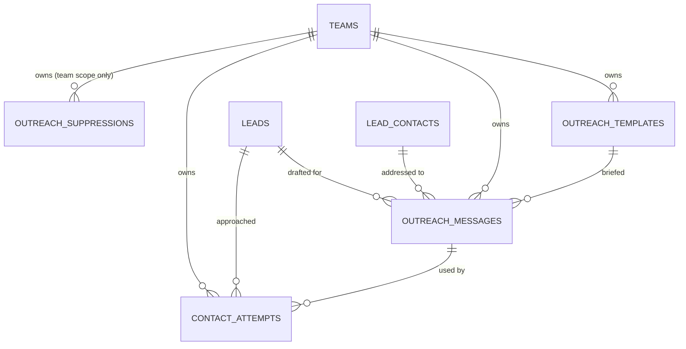

# Outreach

> Status: **MVP built (Phase 11, 2026-10-30)** — AI drafts, briefs, copy, manual log, compliant email send via Resend · Last updated: 2026-10-30

## Purpose

Helps users contact leads: AI-personalised message drafts (email, LinkedIn message text to copy, call script) built from the business profile + lead data, with reusable briefs and tone controls, and an activity log of every contact attempt and outcome.

It owns messages, briefs, contact-attempt logging and — for now — the **do-not-contact list**. It does **not** own pipeline state (Leads Workspace) and it does not decide a team's lawful basis (Compliance). It must honour both the suppression list and `leads.raw.outreach_restriction`.

## What was built (Phase 11)

- **`outreach.draft_message` v2** (reasoning tier) → `MessageDraft`. Channel, tone and language controls; the channel's required shape and the grounding rules are in the prompt; 2–3 genuinely different variants per call. Lead data and a team's own brief go in wrapped as `UntrustedContent`.
- **`outreach_templates`** (briefs), **`outreach_messages`** (draft → sent/logged/failed), **`contact_attempts`** (channel, outcome, when), **`outreach_suppressions`** (the do-not-contact list).
- Draft → **copy** (equal to send, and the only route for LinkedIn/call) and manual **log**; **send email** over the platform's verified Resend sender.
- **`OutreachGuard`** — one gate, asked twice (draft time and the moment before transmission).
- Bilingual drafting (EN/AR), EN/AR screens at parity.

### Post-MVP

Multi-step sequences, per-tenant sending domains, Gmail/Outlook OAuth sending, open/reply tracking, inbound unsubscribe-reply processing, SMS, A/B message testing.

## Code map

- **Backend:** `app/Modules/Outreach/`
    - **Actions:** `DraftMessageAction`, `SendOutreachEmailAction`, `LogContactAttemptAction` (+ `updateOutcome`), `SaveOutreachTemplateAction`, `DeleteOutreachTemplateAction`, `SuppressIdentityAction`.
    - **Services:** `OutreachGuard`, `SuppressionList`, `SenderIdentityResolver`, `OutreachPayloadBuilder`.
    - **Models:** `OutreachTemplate`, `OutreachMessage`, `ContactAttempt`, `OutreachSuppression`.
    - **Enums:** `OutreachChannel`, `OutreachTone`, `OutreachMessageStatus`, `ContactOutcome`, `OutreachBlockReason`, `SuppressionScope`, `SuppressionType`, `SuppressionReason`.
    - **Data:** `DraftMessageData`, `MessageDraft`, `DraftResult`, `OutreachDecision`, `SenderIdentity`, `LogAttemptData`, `OutreachTemplateData`.
    - **Mail:** `OutreachMessageMail` + `resources/views/emails/outreach/message{,-text}.blade.php`.
    - **Policies:** `OutreachTemplatePolicy`, `OutreachMessagePolicy`, `OutreachSuppressionPolicy`.
    - **Exceptions:** `OutreachException`, `OutreachBlockedException`.
- **Routes:** `routes/web.php` (`outreach.show`, `outreach.draft`, `outreach.log`, `outreach.messages.{update,send,destroy}`, `outreach.attempts.outcome`, `outreach.templates.*`, `outreach.suppressions.*`) and `routes/api.php` (the same, plus `api.v1.outreach.decisions`).
- **Frontend:** `resources/js/pages/outreach/{Show,Templates,Suppressions}.vue`, `resources/js/components/outreach/{ChannelPicker,LogAttemptDialog}.vue`, types in `resources/js/types/outreach.ts`. Entry point: the **Reach out** button on `leads/Show.vue`, plus sidebar item **08 Outreach**.
- **Tests:** `tests/Feature/Outreach/` (drafting, sending, logging + opt-out, briefs, screens, API), `tests/Unit/Outreach/` (enums, suppression normalisation), fixtures in `tests/Support/OutreachFixtures.php`.
- **Config / env:** `config/outreach.php` — `OUTREACH_SENDING_ENABLED`, `OUTREACH_FROM_ADDRESS`, `OUTREACH_FROM_VIA`, `OUTREACH_OPT_OUT_ADDRESS`, `OUTREACH_PRIVACY_NOTICE_URL`, `OUTREACH_DRAFT_RATE_LIMIT`, `OUTREACH_SEND_RATE_LIMIT`. Mail: `MAIL_MAILER=resend`, `RESEND_API_KEY`, `MAIL_FROM_ADDRESS`. Log channel: `outreach` (30 days).

## Data model

- **`outreach_templates`** — `team_id`, `created_by`, `name` (unique per team), `channel`, `tone`, `locale`, `subject?`, `body`, `is_default`. "At most one default per channel" is enforced in `SaveOutreachTemplateAction`, not by a partial index (MySQL has none).
- **`outreach_messages`** — the lead, the contact, the brief, channel/tone/locale/status, `subject?`, `body`, `variants` (JSON), `sent_to`, `provider_message_id`, `error_message`, `sent_at`, and AI provenance (`prompt_key`, `prompt_version`, `model`, `cost_micros`). `sent_to` is the address used **at the time** — the contact's email may be corrected later and this stays the record of where the message went.
- **`contact_attempts`** — the lead, the contact, the message it came from (nullable — a call logged off the lead screen has none), channel, outcome, `occurred_at` (when it *happened*, not when it was typed), `notes`.
- **`outreach_suppressions`** — `scope` (`global`/`team`), `scope_key`, `type`, `value_hash`, `value_preview`, `reason`, `note`, `suppressed_at`. Unique on `(scope_key, type, value_hash)`.

### Two schema decisions worth knowing

**`scope_key` exists so uniqueness can be a plain unique index.** MySQL treats NULLs in a unique index as distinct, so `(team_id, type, value_hash)` would let the same **global** entry be written any number of times — and a duplicate in a suppression list is a race waiting to double-send. `scope_key` is the scope as one comparable string: `global`, or `team:17`.

**`OutreachSuppression` deliberately has no `BelongsToTeam`.** A global entry has no team, and the whole point of a global entry is that *every* team's query finds it — a tenant global scope would hide exactly the rows that must never be missed. `SuppressionList` scopes by **scope** rather than by tenancy, and `OutreachSuppressionPolicy` is therefore the whole of the authorisation here rather than a double-check.

## Key flows

### Drafting

1. `OutreachGuard::assertCompliance()` — **before a single token is spent**.
2. The brief is resolved (the one asked for, or the team's default for that channel; a member who picked "no brief" meant it).
3. `AiClient::structured('outreach.draft_message', …)` — **outside any transaction**.
4. `MessageDraft::fromAi()` drops variants for other channels, drops a subject on a channel with none, and clamps everything to its column.
5. One short transaction writes a **new** row — a re-draft is another option, not an overwrite, so the one the member liked three attempts ago is still there.

Nothing goes on the lead's timeline and nothing into the audit log: a draft is a private act that reached nobody.

### Sending

1. **Spent-draft check** — a message already sent or logged is refused (`409`). Cheaper and more certain than any UI guard against a double-tapped Send.
2. **`OutreachGuard::assert()`, again, here, now** — the screen's check was courtesy; days may have passed and a reply saying "stop" may have arrived. This one also asserts the sender identity, which drafting deliberately did not.
3. `Mail::to(…)->send(new OutreachMessageMail(…))` — **outside any transaction**.
4. One transaction writes the status, the provider id, `sent_to`, a logged `ContactAttempt`, the timeline entry and the audit row. A provider failure writes `failed` with the provider's own message and leaves the draft **re-sendable**.

Deliberately **not queued**: the member is watching, and "sent" has to mean sent.

### Logging an approach, and the opt-out

`LogContactAttemptAction` writes the attempt, promotes a `draft` message to `logged` (never downgrading a `sent` one — Alima transmitting it is a stronger statement than a member saying so), and records the timeline entry **subjected to the attempt**, so the outcome arriving days later updates that one entry rather than stacking a second "contacted" on top.

**An opt-out suppresses immediately, globally, in the same transaction.** Not a job, not a listener, not "the next sweep". Which suppression an outcome demands is `ContactOutcome::suppressionScope()`'s answer, so a new outcome has to decide before it can exist:

| Outcome | Scope | What is suppressed |
| --- | --- | --- |
| `opted_out` | **global** | the contact's email **and** phone — "stop contacting me" on a call is not permission to email |
| `bounced` | team | the address alone — a bounce says nothing about their phone |
| everything else | — | nothing |

`updateOutcome()` re-runs the same branch, because a real opt-out is usually set on an existing row days later rather than logged as one.

## The gate — what `OutreachGuard` enforces

Asked twice: once when the screen renders (so a member is never offered a channel they can't use) and again immediately before transmission (the one that counts).

1. **The lead's own restriction.** `OutreachRestriction::fromRaw($lead->raw)`, branched on **`allowsDirectMarketing()`** and never on the case — so a restriction added in a later market can't be missed by a `match` that still compiles. Blocks **drafting** as well as sending.
2. **Suppression** — the address *and* its domain, against the global list and the team's own, in one indexed query.
3. **Configuration** — something to send to, someone to send it from, sending switched on at all.

### Compliance blocks vs configuration blocks

`OutreachBlockReason::isCompliance()` splits them, and `assertCompliance()` is the drafting half. The reasoning:

- A **compliance** refusal (prior consent, an opt-out) is final and must land at **draft** time. Letting a member write a message they can never send spends AI credit on nothing and teaches them the warning is negotiable.
- A **configuration** refusal (no recipient chosen, no verified sender, sending off) must **not** block drafting. A member can still legitimately write the message and copy it into their own mailbox; refusing them is the platform withholding the work over its own setup.

### Non-sendable channels skip suppression

LinkedIn text and a call script are the **member's** own act on a platform where the other person chooses whether to answer. Alima transmits nothing, has no envelope to identify and cannot enforce an opt-out it never carries. Suppressing them would also leave a restricted lead with **no** permitted channel, which is the opposite of what the restriction asks for. The restriction itself is still honoured for any direct-marketing channel, sendable or not — which is why `isDirectMarketing()` and `isSendable()` are separate properties, ready for SMS.

## Per-lead outreach restrictions (required — added by Signals, S4)

Some leads arrive carrying a **legal limit on how they may be approached**, recorded by whichever module created them. The flag lives on the lead as `leads.raw.outreach_restriction`, modelled by `App\Modules\Core\Enums\OutreachRestriction` (in Core, not Signals: it is a property of the lead, not of where the lead came from).

**All four requirements are implemented and tested:**

1. ✅ Read with `OutreachRestriction::fromRaw($lead->raw)` and branched on `allowsDirectMarketing()` — `OutreachGuard::decide()`.
2. ✅ **Email refused outright at draft time as well as send time**, not a warning to click past — `DraftMessageAction` calls the guard before the model.
3. ✅ The permitted channels are offered instead, **and** the drafting prompt's suggested next step is kept to a LinkedIn approach or a referral — `OutreachPayloadBuilder::toneBlock()` appends the instruction, and `ChannelPicker` keeps the closed channel on screen with its reason beside it rather than hiding it.
4. ✅ Surfaced in the API and on mobile — `api.v1.outreach.decisions` reports the decision per channel so a client knows before it offers a compose screen, and `LeadResource` already sends `outreach_restriction` on every lead.

**The one case in v1:** `uae_prior_consent`, on every lead converted from a UAE signal (ADR 0007, ADR 0011). A restriction may be **added** to a lead but never dropped from one; the absence of one means "no limit beyond the team's normal basis", never "cleared to cold-email", which stays the LIA's call (Compliance).

## Sender identity and what actually goes out

`SenderIdentityResolver` returns `null` — a refusal, never a default — unless three things are in place: a verified envelope address from config, a **trading name** from the team's business profile, and the member's own verified address as Reply-To.

- **From:** the platform's Resend-verified address, named `"Acme Ltd via Alima"`. Both parties named: the team because they are the controller, the platform because a recipient is entitled to know who transmitted it (UAE TDRA sender identification). A team's own sending domain is **not** used — sending as a domain we hold no SPF/DKIM for is how a tenant's mail lands in spam. Per-tenant domains are post-MVP.
- **Reply-To:** the member. A reply reaches a person, which matters because replying is the opt-out route the footer offers.
- **Footer:** the team's name and website, an unambiguous opt-out, the privacy notice, and one line naming Alima as the transmitter. Not the member's to edit — these are the conditions under which the message may be sent at all.
- **`List-Unsubscribe` + `List-Unsubscribe-Post`** headers as well as the footer. A recipient who uses their client's unsubscribe button instead of replying is far less likely to reach for "report spam", which protects every other team's deliverability, not just this one's.

### Why the sent email is not brand-styled

Every other mail the platform sends is Alima talking and obeys the brand (CLAUDE.md §2a). **This one is the team talking to their own prospect.** Alima's chrome on it would brand a tenant's cold email as Alima marketing — misattributing the sender, which is the one thing sender identification exists to prevent — and a decorated HTML cold email is also markedly worse at reaching an inbox. So the body is the member's text and nothing else, and Alima appears only in the footer's one identifying line. The only brand rule that does apply is the Arabic one (RTL, set 10–15% larger), because that is about setting *someone's* words legibly.

## External dependencies

**Resend**, via Laravel's built-in `resend` mail transport (`resend/resend-php`). One API call per send, no retry loop — a failure is surfaced to the member with the provider's own message and the draft stays re-sendable, which is more useful than a silent retry. **Deliverability (SPF/DKIM/DMARC on the sending domain) is a deployment concern and out of scope for the MVP**: the domain must be verified in Resend or every send is rejected at the provider.

**AI Platform** for drafting — reasoning tier, cached and credit-guarded by `AiClient` like every other prompt.

## Permissions

| Ability | Who | Policy |
| --- | --- | --- |
| View the outreach screen, drafts, attempts | any member incl. Read-only | `LeadPolicy::view`, `OutreachMessagePolicy::view` |
| Draft, edit, send, log, record an outcome | any member **except** Read-only | `LeadPolicy::work`, `OutreachMessagePolicy::{update,send}` |
| Delete a draft | its author, or Owner/Admin | `OutreachMessagePolicy::delete` |
| Manage briefs | **Owner/Admin** | `OutreachTemplatePolicy` |
| Add/lift a **team** do-not-contact entry | **Owner/Admin** | `OutreachSuppressionPolicy` |
| Create or lift a **global** opt-out | **nobody, from the product** | refused by the model, the policy *and* `SuppressionList::lift()` |

Briefs are deliberately stricter than `LeadPolicy::work`: a brief is not one member's draft, it shapes every message the team sends afterwards.

Note what has **no** policy: whether a message may actually go out. That is the guard's job, and it is a different question — authorisation asks whether this member may act, the guard asks whether this lead may be approached. Conflating them would mean a compliance rule enforced by a role check.

## Privacy notes

- The list of suppressed identities holds a **SHA-256 hash and a masked preview** and nothing else. There is no column with the address in the clear, the hash is **never** exposed over the API (it would be an enumeration oracle over exactly the people entitled to be left alone), and there is deliberately **no lookup endpoint**.
- `sent_to` is not exposed by `OutreachMessageResource` — the client already knows which contact was chosen.
- Logs and audit entries carry ids, enum values and the masked preview only — never an address, a subject, a body or a member's free-text note.

## Known limitations / TODO

- **Compliance (Phase 15) takes ownership of `outreach_suppressions`** and adds the DSAR and retention tooling over it. It is a real table here rather than a stub precisely because a stub that returns "not suppressed" is an opt-out silently ignored.
- **Inbound opt-out replies are not processed.** A recipient who replies "unsubscribe" reaches the member's inbox and the platform's opt-out address; recording it is a manual step (log the attempt with "Asked us to stop"). Automatic inbound processing is post-MVP, and the footer says "reply", which PECR accepts.
- **One-click unsubscribe is a `mailto:`, not a hosted link.** The `List-Unsubscribe-Post` header advertises one-click, which needs a hosted endpoint to be fully honoured — deferred with the hosted privacy notice (compliance.md §3.7).
- No sequences, no reply/open tracking, no per-tenant sending domains, no SMS.
- The draft screen loads the 20 most recent messages and 30 attempts without pagination — enough for a lead, and a cap rather than a page.

## Dependencies

Core, Onboarding/Business Profile, Leads Workspace, Enrichment (contacts), AI Platform, Compliance, Notifications. Feeds Reporting, AI Insights.

## Changelog

| Date | Phase | Change | Files |
| ---- | ----- | ------ | ----- |
| 2026-10-30 | 11 | Module built: `outreach.draft_message` v2, briefs/messages/attempts/suppressions, `OutreachGuard` (restriction + suppression + sender ID, asked at draft and send time), Resend sending with sender ID + opt-out footer and `List-Unsubscribe`, copy/log/outcome flows, EN/AR screens, API v1 incl. `decisions`, 66 feature + 25 unit tests | `app/Modules/Outreach/**`, `database/migrations/2026_10_30_1300{01..04}_*`, `database/factories/{OutreachTemplate,OutreachMessage,ContactAttempt,OutreachSuppression}Factory.php`, `database/seeders/AiPromptTemplateSeeder.php`, `config/outreach.php`, `config/logging.php`, `resources/views/emails/outreach/*`, `resources/js/{pages,components,types}/outreach*`, `lang/{en,ar}.json`, `tests/{Feature,Unit}/Outreach/**` |
