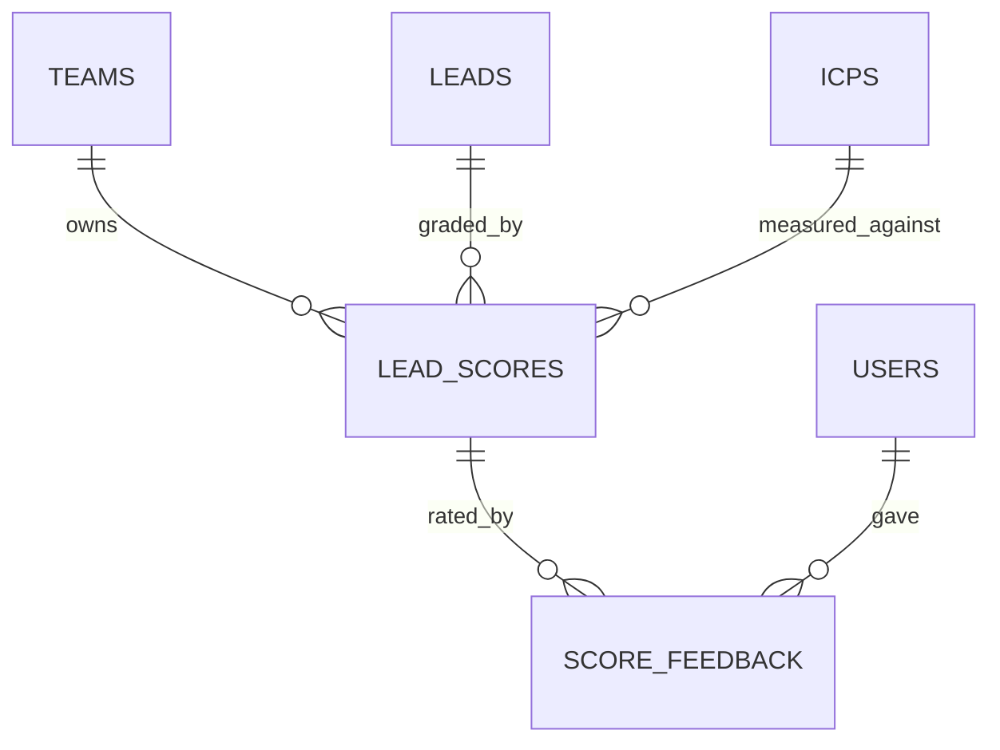

# Scoring & Matching

> Status: **MVP** · Last updated: 2026-10-29

## Purpose

Grades each lead against the team's **active** ICP with a **hybrid** score: a deterministic pass
over the ICP's weighted criteria **plus** an AI qualitative assessment, blended into one 0–100
figure with an A–D grade, a per-criterion breakdown and a plain-English explanation. Re-scores when
the inputs move (the lead was enriched, or the ICP changed) and captures members' good/bad feedback
on the result.

It does **not** source, enrich or de-duplicate leads (Lead Sourcing / Enrichment), does not define
the ICP (ICP module), and does not own the leads list or pipeline (Leads Workspace, Phase 10) — it
only answers "how well does this lead fit, and why?".

## Code map

- **Backend:** `app/Modules/Scoring/`
    - `Services/DeterministicScorer.php` — the rule half: ICP criteria vs the lead's stored fields →
      {@see DeterministicScore}. No AI, no network, fully reproducible.
    - `Services/ScoringPayloadBuilder.php` — renders the `icp` and `lead` blocks for the prompt; the
      lead block is wrapped in `UntrustedContent`.
    - `Actions/ScoreLeadAction.php` — the hybrid score: rules → AI → blend → grade → persist.
    - `Actions/RecordScoreFeedbackAction.php` — one verdict per member per score, with a snapshot.
    - `Actions/FindScoredLeadAction.php` — team-scoped lead read with everything the screen renders.
    - `Jobs/ScoreLeadJob.php` — `ShouldQueue` + `ShouldBeUnique` per (lead, ICP, forced).
    - `Listeners/ScoreEnrichedLead.php` — on `Enrichment\Events\LeadEnriched`.
    - `Listeners/RescoreTeamOnIcpChange.php` — on `ICP\Events\IcpUpdated`; itself `ShouldQueue`.
    - `Models/{LeadScore,ScoreFeedback}.php`, `Policies/LeadScorePolicy.php`.
    - `Data/{CriterionScore,DeterministicScore,QualitativeFit}.php`, `Casts/CriterionScoreList.php`.
    - `Enums/{ScoreGrade,CriterionMatch,FeedbackRating}.php`, `Exceptions/ScoringException.php`.
- **Routes:**
    - Web: `GET /leads/{lead}/score` (`scoring.show`), `POST /leads/{lead}/score` (`scoring.store`),
      `POST /leads/{lead}/score/feedback` (`scoring.feedback`).
    - API: the same three under `/api/v1` (`api.v1.scoring.{show,store,feedback}`).
- **Frontend:** `resources/js/pages/scoring/Show.vue`,
  `resources/js/components/scoring/GradeBadge.vue`, `resources/js/types/scoring.ts`. The discovery
  run screen (`pages/lead-sourcing/Show.vue`) gained a **Fit** column linking to the score screen.
- **Tests:** `tests/Feature/Scoring/` (DeterministicScorer, ScoreLeadAction, ScoreLeadJob,
  RescoreTrigger, ScoreFeedback, ScoringWeb, ScoringApi, ScoringTenancy), `tests/Unit/Scoring/`.
- **Config / env:** `config/scoring.php` — `SCORING_BLEND_DETERMINISTIC`,
  `SCORING_BLEND_QUALITATIVE`, `SCORING_GRADE_{A,B,C}`, `SCORING_DEFAULT_WEIGHT`,
  `SCORING_RESCORE_RATE_LIMIT`, `SCORING_RESCORE_CHUNK`, plus the `country_aliases` table.
- **Prompt:** `scoring.qualitative_fit` v1 (reasoning tier) — see `docs/ai-prompts.md`.

## How the score is produced

### 1. The deterministic half

For each positive criterion, the scorer compares the ICP's value with the lead's own stored fields:

| Criterion type         | Judged against                                                          |
| ---------------------- | ----------------------------------------------------------------------- |
| Industry               | `leads.industry`                                                        |
| Company size           | `leads.employee_range` — **numeric band overlap**                       |
| Geography              | `locality`, `region`, `postal_code`, `country`\*                        |
| Decision-maker title   | `lead_contacts.title`                                                   |
| Seniority              | `lead_contacts.title`                                                   |
| Technology used        | `leads.technologies`                                                    |
| Buying signal          | nothing we hold → always **Unknown**                                    |
| Exclusion (unweighted) | name, number, website/domain, industry, location, contact email domains |

\* through `scoring.country_aliases`, so an ICP written as "UAE" matches a lead stored as "AE".

Three rules govern the arithmetic:

1. **Weights are normalised, not summed.** `score = matchedWeight / assessedWeight × 100`, so an ICP
   with three criteria and one with thirty sit on the same scale and nobody can inflate a lead by
   adding criteria. An unweighted signal takes `scoring.default_signal_weight`.
2. **Missing data is not a failure.** A criterion the lead has no data for is `Unknown` and its
   weight leaves **both** sides of the ratio. Otherwise the score would measure enrichment coverage
   rather than fit, and a thin lead would be marked down for what we simply don't know yet.
3. **An exclusion is absolute.** A matched exclusion returns 0 immediately, grades D, and the AI
   call is skipped entirely (no spend).

Criterion values are matched case- and punctuation-insensitively, in either direction, and read as
"any of" when comma/slash separated (Latin and Arabic separators). Values shorter than four
characters must land on a word boundary, so "IT" doesn't match inside "Security".

### 2. The qualitative half

`scoring.qualitative_fit` (reasoning tier) receives the ICP block (team-authored, trusted) and the
lead block (provider- and page-derived → wrapped in `UntrustedContent`, a nonce-delimited data
block). The lead block states **unknown** for every field we don't hold, so the model can't quietly
fill one in — that is what keeps the explanation grounded. The response is clamped by
`QualitativeFit` (score 0–100, rationale ≤ 1 500 chars, ≤ 6 strengths/concerns). The model's own
letter grade is deliberately **discarded**: the stored grade comes from the blended score, so one
scale governs the product.

### 3. Blending and grading

`score = (deterministic × 0.6 + qualitative × 0.4) / (0.6 + 0.4)`, with either weight dropped to
zero when that half has nothing to say. Grades come from `scoring.grades`: **A** ≥ 80, **B** ≥ 60,
**C** ≥ 40, **D** below. An excluded lead is always D.

Degradation is deliberate and asymmetric:

| Situation                                              | Result                                             |
| ------------------------------------------------------ | -------------------------------------------------- |
| AI credit exhausted / un-validatable output / no score | rules-only score, `ai_score` null, no explanation  |
| …but the lead **already** has an AI-backed score       | the existing score is **left untouched**           |
| No assessable criteria (e.g. only a buying signal)     | AI-only score                                      |
| No assessable criteria **and** never enriched          | **no row written**, and the prompt is never called |
| Neither half has anything to say                       | **no row written** — never a D out of ignorance    |
| Transport failure                                      | bubbles; the queue retries with backoff            |

Two of those deserve their reasoning:

- **A degraded re-score never overwrites a richer one.** If the AI half is down but the lead already
  holds an `ai_score` and an explanation, the score is left exactly as it is. Otherwise a team-wide
  re-score that ran out of credit part-way would quietly strip every remaining lead's explanation
  and re-grade it on the rules alone. The score simply stays stale, so the next trigger — or a
  manual re-score once credit is back — refreshes it properly.
- **A bare lead is not graded at all.** When the rules could assess nothing _and_ the lead has never
  been enriched, there is nothing but a company name to go on, and a grade there would be a guess
  wearing a number. The guard runs **before** the prompt, so it costs nothing; the lead is graded as
  soon as enrichment gives it something to judge.

## Data model

**`lead_scores`** — `team_id`, `lead_id`, `icp_id` (all cascade), `score` + `grade`,
`deterministic_score`, `ai_score` (nullable), `breakdown` JSON (list of `CriterionScore` via the
`CriterionScoreList` cast), `explanation`, `strengths`/`concerns` JSON, `excluded` +
`excluded_by`, provenance (`prompt_key`, `prompt_version`, `model`, cumulative `cost_micros`),
`scored_at`. **Unique (`lead_id`, `icp_id`)** — one current score per lead per ICP, re-scored in
place so feedback on it survives. Indexed on (`team_id`, `grade`) and (`team_id`, `score`) for the
Phase 10 list.

**`score_feedback`** — `team_id`, `lead_score_id` (cascade), `user_id` (null on delete, so the
signal outlives the account), `rating`, `comment`, plus `scored_value` + `scored_grade`: a
**snapshot** of what the member was reacting to, since a re-score moves the score row underneath it.
**Unique (`lead_score_id`, `user_id`)** — re-voting replaces.

A score is meaningless without the definition it measured, so deleting an ICP takes its scores (and
their feedback) with it.

## Key flows

**Automatic scoring.** `EnrichLeadAction` → `LeadEnriched` (afterCommit, surviving lead only) →
`ScoreEnrichedLead` → `ScoreLeadJob` (not forced) → `ScoreLeadAction`.

**Re-score on an ICP change.** The ICP editor saves → `IcpUpdated` (afterCommit) →
`RescoreTeamOnIcpChange` (**queued**, so the request never fans out) → walks the team's leads in
`scoring.rescore_chunk` batches → one **forced** `ScoreLeadJob` per lead. When the team is left with
no active ICP (`activeIcpId === null`) nothing is queued: there is no definition to score against.
Existing scores stay attached to the ICP that produced them as history — the screens only surface
the active ICP's score — because deleting them would also throw away members' feedback.

**Manual re-score.** `POST /leads/{lead}/score` (Owner/Admin) → forced `ScoreLeadJob`; web redirects
back with a toast, API answers `202 {"data":{"status":"queued"}}`. The route carries the `scoring`
rate limiter (`scoring.rescore_rate_limit`, default 10/min per member) because each one spends AI
credit; the AI Platform's credit guard still bounds the team's total.

**Idempotency.** `ScoreLeadAction` returns the existing score untouched when it is already newer
than the lead's `enriched_at` and the ICP's `updated_at`, unless forced. So overlapping triggers cost
nothing, and `ScoreLeadJob` is unique per (lead, ICP, forced) — a forced re-score is a distinct
intent and isn't swallowed by a queued automatic one. The lead's own `updated_at` is deliberately
**not** a freshness input: scoring advances the lead's stage, which would otherwise leave every
score instantly stale and re-spend credit on the next trigger.

**Inside the action:** the AI call runs **outside** any transaction. The writes run in one short
transaction which re-reads the score row `lockForUpdate` (so an overlapping forced and automatic run
can't lose one of their spends from the cumulative `cost_micros`), upserts it, and **advances**
`leads.status` to `scored` only from `discovered`/`enriched` — a re-score must never drag a lead back
from a later stage once Phase 10b adds them.

## External dependencies

- **AI Platform** — `AiClient`, `scoring.qualitative_fit` v1 (reasoning tier), credit guard, usage
  ledger, response cache, injection-safe wrapping. Cost is recorded per score (cumulative) and
  per call in `ai_requests`.
- **ICP** — `Icp`/`IcpCriterion`, `FindActiveIcpAction`, the `IcpUpdated` event.
- **Enrichment** — `LeadContact` titles, the `LeadEnriched` event.
- **Lead Sourcing** — the `Lead` model (`scores()`, `activeScore()`), `LeadStatus::Scored`.
- **Core** — `TeamContext`, `BelongsToTeam`, `AuditLogger`.
- Feeds the **Leads Workspace** (Phase 10), **Reporting** (Phase 13) and **AI Insights** (Phase 14).

No third-party provider and no outbound HTTP of its own; the only metered call is the AI prompt.

## Permissions

`LeadScorePolicy` (ADR 0006), plus `LeadSourcing\Policies\LeadPolicy::view` for the lead itself:

| Ability        | Owner | Admin | Member | Read-only |
| -------------- | ----- | ----- | ------ | --------- |
| `view`         | ✅    | ✅    | ✅     | ✅        |
| `rescore`      | ✅    | ✅    | ❌     | ❌        |
| `giveFeedback` | ✅    | ✅    | ✅     | ❌        |

`rescore` is Owner/Admin because it spends AI credit against the team's allowance; `giveFeedback`
is a write that will tune future grading, so Read-only is excluded. Cross-tenant requests 404
(team-scoped read) before any policy runs — proven by `ScoringTenancyTest`.

## Known limitations / TODO

- **Feedback is captured, not yet used.** Learning-to-rank / weight tuning from `score_feedback` is
  post-MVP; nothing reads the table back yet.
- **Buying signals rest entirely on the AI half.** Nothing in the data model records funding,
  hiring or expansion events, so the rules always abstain on them.
- **No seniority ladder.** Seniority is matched as text against contact titles; "Director or above"
  does not yet imply VP/C-level.
- **`country_aliases` is a short static list** (UK, UAE, IE, KSA, US). Extend as markets are added.
- **Grade thresholds and the blend are global**, not per-team; tuning them is a config change.
- **No bulk re-score UI.** Re-scoring the whole team happens only via an ICP change; a "re-score all"
  action lands with the Leads Workspace (Phase 10).
- **No Reverb progress** on scoring — a queued score lands quietly and the screen is reloaded by the
  member. Live grade updates are a Phase 10/12 concern.
- **The score screen is reached from the discovery run table** until the Leads Workspace (Phase 10)
  gives leads a proper index and detail page; the breadcrumb points at discovery for now.
- `scoring.qualitative_fit` is seeded at v1; improving it means adding a new version row.
- **A score left stale by a failed AI half is not retried on a schedule.** It refreshes on the next
  trigger (an enrich or an ICP change) or when someone asks for it; there is no sweeper job yet.
- **Section eyebrows on this screen use the brand's `text-xs`**, while the Phase 6–7 screens still
  use an arbitrary `text-[0.625rem]` (10px, below `brand-tokens.md §3`). The older screens should be
  brought up to the scale in a follow-up so the app is internally consistent.
- **Grade B's tint depends on the `info` token**, which is still PENDING brand-owner approval
  (`brand-tokens.md §7.6`).

## Changelog

| Date       | Phase | Change                                                                                                                                                                                                                                                                                                                                                                                                                                                                                                                                                                                                                                                                                                                                                                                                                                                                                                                                                           | Files                                                                                                                                                                                                                                                                                                                                                                                                                                                                                                                                                                                                                                                                                                |
| ---------- | ----- | ---------------------------------------------------------------------------------------------------------------------------------------------------------------------------------------------------------------------------------------------------------------------------------------------------------------------------------------------------------------------------------------------------------------------------------------------------------------------------------------------------------------------------------------------------------------------------------------------------------------------------------------------------------------------------------------------------------------------------------------------------------------------------------------------------------------------------------------------------------------------------------------------------------------------------------------------------------------- | ---------------------------------------------------------------------------------------------------------------------------------------------------------------------------------------------------------------------------------------------------------------------------------------------------------------------------------------------------------------------------------------------------------------------------------------------------------------------------------------------------------------------------------------------------------------------------------------------------------------------------------------------------------------------------------------------------- |
| 2026-10-29 | 9     | Initial module: `lead_scores` + `score_feedback`; `ScoreGrade`/`CriterionMatch`/`FeedbackRating` enums; `CriterionScore`/`DeterministicScore`/`QualitativeFit` DTOs + `CriterionScoreList` cast; `DeterministicScorer` (normalised weights, Unknown excluded from the ratio, range-overlap company size, country aliases, absolute exclusions) and `ScoringPayloadBuilder` (grounded, injection-safe prompt blocks); hybrid `ScoreLeadAction` (AI outside transactions, idempotent, degrades to either half) + unique `ScoreLeadJob`; `LeadEnriched` (Enrichment) + `ScoreEnrichedLead`, and the queued `RescoreTeamOnIcpChange` on `IcpUpdated`; `RecordScoreFeedbackAction` with a score snapshot + audit; `LeadScorePolicy` + `LeadPolicy`; web + `/api/v1` score, re-score and feedback endpoints; the score screen with grade panel, breakdown and feedback, a reusable `GradeBadge`, and a Fit column on the discovery run table; EN/AR strings at parity. | `app/Modules/Scoring/**`, `database/migrations/2026_10_29_15000{1,2}_*`, `database/factories/{LeadScoreFactory,ScoreFeedbackFactory}.php`, `config/scoring.php`, `app/Modules/Enrichment/{Events/LeadEnriched,Actions/EnrichLeadAction}.php`, `app/Modules/ICP/Actions/FindActiveIcpAction.php`, `app/Modules/LeadSourcing/{Models/Lead,Policies/LeadPolicy,Providers/LeadSourcingServiceProvider,Http/Resources/LeadResource,Actions/FindDiscoveryRunAction}.php`, `bootstrap/providers.php`, `resources/js/{pages/scoring/Show.vue,components/scoring/GradeBadge.vue,types/scoring.ts,types/lead-sourcing.ts,pages/lead-sourcing/Show.vue}`, `lang/{en,ar}.json`, `tests/{Feature,Unit}/Scoring/*` |
