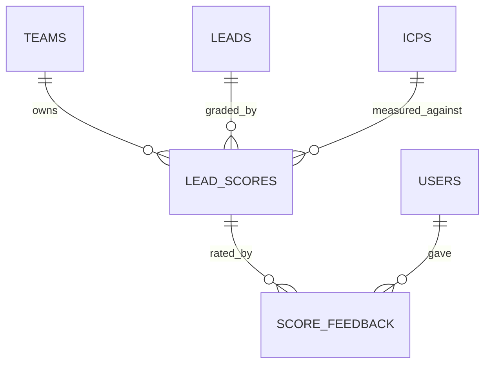

# Scoring & Matching

> Status: **MVP** · Last updated: 2026-10-29

## Purpose

Grades each lead against the team's **active** ICP with a **hybrid** score: a deterministic pass
over the ICP's weighted criteria **plus** an AI qualitative assessment, blended into one 0–100
figure with an A–D grade, a per-criterion breakdown and a plain-English explanation. Re-scores when
the inputs move (the lead was enriched, or the ICP changed) and captures members' good/bad feedback
on the result.

The deterministic half **matches by meaning where it safely can and defers where it can't**: a
sector taxonomy makes "SaaS" and "cloud software" the same industry, a seniority ladder makes "CEO"
satisfy "Director or above", and a criterion the lead has data for but the rules can't settle in a
different vocabulary is handed to the AI half (`Weak`) rather than counted as a failure. It also
surfaces a read-only **calibration preview** to the ICP screen (how the active profile is actually
grading leads, and which criterion is doing the rejecting) through the `IcpCalibrationSource` seam.

It does **not** source, enrich or de-duplicate leads (Lead Sourcing / Enrichment), does not define
the ICP (ICP module), and does not own the leads list or pipeline (Leads Workspace, Phase 10) — it
only answers "how well does this lead fit, and why?".

## Code map

- **Backend:** `app/Modules/Scoring/`
    - `Services/DeterministicScorer.php` — the rule half: ICP criteria vs the lead's stored fields →
      {@see DeterministicScore}. No AI, no network, fully reproducible. Uses `Support/SectorTaxonomy`
      (industry → sector) and `Support/SeniorityLadder` (title → rank, criterion → floor).
    - `Support/SectorTaxonomy.php`, `Support/SeniorityLadder.php` — the two collaborators above,
      pure over `config/scoring.php`.
    - `Services/IcpCalibrator.php` — reads `lead_scores` to build an `ICP\Data\IcpCalibration`; the
      real binding for the ICP module's `IcpCalibrationSource` seam (bound in the provider). No AI,
      no re-grading.
    - `Contracts/LeadSignalSource.php` + `Services/NoLeadSignals.php` (Q3) — the seam through which
      a **buying signal** is judged, and its permissive default. Signals binds the real
      `MatchedLeadSignals` over it; Scoring never imports Signals.
    - `Services/ScoringPayloadBuilder.php` — renders the `icp` and `lead` blocks for the prompt; the
      lead block is wrapped in `UntrustedContent`.
    - `Actions/ScoreLeadAction.php` — the hybrid score: rules → AI → blend → grade → persist.
    - `Actions/RecordScoreFeedbackAction.php` — one verdict per member per score, with a snapshot.
    - `Actions/FindScoredLeadAction.php` — team-scoped lead read with everything the screen renders.
    - `Jobs/ScoreLeadJob.php` — `ShouldQueue` + `ShouldBeUnique` per (lead, ICP, forced).
    - `Listeners/ScoreEnrichedLead.php` — on `Enrichment\Events\LeadEnriched`.
    - `Listeners/RescoreTeamOnIcpChange.php` — on `ICP\Events\IcpUpdated`; itself `ShouldQueue`.
    - `Models/{LeadScore,ScoreFeedback}.php`, `Policies/LeadScorePolicy.php`.
    - `Data/{CriterionScore,DeterministicScore,QualitativeFit}.php`, `Casts/CriterionScoreList.php`.
    - `Enums/{ScoreGrade,CriterionMatch,FeedbackRating}.php`, `Exceptions/ScoringException.php`.
- **Routes:**
    - Web: `GET /leads/{lead}/score` (`scoring.show`), `POST /leads/{lead}/score` (`scoring.store`),
      `POST /leads/{lead}/score/feedback` (`scoring.feedback`).
    - API: the same three under `/api/v1` (`api.v1.scoring.{show,store,feedback}`).
- **Frontend:** `resources/js/pages/scoring/Show.vue`,
  `resources/js/components/scoring/GradeBadge.vue`, `resources/js/types/scoring.ts`. The discovery
  run screen (`pages/lead-sourcing/Show.vue`) gained a **Fit** column linking to the score screen.
- **Tests:** `tests/Feature/Scoring/` (DeterministicScorer, ScoreLeadAction, ScoreLeadJob,
  RescoreTrigger, ScoreFeedback, ScoringWeb, ScoringApi, ScoringTenancy), `tests/Unit/Scoring/`.
- **Config / env:** `config/scoring.php` — `SCORING_BLEND_DETERMINISTIC`,
  `SCORING_BLEND_QUALITATIVE`, `SCORING_GRADE_{A,B,C}`, `SCORING_DEFAULT_WEIGHT`,
  `SCORING_RESCORE_RATE_LIMIT`, `SCORING_RESCORE_CHUNK`, `SCORING_CALIBRATION_SAMPLE`, plus the
  `country_aliases`, `sectors` (the industry taxonomy) and `seniority` (the title ladder) tables.
- **Prompt:** `scoring.qualitative_fit` **v2** (reasoning tier; v1 kept for traceability) — see
  `docs/ai-prompts.md`.

## How the score is produced

### 1. The deterministic half

For each positive criterion, the scorer compares the ICP's value with the lead's own stored fields:

| Criterion type         | Judged against                                                           |
| ---------------------- | ------------------------------------------------------------------------ |
| Industry               | `leads.industry` — literal match **or** shared sector (`SectorTaxonomy`) |
| Company size           | `leads.employee_range` — **numeric band overlap**                        |
| Geography              | `locality`, `region`, `postal_code`, `country`\*, `locations`\*\*        |
| Decision-maker title   | `lead_contacts.title`                                                    |
| Seniority              | `lead_contacts.title` — ranked on the `SeniorityLadder`                  |
| Technology used        | `leads.technologies`                                                     |
| Buying signal          | `LeadSignalSource` — what Signals has matched to this lead\*\*\*         |
| Exclusion (unweighted) | name, number, website/domain, industry, location, contact email domains  |

\* through `scoring.country_aliases`, so an ICP written as "UAE" matches a lead stored as "AE".

\*\*\* `MatchedLeadSignals` (Q3) returns each matched signal's type name, `event_key` and
headline, newest first - dismissed signals excluded, one entry per **event** (a clustered story
is read through `signal_clusters.primary_signal_id`), and only within
`signals.scoring.lead_signal_days`. A team with Signals off, or a lead with nothing matched,
gets an empty list, which is `Unknown` by rule 2 and not a miss. See `docs/modules/signals.md`.

\*\* `leads.locations` (Q1) is the places a company says it **operates in** — not a postal
address, which is what the four fields before it are. A `web_search` lead has no address at all, so
until Q1 this criterion abstained on every one of them, which read as "we don't know" when we did.
Knowing no location at all is still `Unknown`, not a miss (rule 2 below). The AI half is told them as
"Operates in", kept apart from "Location", so an explanation cannot merge two different claims.

Four rules govern the arithmetic:

1. **Weights are normalised, not summed.** `score = matchedWeight / assessedWeight × 100`, so an ICP
   with three criteria and one with thirty sit on the same scale and nobody can inflate a lead by
   adding criteria. An unweighted signal takes `scoring.default_signal_weight`.
2. **Missing data is not a failure.** A criterion the lead has no data for is `Unknown` and its
   weight leaves **both** sides of the ratio. Otherwise the score would measure enrichment coverage
   rather than fit, and a thin lead would be marked down for what we simply don't know yet.
3. **An uncertain read is deferred, not failed (`Weak`).** When the lead _has_ data but the rules
   can't settle it confidently — an industry in a vocabulary the sector taxonomy doesn't carry, a
   contact title the ladder can't rank, a technology or job title that didn't match literally — the
   row is `Weak`. It abstains from the ratio like `Unknown`, **but is handed to the AI half to
   adjudicate** (passed in the prompt's `{{deferred}}` block). This is the correction for a real
   regression: a literal `str_contains` across two vocabularies ("SaaS" vs "cloud software") says
   nothing reliable, yet the old code counted that non-match as a hard zero on the heaviest
   criterion — so improving enrichment (which fills `industry`/`employee_range`) made scores
   _worse_, flipping free-pass `Unknown`s into `NotMatched` zeros. `NotMatched` is now reserved for a
   **confident** miss: a company-size band that genuinely doesn't overlap, a location that isn't
   wanted, two industries the taxonomy places in **different** sectors, a seniority **below** the
   named floor.
4. **An exclusion is absolute.** A matched exclusion returns 0 immediately, grades D, and the AI
   call is skipped entirely (no spend).

Criterion values are matched case- and punctuation-insensitively, in either direction, and read as
"any of" when comma/slash separated (Latin and Arabic separators). Values shorter than four
characters must land on a word boundary, so "IT" doesn't match inside "Security".

**Industry — `SectorTaxonomy`** (`config/scoring.php` → `sectors`, a map of canonical sector →
keywords). A literal hit wins outright; otherwise both the ICP value and the lead's industry are
placed on a sector. Same sector → `Matched`; two _different known_ sectors → `NotMatched`; either
side unmappable → `Weak`. The taxonomy is deliberately coarse (the AI half carries the nuance), and
a team can grow it without a code change.

**Seniority — `SeniorityLadder`** (`config/scoring.php` → `seniority`). The criterion names a floor
("Director or above" → rank 3) and each contact title is ranked; a title at or above the floor
matches, a ranked title below it is a confident miss, a title the ladder can't place defers. A
criterion that names no recognisable level ("decision maker") falls back to a literal compare.

### 2. The qualitative half

`scoring.qualitative_fit` **v2** (reasoning tier) receives the ICP block (team-authored, trusted),
the lead block (provider- and page-derived → wrapped in `UntrustedContent`, a nonce-delimited data
block) and a **`{{deferred}}`** block listing the criteria the rules couldn't settle — what the
profile wanted and what the lead actually holds — so the model judges exactly those vocabulary gaps
rather than re-deriving the whole fit blind to what the rules already settled. The lead block states
**unknown** for every field we don't hold, so the model can't quietly fill one in — that is what
keeps the explanation grounded. The response is clamped by `QualitativeFit` (score 0–100, rationale
≤ 1 500 chars, ≤ 6 strengths/concerns). The model's own letter grade is deliberately **discarded**:
the stored grade comes from the blended score, so one scale governs the product. (v1 stays seeded for
traceability; the registry resolves the highest active version.)

### 3. Blending and grading

`score = (deterministic × Wd + qualitative × 0.4) / (Wd + 0.4)`, with either weight dropped to zero
when that half has nothing to say. Grades come from `scoring.grades`: **A** ≥ 80, **B** ≥ 60, **C** ≥
40, **D** below. An excluded lead is always D.

`Wd = 0.6 × coverage`, where **coverage** is the rules' authority over the data the lead actually
held: `assessedWeight / (assessedWeight + deferredWeight)`. When the rules confidently settled only a
light criterion while deferring a heavy one (an industry in an unknown vocabulary), their 0.6 shrinks
and the AI half — which judged the deferral — carries the score; without it, one confidently-matched
light criterion could pin a lead's score high on the rules alone while the AI's verdict on the real,
heavy question barely moved it. Coverage deliberately ignores `Unknown` weight: missing data is a
blind spot the AI half _shares_, so it's no reason to shift authority between them. Coverage is 1.0
(the old 0.6/0.4) whenever nothing was deferred.

Degradation is deliberate and asymmetric:

| Situation                                              | Result                                             |
| ------------------------------------------------------ | -------------------------------------------------- |
| AI credit exhausted / un-validatable output / no score | rules-only score, `ai_score` null, no explanation  |
| …but the lead **already** has an AI-backed score       | the existing score is **left untouched**           |
| No assessable criteria (e.g. only a buying signal)     | AI-only score                                      |
| No assessable criteria **and** never enriched          | **no row written**, and the prompt is never called |
| Neither half has anything to say                       | **no row written** — never a D out of ignorance    |
| Transport failure                                      | bubbles; the queue retries with backoff            |

Two of those deserve their reasoning:

- **A degraded re-score never overwrites a richer one.** If the AI half is down but the lead already
  holds an `ai_score` and an explanation, the score is left exactly as it is. Otherwise a team-wide
  re-score that ran out of credit part-way would quietly strip every remaining lead's explanation
  and re-grade it on the rules alone. The score simply stays stale, so the next trigger — or a
  manual re-score once credit is back — refreshes it properly.
- **A bare lead is not graded at all.** When the rules could assess nothing _and_ the lead has never
  been enriched, there is nothing but a company name to go on, and a grade there would be a guess
  wearing a number. The guard runs **before** the prompt, so it costs nothing; the lead is graded as
  soon as enrichment gives it something to judge.

## Data model

**`lead_scores`** — `team_id`, `lead_id`, `icp_id` (all cascade), `score` + `grade`,
`deterministic_score`, `ai_score` (nullable), `breakdown` JSON (list of `CriterionScore` via the
`CriterionScoreList` cast), `explanation`, `strengths`/`concerns` JSON, `excluded` +
`excluded_by`, provenance (`prompt_key`, `prompt_version`, `model`, cumulative `cost_micros`),
`scored_at`. **Unique (`lead_id`, `icp_id`)** — one current score per lead per ICP, re-scored in
place so feedback on it survives. Indexed on (`team_id`, `grade`) and (`team_id`, `score`) for the
Phase 10 list.

**`score_feedback`** — `team_id`, `lead_score_id` (cascade), `user_id` (null on delete, so the
signal outlives the account), `rating`, `comment`, plus `scored_value` + `scored_grade`: a
**snapshot** of what the member was reacting to, since a re-score moves the score row underneath it.
**Unique (`lead_score_id`, `user_id`)** — re-voting replaces.

A score is meaningless without the definition it measured, so deleting an ICP takes its scores (and
their feedback) with it.

## Key flows

**Automatic scoring.** `EnrichLeadAction` → `LeadEnriched` (afterCommit, surviving lead only) →
`ScoreEnrichedLead` → `ScoreLeadJob` (not forced) → `ScoreLeadAction`.

**Re-score on an ICP change.** The ICP editor saves → `IcpUpdated` (afterCommit) →
`RescoreTeamOnIcpChange` (**queued**, so the request never fans out) → walks the team's leads in
`scoring.rescore_chunk` batches → one **forced** `ScoreLeadJob` per lead. When the team is left with
no active ICP (`activeIcpId === null`) nothing is queued: there is no definition to score against.
Existing scores stay attached to the ICP that produced them as history — the screens only surface
the active ICP's score — because deleting them would also throw away members' feedback.

**Manual re-score.** `POST /leads/{lead}/score` (Owner/Admin) → forced `ScoreLeadJob`; web redirects
back with a toast, API answers `202 {"data":{"status":"queued"}}`. The route carries the `scoring`
rate limiter (`scoring.rescore_rate_limit`, default 10/min per member) because each one spends AI
credit; the AI Platform's credit guard still bounds the team's total.

**Idempotency.** `ScoreLeadAction` returns the existing score untouched when it is already newer
than the lead's `enriched_at` and the ICP's `updated_at`, unless forced. So overlapping triggers cost
nothing, and `ScoreLeadJob` is unique per (lead, ICP, forced) — a forced re-score is a distinct
intent and isn't swallowed by a queued automatic one. The lead's own `updated_at` is deliberately
**not** a freshness input: scoring advances the lead's stage, which would otherwise leave every
score instantly stale and re-spend credit on the next trigger.

**Inside the action:** the AI call runs **outside** any transaction. The writes run in one short
transaction which re-reads the score row `lockForUpdate` (so an overlapping forced and automatic run
can't lose one of their spends from the cumulative `cost_micros`), upserts it, and **advances**
`leads.status` to `scored` only from `discovered`/`enriched` — a re-score must never drag a lead back
from a later stage once Phase 10b adds them.

## External dependencies

- **AI Platform** — `AiClient`, `scoring.qualitative_fit` v2 (reasoning tier), credit guard, usage
  ledger, response cache, injection-safe wrapping. Cost is recorded per score (cumulative) and
  per call in `ai_requests`.
- **ICP** — `Icp`/`IcpCriterion`, `FindActiveIcpAction`, the `IcpUpdated` event, and the
  `IcpCalibrationSource` **seam** this module fills with `IcpCalibrator` (the ICP screen's calibration
  preview; ICP ships a null default and never imports Scoring).
- **Enrichment** — `LeadContact` titles, the `LeadEnriched` event.
- **Lead Sourcing** — the `Lead` model (`scores()`, `activeScore()`), `LeadStatus::Scored`.
- **Core** — `TeamContext`, `BelongsToTeam`, `AuditLogger`.
- Feeds the **Leads Workspace** (Phase 10), **Reporting** (Phase 13) and **AI Insights** (Phase 14).

No third-party provider and no outbound HTTP of its own; the only metered call is the AI prompt.

## Permissions

`LeadScorePolicy` (ADR 0006), plus `LeadSourcing\Policies\LeadPolicy::view` for the lead itself:

| Ability        | Owner | Admin | Member | Read-only |
| -------------- | ----- | ----- | ------ | --------- |
| `view`         | ✅    | ✅    | ✅     | ✅        |
| `rescore`      | ✅    | ✅    | ❌     | ❌        |
| `giveFeedback` | ✅    | ✅    | ✅     | ❌        |

`rescore` is Owner/Admin because it spends AI credit against the team's allowance; `giveFeedback`
is a write that will tune future grading, so Read-only is excluded. Cross-tenant requests 404
(team-scoped read) before any policy runs — proven by `ScoringTenancyTest`.

## Known limitations / TODO

- **The sector taxonomy is a hand-curated keyword map**, deliberately coarse. It won't place every
  niche vocabulary, and when it can't, the industry criterion defers to the AI half (`Weak`) rather
  than guessing. Growing `config/scoring.php` → `sectors` is the way to sharpen it; embeddings would
  be the post-MVP upgrade (the AI Platform has no embedding transport yet).
- **The seniority ladder is keyword-based**, not an org-chart model; an unusual title defers.
- **The calibration preview's criterion counts are over a capped recent sample**
  (`scoring.calibration_sample`, default 500), read from each score's stored breakdown; the grade mix
  is exact over every lead. On a team mid-re-score (after an ICP change) the counts are briefly the
  pre-change picture until the queued re-score lands.
- **Feedback is captured, not yet used.** Learning-to-rank / weight tuning from `score_feedback` is
  post-MVP; nothing reads the table back yet.
- **A buying signal is only as good as the team's Signals set-up.** Since Q3 the rules judge one
  against `LeadSignalSource`, but the labels are a signal's **type name, event key and headline** —
  text matching, not an understanding of the event — and a team with no watches has no signals, so
  the criterion abstains exactly as it did before. The AI half still carries the cases the text
  misses. Nothing yet weights a criterion by the signal's `heat`, which is available and unused.
- **No seniority ladder.** Seniority is matched as text against contact titles; "Director or above"
  does not yet imply VP/C-level.
- **`country_aliases` is a short static list** (UK, UAE, IE, KSA, US). Extend as markets are added.
- **Grade thresholds and the blend are global**, not per-team; tuning them is a config change.
- **No bulk re-score UI.** Re-scoring the whole team happens only via an ICP change; a "re-score all"
  action lands with the Leads Workspace (Phase 10).
- **No Reverb progress** on scoring — a queued score lands quietly and the screen is reloaded by the
  member. Live grade updates are a Phase 10/12 concern.
- **The score screen is reached from the discovery run table** until the Leads Workspace (Phase 10)
  gives leads a proper index and detail page; the breadcrumb points at discovery for now.
- `scoring.qualitative_fit` is seeded at v1; improving it means adding a new version row.
- **A score left stale by a failed AI half is not retried on a schedule.** It refreshes on the next
  trigger (an enrich or an ICP change) or when someone asks for it; there is no sweeper job yet.
- **Section eyebrows on this screen use the brand's `text-xs`**, while the Phase 6–7 screens still
  use an arbitrary `text-[0.625rem]` (10px, below `brand-tokens.md §3`). The older screens should be
  brought up to the scale in a follow-up so the app is internally consistent.
- **Grade B's tint depends on the `info` token**, which is still PENDING brand-owner approval
  (`brand-tokens.md §7.6`).

## Changelog

| Date       | Phase        | Change                                                                                                                                                                                                                                                                                                                                                                                                                                                                                                                                                                                                                                                                                                                                                                                                                                                                                                                                                                                                                                                                                                                                                                                                                                          | Files                                                                                                                                                                                                                                                                                                                                                                                                                                                                                                                                                                                                                                                                                                                                                                  |
| ---------- | ------------ | ----------------------------------------------------------------------------------------------------------------------------------------------------------------------------------------------------------------------------------------------------------------------------------------------------------------------------------------------------------------------------------------------------------------------------------------------------------------------------------------------------------------------------------------------------------------------------------------------------------------------------------------------------------------------------------------------------------------------------------------------------------------------------------------------------------------------------------------------------------------------------------------------------------------------------------------------------------------------------------------------------------------------------------------------------------------------------------------------------------------------------------------------------------------------------------------------------------------------------------------------- | ---------------------------------------------------------------------------------------------------------------------------------------------------------------------------------------------------------------------------------------------------------------------------------------------------------------------------------------------------------------------------------------------------------------------------------------------------------------------------------------------------------------------------------------------------------------------------------------------------------------------------------------------------------------------------------------------------------------------------------------------------------------------- |
| 2026-10-29 | 9            | Initial module: `lead_scores` + `score_feedback`; `ScoreGrade`/`CriterionMatch`/`FeedbackRating` enums; `CriterionScore`/`DeterministicScore`/`QualitativeFit` DTOs + `CriterionScoreList` cast; `DeterministicScorer` (normalised weights, Unknown excluded from the ratio, range-overlap company size, country aliases, absolute exclusions) and `ScoringPayloadBuilder` (grounded, injection-safe prompt blocks); hybrid `ScoreLeadAction` (AI outside transactions, idempotent, degrades to either half) + unique `ScoreLeadJob`; `LeadEnriched` (Enrichment) + `ScoreEnrichedLead`, and the queued `RescoreTeamOnIcpChange` on `IcpUpdated`; `RecordScoreFeedbackAction` with a score snapshot + audit; `LeadScorePolicy` + `LeadPolicy`; web + `/api/v1` score, re-score and feedback endpoints; the score screen with grade panel, breakdown and feedback, a reusable `GradeBadge`, and a Fit column on the discovery run table; EN/AR strings at parity.                                                                                                                                                                                                                                                                                | `app/Modules/Scoring/**`, `database/migrations/2026_10_29_15000{1,2}_*`, `database/factories/{LeadScoreFactory,ScoreFeedbackFactory}.php`, `config/scoring.php`, `app/Modules/Enrichment/{Events/LeadEnriched,Actions/EnrichLeadAction}.php`, `app/Modules/ICP/Actions/FindActiveIcpAction.php`, `app/Modules/LeadSourcing/{Models/Lead,Policies/LeadPolicy,Providers/LeadSourcingServiceProvider,Http/Resources/LeadResource,Actions/FindDiscoveryRunAction}.php`, `bootstrap/providers.php`, `resources/js/{pages/scoring/Show.vue,components/scoring/GradeBadge.vue,types/scoring.ts,types/lead-sourcing.ts,pages/lead-sourcing/Show.vue}`, `lang/{en,ar}.json`, `tests/{Feature,Unit}/Scoring/*`                                                                   |
| 2026-11-01 | UI           | **The score screen says what the breakdown was worth.** `ScoreBreakdownRow::contribution` has been in the payload since this module shipped and the screen dropped it, printing a bare "Weight 70" instead — so "which criteria cost this lead its grade" was unanswerable from the one screen that exists to answer it. The breakdown now shows the points each criterion added, ordered heaviest first, with a `MeterBar` for the weight (`success` where it matched, neutral Ink 60 where it did not — a criterion a lead fails is not an error). The score itself is a new `ScoreDial`, coloured by grade from the same status tokens `GradeBadge` uses. **Bug fixed:** the "Graded" timestamp was `new Date(…).toLocaleString()`, which formats in the **browser’s** zone and locale — the same score read differently depending on the laptop, and in English inside an Arabic page; it goes through `useFormat().dateTime()` (team timezone) like everything else. The breakdown table moved onto `components/list`, and the header gained a link to the lead. No server change.                                                                                                                                                         | `resources/js/pages/scoring/Show.vue`, `resources/js/components/scoring/ScoreDial.vue`, `resources/js/components/MeterBar.vue`, `lang/{en,ar}.json`                                                                                                                                                                                                                                                                                                                                                                                                                                                                                                                                                                                                                    |
| 2026-11-06 | Q1           | **Geography stopped abstaining on every web-sourced lead.** `DeterministicScorer` reads `leads.locations` (Q1 — the places a company says it operates in) alongside the postal address, and `ScoringPayloadBuilder` states them to the AI half as "Operates in", kept apart from "Location" so an explanation cannot merge two different claims. Knowing no location at all is still `Unknown`, not a miss. No data-model change in this module.                                                                                                                                                                                                                                                                                                                                                                                                                                                                                                                                                                                                                                                                                                                                                                                                | `app/Modules/Scoring/Services/{DeterministicScorer,ScoringPayloadBuilder}.php`, `tests/Feature/Scoring/DeterministicScorerTest.php`                                                                                                                                                                                                                                                                                                                                                                                                                                                                                                                                                                                                                                    |
| 2026-11-06 | Q3           | **A buying signal is judged by the rules now.** `DeterministicScorer` abstained unconditionally on `CriterionType::BuyingSignal`; it now reads `Contracts\LeadSignalSource`, whose permissive default (`NoLeadSignals`) reproduces the old behaviour and which `SignalsServiceProvider` replaces with the real `MatchedLeadSignals`. The special case was **deleted** rather than extended - the criterion goes through `haystackFor()` like every other one, so the matcher, the Unknown-when-empty rule and the evidence string are the existing ones and the breakdown names the matched signal for free. A lead with no signals is still `Unknown`, never a miss. No data-model change.                                                                                                                                                                                                                                                                                                                                                                                                                                                                                                                                                     | `app/Modules/Scoring/{Contracts/LeadSignalSource,Services/NoLeadSignals,Services/DeterministicScorer,Providers/ScoringServiceProvider}.php`, `tests/Feature/Scoring/BuyingSignalScoringTest.php`                                                                                                                                                                                                                                                                                                                                                                                                                                                                                                                                                                       |
| 2026-11-08 | Lead quality | **Match by meaning, defer when unsure, and show the team why.** Root-caused "most leads come back C/D": the deterministic matcher compared heterogeneous vocabularies with literal `str_contains`, so good leads missed on the heaviest criterion the moment enrichment filled an industry — better enrichment made scores _worse_. Added a fourth `CriterionMatch` (`Weak`): present-but-unconfirmable data now **abstains and is handed to the AI half** (`{{deferred}}` in `scoring.qualitative_fit` **v2**) instead of scoring a hard zero. `SectorTaxonomy` matches industry by canonical sector ("SaaS" = "cloud software"); `SeniorityLadder` ranks titles so "Director or above" accepts a CEO; a confident `NotMatched` is kept for a non-overlapping size band, a wrong location, a different known sector, a seniority below the floor. The blend now weights the deterministic half by **coverage** (`assessed / (assessed + deferred)`) so the AI half carries what the rules deferred. Added the **ICP calibration preview**: `IcpCalibrator` fills the new `ICP\Contracts\IcpCalibrationSource` seam (ICP ships a null default, never imports Scoring), surfacing the grade mix and per-criterion match rates on the ICP screen. | `app/Modules/Scoring/{Enums/CriterionMatch,Services/DeterministicScorer,Services/ScoringPayloadBuilder,Services/IcpCalibrator,Support/SectorTaxonomy,Support/SeniorityLadder,Data/DeterministicScore,Actions/ScoreLeadAction,Providers/ScoringServiceProvider}.php`, `app/Modules/ICP/{Contracts/IcpCalibrationSource,Data/{IcpCalibration,CriterionCalibration},Support/NullIcpCalibrationSource,Providers/IcpServiceProvider,Http/Controllers/Web/IcpController}.php`, `config/scoring.php`, `database/seeders/AiPromptTemplateSeeder.php`, `resources/js/{components/icp/IcpCalibrationPanel.vue,pages/icp/Index.vue,pages/scoring/Show.vue,shared/types/{scoring,icp}.ts}`, `lang/{en,ar}.json`, `tests/{Feature,Unit}/Scoring/*`, `tests/Feature/Icp/IcpTest.php` |
