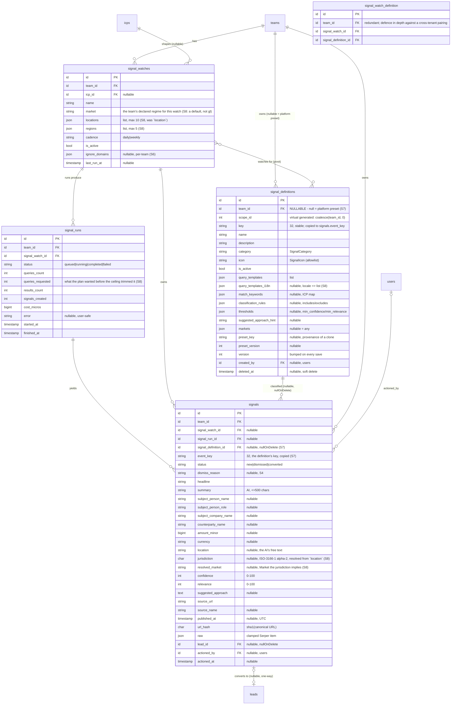
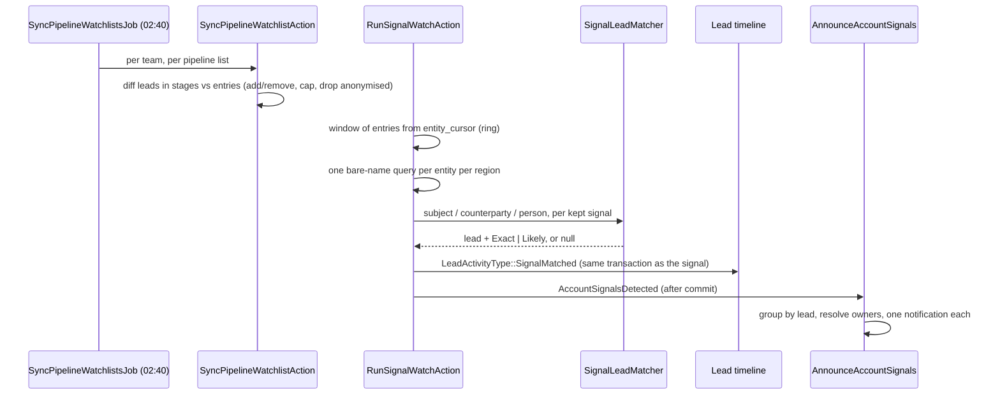

# Signals

> Status: **v1 complete (S0–S6) · v2 in progress (S7–S10 landed; S11–S16 planned, see `signals-v2-plan.md`)**
> Owner: Product · Last updated: 2026-11-02

## Purpose

Surfaces a feed of **wealth / liquidity events** happening in the team's ICP
geography — a company sold, a founder exits, a big funding round, a founder or
executive relocating to Dubai — found with **Serper News**, classified and
summarised by AI, and shown to the team as **signals**. A team member can **dismiss**
a signal or **convert it into a standard `Lead`**, which then flows through the
existing Enrichment → Scoring → Leads Workspace pipeline.

It is **not** a "find rich people" search (queries look for _events_, not stated
intent), **not** a contact-finding tool (a signal stores a person's name, public role
and source URL only — never email or phone), **not** an outreach channel (UAE PDPL
means the suggested next step is LinkedIn or a referral, not cold email — ADR 0007),
and **not** a `LeadSourceProvider` (providers return company leads keyed for dedupe;
a signal is an _event about_ a person or company). Signals is its own module
(ADR 0002, ADR 0011) and hands off to Lead Sourcing **only on conversion**, via a
one-way FK (`signals.lead_id` → `leads`).

**Primary customer (v1):** a Dubai luxury real-estate agency. v1 claimed the feature was
generic because "event types and query templates are data (config)" — the templates were,
the type was not. **S7 made that claim true** (ADR 0018): a signal type is now a
`SignalDefinition` row a team owns, created and tuned on `/signals/types` without a
deploy, so a recruiter watching for a hiring surge and a contractor watching for planning
permission are configuration rather than a release. v1's three types are the first three
entries in a **platform preset library** teams clone from.

**S10 made it a monitor as well as a feed** (ADR 0021). A watch can be pointed at a **watchlist**
of companies instead of at a place, and the obvious list is the team's own pipeline — mirrored
nightly, so nothing is typed. Every kept signal, from any watch, is matched against the team's
leads; a match puts the event **on that lead** rather than offering it as a stranger, and the card
offers _Add to Acme Ltd_ where it used to offer _Convert to lead_. The cold question ("who just came
into money?") is unchanged; the warm one ("what just happened to the forty accounts I am working?")
is new, and it is the one a team cannot switch off without going blind.

**S9 made it a builder** (ADR 0020). A member describes a buying moment in a sentence, Alima
drafts the definition, and — the part that matters — they see **what it would have found** before
they save it. The S0 spike is the reason: nobody can tell whether a query template works by reading
it, seven of eight hand-written ones returned zero, and S7 handed that problem to customers without
the afternoon a developer had to spend on it. The library grew to 30 presets in seven groupings at
the same time, every template run against the live provider first.

**S8 made it multi-market** (ADR 0019). A watch covers several places and several
`SearchRegion`s at once, so a team selling into Dubai and London has one watch rather than two, and
the UK is a first-class market with its own preset pack. The same phase fixed a compliance defect
that multi-geography would otherwise have made live: the outreach restriction on a converted lead
now **follows the signal's own jurisdiction** rather than the watch's market.

## Code map

> **The module is complete (S0–S6, 2026-10-29).** Anything described as "to come" below is
> post-v1 backlog, not unbuilt v1 scope.

- **Backend:** `app/Modules/Signals/…` (scaffolded in S1 via the `new-module` skill)
    - **Models (S1 ✅):** `SignalWatch`, `SignalRun`, `Signal` — all `BelongsToTeam`,
      typed casts (enums, `Carbon`, money as int minor units), relationships
      `watch → runs → signals`, `signal → lead` (one-way) and `signal → actionedBy`.
      Factories `SignalWatchFactory` / `SignalRunFactory` / `SignalFactory`
      (`database/factories`, with `inactive`/`weekly`, `running`/`completed`/`failed`
      and `acquisition`/`dismissed`/`converted` states).
    - **Enums (S1 ✅; S4 ✅):** `SignalDismissReason` (S4: `NotRelevant`, `AlreadyKnown`,
      `NotAnEvent`; `indicatesMisclassification()` so tuning reads intent, not raw counts),
      `SignalCategory` (S7 — how the library groups itself: `Liquidity`, `Growth`, `Movement`,
      `Distress`, `Hiring`, `Regulatory`, `Custom`) and `SignalIcon` (S7 — an **allowlist**,
      because the client maps the value to an imported component and a customer-authored
      definition must not be able to put an arbitrary string there), `SignalStatus` (`New`, `Dismissed`,
      `Converted`), `SignalWatchCadence` (`Daily`, `Weekly`; `staleAfterHours()` →
      24 / 168 for the S3 scheduler), `SignalRunStatus` (`Queued`, `Running`,
      `Completed`, `Failed`; `isTerminal()`/`isActive()` — mirrors `DiscoveryRunStatus`).
      **`SignalEventType` is gone** (S7, ADR 0018). Nothing in the app branched on which case
      it was — it picked templates, rendered a label and a description, mapped an ICP keyword and
      grouped a report, all of which are properties of a type rather than decisions about one — so
      it became a row. The four status/cadence/reason enums stay enums, because the code does
      branch on all four. That test, "does the application branch on the value", is the line
      ADR 0018 §1 draws, and it is the only place in the codebase where `CLAUDE.md` §2's
      "enums for every type column" is set aside.
    - **Enums (S8 ✅):** `SearchRegion` (`Ae`, `Gb`, `Sa`, `Us`, `In`, `Sg`, `Global`) — **where to
      look**, which ADR 0019 separates from `Core\Enums\Market`'s **which rules apply**. It carries
      a nullable `gl()` (`global` sends no country code at all), an `hl()`, `defaultLocations()`,
      an `approachNote()` for the watch form, and a **nullable** `market()`: "we can search here and
      we have not taken a legal position here" is a representable state, and the alternative —
      adding `Market` cases — would be a programmer asserting a compliance position the business
      has not taken. It stays an enum because the app does branch on it: `gl`/`hl` per case, and
      `isOffered()` gates it against `config('signals.regions.*.offered')`, which is **true only for
      `ae` and `gb`** — the two regimes ADR 0007 covers. The other five are ready in code and not
      offered, so turning one on is a config line _and_ a compliance decision (⚖️
      `docs/compliance.md` §5).
    - **Models (S7 ✅):** `SignalDefinition` — what a signal type _is_: its name, its one-line
      explainer, its `query_templates`, its `match_keywords` (the ICP map), its
      `classification_rules` (`includes` / `excludes`, handed to the AI), its own `thresholds`,
      its `markets`, and `preset_key`/`preset_version` when it is a clone. `BelongsToTeam` plus
      soft deletes. **Two scopes share the table:** a row with a `team_id` is the team's; a row
      with `team_id = null` is a **platform preset**, and the only thing allowed to read one is
      `Services/PlatformPresetReader` — the single place in the module that removes the team
      scope, and it replaces it with the stricter `team_id is null` rather than simply dropping
      it (ADR 0018 §2, mirroring how `Admin\Support\PlatformContext` isolates the same trick).
    - **Contracts (S2 ✅):** `NewsSearchClient` (`search(SignalQuery): list<NewsItem>`);
      real impl `SerperNewsClient`, test impl `FakeNewsSearchClient`.
    - **Services (S2 ✅; S7 ✅):** `SignalQueryBuilder` (**watch + definitions + active ICP** →
      `list<SignalQuery>`, deterministic, no AI — watch location overrides ICP geography, each
      definition's own templates are used, buying-signal criteria append extra queries only when
      they map to a watched definition's keywords). Since S7 the definitions are **passed in, not
      loaded**, which is what keeps the builder a pure function of its inputs: the caller resolves
      them through a team-scoped query, and S9's "preview a type before you save it" can call the
      same builder with a definition that has no row yet. It no longer reads
      `config('signals.templates')` at all — that key is seed data for the presets now, and says
      so in the file. The first-match-wins order for an ambiguous ICP buying signal moved from the
      enum's declaration order to the **order the definitions are given**, which
      `SignalWatch::definitions()` fixes by definition id. `SerperNewsClient`
      (implements `NewsSearchClient`; reuses the `AbstractHttpLeadSourceProvider`
      hardening pattern — timeouts, retry-on-429/5xx, the shared
      `Core\Support\CircuitBreaker` with prefix `signals:cb` and key `signals_news`,
      fail-fast on a missing key — drops `ignore_domains`, collapses duplicate URLs,
      clamps all text incl. `raw`, rejects over-long/non-http(s) links, and fails on a
      malformed 200 body), `SignalItemNormaliser` (URL canonicalisation → `url_hash`:
      lower-cased host, `utm_*`/fragment stripped, query sorted).
    - **Data / DTOs (S2 ✅; S4 ✅):** `SignalQuery` (`eventType`, `q`, `gl`, `hl`,
      `tbs`, `num`), `NewsItem` (`title`, `snippet`, `link`, `urlHash`, `source`,
      `publishedAt` best-effort UTC, `raw`), `ExtractedSignal` (S3, AI output,
      schema-validated), `ConvertSignalData` (S4, spatie/laravel-data —
      `prefillFrom(Signal)` seeds the form, `fromValidated()` clamps to the columns,
      `rules()` keeps the S5 web and S6 API endpoints from drifting on what a
      conversion accepts; `companyName` required and never invented).
    - **Actions (S3 ✅; S4 ✅; S5 ✅):** `ListSignalsAction` (the server-driven feed,
      ordered by `published_at` — the feed is about when the _event_ happened, not when
      Alima found it — plus `counts()` for the tabs in one grouped query),
      `ListSignalWatchesAction` (all watches, with runs **capped per watch**),
      `SaveSignalWatchAction` (create/update, audited; an out-of-team ICP is dropped and
      logged; **reactivating a paused watch doesn't make it due**, so a month-old watch
      doesn't fire the moment it is switched on), `DeleteSignalWatchAction` (audited, and
      the audit row records the signals/runs going with the cascade — the only place
      those counts survive), `RunSignalWatchAction` (orchestrates one run),
      `TriggerSignalWatchAction` (run-now, rate-limited 1/15 min/watch via
      `RateLimiter`), **`ListSignalDefinitionsAction` / `SaveSignalDefinitionAction` /
      `DeleteSignalDefinitionAction` / `CloneSignalPresetsAction`** (S7 — the library's CRUD; the
      save writes the key **once** and never again, because every signal of that type carries a
      copy of it, and bumps `version` on every save so S12 can say which version classified a
      signal; the delete is **refused while a watch uses it** and is a soft delete so even the
      attribution survives; the clone is idempotent, so re-adding a preset never overwrites a
      team's tuned copy), `ConvertSignalToLeadAction` (S4 — one transaction with
      `attempts: 3`, lock → attach-or-create → `LeadDeduplicator` → contact →
      timeline/audit → mark converted → `afterCommit` enrich + `SignalConverted`; see
      "Key flows"), `DismissSignalAction` / `RestoreSignalAction` (S4 — transactional,
      audited, idempotent, and refused on a converted signal).
    - **Jobs (S3 ✅):** `RunSignalWatchJob` (`ShouldBeUnique` per watch, `tries=3`,
      `backoff=[30,120,300]`, `timeout=120`, `uniqueFor=600`, `failed()` marks the
      latest non-terminal run Failed), runs inside `TeamContext` with
      `Log::withContext(['team_id','signal_watch_id'])`.
    - **Console (S3 ✅; S6 ✅):** `DispatchDueSignalWatchesCommand` (`signals:dispatch-due`,
      scheduled hourly, `withoutOverlapping`) queues a run for each active watch whose
      cadence is due; `PruneSignalsCommand` (`signals:prune`, nightly at 03:20) is the
      retention sweep — chunked, idempotent, every team, counts-only logging, with a
      `--dry-run` because retention is irreversible.
    - **HTTP (S5 ✅ web; S6 ✅ API):**
        - `Http/Controllers/Concerns/ResolvesSignals` — the caller, their team, and a
          team-scoped read of the signal or watch. Reading inside `TeamContext` is what
          makes a cross-tenant request a **404 before any policy runs**; the policy
          still double-checks (ADR 0006).
        - Web: `SignalController` (`index`/`convert`/`dismiss`/`restore`),
          `SignalWatchController` (`index`/`store`/`storeDefault`/`update`/`destroy`/`run`).
        - API v1: `Api/V1/SignalController` (+ `show`), `Api/V1/SignalWatchController`
          (+ `show`) — same Actions behind both, so there is one definition of what
          converting or dismissing means. `run` answers **202** and returns immediately.
        - Requests: `ListSignalsRequest` (bounds the input; `SignalFilters` narrows it),
          `ConvertSignalRequest` (rules from `ConvertSignalData::rules()` plus a
          team-scoped `pipeline_stage_id`), `DismissSignalRequest`,
          `SaveSignalWatchRequest` (rules from `SignalWatchData::rules()` plus a
          team-scoped `icp_id`; **`market` is not accepted** — v1 is UAE-only).
        - Resources: `SignalResource` (no contact fields, because there are none; `raw`
          never leaves the server; `deletes_in_days` from the retention window),
          `SignalWatchResource` (event types with their labels and explainers; a computed
          `next_due_at`), `SignalRunResource`.
    - **Services (S6 ✅):** `SignalsPersonalDataExporter` — the DSAR hook (see
      `compliance.md` §5a); `SignalLeadOriginProvider` (S4, the lead-origin seam).
    - **Data / DTOs (S3 ✅; S5 ✅):** `ExtractedSignal` (the schema-validated AI output per
      item; `fromAiItem()` converts amount→minor units + resolves currency;
      `meetsThreshold()`), `SignalFilters` (the feed's tab + filter state — the one shape
      the request, the query and the Inertia props speak; unknown values are **dropped,
      not rejected**, so a shared link from last month still opens), `SignalWatchData`
      (`defaultWatch()` is the one-click first watch; `rules()` keeps the web and API
      endpoints from drifting).
    - **Events (S3 ✅; S4 ✅):** `SignalRunProgressed` (stages searching →
      analysing → saving → done), `SignalsDetected` (afterCommit, count) and
      `SignalConverted` (S4 — afterCommit; team, signal, lead and an `attached` flag,
      so a feed can drop the card and reporting can tell a new lead from a link to one
      the team already had) — all `ShouldBroadcast` on `teams.{teamId}`.
    - **Policies (S1 ✅; S7 ✅):** `SignalWatchPolicy` (`view`/`create`/`update`/`delete`/`run`),
      `SignalPolicy` (`view`/`dismiss`/`restore`/`convert`), `SignalDefinitionPolicy`
      (`viewAny`/`view`/`create`/`update`/`delete`/`clone` — and **a platform preset is never
      updatable or deletable**, answered here rather than with an `if` in a controller, so the
      screen, the API and anything added later get the same answer) — all double-check `team_id`
      via `User::roleOn()`; view is every role, mutations are Owner/Admin/Member.
    - **Cross-module seam (S4 ✅):** `SignalLeadOriginProvider` implements
      `LeadsWorkspace\Contracts\LeadOriginProvider` and is bound over the Workspace's
      `NoLeadOrigin` default by `SignalsServiceProvider`, so the lead detail screen can
      show the event a lead came from **without the Workspace depending on Signals**.
      Keys on `raw.signal_id`, not the lead's `source`. Outside this module, S4 also
      added `LeadSource::Signal`, `LeadActivityType::SignalConverted`,
      `Core\Enums\OutreachRestriction` and `Market::outreachRestriction()`.
    - **Exceptions (S1 ✅):** `SignalsException extends DomainException`
      (`alreadyConverted()` 409, `watchInactive()`, `noSubjectToConvert()`,
      `runThrottled()` 429, and the three news-provider causes), rendered centrally in
      `bootstrap/app.php`. S4 uses `noSubjectToConvert()` for a conversion with no
      company name and `alreadyConverted()` for a dismiss/restore of a converted signal
      — and for the one conversion case that can't be made idempotent: a converted
      signal whose lead has been deleted.
    - **Services (S8 ✅):** `SignalJurisdictionResolver` — the AI's free-text `location`
      ("Dubai, UAE", "London") to an ISO-3166-1 alpha-2 code, from the deterministic place map in
      `config('signals.jurisdictions')`. Three properties matter. It matches **whole tokens**
      (`(?<![\p{L}\p{N}])…(?![\p{L}\p{N}])`), so "Indiana" is not India and "Ukraine" is not the
      UK. Its aliases are sorted **longest-first across every country at once**, not within each
      one — sorting per country let "Wales" (GB) beat "New South Wales" (AU) depending on map
      order, which a test caught. And it returns **null when unsure** rather than guessing, because
      null fails toward the restriction (ADR 0019 §3) while a guess fails away from it. The watch's
      own regions are a tiebreak only, never a source of an answer.
    - **Data (S8 ✅):** `SignalQueryPlan` — the queries a run will make _and_ the number it wanted
      (`requested`), so `wasTrimmed()` can be true and the watch card can say coverage was reduced.
      A silent trim is a lie about what was searched.
    - **Actions (S9 ✅):** `ComposeSignalDefinitionAction` — a sentence to a
      `DraftSignalDefinition`, through the `signals.compose_definition` reasoning prompt, and it
      **never saves**: the AI drafts, the member owns (ADR 0020 §2). Behind
      `Capability::SignalComposer`, the one paid thing on this screen.
      `PreviewSignalDefinitionAction` — the draft's queries against live news, classified by
      **`signals.extract_event` v2** with the draft as the only offered type, returning a verdict
      per article and persisting **no signals**. Three independent caps hold the spend (§5 of the
      ADR); the only row it writes is the `signal_previews` ledger that makes the team-wide one
      enforceable at all.
    - **Enums (S9 ✅):** `PreviewVerdict` (`IgnoredDomain`, `NotAnEvent`, `WrongLocation`,
      `BelowConfidence`, `BelowRelevance`, `Kept`) — six cases rather than a boolean because each
      one is **a different thing for the member to change**, and an empty list says only that
      something is wrong. Case order is evaluation order, which is what makes a preview
      reproducible. `label()` and `advice()` are what the panel shows, so the API and the screen
      cannot say different things about the same verdict.
    - **Data (S9 ✅):** `DraftSignalDefinition` (viable / reason / summary / definition, with
      `fromAi()` re-validating against the **save path's own rules**), `PreviewedItem`,
      `SignalPreviewResult` (the counts plus `diagnosis()` — the one sentence that tells "no news at
      all" from "news but no events" from "events your thresholds rejected"), and
      `SignalQuerySpec`, which is what let the preview exist at all: the "where" with no model
      behind it, so building queries no longer needs a saved watch.
    - **Support (S9 ✅):** `IgnoredDomains` — the skip-list rule, extracted because a run drops an
      ignored source **silently** and a preview has to **show it, labelled**; two copies of a
      host-matching rule would have made the preview answer about a search that never happens.
      `SignalCostEstimator` + `SignalCostEstimate` — what a definition costs a month, read off the
      same `SignalQuerySpec` the builder uses so the estimate and the run cannot drift.
      `SignalPresetPack` — the seven library groupings, in code and **not** in the database
      (ADR 0020 §7).
    - **Pointing a watch at a list (S10 ✅):** `signal_watches.signal_watchlist_id` travels
      through `SignalWatchData` → `SaveSignalWatchRequest` (existence scoped to the member's own
      team) → `SaveSignalWatchAction` (scoped again, because the request is not its only caller) →
      `SignalWatchResource` → the editor's own **What this watch follows** picker. It is offered
      only the team's active lists that hold something: a watch pointed at an empty list searches
      nothing. An out-of-team id is **rejected** rather than dropped, unlike a definition id —
      see "What the S10 reviews changed".
    - **Models (S10 ✅):** `SignalWatchlist` (a team's set of accounts: `source_kind`,
      `is_active`, `sync_settings` → stages/owners, `entries_count`, `synced_at`) and
      `SignalWatchlistEntry` (`entity_type`, the member's `name`, `aliases`, `domain`, a nullable
      `lead_id`, and the `normalised_name` the unique index is on). The normalised key is set by a
      **mutator on `name`**, not by a `creating` hook — S7's lesson: a hook does not run for a
      factory under `Event::fake()`, and a comparison key that is sometimes absent is worse than
      none. `searchNames()` is what a query is built from, `matchKeys()` what a match is tested
      against.
    - **Enums (S10 ✅):** `WatchlistSourceKind` (`Manual`, `Pipeline`, `Segment` — the last
      declared and **not offered**, see ADR 0021 §2; `offered()` returns pipeline first because
      that is the answer for almost everybody), `WatchlistEntityType` (`Company`, `Person`;
      `isSearchableAlone()` is what makes a person's query differ from a company's),
      `SignalMatchConfidence` (`Exact`, `Likely` — **there is no `Low`**, because a weak guess is
      not a match) and `SignalScope` (`All`, `Accounts` — a scope, **not** a status; it carries the
      sentence its own empty state shows).
    - **Services (S10 ✅):** `SignalLeadMatcher` — is this event about a company the team already
      has? Watchlist declaration first, then the subject company, then the counterparty; strict name
      is `Exact`, bare name is `Likely`, a corroborating person upgrades `Likely` to `Exact`, and
      anything weaker is **null**. It reuses `LeadSourcing\Support\CompanyNameKey` rather than
      normalising names a third time (ADR 0021 §6), and it skips an anonymised lead.
    - **Actions (S10 ✅):** `SyncPipelineWatchlistAction` (mirrors the pipeline: an add/remove
      **diff**, never a rebuild, because an entry carries the `lead_id` the matcher relies on;
      capped at `signals.watchlist.max_entries` keeping the most recently worked leads; drops an
      anonymised lead), `SaveSignalWatchlistAction` (list cap, immutable `source_kind`, an immediate
      first sync so a new pipeline list is not an empty list and a promise),
      `AddWatchlistEntriesAction` (bulk, duplicates **skipped not refused**, stops at the cap and
      says so, refuses a synced list), `RemoveWatchlistEntryAction` (two writes — the row and the
      cached count — so it is one transaction or it is a counter that drifts) and
      `DeleteSignalWatchlistAction`.
    - **Jobs (S10 ✅):** `SyncPipelineWatchlistsJob` — `ShouldBeUnique`, chunked over teams with a
      per-team try/catch, scheduled `dailyAt('02:40')`. One team's bad row does not stop the rest.
    - **Log channel (S1 ✅):** `signals` (daily, `config/logging.php`) — log IDs/counts
      only, never names or article text.
    - **Testing:** `app/Modules/Signals/Testing/FakeNewsSearchClient` (canned Dubai
      fixtures, bound in tests).
    - **Provider:** `Providers/SignalsServiceProvider` (routes, policies, bindings),
      registered via the Core base provider.
- **Routes (S5 ✅ web, S6 ✅ API):**
    - Web: `signals.index/convert/dismiss/restore` at `/signals`,
      `signal-watches.index/store/store-default/update/destroy/run` at **`/signals/watches`**, and
      `signal-definitions.index/store/clone/update/destroy` at **`/signals/types`** (S7) — all
      nested under `signals/` so the sidebar's `startsWith` match keeps Signals lit across its own
      screens. The route _names_ are the ones the plan specified.
    - API (`auth:sanctum`, `/api/v1`): `GET /signals`, `GET /signals/{id}`,
      `POST /signals/{id}/convert|dismiss|restore`,
      `GET/POST /signal-watches`, `GET/PATCH/DELETE /signal-watches/{id}`,
      `POST /signal-watches/{id}/run` (202), and (S7) `GET/POST /signal-definitions`,
      `GET /signal-definitions/presets`, `POST /signal-definitions/clone`,
      `GET/PATCH/DELETE /signal-definitions/{id}`. The definition routes reuse
      `TokenAbility::SignalsRead`/`SignalsWrite` rather than inventing a scope of their own: a
      signal type is part of Signals, and a token that could read the feed but not the types it is
      grouped by is a credential nobody would mean to issue. `presets` is **not paginated** — the
      library is a curated set measured in tens, and making a client page through it to render a
      picker would be work for nothing.
    - **The builder's two routes (S9)** are `signal-definitions.compose` and
      `signal-definitions.preview`, on both web (`/signals/types/compose`, `/signals/types/preview`)
      and API. Each spends money per press, so each is throttled **per hour** rather than per minute
      — the window has to make iterating affordable and a loop pointless — and `compose` carries
      `capability:signal_composer` as well as the Action's own check. On the API both take
      `TokenAbility::SignalsWrite` although neither creates a row: a scope asks what a _credential_
      may do (ADR 0013), and a read-only token that could run paid AI drafts is not read-only.
    - `run` carries **two** limits on both web and API: the per-watch 15-minute window in
      `TriggerSignalWatchAction`, and a per-member `signals-run` throttle
      (`signals.run_rate_limit`, default 10/min). A run spends real money, and a token is
      easier to loop than a button.
    - **Accounts (S10)** — web: `signal-watchlists.index/store/update/destroy`,
      `signal-watchlists.entries.store/destroy` and `signal-watchlists.sync` at
      **`/signals/accounts`**, plus `signals.attach`. API: the same set under
      `/api/v1/signal-watchlists*` and `POST /api/v1/signals/{signal}/attach`, on
      `TokenAbility::SignalsRead`/`SignalsWrite` — a watchlist is where a watch looks, and a token
      that could read the feed but not the accounts it is about is a credential nobody would mean
      to issue. `attach` is its **own route** rather than a flag on `convert`: a route that
      sometimes creates a lead and sometimes does not is a route nobody can reason about from its
      name. `sync` needs no throttle of its own — it is indexed queries and no external call —
      unlike `run`, which spends money.
    - Broadcast: reuses the `teams.{teamId}` private channel.
- **Frontend (S5 ✅; S7 ✅):** `resources/js/pages/signals/{Index,Watches,Types}.vue`,
  `resources/js/components/signals/{SignalCard,ConvertSignalModal,DismissSignalDialog,SignalTypeIcon}.vue`,
  a **Signals** sidebar entry (`Satellite`, `/signals`), and the lead-detail "The event"
  panel (S4). Brand tokens only; EN/AR at parity.
    - **`Types.vue` (S7)** is the library: the team's own types above, Alima's presets below,
      grouped by category. The copy says the clone rule in words — "adding one makes your own copy
      of it" — rather than leaving a member to discover it. The watch editor's three fixed
      checkboxes became **one per active type the team has**, and a team with none is sent to the
      library instead of being shown an empty fieldset.
    - **`SignalTypeIcon.vue` (S7)** is the one place an icon key becomes a component, typed
      `Record<SignalIcon, Component>` so `vue-tsc` fails the build if a case is added to the enum
      and forgotten here. That is the whole reason the icon set is closed (ADR 0018 §8).
    - **`Types.vue` is the builder since S9**: the composer box with its example briefs (buttons,
      not prose — an example a member has to retype is an example nobody takes), the library browsed
      by **pack** with the shared `FilterToggle`/`FilterGroup` chips, a `Rare` badge on the three
      presets the spike found thin, and inside the editor a **Before you save** panel carrying the
      live cost line and the preview with its verdict chips. The draft and the preview arrive as
      **flashed** data rather than props, which is exactly their lifetime.
    - **The four list textareas were not keyboard-operable** until S9, and the fix is the same one
      S8's review made to the watch form: a two-way computed that filtered blank lines and wrote the
      result back ate the Enter key, so the only way to add a second template was to split a line or
      paste (WCAG 2.1.1). They are refs with a one-way parse now.
    - **`Accounts.vue` (S10)** is the accounts screen: a section per list with its names, the
      stage picker for a mirrored list, the paste-a-column dialog for a typed one, and — because
      nobody can see this for themselves — **the rotation in words** ("checked every 7 days"), since
      a long list that seems quiet otherwise reads as a broken feature. `SignalCard` grew an
      `info`-tinted panel naming the matched lead and explaining the confidence in a sentence, with
      **Add to {Lead}** as the primary action and **Convert anyway** beside it as a real button —
      converting is the one that makes a duplicate here, so it is the quiet one. The feed gained a
      **scope** row (pills, above the status tabs, because two axes must not read as one list of
      six), and the lead detail's "The event" panel became a **list** of events in date order.
    - **Whose words are these?** A type's name and description are Alima's or the team's, and only
      the server knows which: `SignalDefinition::usesPlatformWording()` is "cloned, and never
      edited since" (`version === 1`), and it rides on every payload as `translatable`. A screen
      runs the wording through `t()` only when that is true — translating what a team typed would
      be the app overwriting them, and leaving ours untranslated would give an Arabic UI an English
      badge.
    - After the `brand-reviewer` pass: the tabs are **links, not `role="tab"`** (each one
      navigates, so it is shareable and the Filters button can live beside them);
      selected filter chips carry a **tick, not just a tint** (WCAG 1.4.1); focus moves
      to the list when a card leaves it, with an always-mounted live region; the card was
      **trimmed** (no redundant status badge, no "found by", relevance in the header, no
      tinted approach panel); counts use **count-neutral phrasing** so Arabic needs no
      dual/plural forms.
    - Two base components were extracted rather than copying `Input`'s class string a
      fifth time: `ui/native-select/NativeSelect.vue` and `ui/textarea/Textarea.vue`.
      ~15 older call sites across the app still hand-roll these — see "Known limitations".
- **The query builder, after S8.** `SignalQueryBuilder` loops **region → place → type →
  template**, and that nesting order _is_ the trim order, because the ceiling keeps the first N.
  So a watch cut down to budget loses whole places — a gap a member can see on the card — rather
  than a slice of every type's templates everywhere, which is one nobody could. The count is
  `regions × locations × definitions × templates`: six types of ten templates over ten places in
  two regions is **twelve hundred paid searches for one run of one watch**, where v1 could not
  exceed eight. `signals.max_queries_per_run` is what holds that, and S8 is the phase that made it
  bite in a second dimension.
- **Shared:** `resources/js/shared/types/signals.ts` (S5; S7 replaced the `SignalEventType`
  union with a `SignalEventKey` alias, added `SignalDefinition`, `SignalCategory` and
  `SignalIcon`, and `SignalWatch.event_types` became `SignalWatch.definitions`).
- **Tests:** `tests/Feature/Signals/*`, `tests/Unit/Signals/*`.
- **Config / env vars:** `config/signals.php` (S2 ✅; `run_rate_limit` S5 ✅;
  `max_definitions_per_team` S7 ✅ — the same reasoning as the watch ceiling one level up, since a
  type is multiplied by every watch using it) — Serper settings (reuse the
  ADR 0010 key/base URL by reference; own `timeout`, `connect_timeout`, `retries`,
  `backoff`), `results_per_query`, `recency` (`qdr:w`), `cost_micros_per_request`,
  `min_confidence`, `min_relevance`, `ignore_domains`, the per-event-type **query
  templates** (**seed data only since S7** — the query builder no longer reads them; they are the
  record of what the three platform presets were created with), and
  `retention.{dismissed_days,unactioned_days}`. Every key documented in `.env.example`.
  **S9 added `preview`** (`max_queries`, `results_per_query`, `rate_limit`,
  `daily_budget_micros`) and **`composer`** (`rate_limit`, `max_brief`) — the three caps of ADR 0020
  §5 plus the character bound on the brief, which is ADR 0017's rule rather than a form limit.
  **S8 added `regions`** (per region: `label`, `gl`, `hl`, `market`, `offered`, `default_locations`,
  `approach_note`), **`jurisdictions`** (the resolver's place map), `max_locations_per_watch` (10)
  and `max_regions_per_watch` (5). `markets` and the top-level `hl` are marked **superseded** and
  kept only as seed data — `hl` is now a property of the region, which is what makes Arabic a
  content decision rather than an architectural one.
- **Platform data:** `Support/SignalPresetCatalogue` declares the library in code and
  `database/seeders/SignalPresetSeeder` writes it, registered in `DatabaseSeeder` beside
  `TeamRolesSeeder` and the prompt registry — all three are product data every install needs. The
  S7 data migration carries a **frozen copy** of the three v1 presets rather than reading the
  catalogue, because a migration is a snapshot and S9 grows that catalogue into six vertical packs.
  **S8 added the UK pack** — `uk_acquisition`, `uk_funding`, `uk_psc_change`, `uk_insolvency`,
  `uk_planning`, `uk_leadership` — behind `SignalPresetCatalogue::keysForMarket()` and
  `starterKeys(?Market)`, and seeded by its own frozen migration rather than the seeder alone. That
  migration is the part that is easy to leave out and the part that matters: `teams.market` already
  defaults to `uk`, so without it a UK team on a fresh database opened an **empty library** and the
  one-click first watch failed. Every UK template was spiked against live Serper before shipping —
  see the spike table below, which is also why `uk_psc_change` is **not a starter**.
  **S9 took the library to 30 presets in seven groupings** — `SignalPresetPack`: general (the UK
  starter set), luxury real estate, recruitment, B2B software, wealth management, construction and
  M&A. The pack lives on the preset in code and not on the row (ADR 0020 §7). Its frozen migration
  (`2026_11_02_140002`) was **generated from the catalogue once** and committed as a snapshot, which
  is how a 21-preset literal gets typed accurately without a migration that reads a catalogue it
  will outlive. None of the 21 is a starter: a team landing on thirty types would be past
  `max_definitions_per_team` and paying for a search per template per type on every run.

## MVP vs post-MVP

**v1 (S0–S6):** UAE-only, snippet-only Serper News watches; AI event extraction
(cheap tier) with confidence/relevance thresholds; the signals feed (EN/AR + RTL);
convert-to-lead into the existing pipeline with the UAE prior-consent flag;
dismiss/restore; API v1 parity; retention sweep + DSAR hook + per-team ignore list.
**v2 (S7–S16, `signals-v2-plan.md`):** S7 ✅ turned the event types into data a team owns.
S8 ✅ took the geography multi-market and moved the outreach restriction from the watch to the
signal's own jurisdiction; S9 ✅ added the builder (six vertical preset packs, the plain-language
composer, and preview-before-you-save); S10–S16 add watchlists, clustering, scoring, pluggable
sources, playbooks, delivery and cost governance.
**Still post-v2 backlog:** premium wealth data (Altrata).

## Data model

Eight tables. A `signal_definition` defines _what a signal type is_; a `signal_watch` defines
_where and how often to look_, and reaches its types through the `signal_watch_definition` pivot;
each run of it (`signal_run`) records cost and totals; each kept event is a `signal`, unique per
team on `url_hash` so one article never becomes two signals. A converted signal points one-way at
the `Lead` it created.

`signal_definitions` is the one table with **two scopes in it** (ADR 0018 §2): `team_id = null` is
a platform preset and anything else is a team's own. Three things make that safe rather than
clever — the `BelongsToTeam` global scope hides presets from every ordinary query;
`PlatformPresetReader` is the only code that removes it, and replaces it with the stricter
`team_id is null`; and `scope_id`, a **virtual generated column** (`coalesce(team_id, 0)`), lets
`unique(scope_id, key)` mean "one key per scope". That last one needs the column because MySQL
treats NULLs in a unique index as distinct, so `unique(team_id, key)` would not have stopped two
presets sharing a key — and SQLite would never have said so.

It is **virtual rather than stored**, and that is a MySQL requirement: MySQL refuses
`ON DELETE CASCADE` on the base column of a _stored_ generated column, and `team_id` has to
cascade like every other tenant table's does. The stored version passed the whole SQLite suite and
failed on the first `php artisan migrate` against MySQL.

**S10 added two tables and two columns on each of `signals` and `signal_watches`** (ADR 0021).
`signal_watchlists` is a team's set of accounts (`source_kind`, `is_active`, `sync_settings` →
stages and owners, `entries_count`, `synced_at`) and `signal_watchlist_entries` holds the names,
unique on `(signal_watchlist_id, normalised_name)` so "ACME LTD" is already-present when "Acme Ltd"
is there — which is exactly what pasting a column produces.

Four of those columns are the phase:

- **`signal_watches.signal_watchlist_id`** (nullable, `nullOnDelete`) is what makes a watch
  topical **or** entity-scoped — one column rather than a flag and two half-filled column sets
  (ADR 0021 §1). Deleting a list leaves its watches searching by place again, which the toast says
  out loud because it is not what anybody would assume.
- **`signal_watches.entity_cursor`** is where the next run starts. A long list is a **ring**: a run
  searches a window (`signals.watchlist.window`, 40) and wraps, so 250 accounts come round about
  every six days. It advances only on a **completed** run, so a failure does not skip the accounts
  it never reached.
- **`signals.matched_lead_id`** is the lead an event is **about**, which is a different column from
  `lead_id` ("the lead this was converted into"). Both are nullable `nullOnDelete`, and the index
  `(team_id, matched_lead_id, published_at)` is what the "My accounts" feed reads.
- **`signals.match_confidence`** travels with it, because the member is owed it (ADR 0021 §5).

**S9 added one table and it holds no results.** `signal_previews` is the ledger behind "show me
what this finds": team, who pressed it, a hash of the draft, the query and result counts, and the
cost. A preview searches the provider and runs an AI pass, so it spends real money on a button
press — and **a cost with no ledger row is a cost nobody can cap**. That row is what makes the
per-team daily preview budget enforceable and what puts preview spend beside run spend in cost
reporting rather than leaving it to be inferred from the AI usage log. It deliberately stores
nothing about what the preview found: a definition nobody has saved has no business putting rows in
a team's feed, and the member's own words survive only as `draft_hash` — enough to recognise a
repeat, which is the only question anybody asks of it.

**S8 split geography from compliance in the columns too** (ADR 0019). `signal_watches.location`
(one string) became `locations` (a list, max 10) and `regions` (a list of `SearchRegion`, max 5);
`market` **stays** on the watch, demoted to the team's declared regime for it — a default and a
backstop, no longer the thing that picks Serper's `gl`. On the other side, a signal now records
**its own** `jurisdiction` (ISO-3166-1 alpha-2) and `resolved_market`, derived once at extraction
and never recomputed. Denormalised deliberately: a lead has to be able to explain its own
restriction later, and tidying the place map must not retroactively re-label signals that have
already produced leads.



Indexes: unique `(team_id, url_hash)` (dedupe per team); `(team_id, status,
published_at)` (the feed). Money is integer minor units; timestamps UTC in the DB,
shown in the team timezone.

`dismiss_reason` (S4) is nullable because the reason is **optional** - a member can
clear a card without justifying it - and is cleared again on restore. It is kept for
tuning, not for display: "not an event" across a week says the classifier is too
loose, "not relevant" says the queries or the relevance floor are.

**A converted signal leaves nothing of itself on the lead but a pointer.** The lead
carries `raw.signal_id` / `raw.event_type` / `raw.headline`, since S8 `raw.jurisdiction`, and
where the law requires it `raw.outreach_restriction` - see the conversion flow below. **Since S8
that restriction follows the subject, not the watch**: the signal's own `resolved_market` first,
the watch's `market` as a backstop, then the most restrictive restriction across the watch's
regions - each step may only _add_ one. The FK is
one-way and `nullOnDelete`, so Lead Sourcing never depends on Signals.

### Building a signal type (S9, ADR 0020)

```mermaid
sequenceDiagram
    actor M as Member
    participant UI as /signals/types
    participant C as ComposeSignalDefinitionAction
    participant P as PreviewSignalDefinitionAction
    participant AI as AiClient
    participant S as Serper /news

    M->>UI: "tell me when a UK manufacturer changes hands"
    UI->>C: POST compose (capability + per-hour throttle)
    C->>AI: signals.compose_definition (brief wrapped untrusted)
    AI-->>C: draft, or is_viable=false + reason
    C-->>UI: DraftSignalDefinition (nothing saved)
    M->>UI: edits the draft
    UI->>P: POST preview (whole definition, not an id)
    P->>P: budget check over signal_previews
    P->>S: up to 4 sample queries
    P->>AI: signals.extract_event v2, draft as the only type
    P->>P: verdict per article; write the ledger row
    P-->>UI: items + counts + diagnosis (no signals)
    M->>UI: Save
```

Four things in that sequence are the phase rather than the plumbing:

- **Compose saves nothing.** The draft is a suggestion the member edits. A composer with write
  access would be a prompt with write access to a standing instruction to spend money.
- **A refusal is an answer.** `is_viable: false` with a reason, returned as a 200 — the member asked
  a reasonable question and got a usable answer.
- **Preview takes the whole definition, not an id**, because it is about the text in front of
  somebody, which is the point when it differs from the stored row by three words they just typed.
- **Preview classifies with the real prompt.** `signals.extract_event` v2 with the draft as the only
  offered type; a preview that used a different prompt would be previewing a search nobody will run.

### Watching your own accounts (S10, ADR 0021)



Five things in that sequence are the decisions rather than the plumbing:

- **Every kept signal is matched**, not only an entity watch's. A topical watch finding an event
  about a company already in the pipeline is exactly as useful, and a member should not have had to
  predict it.
- **The match is a column of the row being built**, so a signal is never stored unmatched and then
  corrected — and the timeline entry is written in the **same transaction** as the signal. A lead
  whose history says an event happened, with no such signal in the feed, is the worse state.
- **Idempotent for free.** A re-run inserts no signal (`insertOrIgnore` on `(team_id, url_hash)`),
  so there is no second timeline entry and nobody is told twice.
- **The notification goes to the lead's owners**, aggregated per run — one notification saying six,
  not six notifications. A lead nobody owns falls back to the team, deliberately.
- **"Add to {Lead}" is `ConvertSignalToLeadAction` with a named target**, not a second Action: the
  fill-gaps-never-overwrite rule and the `field_sources` stamping (ADR 0008) hold without a copy,
  and `ConvertSignalData::fromSignalForLead()` keeps **the lead's** company name rather than the
  article's.

## Key flows

```mermaid
sequenceDiagram
    participant Sch as signals:dispatch-due (hourly)
    participant Job as RunSignalWatchJob
    participant Act as RunSignalWatchAction
    participant QB as SignalQueryBuilder
    participant Serper as SerperNewsClient
    participant AI as AiClient (signals.extract_event)
    participant DB as DB (signals/signal_runs)
    Sch->>Job: dispatch(teamId, watchId) for due active watches
    Job->>Act: handle(watch) in TeamContext
    Act->>DB: claim/create run (Running) [tx]
    Act->>QB: build(watch, activeIcp) → queries
    Act->>Serper: search(query) per query (outside tx)
    Serper-->>Act: NewsItem[] (clamped, ignore-domains dropped)
    Act->>DB: drop url_hashes already seen for this team
    Act->>AI: structured(batch ≤10, UntrustedContent)
    AI-->>Act: ExtractedSignal[] (schema-valid)
    Act->>DB: insertOrIgnore kept signals + run totals + last_run_at [one tx]
    Act-->>Job: afterCommit → SignalsDetected; progress → done
```

**Watch run (S3).** `signals:dispatch-due` (hourly scheduler) queues a
`RunSignalWatchJob` for each active watch whose cadence is due (Daily: `last_run_at`
older than 24 h; Weekly: older than 7 days). The job runs inside `TeamContext` and
`RunSignalWatchAction`: (1) create the `signal_runs` row (Running) in a transaction;
(2) **outside any transaction** — `SignalQueryBuilder` turns the watch + active ICP
into queries → `SerperNewsClient` calls `/news` per query → collect items → **drop
items whose `url_hash` already exists for this team** → batch the rest (≤10) through
the `signals.extract_event` prompt (each item wrapped in `UntrustedContent`); (3)
**reject any `event_type` the run did not offer** (see below) and keep items clearing
**their own definition's** floors (`SignalDefinition::effectiveThresholds()`, falling back to
`signals.min_confidence` / `min_relevance` where a type sets none); (4) persist kept signals + run totals + `cost_micros` (Serper +
AI) in **one `DB::transaction()`**, using an upsert on `(team_id, url_hash)` so a
re-run is idempotent; (5) **`afterCommit`** fire `SignalsDetected` and set
`last_run_at`. Progress (`searching → analysing → saving → done`) broadcasts via
`SignalRunProgressed`. AI goes through `AiCreditGuard`, so an out-of-credit team gets
a clean Failed run, not a half-run. **Run-now** uses `TriggerSignalWatchAction`,
rate-limited to once / 15 min / watch; it **opens a `queued` run row and then dispatches**,
so the screen that pressed the button has something to report the instant it redirects,
and `RunSignalWatchAction` adopts that row rather than opening a second. A refused press
(paused watch, throttle) opens nothing. Never call Serper or the AI inside a transaction.

**Conversion (S4).** `ConvertSignalToLeadAction`, in one `DB::transaction()`:

1. **Lock the signal** (`lockForUpdate`). Already Converted -> **return the lead it
   made** (idempotent; a double-click, a retried request and an impatient member all
   land on the same lead). A converted signal whose lead has since been **deleted** has
   a null `lead_id`, so there is nothing to hand back and nothing to re-create -
   `SignalsException::alreadyConverted()` says so plainly.
2. **Normalise through `SourcedLead`**, not by hand, so the lead is keyed, clamped and
   URL-filtered exactly as a discovered one (`source = Signal`, `dedupe_key` from
   `SourcedLead::dedupeKey()`, `source_url` from the signal, `collected_at = now()`).
3. **Attach or create.** `(team_id, dedupe_key)` is unique, so an existing row with
   that key is **filled in, never overwritten** (`fillGaps()` - empty columns only,
   each with a `field_sources` entry naming `signal` / `news_extraction`, per ADR
   0008). Then `Enrichment\Services\LeadDeduplicator::deduplicate()` catches the
   harder case: the same company already on file under a _different_ key (keyed by
   registry number while this one is keyed by name, say). Because `LeadSource::Signal`
   **ranks at the bottom**, a merge may only _fill_ the survivor's gaps - an article's
   spelling of a company never renames the registry record or the team's own import -
   and it may well be our own row that is merged away, in which case the signal points
   at the survivor.
4. **Create a `LeadContact`** for the named person: `name`, `title` = role, `email` and
   `phone` **null by construction** (Signals never holds either), `is_personal = true`,
   `source = 'signal'`, `method = 'news_extraction'`. Skipped - case-insensitively -
   when the lead already has a contact of that name, so a second signal about the same
   founder doesn't stack up duplicates.
5. **Re-stamp the origin** (`stampOrigin()`), merging into the lead's existing `raw`
   rather than replacing it. This is a **deliberate exception to "fill in, never
   overwrite"**: `raw` is one of the columns the de-duplicator merges, so a lead that
   already had a `raw` payload would keep it and silently lose both the `signal_id` the
   origin panel reads and - far worse - the outreach restriction. A compliance limit
   may be **added** to a lead but never dropped from one, so it is written last, after
   every merge has had its say. The **first** signal keeps the pointer: a lead already
   carrying a `signal_id` doesn't have the three origin keys overwritten, so the panel
   can't end up describing one event while the timeline says another.
6. **Record it:** a `LeadActivityType::SignalConverted` timeline entry (properties only
    - `signal_id`, `event_type`, `headline`, `attached`; the sentence is composed at
      render time, EN/AR) plus a `signals.converted` audit row carrying ids and flags,
      never the person's name. The member's optional note goes on via
      `CreateLeadNoteAction`.
7. **Mark the signal** Converted (`lead_id`, `actioned_by`, `actioned_at`), and
   `refresh()` the caller's model so a controller about to redirect isn't holding a
   signal that still says New.
8. **`afterCommit`:** queue `EnrichLeadJob` - **only when the resulting lead is still
   enrichment-`Pending`**, so attaching to a company the team already enriched doesn't
   spend on it again (scoring follows via the existing `LeadEnriched` ->
   `ScoreEnrichedLead` listener) - and fire `SignalConverted` (team, signal, lead,
   `attached`).

**The outreach restriction follows the subject of the signal** (S8, ADR 0019).
`ConvertSignalToLeadAction::restrictionFor()` asks three things in order and keeps the most
restrictive answer:

1. the **signal's own `resolved_market`**, resolved at extraction from the AI's free-text
   `location` - this is the answer in the normal case;
2. the **watch's `market`**, the team's own declared regime, as the backstop when the article
   named no place we recognise;
3. the **most restrictive restriction across the watch's regions**, where a region maps to a
   `Market` at all - only ever used to _add_ one the first two did not supply.

Each step may add a restriction and none may remove one (`docs/compliance.md` §5a), and
"most restrictive" is ranked by `OutreachRestriction::allowsDirectMarketing()` rather than a
hard-coded `match`, so a new case joins the ordering by answering that question instead of by
somebody remembering to edit a list. A region with **no** `Market` contributes nothing: the only
restriction the app has is specifically about UAE PDPL, and stamping it on a Singapore lead would
make Outreach do the right thing for a reason that is false.

v1 keyed this on the watch's market alone, which was indistinguishable from the above while every
watch was UAE-only - and wrong in **both** directions the moment S8 let a watch span places. The
serious direction is the permissive one: a UK-market watch catching a Dubai relocation would have
produced a lead with **no** restriction, and Outreach would have seen no reason to refuse a cold
email. That is why the fix landed in the same phase that made it reachable.

What has not changed is why it is not keyed on the **lead's** country: the restriction protects the
person being approached, and the company they own may be registered elsewhere - a Dubai founder
filed under a UK holding company is exactly the case it exists for. `leads.raw.jurisdiction`
records the code the restriction was derived from, so a lead can explain its own flag later.
`LeadResource` sends the restriction on **every** lead, and `docs/modules/outreach.md` records what
Phase 11 does with it.

**Concurrency.** The conversion runs with `attempts: 3`, because this action takes row
locks in an order `LeadDeduplicator` doesn't know about - signal, then the attached
lead, _then_ the deduplicator's own id-ordered group lock - so a concurrent enrichment
deduping the same companies can deadlock with it. A **lost insert race** (two members
converting signals about the same new company at once; the row lock can't hold a row
that doesn't exist yet) surfaces as a `UniqueConstraintViolationException` and is
retried **outside** the transaction, because by then the transaction is doomed and a
failed statement poisons everything after it on some drivers - the same trap
`ImportLeadsAction` avoids the same way. The retry finds the winner and attaches.

**Dismiss / restore (S4).** Both transactional, audited and idempotent.
`DismissSignalAction` takes an optional `SignalDismissReason` (`NotRelevant`,
`AlreadyKnown`, `NotAnEvent`) and re-dismissing just updates the reason;
`RestoreSignalAction` takes Dismissed -> New and clears the reason **and** the
actioned-by/at stamps (a `New` row carrying someone's name reads as though they did
something to it). Neither works on a **Converted** signal: the lead is real and in
someone's pipeline, so "restoring" the card would invite a second conversion of the
same event.

**The lead's origin panel (S4) - a one-way seam.** Signals creates leads, so it already
knows about Lead Sourcing and the Workspace; the Workspace must not learn about Signals
in return just to render a panel. So the Workspace defines
`LeadsWorkspace\Contracts\LeadOriginProvider` (+ the `LeadOrigin` DTO and a
`NoLeadOrigin` default binding) and `SignalsServiceProvider` rebinds it to
`SignalLeadOriginProvider` - registered after the Workspace provider, so it wins. The
provider keys on **`raw.signal_id` alone, not the lead's `source`**: a signal attached
to a company the team already had leaves that lead's stronger attribution intact
(`source` stays `Import` or `Companies House`), but the event is still where the lead
came to the team's attention. It re-reads the signal row rather than trusting the `raw`
snapshot, is scoped by `team_id` beside the global scope, and returns null once the
retention sweep (S6) has removed the signal.

**The feed (S5).** `ListSignalsAction` is **server-driven**, like the leads list: the
tab, the filters and the page all live in the query string, so the screen never holds
more than a page of signals and a shared URL reproduces exactly what the sender saw.
Ordering is `published_at` descending (with the id as tie-break, because one run can
write a dozen signals sharing a fallback timestamp) — the feed is about **when the event
happened**, not when Alima happened to find it. `SignalFilters` narrows every value to
an enum, a bounded integer or a parsed date and **drops** what it no longer recognises,
so a link someone shared last month still opens the feed. A backwards date range is
swapped rather than 422'd. Tab counts come from one grouped query, not three pages.

Live arrivals reuse the S3 broadcasts: the feed listens for `signals.detected` on
`teams.{id}` and offers a "show them" banner rather than reordering under the member's
cursor, and the watch screen listens for `signal-run.progressed` so a run started there
updates in place.

`SignalRunProgressed` carries **`watch_id` as well as `run_id`, and the screen keys
progress by the watch**. "Run now" redirects as soon as the run is queued, so the card is
waiting on a run whose id it cannot know — keyed by run id, every stage arrived
unroutable and the card showed nothing at all until the run finished. A watch has at most
one live run (`ShouldBeUnique` on the job), so its id is an unambiguous key. The stage
text (`searching → analysing → saving → done`) and the percent are displayed on the card
through the shared `ui/progress` component; a single page-level `role="status"` region
announces the stage **with the watch's name**, because any of the cards could be the one
that moved. Scheduled runs don't pre-open a row — nobody is watching the moment one
starts — so their card lights up at the first broadcast instead.

**Watch settings (S5).** `ListSignalWatchesAction` returns every watch (a team has a
handful, not a page) with its **runs capped per watch** — a daily watch left alone for a
year has 365 and the screen shows five. A team with none is offered a **one-click default
watch** (`SignalWatchData::defaultWatch()`: the market's default location, all three
event types, daily), deliberately the broadest useful one, because a first watch that
finds nothing teaches the team the feature doesn't work. Deleting a watch **takes its
signals and runs with it** (both FKs cascade), which the confirmation says plainly; any
signal the team actually wanted is already a lead, and the lead survives.

**Retention (S6).** `signals:prune`, nightly at 03:20: dismissed signals go after
`retention.dismissed_days` (90), unactioned ones after `retention.unactioned_days` (180),
and **converted ones never** — they are the provenance of a real lead. Chunked at 500
rows, idempotent, sweeping every team (`withoutGlobalScopes()`, which is why it is a
scheduled command and not something a request can reach), logging counts and windows
only. Dated on **`created_at`, not `published_at`**: the promise is about how long Alima
holds the record. `--dry-run` reports without deleting. The feed shows
**"Deletes in N days"** on every unconverted signal, from the same window the sweep uses,
so retention never removes something a team assumed was kept.

**Data-subject requests (S6).** `SignalsPersonalDataExporter::export()` / `erase()`,
per team, matched on `subject_person_name` — see `compliance.md` §5a, including the two
deviations from the original design (a converted signal is **reported but not erased**,
and matches are candidates for a human rather than an automatic erasure).

**Per-team ignored sources (S6).** `signal_watches.ignore_domains` is normalised to bare
lower-case hosts by `SignalQueryBuilder` (a team types what they see — a pasted URL, a
`www.` prefix, mixed case) and **carried on the `SignalQuery`** rather than read from
config by the client, so the client holds no notion of which team asked and can't apply
one team's list to another's results. It is merged with the global
`signals.ignore_domains` in `SerperNewsClient`.

## External dependencies

- **Serper News** (`POST /news`), reusing the ADR 0010 account
  (`config/lead-sourcing.php` → `providers.web_search`): `q`, `gl=ae`, `hl=en`,
  `tbs=qdr:w`, `num`. **Returns at most ~10 items per query** regardless of `num`
  (see spike). Paid, metered to `signal_runs.cost_micros` (~$0.001/query). Own
  timeout/retry/circuit-breaker in `config/signals.php`; retry on 429/5xx only;
  missing key fails fast.
- **AI Platform** (cheap tier) — the `signals.extract_event` prompt via
  `PromptRegistry` + `AiClient`, with `UntrustedContent` wrapping and
  `JsonSchemaValidator`. Metered through `AiCreditGuard`.
- **ICP** — the active profile supplies default location (first Geography) and
  BuyingSignal keywords that may add queries.
- **Lead Sourcing / Enrichment / Scoring / Leads Workspace** — only at conversion
  (one-way): creates a `Lead` + `LeadContact`, triggers `EnrichLeadJob`, surfaces the
  origin panel. **Reverb** for progress.

## Serper News spike — findings (2026-10-29)

Ran every S2 template against `POST https://google.serper.dev/news` with
`gl=ae, hl=en, tbs=qdr:w, num=20`. Goal: confirm ≥ ~3 genuine Dubai/UAE events per
event type per week before writing code (S0 task 5).

### The plan's strict templates fail

7 of the 8 exact-phrase templates returned **0** results over the past week:

| Template (as written in S2)                                   | Results |
| ------------------------------------------------------------- | ------- |
| `"Dubai-based" company acquired`                              | 0       |
| `UAE startup "acquired by"`                                   | 0       |
| `"Dubai" founder "exits" OR "sells stake"`                    | 0       |
| `"Dubai-based" raises "Series B" OR "Series C" OR "Series D"` | 0       |
| `UAE startup raises million funding`                          | 10      |
| `founder OR CEO OR entrepreneur "relocates to Dubai" OR …`    | 0       |
| `"family office" opens Dubai`                                 | 0       |
| `"moves headquarters to Dubai"`                               | 0       |

**Cause:** Serper `/news` with a tight `tbs=qdr:w` window plus multi-word **exact
phrases** (`"…"`) and `-based` constructions almost never matches a news headline.
The one template that worked used plain keywords.

### Loosened templates work — adopt these for S2

Plain-keyword variants returned 3–10 results each, mostly genuine events:

| Loosened template                      | Event type   | Results | Genuine events (examples)                                                                    |
| -------------------------------------- | ------------ | ------- | -------------------------------------------------------------------------------------------- |
| `Dubai company acquisition`            | Acquisition  | 10      | Amanat buys UK's Cornerstone Healthcare; OFG Education acquires Crown American; Sika/Duproof |
| `UAE acquisition deal`                 | Acquisition  | 10      | Apollo–Mubadala Capital; EDGE acquires Italy's CMD; UAE M&A hit $52.6bn (Khaleej Times)      |
| `UAE startup acquired`                 | Acquisition  | 5       | Sika/Duproof; FAB exploring Bandhan Bank stake                                               |
| `Dubai startup raises funding`         | FundingRound | 10      | Clinics On Cloud Series A from Dubai investors; BY Venture Partners closes $60M Fund III     |
| `UAE Series B funding`                 | FundingRound | 10      | OpenAI round led by UAE investors; Apollo/Mubadala $5bn; Phaze Ventures AI funds             |
| `Dubai startup Series A funding round` | FundingRound | 10      | BY Venture Partners $60M; Bites $40M Series A                                                |
| `Dubai founder relocates`              | Relocation   | 6       | "Why UK founders are moving their business to Dubai in 2026"; Dubai relocation enquiries     |
| `family office Dubai opens`            | Relocation   | 10      | Absa opens first Gulf office in Dubai; Procyon Metals; VIVOS Dubai office                    |
| `company relocates headquarters Dubai` | Relocation   | 3       | **Weak** — mostly non-UAE (Mott MacDonald NY, Axe Compute Miami); drop or rephrase           |

**Verdict: proceed.** Acquisition and FundingRound comfortably clear ~3 genuine
events/week; Relocation clears it via `Dubai founder relocates` + `family office
Dubai opens`. The literal HQ-relocation template is too noisy — replace it.

### What S2 must change

- **Drop exact-phrase quoting and `-based`** from the templates; use plain keywords.
  Keep template _breadth_ (several per event type) rather than one clever query.
- **`/news` returns ≤ ~10 items per query.** Set `results_per_query`/`num`
  expectations accordingly — coverage comes from more templates, not a bigger `num`.
- **Noisy domains / patterns to add to `ignore_domains` or down-rank:** cross-region
  funding listicles not about UAE (Indian/African "₹ crore" / African weekly
  round-ups), roundup/tracker pages (`vogue.com` "Funding Tracker", Techloy "Week 43"),
  generic market-update pages (`crowe.com`, economy "update" posts), and the existing
  Lead Sourcing aggregator denylist. The AI `relevance` score (is this a HNW buyer for
  _this_ team) is the main filter; `ignore_domains` handles the obvious portals.
- **AI must geo-qualify:** several keyword hits are non-UAE M&A/funding that merely
  mention UAE. The `signals.extract_event` prompt must set `is_event=false` or a low
  `relevance` when the subject isn't tied to the watched location.

Method: `POST https://google.serper.dev/news` with the ADR 0010 key, `num=20`, one
request per template. To reproduce, re-run the templates above against `/news` with
`gl=ae, hl=en, tbs=qdr:w`.

## Serper News spike — UK pack (2026-11-02, S8)

Ran every UK preset template against `POST https://google.serper.dev/news` with
`gl=gb, hl=en, tbs=qdr:w, num=20`, substituting `London`. 24 requests in total across two passes
(~$0.024). Goal, as in S0: find out which templates actually return events before shipping them,
because **nobody can tell by reading one**.

The S0 finding held — it is a Serper fact, not a UAE fact. Two templates returned **zero**, and both
failed the same way: a tight multi-word phrase plus a one-week recency window matches no headline.

| Template (as first written)                          | Results | Verdict                                                                                                                                                                 |
| ---------------------------------------------------- | ------- | ----------------------------------------------------------------------------------------------------------------------------------------------------------------------- |
| `{location} company acquired`                        | 10      | Keep. Genuine: Amanat/Cornerstone, Baird Capital/Blue Matter, Zurich/AIG.                                                                                               |
| `UK business sold private equity`                    | 10      | Keep. Mixed — some commentary, some real ("Rise in founder exits of UK companies").                                                                                     |
| `{location} founder sells stake`                     | 5       | Keep. Genuine: Two Sigma stake sale, Thea Green exits Nails Inc.                                                                                                        |
| `{location} startup raises funding`                  | 10      | Keep. Genuine: Machenta $40m, Obsero seed, Ares Intelligence €2.9m.                                                                                                     |
| `UK startup Series A funding round`                  | 10      | Keep. Genuine, overlaps the above (same week's stories).                                                                                                                |
| `UK scaleup raises million`                          | 8       | **Replace.** Almost no events — weekly round-ups, a law-society digest. → `{location} company secures investment` (10, genuine: £2m smoothie-bar raise, £35.5m bridge). |
| `UK company change of ownership Companies House`     | 10      | **Drop.** Ten results, not one event: an AI sector study, a Budget summary, registry statistics.                                                                        |
| `{location} company new majority shareholder`        | 8       | Keep, weak. One genuine (Saba Capital discloses 5% of Derwent London) among LSE notices.                                                                                |
| `{location} company enters administration`           | **0**   | **Replace.** → `{location} business goes into administration` (10, genuine: GP websites offline, Poundland notice).                                                     |
| `UK business insolvency administrators appointed`    | 10      | Keep. Genuine: Poundland collapse across BBC, RTE, The Grocer.                                                                                                          |
| `{location} planning permission granted development` | 10      | Keep. Genuine: 15 homes on east London green belt, a green-belt data centre.                                                                                            |
| `{location} council approves scheme`                 | 10      | Keep. Genuine: Soho development approved by Westminster, Hillingdon tower block.                                                                                        |
| `{location} appoints chief executive`                | 10      | Keep. Genuine: merged London trust, Spin, Peabody.                                                                                                                      |
| `UK company appoints new managing director`          | **0**   | **Replace.** → `{location} appoints managing director` (10). Dropping two filler words is the whole difference.                                                         |

**Verdict: proceed, with two types flagged.** Acquisition, funding, insolvency, planning and
appointments all clear the ~3-genuine-events-a-week bar comfortably. **`uk_psc_change` does not**,
and the reason is structural rather than a bad template: a change in people with significant control
is a **registry filing**, not a story a journalist files, so no keyword search over news will find it
reliably. It ships in the library, marked **not a starter** so it stays out of the one-click first
watch, and S13's Companies House source is what makes it work. `uk_insolvency` has the same shape
(a filing before it is a story) but did find real collapses, because insolvency of a known name
_is_ news.

**Also learned:** "people moves" and "this week in funding" round-ups are as common in UK news as
the UAE equivalents the S0 spike found, so every UK preset's `excludes` names them. The AI's
relevance score remains the main filter; the templates only decide what it gets to look at.

## What the S10 reviews changed

Two agents read this phase (`laravel-module-reviewer`, `brand-reviewer`), and between them they
found one thing that mattered more than everything else put together.

**The feature could not be reached.** `signal_watches.signal_watchlist_id` existed, was fillable,
and was set by **nothing outside the tests** — not the DTO, not the request, not the Action, not the
form. Every entity-scoped test built its watch through the factory, so the whole suite passed while
the phase's acceptance criterion ("a team points a watch at its pipeline") was impossible in
production. The lesson is about the tests rather than the column: a factory is a convenient way to
reach a state, and it will happily reach a state the product cannot. It is now wired end to end —
`SignalWatchData`, `SaveSignalWatchRequest` (existence scoped to the member's own team),
`SaveSignalWatchAction` (team-scoped again, because the request is not its only caller), the
resource, the watch editor's own picker and the watch card — with a test that posts the form and a
test that another team's list is **rejected** rather than dropped. An out-of-team definition id is
dropped and logged; a list is refused, because a watch silently pointed at nothing would look
configured and quietly search places instead.

**The ring advanced by the wrong number.** It took `window` entities and advanced the cursor by how
many it took — but one entity is one query _per region_, and the plan is then trimmed to
`max_queries_per_run`. Forty accounts over two regions build eighty queries, forty survive the trim,
and the cursor stepped past twenty accounts that were never searched. On every lap. That is the
exact failure the ring was introduced to prevent, reintroduced one level down. The window is now
filled **by cost** — regions × names, and × definitions for a person — and the cursor advances by
the entities that actually fit. The first entity is always taken however expensive, because an
unaffordable account must not block the ring.

**A deleted lead left a name nobody could remove.** `lead_id` is `nullOnDelete` and a lead is not
soft-deleted, so deleting one left a row holding a company name with nothing behind it — on a list
that refuses hand edits, so the member could not clear it up, while it went on being searched and
paid for and counting against the cap. The sync owns that cleanup now.

Three smaller matcher findings, all in the same direction — **say less, more deliberately**:

- It took no team and relied on the ambient `TeamContext`. `BelongsToTeam` applies no scope when
  there is none, so a caller outside the context would have matched against every tenant's leads.
  It takes a `$teamId` and scopes every query explicitly, with a test that runs it with **no**
  context at all.
- A watchlist hit found through the _looser_ key was labelled `Exact`, which suppressed the very
  confirmation prompt the weaker case exists for. The precedence is now **every certain source
  before any inferred one**: the team's statement about the exact name, then the subject's own name,
  then the watchlist's looser name, then the counterparty.
- An ambiguous looser match picked whichever row came back first. Two leads that agree only once
  their legal forms are dropped are a question, not an answer, so it returns **null**.

It also read every lead in the team for every signal, twice. The index is built once per team per
run; fifty signals against twenty thousand leads was a million hydrated models.

From the brand review, the one that changed a decision: the matched panel was a `status.info` tint,
and that was wrong twice — it spent a _status_ colour on something that is not a status, and it put
a third hue on a card whose one accent is the type chip. It is a neutral panel now, which also drops
the phase's dependency on a token still pending sign-off (`brand-tokens.md` §7.6). The rest were
accessibility: 14px delete targets in dense chips (24px now), focus falling to `<body>` when the
chip holding it was unmounted, a row of identical "Remove this list" labels, error-summary anchors
pointing at ids that did not exist, a scope pill distinguished by colour alone, an entity type said
only by an icon, and a disabled "New list" with no reason beside it. Plus three Arabic corrections:
`:count days` cannot be pluralised in Arabic at all (the unit moved into the label), "حساباتي" reads
as a bank account where the English means companies, and "عملية بيع" is a sales transaction rather
than a company changing hands.

## What the S9 reviews changed

Three agents read the finished phase — `laravel-module-reviewer`, `brand-reviewer` and
`security-review` — and what they found is the reason this section exists rather than a line in the
changelog. **Every serious finding was in the accounting, not in the feature.** The composer and the
preview did what they were designed to do; the bookkeeping around a user-triggered spend loop is
what was wrong, and under-accounting is invisible to every test that only checks the happy path.

**The money path, three findings that compounded.** The `signal_previews` row was written at the
_end_: so an unexpected provider failure left searches paid for and **no row at all**, and the next
budget check passed as though nothing had happened. The check itself was a read-then-write, so every
member of a team pressing at once read the same "budget remaining". And the AI's failure branches
reported a cost of **zero** while `ClaudeAiClient` had already billed two attempts — which a member
could trigger _deliberately_, because their own "does not count" rules go into that prompt and a
rule reading "ignore the schema" forces an invalid answer every time. The row is now **reserved
before the spend and settled after it**, under a short per-team lock, with the AI cost measured
against the team's own `ai_requests` ledger rather than taken from the response.

**Two behavioural findings, neither in a money path.** The preview flashed the submitted draft back
so the form would survive the redirect — and the screen could not tell that echo from a composer
draft, so previewing a **saved** type reopened the editor as a new one: pressing Save created a
duplicate, and `form.reset()` had silently cleared the unsaved-changes guard. The screen keeps its
own state across the post now, which is simpler and correct. And the preview labelled _our_ outage
as `not_an_event`, a verdict that tells a member to rewrite templates that are working; that is its
own `Unclassified` case now, because a verdict has to name what actually happened.

**One finding was the library's own size.** Growing it to thirty presets broke "add all of them" — a
button that could no longer succeed (27 visible presets against a ceiling of 25) and should not
have, since thirty types is a paid search per template per type on every run of every watch. It
offers the **starter set** now.

**The preview's parity with a run** was the subtlest of the lot and both the module and security
reviews found it independently: `IgnoredDomains` was shared, as ADR 0020 §4 promised, but its _input_
was not. A run normalised a team's skip list through `SignalQuerySpec` (a pasted URL to a host,
Unicode to punycode); the preview compared against the raw stored string. So a watch holding
`https://rival.ae/news` had those results dropped by a run and **kept by the preview** — exactly the
"1% more lenient" failure the sharing was meant to prevent. One rule, one place, both sides reading
it.

**The brand review's own list** — the panel regrouped by verdict, four accessibility fixes, and
seven Arabic meaning errors including "you employ talent" for "you place people" — is in
`docs/brand/brand-tokens.md` §7j, with what still needs a brand owner and a native reader.

## What the S8 reviews changed

Both review agents (`laravel-module-reviewer`, `brand-reviewer`) ran against the finished phase and
found real defects, which is the reason they are in the phase checklist rather than a formality.

**Backend — five, three of them fail-permissive.** Every one was a place where a second reading of
an existing concept had been adopted without anybody deciding to: `offered` meaning both "may
search" and "is restricted by" (so withdrawing a region relaxed the restriction on signals it had
already produced); the watch's region **order** standing in for the ambiguity rule (so "UK founder
relocates to Dubai" resolved to whichever region the member ticked first, and a lead about somebody
moving to Dubai could come out unrestricted); `market` being re-applied from the team row on every
save, so renaming a watch moved its compliance regime — and since `teams.market` defaults to `uk`,
a UAE team that never visited its settings would have had every watch flip on the first edit; and
the UK-preset migration's rollback deleting "its own" rows, where that had been read to include a
team's tuned clone. The fifth was arithmetic: the plan was nested region-major, so a ceiling below
one region's worth of queries spent the whole budget on the first region and left the second with
nothing — a member who asked for two jurisdictions silently got one. See ADR 0019 §2a, §2b and §4;
each fix has a regression test named after what it was.

**Frontend — four, one functional.** The places textarea was **not keyboard-operable**: a two-way
computed filtered blank lines and wrote the result back, so pressing Enter at the end removed the
line break it had just inserted (WCAG 2.1.1). The skip list had the same defect since S6. Both now
keep their raw text and parse one way. The approach note was styled as helper text and the summary
panel sat four groups above the Save button it claimed to sit beside; the note is no longer muted
and the panel is now the last thing read before Save. The one-click promise named only the first
default place while the default is two, quietly doubling what it committed the team to. And the
Arabic needed rewriting rather than correcting — it said "sea" for "search", softened "never" to
"and not", and called prospects customers on a compliance line. See `docs/brand/brand-tokens.md`
§7i, including what was left standing and what still needs brand-owner sign-off.

## Serper News spike — the vertical packs (2026-11-02, S9)

66 candidate templates across 21 new presets, run against `POST https://google.serper.dev/news`
with `tbs=qdr:w, num=20` — the luxury pack in Dubai (`gl=ae`), everything else in London
(`gl=gb`) — plus a second pass of 13 replacements. 79 requests, **~$0.079**.

The S0 finding held for the third time: **eight of the 66 returned zero**, and every one of them was
a tight phrase that reads as precise and matches no headline. The replacements were plainer and all
but one came back full.

| Preset                            | Shipped templates (results)                                                                                                                                   | Dropped, and why                                                                                                                                                                                                                                      |
| --------------------------------- | ------------------------------------------------------------------------------------------------------------------------------------------------------------- | ----------------------------------------------------------------------------------------------------------------------------------------------------------------------------------------------------------------------------------------------------- |
| `luxury_family_office` ⚠️         | `family office launches {location}` (10) · `new family office {location}` (10) · `{location} single family office established` (4)                            | `{location} family office opens` → **0**. Marked **thin**: the results that do come back are trend pieces as often as openings.                                                                                                                       |
| `luxury_senior_relocation`        | `{location} executive relocates` (10) · `{location} appoints regional head` (10) · `senior banker moves {location}` (7)                                       | —                                                                                                                                                                                                                                                     |
| `rec_hiring_surge`                | `{location} business expands team` (10) · `{location} company hiring spree` (5) · `{location} company recruitment drive` (10)                                 | `{location} firm creates jobs` (10) → Budget commentary and think-tank pieces, not events.                                                                                                                                                            |
| `rec_new_office`                  | `{location} company opens office` (10) · `{location} business new headquarters` (10) · `{location} firm enters market` (8)                                    | —                                                                                                                                                                                                                                                     |
| `rec_senior_departure`            | `{location} chief executive steps down` (10) · `{location} company director resigns` (10) · `{location} finance chief departs` (10)                           | —                                                                                                                                                                                                                                                     |
| `rec_restructure`                 | `{location} business announces redundancies` (10) · `{location} company restructuring jobs` (10) · `{location} firm cuts jobs` (10)                           | `{location} firm return to office policy` (10) → working-pattern opinion pieces.                                                                                                                                                                      |
| `saas_new_leader`                 | `{location} appoints chief technology officer` (10) · `{location} company names head of operations` (10) · `{location} company appoints vice president` (10)  | `{location} business hires chief information officer` → **0**.                                                                                                                                                                                        |
| `saas_expansion`                  | `{location} business launches new market` (10) · `{location} firm opens second office` (10) · `{location} company international expansion` (10)               | `{location} company expands internationally` → **0**.                                                                                                                                                                                                 |
| `saas_outage`                     | `{location} company service outage` (10) · `{location} firm website down` (10) · `{location} business system failure customers` (4)                           | —                                                                                                                                                                                                                                                     |
| `saas_security_incident`          | `{location} data breach customers` (10) · `{location} firm hit cyber attack` (10) · `{location} company hacked` (10)                                          | `{location} company data breach` → **0**; `{location} business cyber attack` → **0**. The whole preset was dead on the first pass and is strong on the second — the difference is how a journalist writes a headline.                                 |
| `wealth_company_sale`             | `{location} founder sells business` (10) · `{location} owner exits company` (10) · `{location} entrepreneur sells stake` (2)                                  | —                                                                                                                                                                                                                                                     |
| `wealth_ipo`                      | `{location} company lists shares` (10) · `{location} business announces IPO` (9)                                                                              | `{location} firm stock market debut` → **0**; `{location} company flotation` (10) → index round-ups and AI commentary.                                                                                                                                |
| `wealth_secondary` ⚠️             | `{location} shareholder sells shares` (10) · `{location} company secondary sale` (10) · `{location} investor exits stake` (4)                                 | Marked **thin**: real transactions mixed with exchange notices and nominal director dealings.                                                                                                                                                         |
| _(sports/entertainment contract)_ | **dropped entirely**                                                                                                                                          | `{location} player signs contract` (10), `{location} athlete new deal` (10), `{location} club signs record transfer` (10) — all three returned nothing but transfer rumour and paper talk. The plan asked for this preset; the news for it is gossip. |
| `const_planning_granted`          | `{location} planning approved homes` (10) · `{location} council grants permission` (10) · `{location} development approved scheme` (10)                       | —                                                                                                                                                                                                                                                     |
| `const_project_award`             | `{location} construction contract awarded` (10) · `{location} firm appointed build` (10) · `{location} contractor wins contract` (5)                          | —                                                                                                                                                                                                                                                     |
| `const_new_hq`                    | `{location} company new headquarters building` (10) · `{location} firm takes space` (7) · `{location} company relocates headquarters` (8)                     | `{location} business moves offices` (10) → relocation-service marketing and listicles.                                                                                                                                                                |
| `const_hotel_launch`              | `{location} hotel opens` (10) · `{location} tower launches` (10) · `{location} resort breaks ground` (3)                                                      | —                                                                                                                                                                                                                                                     |
| `ma_shareholding_change` ⚠️       | `{location} company new shareholder` (10) · `{location} business stake acquired` (10) · `{location} firm ownership changes` (10)                              | Marked **thin**: roughly one genuine change of control per ten results, the rest exchange notifications.                                                                                                                                              |
| `ma_cfo_change`                   | `{location} business new chief financial officer` (10) · `{location} appoints finance director` (10) · `{location} firm changes auditor` (4)                  | `{location} company appoints finance director` → **0**. Dropping one word is the whole difference, exactly as S8 found.                                                                                                                               |
| `ma_insolvency`                   | `{location} business liquidation` (10) · `{location} firm insolvency appointed` (10) · `{location} business goes into administration` (0 this week, 10 in S8) | `{location} company administration` → **0**.                                                                                                                                                                                                          |
| `ma_divestment`                   | `{location} company sells division` (5) · `{location} group carve out sale` (9) · `{location} business divests unit` (2)                                      | —                                                                                                                                                                                                                                                     |

**Three findings worth keeping.**

1. **A zero is not always a dead template.** `{location} business goes into administration` returned
   **10** when S8 spiked it and **0** a week later — the same query, the same place. Insolvency news
   is lumpy: last week it found Poundland, this week nothing failed. It ships, because two S8-proven
   siblings carry the preset and a one-week sample has that much noise in it. **A single zero on a
   phrase that has worked before is evidence about the week, not about the template.**
2. **The failures are a shape, not a topic.** All eight zeros were four-or-more-word noun phrases a
   press officer would write and a journalist would not: "company data breach", "business hires
   chief information officer", "company expands internationally". The working replacements read like
   headlines. That is the S0 finding restated, and it is now **in the composer's system prompt with
   its reason** — a model told merely to write good templates writes the press-officer version.
3. **Round-ups are the universal enemy.** "This week's people moves", "funding trackers", job-cut
   trackers, "best hotels" listicles — every pack met them. Every preset's `excludes` names the ones
   its own spike surfaced, and the relevance floor does the rest.

## Serper News spike — entity queries (2026-11-02, S10)

The S10 plan said a company name is precisely the case where exact-phrase quoting is right, and
asked for that to be checked rather than assumed. 24 live calls, about $0.024, six companies in the
news that week, four query shapes each:

| Subject                 | Quoted     | Bare             | Bare + keyword                      |
| ----------------------- | ---------- | ---------------- | ----------------------------------- |
| Majid Al Futtaim        | **0**      | 9 (9 on topic)   | **0**                               |
| Derwent London          | **0**      | 10 (7 on topic)  | 3 (3 on topic)                      |
| the other four subjects | **0** each | 70–100% on topic | fewer results than bare, every time |

**Every quoted query returned zero — twelve of twelve** (two quoted shapes per subject), including a
single-word name where quoting cannot change the meaning. The endpoint appears not to serve quoted queries with a recency window at
all, which is the same wall the S0 spike hit from the other side.

And **adding a keyword lost genuine results rather than sharpening them** — Majid Al Futtaim went
from nine to none. So an entity query is a **bare name**, a company is searched with no keyword at
all, and `signals.extract_event` decides whether what comes back is an event of a watched type. A
**person** is the exception: "Jane Smith" returns every Jane Smith alive, so a person entity gets
one query per definition qualified by that definition's first match keyword.

The consequence is a cost shape, not just a query shape: one entity is one query per region, so a
250-account list cannot be searched in one run. Hence the ring (`entity_cursor`), and hence the
screen saying how long a list takes to come round.

## Permissions

| Ability                                       | Owner | Admin | Member | Read-only |
| --------------------------------------------- | ----- | ----- | ------ | --------- |
| View signals, watches + the type library      | ✅    | ✅    | ✅     | ✅        |
| Create/update/delete watches; run-now         | ✅    | ✅    | ✅     | ❌        |
| Create/update/delete signal types; clone one  | ✅    | ✅    | ✅     | ❌        |
| Dismiss / restore / convert / attach a signal | ✅    | ✅    | ✅     | ❌        |
| View the accounts the team watches            | ✅    | ✅    | ✅     | ✅        |
| Create/update/delete a watchlist; sync one    | ✅    | ✅    | ✅     | ❌        |

**Nobody edits a platform preset.** It is not a role question — a preset belongs to the product,
and a team clones it (ADR 0018 §3). `SignalDefinitionPolicy::update()`/`delete()` refuse one for
every role, and the team-scoped read in `ResolvesSignals::definition()` makes the attempt a 404
before the policy is even consulted.

`sync` is a **write** although it creates nothing of its own: it rewrites a list's entries from the
pipeline, and a Read-only member pressing it would be changing what the team pays to search.
`attach` takes the same ability as `convert`, because it writes to a lead.

Policies `SignalWatchPolicy` + `SignalPolicy` + `SignalDefinitionPolicy` + `SignalWatchlistPolicy` double-check `team_id` behind the
`BelongsToTeam` global scope (ADR 0006). Authoritative role via `User::roleOn($team)`.

## Known limitations / TODO

- **A long watchlist is searched slowly** (S10). One entity is one query per region and a run is
  capped at 40, so 250 accounts come round about every six days. The screen says the number rather
  than hiding it; raising `signals.watchlist.window` raises the bill proportionally.
- **`Likely` will be wrong sometimes** (S10). Two businesses whose names differ only by a legal form
  do exist. It is labelled, explained in words, and _Convert anyway_ is a real button — which is the
  most that can be promised about an inference over company names.
- **One acquisition is still several cards** (S10 makes this more visible, S11 fixes it): searching a
  company by name returns every outlet that covered the same event.
- **A person entity costs more per head than a company** (one query per definition rather than one
  in total), and nothing on the screen says so — because the screen only offers companies for now.
- **The strongest account signals are filings, not news** (a PSC change, a shareholding change).
  A keyword search cannot find a filing reliably; S13 reads the registries.
- **A retried search is not separately accounted for.** The ledger counts one paid request per
  query; a 429 or a connection error sends a second HTTP call, and whether the provider bills it is
  unconfirmed. The same arrangement a real run has had since S2, flagged here because S9 is the
  phase that made searches a thing a member triggers by hand.
- **The composer has no team-wide daily cap**, unlike the preview. Its ceiling is the _monthly_ AI
  allowance, so several members looping it could spend a month of a team's AI budget in an
  afternoon and starve insights, drafting and scoring. The per-member limit is 10/hour to narrow
  that; the per-team budget belongs with S16's other cost ceilings (ADR 0020 §5).
- **A preview is a sample from one place.** One region and one place, up to four queries, one AI
  batch — the three caps of ADR 0020 §5 exist because a preview is a user-triggered spend loop. So a
  thin preview is not proof a definition is bad, and the panel says so in words. Previewing across a
  whole watch is a bigger spend decision than S9 wanted to take.
- **The composer is only as good as the brief.** It refuses what is not an event, which is the
  important half, but it cannot tell a vague-but-valid brief from a sharp one — it will draft
  something plausible for "tell me when a company does well". The preview is what catches that,
  which is why the two shipped together.
- **Three presets are thin and say so.** `luxury_family_office`, `wealth_secondary` and
  `ma_shareholding_change` passed the spike weakly: the events are real and the news for them is
  sparse or noisy. They carry a `Rare` badge in the library. S13's registry sources are what fix the
  filing-shaped ones properly; no amount of template tuning makes a keyword search over news find a
  Companies House filing reliably.
- **Snippet-only.** No full-article fetch, so amounts and names are best-effort from title +
  snippet. This is the oldest limitation in the module and the one most likely to be worth fixing.
- **Two markets, and the other five regions are code without a decision.** S8 made the geography
  plural, but `config('signals.regions.*.offered')` is true only for `ae` and `gb`. `sa`, `us`,
  `in`, `sg` and `global` have working `gl`/`hl` and sit behind a config line — what they do **not**
  have is a compliance position, and that is the blocker, not the code (⚖️ ADR 0019 §3,
  `docs/compliance.md` §5). Switching one on without one ships a watch that produces leads nobody
  has decided the rules for.
- **English query templates only — the plumbing for Arabic shipped without the content.** A
  definition may carry `query_templates_i18n`, a region carries its own `hl`, and a region whose
  `hl` is not `en` uses the translated templates where a type has them and the English ones where
  it does not. **Nothing has them yet.** This is deliberate: a machine-translated search query is
  worse than none, because it finds nothing while looking like it works. It wants the
  native-speaker pass already pending below.
- **The jurisdiction resolver is a place map and will not know every town.** Its failure mode is
  null, which fails toward the restriction, and a missing place is a line in
  `config('signals.jurisdictions')` rather than a code change. What it cannot do is disambiguate a
  genuinely ambiguous place name on its own — the watch's regions break a tie, and where they
  cannot it returns null.
- **Serper `/news` relative dates** ("3 days ago") parse best-effort to UTC; fall back
  to the run time when unparseable (S2 risk).
- **Query templates are the main quality lever**, and since S7 they are a **row a team owns**
  rather than config — tuned on `/signals/types`, per type. The config block is the record of what
  the presets were seeded with and is read by nothing at runtime. Two consequences the enum used
  to prevent: a team can now write a type whose templates find nothing, and there is **no preview**
  until S9 — which is exactly why S9 pairs the composer with one, since the S0 spike showed that
  seven of eight hand-written templates returned zero results and nobody could tell by reading
  them.
- **ICP buying-signal → type matching** (`SignalQueryBuilder`) is intentionally
  **stem/substring, first-match-wins**: `rais` matches "raises/raised", `exit` matches "exits".
  Since S7 the keywords live on each definition and the order is **the order the definitions are
  given**, which `SignalWatch::definitions()` fixes by definition id — v1 relied on the enum's
  declaration order for the same determinism, and the promise moved rather than disappeared
  (pinned by a test). A buying signal only ever adds a query for a type this **watch** uses.
  Word-boundary matching is still a possible refinement.
- **`CircuitBreaker` lives in `Core\Support`** (extracted from Lead Sourcing in S2) and
  takes a `prefix`, so Signals' breaker state (`signals:cb:*`) never shares Lead
  Sourcing's cache namespace (`lead_sourcing:cb:*`).
- **Retention, the per-team ignore list and the DSAR hook all shipped in S6** — see
  "Key flows" and `compliance.md` §5a.
- ~~**No admin view of `signal_runs` yet.**~~ **Closed in Phase 19c.** S6 planned a read-only
  Filament view of run cost and failures; there is no Filament panel (ADR 0014 replaced that plan),
  so it landed as a bespoke cross-tenant screen instead: **`/admin/signal-runs`** shows cost,
  failures and **durations** per run across every tenant, filterable by status, tenant and window,
  with totals above the table. Read-only, and the absence of a "run again" button is the decision
  rather than an omission — a run spends the tenant's own Serper and AI allowance, which
  `TriggerSignalWatchAction` throttles for that reason; a tenant re-runs their own watch from their
  own screen. Durations come from `started_at`/`finished_at` rather than `created_at`, because a
  queued run can wait minutes before it begins, and a **blank** duration is itself the finding on a
  stuck run. See `docs/modules/admin.md` and `docs/runbooks/admin-panel.md` §18. Per-watch cost and
  failures are still on the tenant's own settings screen, and a failed run still leaves a Sentry
  breadcrumb with the team and watch ids.
- **Serper sometimes returns a Google redirect, not the publisher's link.** Observed in real
  data: `link = https://google.com/goto?url=<opaque token>` (~280 chars) with
  `source = "Construction Week Online"`. The token is Google's own encoding, so **the publisher
  URL cannot be recovered locally** — there is nothing to unwrap. Three consequences, none of
  them yet addressed:
    1. **`url_hash` stops being the article's identity.** It is `sha1()` of the canonical URL, so
       for a redirected item it hashes the token. If Google varies that token between requests,
       the same article re-enters as a new signal on every run — a fresh Serper query and a fresh
       AI batch each time, which is exactly the spend the hash exists to prevent.
    2. **The per-team ignore list cannot match.** It compares hosts, and every redirected item's
       host is `google.com`; adding that would silently drop a large share of all results.
    3. The card links to a Google interstitial while naming the publisher, where
       `runbooks/signals-demo.md` promises "every signal links to the published source" — the link
       does still reach the article, so this is the mildest of the three.
       **Candidate fix** (not done, needs a decision): fall back to `sha1(source_name + normalised
       headline)` for the dedupe key when the host is a known redirector, and match the ignore list
       against `source_name` as well as the host.
- **`ui/spinner` names itself in English.** `Spinner.vue` hardcodes `role="status"` and
  `aria-label="Loading"`, so inside a button its name joins the button's ("Loading
  Running") and an Arabic UI gets an English word; several on one screen also each form a
  live region. The watch card passes `aria-hidden="true"` at its two call sites, since the
  adjacent text is the status — but the **base component should take an optional
  translated label and default to decorative**, which would fix ~14 call sites at once
  (`brand-reviewer`, 2026-10-30). Same family as the `ui/dialog` close button's
  untranslated `sr-only`.
- **Discovery and Business Intel show their stage text untranslated.** `lead-sourcing/Show.vue`
  and `business-intel/Review.vue` render `progress?.step` raw, where the watch card runs it
  through `t()`; the broadcast carries English. Pre-dates the progress work and needs the
  same 3–4 strings added per module.
- **`ui/progress` was extracted on 2026-10-30** — the same bar had been hand-rolled
  identically in `lead-sourcing/Show.vue` and `business-intel/Review.vue`, and the watch
  card made it a third copy. Both pages now use the component. It is **determinate only**:
  everything that uses it has a percent to report, and a watch waiting for a worker says so
  in words rather than with an indeterminate animation.
- **Two form base components were extracted in S5** (`ui/native-select`, `ui/textarea`)
  because four more call sites were about to copy `Input`'s class string. **~15 older
  call sites across the app still hand-roll a `<select>` or `<textarea>`** (Team.vue,
  LeadFilterBar, lead-sourcing/Index.vue, icp/Edit.vue and others) and silently drop
  `Input`'s `disabled:` and `aria-invalid:` styling. Retrofitting them is a small,
  app-wide follow-up, not a Signals one.
- **Brand items raised in the S5 review and deliberately left** (all app-wide, not
  Signals defects): `ui/input`'s focus ring uses `ring-ring/50`, which is below 3:1 on
  cream at 50% alpha (a token-layer fix); `ui/dialog`'s close button has a hard-coded
  English `sr-only` label; `ui/card` is `rounded-xl` (12px), which is not one of the
  brand's radius tokens; page headings are `text-3xl sm:text-4xl` rather than the book's
  H1 40/64; `text-xs`/`text-sm` metadata sits below the 16px mobile body minimum. The
  `info` status token also remains **pending brand-owner approval** (`brand-tokens.md`
  §7.6) and S5 adds more uses of it.
- **Arabic copy is machine-authored and wants a native-speaker pass.** The S5 review
  flagged specific phrasings worth revisiting (the "Who just came into money" headline,
  "أخبر أليما بالمكان", "راقب :location بالنيابة عني"). Counts are phrased
  count-neutrally so no dual/plural forms are needed.
- **The admin registry no longer shows a watch's types.** Its columns read a column or an
  eager-loaded `relation.attribute`, and a count over a pivot is neither; teaching the registry
  `withCount` for one read-only detail panel is more machinery than the answer is worth, and
  `/admin/signals` already shows each signal's own `event_key`, which is the question an operator
  actually asks. The cross-tenant **event filter** on `/admin/signals` is built from
  `SignalPresetCatalogue::labels()` for a related reason: there is no "the" set of types any more,
  and the preset keys are the ones every tenant shares, so a tenant's own key is reachable by
  search rather than by filter.
- **A team can write a type that finds nothing, and nothing warns them.** The floor is one
  template and a non-empty description; whether the templates work is unknowable without running
  them. S9's preview is the answer. Until then the library's presets are the safe path and the
  copy says so.
- **`translatable` is "cloned and never edited" (`version === 1`)**, which is a proxy rather than a
  fact: a team that edits a cloned type and puts the name back exactly as it was still owns the
  wording from then on, so an Arabic UI shows it in English. The alternative was a second column
  recording whose words they are, and the proxy is right in every case anybody will meet.
- **Arabic copy for S7 is machine-authored** like the rest of this module's, and wants the same
  native-speaker pass — in particular the library's framing ("أنواع الإشارات", "مكتبة أليما") and
  the editor's two hint lines about what counts and what does not.
- **`FormField`'s hint is `text-xs`**, below section 3's 16px body floor, and S7's editor now has
  nine of them. Using the shared component was still right — it is what brings `aria-invalid`, the
  error summary and required-in-words — so this is an **app-wide** item rather than a Signals one:
  raising the hint size in `components/forms/FormField.vue` fixes every long form at once. The
  `brand-reviewer` has now flagged the size floor on two separate phases.
- **The removal dialog does not distinguish "refused" from "removed".** A 422
  `signals.definition_in_use` lands as an error toast, which is correct, while the dialog closes on
  `onFinish` regardless — so for a moment the screen reads as though the type went. The toast is the
  authority; worth tidying when the screen is next touched.
- **Logging:** channel `signals`; log IDs/counts only, never names or article text.
- **Runs have no policy of their own.** A `SignalRun` is only ever reached through its parent
  `SignalWatch` (the watch gates viewing), so S1 ships `SignalWatchPolicy` + `SignalPolicy` only.
  If a run is ever exposed on its own route, give it a `view` policy then.
- **Accepted S3 cost trade-offs (revisit with the S6 ignore-list / post-v1 tuning):**
  (a) a **job retry** re-runs the search and re-pays for AI batches already done in the failed
  attempt — nothing is persisted per batch, so a transient error after some batches repeats that AI
  spend; (b) **non-event / below-threshold articles aren't remembered**, so each run re-sends the
  same persistent noise (round-ups, trackers) to the AI. A failed run now records its spend and
  advances `last_run_at` (so a failing watch backs off to cadence, not hourly), which bounds the
  bleed; a per-batch persist and a cheap "seen but rejected" store are the fuller fixes.
- **Cross-team parent references** (`signal_watch_id`, `signal_run_id`, `icp_id`, `lead_id`) are
  plain FKs, not team-qualified at the DB level. Nothing in S1 can set them wrongly (no Actions
  yet); the S3 run and S4 conversion Actions **must resolve every parent through a team-scoped
  query** (e.g. load the lead only under the active team) so a signal can never point at another
  team's row.

## Changelog

| Date       | Phase | Change                                                                                                                                                                                                                                                                                                                                                                                                                                                                                                                                                                                                                                                                                                                                                                                                                                                                                                                                                                                                                                                                                                                                                                                                                                                                                                                                                                                                                                                                                                                                                                                                                                                                                                                                                                                                                                                                                                                                                                                                                                                                                                                                                                                                                                                                                                                                                                                                                                                                                                                                                                                                                                                                                                                                                                                                                                                                                                                                                                                                                                                                                                                                                                                                                                                                                                                                                                                                                                                                                                                                                                                                                                                                                                                                                                                                                                                                                                                                                                                                                                                                                                                                                                                                                                                                                                                                                                                                                                                                                                                                                                                                                                                                                                                                                                                                                                                                                                                                                                                                                                                                                                                                                       | Files                                                                                                                                                                                                                                                                                                                                                                                                                                                                                                                                                                                                                                                                                                                                                                                                                                                                                                                                                                                                                      |
| ---------- | ----- | ------------------------------------------------------------------------------------------------------------------------------------------------------------------------------------------------------------------------------------------------------------------------------------------------------------------------------------------------------------------------------------------------------------------------------------------------------------------------------------------------------------------------------------------------------------------------------------------------------------------------------------------------------------------------------------------------------------------------------------------------------------------------------------------------------------------------------------------------------------------------------------------------------------------------------------------------------------------------------------------------------------------------------------------------------------------------------------------------------------------------------------------------------------------------------------------------------------------------------------------------------------------------------------------------------------------------------------------------------------------------------------------------------------------------------------------------------------------------------------------------------------------------------------------------------------------------------------------------------------------------------------------------------------------------------------------------------------------------------------------------------------------------------------------------------------------------------------------------------------------------------------------------------------------------------------------------------------------------------------------------------------------------------------------------------------------------------------------------------------------------------------------------------------------------------------------------------------------------------------------------------------------------------------------------------------------------------------------------------------------------------------------------------------------------------------------------------------------------------------------------------------------------------------------------------------------------------------------------------------------------------------------------------------------------------------------------------------------------------------------------------------------------------------------------------------------------------------------------------------------------------------------------------------------------------------------------------------------------------------------------------------------------------------------------------------------------------------------------------------------------------------------------------------------------------------------------------------------------------------------------------------------------------------------------------------------------------------------------------------------------------------------------------------------------------------------------------------------------------------------------------------------------------------------------------------------------------------------------------------------------------------------------------------------------------------------------------------------------------------------------------------------------------------------------------------------------------------------------------------------------------------------------------------------------------------------------------------------------------------------------------------------------------------------------------------------------------------------------------------------------------------------------------------------------------------------------------------------------------------------------------------------------------------------------------------------------------------------------------------------------------------------------------------------------------------------------------------------------------------------------------------------------------------------------------------------------------------------------------------------------------------------------------------------------------------------------------------------------------------------------------------------------------------------------------------------------------------------------------------------------------------------------------------------------------------------------------------------------------------------------------------------------------------------------------------------------------------------------------------------------------------------------------------ | -------------------------------------------------------------------------------------------------------------------------------------------------------------------------------------------------------------------------------------------------------------------------------------------------------------------------------------------------------------------------------------------------------------------------------------------------------------------------------------------------------------------------------------------------------------------------------------------------------------------------------------------------------------------------------------------------------------------------------------------------------------------------------------------------------------------------------------------------------------------------------------------------------------------------------------------------------------------------------------------------------------------------- |
| 2026-10-29 | S0    | Created the module doc: purpose, planned code map, data model (ER diagram for `signal_watches`/`signal_runs`/`signals`), key flows, external deps, permissions — and recorded the Serper News spike (strict templates fail; loosened plain-keyword templates return 3–10 genuine Dubai events/type/week; `/news` caps at ~10 results/query). ADR 0011 accepted.                                                                                                                                                                                                                                                                                                                                                                                                                                                                                                                                                                                                                                                                                                                                                                                                                                                                                                                                                                                                                                                                                                                                                                                                                                                                                                                                                                                                                                                                                                                                                                                                                                                                                                                                                                                                                                                                                                                                                                                                                                                                                                                                                                                                                                                                                                                                                                                                                                                                                                                                                                                                                                                                                                                                                                                                                                                                                                                                                                                                                                                                                                                                                                                                                                                                                                                                                                                                                                                                                                                                                                                                                                                                                                                                                                                                                                                                                                                                                                                                                                                                                                                                                                                                                                                                                                                                                                                                                                                                                                                                                                                                                                                                                                                                                                                              | `docs/modules/signals.md`, `docs/decisions/0011-signals-module.md`, `docs/compliance.md`, `docs/architecture.md`, `CLAUDE.md`, `mvp.md`                                                                                                                                                                                                                                                                                                                                                                                                                                                                                                                                                                                                                                                                                                                                                                                                                                                                                    |
| 2026-10-29 | S3    | AI event extraction & the scheduled watch run: `signals.extract_event` cheap-tier prompt (seeded + `ai-prompts.md`, geo-qualifying, injection-safe, LinkedIn/referral-only next step); `ExtractedSignal` DTO (amount→minor, currency resolve, threshold); `RunSignalWatchAction` (claim run → build queries → Serper → drop already-seen → batch AI → keep in-threshold events → one-tx `insertOrIgnore` persist + totals + `last_run_at` → afterCommit `SignalsDetected`); `RunSignalWatchJob` (`ShouldBeUnique`/retries/`failed()`, `TeamContext`, `Log::withContext`); `TriggerSignalWatchAction` (run-now, 15-min rate limit); `signals:dispatch-due` hourly scheduler; `SignalRunProgressed` + `SignalsDetected` Reverb events; AI credit via `AiCreditGuard`. Serper/AI never called inside a transaction. Tests (31): happy path, idempotent re-run, below-threshold drop, injection-as-data, schema-invalid retry-then-skip, non-retryable vs retryable provider failure, credit exhaustion, scheduler due-selection, run-now throttle, cross-tenant dedupe, job uniqueness/`failed()`, DTO mapping.                                                                                                                                                                                                                                                                                                                                                                                                                                                                                                                                                                                                                                                                                                                                                                                                                                                                                                                                                                                                                                                                                                                                                                                                                                                                                                                                                                                                                                                                                                                                                                                                                                                                                                                                                                                                                                                                                                                                                                                                                                                                                                                                                                                                                                                                                                                                                                                                                                                                                                                                                                                                                                                                                                                                                                                                                                                                                                                                                                                                                                                                                                                                                                                                                                                                                                                                                                                                                                                                                                                                                                                                                                                                                                                                                                                                                                                                                                                                                                                                                                                 | `app/Modules/Signals/{Actions,Jobs,Console,Events,Data}/*`, `database/seeders/AiPromptTemplateSeeder.php`, `docs/ai-prompts.md`, `tests/{Unit,Feature}/Signals/*`, `tests/Feature/AiPlatform/PromptRegistryTest.php`                                                                                                                                                                                                                                                                                                                                                                                                                                                                                                                                                                                                                                                                                                                                                                                                       |
| 2026-10-29 | S4    | **Convert a signal into a standard Lead.** `ConvertSignalToLeadAction` (one transaction, `attempts: 3`): lock the signal -> already-Converted returns the same lead (idempotent double-click) -> normalise through `SourcedLead` so the lead is keyed/clamped like a discovered one -> attach to the team's existing row by `dedupe_key` (gap-fill only, each filled column stamped into `field_sources`) -> `LeadDeduplicator` for the same company under a different key -> `LeadContact` with name + public role and **email/phone null by construction** -> `stampOrigin()` re-asserts `raw.signal_id`/`event_type`/`headline` + the outreach restriction after the merge (a compliance limit may be added but never dropped; the first signal keeps the pointer) -> `SignalConverted` timeline entry + `signals.converted` audit (ids and flags, never the person) -> mark the signal converted -> **afterCommit** `EnrichLeadJob` (only for an enrichment-`Pending` lead) + `SignalConverted`. `ConvertSignalData` (prefill / clamp / shared `rules()`, `companyName` required and never invented, so a company-less relocation signal is refused with `noSubjectToConvert()`). `DismissSignalAction` + `RestoreSignalAction` with the new `SignalDismissReason` enum and a `signals.dismiss_reason` column; both refused on a converted signal. New `SignalConverted` event. **The UAE flag is keyed on the watch's market, not the company's country** (`Market::outreachRestriction()` + `Core\Enums\OutreachRestriction`), so a Dubai founder filed under a UK holding company keeps it; `LeadResource` sends it on every lead and `outreach.md` records what Phase 11 must do. Lead origin via the new one-way `LeadOriginProvider` seam (`SignalLeadOriginProvider` keys on `raw.signal_id`, not `source`, so an attached lead shows its event too) + the read-only **The event** panel and the restriction note on `leads/Show.vue`. Tests (48): creation/contact shape, idempotent re-convert, attach-by-key and merge-by-different-key, restriction kept on a GB-registered lead, first-signal-keeps-the-pointer, `field_sources` provenance, lost-insert-race fallback, afterCommit enrichment + no re-enrich, out-of-team stage dropped, cross-tenant attach and tampered-`raw` origin, dismiss/restore/refusals, enum coverage.                                                                                                                                                                                                                                                                                                                                                                                                                                                                                                                                                                                                                                                                                                                                                                                                                                                                                                                                                                                                                                                                                                                                                                                                                                                                                                                                                                                                                                                                                                                                                                                                                                                                                                                                                                                                                                                                                                                                                                                                                                                                                                                                                                                                                                                                                                                                                                                                                                                                                                                                                                                                                                                                                                                                                                                                            | `app/Modules/Signals/{Actions/ConvertSignalToLeadAction,Actions/DismissSignalAction,Actions/RestoreSignalAction,Data/ConvertSignalData,Enums/SignalDismissReason,Events/SignalConverted,Services/SignalLeadOriginProvider,Models/Signal,Providers/SignalsServiceProvider}.php`, `app/Modules/Core/Enums/{OutreachRestriction,Market}.php`, `app/Modules/LeadsWorkspace/{Contracts/LeadOriginProvider,Services/NoLeadOrigin,Data/LeadOrigin,Enums/LeadActivityType,Http/Controllers/Web/LeadController,Providers/LeadsWorkspaceServiceProvider}.php`, `app/Modules/LeadSourcing/{Enums/LeadSource,Http/Resources/LeadResource,Http/Controllers/Web/DiscoveryController}.php`, `database/migrations/2026_10_29_190001_*`, `database/factories/SignalFactory.php`, `resources/js/{pages/leads/Show.vue,components/leads/ActivityTimeline.vue,types/*}`, `lang/{en,ar}.json`, `docs/modules/{signals,lead-sourcing,leads-workspace,outreach}.md`, `tests/{Feature/Signals,Unit/Core,Unit/LeadSourcing,Feature/LeadSourcing}/*` |
| 2026-10-29 | S5    | **The Signals feed and watch settings (EN/AR, RTL).** Server-driven feed: `SignalFilters` (one shape for the request, the query and the props; unknown values **dropped, not rejected**, so a shared link still opens; a backwards date range is swapped), `ListSignalsAction` (ordered by `published_at` — the feed is about when the _event_ happened — plus one grouped query for the tab counts), `ListSignalWatchesAction` (runs capped per watch), `SaveSignalWatchAction` (audited; an out-of-team ICP is dropped and logged; **reactivating a paused watch doesn't make it due**, so a month-old watch doesn't fire the moment it is switched on), `DeleteSignalWatchAction`, `SignalWatchData` (`defaultWatch()` is the one-click first watch; `rules()` shared with the API so the two can't drift). Thin controllers behind `ResolvesSignals`, which resolves inside `TeamContext` so a cross-tenant id is a **404 before any policy runs**. 10 web routes; `run` carries a per-member `signals-run` throttle on top of the per-watch 15-minute window. Screens: `signals/Index.vue` (tabs with counts, collapsible filters, three distinct empty states, a live "new signals landed" banner over Reverb), `signals/Watches.vue` (per-watch stats, recent runs, live progress, create/edit and a removal confirmation that says what goes with it), `SignalCard`, `ConvertSignalModal`, `DismissSignalDialog`, and a **Signals** sidebar entry. 94 EN/AR strings at parity. **Reviewed** by `brand-reviewer`; its three blockers are fixed — tabs are **links, not `role="tab"`** (navigable, shareable, and the Filters button can sit beside them), selected filter chips carry a **tick, not just a tint** (WCAG 1.4.1), and focus moves to the list with an always-mounted live region when a card leaves it. Also from that review: the card was **trimmed** (no redundant status badge, no "found by", relevance in the header, no tinted approach panel), counts are **count-neutral** so Arabic needs no dual/plural forms, queued runs read `outline` not `warning`, Play mirrors under RTL, and `ui/native-select` + `ui/textarea` were extracted rather than copying `Input`'s class string a fifth time.                                                                                                                                                                                                                                                                                                                                                                                                                                                                                                                                                                                                                                                                                                                                                                                                                                                                                                                                                                                                                                                                                                                                                                                                                                                                                                                                                                                                                                                                                                                                                                                                                                                                                                                                                                                                                                                                                                                                                                                                                                                                                                                                                                                                                                                                                                                                                                                                                                                                                                                                                                                                                                                                                                                                                                                                                                                                                                                              | `app/Modules/Signals/{Actions,Data,Http}/**`, `config/signals.php`, `.env.example`, `resources/js/{pages/signals/*,components/signals/*,components/AppSidebar.vue,components/ui/{native-select,textarea}/*,types/signals.ts}`, `lang/{en,ar}.json`, `tests/Feature/Signals/{SignalFeedTest,SignalWatchSettingsTest}.php`                                                                                                                                                                                                                                                                                                                                                                                                                                                                                                                                                                                                                                                                                                   |
| 2026-10-29 | S6    | **API v1, retention, compliance hardening and the demo runbook.** 11 `/api/v1` routes (Sanctum) with full parity and the **same Actions** behind web and API — `run` answers **202** and returns, domain errors render the standard envelope (409 already-converted, 422 at the watch ceiling, 429 throttled). **`signals:prune`** nightly: chunked, idempotent, every team, counts-only logging, `--dry-run` because retention is irreversible; windows live in a new **`SignalRetention`** service that the feed's "Deletes in N days" reads too, so the promise on screen and the rule that deletes the row are one rule. **`SignalsPersonalDataExporter`** export/erase per team for Phase 15 (DSAR), with converted signals **reported but not erased** — they are a working lead's provenance. **Per-team ignore list** (`signal_watches.ignore_domains`, edited one host per line, normalised by the query builder and carried on the `SignalQuery` so the client can't cross teams). Audit entries on watch create/update/delete. Sentry breadcrumb on a failed run. `docs/runbooks/signals-demo.md`. **Post-review fixes — `laravel-module-reviewer` (2 blockers):** deleting a watch **cascaded to converted signals**, silently destroying the origin of leads the team was working and contradicting the module's own guarantee — the FKs are now `nullOnDelete` with nullable columns, so the **database** protects provenance, and the action deletes only un-converted signals; and `signals:prune` read ids then deleted by id alone, so a signal converted mid-sweep was removed anyway — the delete now re-applies its own status and age guards. Also: a `max_watches_per_team` ceiling (a watch is a standing instruction to spend money, and the run throttle does nothing about a team with two hundred of them), a cheap `CountSignalWatchesAction` for the feed, and the lead origin link pointed at a `?signal=` filter the feed doesn't have. **`security-review` (no blockers, 2 medium):** a tab/newline inside a host made `parse_url` yield `bayut_.com`, and a trailing-dot FQDN (`bayut.com.`) matched nothing — both walked past the ignore list S6 had just added and minted a fresh `url_hash` for the same article every run; hosts now go through one strict normaliser. Plus: the **canonical** URL is stored so userinfo (`https://gulfnews.com@evil.ae/…`) can't dress up a link, over-long links are rejected before parsing, the DSAR `LIKE` declares `ESCAPE` explicitly (SQLite has no default, so the tests were validating non-production behaviour), the suggested-approach line now also bans bare URLs and messaging handles, and the AI schema carries `maxItems`/`maxLength` so the schema is the guard.                                                                                                                                                                                                                                                                                                                                                                                                                                                                                                                                                                                                                                                                                                                                                                                                                                                                                                                                                                                                                                                                                                                                                                                                                                                                                                                                                                                                                                                                                                                                                                                                                                                                                                                                                                                                                                                                                                                                                                                                                                                                                                                                                                                                                                                                                                                                                                                                  | `app/Modules/Signals/{Console/PruneSignalsCommand,Services/{SignalRetention,SignalsPersonalDataExporter,SerperNewsClient,SignalItemNormaliser,SignalQueryBuilder,SignalLeadOriginProvider},Http/Controllers/Api/V1/*,Actions/{CountSignalWatchesAction,DeleteSignalWatchAction,SaveSignalWatchAction},Data/ExtractedSignal,Exceptions/SignalsException,routes/api.php}`, `database/migrations/2026_10_29_20000{1,2}_*`, `database/seeders/AiPromptTemplateSeeder.php`, `config/signals.php`, `.env.example`, `docs/{compliance.md,runbooks/signals-demo.md}`, `tests/Feature/Signals/{SignalsApiTest,SignalsRetentionTest,SignalsPersonalDataTest,SignalIgnoreDomainsTest,SignalReviewFixesTest}.php`                                                                                                                                                                                                                                                                                                                      |
| 2026-10-30 | fix   | **"Run now" shows its work.** Pressing it gave almost no feedback: `TriggerSignalWatchAction` dispatched the job and returned, so **no run row existed** until a worker claimed it, and `SignalRunProgressed` was keyed by `run_id` — an id the card could not know, since the redirect happens before the run is opened. Every stage the backend had been broadcasting since S3 therefore arrived unroutable and was discarded, and the card sat unchanged until the run finished. Now: the action **opens a `queued` run inside a transaction and dispatches `afterCommit`** (`RunSignalWatchAction` adopts that row, so there is still one run per press, and a refused press leaves nothing behind); the event carries **`watch_id`**; and the card shows the stage text, the percent and a bar, with the button answering the press itself before the round trip finishes. A single page-level `role="status"` region announces stages with the watch's name. **`ui/progress`** was extracted (third identical copy — `lead-sourcing/Show.vue` and `business-intel/Review.vue` now use it), and the 4 stage strings were translated at last, since nothing had ever displayed them. Tests (7): the queued row and its reuse, nothing left behind by a paused or throttled press, every broadcast carrying its watch id, the worker adopting the queued row, and the queued run reaching the screen's props.                                                                                                                                                                                                                                                                                                                                                                                                                                                                                                                                                                                                                                                                                                                                                                                                                                                                                                                                                                                                                                                                                                                                                                                                                                                                                                                                                                                                                                                                                                                                                                                                                                                                                                                                                                                                                                                                                                                                                                                                                                                                                                                                                                                                                                                                                                                                                                                                                                                                                                                                                                                                                                                                                                                                                                                                                                                                                                                                                                                                                                                                                                                                                                                                                                                                                                                                                                                                                                                                                                                                                                                                                                                                                                                                             | `app/Modules/Signals/{Actions/TriggerSignalWatchAction,Actions/RunSignalWatchAction,Events/SignalRunProgressed,Jobs/RunSignalWatchJob}.php`, `resources/js/components/ui/progress/*`, `resources/js/pages/signals/Watches.vue`, `resources/js/pages/{lead-sourcing/Show,business-intel/Review}.vue`, `resources/js/types/signals.ts`, `lang/{en,ar}.json`, `tests/Feature/Signals/{TriggerSignalWatchActionTest,RunSignalWatchActionTest,SignalWatchSettingsTest}.php`                                                                                                                                                                                                                                                                                                                                                                                                                                                                                                                                                     |
| 2026-10-30 | fix   | **Converting a signal with a long article URL threw, and the lead kept a truncated link.** `signals.source_url` is 2048 wide; `leads.source_url` and `lead_contacts.source_url` were the default **255**. Serper answers some articles with a ~280-character Google redirect (`https://google.com/goto?url=<token>`), so `addContact()` — which wrote `$signal->source_url` **raw**, bypassing the clamp the lead's own value went through — died on `SQLSTATE[22001]`, making the signals a member most wanted the ones that could not be converted. The quieter half: `SourcedLead::safeUrl()` clamped to 255 to fit the column, so the lead stored a **cut URL that 404s** and the origin panel rendered it as a working link. Fixed by widening both columns to 2048 (neither is indexed; rollback **refuses** rather than truncating), giving `safeUrl()` a per-field limit so `website` stays at its own 255, and routing the contact and every `field_sources` entry through **one** `storedSourceUrl()` — the value as the lead actually stored it — so all three citations of an article agree. Tests (4): the long URL whole on both lead and contact, the 2048 clamp, `website` still held to 255, and a non-http URL still dropped however long. The redirect itself is a **separate, unfixed** problem — see "Known limitations".                                                                                                                                                                                                                                                                                                                                                                                                                                                                                                                                                                                                                                                                                                                                                                                                                                                                                                                                                                                                                                                                                                                                                                                                                                                                                                                                                                                                                                                                                                                                                                                                                                                                                                                                                                                                                                                                                                                                                                                                                                                                                                                                                                                                                                                                                                                                                                                                                                                                                                                                                                                                                                                                                                                                                                                                                                                                                                                                                                                                                                                                                                                                                                                                                                                                                                                                                                                                                                                                                                                                                                                                                                                                                                                                                                                                               | `database/migrations/2026_10_30_120001_widen_source_url_columns.php`, `app/Modules/LeadSourcing/Data/SourcedLead.php`, `app/Modules/Signals/Actions/ConvertSignalToLeadAction.php`, `tests/Unit/LeadSourcing/SourcedLeadTest.php`, `tests/Feature/Signals/ConvertSignalToLeadActionTest.php`                                                                                                                                                                                                                                                                                                                                                                                                                                                                                                                                                                                                                                                                                                                               |
| 2026-10-29 | S2    | Serper News client & ICP-driven query builder: `config/signals.php` (Serper reused from ADR 0010 by env reference, own HTTP/circuit-breaker/cost tuning, `results_per_query`/`recency`/thresholds/`ignore_domains`/retention, and the loosened UAE templates from the S0 spike); `SignalQuery`/`NewsItem` DTOs; `NewsSearchClient` contract; `SerperNewsClient` (POST `/news`, maps `news[]`, clamps text, rejects non-http(s) links, drops `ignore_domains`, collapses dup URLs, retry-on-429/5xx + circuit breaker + fail-fast key); `SignalQueryBuilder` (deterministic; location override, event-type templates, buying-signal→watched-event-type extra queries); `SignalItemNormaliser` (canonical URL → `url_hash`); `FakeNewsSearchClient`. Tests: builder table tests, client payload mapping/ignore-domains/non-http/dedupe/retry/circuit/missing-key/driver, URL canonicalisation. Every env key in `.env.example`. Serper faked in every test.                                                                                                                                                                                                                                                                                                                                                                                                                                                                                                                                                                                                                                                                                                                                                                                                                                                                                                                                                                                                                                                                                                                                                                                                                                                                                                                                                                                                                                                                                                                                                                                                                                                                                                                                                                                                                                                                                                                                                                                                                                                                                                                                                                                                                                                                                                                                                                                                                                                                                                                                                                                                                                                                                                                                                                                                                                                                                                                                                                                                                                                                                                                                                                                                                                                                                                                                                                                                                                                                                                                                                                                                                                                                                                                                                                                                                                                                                                                                                                                                                                                                                                                                                                                                    | `config/signals.php`, `.env.example`, `app/Modules/Signals/{Contracts,Data,Services,Testing,Providers,Exceptions}/*`, `tests/{Unit,Feature}/Signals/*`                                                                                                                                                                                                                                                                                                                                                                                                                                                                                                                                                                                                                                                                                                                                                                                                                                                                     |
| 2026-10-29 | S1    | Scaffolded the module (ADR 0002) and built the data model: 4 enums, 3 migrations (`signal_watches`/`signal_runs`/`signals`, all team-scoped, unique `(team_id, url_hash)` + feed index `(team_id, status, published_at)`, one-way `signals.lead_id → leads` `nullOnDelete`), 3 `BelongsToTeam` models + factories, `SignalWatchPolicy`/`SignalPolicy`, `SignalsException`, the `signals` log channel, and the `SignalsServiceProvider` (registered via Core base provider). Tests: enum coverage, cross-tenant isolation + auto-assign for all three models, per-team `url_hash` uniqueness, and `lead_id` nulling on lead delete. `signal_watches.ignore_domains` deferred to S6 per plan. No external calls.                                                                                                                                                                                                                                                                                                                                                                                                                                                                                                                                                                                                                                                                                                                                                                                                                                                                                                                                                                                                                                                                                                                                                                                                                                                                                                                                                                                                                                                                                                                                                                                                                                                                                                                                                                                                                                                                                                                                                                                                                                                                                                                                                                                                                                                                                                                                                                                                                                                                                                                                                                                                                                                                                                                                                                                                                                                                                                                                                                                                                                                                                                                                                                                                                                                                                                                                                                                                                                                                                                                                                                                                                                                                                                                                                                                                                                                                                                                                                                                                                                                                                                                                                                                                                                                                                                                                                                                                                                               | `app/Modules/Signals/**`, `database/migrations/2026_10_29_18000{1,2,3}_*`, `database/factories/Signal*Factory.php`, `config/logging.php`, `bootstrap/providers.php`, `tests/{Unit,Feature}/Signals/*`                                                                                                                                                                                                                                                                                                                                                                                                                                                                                                                                                                                                                                                                                                                                                                                                                      |
| 2026-10-30 | 15    | **`SignalsPersonalDataExporter` has a caller.** Compliance's `PersonalDataLocator` asks it on every name-matched data-subject request, closing this module's last open dependency on a later phase. Two things came out of wiring it up: its `LIKE ... ESCAPE '\'` was an **unterminated string literal in MySQL** (the backslash escapes the closing quote) — it passed every SQLite test and would have failed every production query, and is now `!`, the character `LeadQueryBuilder` settled on for the same reason; and the Phase 15 retention sweep now **deletes the signals attached to a lead it removes**, because `lead_id` is `nullOnDelete` and `signals:prune` never sweeps a converted signal, so one whose lead was deleted would have outlived it with a named individual still on it and nothing left to remove it.                                                                                                                                                                                                                                                                                                                                                                                                                                                                                                                                                                                                                                                                                                                                                                                                                                                                                                                                                                                                                                                                                                                                                                                                                                                                                                                                                                                                                                                                                                                                                                                                                                                                                                                                                                                                                                                                                                                                                                                                                                                                                                                                                                                                                                                                                                                                                                                                                                                                                                                                                                                                                                                                                                                                                                                                                                                                                                                                                                                                                                                                                                                                                                                                                                                                                                                                                                                                                                                                                                                                                                                                                                                                                                                                                                                                                                                                                                                                                                                                                                                                                                                                                                                                                                                                                                                       | `app/Modules/Signals/Services/SignalsPersonalDataExporter.php`, `app/Modules/Compliance/{Services/PersonalDataLocator,Services/LeadAnonymiser,Actions/PurgeExpiredDataAction,Actions/EraseSubjectDataAction}.php`                                                                                                                                                                                                                                                                                                                                                                                                                                                                                                                                                                                                                                                                                                                                                                                                          |
| 2026-11-02 | S9    | **The builder: compose a signal type from a sentence, and see what it finds before you save it** (ADR 0020). S7 made a signal type a row and left the team holding a blank page — and "a good template" is not a matter of taste: the S0 spike exists because **nobody can tell whether a query template works by reading it**, and seven of eight hand-written ones returned zero. So S9 ships the two things that close that gap. `ComposeSignalDefinitionAction` turns a sentence into a draft through the new `signals.compose_definition` **reasoning** prompt (the cheap tier writes templates that look right and find nothing) and **never saves**: the AI drafts, the member owns, and `is_viable: false` with a reason is a first-class answer for "find me rich people in Dubai". `PreviewSignalDefinitionAction` runs the draft against live news, classifies it with the **real** extraction prompt, and returns one of six **verdicts** per article — because each one is a different thing to change, and an empty list says only that something is wrong. It persists no signals and exactly one `signal_previews` row, which is the new table and the reason the per-team daily budget is enforceable: a cost with no ledger row is a cost nobody can cap. Three independent caps bound the spend (per press, per member per hour, per team per day) because each fails differently. The library grew to **30 presets in seven groupings** (`SignalPresetPack`, in code and not on the row), with **66 templates spiked live** first: eight returned zero and were replaced, one preset the plan asked for was dropped because its news is transfer gossip, and three ship marked `Rare`. `Capability::SignalComposer` gates the AI shortcut only — the library, the hand-written form and the preview stay on every plan with Signals, because gating the builder would make the cheaper plans worse than before it existed. Also: `SignalQuerySpec` extracted so building queries no longer needs a saved watch (which is what made the preview possible), `IgnoredDomains` extracted so a run can drop a skip-listed source while a preview labels it, a live cost line in the editor, and the four list textareas fixed to accept the Enter key — the same WCAG 2.1.1 defect S8’s review found in the watch form. 41 new tests.                                                                                                                                                                                                                                                                                                                                                                                                                                                                                                                                                                                                                                                                                                                                                                                                                                                                                                                                                                                                                                                                                                                                                                                                                                                                                                                                                                                                                                                                                                                                                                                                                                                                                                                                                                                                                                                                                                                                                                                                                                                                                                                                                                                                                                                                                                                                                                                                                                                                                                                                                                                                                                                                                                                                                                                                         |
| 2026-11-02 | S8    | **Geography went plural, and the outreach restriction moved onto the signal** (ADR 0019). `signal_watches.location` became `locations` (max 10) + `regions` (max 5, the new `SearchRegion` enum), and `market` was demoted to the team’s declared regime for the watch rather than the thing that picks Serper’s `gl`. The reason the two had to be separated is a compliance defect that multi-geography would have made live: keyed on the watch’s market, a UK watch catching a Dubai relocation produced a lead with **no** restriction at all, and Outreach would have seen no reason to refuse a cold email. `ConvertSignalToLeadAction` now resolves it from the signal’s own `resolved_market` first (derived at extraction by `SignalJurisdictionResolver`), the watch’s `market` as a backstop, then the most restrictive across the watch’s regions — each step may only add one, ranked by `allowsDirectMarketing()` rather than a hard-coded `match`. `SignalQueryBuilder` was rewritten to loop region → place → type → template, which is also the trim order, so a watch cut to the `max_queries_per_run` ceiling loses whole places rather than a slice of everything; the run records `queries_requested` beside `queries_count` and the card says so, because a silent trim is a lie about what was searched. Six migrations (backfill to `places=["Dubai"] regions=["ae"]`, verified round-trip on MySQL and losslessly reversible), the **UK preset pack** (6 types, every template spiked against live Serper first — two returned zero and `uk_psc_change` ships as a non-starter because a PSC filing is not news), seeded by its own frozen migration because `teams.market` already defaults to `uk` and without it a UK team opened an empty library. `hl` became a property of the region and definitions gained `query_templates_i18n`, which is the plumbing for Arabic without the content. 5 regions are ready in code and **not offered**, because what they lack is a compliance position, not code (⚖️). 45 new tests (`SignalJurisdictionResolverTest`, `SignalGeographyTest`, 5 conversion cases).                                                                                                                                                                                                                                                                                                                                                                                                                                                                                                                                                                                                                                                                                                                                                                                                                                                                                                                                                                                                                                                                                                                                                                                                                                                                                                                                                                                                                                                                                                                                                                                                                                                                                                                                                                                                                                                                                                                                                                                                                                                                                                                                                                                                                                                                                                                                                                                                                                                                                                                                                                                                                                                                                                                                                                                                                                                                                                                                                                                                                      |
| 2026-11-02 | S7    | **Signal types became data** (ADR 0018). `SignalEventType` is gone: nothing in the app branched on which case it was — it picked templates, rendered a label and a description, mapped an ICP keyword and grouped a report, all properties of a type rather than decisions about one — so it became a `signal_definitions` row a team owns, created and tuned on **`/signals/types`** without a deploy. v1's three types are the first three entries in a **platform preset library** (`team_id = null`), which a team **clones** rather than references, so a platform edit never silently changes what they are paying to run and their tuning never leaks upward. A watch reaches its types through the `signal_watch_definition` **pivot** rather than a JSON column of ids — a deviation from the S7 plan, because "which watches use this definition?" is `JSON_CONTAINS` on MySQL and `json_each` on SQLite, and only one of those would ever have run here. Thresholds are **per type** now, falling back to the global config. `signals.event_type` was renamed `event_key` and is **denormalised beside the FK** so a signal outlives the type that classified it. **`signals.extract_event` v2**: the schema's `event_type` enum could not survive per-team keys, so the keys and their include/exclude rules are injected into the body and `RunSignalWatchAction::resolveDefinition()` **rejects any key the run did not offer** — that Action is now the guard the schema used to be, which is the one real safety change in this phase. 5 migrations, run round-trip against the local MySQL, which is how **two MySQL-only failures** were found: a _stored_ generated `scope_id` refuses a cascading FK on its base column (now virtual), and Laravel's generated pivot index name is 67 characters against MySQL's 64-character limit (now named). A third bug came from `Event::fake()` — `scope_id` had been maintained by a model `creating` hook, which the suite suppressed, silently writing every row into the platform scope; a column carrying a uniqueness invariant cannot depend on anything a caller might skip, so the database computes it. Tests (37 new): the data migration repoints paused watches and converted signals and is idempotent; a hostile `event_type` is dropped; per-type thresholds bite; a preset refuses a tenant edit with a 404; an all-paused watch completes empty rather than failing. **`laravel-module-reviewer` and `brand-reviewer` then found six things worth fixing, three of them real defects.** Backend: (a) the clone path looked up an existing clone with the default scope, so a team who **deleted a type and re-added it from the library** hit a unique violation and a 500 - `unique(scope_id, key)` knows nothing about `deleted_at`, and the same collision came from a team writing their own type called "Acquisition"; both now go through `SignalDefinitionKeyAllocator`, which restores a trashed clone and suffixes a key somebody else took. (b) `Signal::definition()` was a plain `belongsTo`, so the soft-delete scope made a removed type's signals read "Hiring Surge Uae" on every card, report row and lead-origin panel - exactly what ADR 0018 section 4 promises it would not; `withTrashed()` on the relation and on the report's label query. (c) `SignalFilters::onlyKnownKeys()` **dropped** a key the team no longer had, which answered a filtered request with the whole feed and made a deleted type's signals impossible to isolate - it is gone, and a key is honoured as given, because a key is not meaningless after a delete the way a removed enum case was. Also: the one-click default clones a **declared starter set** rather than everything (the library grows to six packs in S9 and would blow the ceiling); a `signals.max_queries_per_run` ceiling closes the 30x cost exposure this phase opened (25 types x 10 templates against v1's 8); the data migration's `down()` no longer deletes a team's own type that happens to share a preset key; and the ADR's claim that the pivot's `team_id` made a cross-tenant pairing "impossible at the database level" is corrected to defence-in-depth, since the FKs are single-column. Frontend: the editor used `DialogContent`, which has no `max-h` and no overflow, so **Save was unreachable on a laptop or at 200% zoom** (WCAG 1.4.10) - now `DialogScrollContent`; closing it discarded a long hand-written form with no prompt (now `UnsavedChangesDialog`, per section 7h.11); the editor is rebuilt on the shared `FormField`/`FormErrorSummary` set, so it has `aria-invalid`, an error summary and required/optional in words; prose moved off `text-sm` to the 16px body floor and the `dt` rail became DM Mono eyebrows; the lime icon tiles became lilac circles (one accent, and section 5's feature-icon shape); the ceiling is explained in words rather than only disabling buttons; a long team-authored name truncates with a `title` instead of clipping; and "Confidence floor"/"Relevance floor" became "How sure Alima must be" / "How well it must fit you". | `app/Modules/Signals/{Models/SignalDefinition,Enums/{SignalCategory,SignalIcon},Support/{SignalPreset,SignalPresetCatalogue},Services/PlatformPresetReader,Data/SignalDefinitionData,Actions/{List,Save,Delete}SignalDefinitionAction,Actions/CloneSignalPresetsAction,Policies/SignalDefinitionPolicy,Http/**}.php`, `database/migrations/2026_11_02_1000{01..05}_*`, `database/seeders/{SignalPresetSeeder,AiPromptTemplateSeeder,DatabaseSeeder,DemoSeeder}.php`, `database/factories/Signal*Factory.php`, `app/Modules/{Reporting/Actions/BuildSignalBreakdownAction,Admin/Resources/Signal*Resource,Compliance/Services/TeamDataArchiver}.php`, `config/signals.php`, `.env.example`, `resources/js/{pages/signals/*,components/signals/SignalTypeIcon.vue,shared/types/signals.ts}`, `lang/{en,ar}.json`, `docs/{decisions/0018-*,modules/signals.md,ai-prompts.md,api/openapi.json}`, `tests/**/Signals/*`                                                                                                          |
| 2026-11-01 | UI    | **The feed says what is narrowing it.** The event-type chips are now the shared `FilterToggle`/`FilterGroup` — one chip for the whole product, with the tick that keeps the on state from being colour alone — and the filters in force are summarised above the feed as removable chips (`ActiveFilters`). The filters themselves stay behind the disclosure, which is right for controls used occasionally, but it meant a member could land on a shared link showing four signals out of two hundred with nothing on screen to say why. The feed also dims while a filter request is in flight (`useNavigating()`). No server change. The app-wide hand-rolled `<select>` follow-up recorded in Phase S5/S6 is now down to a handful of call sites.                                                                                                                                                                                                                                                                                                                                                                                                                                                                                                                                                                                                                                                                                                                                                                                                                                                                                                                                                                                                                                                                                                                                                                                                                                                                                                                                                                                                                                                                                                                                                                                                                                                                                                                                                                                                                                                                                                                                                                                                                                                                                                                                                                                                                                                                                                                                                                                                                                                                                                                                                                                                                                                                                                                                                                                                                                                                                                                                                                                                                                                                                                                                                                                                                                                                                                                                                                                                                                                                                                                                                                                                                                                                                                                                                                                                                                                                                                                                                                                                                                                                                                                                                                                                                                                                                                                                                                                                       | `resources/js/pages/signals/Index.vue`, `resources/js/components/list/*`, `lang/{en,ar}.json`                                                                                                                                                                                                                                                                                                                                                                                                                                                                                                                                                                                                                                                                                                                                                                                                                                                                                                                              |
| 2026-11-02 | S10   | **Account monitoring: a watch can be pointed at companies instead of places** (ADR 0021). Two tables (`signal_watchlists`, `signal_watchlist_entries`, unique on the normalised name) plus `signal_watches.signal_watchlist_id`/`entity_cursor` and `signals.matched_lead_id`/`match_confidence`. A `pipeline` list mirrors the team's own leads nightly (`SyncPipelineWatchlistAction` — a diff, not a rebuild; capped at 250 keeping the most recently worked; drops an anonymised lead), a `manual` list takes names pasted one per line, and `segment` is declared and not offered. **The spike contradicted the plan**: every quoted query returned zero (12/12) and adding a keyword _lost_ results, so an entity query is a bare name — which made a 250-account list exceed the per-run ceiling, hence `entity_cursor` and the ring — a window filled by what one run can **afford** (regions × names), not by a fixed count. `SignalLeadMatcher` reuses the one name rule, extracted to `LeadSourcing\Support\CompanyNameKey` (`for()` strict, `bare()` legal-forms-only — `holdings`/`group` came back out after they made "Acme" match "Acme Holdings Ltd"); two confidences and **no third**, because a weak guess is not a match. A match writes `matched_lead_id` and one `SignalMatched` timeline entry inside the signal's own transaction, and raises `AccountSignalsDetected` → `AnnounceAccountSignals` → `NotificationType::SignalOnAccount`, aggregated per run and addressed to the **lead's owners** (team only where nobody owns it). The card offers _Add to {Lead}_ (`ConvertSignalToLeadAction` with a named target — no lead created, gaps filled only) with _Convert anyway_ beside it; the feed gained a `SignalScope` **scope**, not a fourth status, with the counts scoped to match; the lead page's "The event" became a list. `LeadAnonymiser` now deletes matched signals and watchlist entries in the erasure transaction and `TeamDataArchiver` exports `signal_watchlists.csv`. A watch is pointed at a list from the watch editor's own **What this watch follows** picker. 9 web + 9 API routes, 52 tests of its own.                                                                                                                                                                                                                                                                                                                                                                                                                                                                                                                                                                                                                                                                                                                                                                                                                                                                                                                                                                                                                                                                                                                                                                                                                                                                                                                                                                                                                                                                                                                                                                                                                                                                                                                                                                                                                                                                                                                                                                                                                                                                                                                                                                                                                                                                                                                                                                                                                                                                                                                                                                                                                                                                                                                                                                                                                                                                                                                                                                                               |
