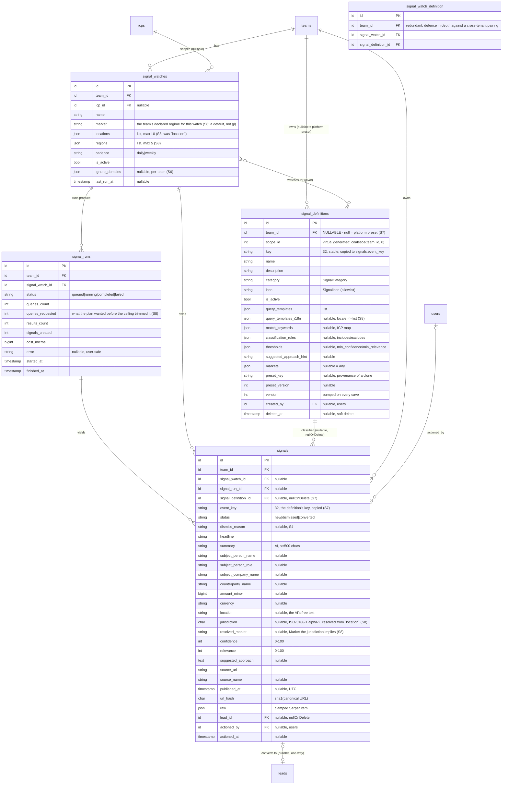
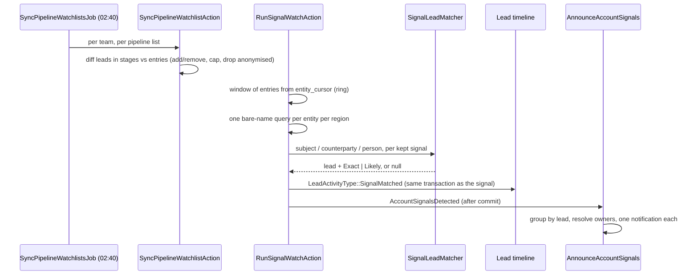

# Signals

> Status: **v1 complete (S0–S6) · v2 complete (S7–S16, see `signals-v2-plan.md`)**
> Owner: Product · Last updated: 2026-11-03

## Purpose

Surfaces a feed of **wealth / liquidity events** happening in the team's ICP
geography — a company sold, a founder exits, a big funding round, a founder or
executive relocating to Dubai — found with **Serper News**, classified and
summarised by AI, and shown to the team as **signals**. A team member can **dismiss**
a signal or **convert it into a standard `Lead`**, which then flows through the
existing Enrichment → Scoring → Leads Workspace pipeline.

It is **not** a "find rich people" search (queries look for _events_, not stated
intent), **not** a contact-finding tool (a signal stores a person's name, public role
and source URL only — never email or phone), **not** an outreach channel (UAE PDPL
means the suggested next step is LinkedIn or a referral, not cold email — ADR 0007),
and **not** a `LeadSourceProvider` (providers return company leads keyed for dedupe;
a signal is an _event about_ a person or company). Signals is its own module
(ADR 0002, ADR 0011) and hands off to Lead Sourcing **only on conversion**, via a
one-way FK (`signals.lead_id` → `leads`).

**Primary customer (v1):** a Dubai luxury real-estate agency. v1 claimed the feature was
generic because "event types and query templates are data (config)" — the templates were,
the type was not. **S7 made that claim true** (ADR 0018): a signal type is now a
`SignalDefinition` row a team owns, created and tuned on `/signals/types` without a
deploy, so a recruiter watching for a hiring surge and a contractor watching for planning
permission are configuration rather than a release. v1's three types are the first three
entries in a **platform preset library** teams clone from.

**S12 made the feed ranked, and made the ranking answerable.** Every signal carries a **heat** — a
deterministic 0–100 composite of eight things, each of which is _stored beside the total_ — and the
feed is ordered by it, with "most recent" kept as a real choice. The stored breakdown is the point
rather than a side effect: every card opens to **why you're seeing this**, naming the type and
version that classified it, the watch that found it, what each component was worth and, for the
components Alima could not judge, why not. The phase's own risk note is the thing it is built
against: _a scorer nobody understands is worse than date order._

The same phase closed the oldest item in the v1 backlog twice over. The product now **learns from
dismissals** — `signal_source_stats` records what each team does with each outlet's stories, per
event type — and it **proposes rather than applies**: a `SignalTuningAdvisor` writes suggestions a
member accepts or declines, with the counts beside them, because a feature that silently retunes
itself is a feature nobody can debug. And for the signals at the top of the feed it can **read the
whole article** instead of the search snippet, which is where amounts, counterparties and job
titles actually live.

**S11 made one event one card.** A Dubai acquisition reported by Gulf News, Khaleej Times, Zawya,
Arabian Business and three aggregators was five to eight signals, each costing an AI classification
and each needing its own dismiss — the feed’s perceived quality was dominated by it. A
`SignalCluster` is that event; the signals under it are the coverage, and the card says “reported by
8 sources”. The same phase closed the oldest identity defect in the module: behind a Google redirect
the article’s link is an opaque token, so `url_hash` stopped being its identity and a token that
varied re-admitted the same article on **every** run. The run now classifies one representative per
story, remembers what it rejected, and dedupes on a content identity where the link is not one.

**S10 made it a monitor as well as a feed** (ADR 0021). A watch can be pointed at a **watchlist**
of companies instead of at a place, and the obvious list is the team's own pipeline — mirrored
nightly, so nothing is typed. Every kept signal, from any watch, is matched against the team's
leads; a match puts the event **on that lead** rather than offering it as a stranger, and the card
offers _Add to Acme Ltd_ where it used to offer _Convert to lead_. The cold question ("who just came
into money?") is unchanged; the warm one ("what just happened to the forty accounts I am working?")
is new, and it is the one a team cannot switch off without going blind.

**S9 made it a builder** (ADR 0020). A member describes a buying moment in a sentence, Alima
drafts the definition, and — the part that matters — they see **what it would have found** before
they save it. The S0 spike is the reason: nobody can tell whether a query template works by reading
it, seven of eight hand-written ones returned zero, and S7 handed that problem to customers without
the afternoon a developer had to spend on it. The library grew to 30 presets in seven groupings at
the same time, every template run against the live provider first.

**S8 made it multi-market** (ADR 0019). A watch covers several places and several
`SearchRegion`s at once, so a team selling into Dubai and London has one watch rather than two, and
the UK is a first-class market with its own preset pack. The same phase fixed a compliance defect
that multi-geography would otherwise have made live: the outreach restriction on a converted lead
now **follows the signal's own jurisdiction** rather than the watch's market.

## Code map

> **The module is complete (S0–S6, 2026-10-29).** Anything described as "to come" below is
> post-v1 backlog, not unbuilt v1 scope.

- **Backend:** `app/Modules/Signals/…` (scaffolded in S1 via the `new-module` skill)
    - **Models (S1 ✅):** `SignalWatch`, `SignalRun`, `Signal` — all `BelongsToTeam`,
      typed casts (enums, `Carbon`, money as int minor units), relationships
      `watch → runs → signals`, `signal → lead` (one-way) and `signal → actionedBy`.
      Factories `SignalWatchFactory` / `SignalRunFactory` / `SignalFactory`
      (`database/factories`, with `inactive`/`weekly`, `running`/`completed`/`failed`
      and `acquisition`/`dismissed`/`converted` states).
    - **Enums (S1 ✅; S4 ✅):** `SignalDismissReason` (S4: `NotRelevant`, `AlreadyKnown`,
      `NotAnEvent`; `indicatesMisclassification()` so tuning reads intent, not raw counts),
      `SignalCategory` (S7 — how the library groups itself: `Liquidity`, `Growth`, `Movement`,
      `Distress`, `Hiring`, `Regulatory`, `Custom`) and `SignalIcon` (S7 — an **allowlist**,
      because the client maps the value to an imported component and a customer-authored
      definition must not be able to put an arbitrary string there), `SignalStatus` (`New`, `Dismissed`,
      `Converted`), `SignalWatchCadence` (`Daily`, `Weekly`; `staleAfterHours()` →
      24 / 168 for the S3 scheduler), `SignalRunStatus` (`Queued`, `Running`,
      `Completed`, `Failed`; `isTerminal()`/`isActive()` — mirrors `DiscoveryRunStatus`).
      **`SignalEventType` is gone** (S7, ADR 0018). Nothing in the app branched on which case
      it was — it picked templates, rendered a label and a description, mapped an ICP keyword and
      grouped a report, all of which are properties of a type rather than decisions about one — so
      it became a row. The four status/cadence/reason enums stay enums, because the code does
      branch on all four. That test, "does the application branch on the value", is the line
      ADR 0018 §1 draws, and it is the only place in the codebase where `CLAUDE.md` §2's
      "enums for every type column" is set aside.
    - **Enums (S8 ✅):** `SearchRegion` (`Ae`, `Gb`, `Sa`, `Us`, `In`, `Sg`, `Global`) — **where to
      look**, which ADR 0019 separates from `Core\Enums\Market`'s **which rules apply**. It carries
      a nullable `gl()` (`global` sends no country code at all), an `hl()`, `defaultLocations()`,
      an `approachNote()` for the watch form, and a **nullable** `market()`: "we can search here and
      we have not taken a legal position here" is a representable state, and the alternative —
      adding `Market` cases — would be a programmer asserting a compliance position the business
      has not taken. It stays an enum because the app does branch on it: `gl`/`hl` per case, and
      `isOffered()` gates it against `config('signals.regions.*.offered')`, which is **true only for
      `ae` and `gb`** — the two regimes ADR 0007 covers. The other five are ready in code and not
      offered, so turning one on is a config line _and_ a compliance decision (⚖️
      `docs/compliance.md` §5).
    - **Models (S7 ✅):** `SignalDefinition` — what a signal type _is_: its name, its one-line
      explainer, its `query_templates`, its `match_keywords` (the ICP map), its
      `classification_rules` (`includes` / `excludes`, handed to the AI), its own `thresholds`,
      its `markets`, and `preset_key`/`preset_version` when it is a clone. `BelongsToTeam` plus
      soft deletes. **Two scopes share the table:** a row with a `team_id` is the team's; a row
      with `team_id = null` is a **platform preset**, and the only thing allowed to read one is
      `Services/PlatformPresetReader` — the single place in the module that removes the team
      scope, and it replaces it with the stricter `team_id is null` rather than simply dropping
      it (ADR 0018 §2, mirroring how `Admin\Support\PlatformContext` isolates the same trick).
    - **Contracts (S2 ✅; S13a ✅):** `SignalSourceProvider` — `kind()`, `supports(SignalDefinition)`,
      `fetch(SignalSourceQuery): list<SourceItem>`, `estimatedCostMicros(int $queries)`. The
      deliberate mirror of Lead Sourcing's `LeadSourceProvider` (ADR 0023 §1), resolved by
      `SignalSourceRegistry`. Real impls `NewsSignalSource` and `WebSearchSignalSource`, test impl
      `FakeSignalSource`. **`NewsSearchClient` is gone**: it named one endpoint, and a definition
      stopped meaning one endpoint.
    - **Services (S2 ✅; S7 ✅):** `SignalQueryBuilder` (**watch + definitions + active ICP** →
      `list<SignalQuery>`, deterministic, no AI — watch location overrides ICP geography, each
      definition's own templates are used, buying-signal criteria append extra queries only when
      they map to a watched definition's keywords). Since S7 the definitions are **passed in, not
      loaded**, which is what keeps the builder a pure function of its inputs: the caller resolves
      them through a team-scoped query, and S9's "preview a type before you save it" can call the
      same builder with a definition that has no row yet. It no longer reads
      `config('signals.templates')` at all — that key is seed data for the presets now, and says
      so in the file. The first-match-wins order for an ambiguous ICP buying signal moved from the
      enum's declaration order to the **order the definitions are given**, which
      `SignalWatch::definitions()` fixes by definition id. **Since S13a the builder emits one query
      per source** and asks `SignalSourceRegistry::forDefinition()` rather than trusting
      `signal_definitions.source_keys` — so a key this build does not know, a key with no provider
      registered, and a provider that **declines** the definition through `supports()` all collapse
      to "no queries from here", and a plan never contains searches nobody can run. The dedupe key
      gained the source, because the same template asked of `/news` and of `/search` is two
      searches with two answers. **S13b gave it three addressing shapes**, which is
      the structural change that phase made: a _query-based_ source takes a string and multiplies out
      by place, region and template; a _subject-addressed_ one (`SignalSourceKind::addressesSubject()`
      — the registry) takes a company number, so one query per account and no multiplication; a
      _definition-addressed_ one (a feed, the webhook) takes what is on the definition, so one query
      each and nothing else. Getting that wrong is a cost bug in the expensive direction — a feed
      asked once per place per region per template would be fetched forty times a run for one
      identical document.
    - **Sources (S13a ✅, ADR 0023):** `SignalSourceRegistry` (register / `for` / `has` / `find` /
      `forDefinition`; `for()` raises on an unknown key and `find()` returns null, because a member
      naming a bad source is an error and a scheduled run meeting a withdrawn one is a skip).
      `AbstractHttpSignalSourceProvider` — the generic hardening, in the lineage of
      `AbstractHttpLeadSourceProvider`: timeouts, retry-on-429/5xx only, the shared
      `Core\Support\CircuitBreaker` with prefix `signals:cb` and a key **per source**
      (`signals_news`, `signals_web_search`), fail-fast on a missing credential, and the
      three-way failure split (transient / ours / **this query**) ADR 0023 §4 describes.
      `AbstractSerperSignalSource` — the Serper half both endpoints share: the POST and its
      `gl`/`hl`/`tbs`/`num` payload, the text clamps, the canonical-URL identities, the skip list
      and the within-response de-duplication, plus the sanity-bounded date parse the `/search`
      spike forced. `NewsSignalSource` (`/news`, `news[]`, the outlet from `source`) and
      `WebSearchSignalSource` (`/search`, `organic[]`, the outlet from the **host** because
      `/search` names no publisher) are three methods each.
      **S13b added the other three, and each is a different shape.**
      `CompaniesHouseSignalSource` extends the _generic_ HTTP provider rather than the Serper one —
      a different vendor, a different credential, no `q` at all — and is the one source whose items
      arrive **already classified** (ADR 0023 §6): `CompaniesHouseFiling` reads the registry's own
      `description_values` and form codes, so `ExtractedSignal::structured()` can assert what the
      event is and the AI batch is skipped entirely. It shares **Lead Sourcing's** credential _and
      its breaker_, because the registry rate-limits per API key and one quota deserves one circuit.
      `CompaniesHouseNumberLookup` + `ResolveWatchlistCompanyNumbersAction` turn a watchlist name
      into a number — from `leads.company_number` for free where the team's own data knows, and
      otherwise from a search that accepts **only an exact normalised-name match**.
      `FeedSignalSource` (RSS/Atom) is the one source whose address a customer supplies, so it is
      the one with an SSRF surface: `Core\Support\Security\SafeUrl` (shared with
      `HttpWebContentFetcher`, not copied), no redirects followed, a conditional GET with
      `ETag`/`Last-Modified`, a byte cap off a streamed body, and a poll-interval floor keyed per
      **feed URL** rather than per watch. `FeedDocument`/`FeedEntry` parse both formats and refuse
      any document carrying a doctype, so XXE is not attempted rather than merely neutralised.
      `WebhookSignalSource` extends nothing and makes no request: it reads back
      `signal_inbound_events` the API accepted. `SignalItemNormaliser` (URL canonicalisation →
      `url_hash`: lower-cased host, `utm_*`/fragment stripped, query sorted).
    - **Data / DTOs (S2 ✅; S4 ✅; S13a ✅):** `SignalSourceQuery` (`eventKey`, `q`, `region`, `gl`,
      `hl`, `tbs`, `num`, `ignoreDomains`, and since S13a `kind` + `config` — the source that will
      run it and that source's slice of `source_config`), `SourceItem` (`title`, `snippet`, `link`,
      `urlHash`, `source`, `publishedAt` best-effort UTC, `raw`, `contentHash`, `dedupeHash`, and
      since S13a `kind`, `matchedTemplate` and `classification`). **Both were renamed at S13a**
      (`SignalQuery`, `NewsItem`) because both had become lies: a planning decision found by
      `/search` is not a news item, and the DTO's shape now addresses more than one endpoint. A
      clean rename with no alias — they are internal to the module, and a deprecated spelling kept
      "for safety" is how two names for one concept survive into the next phase. `classification`
      is null for everything S13a ships and is the seam S13b's Companies House source uses to skip
      the AI batch (ADR 0023 §6). `ExtractedSignal` (S3, AI output,
      schema-validated), `ConvertSignalData` (S4, spatie/laravel-data —
      `prefillFrom(Signal)` seeds the form, `fromValidated()` clamps to the columns,
      `rules()` keeps the S5 web and S6 API endpoints from drifting on what a
      conversion accepts; `companyName` required and never invented).
    - **Actions (S3 ✅; S4 ✅; S5 ✅):** `ListSignalsAction` (the server-driven feed,
      ordered by `published_at` — the feed is about when the _event_ happened, not when
      Alima found it — plus `counts()` for the tabs in one grouped query),
      `ListSignalWatchesAction` (all watches, with runs **capped per watch**),
      `SaveSignalWatchAction` (create/update, audited; an out-of-team ICP is dropped and
      logged; **reactivating a paused watch doesn't make it due**, so a month-old watch
      doesn't fire the moment it is switched on), `DeleteSignalWatchAction` (audited, and
      the audit row records the signals/runs going with the cascade — the only place
      those counts survive), `RunSignalWatchAction` (orchestrates one run),
      `TriggerSignalWatchAction` (run-now, rate-limited 1/15 min/watch via
      `RateLimiter`), **`ListSignalDefinitionsAction` / `SaveSignalDefinitionAction` /
      `DeleteSignalDefinitionAction` / `CloneSignalPresetsAction`** (S7 — the library's CRUD; the
      save writes the key **once** and never again, because every signal of that type carries a
      copy of it, and bumps `version` on every save so S12 can say which version classified a
      signal; the delete is **refused while a watch uses it** and is a soft delete so even the
      attribution survives; the clone is idempotent, so re-adding a preset never overwrites a
      team's tuned copy), `ConvertSignalToLeadAction` (S4 — one transaction with
      `attempts: 3`, lock → attach-or-create → `LeadDeduplicator` → contact →
      timeline/audit → mark converted → `afterCommit` enrich + `SignalConverted`; see
      "Key flows"), `DismissSignalAction` / `RestoreSignalAction` (S4 — transactional,
      audited, idempotent, and refused on a converted signal).
    - **Jobs (S3 ✅):** `RunSignalWatchJob` (`ShouldBeUnique` per watch, `tries=3`,
      `backoff=[30,120,300]`, `timeout=120`, `uniqueFor=600`, `failed()` marks the
      latest non-terminal run Failed), runs inside `TeamContext` with
      `Log::withContext(['team_id','signal_watch_id'])`.
    - **Console (S3 ✅; S6 ✅):** `DispatchDueSignalWatchesCommand` (`signals:dispatch-due`,
      scheduled hourly, `withoutOverlapping`) queues a run for each active watch whose
      cadence is due; `PruneSignalsCommand` (`signals:prune`, nightly at 03:20) is the
      retention sweep — chunked, idempotent, every team, counts-only logging, with a
      `--dry-run` because retention is irreversible.
    - **HTTP (S5 ✅ web; S6 ✅ API):**
        - `Http/Controllers/Concerns/ResolvesSignals` — the caller, their team, and a
          team-scoped read of the signal or watch. Reading inside `TeamContext` is what
          makes a cross-tenant request a **404 before any policy runs**; the policy
          still double-checks (ADR 0006).
        - Web: `SignalController` (`index`/`convert`/`dismiss`/`restore`),
          `SignalWatchController` (`index`/`store`/`storeDefault`/`update`/`destroy`/`run`).
        - API v1: `Api/V1/SignalController` (+ `show`), `Api/V1/SignalWatchController`
          (+ `show`) — same Actions behind both, so there is one definition of what
          converting or dismissing means. `run` answers **202** and returns immediately.
        - Requests: `ListSignalsRequest` (bounds the input; `SignalFilters` narrows it),
          `ConvertSignalRequest` (rules from `ConvertSignalData::rules()` plus a
          team-scoped `pipeline_stage_id`), `DismissSignalRequest`,
          `SaveSignalWatchRequest` (rules from `SignalWatchData::rules()` plus a
          team-scoped `icp_id`; **`market` is not accepted** — v1 is UAE-only).
        - Resources: `SignalResource` (no contact fields, because there are none; `raw`
          never leaves the server; `deletes_in_days` from the retention window),
          `SignalWatchResource` (event types with their labels and explainers; a computed
          `next_due_at`), `SignalRunResource`.
    - **Services (S6 ✅):** `SignalsPersonalDataExporter` — the DSAR hook (see
      `compliance.md` §5a); `SignalLeadOriginProvider` (S4, the lead-origin seam).
    - **Data / DTOs (S3 ✅; S5 ✅):** `ExtractedSignal` (the schema-validated AI output per
      item; `fromAiItem()` converts amount→minor units + resolves currency;
      `meetsThreshold()`), `SignalFilters` (the feed's tab + filter state — the one shape
      the request, the query and the Inertia props speak; unknown values are **dropped,
      not rejected**, so a shared link from last month still opens), `SignalWatchData`
      (`defaultWatch()` is the one-click first watch; `rules()` keeps the web and API
      endpoints from drifting).
    - **Events (S3 ✅; S4 ✅):** `SignalRunProgressed` (stages searching →
      analysing → saving → done), `SignalsDetected` (afterCommit, count) and
      `SignalConverted` (S4 — afterCommit; team, signal, lead and an `attached` flag,
      so a feed can drop the card and reporting can tell a new lead from a link to one
      the team already had) — all `ShouldBroadcast` on `teams.{teamId}`.
    - **Policies (S1 ✅; S7 ✅):** `SignalWatchPolicy` (`view`/`create`/`update`/`delete`/`run`),
      `SignalPolicy` (`view`/`dismiss`/`restore`/`convert`), `SignalDefinitionPolicy`
      (`viewAny`/`view`/`create`/`update`/`delete`/`clone` — and **a platform preset is never
      updatable or deletable**, answered here rather than with an `if` in a controller, so the
      screen, the API and anything added later get the same answer) — all double-check `team_id`
      via `User::roleOn()`; view is every role, mutations are Owner/Admin/Member.
    - **Cross-module seam (S4 ✅):** `SignalLeadOriginProvider` implements
      `LeadsWorkspace\Contracts\LeadOriginProvider` and is bound over the Workspace's
      `NoLeadOrigin` default by `SignalsServiceProvider`, so the lead detail screen can
      show the event a lead came from **without the Workspace depending on Signals**.
      Keys on `raw.signal_id`, not the lead's `source`. Outside this module, S4 also
      added `LeadSource::Signal`, `LeadActivityType::SignalConverted`,
      `Core\Enums\OutreachRestriction` and `Market::outreachRestriction()`.
    - **Exceptions (S1 ✅):** `SignalsException extends DomainException`
      (`alreadyConverted()` 409, `watchInactive()`, `noSubjectToConvert()`,
      `runThrottled()` 429, and the three news-provider causes), rendered centrally in
      `bootstrap/app.php`. S4 uses `noSubjectToConvert()` for a conversion with no
      company name and `alreadyConverted()` for a dismiss/restore of a converted signal
      — and for the one conversion case that can't be made idempotent: a converted
      signal whose lead has been deleted.
    - **Services (S8 ✅):** `SignalJurisdictionResolver` — the AI's free-text `location`
      ("Dubai, UAE", "London") to an ISO-3166-1 alpha-2 code, from the deterministic place map in
      `config('signals.jurisdictions')`. Three properties matter. It matches **whole tokens**
      (`(?<![\p{L}\p{N}])…(?![\p{L}\p{N}])`), so "Indiana" is not India and "Ukraine" is not the
      UK. Its aliases are sorted **longest-first across every country at once**, not within each
      one — sorting per country let "Wales" (GB) beat "New South Wales" (AU) depending on map
      order, which a test caught. And it returns **null when unsure** rather than guessing, because
      null fails toward the restriction (ADR 0019 §3) while a guess fails away from it. The watch's
      own regions are a tiebreak only, never a source of an answer.
    - **Data (S8 ✅):** `SignalQueryPlan` — the queries a run will make _and_ the number it wanted
      (`requested`), so `wasTrimmed()` can be true and the watch card can say coverage was reduced.
      A silent trim is a lie about what was searched.
    - **Actions (S9 ✅):** `ComposeSignalDefinitionAction` — a sentence to a
      `DraftSignalDefinition`, through the `signals.compose_definition` reasoning prompt, and it
      **never saves**: the AI drafts, the member owns (ADR 0020 §2). Behind
      `Capability::SignalComposer`, the one paid thing on this screen.
      `PreviewSignalDefinitionAction` — the draft's queries against live news, classified by
      **`signals.extract_event` v2** with the draft as the only offered type, returning a verdict
      per article and persisting **no signals**. Three independent caps hold the spend (§5 of the
      ADR); the only row it writes is the `signal_previews` ledger that makes the team-wide one
      enforceable at all.
    - **Enums (S9 ✅):** `PreviewVerdict` (`IgnoredDomain`, `NotAnEvent`, `WrongLocation`,
      `BelowConfidence`, `BelowRelevance`, `Kept`) — six cases rather than a boolean because each
      one is **a different thing for the member to change**, and an empty list says only that
      something is wrong. Case order is evaluation order, which is what makes a preview
      reproducible. `label()` and `advice()` are what the panel shows, so the API and the screen
      cannot say different things about the same verdict.
    - **Data (S9 ✅):** `DraftSignalDefinition` (viable / reason / summary / definition, with
      `fromAi()` re-validating against the **save path's own rules**), `PreviewedItem`,
      `SignalPreviewResult` (the counts plus `diagnosis()` — the one sentence that tells "no news at
      all" from "news but no events" from "events your thresholds rejected"), and
      `SignalQuerySpec`, which is what let the preview exist at all: the "where" with no model
      behind it, so building queries no longer needs a saved watch.
    - **Support (S9 ✅):** `IgnoredDomains` — the skip-list rule, extracted because a run drops an
      ignored source **silently** and a preview has to **show it, labelled**; two copies of a
      host-matching rule would have made the preview answer about a search that never happens.
      `SignalCostEstimator` + `SignalCostEstimate` — what a definition costs a month, read off the
      same `SignalQuerySpec` the builder uses so the estimate and the run cannot drift.
      `SignalPresetPack` — the seven library groupings, in code and **not** in the database
      (ADR 0020 §7).
    - **Pointing a watch at a list (S10 ✅):** `signal_watches.signal_watchlist_id` travels
      through `SignalWatchData` → `SaveSignalWatchRequest` (existence scoped to the member's own
      team) → `SaveSignalWatchAction` (scoped again, because the request is not its only caller) →
      `SignalWatchResource` → the editor's own **What this watch follows** picker. It is offered
      only the team's active lists that hold something: a watch pointed at an empty list searches
      nothing. An out-of-team id is **rejected** rather than dropped, unlike a definition id —
      see "What the S10 reviews changed".
    - **Models (S10 ✅):** `SignalWatchlist` (a team's set of accounts: `source_kind`,
      `is_active`, `sync_settings` → stages/owners, `entries_count`, `synced_at`) and
      `SignalWatchlistEntry` (`entity_type`, the member's `name`, `aliases`, `domain`, a nullable
      `lead_id`, and the `normalised_name` the unique index is on). The normalised key is set by a
      **mutator on `name`**, not by a `creating` hook — S7's lesson: a hook does not run for a
      factory under `Event::fake()`, and a comparison key that is sometimes absent is worse than
      none. `searchNames()` is what a query is built from, `matchKeys()` what a match is tested
      against.
    - **Enums (S10 ✅):** `WatchlistSourceKind` (`Manual`, `Pipeline`, `Segment` — the last
      declared and **not offered**, see ADR 0021 §2; `offered()` returns pipeline first because
      that is the answer for almost everybody), `WatchlistEntityType` (`Company`, `Person`;
      `isSearchableAlone()` is what makes a person's query differ from a company's),
      `SignalMatchConfidence` (`Exact`, `Likely` — **there is no `Low`**, because a weak guess is
      not a match) and `SignalScope` (`All`, `Accounts` — a scope, **not** a status; it carries the
      sentence its own empty state shows).
    - **Services (S10 ✅):** `SignalLeadMatcher` — is this event about a company the team already
      has? Watchlist declaration first, then the subject company, then the counterparty; strict name
      is `Exact`, bare name is `Likely`, a corroborating person upgrades `Likely` to `Exact`, and
      anything weaker is **null**. It reuses `LeadSourcing\Support\CompanyNameKey` rather than
      normalising names a third time (ADR 0021 §6), and it skips an anonymised lead.
    - **Actions (S10 ✅):** `SyncPipelineWatchlistAction` (mirrors the pipeline: an add/remove
      **diff**, never a rebuild, because an entry carries the `lead_id` the matcher relies on;
      capped at `signals.watchlist.max_entries` keeping the most recently worked leads; drops an
      anonymised lead), `SaveSignalWatchlistAction` (list cap, immutable `source_kind`, an immediate
      first sync so a new pipeline list is not an empty list and a promise),
      `AddWatchlistEntriesAction` (bulk, duplicates **skipped not refused**, stops at the cap and
      says so, refuses a synced list), `RemoveWatchlistEntryAction` (two writes — the row and the
      cached count — so it is one transaction or it is a counter that drifts) and
      `DeleteSignalWatchlistAction`.
    - **Jobs (S10 ✅):** `SyncPipelineWatchlistsJob` — `ShouldBeUnique`, chunked over teams with a
      per-team try/catch, scheduled `dailyAt('02:40')`. One team's bad row does not stop the rest.
    - **Ranking (S12 ✅):** `SignalScorer` is a weighted average of eight components
      (`SignalScoreComponent`), each stored beside the total in `signals.score_breakdown`. Two
      rules, both taken from `Scoring\Services\DeterministicScorer` so the product's two scores
      behave the same way: **weights are normalised, not summed** (heat is `contributed / assessed`,
      so changing one weight cannot inflate every signal and adding a ninth component will not
      re-scale the feed), and **missing data is not a failure** (a component with nothing to judge
      leaves _both_ sides of the ratio). Scoring a thinly-reported event down for being thinly
      reported would make heat measure how much Alima knows rather than what the event is worth.
      Deterministic, and no AI in it — two components _read_ what the AI said, which is not the same
      thing, and it is what makes the breakdown auditable.
    - **The two components worth reading the code for (S12).** **Amount** is a percentile against
      the team's own history (`SignalAmountBands`) rather than a figure against a constant: a £2m
      exit is the biggest thing a boutique has seen all year and a rounding error to a growth fund.
      Per currency, because ranking 40m AED against 2m GBP would rank the exchange rate. And **ICP
      fit** reuses `Scoring`'s criteria match rather than inventing a second fit score —
      `SignalIcpFit` builds the lead the signal _would become_, in memory and saved nowhere, from
      the same fields `ConvertSignalToLeadAction` maps, so "the fit of this signal" and "the fit of
      the lead it makes" cannot disagree. Criteria a signal has no data for come back `Unknown`,
      which the deterministic scorer already treats as "leave this out", so a signal is never marked
      down for being a news article rather than an enriched company record.
    - **Where the scoring happens (S12).** `RunSignalWatchAction::scoreRun()`, inside the
      persistence transaction and **after** the cluster reconcile — breadth is one of the eight
      components and a cluster does not know how many outlets it holds until then. It also
      re-scores the **primaries of the clusters the run touched**, which is the easy thing to miss:
      a run that only added coverage of an existing event changed that event's breadth, and a feed
      ordered by heat would otherwise keep ranking a six-outlet story as the one-outlet story it was
      yesterday. `signals:rescore` is the backfill and the after-a-retune command, deliberately
      **not** scheduled.
    - **Learning (S12 ✅):** `SignalSourceLedger` is the only writer of `signal_source_stats`, and
      `RecordSignalOutcome` the only caller — a listener on four events, after commit, catching
      everything and logging rather than throwing. A tally is the most skippable write in the
      product: a statistic lost is a statistic, a dismissal lost is a bug report. Three properties
      hold: counted **per card** rather than per article (a member only ever actions the cluster's
      primary, and counting keeps per article while counting dismissals per card would make every
      well-covered outlet look beloved); **undoable**, because a restore decrements and a mis-click
      must not leave a lesson behind; and **additive rather than derived**, because retention
      deletes the signals and a reputation computed from them would quietly reset every ninety days.
    - **Tuning (S12 ✅):** `SignalTuningAdvisor` proposes and `ApplySignalTuningSuggestionAction`
      applies — and the second only ever runs because a member pressed a button. Four kinds
      (`SignalTuningKind`), and the split between two of them is the valuable part: **"not an event"
      dismissals point at confidence** (the classifier is too loose) and **"not relevant" ones point
      at relevance** (the events are real and not this team's). A product offering one knob for both
      would have teams tightening the wrong screw for a month. A declined suggestion is **kept** so
      it is never raised again, which is the difference between a suggestion and a nag; accepting
      one writes the same audit entry a member editing by hand would.
    - **Reading the article (S12 ✅):** `SignalArticleEnricher` — the oldest limitation in the
      module, closed behind a flag. It reuses `Core\Contracts\WebContentFetcher` (the SSRF-safe
      seam Enrichment and Business Intelligence already use) and the **existing**
      `signals.extract_event` prompt with the article text where the snippet was, rather than adding
      either. Five things bound it: the flag (off by default), a heat floor, a per-run count, a
      per-team monthly ceiling, and `robots.txt`. It **fills gaps and never erases**, it does **not
      re-decide the event type** (that guard lives in the run — ADR 0018 §7 — and a re-read that
      reclassified would move a card between a team's types behind their back), and it stores the
      extracted fields and a timestamp and **never the article body**.
    - **`robots.txt` (S12 ✅):** `Core\Support\RobotsPolicy`. `docs/compliance.md` §5 has required
      this since the beginning and nothing implemented it, because until now the only pages the
      product fetched were a lead's **own** website. A news publisher is different in kind. It
      fetches through the same SSRF-safe seam, caches per host for a day, **fails open** on an
      unreachable file (that is what the standard says) and **closed** on an unreadable URL, and is
      deliberately **not** wired into the fetcher itself — retro-fitting a new refusal into a seam
      two shipped features depend on would change what they fetch, silently, for a reason neither
      asked for.
    - **Clustering (S11 ✅):** `SignalClusterer` holds **two different questions** and the split is
      the design. Before the AI there is no event yet — only headlines — so `group()` compares the
      significant words of two titles (**Dice**, not Jaccard: one outlet writes the same headline
      plus "in an all-cash deal", and Jaccard punishes the longer one for the words the shorter did
      not have room for) with an absolute floor underneath the ratio. That grouping is provisional
      and only has to pick one representative per story. **After** the AI the event has a type and
      a subject, so `clusterKeyFor()` is the real key — `sha1(event key | subject fingerprint | ISO
      week)` — and it is what makes a story covered again tomorrow join the card it already has,
      which a headline comparison inside one run never could. `ensure()` finds or creates the row,
      `reconcile()` recomputes the counters from the member signals, and `propagateStatus()` carries
      a dismiss, a restore or a conversion across the cluster.
    - **Where the correctness lives, and where the savings do (S11).** A false merge _before_ the
      AI means one event is written down as the other, so that threshold is deliberately strict and
      under-clustering only costs an AI call and a duplicate card. The cards are consolidated again
      by the subject-based key, which cannot mis-merge that way. **So the savings depend on the
      similarity numbers and the correctness does not** — which is why `signals.cluster_before_ai`
      is a safe flag to turn off (it restores v1's behaviour exactly) and why the card
      consolidation keeps working when it is.
    - **The content identity (S11 ✅):** `SignalItemNormaliser` gained `contentHash()`
      (`sha1(normalised source name + normalised headline)`), `isRedirector()` (config,
      `signals.redirect_hosts`, a bare host or a host and a path prefix) and `dedupeHash()` — the
      content hash behind a redirector, the canonical URL hash everywhere else. The source is part
      of the content hash **on purpose**: two outlets reporting one event are two articles, each
      with a link worth reading, and merging them into one card is the clusterer's question, not
      this one's. `headlineTokens()` is the clusterer's input; `normalisedHeadline()` strips an
      outlet suffix (a pipe, a long dash or an interpunct wherever it appears last; a hyphenated or
      colonned tail **only** when it is literally the source's name) and is Unicode-aware, so an
      Arabic headline does not reduce to the empty identity two articles must never share.
    - **Remembering the "no" (S11 ✅):** `SignalRejectionLedger` + `SignalRejection` +
      `SignalRejectionVerdict`. Keyed by `(team, dedupe hash, definition fingerprint)`, where the
      fingerprint hashes **the set of signal type keys that were offered** — which is what "rejected
      for the same definition" has to mean once a watch offers six types at once: add a type and the
      same article is asked about again, change nothing and nobody pays twice. Two verdicts
      (`NotEvent`, `BelowThreshold`) because they are two different conversations for somebody
      tuning a type; **no verdict for an unoffered key**, because that is a statement about our
      prompt rather than about the article. Writes are update-then-insert so `seen_count`
      increments and a race loses safely.
    - **Console (S11 ✅):** `ClusterSignalsBackfillCommand` (`signals:cluster-backfill`,
      **not scheduled** — a backfill is a one-off an operator runs when the phase ships). Newest 90
      days by `--days`, chunked per team, idempotent, `--dry-run`, and it fills the `content_hash`
      the migration deliberately left null. It **skips a converted signal**: its `lead_id` is the
      only copy of where that lead came from, so it stays its own card rather than disappearing
      behind a primary that never made one.
    - **Log channel (S1 ✅):** `signals` (daily, `config/logging.php`) — log IDs/counts
      only, never names or article text.
    - **Testing:** `app/Modules/Signals/Testing/FakeSignalSource` (canned Dubai
      fixtures, bound in tests).
    - **Provider:** `Providers/SignalsServiceProvider` (routes, policies, bindings),
      registered via the Core base provider.
- **Routes (S5 ✅ web, S6 ✅ API):**
    - Web: `signals.index/convert/dismiss/restore` at `/signals`,
      `signal-watches.index/store/store-default/update/destroy/run` at **`/signals/watches`**, and
      `signal-definitions.index/store/clone/update/destroy` at **`/signals/types`** (S7) — all
      nested under `signals/` so the sidebar's `startsWith` match keeps Signals lit across its own
      screens. The route _names_ are the ones the plan specified.
    - API (`auth:sanctum`, `/api/v1`): `GET /signals`, `GET /signals/{id}`,
      `POST /signals/{id}/convert|dismiss|restore`,
      `GET/POST /signal-watches`, `GET/PATCH/DELETE /signal-watches/{id}`,
      `POST /signal-watches/{id}/run` (202), and (S7) `GET/POST /signal-definitions`,
      `GET /signal-definitions/presets`, `POST /signal-definitions/clone`,
      `GET/PATCH/DELETE /signal-definitions/{id}`. The definition routes reuse
      `TokenAbility::SignalsRead`/`SignalsWrite` rather than inventing a scope of their own: a
      signal type is part of Signals, and a token that could read the feed but not the types it is
      grouped by is a credential nobody would mean to issue. `presets` is **not paginated** — the
      library is a curated set measured in tens, and making a client page through it to render a
      picker would be work for nothing.
    - **The builder's two routes (S9)** are `signal-definitions.compose` and
      `signal-definitions.preview`, on both web (`/signals/types/compose`, `/signals/types/preview`)
      and API. Each spends money per press, so each is throttled **per hour** rather than per minute
      — the window has to make iterating affordable and a loop pointless — and `compose` carries
      `capability:signal_composer` as well as the Action's own check. On the API both take
      `TokenAbility::SignalsWrite` although neither creates a row: a scope asks what a _credential_
      may do (ADR 0013), and a read-only token that could run paid AI drafts is not read-only.
    - `run` carries **two** limits on both web and API: the per-watch 15-minute window in
      `TriggerSignalWatchAction`, and a per-member `signals-run` throttle
      (`signals.run_rate_limit`, default 10/min). A run spends real money, and a token is
      easier to loop than a button.
    - **Accounts (S10)** — web: `signal-watchlists.index/store/update/destroy`,
      `signal-watchlists.entries.store/destroy` and `signal-watchlists.sync` at
      **`/signals/accounts`**, plus `signals.attach`. API: the same set under
      `/api/v1/signal-watchlists*` and `POST /api/v1/signals/{signal}/attach`, on
      `TokenAbility::SignalsRead`/`SignalsWrite` — a watchlist is where a watch looks, and a token
      that could read the feed but not the accounts it is about is a credential nobody would mean
      to issue. `attach` is its **own route** rather than a flag on `convert`: a route that
      sometimes creates a lead and sometimes does not is a route nobody can reason about from its
      name. `sync` needs no throttle of its own — it is indexed queries and no external call —
      unlike `run`, which spends money.
    - Broadcast: reuses the `teams.{teamId}` private channel.
- **Frontend (S5 ✅; S7 ✅):** `resources/js/pages/signals/{Index,Watches,Types}.vue`,
  `resources/js/components/signals/{SignalCard,ConvertSignalModal,DismissSignalDialog,SignalTypeIcon}.vue`,
  a **Signals** sidebar entry (`Satellite`, `/signals`), and the lead-detail "The event"
  panel (S4). Brand tokens only; EN/AR at parity.
    - **`Types.vue` (S7)** is the library: the team's own types above, Alima's presets below,
      grouped by category. The copy says the clone rule in words — "adding one makes your own copy
      of it" — rather than leaving a member to discover it. The watch editor's three fixed
      checkboxes became **one per active type the team has**, and a team with none is sent to the
      library instead of being shown an empty fieldset.
    - **`SignalTypeIcon.vue` (S7)** is the one place an icon key becomes a component, typed
      `Record<SignalIcon, Component>` so `vue-tsc` fails the build if a case is added to the enum
      and forgotten here. That is the whole reason the icon set is closed (ADR 0018 §8).
    - **`Types.vue` is the builder since S9**: the composer box with its example briefs (buttons,
      not prose — an example a member has to retype is an example nobody takes), the library browsed
      by **pack** with the shared `FilterToggle`/`FilterGroup` chips, a `Rare` badge on the three
      presets the spike found thin, and inside the editor a **Before you save** panel carrying the
      live cost line and the preview with its verdict chips. The draft and the preview arrive as
      **flashed** data rather than props, which is exactly their lifetime.
    - **The four list textareas were not keyboard-operable** until S9, and the fix is the same one
      S8's review made to the watch form: a two-way computed that filtered blank lines and wrote the
      result back ate the Enter key, so the only way to add a second template was to split a line or
      paste (WCAG 2.1.1). They are refs with a one-way parse now.
    - **`Accounts.vue` (S10)** is the accounts screen: a section per list with its names, the
      stage picker for a mirrored list, the paste-a-column dialog for a typed one, and — because
      nobody can see this for themselves — **the rotation in words** ("checked every 7 days"), since
      a long list that seems quiet otherwise reads as a broken feature. `SignalCard` grew an
      `info`-tinted panel naming the matched lead and explaining the confidence in a sentence, with
      **Add to {Lead}** as the primary action and **Convert anyway** beside it as a real button —
      converting is the one that makes a duplicate here, so it is the quiet one. The feed gained a
      **scope** row (pills, above the status tabs, because two axes must not read as one list of
      six), and the lead detail's "The event" panel became a **list** of events in date order.
    - **Whose words are these?** A type's name and description are Alima's or the team's, and only
      the server knows which: `SignalDefinition::usesPlatformWording()` is "cloned, and never
      edited since" (`version === 1`), and it rides on every payload as `translatable`. A screen
      runs the wording through `t()` only when that is true — translating what a team typed would
      be the app overwriting them, and leaving ours untranslated would give an Arabic UI an English
      badge.
    - After the `brand-reviewer` pass: the tabs are **links, not `role="tab"`** (each one
      navigates, so it is shareable and the Filters button can live beside them);
      selected filter chips carry a **tick, not just a tint** (WCAG 1.4.1); focus moves
      to the list when a card leaves it, with an always-mounted live region; the card was
      **trimmed** (no redundant status badge, no "found by", relevance in the header, no
      tinted approach panel); counts use **count-neutral phrasing** so Arabic needs no
      dual/plural forms.
    - Two base components were extracted rather than copying `Input`'s class string a
      fifth time: `ui/native-select/NativeSelect.vue` and `ui/textarea/Textarea.vue`.
      ~15 older call sites across the app still hand-roll these — see "Known limitations".
- **The query builder, after S8.** `SignalQueryBuilder` loops **region → place → type →
  template**, and that nesting order _is_ the trim order, because the ceiling keeps the first N.
  So a watch cut down to budget loses whole places — a gap a member can see on the card — rather
  than a slice of every type's templates everywhere, which is one nobody could. The count is
  `regions × locations × definitions × templates`: six types of ten templates over ten places in
  two regions is **twelve hundred paid searches for one run of one watch**, where v1 could not
  exceed eight. `signals.max_queries_per_run` is what holds that, and S8 is the phase that made it
  bite in a second dimension.
- **Playbooks (S14).** `Models/{SignalPlaybook,SignalPlaybookRun}`;
  `Enums/{PlaybookMode,PlaybookActionKind,PlaybookActionStatus,PlaybookOutcomeReason,PlaybookAssignStrategy,PlaybookNotifyAudience,PlaybookWatchlistCondition}`;
  `Data/{SignalPlaybookData,SignalPlaybookConditions,SignalPlaybookStep,SignalPlaybookFacts,PlaybookStepOutcome,PlaybookDraftOutcome,SignalPlaybookPreview,PreviewedSignal}`;
  `Services/{SignalPlaybookEvaluator,PlaybookStepRegistry,NoOutreachDrafting}`;
  `Contracts/SignalOutreachDrafter`;
  `Support/Playbook/{PlaybookContext,PlaybookBudget,PlaybookNotices,PlaybookActor,PlaybookStepHandler}`
  plus one handler per step kind;
  `Actions/{SaveSignalPlaybookAction,DeleteSignalPlaybookAction,PreviewSignalPlaybookAction,RunSignalPlaybooksAction}`;
  `Listeners/RunPlaybooks` (on the existing `SignalsDetected` / `SignalConverted`);
  `Jobs/RunSignalPlaybooksJob`; `Policies/SignalPlaybookPolicy`;
  `Http/{Requests/{SaveSignalPlaybookRequest,PreviewSignalPlaybookRequest},Resources/{SignalPlaybookResource,SignalPlaybookRunResource},Controllers/{Web,Api/V1}/SignalPlaybookController}`.
  Outreach's half is one class, `Outreach\Services\PlaybookOutreachDrafter`, bound over this
  module's refusing default. Screens: `pages/signals/{Playbooks,PlaybookActivity}.vue`; the mobile
  inbox is `mobile/src/views/PlaybookInboxView.vue` (read-only — building stays on the web).
- **ROI and the library (S15).** `Models/{SignalDefinitionSpend,SignalDefinitionSubmission}`;
  `Enums/SignalSubmissionStatus`; `Data/SignalDefinitionRoi`;
  `Support/SignalDefinitionBreakdown` (the mirror of `SignalSourceBreakdown`);
  `Services/{SignalSpendLedger,SignalRoiReader,PresetUpdateDiffer}`;
  `Actions/{SubmitSignalDefinitionAction,PromoteSignalDefinitionAction,SavePlatformPresetAction,AdoptPresetChangesAction}`;
  `Http/{Requests/{SubmitSignalDefinitionRequest,AdoptPresetChangesRequest},Resources/SignalDefinitionSubmissionResource}`.
  `PlatformPresetReader` gained **`keyIsTaken()`**, a trashed-aware companion to `byKey()`,
  because the unique index does not soft-delete.
  The retirement proposal is `SignalTuningKind::RetireDefinition` on the existing advisor.
  Admin's half is a reader and a controller that call this module's Actions —
  `Admin\Services\Platform\SignalLibrary`, `Admin\Http\Controllers\Web\SignalLibraryController`,
  `Admin\Http\Requests\{PromoteSubmissionRequest,SavePlatformPresetRequest}` — plus four
  `PlatformMetric` cases and two `PlatformReport` tables in Admin's own builders (ADR 0016).
  Notifications' half is `Data/DigestHighlight` and `Services/PushDelivery` (extracted from
  `PushChannel`, which is now an adapter over it). Screens: the ROI rail, the preset offer and the
  submission list on `pages/signals/Types.vue`; `pages/admin/signals/Library.vue` (English only,
  like the rest of the panel).
- **Cost governance and retention (S16).** The fourth seam Billing fills in, built to the shape of
  the other three: `Contracts/SignalQuotaSource` + `Data/SignalAllowance` (the eight figures) +
  `Services/StubSignalQuotaSource` (this module's own floors — **not** "unlimited", see below),
  with `Billing\Services\PlanSignalQuotaSource` bound over it. `Services/SignalSpendGuard` is the
  one place a limit is decided and the only thing that should call the source;
  `Services/SignalUsageCounter` answers what a team has spent, over this module's own ledgers, and
  is what Billing's `UsageLedger` reads for the new `BillingMetric::SignalQueries`.
  `Exceptions/SignalAllowanceExceeded` exists so `sentry.ignore_exceptions` can filter a plan
  refusal by **type** without filtering a real provider fault. `Services/SignalRetention` gained
  `eligiblePreviews()`, `eligibleRuns()`, `eligibleSpend()`, `eligiblePlaybookRuns()`,
  `eligibleSourceStats()` and `orphanedWatchlistEntries()`, and `PruneSignalsCommand` sweeps all
  six through **one** `sweep()` helper that re-applies the eligibility query at the `DELETE`.
  `SignalsPersonalDataExporter` reaches two more tables, and Compliance gained two
  `SubjectDataCategory` cases for them. No new tables and no new routes, but **two columns on
  `signal_runs`** that the review forced: `paid_queries_count` (the allowance is metered on what we
  are billed for, and three of the five sources are free) and `error_code` (so a run refused for a
  spent allowance is not counted as a provider failure). No new screen: the allowance shows up on
  `/billing`, because that screen renders every `BillingMetric`. `SignalsSeamTest` greps this module
  for an import of `App\Modules\Billing`, because the rule had already been broken once by a
  `use` statement that existed only for a `{@see}`.
- **Shared:** `resources/js/shared/types/signals.ts` (S5; S7 replaced the `SignalEventType`
  union with a `SignalEventKey` alias, added `SignalDefinition`, `SignalCategory` and
  `SignalIcon`, and `SignalWatch.event_types` became `SignalWatch.definitions`).
- **Tests:** `tests/Feature/Signals/*`, `tests/Unit/Signals/*`.
- **Config / env vars:** `config/signals.php` (S2 ✅; `run_rate_limit` S5 ✅;
  `max_definitions_per_team` S7 ✅ — the same reasoning as the watch ceiling one level up, since a
  type is multiplied by every watch using it) — Serper settings (reuse the
  ADR 0010 key/base URL by reference; own `timeout`, `connect_timeout`, `retries`,
  `backoff`), `results_per_query`, `recency` (`qdr:w`), `cost_micros_per_request`,
  `min_confidence`, `min_relevance`, `ignore_domains`, the per-event-type **query
  templates** (**seed data only since S7** — the query builder no longer reads them; they are the
  record of what the three platform presets were created with), and
  `retention.{dismissed_days,unactioned_days}`. Every key documented in `.env.example`.
  **S11 added `redirect_hosts`** (the hosts whose links are an opaque token, `google.com/goto`
  first — config rather than a constant, because the next aggregator that wraps its links should be
  a line in a file), **`cluster_before_ai`** + **`clustering`** (`title_similarity`,
  `min_shared_tokens`) and **`rejections`** (`enabled`, `retention_days`). Note that
  `rejections.retention_days` is **one** number doing two jobs — how long a rejection is honoured
  and how long the row is kept — read through `SignalRejectionLedger::window()` by both the run and
  the sweep, because two copies of it would drift and then either delete a memory the run still
  trusts or keep one it has stopped trusting.
  **S15 added `digest.highlights`** (3 — the cap on named headlines in a round-up, because the
  risk this feature carries is noise) and **`roi`** (`window_days`, plus
  `retire.{enabled,minimum_found,kept_rate_floor}`). The retirement floors are config rather than
  constants for the ordinary reason — they are the line between evidence and an opinion, and that
  line moves with how much a team runs.
  **S9 added `preview`** (`max_queries`, `results_per_query`, `rate_limit`,
  `daily_budget_micros`) and **`composer`** (`rate_limit`, `max_brief`) — the three caps of ADR 0020
  §5 plus the character bound on the brief, which is ADR 0017's rule rather than a form limit.
  **S8 added `regions`** (per region: `label`, `gl`, `hl`, `market`, `offered`, `default_locations`,
  `approach_note`), **`jurisdictions`** (the resolver's place map), `max_locations_per_watch` (10)
  and `max_regions_per_watch` (5). `markets` and the top-level `hl` are marked **superseded** and
  kept only as seed data — `hl` is now a property of the region, which is what makes Arabic a
  content decision rather than an architectural one.
- **Platform data:** `Support/SignalPresetCatalogue` declares the library in code and
  `database/seeders/SignalPresetSeeder` writes it, registered in `DatabaseSeeder` beside
  `TeamRolesSeeder` and the prompt registry — all three are product data every install needs. The
  S7 data migration carries a **frozen copy** of the three v1 presets rather than reading the
  catalogue, because a migration is a snapshot and S9 grows that catalogue into six vertical packs.
  **S8 added the UK pack** — `uk_acquisition`, `uk_funding`, `uk_psc_change`, `uk_insolvency`,
  `uk_planning`, `uk_leadership` — behind `SignalPresetCatalogue::keysForMarket()` and
  `starterKeys(?Market)`, and seeded by its own frozen migration rather than the seeder alone. That
  migration is the part that is easy to leave out and the part that matters: `teams.market` already
  defaults to `uk`, so without it a UK team on a fresh database opened an **empty library** and the
  one-click first watch failed. Every UK template was spiked against live Serper before shipping —
  see the spike table below, which is also why `uk_psc_change` is **not a starter**.
  **S9 took the library to 30 presets in seven groupings** — `SignalPresetPack`: general (the UK
  starter set), luxury real estate, recruitment, B2B software, wealth management, construction and
  M&A. The pack lives on the preset in code and not on the row (ADR 0020 §7). Its frozen migration
  (`2026_11_02_140002`) was **generated from the catalogue once** and committed as a snapshot, which
  is how a 21-preset literal gets typed accurately without a migration that reads a catalogue it
  will outlive. None of the 21 is a starter: a team landing on thirty types would be past
  `max_definitions_per_team` and paying for a search per template per type on every run.

## MVP vs post-MVP

**v1 (S0–S6):** UAE-only, snippet-only Serper News watches; AI event extraction
(cheap tier) with confidence/relevance thresholds; the signals feed (EN/AR + RTL);
convert-to-lead into the existing pipeline with the UAE prior-consent flag;
dismiss/restore; API v1 parity; retention sweep + DSAR hook + per-team ignore list.
**v2 (S7–S16, `signals-v2-plan.md`):** S7 ✅ turned the event types into data a team owns.
S8 ✅ took the geography multi-market and moved the outreach restriction from the watch to the
signal's own jurisdiction; S9 ✅ added the builder (six vertical preset packs, the plain-language
composer, and preview-before-you-save); S10–S13 ✅ added watchlists, clustering, scoring and
pluggable sources; S14 ✅ added **playbooks** — a signal arriving becomes an event a team can
automate against, which drafts an approach and never sends one; S15 ✅ added delivery, ROI and the
curated library; and S16 ✅ made all of it safe to sell — a plan-driven allowance behind
`SignalQuotaSource`, every ceiling enforced at the point of spend by `SignalSpendGuard`, signal
searches metered into `usage_meters`, a retention window on every table the feature has, and the
DSAR surface closed across watchlists and pushed events.
**Still post-v2 backlog:** premium wealth data (Altrata).

## Data model

Sixteen tables. A `signal_definition` defines _what a signal type is_; a `signal_watch` defines
_where and how often to look_, and reaches its types through the `signal_watch_definition` pivot;
each run of it (`signal_run`) records cost and totals; each kept event is a `signal`, unique per
team on **`dedupe_hash`** so one article never becomes two signals. A converted signal points
one-way at the `Lead` it created.

**S12 added two more, and three columns.** `signals.heat` is the composite score and
`signals.score_breakdown` is every component's value, weight, share and evidence — **stored** rather
than derived, because the card has to explain the score the feed was actually _ranked_ by and not
what today's weights would say about yesterday's order. `heat` is **nullable**, and that is
load-bearing: a signal found before this phase has none until `signals:rescore` gives it one, and
the feed's heat sort puts nulls **last** rather than pretending they are cold. `ORDER BY heat DESC`
puts nulls first on MySQL and last on SQLite, so `SignalSortOrder::apply()` sorts on an explicit key
instead — one of those orderings is a feed that opens on its oldest unscored rows, and which one you
get would otherwise depend on the database. `signals.article_fetched_at` is a flag that is also the
ledger the monthly fetch ceiling is measured over.

**S13a added four columns and no tables** (ADR 0023). `signal_definitions.source_keys` is which
sources a type runs on — **backfilled to `["news"]` on every existing row**, which is the whole
compatibility story, since that is what each of them was already doing; `SignalDefinition::sourceKinds()`
also reads a null or empty column as news, so no code path can produce a type that searches
**nowhere** and completes a run successfully having found nothing. `signal_definitions.source_config`
is per-source settings (a SIC-code list, a feed URL, a webhook secret id — all S13b), one column
rather than one per source, and a provider is handed only its own slice so nothing can read
another source's configuration by accident.

`signal_runs.source_breakdown` is `queries`, `results`, `rejected` and `cost_micros` **per source**.
`signal_runs.cost_micros` stays the single total, so nothing that already reads a run's cost
changes; this is the breakdown beneath it, and it is a **record** rather than a counter — the run
computes it and writes it once, so it says what that run did at the prices of that day. `rejected`
is counted apart from `queries` because a refused query never ran, and folding it in would make
cost-per-query wrong on the screen that reads it.

`signals.source_kind` is which source found a signal: **not nullable and defaulted**, because the
question has a true answer for every row that has ever existed — everything before S13a came from
the news — and a null would make the card and the feed filter cope with an absence that is not real.
`signals.matched_template` is the query that found it, and **is** nullable: a source that does not
search by keyword has no template behind it, and inventing one would be a lie on the one panel whose
job is to be trusted. It closes the gap S12 recorded as its second deviation.

**S13b added two tables and two columns.** `signal_watchlist_entries.company_number` and
`.company_number_checked_at` are the registry's identity for an account and the record of having
_asked_ — the second is the negative cache, and it earns its keep because most manual entries never
resolve (a trading name is not a registered name, an overseas business is not on the UK register)
and without it every one would cost a search on every run for ever. A timestamp with a null number
means "asked, nothing matched exactly"; a null timestamp means "not asked yet", which is also what a
transport failure leaves behind so a later run tries again.

`signal_inbound_events` is one event a customer pushed, **stored rather than processed**: the next
run of a watch reads it through `WebhookSignalSource` like any other source. The
`(team_id, idempotency_key)` unique index _is_ the replay guard — per team, because two customers'
systems can legitimately use the same scheme. There is deliberately **no `processed_at`**: a
classified event becomes a `Signal` whose `(team_id, dedupe_hash)` is unique so a re-read creates
nothing, and one the classifier refused is remembered by `SignalRejectionLedger` — so the only thing
needing a bound is an event nobody ever classified, which the source's **window** provides. That
window must stay shorter than the 30-day rejection memory, or a refused event would reappear the day
it expired. A flag we had to keep in step with two other mechanisms is the thing that would drift.

`signal_webhook_secrets` holds one secret per signal type, **encrypted rather than hashed**, and
that is forced by the cryptography rather than chosen: a signature is an HMAC over the raw body, so
verifying one means recomputing it, which needs the secret itself. A hash can check a secret
somebody presents; it cannot check a signature they derived from one. It is shown in the clear
exactly once, by the call that mints it. One per _type_ so revoking a leaked credential costs one
integration, and rotation **replaces** the row — two valid secrets at once is a grace period nobody
asked for and a second thing to find when one leaks.

`signal_source_stats` is a tally per `(team, source_key, event_key)` — kept, dismissed, converted,
and **"not an event" as a subset of dismissed**, which is the only column that says the _classifier_
was wrong rather than that the team was uninterested. Per `(source, type)` rather than per source,
because an outlet is not good or bad in general: Gulf Business is excellent on funding rounds and
says nothing useful about planning permission, and one authority figure per outlet would average
those into a number wrong about both.

`signal_tuning_suggestions` holds a proposal, its `payload` (the change as values, never a
sentence — the wording is composed at render time for an EN/AR screen), its `evidence` (what the
advisor counted, so the proposal can be _checked_ rather than only obeyed), a status and a
`fingerprint`. The status exists so a **declined** row can be kept: the advisor reads it before
proposing and never raises the same thing twice. The fingerprint deliberately excludes the proposed
_value_, because a team that declined "raise this floor" has declined raising this floor, and coming
back next week with a number one higher would be the same nag wearing a different hat.

And `signal_definitions.score_weights` lets a type override any weight — on the **definition**
rather than the watch, because a weight is a statement about this kind of event (deal size matters
for an acquisition and means nothing for a relocation) and a team running one type from three
watches wants one answer. It is also what makes an accepted tuning suggestion an ordinary definition
edit.

`signal_runs.signals_created` counts **events, not rows**, since S11: eight outlets covering one
acquisition write eight `signals` and add one card, and the number everybody reads — the watch card,
the admin run list, the `SignalsDetected` announcement — is the number of cards. `results_count` is
still the raw provider count and `cost_micros` is still what the run cost.

**S11 added two, and moved one identity.** A `signal_cluster` is **one event, however many outlets
reported it**: the signals under it are the coverage, and the feed lists and counts its
`primary_signal_id` rather than every member. Its `sources_count`, `first_published_at` and
`last_published_at` are a **record over the member rows**, recomputed by
`SignalClusterer::reconcile()` — the same shape `usage_meters` has over the AI ledgers (ADR 0012),
and for the same reason: a counter the app increments and the rows it counts disagree eventually.
`subject_fingerprint` is `CompanyNameKey::bare()` of the company the event is about. It reads the
**company** field and never the person one — a cluster has no retention window of its own, so a
person's name on one would outlive the rows it came from, and a signal naming only a person is
therefore left unclustered. That is a statement about which column is read, not a guarantee about
what is in it: a sole trader the model files under `subject_company_name` puts a person's name here,
and what bounds it is the orphan sweep taking the row once its last signal has gone (see "Known
limitations").

A `signal_rejection` is what the classifier has already said no to: a team, a dedupe hash, a
fingerprint of the offered types, a verdict and a tally. **Two hashes, a verdict and counts** — no
headline, no URL, no outlet, no name — which is what makes it cheap to keep for 30 days and
uninteresting to a subject access request.

And the unique index on `signals` **moved from `(team_id, url_hash)` to `(team_id, dedupe_hash)`**,
with `url_hash` kept as data and indexed. That index is the redirect fix, not the column: behind
`google.com/goto?url=<token>` two links that differ only by an opaque token **are** one article, and
the old constraint refused the second insert rather than recognising it — `insertOrIgnore` is what
makes a re-run idempotent and the unique index is what makes `insertOrIgnore` mean anything.

`signal_definitions` is the one table with **two scopes in it** (ADR 0018 §2): `team_id = null` is
a platform preset and anything else is a team's own. Three things make that safe rather than
clever — the `BelongsToTeam` global scope hides presets from every ordinary query;
`PlatformPresetReader` is the only code that removes it, and replaces it with the stricter
`team_id is null`; and `scope_id`, a **virtual generated column** (`coalesce(team_id, 0)`), lets
`unique(scope_id, key)` mean "one key per scope". That last one needs the column because MySQL
treats NULLs in a unique index as distinct, so `unique(team_id, key)` would not have stopped two
presets sharing a key — and SQLite would never have said so.

It is **virtual rather than stored**, and that is a MySQL requirement: MySQL refuses
`ON DELETE CASCADE` on the base column of a _stored_ generated column, and `team_id` has to
cascade like every other tenant table's does. The stored version passed the whole SQLite suite and
failed on the first `php artisan migrate` against MySQL.

**S10 added two tables and two columns on each of `signals` and `signal_watches`** (ADR 0021).
`signal_watchlists` is a team's set of accounts (`source_kind`, `is_active`, `sync_settings` →
stages and owners, `entries_count`, `synced_at`) and `signal_watchlist_entries` holds the names,
unique on `(signal_watchlist_id, normalised_name)` so "ACME LTD" is already-present when "Acme Ltd"
is there — which is exactly what pasting a column produces.

Four of those columns are the phase:

- **`signal_watches.signal_watchlist_id`** (nullable, `nullOnDelete`) is what makes a watch
  topical **or** entity-scoped — one column rather than a flag and two half-filled column sets
  (ADR 0021 §1). Deleting a list leaves its watches searching by place again, which the toast says
  out loud because it is not what anybody would assume.
- **`signal_watches.entity_cursor`** is where the next run starts. A long list is a **ring**: a run
  searches a window (`signals.watchlist.window`, 40) and wraps, so 250 accounts come round about
  every six days. It advances only on a **completed** run, so a failure does not skip the accounts
  it never reached.
- **`signals.matched_lead_id`** is the lead an event is **about**, which is a different column from
  `lead_id` ("the lead this was converted into"). Both are nullable `nullOnDelete`, and the index
  `(team_id, matched_lead_id, published_at)` is what the "My accounts" feed reads.
- **`signals.match_confidence`** travels with it, because the member is owed it (ADR 0021 §5).

**S9 added one table and it holds no results.** `signal_previews` is the ledger behind "show me
what this finds": team, who pressed it, a hash of the draft, the query and result counts, and the
cost. A preview searches the provider and runs an AI pass, so it spends real money on a button
press — and **a cost with no ledger row is a cost nobody can cap**. That row is what makes the
per-team daily preview budget enforceable and what puts preview spend beside run spend in cost
reporting rather than leaving it to be inferred from the AI usage log. It deliberately stores
nothing about what the preview found: a definition nobody has saved has no business putting rows in
a team's feed, and the member's own words survive only as `draft_hash` — enough to recognise a
repeat, which is the only question anybody asks of it.

**S8 split geography from compliance in the columns too** (ADR 0019). `signal_watches.location`
(one string) became `locations` (a list, max 10) and `regions` (a list of `SearchRegion`, max 5);
`market` **stays** on the watch, demoted to the team's declared regime for it — a default and a
backstop, no longer the thing that picks Serper's `gl`. On the other side, a signal now records
**its own** `jurisdiction` (ISO-3166-1 alpha-2) and `resolved_market`, derived once at extraction
and never recomputed. Denormalised deliberately: a lead has to be able to explain its own
restriction later, and tidying the place map must not retroactively re-label signals that have
already produced leads.



Indexes: unique `(team_id, url_hash)` (dedupe per team); `(team_id, status,
published_at)` (the feed). Money is integer minor units; timestamps UTC in the DB,
shown in the team timezone.

`dismiss_reason` (S4) is nullable because the reason is **optional** - a member can
clear a card without justifying it - and is cleared again on restore. It is kept for
tuning, not for display: "not an event" across a week says the classifier is too
loose, "not relevant" says the queries or the relevance floor are.

**A converted signal leaves nothing of itself on the lead but a pointer.** The lead
carries `raw.signal_id` / `raw.event_type` / `raw.headline`, since S8 `raw.jurisdiction`, and
where the law requires it `raw.outreach_restriction` - see the conversion flow below. **Since S8
that restriction follows the subject, not the watch**: the signal's own `resolved_market` first,
the watch's `market` as a backstop, then the most restrictive restriction across the watch's
regions - each step may only _add_ one. The FK is
one-way and `nullOnDelete`, so Lead Sourcing never depends on Signals.

### Building a signal type (S9, ADR 0020)

```mermaid
sequenceDiagram
    actor M as Member
    participant UI as /signals/types
    participant C as ComposeSignalDefinitionAction
    participant P as PreviewSignalDefinitionAction
    participant AI as AiClient
    participant S as Serper /news

    M->>UI: "tell me when a UK manufacturer changes hands"
    UI->>C: POST compose (capability + per-hour throttle)
    C->>AI: signals.compose_definition (brief wrapped untrusted)
    AI-->>C: draft, or is_viable=false + reason
    C-->>UI: DraftSignalDefinition (nothing saved)
    M->>UI: edits the draft
    UI->>P: POST preview (whole definition, not an id)
    P->>P: budget check over signal_previews
    P->>S: up to 4 sample queries
    P->>AI: signals.extract_event v2, draft as the only type
    P->>P: verdict per article; write the ledger row
    P-->>UI: items + counts + diagnosis (no signals)
    M->>UI: Save
```

Four things in that sequence are the phase rather than the plumbing:

- **Compose saves nothing.** The draft is a suggestion the member edits. A composer with write
  access would be a prompt with write access to a standing instruction to spend money.
- **A refusal is an answer.** `is_viable: false` with a reason, returned as a 200 — the member asked
  a reasonable question and got a usable answer.
- **Preview takes the whole definition, not an id**, because it is about the text in front of
  somebody, which is the point when it differs from the stored row by three words they just typed.
- **Preview classifies with the real prompt.** `signals.extract_event` v2 with the draft as the only
  offered type; a preview that used a different prompt would be previewing a search nobody will run.

### Watching your own accounts (S10, ADR 0021)



Five things in that sequence are the decisions rather than the plumbing:

- **Every kept signal is matched**, not only an entity watch's. A topical watch finding an event
  about a company already in the pipeline is exactly as useful, and a member should not have had to
  predict it.
- **The match is a column of the row being built**, so a signal is never stored unmatched and then
  corrected — and the timeline entry is written in the **same transaction** as the signal. A lead
  whose history says an event happened, with no such signal in the feed, is the worse state.
- **Idempotent for free.** A re-run inserts no signal (`insertOrIgnore` on `(team_id, url_hash)`),
  so there is no second timeline entry and nobody is told twice.
- **The notification goes to the lead's owners**, aggregated per run — one notification saying six,
  not six notifications. A lead nobody owns falls back to the team, deliberately.
- **"Add to {Lead}" is `ConvertSignalToLeadAction` with a named target**, not a second Action: the
  fill-gaps-never-overwrite rule and the `field_sources` stamping (ADR 0008) hold without a copy,
  and `ConvertSignalData::fromSignalForLead()` keeps **the lead's** company name rather than the
  article's.

### What a type cost, and who offered what (S15)

**Two tables, and they answer different questions.**

**`signal_definition_spend`** is one row per `(team_id, event_key, day)` — queries, results, and the
two cost columns. The identity is the type's **`event_key`**, not its id, so a type a team deleted
still has a cost history (ADR 0018 §4); `signal_definition_id` is nullable live attribution and
nothing more. `day` is a **date in UTC** and the window is compared as one: a `>=` against a
timestamp drops the first day's rows on every driver that stores a date as midnight.

The two cost columns are not interchangeable and the split is the design.
`search_cost_micros` is **measured** — a query names exactly one type, so attributing what it cost
needs no judgement. `ai_cost_micros` is **allocated** — one classification call is offered every
type on the watch at once (that sharing is where S11's saving comes from), so there is nothing to
measure, and `SignalDefinitionBreakdown::allocateAi()` apportions it by each type's share of the
**results** it contributed, with the integer remainder going to the largest contributor so the parts
sum to the whole. A screen that showed one total would be presenting an allocation as a measurement,
and a figure that lost a few micros a run could not be reconciled against `signal_runs.cost_micros`.

A **record, not a counter**: the row is written once per run, after the run has finished and its
cost is known, by `SignalSpendLedger` — and with `insertOrIgnore` + `incrementEach` rather than an
upsert whose update clause adds, because MySQL spells that `VALUES(col)` and SQLite spells it
`excluded.col` (`memory/sqlite-tests-mysql-prod.md`). Two of a team's watches finishing in the same
second both land; a read-modify-write would lose one.

**`signal_definition_submissions`** is one team's **request** that a type of theirs join the shared
library: `team_id`, `submitted_by`, `signal_definition_id` (**`cascadeOnDelete` — a request about a
row has no meaning once the row is gone**), a status, the team's `note`, our `review_note`, the
`preset_id` it produced and who answered when. `unique(signal_definition_id, status)` is what makes
"one open offer per type" a constraint rather than a check, and a settled row is **deleted** on
re-submission so the queue shows one question per type. Both notes are stored as **prose** — the one
kind of text in this codebase that is not a translation key, because there is nothing to translate
about one person's own sentence to another.

Nothing was added for "your preset has moved on": `signal_definitions.version` and `.preset_version`
have been the clone-lineage pair since S7, and S15 is the feature they were put there for.

### Playbooks: a rule that acts (S14)

A **playbook** is a row a team owns that says _when a signal looks like this, do these things_. It
is what turns Signals from a feed somebody reads every morning into something that works while they
are out — and it is the one feature in this module that changes a team's own data without anybody
pressing anything, so most of its design is brakes.

**`signal_playbooks`** holds the rule: a name, `is_active`, a `mode`, the `conditions` (json), the
`actions` (json, ordered), `stop_after_first_match` and `priority`. **`signal_playbook_runs`** holds
what happened: one row per `(signal, playbook)` with every step's status, its reason key and the
values a sentence is composed from — **including what it refused to do and why**.

**The rule that governs the whole phase: a playbook can prepare an approach, it cannot send one**
(`docs/compliance.md` §3.12, ADR 0024). `OutreachGuard` answers whether a prospect may be
approached; suppression, sender identification and the opt-out are conditions of sending; and a
UAE-jurisdiction signal carries a prior-consent restriction nothing published can satisfy. So the
drafting step writes a draft **for review** and is **refused outright** where the guard says no,
with the refusal recorded. There is no `send` on the seam Signals reaches Outreach through and there
will not be one. This is a recorded decision, not an omission.

Fourteen things about it that are easy to get wrong.

1. **`is_active` and `mode` are two different statements.** Paused means _do not evaluate me_;
   rehearsing (`PlaybookMode::DryRun`) means _evaluate me and tell me what you would have done_.
   Collapsing them into one column would lose the rehearsal, which is the brake that makes anybody
   brave enough to switch a rule on. A rule created with no mode **rehearses** —
   `SignalPlaybookData`'s only safety default.
2. **There are four independent brakes and all four are load-bearing.** The
   `(signal_id, signal_playbook_id)` unique (a rule fires once per signal, ever); `PlaybookBudget`'s
   per-job conversion and drafting ceilings, counted **across every playbook** because three rules
   each converting twenty-five is seventy-five leads; `signals.playbooks.max_signals_per_run`; and
   the dry-run mode. Removing any one of them leaves a rule that can mass-convert or mass-draft.
3. **The run row is claimed before a single step executes.** That insert is what wins the unique, so
   two workers racing the same signal have exactly one of them do the work — executing first and
   inserting after would have the loser discover its duplicate _after_ creating a second task and
   spending a second draft. A crash between the claim and the fill-in leaves a claimed row with no
   steps, which the log shows as "started and did not finish" rather than pretending.
4. **The steps execute outside every transaction.** One calls an AI model and each of the others
   carries a transaction of its own inside the module that owns the write; wrapping the chain would
   nest five modules' writes in one long transaction held across an HTTP call.
5. **A handler calls the owning module's Action and never reimplements one.** Assignment is
   `SetLeadAssigneesAction`, a stage move is `MoveLeadStageAction`, a tag is `SyncLeadTagsAction`, a
   task is `CreateLeadTaskAction`, a conversion is `ConvertSignalToLeadAction`. Those Actions carry
   the transaction, the timeline entry, the audit entry, the post-commit event and the tenancy
   check; a handler that wrote the row itself would be a second implementation of all five.
   `SignalPlaybookTest` asserts the Action's own side effects rather than only the row, which is
   what makes that checkable.
6. **The two "set the whole thing" Actions are used additively.** `SetLeadAssigneesAction` and
   `SyncLeadTagsAction` take the complete set, so the handlers union with what the lead already has.
   A rule that silently took a lead off the person working it, or cleared every tag they had put on
   it, would be the most annoying thing in this phase.
7. **The context's one piece of mutable state is the lead**, which is what makes the ordering of
   steps meaningful: a conversion hands the lead it produced to the steps after it, so "Make it a
   lead" first is what the builder advises. It starts out as the lead the signal already points at
   — its own `lead_id`, or S10's `matched_lead_id` — so a rule about accounts the team already works
   needs no conversion step at all, which is the common case and the cheap one.
8. **An unattended rule acts as a real member** (`PlaybookActor`): the creator while they are still
   on the team, then the team's owner, then a recorded refusal. A synthetic system user was
   rejected deliberately — every entry it wrote would be unattributable, which is the opposite of
   what an audit trail is for.
9. **A notify step sends nothing.** It records an intent on `PlaybookNotices` and the job dispatches
   one aggregated `NotificationType::PlaybookFired` per recipient per rule, because a rule that
   matched twelve of a morning's signals would otherwise be twelve messages about one morning
   (CLAUDE.md §3's aggregation rule).
10. **The evaluator is deterministic, pure and takes nine scalars** (`SignalPlaybookFacts`), not a
    model. That is a requirement rather than a preference: the preview and the dry run are both
    _predictions_ about what the live rule will do, and a classifier would make both of them
    guesses. **An empty condition list means "don't care"**, and **unknown is not zero** — a signal
    with no `heat` does not clear a heat floor and one with no amount is not inside an amount band
    (ADR 0022's reasoning, one level up). An unplaceable story fails a jurisdiction condition, which
    is the conservative direction for a rule that may go on to draft.
11. **A cluster member matches nothing.** One event is one card and a member never actions a member
    row (S11), so neither does a rule — eight articles about one acquisition would otherwise be
    eight conversions of one company.
12. **The preview executes nothing and spends nothing.** It is S9's preview idea applied to
    automation: `PreviewSignalPlaybookAction` evaluates stored signals over
    `signals.playbooks.preview_days` and reports `matched / considered`, because the **ratio** is
    what separates a rule somebody can switch on from the one that would convert the whole feed. No
    ledger row, because there is no spend to cap. It takes conditions rather than a saved playbook,
    so a rule can be previewed before it exists.
13. **The step handlers are a registry, not a `match`.** `PlaybookStepRegistry` is the deliberate
    mirror of `SignalSourceRegistry`, and the builder reads the **registry** rather than the enum —
    a kind declared and not wired up is never offered, the same separation
    `SignalSourceKind::isAvailable()` draws. A stored step whose kind this build does not know is
    **dropped and the rest of the rule honoured**, with `has_unknown_steps` telling the screen to
    say so, because a rolled-back deploy must not fail every signal a team's rules touch.
14. **The log outlives the rule and dies with the signal**, and the asymmetry is deliberate:
    `signal_playbook_id` is `nullOnDelete` with the name copied, because deleting a rule must not
    erase the record of what it did to somebody's pipeline; `signal_id` is `cascadeOnDelete`,
    because the retention sweep minimising a prospect's event away should take the record of how we
    handled it with it.

**Signals reaches Outreach through a contract Signals declares.**
`Signals\Contracts\SignalOutreachDrafter` lives in this module with a refusing default
(`NoOutreachDrafting`), and `Outreach\Services\PlaybookOutreachDrafter` is bound over it by
Outreach's provider — the same direction Compliance's three seams point, and the reason nothing in
`App\Modules\Signals` imports `App\Modules\Outreach`. The default is **conservative** rather than
permissive, unlike the seams Compliance and Admin decorate: the question is "may this prospect be
approached", and a default that answered yes would be Signals settling a compliance question
Outreach exists to settle. The contract also supplies the channel and register vocabulary, so the
builder offers Outreach's own options and the save path validates against them without this module
learning Outreach's enums.

## Key flows

```mermaid
sequenceDiagram
    participant Sch as signals:dispatch-due (hourly)
    participant Job as RunSignalWatchJob
    participant Act as RunSignalWatchAction
    participant QB as SignalQueryBuilder
    participant Src as SignalSourceRegistry → provider
    participant Cl as SignalClusterer
    participant AI as AiClient (signals.extract_event)
    participant DB as DB (signals/signal_runs)
    Sch->>Job: dispatch(teamId, watchId) for due active watches
    Job->>Act: handle(watch) in TeamContext
    Act->>DB: claim/create run (Running) [tx]
    Act->>QB: build(watch, activeIcp) → queries
    Act->>Src: fetch(query) per query, per source (outside tx)
    Src-->>Act: SourceItem[] (clamped, ignored source/outlet dropped)
    Note over Act,Src: a refused query pattern is counted and skipped, not fatal (S13a)
    Act->>DB: drop dedupe_hashes already seen for this team
    Act->>DB: drop hashes already rejected under this type set (S11)
    Act->>Cl: group(items) → one story per headline cluster (S11)
    Act->>AI: structured(one representative per story, ≤10, UntrustedContent)
    AI-->>Act: ExtractedSignal[] (schema-valid), applied to every member
    Act->>DB: find/create signal_clusters, insertOrIgnore signals, reconcile counters, run totals + source_breakdown, last_run_at [one tx]
    Act->>DB: remember the verdicts it rejected (S11, outside the tx)
    Act-->>Job: afterCommit → SignalsDetected; progress → done
```

**Watch run (S3).** `signals:dispatch-due` (hourly scheduler) queues a
`RunSignalWatchJob` for each active watch whose cadence is due (Daily: `last_run_at`
older than 24 h; Weekly: older than 7 days). The job runs inside `TeamContext` and
`RunSignalWatchAction`: (1) create the `signal_runs` row (Running) in a transaction;
(2) **outside any transaction** — `SignalQueryBuilder` turns the watch + active ICP
into queries, **one per source each definition runs on** (S13a) → the
`SignalSourceRegistry` resolves each query's provider and `fetch()`es it → collect items,
de-duplicated **across sources as well as across queries**, because the news and the wider web
routinely return the same story and it is one event with two ways in → **drop
items whose `dedupe_hash` already exists for this team** and, since S11, **those this team's
classifier has already rejected** under this same set of signal types → **group what is left into
stories** by headline overlap (`SignalClusterer::group()`, deterministic, no AI) → batch **one
representative per story** (≤10) through the `signals.extract_event` prompt (each item wrapped in
`UntrustedContent`), applying the verdict to every member of the story; (3)
**reject any `event_type` the run did not offer** (see below) and keep items clearing
**their own definition's** floors (`SignalDefinition::effectiveThresholds()`, falling back to
`signals.min_confidence` / `min_relevance` where a type sets none); (4) persist kept signals + run
totals + `cost_micros` (the sources + AI) and **`source_breakdown`** — what each source cost,
found and had refused (S13a) — in **one `DB::transaction()`**, using an upsert on
`(team_id, dedupe_hash)` so a re-run is idempotent — and, inside the same transaction, **find or
create the `signal_clusters` row** each one belongs to and reconcile its counters, because a cluster
claiming six sources over a card that can show five is the one inconsistency a member would notice;
(5) **`afterCommit`** fire `SignalsDetected` and set `last_run_at`. The rejected verdicts are
written **outside** the transaction: a memory that failed to save costs a repeated classification
next week, which is not worth rolling back the signals this run actually found.

**A query a source refuses is skipped, not fatal (S13a, ADR 0023 §4).** Serper answers a `site:` or
quoted-phrase pattern with a 400 on this account tier, and before S13a that raised a _retryable_
failure — so one template a member had typed with a quotation mark in it failed their whole watch,
three times over, re-paying for every other query in the plan each time. The run now catches
`SignalsException::sourceQueryRejected()` **per query**, counts it under `rejected` on the
breakdown, and carries on; a run whose every query was refused **completes having found nothing**,
because nothing is broken. A genuinely unwell source still bubbles so the job retries, and a stored
source key with no provider registered is skipped with a log line rather than crashing a watch at
three in the morning.

**Clustering, in the order it happens (S11).** Rows are clustered **oldest first**, which is not
cosmetic: a key is looked up against its own ISO week _and_ the week before, so a story that breaks
on a Sunday and is covered on the Monday is one event only if the Sunday article is filed first.
Processing in publication order makes the result the same whichever order the provider returned
them in. A row whose event names no company keeps a null `signal_cluster_id` and stays its own
card. The **primary** is the highest-confidence member, earliest publication breaking ties — the
first report of an event is usually the best one — and `reconcile()` **will not move it once it has
been actioned**, because it is what carries `lead_id` and the member's decision. Progress (`searching → analysing → saving → done`) broadcasts via
`SignalRunProgressed`. AI goes through `AiCreditGuard`, so an out-of-credit team gets
a clean Failed run, not a half-run. **Run-now** uses `TriggerSignalWatchAction`,
rate-limited to once / 15 min / watch; it **opens a `queued` run row and then dispatches**,
so the screen that pressed the button has something to report the instant it redirects,
and `RunSignalWatchAction` adopts that row rather than opening a second. A refused press
(paused watch, throttle) opens nothing. Never call Serper or the AI inside a transaction.

**Conversion (S4).** `ConvertSignalToLeadAction`, in one `DB::transaction()`:

1. **Lock the signal** (`lockForUpdate`). Already Converted -> **return the lead it
   made** (idempotent; a double-click, a retried request and an impatient member all
   land on the same lead). A converted signal whose lead has since been **deleted** has
   a null `lead_id`, so there is nothing to hand back and nothing to re-create -
   `SignalsException::alreadyConverted()` says so plainly.
2. **Normalise through `SourcedLead`**, not by hand, so the lead is keyed, clamped and
   URL-filtered exactly as a discovered one (`source = Signal`, `dedupe_key` from
   `SourcedLead::dedupeKey()`, `source_url` from the signal, `collected_at = now()`).
3. **Attach or create.** `(team_id, dedupe_key)` is unique, so an existing row with
   that key is **filled in, never overwritten** (`fillGaps()` - empty columns only,
   each with a `field_sources` entry naming `signal` / `news_extraction`, per ADR
   0008). Then `Enrichment\Services\LeadDeduplicator::deduplicate()` catches the
   harder case: the same company already on file under a _different_ key (keyed by
   registry number while this one is keyed by name, say). Because `LeadSource::Signal`
   **ranks at the bottom**, a merge may only _fill_ the survivor's gaps - an article's
   spelling of a company never renames the registry record or the team's own import -
   and it may well be our own row that is merged away, in which case the signal points
   at the survivor.
4. **Create a `LeadContact`** for the named person: `name`, `title` = role, `email` and
   `phone` **null by construction** (Signals never holds either), `is_personal = true`,
   `source = 'signal'`, `method = 'news_extraction'`. Skipped - case-insensitively -
   when the lead already has a contact of that name, so a second signal about the same
   founder doesn't stack up duplicates.
5. **Re-stamp the origin** (`stampOrigin()`), merging into the lead's existing `raw`
   rather than replacing it. This is a **deliberate exception to "fill in, never
   overwrite"**: `raw` is one of the columns the de-duplicator merges, so a lead that
   already had a `raw` payload would keep it and silently lose both the `signal_id` the
   origin panel reads and - far worse - the outreach restriction. A compliance limit
   may be **added** to a lead but never dropped from one, so it is written last, after
   every merge has had its say. The **first** signal keeps the pointer: a lead already
   carrying a `signal_id` doesn't have the three origin keys overwritten, so the panel
   can't end up describing one event while the timeline says another.
6. **Record it:** a `LeadActivityType::SignalConverted` timeline entry (properties only
    - `signal_id`, `event_type`, `headline`, `attached`; the sentence is composed at
      render time, EN/AR) plus a `signals.converted` audit row carrying ids and flags,
      never the person's name. The member's optional note goes on via
      `CreateLeadNoteAction`.
7. **Mark the signal** Converted (`lead_id`, `actioned_by`, `actioned_at`), and
   `refresh()` the caller's model so a controller about to redirect isn't holding a
   signal that still says New.
8. **`afterCommit`:** queue `EnrichLeadJob` - **only when the resulting lead is still
   enrichment-`Pending`**, so attaching to a company the team already enriched doesn't
   spend on it again (scoring follows via the existing `LeadEnriched` ->
   `ScoreEnrichedLead` listener) - and fire `SignalConverted` (team, signal, lead,
   `attached`).

**The outreach restriction follows the subject of the signal** (S8, ADR 0019).
`ConvertSignalToLeadAction::restrictionFor()` asks three things in order and keeps the most
restrictive answer:

1. the **signal's own `resolved_market`**, resolved at extraction from the AI's free-text
   `location` - this is the answer in the normal case;
2. the **watch's `market`**, the team's own declared regime, as the backstop when the article
   named no place we recognise;
3. the **most restrictive restriction across the watch's regions**, where a region maps to a
   `Market` at all - only ever used to _add_ one the first two did not supply.

Each step may add a restriction and none may remove one (`docs/compliance.md` §5a), and
"most restrictive" is ranked by `OutreachRestriction::allowsDirectMarketing()` rather than a
hard-coded `match`, so a new case joins the ordering by answering that question instead of by
somebody remembering to edit a list. A region with **no** `Market` contributes nothing: the only
restriction the app has is specifically about UAE PDPL, and stamping it on a Singapore lead would
make Outreach do the right thing for a reason that is false.

v1 keyed this on the watch's market alone, which was indistinguishable from the above while every
watch was UAE-only - and wrong in **both** directions the moment S8 let a watch span places. The
serious direction is the permissive one: a UK-market watch catching a Dubai relocation would have
produced a lead with **no** restriction, and Outreach would have seen no reason to refuse a cold
email. That is why the fix landed in the same phase that made it reachable.

What has not changed is why it is not keyed on the **lead's** country: the restriction protects the
person being approached, and the company they own may be registered elsewhere - a Dubai founder
filed under a UK holding company is exactly the case it exists for. `leads.raw.jurisdiction`
records the code the restriction was derived from, so a lead can explain its own flag later.
`LeadResource` sends the restriction on **every** lead, and `docs/modules/outreach.md` records what
Phase 11 does with it.

**Concurrency.** The conversion runs with `attempts: 3`, because this action takes row
locks in an order `LeadDeduplicator` doesn't know about - signal, then the attached
lead, _then_ the deduplicator's own id-ordered group lock - so a concurrent enrichment
deduping the same companies can deadlock with it. A **lost insert race** (two members
converting signals about the same new company at once; the row lock can't hold a row
that doesn't exist yet) surfaces as a `UniqueConstraintViolationException` and is
retried **outside** the transaction, because by then the transaction is doomed and a
failed statement poisons everything after it on some drivers - the same trap
`ImportLeadsAction` avoids the same way. The retry finds the winner and attaches.

**Dismiss / restore (S4).** Both transactional, audited and idempotent.
`DismissSignalAction` takes an optional `SignalDismissReason` (`NotRelevant`,
`AlreadyKnown`, `NotAnEvent`) and re-dismissing just updates the reason;
`RestoreSignalAction` takes Dismissed -> New and clears the reason **and** the
actioned-by/at stamps (a `New` row carrying someone's name reads as though they did
something to it). Neither works on a **Converted** signal: the lead is real and in
someone's pipeline, so "restoring" the card would invite a second conversion of the
same event.

**The lead's origin panel (S4) - a one-way seam.** Signals creates leads, so it already
knows about Lead Sourcing and the Workspace; the Workspace must not learn about Signals
in return just to render a panel. So the Workspace defines
`LeadsWorkspace\Contracts\LeadOriginProvider` (+ the `LeadOrigin` DTO and a
`NoLeadOrigin` default binding) and `SignalsServiceProvider` rebinds it to
`SignalLeadOriginProvider` - registered after the Workspace provider, so it wins. The
provider keys on **`raw.signal_id` alone, not the lead's `source`**: a signal attached
to a company the team already had leaves that lead's stronger attribution intact
(`source` stays `Import` or `Companies House`), but the event is still where the lead
came to the team's attention. It re-reads the signal row rather than trusting the `raw`
snapshot, is scoped by `team_id` beside the global scope, and returns null once the
retention sweep (S6) has removed the signal.

**The feed (S5).** `ListSignalsAction` is **server-driven**, like the leads list: the
tab, the filters and the page all live in the query string, so the screen never holds
more than a page of signals and a shared URL reproduces exactly what the sender saw.
Ordering is `published_at` descending (with the id as tie-break, because one run can
write a dozen signals sharing a fallback timestamp) — the feed is about **when the event
happened**, not when Alima happened to find it. `SignalFilters` narrows every value to
an enum, a bounded integer or a parsed date and **drops** what it no longer recognises,
so a link someone shared last month still opens the feed. A backwards date range is
swapped rather than 422'd. Tab counts come from one grouped query, not three pages.

Live arrivals reuse the S3 broadcasts: the feed listens for `signals.detected` on
`teams.{id}` and offers a "show them" banner rather than reordering under the member's
cursor, and the watch screen listens for `signal-run.progressed` so a run started there
updates in place.

`SignalRunProgressed` carries **`watch_id` as well as `run_id`, and the screen keys
progress by the watch**. "Run now" redirects as soon as the run is queued, so the card is
waiting on a run whose id it cannot know — keyed by run id, every stage arrived
unroutable and the card showed nothing at all until the run finished. A watch has at most
one live run (`ShouldBeUnique` on the job), so its id is an unambiguous key. The stage
text (`searching → analysing → saving → done`) and the percent are displayed on the card
through the shared `ui/progress` component; a single page-level `role="status"` region
announces the stage **with the watch's name**, because any of the cards could be the one
that moved. Scheduled runs don't pre-open a row — nobody is watching the moment one
starts — so their card lights up at the first broadcast instead.

**Watch settings (S5).** `ListSignalWatchesAction` returns every watch (a team has a
handful, not a page) with its **runs capped per watch** — a daily watch left alone for a
year has 365 and the screen shows five. A team with none is offered a **one-click default
watch** (`SignalWatchData::defaultWatch()`: the market's default location, all three
event types, daily), deliberately the broadest useful one, because a first watch that
finds nothing teaches the team the feature doesn't work. Deleting a watch **takes its
signals and runs with it** (both FKs cascade), which the confirmation says plainly; any
signal the team actually wanted is already a lead, and the lead survives.

**Retention, after S11.** The same command sweeps three tables now. A `signal_rejection` goes on
the same 30-day clock the run honours it for — one number, read from
`SignalRejectionLedger::window()`, so the sweep cannot delete a memory the run still trusts or keep
one it has stopped trusting. A `signal_cluster` has **no window of its own** and goes when it has no
signals left, which is the only thing that stops a subject fingerprint outliving every row it was
derived from. Clusters are swept **after** the signals, because a cluster is only eligible once its
last member has gone.

**Retention (S6).** `signals:prune`, nightly at 03:20: dismissed signals go after
`retention.dismissed_days` (90), unactioned ones after `retention.unactioned_days` (180),
and **converted ones never** — they are the provenance of a real lead. Chunked at 500
rows, idempotent, sweeping every team (`withoutGlobalScopes()`, which is why it is a
scheduled command and not something a request can reach), logging counts and windows
only. Dated on **`created_at`, not `published_at`**: the promise is about how long Alima
holds the record. `--dry-run` reports without deleting. The feed shows
**"Deletes in N days"** on every unconverted signal, from the same window the sweep uses,
so retention never removes something a team assumed was kept.

**Data-subject requests (S6).** `SignalsPersonalDataExporter::export()` / `erase()`,
per team, matched on `subject_person_name` — see `compliance.md` §5a, including the two
deviations from the original design (a converted signal is **reported but not erased**,
and matches are candidates for a human rather than an automatic erasure).

**Per-team ignored sources (S6).** `signal_watches.ignore_domains` is normalised to bare
lower-case hosts by `SignalQueryBuilder` (a team types what they see — a pasted URL, a
`www.` prefix, mixed case) and **carried on the `SignalQuery`** rather than read from
config by the client, so the client holds no notion of which team asked and can't apply
one team's list to another's results. It is merged with the global
`signals.ignore_domains` by the source.

**Per-source ignored pages (S13a).** A third list, `signals.sources.<key>.ignore_domains`, is
merged on top of the global one **for that source only**, and the two answer different questions:
the global list names publishers nobody wants, and a source's own names a shape of page only that
source returns. `/search`'s list is the job aggregators and press-release wires its spike surfaced;
a job board republishing hiring research is noise on a web page and a legitimate story in a news
feed, which is why it cannot be global. A **team's** list still applies to every source, which is
why it travels on the query and a source's own does not.

## External dependencies

- **Serper News** (`POST /news`), reusing the ADR 0010 account
  (`config/lead-sourcing.php` → `providers.web_search`): `q`, `gl=ae`, `hl=en`,
  `tbs=qdr:w`, `num`. **Returns at most ~10 items per query** regardless of `num`
  (see spike). Paid, metered to `signal_runs.cost_micros` (~$0.001/query). Own
  timeout/retry/circuit-breaker in `config/signals.php`; retry on 429/5xx only;
  missing key fails fast. Breaker key `signals_news`.
- **Serper web search** (`POST /search`, S13a) — the same account and the same key, a
  different endpoint and a **separate breaker** (`signals_web_search`), so a team running both
  does not lose their news when `/search` is unwell. Reads `organic[]`, which carries no
  `source` field, so the outlet is the host. Priced independently
  (`signals.sources.web_search.cost_micros_per_request`). Both breakers are declared in
  `Admin\Enums\PlatformProvider` so an open one is visible on `/admin/providers`, and the
  per-source cost is on `/admin/signal-runs`.
  **Both endpoints refuse `site:` and quoted-phrase queries on this account tier** with a 400 —
  see the S13a spike, and `SignalsException::sourceQueryRejected()` for what the run does about it.
- **Companies House** (`GET /company/{number}/filing-history`, S13b) — **free**, and the one source
  with no AI cost either, because a filing arrives already parsed. Reuses Lead Sourcing's credential
  and **its** breaker (`lead_sourcing:cb` / `companies_house`): the registry rate-limits at 600
  requests per five minutes **per API key**, so discovery and Signals share one quota and one
  circuit. Addressed by company number, so it runs on a watchlist watch only — see the S13b spike.
- **Any RSS/Atom feed a team names** (S13b) — the only outbound request to an address Alima did not
  choose, so the only SSRF surface: `Core\Support\Security\SafeUrl`, no redirects followed, a
  conditional GET, a byte cap, and a poll floor per feed URL. Free to fetch; what it costs is the AI
  that reads what comes out of it. Its own breaker key, because a feed is a different host per team.
- **AI Platform** (cheap tier) — the `signals.extract_event` prompt via
  `PromptRegistry` + `AiClient`, with `UntrustedContent` wrapping and
  `JsonSchemaValidator`. Metered through `AiCreditGuard`.
- **ICP** — the active profile supplies default location (first Geography) and
  BuyingSignal keywords that may add queries.
- **Lead Sourcing / Enrichment / Scoring / Leads Workspace** — only at conversion
  (one-way): creates a `Lead` + `LeadContact`, triggers `EnrichLeadJob`, surfaces the
  origin panel. **Reverb** for progress.

## Serper News spike — findings (2026-10-29)

Ran every S2 template against `POST https://google.serper.dev/news` with
`gl=ae, hl=en, tbs=qdr:w, num=20`. Goal: confirm ≥ ~3 genuine Dubai/UAE events per
event type per week before writing code (S0 task 5).

### The plan's strict templates fail

7 of the 8 exact-phrase templates returned **0** results over the past week:

| Template (as written in S2)                                   | Results |
| ------------------------------------------------------------- | ------- |
| `"Dubai-based" company acquired`                              | 0       |
| `UAE startup "acquired by"`                                   | 0       |
| `"Dubai" founder "exits" OR "sells stake"`                    | 0       |
| `"Dubai-based" raises "Series B" OR "Series C" OR "Series D"` | 0       |
| `UAE startup raises million funding`                          | 10      |
| `founder OR CEO OR entrepreneur "relocates to Dubai" OR …`    | 0       |
| `"family office" opens Dubai`                                 | 0       |
| `"moves headquarters to Dubai"`                               | 0       |

**Cause:** Serper `/news` with a tight `tbs=qdr:w` window plus multi-word **exact
phrases** (`"…"`) and `-based` constructions almost never matches a news headline.
The one template that worked used plain keywords.

### Loosened templates work — adopt these for S2

Plain-keyword variants returned 3–10 results each, mostly genuine events:

| Loosened template                      | Event type   | Results | Genuine events (examples)                                                                    |
| -------------------------------------- | ------------ | ------- | -------------------------------------------------------------------------------------------- |
| `Dubai company acquisition`            | Acquisition  | 10      | Amanat buys UK's Cornerstone Healthcare; OFG Education acquires Crown American; Sika/Duproof |
| `UAE acquisition deal`                 | Acquisition  | 10      | Apollo–Mubadala Capital; EDGE acquires Italy's CMD; UAE M&A hit $52.6bn (Khaleej Times)      |
| `UAE startup acquired`                 | Acquisition  | 5       | Sika/Duproof; FAB exploring Bandhan Bank stake                                               |
| `Dubai startup raises funding`         | FundingRound | 10      | Clinics On Cloud Series A from Dubai investors; BY Venture Partners closes $60M Fund III     |
| `UAE Series B funding`                 | FundingRound | 10      | OpenAI round led by UAE investors; Apollo/Mubadala $5bn; Phaze Ventures AI funds             |
| `Dubai startup Series A funding round` | FundingRound | 10      | BY Venture Partners $60M; Bites $40M Series A                                                |
| `Dubai founder relocates`              | Relocation   | 6       | "Why UK founders are moving their business to Dubai in 2026"; Dubai relocation enquiries     |
| `family office Dubai opens`            | Relocation   | 10      | Absa opens first Gulf office in Dubai; Procyon Metals; VIVOS Dubai office                    |
| `company relocates headquarters Dubai` | Relocation   | 3       | **Weak** — mostly non-UAE (Mott MacDonald NY, Axe Compute Miami); drop or rephrase           |

**Verdict: proceed.** Acquisition and FundingRound comfortably clear ~3 genuine
events/week; Relocation clears it via `Dubai founder relocates` + `family office
Dubai opens`. The literal HQ-relocation template is too noisy — replace it.

### What S2 must change

- **Drop exact-phrase quoting and `-based`** from the templates; use plain keywords.
  Keep template _breadth_ (several per event type) rather than one clever query.
- **`/news` returns ≤ ~10 items per query.** Set `results_per_query`/`num`
  expectations accordingly — coverage comes from more templates, not a bigger `num`.
- **Noisy domains / patterns to add to `ignore_domains` or down-rank:** cross-region
  funding listicles not about UAE (Indian/African "₹ crore" / African weekly
  round-ups), roundup/tracker pages (`vogue.com` "Funding Tracker", Techloy "Week 43"),
  generic market-update pages (`crowe.com`, economy "update" posts), and the existing
  Lead Sourcing aggregator denylist. The AI `relevance` score (is this a HNW buyer for
  _this_ team) is the main filter; `ignore_domains` handles the obvious portals.
- **AI must geo-qualify:** several keyword hits are non-UAE M&A/funding that merely
  mention UAE. The `signals.extract_event` prompt must set `is_event=false` or a low
  `relevance` when the subject isn't tied to the watched location.

Method: `POST https://google.serper.dev/news` with the ADR 0010 key, `num=20`, one
request per template. To reproduce, re-run the templates above against `/news` with
`gl=ae, hl=en, tbs=qdr:w`.

## Serper News spike — UK pack (2026-11-02, S8)

Ran every UK preset template against `POST https://google.serper.dev/news` with
`gl=gb, hl=en, tbs=qdr:w, num=20`, substituting `London`. 24 requests in total across two passes
(~$0.024). Goal, as in S0: find out which templates actually return events before shipping them,
because **nobody can tell by reading one**.

The S0 finding held — it is a Serper fact, not a UAE fact. Two templates returned **zero**, and both
failed the same way: a tight multi-word phrase plus a one-week recency window matches no headline.

| Template (as first written)                          | Results | Verdict                                                                                                                                                                 |
| ---------------------------------------------------- | ------- | ----------------------------------------------------------------------------------------------------------------------------------------------------------------------- |
| `{location} company acquired`                        | 10      | Keep. Genuine: Amanat/Cornerstone, Baird Capital/Blue Matter, Zurich/AIG.                                                                                               |
| `UK business sold private equity`                    | 10      | Keep. Mixed — some commentary, some real ("Rise in founder exits of UK companies").                                                                                     |
| `{location} founder sells stake`                     | 5       | Keep. Genuine: Two Sigma stake sale, Thea Green exits Nails Inc.                                                                                                        |
| `{location} startup raises funding`                  | 10      | Keep. Genuine: Machenta $40m, Obsero seed, Ares Intelligence €2.9m.                                                                                                     |
| `UK startup Series A funding round`                  | 10      | Keep. Genuine, overlaps the above (same week's stories).                                                                                                                |
| `UK scaleup raises million`                          | 8       | **Replace.** Almost no events — weekly round-ups, a law-society digest. → `{location} company secures investment` (10, genuine: £2m smoothie-bar raise, £35.5m bridge). |
| `UK company change of ownership Companies House`     | 10      | **Drop.** Ten results, not one event: an AI sector study, a Budget summary, registry statistics.                                                                        |
| `{location} company new majority shareholder`        | 8       | Keep, weak. One genuine (Saba Capital discloses 5% of Derwent London) among LSE notices.                                                                                |
| `{location} company enters administration`           | **0**   | **Replace.** → `{location} business goes into administration` (10, genuine: GP websites offline, Poundland notice).                                                     |
| `UK business insolvency administrators appointed`    | 10      | Keep. Genuine: Poundland collapse across BBC, RTE, The Grocer.                                                                                                          |
| `{location} planning permission granted development` | 10      | Keep. Genuine: 15 homes on east London green belt, a green-belt data centre.                                                                                            |
| `{location} council approves scheme`                 | 10      | Keep. Genuine: Soho development approved by Westminster, Hillingdon tower block.                                                                                        |
| `{location} appoints chief executive`                | 10      | Keep. Genuine: merged London trust, Spin, Peabody.                                                                                                                      |
| `UK company appoints new managing director`          | **0**   | **Replace.** → `{location} appoints managing director` (10). Dropping two filler words is the whole difference.                                                         |

**Verdict: proceed, with two types flagged.** Acquisition, funding, insolvency, planning and
appointments all clear the ~3-genuine-events-a-week bar comfortably. **`uk_psc_change` does not**,
and the reason is structural rather than a bad template: a change in people with significant control
is a **registry filing**, not a story a journalist files, so no keyword search over news will find it
reliably. It ships in the library, marked **not a starter** so it stays out of the one-click first
watch, and S13's Companies House source is what makes it work. `uk_insolvency` has the same shape
(a filing before it is a story) but did find real collapses, because insolvency of a known name
_is_ news.

**Also learned:** "people moves" and "this week in funding" round-ups are as common in UK news as
the UAE equivalents the S0 spike found, so every UK preset's `excludes` names them. The AI's
relevance score remains the main filter; the templates only decide what it gets to look at.

## S16 — cost governance, limits, retention and close-out (2026-11-04)

**The phase that gets skipped when the demo already works, and the one that stops a team running a
£900 Serper bill on a Tuesday.** Everything S7–S15 added was a new way to spend money: a type is
multiplied by every watch and every place, a watchlist is a search per account, a preview is a
button, a playbook evaluates every signal, and a feed is an outbound request to an address a
customer chose. None of it was bounded by anything a plan could set.

### 1. The fourth seam (task 1)

`Signals\Contracts\SignalQuotaSource` reports a `SignalAllowance` — eight figures — and Billing
binds a plan-backed source over this module's default. The pattern is `CreditSource` /
`LeadQuotaSource` / `SeatLimitSource` exactly, Billing is still registered last, and nothing in
Signals imports `App\Modules\Billing` (`CLAUDE.md` §3).

The eight are **three different kinds of thing**, which is the thing to know before adding a ninth:

| Kind               | Figures                                                                     | Enforced                                              |
| ------------------ | --------------------------------------------------------------------------- | ----------------------------------------------------- |
| Standing ceilings  | `max_definitions`, `max_watches`, `max_watchlist_entries`                   | on **creation** — each is a standing cost             |
| Monthly allowances | `monthly_source_queries`, `monthly_preview_queries`, `article_fetch_micros` | at the **point of spend**, over this module's ledgers |
| Switches           | `playbooks`, `webhook_source`                                               | on the save path **and** in the evaluator             |

**Two deviations from the pattern, both deliberate.**

`StubSignalQuotaSource` is **not** unlimited, unlike the three stubs it mirrors. The three standing
ceilings it reports are the floors S6, S7 and S10 shipped (`signals.max_watches_per_team` and the
rest) and the article-fetch cap is S12's. Returning `SignalAllowance::unlimited()` would have made
this phase _remove_ four ceilings in the name of adding governance: an installation with
`BILLING_ENFORCE_PLANS=false` would become one where a script can create two hundred watches. It is
the argument `config/billing.php` already makes about the AI credit allowance — a cost guard every
tenant has had since the feature shipped is not a plan feature. What the stub _is_ permissive about
is the two monthly query allowances and the two switches, because none of those existed before this
phase and there is no floor to keep.

`PlanSignalQuotaSource` **decorates** rather than replaces, because it answers eight figures rather
than one and a plan definition is allowed to be partial. So a figure has **three** states and all
three are used:

- a **number** is a limit;
- an explicit **`null`** is a plan declaring _unlimited_ and wins over the floor — which is why the
  Enterprise plan spells all eight out rather than omitting the block;
- an **absent key** is a plan with no position, and only that one reaches the module's floor.

Collapsing the last two is the bug this nearly shipped with: an Enterprise plan that spells out
`'max_watches' => null` would have been silently held to the module's ten, with the config saying
otherwise a line above. `BillingFixtures::capSignalAllowance()` and `forgetSignalAllowance()` are
two helpers rather than one for the same reason.

### 2. Enforcement in the guards, not in middleware (task 2)

`SignalSpendGuard` is the one place a Signals limit is decided, and ADR 0012's argument is why it is
not middleware: three of the four ways this module spends money have no request behind them — the
hourly `signals:dispatch-due`, the nightly watchlist sync, and a queued `RunSignalWatchAction`. A
middleware limit would guard the one case that is cheapest to guard.

**A ceiling refuses; a partial allowance clamps**, and conflating the two is how a team near the
edge of an allowance gets nothing instead of what they are still entitled to:

- `assertSourceQueriesRemain()` refuses a run with nothing left, **before any external work**, and
  the refusal is recorded on the run — not thrown away like the capability refusal above it. The
  difference is what the two mean: a capability refusal says Signals is not this team's feature, so
  a `signal_runs` row would record something that should never have been scheduled, while a spent
  allowance is a **cost event** and the watch card, the run list and the month's cost history are
  exactly where a team needs to see it. One clean failed run per cadence with a sentence on it,
  rather than a half-run that reads as the news provider having broken.
- `maxQueriesPerRun()` hands back a _smaller_ per-run ceiling when there is some allowance left, and
  the run already reports a trimmed plan on the watch card — which is the condition under which
  clamping is honest rather than silent. It is threaded through `planFor()` and
  `SignalQueryBuilder::build()`, including the entity window's own budget arithmetic.
- "Run now" refuses **before the fifteen-minute throttle token is spent**: a press that was never
  going to search anything must not also cost the member their next press.
- The article fetch asks for a **number**, not a refusal, because it is an enhancement — a team at
  its ceiling keeps receiving signals with the headline and snippet, which is what every signal was
  before S12. Refusing the run over it would turn a cost ceiling into an outage.
- A playbook **save** refuses and the **evaluator skips silently**, because the evaluator is a
  listener on an after-commit event and therefore runs inside the watch's own job: a throw there
  would fail the run and the retry would re-bill the Serper search (S14's review finding, which this
  phase had to honour rather than rediscover).

### 3. The meter is a record over the ledgers (task 3)

`BillingMetric::SignalQueries` is the third metric, read by `UsageLedger` from
`SignalUsageCounter::sourceQueriesBetween()` — `signal_runs.queries_count`, through the module that
owns the table, the same arrangement leads and AI credits already have. Nothing increments a
counter (ADR 0012), so the figure cannot be stale through a forgotten increment or doubled through a
retried one, and the meter row survives the retention sweep that prunes the runs behind it.

Four things about the counting, two of which the review corrected:

- **It is `paid_queries_count`, not `queries_count`.** `queries_count` is a _coverage_ figure across
  every source, and since S13b three of the five are **free**: Companies House shares Lead
  Sourcing's existing quota, and a feed and the webhook make no request we are billed for. The first
  implementation metered the allowance on coverage, which charged a team for requests that cost
  nothing and — on a metered plan — produced _overage_ on them. Two questions, two columns, and
  `SignalSourceBreakdown::totalPaidQueriesAttempted()` decides by the configured price rather than by
  a list of source keys, so a source that becomes free needs no change.
- **A run that settles as `Failed` counts.** It paid Serper the moment it asked, so counting only
  completed runs would make a flaky provider free — the hole `LeadUsageCounter` already closes for
  discovery.
- **Two windows where it under-counts, both stated rather than papered over.** A run still
  `Running` has not written its figure, and the scheduler can start one run per active watch for a
  team at once — so the overshoot is bounded by `max_watches` × the per-run ceiling rather than by
  the allowance. And a worker killed outright settles the row through
  `RunSignalWatchJob::failed()`, which has no tally to write, so those searches are given away.
  Both are under-counts in the customer's favour and neither can double-count, which is the right
  direction for an allowance to be wrong in; closing the first needs a reservation the run
  reconciles, which is a counter rather than a record (ADR 0012).
- **A preview's searches are counted separately**, over `signal_previews`, and bounded separately. A
  run is a standing instruction a team configured; a preview is a button somebody is pressing now,
  and folding them together would let an afternoon of iterating on wording eat a month of scheduled
  coverage. The ledger row **reserves** both the cost and the count under the lock: the first
  version booked a zero count and wrote the real one on settle, so a preview in flight counted for
  nothing, concurrent presses all read the same remaining figure, and one that threw before settling
  was never counted at all.

`monthly_source_queries` being a `BillingMetric` is also why it is the one of the eight read as the
plan's **ceiling** rather than its included allowance: a metered plan keeps watching past what it
included and is billed for the excess, exactly as it keeps discovering past its lead allowance. The
meter and the refusal cannot disagree, because both read the same counter for the usage
(`SignalUsageCounter`) and the same `PlanData::ceilingFor()` for the ceiling.

### 4. Plan definitions and one capability that did not get added (task 4)

`config/billing.php` gained a `signals` block per plan. Free and Starter carry small numbers rather
than none, because Signals is not on those plans at all and the figures are what an operator's
capability override would entitle a pilot to — a sales conversation, not a plan edit (ADR 0015).
Team is where the price list promises Signals, so that block is the shape of the offer.

**`playbooks` and `webhook_source` are quota switches rather than `Capability` cases**, and that is
the enum's own rule applied rather than an omission: a capability that is not enforced does not get
a case, both of these are enforced here where every other Signals limit a plan sets is, and two
cases for one rule would have made the shorter list the one somebody reads. `Capability::Signals`
and `Capability::SignalComposer` are unchanged.

Both switches are **on for every plan that has Signals**. The temptation was to hold the events API
back for Scale — it is a developer integration, so it reads like an upmarket feature — but it
shipped in S13b on every plan that had Signals, and holding it back would also have taken it off the
**trial** plan, so nobody could evaluate it before buying. Tightening one is a line changed in
`config/billing.php`, which is where a pricing decision belongs.

### 5. Retention for every table the feature has (task 5)

`signals:prune` swept four tables; it now sweeps ten. The windows are three different lengths
because the tables answer three different questions, and the **group** a table is in is the thing to
get right rather than the number:

| Table                      | Window                                    | Why                                           |
| -------------------------- | ----------------------------------------- | --------------------------------------------- |
| `signals`                  | 90 / 180 days, converted never (S6)       | A record about a person                       |
| `signal_playbook_runs`     | 180 days, **and** cascade with the signal | How we handled a prospect's event             |
| `signal_runs`              | 400 days, **finished only**               | Cost history, named nobody                    |
| `signal_definition_spend`  | 400 days, on `day`                        | The same cost history, per type               |
| `signal_previews`          | 30 days                                   | A draft hash, three counts and a cost         |
| `signal_source_stats`      | 180 days from `last_seen_at`, **rolling** | An outlet the team still reads is never swept |
| `signal_rejections`        | the run's own 30-day memory (S11)         | Exactly as long as the run honours it         |
| `signal_clusters`          | when the last member goes (S11)           | No clock of its own                           |
| `signal_watchlist_entries` | when the lead goes                        | No clock of its own                           |
| `signal_inbound_events`    | 30 days (S13b)                            | "What did they actually send us?"             |

Four of those are worth the sentence:

- **`signal_runs` is swept on `finished_at` and never on age.** A queued or running row is live
  state — `claimOrCreateRun()` adopts a non-terminal run for the watch — so deleting one by age
  would take the row a worker is about to claim, and a run sitting queued for four hundred days is a
  stopped queue, which is somebody's problem to look at rather than the sweep's to tidy away.
  `signals.signal_run_id` is `nullOnDelete`, so a signal whose run is swept keeps its row and loses
  the link: the signal is the record about a company and the run is the cost of having found it.
- **`signal_playbook_runs` has a second clock on a row that already has one.** The cascade covers
  every signal the sweep takes; what it does not cover is a **converted** signal, which is never
  swept, so its log would be kept for as long as the lead. This window is what makes the promise
  true in the one case the cascade cannot.
- **`signal_source_stats` is rolling.** Swept on age, the row for a team's best outlet would be
  deleted on its birthday and the authority it had earned would start again from nothing.
- **A watchlist entry has no clock at all.** `SyncPipelineWatchlistAction` already clears orphans on
  the nightly sync, but only for a list it is allowed to touch — and it skips a **paused** one on
  purpose. A paused synced list is exactly where an orphan would sit for ever, which is what this
  covers. A manual list is left alone: a null `lead_id` there is the normal case.

**Every sweep now goes through one `sweep()` helper**, and that is the fix for the bug this command
has already had once: reading ids and then deleting **by id alone** deleted rows a member had acted
on between the two statements. The eligibility query is passed back into the `DELETE`, in one place,
so the next table to be swept gets the guard without anybody remembering.

### 6. The DSAR surface (task 6)

`SignalsPersonalDataExporter` reached one table and now reaches three, because the phase went
looking for everywhere the feature had grown a name since S6:

- **`signal_watchlist_entries`** can hold a _person_ (S10's `WatchlistEntityType::Person`). A named
  individual on a watchlist is a standing instruction to search the news for them — and erasing the
  signals while leaving the entry would mean the next run went and found them again, which is the
  one erasure outcome worse than refusing. **Person entries only**: a company entry's name is a
  company, and "J. Okafor Consulting" is a business whose name happens to contain a person's.
- **`signal_inbound_events`** holds the payload a customer pushed, whole, for thirty days. Alima did
  not choose what is in it, which is exactly why it has to be searched. The match is a
  contains-search over the serialised body — cruder than a column that _is_ a name, and the safe
  direction for a class that offers candidates for a human to confirm.

Each row carries a `record` key naming which table it came from, and Compliance maps the three to
**three categories** — `signal`, `watched_account`, `pushed_event` — because what a subject needs to
know is the difference between something we found, something we are looking for, and something
somebody told us. `PersonalDataLocator` dispatches on that key rather than assuming `signal_id` is
present, which is the shape of bug the two new surfaces would otherwise have introduced (a missing
key reads as id zero, and the operator is offered a row that erases nothing).

**Erasing a signal now repairs its cluster immediately** rather than at the next nightly sweep: a
cluster short of its primary shows every member as a separate card until it is reconciled, and a
DSAR is answered to a statutory deadline rather than overnight. A cluster the erasure emptied is
deleted, because `subject_fingerprint` is the one part of it derived from the rows that are gone.

**Tested on MySQL, not only SQLite.** `tests/Feature/Signals/SignalsMysqlDialectTest.php` runs the
six new raw `LIKE`s, the `whereDate` over a `date` column and the nested `orWhere` group against the
real engine, gated on `SIGNALS_MYSQL_TEST_DATABASE` naming a throwaway schema so it can never point
at anything by accident. It was run green on MySQL 8 on 2026-11-04. The reason it exists is on the
record: the `LIKE ... ESCAPE` character here could not be a backslash, because `'\'` is an
unterminated string literal in MySQL and perfectly fine in SQLite — a bug that passed every test and
would have failed every production query (`memory/sqlite-tests-mysql-prod.md`).

### 7. Posture and the error tracker (task 7)

`security:posture` gained three checks, in the command rather than in a test for the reason that
class already gives — each one is correct in `.env.example` and is exactly what gets switched on for
a demo and left on:

- **the article fetch has a ceiling**: on, with a zero config cap and plans not enforced, is the one
  combination where nothing bounds it (the check `config/signals.php` nominates this command for);
- **the signal preview budget is set**, because zero reads as "no budget configured" in the Action
  and that is a user-driven spend loop;
- **plan limits are enforced** — a warning, not a failure: off is the legitimate invoiced-customer
  case, and nobody notices on their own.

`SignalAllowanceExceeded` is a new subclass and the only thing on
`sentry.ignore_exceptions`. Every plan refusal is the application **working** — this month's
searches are gone, the team is at its watch ceiling — and the scheduled one would report itself once
an hour per watch, for every team on a ceiling. The base `SignalsException` could never go on that
list: a source returning something unreadable is a domain exception too, and that one we want to
hear about. Eleven named constructors now return the subclass; the three source failures and the
three addressing refusals deliberately do not.

### 8. What the S16 review changed

Ten findings; six were code and four were a docblock claiming more than the code did. The six:

- **The monthly preview allowance could be bypassed.** `reserve()` booked `queries_count` as zero
  and `settle()` wrote the real figure — so the count the ceiling is measured on did not exist until
  the preview finished, and a preview that threw never created it at all. The comment above it said
  "both inside the lock, so a race cannot slip past either", which was true of the daily _cost_
  budget (reserved up front) and false of the monthly _count_. Both are reserved now.
- **Signals imported Billing**, in `SignalAllowance`, purely for a `{@see}` — while three docblocks
  claimed nothing in the module did. `SignalsSeamTest` greps for it now, because a convention that
  has been broken once will be broken again.
- **The meter counted free queries as paid**, and billed overage on them. See §3.
- **A quota refusal was counted as a provider failure.** `PlatformRollup` and `SignalRunOversight`
  both read `Failed` runs as Serper being unwell, so every team on a ceiling would have raised the
  platform failure rate once an hour per watch. `signal_runs.error_code` and
  `SignalRun::refusalCodes()` separate the two — by code, never by the message, which is translated.
- **The entity ring could step past an account it had not searched.** The window always takes the
  first entity "however expensive" and the cursor then advances past it, which was right while the
  ceiling was the config bound of forty — an entity costing more than that is pathological, and
  holding the cursor would stop the ring for ever. S16's clamp broke that reasoning: an account
  costing two queries is affordable in general and not in the last hour of a month. The two cases
  are now told apart by the **unclamped** ceiling, so the ring advances past the first and waits for
  the second.
- **`allowanceFor()` paid for a `SUM` it discarded on every call**, because it read the ceiling
  through `EnforcesPlanLimits` — whose job is to compare a ceiling with usage. The ceiling needs
  only the plan. The guard also memoises per team and is bound `scoped()`, for the reason
  `PlanResolver` documents: a singleton would hold one team's allowance for the life of a worker.

And one finding taken as a **product** fix rather than a correction: refusing _every_ playbook
update after a downgrade trapped a team into deleting a rule to stop it being listed as live, since
the save path that would have paused it refused too. An edit that leaves the rule paused or
rehearsing is allowed through; only one asking for it to perform is refused. A member must always be
able to turn something off.

**A fourth pass (`/code-review` at high effort) found six more, all small**, and they are in
"What `/code-review` changed" below. **`security-review` found no exploitable vulnerability** — it checked the raw `LIKE`s (the column
names are literal and only the pattern is bound; `escapeLike()` neutralises `%`, `_` and the escape
character itself, in that order, which is the complete set for `LIKE` on both engines), the tenancy
of every new query and sweep, whether the three new plan gates can be reached around, whether the
webhook's signature and replay controls were weakened (they are untouched, and the new refusal is
only reachable by a caller who has already proved the team's own HMAC, so it is not an enumeration
oracle), whether a customer's pushed payload escapes into a screen or a log (it does not —
`PersonalDataLocator` drops it, and the diff adds no `Log::` call at all), and the frontend for
`v-html` or a user-controlled translation key (neither exists).

**It did find one real bug, in this phase's own fix, and it is the best lesson of the lot.**
`whereNotIn('error_code', …)` was how the quota refusal was excluded from the provider failure rate
— and `error_code NOT IN ('…')` evaluates to **`NULL`**, so it does not match, for a row whose code
_is_ null. That is every failure from before the column existed, **every run settled by
`RunSignalWatchJob::failed()`** — worker death and retries exhausted, the failures that matter most
— and the AI-credit branch. So a filter added to hide one refusal hid almost every real outage, and
it would never have been noticed, because a falling failure rate reads as good news. It is a
`providerFailures()` scope on the model now (`whereNull OR whereNotIn`, the shape SQL's three-valued
logic requires), with a test naming all three cases. The same review's robustness note was **tried and
reverted**, which is worth recording: it suggested the guard's three counting queries take
`SignalUsageCounter`'s `withoutGlobalScopes()` + explicit `team_id` shape, so a guard called from a
job could not be made permissive by whichever team is ambient. It is not a drop-in — dropping the
global scopes also drops the **soft-delete** scope, and of the three models counted only
`SignalDefinition` soft-deletes, so a blanket `whereNull('deleted_at')` is an unknown column on two
of them and a count that cannot run is a ceiling that does not bite (three tests caught it inside a
minute). Doing it per model would mean the guard knowing which of its callers soft-delete, which is
the knowledge a global scope exists to hold. The concern is answered where it belongs instead: every
caller is an Action already inside `TeamContext::run()`, and the explicit `team_id` means the scope
can only narrow to the same team or to nothing.

### 9. What `/code-review` changed, after the other three

A fourth pass over the finished phase found six more, none of them a repeat and all of them small.
Three are the same mistake and it is a different one from the review above's: **a second write
somebody forgot.**

- **`signal_watchlists.entries_count` is a cached counter, and two new delete paths left it
  behind** — the DSAR erasure of a watched person, and the retention sweep of an orphaned entry.
  Every other path has always maintained it in the same breath;
  `RemoveWatchlistEntryAction`'s docblock says so in as many words. The sweep's case is the one that
  matters, because it **can never self-heal**: that sweep exists for the _paused_ synced list
  `SyncPipelineWatchlistAction` returns early on, which is precisely the path that never recomputes.
  A list of forty would have reported forty over twenty-eight rows for ever, and
  `SignalWatchController` offers lists by `entries_count > 0`. One `SignalWatchlist::recountEntries()`
  now, called by both, recomputing from the rows rather than decrementing.
- **The AI-credit refusal was still being counted as a provider failure.** It is the sibling of the
  source-query allowance and it settled its run with no `error_code`, so it sat in the null set
  `providerFailures()` deliberately treats as a real outage — which is the exact defect this phase
  added `error_code` to prevent, left in place for the other allowance. It carries
  `SignalRun::AI_CREDIT_EXHAUSTED` and is on `refusalCodes()`; what is left in the null set is now
  only what we want counted, which is a worker that died.
- **The Types screen offered the events API to teams whose plan excludes it**, so a Starter team
  could tick it, fill in the form and collect a 403 — breaking the rule stated one field below about
  `max_definitions`: _a number, or an option, on a screen has to be the one the save path will
  apply._ And the tail behind it: the edit form re-posts `source_keys` from the stored definition, so
  **every full edit of an existing webhook-sourced type was refused after a downgrade** — the same
  trap the review above removed for playbooks, arriving through a different door. The save path now
  refuses only a webhook source being _added_; a team keeping what they have is not acquiring
  anything.
- **`retention.preview_days` was 30 and the allowance it feeds is a calendar month.** On the 31st of
  a long month the sweep deleted the previews from the 1st, and a team that had spent its monthly
  preview allowance early got part of it back. **A retention window shorter than the period a figure
  is measured over is an allowance that refills itself.** Forty days now; `run_days` and `spend_days`
  at 400 were never close to it.
- **A Free team was shown a "Signal searches" bar** for a feature their plan does not include at
  all, because `UsageLedger::summary()` loops every metric and the screen rendered them all. The
  meter still keeps a row per metric per team — it is a billing record, and a gap in one is worse
  than a zero — and `BillingMetric::requiresCapability()` is what the _screen_ filters on, asked of
  the one `CapabilityGate` (ADR 0015). On the enum so a fourth metric cannot be added without
  answering the question.

### 10. What changed outside Signals

Three small fixes, all the same shape — **a two-way ternary over an enum that was about to grow a
third case**:

- `NotificationPresenter::creditLow()` chose between "Your search allowance" and "AI credit" with
  `$metric === Leads ? … : …`, which would have described a signal allowance as AI credit.
  `BillingMetric::subjectLabel()` is a `match`, which cannot.
- The billing screen priced overage with the same shape twice. The `overage` prop is now a map keyed
  by metric, built from `BillingMetric::cases()`, and the sentence under the bars is a list rather
  than a hard-coded pair.
- The signal-type and watchlist screens sent the module's **config floor** as `max_definitions` and
  `max_entries`. A team on a plan allowing fifteen types was told twenty-five and found out by being
  refused; both now ask the guard. A number on a screen has to be the number the save path will
  apply.

## S15 — delivery, ROI and the curated library (2026-11-03)

**Read "What the S15 reviews changed" below first.** The reviews found four bugs that would have
shipped, two of them cross-tenant, and every one of them invisible in the happy path.

Three things S7–S14 built and never answered: **does a signal reach anybody who is not looking at
the screen**, **is a type worth what it costs**, and **does the library grow by curation or by
deploy**. S15 answers all three, and the answers share one shape — Alima measures, proposes and
offers; a member or an operator decides.

### 1. The signal round-up (task 1)

`DigestBuilder` gained **highlights** rather than a second digest path, which was the plan's
instruction and the right one: a member who has set a weekly round-up at 8am on Monday in their
team's timezone has already answered every question a signal digest would otherwise ask again.

`Notifications\Data\DigestHighlight` is one named event — `signalId`, `headline`, `eventLabel`,
`heat`, `approachNote`. Five decisions in it:

- **The headline is prose.** It is the only thing in a notification payload that is not a
  translation key, because a journalist wrote it. Everything Alima says about it is a key.
- **The approach note travels with the headline.** The digest is read **outside the app**, where no
  screen can tell somebody that the UAE prospect in front of them carries a prior-consent
  restriction nothing published can satisfy (`docs/compliance.md` §3.11). So the restriction comes
  with the line or the line does not go — and it is read from the **signal's own** resolved
  jurisdiction, never the team's, which is ADR 0019's rule.
- **Gated on the same preference as the count** (`NotificationType::SignalsDetected`). A round-up
  that ignored it would be a way of re-enabling something a member switched off.
- **Events, not articles** (`Signal::representatives()`), and **nulls last** on heat, because
  unknown is not zero (ADR 0022) and MySQL and SQLite disagree about where a null sorts.
- **Capped** at `signals.digest.highlights` (3). The risk this feature carries is noise.

Push came with it, and it needed a small refactor rather than a copy: the digest is a Mailable with
sections, not a one-line notification, so it cannot travel through `PushChannel`.
`Notifications\Services\PushDelivery` was **extracted** from that channel — device lookup, invalid
token deletion, `last_used_at` — and the channel is now an adapter over it. `SendDigestsCommand`
pushes **after** the mail, inside its own `try`/`catch`: a provider having a bad morning must not
cost every member their round-up. The body is the hottest headline itself where there is one, and a
count where there is not; one message for the whole round-up, which is the aggregation rule
`AnnounceTopLeadsJob` set.

### 2. What a type found and what it cost (task 2)

**Per-definition cost did not exist anywhere before S15.** A run's `cost_micros` covers every type
on the watch, so "is this type worth it?" had no denominator. `signal_definition_spend` is the
answer: one row per `(team, event_key, day)`, keyed by the type's **`event_key`** so a type a team
deleted still has a cost history (ADR 0018 §4).

The column split is the part worth holding on to:

| Column               | Kind          | Why                                                                                                                                                                                         |
| -------------------- | ------------- | ------------------------------------------------------------------------------------------------------------------------------------------------------------------------------------------- |
| `search_cost_micros` | **measured**  | A query names exactly one type (`SignalSourceQuery::$eventKey`). No judgement.                                                                                                              |
| `ai_cost_micros`     | **allocated** | One classification call serves every type on the watch — that sharing is S11's saving — so there is nothing to measure. Apportioned by each type's share of the **results** it contributed. |

Keeping them in separate columns is what stops a screen presenting an allocation as a measurement.
`SignalDefinitionBreakdown` (the deliberate mirror of `SignalSourceBreakdown`) accumulates during a
run and gives the integer-division remainder to the largest contributor, so the parts sum to the
whole — a figure that quietly loses a few micros per run is one nobody can reconcile against
`signal_runs.cost_micros`, which is exactly the complaint the table exists to answer. A run with an
AI cost and **no** results allocates nothing: it cannot have classified anything.

`SignalSpendLedger` writes it, with **two portable statements** rather than one clever upsert —
`insertOrIgnore` claims the day's row under the unique index and `incrementEach` does the arithmetic
in the database. An `upsert` whose update clause adds to the existing value has to name it, and the
dialects disagree about how (`VALUES(col)` on MySQL, `excluded.col` on SQLite), which is precisely
the class of difference a green SQLite suite says nothing about
(`memory/sqlite-tests-mysql-prod.md`). It is still a **record, not a counter**: the addition happens
once, after a run has finished and its cost is known, on all three paying paths (search failure,
credit exhausted, completion).

`SignalRoiReader` joins it to the funnel **in PHP, not in SQL**, and that is deliberate: a signal
belongs to the window it was **found** in and a cost to the day it was **incurred** on. They agree
for every run that is not straddling midnight; one query would force one clock onto both and make
the figure wrong in a way nobody could see. The funnel's definitions are **S12's**, restated
nowhere.

`SignalDefinitionRoi::costPerConvertedMicros()` is **null when nothing converted**, which is the
whole reason the type exists. A zero would read as "free"; the truth is the money bought no leads,
and the card says so in words. Below `signals.roi.retire.minimum_found` the rail is **hidden rather
than shown as zeros**: four signals and none kept says nothing, and a panel of noughts reads as a
verdict.

### 3. "Pause or retune?" (task 3)

`SignalTuningKind::RetireDefinition`, proposed by the same `SignalTuningAdvisor` as everything else
and therefore under the same promise: **it proposes and never applies.** Three guards, each a
different kind of honesty — an evidence floor (`roi.retire.minimum_found`, 30), nothing converted
(one lead in forty is a terrible keep rate and a perfectly good reason to keep running), and active
only. The evidence carried is the numbers that make the argument: found, kept, rate, cost, days.
Accepting pauses the type; it does **not** bump `version`, because pausing is not a change to what
the type looks for.

`TuningSuggestions.vue` grew three evidence labels (`found`, `cost_micros`, `days`) and a money
formatter, which is the docblock's own warning coming true: a panel that only knew how to render one
kind's evidence would quietly show nothing for the others, and `cost_micros` printed raw says "What
it cost: 4820000" of eight pounds.

### 4. The curated library (task 4, plan decision #3)

A team **submits**; an operator **curates**. Three Actions in Signals, called by the panel, because
the panel owns no business rule and what a preset _is_ — `team_id = null`, versioned, unique within
the platform scope — is ADR 0018 §2's rule.

- `SubmitSignalDefinitionAction` — a request, not a publication. Refuses a **platform** row (it _is_
  the library) and a type with no searches; one open offer per type; a settled row is replaced so a
  team can offer the same type again after changing it. A team's **clone** may be offered
  deliberately: a team who took `funding_round` and spent three months improving its templates is
  the best source of a better `funding_round`.
- `PromoteSignalDefinitionAction` — **copies; it does not move.** The team's own type is untouched:
  same row, same name, still running. Re-pointing it at `team_id = null` would take their type away
  as a reward for sharing it. A **named** key folds the submission into that preset and bumps its
  version; a **derived** key never collides, because two teams choosing the same obvious name must
  not silently overwrite the library. `fieldsFrom()` omits `team_id`, `created_by`, `preset_key`,
  `preset_version` and **`source_config`** — a feed URL and a webhook identity are one tenant's
  integration, not a template anybody else could run.
- `SavePlatformPresetAction` — CRUD. The version bumps on every change that alters what a preset
  looks for and **not** on a pause, because whether the library advertises a type is not a change to
  the type. A **key never changes**: clones point at it, signals record it, and the frozen seed
  migrations name it.

Both preset-writing paths set **`SignalDefinition::$isPlatformPreset`**, and that is the one thing
in S15 worth reading twice. `'team_id' => null` **is not enough on its own**: `BelongsToTeam`'s
`creating` hook fills a null `team_id` from the ambient `TeamContext`, so a preset written while a
team happened to be active is silently _that team's own type_ — right columns, wrong owner, and a
library that never shows it, because every consumer of a preset reads through the door that only
sees `team_id is null`. Nothing downstream would notice. The model has carried that flag since S7
for exactly this case, which is the better half of the story: the first fix here was a new helper
that forgot and restored the context, and two doors onto one invariant defeat the point of having a
door (see "What the S15 reviews changed"). `promote()` reads the submitted definition with
`withoutGlobalScope('team')` explicitly, for the same reason: the relation is team-scoped, and
naming the cross-tenant read is what makes it correct rather than dependent on its caller.

`Admin\Services\Platform\SignalLibrary` is a **reader only**, and it owns the operator's two
questions — which are not a tenant's questions with the scope removed (ADR 0016, applied to a
curation screen): _how widely is this preset used and how far behind are the copies?_ and _how has
this submitted type actually performed?_ The **author is anonymised and the evidence is not**: the
row carries `team_id`, and this reader simply does not hand it over, because an operator choosing
between two submissions should be choosing on the evidence.

### 5. "Your preset has moved on" (task 5)

**This is the feature ADR 0018 §3 made a clone a copy for.** A reference would have meant a platform
edit silently changing what thirty teams pay to run, overnight, with no record of what changed.

`PresetUpdateDiffer` compares a clone against its preset by `preset_version` and offers the changed
fields — **eleven of them**, and the list is short on purpose: everything in `FIELDS` is a statement
about _what this kind of event is_, and nothing in it is a statement about _how one team runs it_.
`is_active`, `source_config` and anything else about a team's own use are never offered. The
comparison ignores key order inside the json columns and treats **a null and an empty array as the
same absence** — three of the diffable columns arrive as either depending on which code path last
wrote them, and `===` offered a change whose two sides were both blank. A panel that cries wolf is a
panel nobody reads.

`AdoptPresetChangesAction` takes the ticked fields, narrowed **against the actual diff** so a stale
form cannot copy a value over one the team edited in the meantime. **Taking nothing is a real
answer**: `preset_version` is set in every case including the empty one, which is what stops the
offer coming back, and `version` bumps only when something was actually taken — acknowledging an
offer is not an edit to the type.

### 6. Platform signal reporting (task 6)

Two reports in **Admin's own builders** over `platform_daily_metrics` (ADR 0016), from four new
metrics written by `PlatformRollup`: `signal_types_in_use`, `signals_found`, `signal_outcomes`,
`signals_by_source`.

- Attribution is to the **preset a type was cloned from**, so a hundred clones of `funding_round`
  are one row — which is the whole point. A team's own type is `own`; a signal whose type has been
  deleted is **`unattributed` rather than dropped**, so the platform's total agrees with the
  tenants' and the difference is findable.
- `signal_types_in_use` is **point-in-time only**. There is no record of when a type was switched
  on, so writing it for a reconstructed day would be today's shape stamped with last month's date.
- The **pack is derived in the builder** from `SignalPresetCatalogue::packFor()` rather than rolled
  up as a dimension, because a pack is a property of the catalogue and not of the row (ADR 0020).
  Rolled up it would freeze last month's packaging into the metrics table where a repackaging could
  never be reflected; derived, "which packs should we invest in?" is always asked of today's
  packaging over history's signals.
- Sources are their **own table**, because a signal has one source and one type and crossing them
  would be eighty mostly-empty cells.

### 7. Library-first, market-first (task 7)

The empty state already pointed at the library; what was wrong was the **order**. A UK team's
library is a handful of UK presets spiked against UK news plus thirty market-agnostic ones, and in
catalogue order the market-agnostic ones won — so the first thing a new UK team read was the generic
shelf, with the pack written for them below the fold. `marketFirst()` sorts the team's own market to
the front, stably, so the sections still read in the order they were designed in. A library is read
top-down or not at all. Nudge, never hard-gate (`memory/onboarding-not-hard-gated.md`).

## What the S15 reviews changed

Two reviews, and between them they found **four bugs that would have shipped, two of them
cross-tenant** — plus a handful of claims the code did not actually back up. The theme is worth
naming because it is not the one S14's review had: every finding here was **invisible in the happy
path**. A preset written to the wrong owner, a withdrawn key that 500s, one tenant's totals labelled
as another's, a queue of nameless rows — none of them throws, and none is visible on a screen built
by somebody who only ever had one team and never deleted anything.

### `'team_id' => null` is not enough to write a row that belongs to nobody

The one worth reading twice, and it generalises past Signals.

A platform preset is a `signal_definitions` row with `team_id = null`. Both new Actions said exactly
that, both documented that they "run outside any team context", and **`BelongsToTeam`'s `creating`
hook fills a null `team_id` from the ambient `TeamContext`**. So a preset written while any team
happened to be active silently became _that team's_ own type: right columns, wrong owner, unique
against the wrong scope, and invisible to every reader of the library, because every consumer of a
preset reads through the door that only sees `team_id is null`.

It could not fire in production — `PlatformContext` drops the context on every admin request and an
operator is in no team — and it fired on the first test fixture that created one with a team active.

The first fix was a new `PlatformPresetReader::asPlatform()` that forgot and restored the context. The
review was right to reject it: **`SignalDefinition::$isPlatformPreset` already existed**, with a
docblock naming "the admin panel in S15" as its intended user, and the seeder and the factory already
used it. Two doors defeat the point of having one, and the new one had a bug of its own (it restored
only when `TeamContext::team()` resolved a model, so a context set by id was left forgotten). The
flag is now what both creates use, and `asPlatform()` is gone.

The lesson the architecture doc now carries: **removing a read scope and removing a write's
auto-assignment are two different jobs.** A trait that _adds_ data on write is an independent
mechanism from the scope that _hides_ it on read, and an intention expressed as a literal `null` is
not enforcement.

### An eager load is a second query, and it re-applies the scope

The same shape, one level further out, and this one was reachable.

`SignalLibrary::queue()` reads submissions `withoutGlobalScopes()` — cross-tenant on purpose, since
the queue is every tenant's offers. The `definition` relation is a **separate query**, and it applied
`BelongsToTeam` as usual. With any team in context, every row in the operator's queue came back with
a null definition: no name, no description, no templates, "no longer available", and a performance
figure of zero. An operator would have seen an empty-looking queue and had nothing to press.

Production was saved by `PlatformContext` again. The test that found it is the one that now asserts
the queue **with another team in context**, deliberately.

### The evidence on a submission was every tenant's

`performanceFor()` aggregated `Signal` by `event_key` alone, with no team. A clone carries the
preset's own key, so `funding_round` is one `event_key` shared by dozens of tenants — and the figure
labelled "how this type has done for the team that wrote it" was the platform's total. On the one
screen whose entire purpose is to decide on the evidence, with the author anonymised so the evidence
is all there is. It is keyed on `(team_id, event_key)` now, as one `orWhere` per pair rather than two
`whereIn`s, because crossing the teams with the keys is the same bug wearing a different hat.

### A withdrawn preset kept its key and stayed on the screen

`SignalDefinition` soft-deletes and `unique(scope_id, key)` **does not**. So after withdrawing a
preset, `PlatformPresetReader::byKey()` answered null, the `presetKeyTaken` guard passed, and the
insert then failed on the index with a raw 500 — for `create`, for a promotion naming that key, and
for `freeKey()`'s derived keys. Separately, `withoutGlobalScopes()` on the admin reads dropped the
**soft-delete** scope as well as the team scope, so withdrawn presets stayed in the operator's list
to be toggled and withdrawn again.

Three changes. `keyIsTaken()` is a second, trashed-aware question — deliberately not folded into
`byKey()`, because a read must _not_ hand back a withdrawn preset and the index must _not_ pretend
its key is free. The admin reads name the one scope they mean (`withoutGlobalScope('team')`). And a
promotion that names a withdrawn preset's key now **restores it** carrying the new content, which is
the honest reading of the gesture: naming a key means "this _is_ that preset".

### A promotion threw away the half of the work that does the most

`fieldsFrom()` omitted `match_keywords`, `classification_rules` and `suggested_approach_hint` — all
three of which are in `PresetUpdateDiffer::FIELDS`, so a clone may take them _from_ a preset. A team
whose contribution was a well-tuned exclusion list (a funding tracker is kept out by an exclusion,
not by a template) had that dropped on promotion, and every other clone was then shown a diff
against a preset the submission had not actually changed. **The two lists have to agree**: anything a
clone may take is something a promotion must carry.

### The spend was lost on two paths, and could fail a run on a third

A search is paid for the moment it is made, so a path that leaves without recording makes the ROI
card understate the cost **and** makes the retry pay again. Two such paths: a **retryable** failure
out of `search()` rethrew without recording, and an unexpected throw out of the classifier or the
commit did the same. And the ledger write itself could fail a run that had already spent the team's
allowance — the S14 review's listener hazard in a new place.

All three are now one once-only, exception-safe `$recordSpend()` closure called on every way out,
with the tail wrapped so nothing is swallowed and nothing is double-added. Losing a row of reporting
is the lesser failure by a wide margin.

### Claims the code did not back up

Worth listing, because a comment that overstates is worse than no comment:

- **"A record, not a counter."** `signal_definition_spend` is a running total with no `signal_run_id`
  and nothing can recompute it from an underlying ledger, so it does not follow `usage_meters`'
  pattern and borrowing its name borrowed its credibility. The comment now says what is true, what
  the figure can be trusted for, and the column to add if the trade is ever revisited.
- **"Results are what was classified."** `allocateAi()` apportions by **raw** per-query results, not
  by what reached the batch — `dropAlreadySeen` and `dropRejected` take most of it on a steady-state
  watch, and an article found by two types is classified once. It is an allocation by volume brought
  to the run, which is defensible and is not the same claim. (It also has an idempotence guard now,
  because a second call would add again and the breakdown would stop reconciling.)
- **"A clone cannot be submitted."** Only a _platform_ row is refused, and allowing an improved clone
  is right: a team who spent three months on a preset's templates is the best source of a better one.
- **"The record that they asked survives."** It survives until they offer the same type again:
  `unique(signal_definition_id, status)` holds one row per status, so re-offering has to replace the
  settled row and the previous review note goes with it. Said plainly now, with the shape to change
  to if the history is ever wanted.
- **"`PlatformPresetReader` is the only thing allowed to remove the scope."** Two Admin services
  remove it to ask platform-wide questions _about_ presets, which is ADR 0016's distinction. The
  invariant that class actually protects is narrower and is now stated as such.

### Withdrawing an offer for a type you had deleted returned 404

`withdrawSubmission` authorised through the definition, which soft-deletes. A team that deleted the
type while the offer waited could not take it back, and the offer sat Pending in the operator's queue
for ever. It is authorised against the **team** now, which is what the policy question is actually
about — the row is already proven theirs by the scoped lookup.

### From the brand review

- **The cost was printed in the wrong currency.** `money()` took `currency()`'s GBP default while the
  providers bill in USD (`signals.cost_micros_per_request` is documented as ~$0.001 a query) — and
  the same screen's S9 estimate already said `'USD'` three hundred lines down. A pound sign over a
  dollar figure, on the one panel whose job is to be checkable. Fixed in both places, and isolated
  for RTL like every other Latin run on that screen.
- **The offer dialog's checkboxes were not tied to the values they decide.** The tick's accessible
  name was the field label alone, so a screen-reader user in forms mode heard "Searches" and was
  asked to agree to a change nobody had read them. Each change is a `fieldset` with the field as its
  `legend`, the control says "Take the library's version", and `aria-describedby` points at both
  columns. The native checkbox also got the brand focus ring back.
- **`Heat` was a reused one-word key**, translated "الأهمية" in the email and "الحرارة" in the app —
  the exact trap `TuningSuggestions.vue` records, which is also why the ROI rail says `Kept by you`
  rather than `Kept` (that key already means S9's preview verdict, "will appear"). The email now says
  `How hot` with a `/100` scale.
- **The digest's headline and event label ran together** (markdown needs two trailing spaces), the
  approach note was carried **only by italics** so a client that strips them showed an unlabelled
  sentence, and the headline needed `<bdi>` inside an Arabic paragraph. All three fixed; the note now
  carries "Before you reach out:" in the sentence.
- **Arabic**: `Take it back` and the `Withdrawn` status used two different verbs for one action (and
  `Withdrawn` was itself a key already taken by a compliance assessment, so the status has its own
  now); `Pause this signal type` said "stop" rather than the app's own "pause"; the plural of
  ":count things happened" was ungrammatical for everything but one, so it is a `trans_choice` with
  explicit bands.
- Smaller: the read-only member was invited to "take the parts you want" beside no button and now
  reads a sentence about their own copy instead; the repeated per-card buttons carry the type's name
  in their accessible names; the submit dialog's error is linked to its field and the button uses
  `aria-disabled`; the admin editor opened with an **empty Searches box**, because the reader sent a
  count rather than the templates; and a rejection's confirm button is no longer `destructive`,
  because declining a submission destroys nothing.

### Two things flagged, not taken

A **native Arabic reader** is wanted for the compliance-adjacent approach copy in the email and for
the submission statuses, which is the same flag `brand-tokens.md` §7 already carries for S13's and
S14's new strings. And the push body is now bounded at 160 characters, because it is untrusted
third-party text going to a lock screen — but nothing redacts a person's name from a headline, which
is a product question rather than a bug.

## What the S14 reviews changed

`laravel-module-reviewer` and `brand-reviewer` both ran on the phase as first built. Sixteen
findings between them were real; the ones worth carrying forward are below, with the four that were
accepted rather than fixed at the end. Three of them were product bugs rather than code smells.

### A rule could override a human's decision

**A signal a member had dismissed was still converted**, and a draft written for it. Nothing in the
facts or the evaluator looked at `SignalStatus`, and `ConvertSignalToLeadAction` deliberately
permits converting a dismissed signal — because a _member_ may ask for exactly that.

A rule may not. A dismissed signal is now skipped before it is claimed and before it is counted: no
run row, no log line, nothing. The rule never saw it. That asymmetry — the same Action, permitted to
a person and refused to a rule — is the shape of this whole phase in one line.

### A cap refused the signal for ever instead of deferring it

The per-job ceilings were checked inside the handlers, so a signal arriving after the ceiling was
reached got a **claimed** run row with a `*_cap_reached` refusal on it. The claim is permanent, so
the rule never got another chance at that signal. With the shipped defaults — 200 signals a batch,
25 conversions — **175 signals were refused for ever by design.** And the batch ceiling was worse:
`array_slice` dropped the tail entirely, so a long run never automated anything past the cap and
only a log line said so.

Both are now **deferrals**. `PlaybookBudget::canAfford()` is asked **before** the signal is claimed,
the Action hands back a `deferred` list, and `RunSignalPlaybooksJob` re-dispatches it after
`signals.playbooks.defer_seconds`. The ceilings keep their meaning — they are per job, and the next
pass is a later job — and nothing is lost. The in-handler checks stay as the backstop for a chain
that spends twice.

The termination argument matters and is tested: a pass either handles at least one signal or defers
strictly fewer than it received, so the list shrinks, and a job that made no progress at all does
not re-queue itself.

### A failed automation could re-bill a Serper run

`RunPlaybooks` runs **synchronously inside `RunSignalWatchAction`'s after-commit callback**. An
exception there — a queue outage, a failed read — propagated into the watch-run job and failed it,
and the retry re-ran the paid search. The signals were already saved by that point, so the automation
was being paid for twice to deliver nothing.

It now catches `Throwable`, logs ids, and returns. The general rule: **a listener on an after-commit
event may not fail the thing that raised it**, because the expensive work is already done and
committed.

### Six more, each a small defect with a general lesson

1. **An interrupted run was indistinguishable from one that matched nothing.** The claim has to be
   written before any step executes or a race creates a second task, so a worker dying in between
   cannot be designed away. It is now **visible** instead: `signal_playbook_runs.completed_at` is
   stamped with the results, an unstamped row reads as "needs attention", and the log says the rule
   started and did not finish. An audit trail that cannot show its own gaps is a success log.
2. **A rehearsing rule changed what the live rules did.** A dry-run rule with
   `stop_after_first_match` swallowed the signal for the live rule below it — so switching a rule to
   rehearse silently altered the rest of the team's automation. `select()` now honours the flag only
   for a rule that performs. The one promise a rehearsal makes is that it changes nothing, and that
   has to include the other rules.
3. **A demoted member kept acting for ever.** `PlaybookActor` checked membership and not role, and
   the module Actions take an actor without consulting a policy, so a creator moved to Read-only
   went on converting and drafting. It now requires the same role set `SignalPlaybookPolicy` manages
   with.
4. **An AI outage was unbounded.** The drafting ceiling counted successes, so a hanging provider
   meant every signal in the batch waiting out a timeout until the job's own timeout killed the
   worker — which is the one thing that loses a claimed run's work. It counts **attempts** now.
5. **`failed()` logged `getMessage()`.** A `QueryException`'s message embeds its bindings, which
   here means a rule's name and an article's headline. It logs the exception's **class**, like the
   Action's own catch already did (`CLAUDE.md` §2).
6. **Two silent lies in the log.** A step whose kind this build knows but has no handler for was
   dropped from the results entirely, so the counts under-reported what the rule did — it is now a
   recorded `step_unavailable` refusal. And `AddTagHandler` reported `applied` when
   `SyncLeadTagsAction`'s twenty-label cap had silently dropped the label — it reports
   `tag_limit_reached`. Both are the same mistake: an audit row that says something happened when it
   did not is worse than no row.

Also: the claim transaction retries a deadlock (three concurrent inserters of one key meet on
InnoDB's lock queue and get 1213 rather than a duplicate-key error) and survives the rule being
deleted mid-flight; and the convert/attach handlers map the Action's refusal by its **error code**
rather than calling everything "no company named".

### The screens

**The error summary's links did nothing for a per-step failure**, which on a form this tall is the
member being told something is wrong and offered no way to it. The server addresses a step as
`actions.2.params.stage_id`; `FormErrorSummary` falls back to turning underscores into hyphens,
which produces an id that exists nowhere. The anchor and label maps are now **derived from the
form**, per step and per condition, so they cannot go stale when a step is reordered. The three
numeric conditions also had no inline error at all, and now do.

The rest, in order of how much they mattered:

- **Reordering a step lost focus twice over**: the move buttons were `disabled` at the ends, so
  pressing "up" until the step reached the top disabled the control the member was standing on, and
  the list was keyed by index, so a reorder re-keyed the DOM and dropped focus anyway.
  `aria-disabled` plus a guard, stable client-side keys, focus moved to the button's new position,
  and the move announced politely — nothing else told a screen-reader user it had happened. The
  "New rule" and add-step buttons got the same treatment, since `aria-describedby` on a `disabled`
  button is never read.
- **Checkbox groups were named by a `<span>`**, which names nothing: they are `fieldset`/`legend`
  now, which is also what gives the error summary somewhere to land.
- **A rehearsed step wore the same tick as an applied one**, so a rehearsal's log read as "done"
  when nothing was done. Three glyphs, not two.
- **`watchlist_ids` was a condition only the API could set.** The builder sent the lists as options
  and offered no control for them — a condition reachable only over the API is one the screen is
  lying about by omission. It has a control now.
- **Arabic figures and labels were set in DM Mono at 12px**, which drops Tajawal for a fallback
  (brand-tokens.md §3). Mono and tabular are kept for the figures and nothing else.
- **The mobile inbox truncated the refusal reasons** — the one thing somebody opens that screen to
  read — because `IonLabel` ellipsises without `ion-text-wrap`; and a rehearsal that also refused
  something showed only "Worth a look", so a hypothetical refusal read as a real one.
- Copy: "check" was undefined jargon used three ways (now "each time Alima looks" / "run"); "where
  the law says you need consent first" overstated a market-dependent rule; "including the noes"
  became "including the refusals"; "Order: 100" became "Runs in order"; the preview's
  `4 / 120 · 7` became a sentence, because read aloud it had no units.
- Arabic: one gender error (`إحدى أعمدة` → `أحد أعمدة`), "Rehearsal" disambiguated to
  `تجربة تشغيل`, "approach" aligned to the product's own `تواصل` rather than `مقاربة`, and the
  reorder labels made imperative to match their neighbours. The missing `Activity pages` key — read
  by the shared pager as an `aria-label` — was added.

### Four things accepted rather than fixed, with the reasoning

1. **The additive union on assignees and tags is a read-modify-write outside the owning Action's
   transaction.** `SetLeadAssigneesAction` and `SyncLeadTagsAction` take the whole set and diff
   against their own fresh read, so a human edit landing in the millisecond between our pluck and
   their transaction is reverted. The honest fix is additive Actions in Leads Workspace taking
   `lockForUpdate` — which is that module's change to make, not a seam Signals should reach through.
   The window is small, the loser is one edit, and the alternative was a handler writing the rows
   itself, which is the thing ADR 0024 §3 exists to prevent. Recorded here so the next person knows
   it was seen.
2. **An assignment step still sends one `LeadAssigned` per lead.** A rule assigning on twelve
   signals sends twelve notifications. It reads like a fan-out, but each is about a _different_
   lead, and a human assigning twelve leads by hand sends twelve too — the type is per-lead by
   design. A team that wants one message uses the rule's own `Notify` step, which **is** aggregated.
   Suppressing the event for a playbook actor would mean teaching Leads Workspace what a playbook
   is.
3. **Cross-tenant stage and member ids are stored rather than refused at save time.** The same
   treatment a watch's ICP and a watchlist's stages get: an id from another team can only arrive
   from a tampered form, the handlers re-scope through the team so it matches nothing, and the log
   says `stage_not_found` / `no_members` with guidance. Validating them would mean plumbing the team
   into `SignalPlaybookData::problems()` for a case the runtime already handles safely and visibly.
4. **`Notify` with `lead_owners` and no lead at all tells the whole team.** That is the same
   audience `SignalsDetected` has, for the same reason — nobody owns a stranger — and it is one
   message per member per job because `PlaybookNotices` aggregates it. A rule that converts nothing
   and tells somebody is a legitimate rule.

Two further brand items are **pending brand-owner approval** rather than accepted: whether a
refusal should read amber or neutral at all, and whether `PlaybookActivity` should carry a hero or a
plain sub-page header (precedent exists both ways in Signals' own screens). The dark-mode `warning`
value these panels depend on is the same unapproved one §7.10 already lists.

## What the S11 review changed

`laravel-module-reviewer` found no blockers and seven real defects, five of which are the same
mistake wearing different clothes: **only the feed was taught about clusters.**

1. **A cluster whose primary was swept hid its remaining members.** Retention deletes per _signal_,
   so it can take the article a cluster is shown as and leave the other seven; the FK nulls
   `primary_signal_id`. The first predicate asked "are you the primary?", which answered no for
   every survivor — the whole story disappeared from the feed and the counts with the rows still in
   the table. The predicate is now written the other way round: a row is shown unless some _other_,
   live primary stands in front of it (`Signal::representatives()`), so an orphaned cluster shows
   all of its members. **Too many cards is a fault somebody reports; none is one nobody can see.**
   `signals:prune` then repairs it — `SignalRetention::clustersNeedingAPrimary()` plus a reconcile —
   because leaving it to the next run that happens to touch the cluster means never, for a story
   nobody writes about again.
2. **The digest and the dashboard still counted articles.** "8 new signals waiting" in the daily
   digest and on the headline KPIs, over a feed showing one card, is exactly the discrepancy the
   phase exists to remove. The predicate is now a model scope used by the feed, its tab counts,
   `DigestBuilder`, `BuildHeadlineKpisAction` and `BuildSignalBreakdownAction` — one definition,
   because two copies is how a dashboard comes to disagree with the screen it links to.
3. **`signals_created` counts events now, not rows.** Same reason: "signals created: 8" on the
   watch card over one card in the feed. The article count is still `results_count` and the cost is
   still `cost_micros`; the number of rows written is not something anybody reads. `SignalsDetected`
   carries the event count too, and is **not raised at all** when a run's new rows only added
   coverage of an event the team already has — "3 new signals" leading to an unchanged feed is worse
   than silence.
4. **A matched lead's timeline said the same thing eight times.** `recordMatches()` wrote an entry
   per article, so one acquisition of a company somebody is working filled their timeline in a
   single morning — the feed's old defect moved somewhere a member cannot dismiss it. It is scoped
   to the representatives, and the **reconcile now runs before it** inside the transaction, because
   a freshly created cluster has no primary until then and the scope would have shown every member
   again.
5. **Propagating a dismiss could delete a lead's provenance.** `propagateStatus()` had no
   `status != converted` guard, so dismissing a new primary whose cluster also held a converted
   signal flipped that row to `Dismissed` — and converted has no retention window while dismissed
   has ninety days. The guard is the same one `DismissSignalAction` applies to the row a member
   actually clicked, and the propagated **count** now goes in that row's audit entry, because one
   click can clear seven more rows and a trail that does not say how far a decision reached
   under-reports it.
6. **The backfill left redirected rows on the wrong identity.** The migration copied `url_hash` into
   `dedupe_hash` for every existing row, which was right — that is what the old index enforced — but
   for a `google.com/goto` link that hash is a hash of the token. The first run after the deploy
   would have computed the content identity, matched nothing, and re-admitted each one once.
   `signals:cluster-backfill` repoints them, and **leaves a collision alone and counts it**: two
   rows already sharing a content identity are a duplicate pair that predates this phase, and
   merging a team's signals is not a decision a backfill should take quietly.
7. **Three smaller ones, all found by reading rather than running.** The orphan sweep's
   `whereDoesntHave('signals')` carried the _Signal_ model's team scope into its subquery, so a
   sweep reached inside a team context would have found every other tenant's clusters empty and
   deleted them — it reads as a no-op only because the command runs with no context. The sweep also
   now leaves a cluster touched in the last hour alone, because a run can find an empty cluster and
   then spend a moment on its insert, and MySQL turns the resulting foreign-key violation inside an
   `INSERT IGNORE` into a _warning_ — the signals would have been dropped silently. And silence from
   the model is only read as a rejection when the response named **at least one** item: a
   truncated-but-schema-valid answer would otherwise have hidden every real event in that batch for
   thirty days.

Two more things the review surfaced that are not defects but are worth having written down. The
backfill held every touched cluster as a **model** for the whole run and reconciled only at the very
end, so a crash part-way through left every cluster it had created with no primary — it now keeps
ids and reconciles per team. And `SignalRejectionLedger::remember()` does two statements per hash
rather than one bulk upsert; it is bounded by the batch size and runs outside the transaction, so it
stays as it is, written down here rather than discovered twice.

**`brand-reviewer`** found no violations: no off-token values, no Signal Orange, the disclosure is
keyboard-operable with `aria-expanded`/`aria-controls`, and the logical properties mirror correctly.
Three small fixes taken — `motion-reduce:transition-none` on the chevron (the repo's own precedent),
and two Arabic voice notes: one noun for "sources" rather than alternating with "outlets", and the
classifier's explanation moved from "the system did not classify" to the first person, which is the
brand's voice rather than a machine's. It also noted the outlet links hover to `text-brand` where
the trigger hovers to `text-foreground`; that is deliberate and consistent with the card's existing
source link, so it stays.

## What the S10 reviews changed

Two agents read this phase (`laravel-module-reviewer`, `brand-reviewer`), and between them they
found one thing that mattered more than everything else put together.

**The feature could not be reached.** `signal_watches.signal_watchlist_id` existed, was fillable,
and was set by **nothing outside the tests** — not the DTO, not the request, not the Action, not the
form. Every entity-scoped test built its watch through the factory, so the whole suite passed while
the phase's acceptance criterion ("a team points a watch at its pipeline") was impossible in
production. The lesson is about the tests rather than the column: a factory is a convenient way to
reach a state, and it will happily reach a state the product cannot. It is now wired end to end —
`SignalWatchData`, `SaveSignalWatchRequest` (existence scoped to the member's own team),
`SaveSignalWatchAction` (team-scoped again, because the request is not its only caller), the
resource, the watch editor's own picker and the watch card — with a test that posts the form and a
test that another team's list is **rejected** rather than dropped. An out-of-team definition id is
dropped and logged; a list is refused, because a watch silently pointed at nothing would look
configured and quietly search places instead.

**The ring advanced by the wrong number.** It took `window` entities and advanced the cursor by how
many it took — but one entity is one query _per region_, and the plan is then trimmed to
`max_queries_per_run`. Forty accounts over two regions build eighty queries, forty survive the trim,
and the cursor stepped past twenty accounts that were never searched. On every lap. That is the
exact failure the ring was introduced to prevent, reintroduced one level down. The window is now
filled **by cost** — regions × names, and × definitions for a person — and the cursor advances by
the entities that actually fit. The first entity is always taken however expensive, because an
unaffordable account must not block the ring.

**A deleted lead left a name nobody could remove.** `lead_id` is `nullOnDelete` and a lead is not
soft-deleted, so deleting one left a row holding a company name with nothing behind it — on a list
that refuses hand edits, so the member could not clear it up, while it went on being searched and
paid for and counting against the cap. The sync owns that cleanup now.

Three smaller matcher findings, all in the same direction — **say less, more deliberately**:

- It took no team and relied on the ambient `TeamContext`. `BelongsToTeam` applies no scope when
  there is none, so a caller outside the context would have matched against every tenant's leads.
  It takes a `$teamId` and scopes every query explicitly, with a test that runs it with **no**
  context at all.
- A watchlist hit found through the _looser_ key was labelled `Exact`, which suppressed the very
  confirmation prompt the weaker case exists for. The precedence is now **every certain source
  before any inferred one**: the team's statement about the exact name, then the subject's own name,
  then the watchlist's looser name, then the counterparty.
- An ambiguous looser match picked whichever row came back first. Two leads that agree only once
  their legal forms are dropped are a question, not an answer, so it returns **null**.

It also read every lead in the team for every signal, twice. The index is built once per team per
run; fifty signals against twenty thousand leads was a million hydrated models.

From the brand review, the one that changed a decision: the matched panel was a `status.info` tint,
and that was wrong twice — it spent a _status_ colour on something that is not a status, and it put
a third hue on a card whose one accent is the type chip. It is a neutral panel now, which also drops
the phase's dependency on a token still pending sign-off (`brand-tokens.md` §7.6). The rest were
accessibility: 14px delete targets in dense chips (24px now), focus falling to `<body>` when the
chip holding it was unmounted, a row of identical "Remove this list" labels, error-summary anchors
pointing at ids that did not exist, a scope pill distinguished by colour alone, an entity type said
only by an icon, and a disabled "New list" with no reason beside it. Plus three Arabic corrections:
`:count days` cannot be pluralised in Arabic at all (the unit moved into the label), "حساباتي" reads
as a bank account where the English means companies, and "عملية بيع" is a sales transaction rather
than a company changing hands.

## What the S9 reviews changed

Three agents read the finished phase — `laravel-module-reviewer`, `brand-reviewer` and
`security-review` — and what they found is the reason this section exists rather than a line in the
changelog. **Every serious finding was in the accounting, not in the feature.** The composer and the
preview did what they were designed to do; the bookkeeping around a user-triggered spend loop is
what was wrong, and under-accounting is invisible to every test that only checks the happy path.

**The money path, three findings that compounded.** The `signal_previews` row was written at the
_end_: so an unexpected provider failure left searches paid for and **no row at all**, and the next
budget check passed as though nothing had happened. The check itself was a read-then-write, so every
member of a team pressing at once read the same "budget remaining". And the AI's failure branches
reported a cost of **zero** while `ClaudeAiClient` had already billed two attempts — which a member
could trigger _deliberately_, because their own "does not count" rules go into that prompt and a
rule reading "ignore the schema" forces an invalid answer every time. The row is now **reserved
before the spend and settled after it**, under a short per-team lock, with the AI cost measured
against the team's own `ai_requests` ledger rather than taken from the response.

**Two behavioural findings, neither in a money path.** The preview flashed the submitted draft back
so the form would survive the redirect — and the screen could not tell that echo from a composer
draft, so previewing a **saved** type reopened the editor as a new one: pressing Save created a
duplicate, and `form.reset()` had silently cleared the unsaved-changes guard. The screen keeps its
own state across the post now, which is simpler and correct. And the preview labelled _our_ outage
as `not_an_event`, a verdict that tells a member to rewrite templates that are working; that is its
own `Unclassified` case now, because a verdict has to name what actually happened.

**One finding was the library's own size.** Growing it to thirty presets broke "add all of them" — a
button that could no longer succeed (27 visible presets against a ceiling of 25) and should not
have, since thirty types is a paid search per template per type on every run of every watch. It
offers the **starter set** now.

**The preview's parity with a run** was the subtlest of the lot and both the module and security
reviews found it independently: `IgnoredDomains` was shared, as ADR 0020 §4 promised, but its _input_
was not. A run normalised a team's skip list through `SignalQuerySpec` (a pasted URL to a host,
Unicode to punycode); the preview compared against the raw stored string. So a watch holding
`https://rival.ae/news` had those results dropped by a run and **kept by the preview** — exactly the
"1% more lenient" failure the sharing was meant to prevent. One rule, one place, both sides reading
it.

**The brand review's own list** — the panel regrouped by verdict, four accessibility fixes, and
seven Arabic meaning errors including "you employ talent" for "you place people" — is in
`docs/brand/brand-tokens.md` §7j, with what still needs a brand owner and a native reader.

## What the S8 reviews changed

Both review agents (`laravel-module-reviewer`, `brand-reviewer`) ran against the finished phase and
found real defects, which is the reason they are in the phase checklist rather than a formality.

**Backend — five, three of them fail-permissive.** Every one was a place where a second reading of
an existing concept had been adopted without anybody deciding to: `offered` meaning both "may
search" and "is restricted by" (so withdrawing a region relaxed the restriction on signals it had
already produced); the watch's region **order** standing in for the ambiguity rule (so "UK founder
relocates to Dubai" resolved to whichever region the member ticked first, and a lead about somebody
moving to Dubai could come out unrestricted); `market` being re-applied from the team row on every
save, so renaming a watch moved its compliance regime — and since `teams.market` defaults to `uk`,
a UAE team that never visited its settings would have had every watch flip on the first edit; and
the UK-preset migration's rollback deleting "its own" rows, where that had been read to include a
team's tuned clone. The fifth was arithmetic: the plan was nested region-major, so a ceiling below
one region's worth of queries spent the whole budget on the first region and left the second with
nothing — a member who asked for two jurisdictions silently got one. See ADR 0019 §2a, §2b and §4;
each fix has a regression test named after what it was.

**Frontend — four, one functional.** The places textarea was **not keyboard-operable**: a two-way
computed filtered blank lines and wrote the result back, so pressing Enter at the end removed the
line break it had just inserted (WCAG 2.1.1). The skip list had the same defect since S6. Both now
keep their raw text and parse one way. The approach note was styled as helper text and the summary
panel sat four groups above the Save button it claimed to sit beside; the note is no longer muted
and the panel is now the last thing read before Save. The one-click promise named only the first
default place while the default is two, quietly doubling what it committed the team to. And the
Arabic needed rewriting rather than correcting — it said "sea" for "search", softened "never" to
"and not", and called prospects customers on a compliance line. See `docs/brand/brand-tokens.md`
§7i, including what was left standing and what still needs brand-owner sign-off.

## Serper News spike — the vertical packs (2026-11-02, S9)

66 candidate templates across 21 new presets, run against `POST https://google.serper.dev/news`
with `tbs=qdr:w, num=20` — the luxury pack in Dubai (`gl=ae`), everything else in London
(`gl=gb`) — plus a second pass of 13 replacements. 79 requests, **~$0.079**.

The S0 finding held for the third time: **eight of the 66 returned zero**, and every one of them was
a tight phrase that reads as precise and matches no headline. The replacements were plainer and all
but one came back full.

| Preset                            | Shipped templates (results)                                                                                                                                   | Dropped, and why                                                                                                                                                                                                                                      |
| --------------------------------- | ------------------------------------------------------------------------------------------------------------------------------------------------------------- | ----------------------------------------------------------------------------------------------------------------------------------------------------------------------------------------------------------------------------------------------------- |
| `luxury_family_office` ⚠️         | `family office launches {location}` (10) · `new family office {location}` (10) · `{location} single family office established` (4)                            | `{location} family office opens` → **0**. Marked **thin**: the results that do come back are trend pieces as often as openings.                                                                                                                       |
| `luxury_senior_relocation`        | `{location} executive relocates` (10) · `{location} appoints regional head` (10) · `senior banker moves {location}` (7)                                       | —                                                                                                                                                                                                                                                     |
| `rec_hiring_surge`                | `{location} business expands team` (10) · `{location} company hiring spree` (5) · `{location} company recruitment drive` (10)                                 | `{location} firm creates jobs` (10) → Budget commentary and think-tank pieces, not events.                                                                                                                                                            |
| `rec_new_office`                  | `{location} company opens office` (10) · `{location} business new headquarters` (10) · `{location} firm enters market` (8)                                    | —                                                                                                                                                                                                                                                     |
| `rec_senior_departure`            | `{location} chief executive steps down` (10) · `{location} company director resigns` (10) · `{location} finance chief departs` (10)                           | —                                                                                                                                                                                                                                                     |
| `rec_restructure`                 | `{location} business announces redundancies` (10) · `{location} company restructuring jobs` (10) · `{location} firm cuts jobs` (10)                           | `{location} firm return to office policy` (10) → working-pattern opinion pieces.                                                                                                                                                                      |
| `saas_new_leader`                 | `{location} appoints chief technology officer` (10) · `{location} company names head of operations` (10) · `{location} company appoints vice president` (10)  | `{location} business hires chief information officer` → **0**.                                                                                                                                                                                        |
| `saas_expansion`                  | `{location} business launches new market` (10) · `{location} firm opens second office` (10) · `{location} company international expansion` (10)               | `{location} company expands internationally` → **0**.                                                                                                                                                                                                 |
| `saas_outage`                     | `{location} company service outage` (10) · `{location} firm website down` (10) · `{location} business system failure customers` (4)                           | —                                                                                                                                                                                                                                                     |
| `saas_security_incident`          | `{location} data breach customers` (10) · `{location} firm hit cyber attack` (10) · `{location} company hacked` (10)                                          | `{location} company data breach` → **0**; `{location} business cyber attack` → **0**. The whole preset was dead on the first pass and is strong on the second — the difference is how a journalist writes a headline.                                 |
| `wealth_company_sale`             | `{location} founder sells business` (10) · `{location} owner exits company` (10) · `{location} entrepreneur sells stake` (2)                                  | —                                                                                                                                                                                                                                                     |
| `wealth_ipo`                      | `{location} company lists shares` (10) · `{location} business announces IPO` (9)                                                                              | `{location} firm stock market debut` → **0**; `{location} company flotation` (10) → index round-ups and AI commentary.                                                                                                                                |
| `wealth_secondary` ⚠️             | `{location} shareholder sells shares` (10) · `{location} company secondary sale` (10) · `{location} investor exits stake` (4)                                 | Marked **thin**: real transactions mixed with exchange notices and nominal director dealings.                                                                                                                                                         |
| _(sports/entertainment contract)_ | **dropped entirely**                                                                                                                                          | `{location} player signs contract` (10), `{location} athlete new deal` (10), `{location} club signs record transfer` (10) — all three returned nothing but transfer rumour and paper talk. The plan asked for this preset; the news for it is gossip. |
| `const_planning_granted`          | `{location} planning approved homes` (10) · `{location} council grants permission` (10) · `{location} development approved scheme` (10)                       | —                                                                                                                                                                                                                                                     |
| `const_project_award`             | `{location} construction contract awarded` (10) · `{location} firm appointed build` (10) · `{location} contractor wins contract` (5)                          | —                                                                                                                                                                                                                                                     |
| `const_new_hq`                    | `{location} company new headquarters building` (10) · `{location} firm takes space` (7) · `{location} company relocates headquarters` (8)                     | `{location} business moves offices` (10) → relocation-service marketing and listicles.                                                                                                                                                                |
| `const_hotel_launch`              | `{location} hotel opens` (10) · `{location} tower launches` (10) · `{location} resort breaks ground` (3)                                                      | —                                                                                                                                                                                                                                                     |
| `ma_shareholding_change` ⚠️       | `{location} company new shareholder` (10) · `{location} business stake acquired` (10) · `{location} firm ownership changes` (10)                              | Marked **thin**: roughly one genuine change of control per ten results, the rest exchange notifications.                                                                                                                                              |
| `ma_cfo_change`                   | `{location} business new chief financial officer` (10) · `{location} appoints finance director` (10) · `{location} firm changes auditor` (4)                  | `{location} company appoints finance director` → **0**. Dropping one word is the whole difference, exactly as S8 found.                                                                                                                               |
| `ma_insolvency`                   | `{location} business liquidation` (10) · `{location} firm insolvency appointed` (10) · `{location} business goes into administration` (0 this week, 10 in S8) | `{location} company administration` → **0**.                                                                                                                                                                                                          |
| `ma_divestment`                   | `{location} company sells division` (5) · `{location} group carve out sale` (9) · `{location} business divests unit` (2)                                      | —                                                                                                                                                                                                                                                     |

**Three findings worth keeping.**

1. **A zero is not always a dead template.** `{location} business goes into administration` returned
   **10** when S8 spiked it and **0** a week later — the same query, the same place. Insolvency news
   is lumpy: last week it found Poundland, this week nothing failed. It ships, because two S8-proven
   siblings carry the preset and a one-week sample has that much noise in it. **A single zero on a
   phrase that has worked before is evidence about the week, not about the template.**
2. **The failures are a shape, not a topic.** All eight zeros were four-or-more-word noun phrases a
   press officer would write and a journalist would not: "company data breach", "business hires
   chief information officer", "company expands internationally". The working replacements read like
   headlines. That is the S0 finding restated, and it is now **in the composer's system prompt with
   its reason** — a model told merely to write good templates writes the press-officer version.
3. **Round-ups are the universal enemy.** "This week's people moves", "funding trackers", job-cut
   trackers, "best hotels" listicles — every pack met them. Every preset's `excludes` names the ones
   its own spike surfaced, and the relevance floor does the rest.

## Serper News spike — entity queries (2026-11-02, S10)

The S10 plan said a company name is precisely the case where exact-phrase quoting is right, and
asked for that to be checked rather than assumed. 24 live calls, about $0.024, six companies in the
news that week, four query shapes each:

| Subject                 | Quoted     | Bare             | Bare + keyword                      |
| ----------------------- | ---------- | ---------------- | ----------------------------------- |
| Majid Al Futtaim        | **0**      | 9 (9 on topic)   | **0**                               |
| Derwent London          | **0**      | 10 (7 on topic)  | 3 (3 on topic)                      |
| the other four subjects | **0** each | 70–100% on topic | fewer results than bare, every time |

**Every quoted query returned zero — twelve of twelve** (two quoted shapes per subject), including a
single-word name where quoting cannot change the meaning. The endpoint appears not to serve quoted queries with a recency window at
all, which is the same wall the S0 spike hit from the other side.

And **adding a keyword lost genuine results rather than sharpening them** — Majid Al Futtaim went
from nine to none. So an entity query is a **bare name**, a company is searched with no keyword at
all, and `signals.extract_event` decides whether what comes back is an event of a watched type. A
**person** is the exception: "Jane Smith" returns every Jane Smith alive, so a person entity gets
one query per definition qualified by that definition's first match keyword.

The consequence is a cost shape, not just a query shape: one entity is one query per region, so a
250-account list cannot be searched in one run. Hence the ring (`entity_cursor`), and hence the
screen saying how long a list takes to come round.

## Serper `/search` spike — web search and job postings (2026-11-03, S13a)

S13a's plan asked for two new sources and said to spike both: `WebSearchSignalSource` because
`/search` has "a different noise profile, so its own ignore defaults and its own spike table", and
`JobPostingSignalSource` with the instruction to **drop it rather than ship a pack that finds
nothing** if the result was poor. 32 live calls, about $0.032. One source shipped and one was
dropped, and the spike also found a defect in the run.

### The finding that reframes S10's, and changes the hardening

**`site:` and quoted-phrase queries are refused outright, not answered with zero.** Every one came
back `HTTP 400 {"message":"Query pattern not allowed for free accounts.","statusCode":400}` — eight
of eight across both endpoints.

That is worth holding beside the S10 table above, which recorded "every quoted query returned zero,
twelve of twelve" on `/news`. The cause is not that Google serves quoted queries badly with a
recency window; it is that **this account tier does not accept the query pattern at all**. S10's
conclusion survives unchanged — an entity query is a bare name — but its stated reason was wrong.

It also exposed a real defect. A 400 is a 4xx, so it correctly did not trip the circuit breaker, but
the old `SerperNewsClient` raised `newsProviderFailed()` for any failed response and **that
exception is retryable**. So one template a member had typed with a quotation mark in it would:

1. fail their whole run, including every query that would have worked;
2. be retried three times by the job, re-paying for every other query in the plan each time;
3. and report "We couldn't reach the news service" — untrue, and unfixable by them.

Hence `SignalsException::sourceQueryRejected()` and the per-query `catch` in the run (ADR 0023 §4).
A rejected query is counted on `signal_runs.source_breakdown` and the rest of the plan proceeds; a
run whose every query was rejected **completes having found nothing**, because nothing is broken —
we asked badly. The editor's hint already said quote marks and operators "find almost nothing in
news"; it is now true in a stronger way than it was written.

### `/search` — shipped

Ten candidate templates, `tbs=qdr:w, num=20`, UK (`gl=gb`) and UAE (`gl=ae`).

| Template                                    | Region | Results | Dated | Verdict                                                             |
| ------------------------------------------- | ------ | ------- | ----- | ------------------------------------------------------------------- |
| `planning permission granted London scheme` | gb     | 10      | 7/10  | Mixed: one genuine approval, one council explainer, social posts.   |
| `London council approves development`       | gb     | 10      | 7/10  | Works, with geographic leakage — an **Asheville** council decision. |
| `London company wins business award`        | gb     | 10      | 5/10  | Genuine: _The Profs Receives The King's Award for Enterprise_.      |
| `UK firm named supplier of the year`        | gb     | 10      | 9/10  | Genuine, plus the junk-date case (see below).                       |
| `London company announces new office`       | gb     | 10      | 7/10  | Strong: _Arrive Expands UK Presence_, _Thames Removals Announces…_. |
| `UK business announces partnership`         | gb     | 10      | 7/10  | Strong: _Estée Lauder and Microsoft Announce…_, _Jonathan Rose…_.   |
| `Dubai project receives approval`           | ae     | 10      | 5/10  | Thin: a land-department service page, social posts.                 |
| `Dubai company wins award`                  | ae     | 10      | 4/10  | Genuine: _Hamdan bin Mohammed names Emaar winner of Dubai-it_.      |
| `Dubai business announces expansion`        | ae     | 10      | 4/10  | Genuine: _M&S Food x Al-Futtaim Announce Major UAE Expansion_.      |
| `Dubai firm opens new facility`             | ae     | 10      | 6/10  | Genuine: _J.P. Morgan opens private banking branch at DIFC_.        |

**Nothing returned zero**, which is the first time any spike in this module has managed that — and
it is not the good news it looks like. `/search` always has something to say; the question is how
much of it is an event. Four findings:

1. **Its noise is social, and the global list already handles it.** Facebook, Instagram, Reddit and
   LinkedIn posts were roughly 40% of the sampled results — and every one of those hosts is already
   on `signals.ignore_domains`, which was written for `/news`. So the obvious new ignore list was
   not needed. What the global list **misses** is job aggregators (`uk.indeed.com`,
   `charityjob.co.uk`, `gulftalent.com`, `builtin.com`) and press-release wires (`prurgent.com`),
   which are a shape of page only this endpoint returns. Those are
   `signals.sources.web_search.ignore_domains`, and they are per-source for a reason: a job board
   republishing hiring research is noise on a web page and a legitimate story in a news feed.
   Informational and service pages — a council's "how planning decisions are made", a portal's
   "register a project" form — are deliberately **not** listed, because they sit on the same hosts
   as the genuine register entries we want. The relevance floor has to reject those, not a host list.
2. **There is no outlet.** A `/search` result carries `title`, `link`, `displayedLink`, `snippet`,
   `date` and `position` — and no `source`. So the publisher is the **host**, which is honest about
   what a web result is: a page on a site, not a story in a paper. A member sees `gulfnews.com`
   rather than "Gulf News", and the card's source badge is what makes that read as information.
   `displayedLink` is not used: it is a display string Google composes
   (`gulfnews.com › business › property`), neither a host nor reliably parseable.
3. **Its dates are scraped, and some are not dates.** Four to nine results in ten carried one, and
   one `date` field held the literal string **"Exciting news"**. Hence the sanity window in
   `AbstractSerperSignalSource::parseDate()` — anything unparseable, more than two days in the
   future, or more than 25 years old is treated as no date, and the run falls back to its own time
   as it always has for an unreadable date. The window is deliberately generous: this is a guard
   against nonsense, not a recency filter, which is `tbs`'s job.
4. **`gl` biases and does not constrain.** An Asheville (North Carolina) council decision for a
   London query; a Los Angeles vacancy for a Dubai one. `/news` leaks too, but less. Nothing new was
   built for this — `signals.extract_event` already geo-qualifies and `SignalJurisdictionResolver`
   already decides the jurisdiction — but it is the reason a team adding web search should expect to
   **raise** a threshold rather than lower one, and why the source's own description on the type
   form says it finds more noise.

`tbs` **does** work on `/search`, and visibly: with `qdr:w` the top results were hours and days old,
and without it the same query returned a 2016 press release and a year-old video.

### Job postings — dropped, on evidence

Ten candidate queries. The plan's instruction was to spike it first and drop it if the result was
poor; it was, for three structural reasons rather than one bad week.

| Shape                                         | Result                                                                                                                          |
| --------------------------------------------- | ------------------------------------------------------------------------------------------------------------------------------- |
| `site:linkedin.com/jobs London head of sales` | **HTTP 400** — query pattern not allowed. 5 of 5 `site:` queries, both regions.                                                 |
| `London company hiring head of sales`         | 10/10 dated — and all of them single job adverts (BlackRock, Marriott, Fitch).                                                  |
| `London jobs head of operations hiring`       | 10/10 — board **index pages**: "Head of Operations Job in London WC2N (with Salaries)", "11 Operations manager jobs in London". |
| `Dubai company hiring regional director`      | 10/10 — a GulfTalent index, a Visa vacancy, and an Amgen role in **Los Angeles**.                                               |
| `London first head of revenue operations job` | 10/10 — individual postings on `builtin.com`, `ashbyhq.com`, `revpath`.                                                         |
| `UK company multiple vacancies expansion`     | 10/10 — and these were **news about expansion**, not postings at all.                                                           |

**Three reasons it cannot work in this shape, and the third is the one that settles it.**

1. **A board cannot be targeted.** Every `site:` query is refused on this account tier, so there is
   no way to scope a search to LinkedIn Jobs, Indeed or Bayt. A paid tier would fix this one.
2. **The results are indexes as often as postings.** "11 Operations manager jobs in London" is a
   page of search results on somebody else's site. Classifying it would produce a signal about a job
   board.
3. **A job advert is not a trigger event.** This is the finding a better tier would not fix. The
   events the plan wanted — a _hiring surge_, a _new office_, a _new function_ — are **patterns
   over** postings: five senior roles at one company in a fortnight, a first-ever role in a city, a
   first-ever head of a function. Each requires counting postings **per company over time**, which
   is an aggregate, and a search-and-classify source cannot compute one. "Senior Sales Manager
   (Groups & MICE) at Marriott St Pancras" is a vacancy, and no amount of classification makes it an
   event.

And the signal the pack actually wanted is **already shipping**. `rec_hiring_surge` has been in the
recruitment pack since S9, on `/news`, spiked at 10/5/10 — and the one job-shaped query that
returned events rather than vacancies (`UK company multiple vacancies expansion`) returned exactly
the kind of story that preset already finds: _"Firm employing 110 people has been given the green
light"_, _"Break Into Tech Announces Expansion into the US"_.

So `JobPostingSignalSource` is **not built**, `SignalSourceKind` has no case for it, and if hiring
aggregation is wanted later it is a different source shape — one that tracks postings per company
over time — and a different decision. Recorded here so nobody spikes it a second time.

## Companies House spike — filings as signals (2026-11-03, S13b)

Task 5 asked for PSC changes, appointments, resignations, overdue accounts and insolvency filings,
polled "for a watchlist (S10) **or by SIC code + region for a topical watch**". The second half does
not exist, and finding that out first is what stopped a week being spent on it. About 20 live calls
against the real API, free (Companies House does not bill; it rate-limits at 600 requests per five
minutes **per API key**, which is why Signals shares Lead Sourcing's breaker rather than opening a
second circuit over the same quota).

### The finding that removed half the task

**There is no cross-company filings endpoint.** Both guesses 404:

| Probe             | Result   |
| ----------------- | -------- |
| `/filing-history` | `404 {}` |
| `/search/filings` | `404`    |

Filings exist only at `/company/{number}/filing-history` — one company at a time, by number. So
"poll filings by SIC code" cannot be built at any price.

What `/advanced-search/companies` _can_ do is real, and still not a signal:

| Query                                                | Hits in one month | What it is                 |
| ---------------------------------------------------- | ----------------- | -------------------------- |
| `sic_codes=62012&location=London&incorporated_from=` | **2,422**         | every new software company |
| `sic_codes=62012&location=London&dissolved_from=`    | **639**           | every dissolution          |

Two thousand four hundred new companies for **one** SIC code in **one** city in **one** month is a
list, not a trigger event about a prospect. And the default ordering is by company number, so the
first page is whatever incorporated earliest — the first five results of the plain query were all
`dissolved`. A capped version would have the cap, rather than the relevance, decide what a team saw.

So the source is **entity-scoped**: it runs on a watchlist watch, where a filing is exactly the
event the product promises ("a director was appointed at a company you are working"), and a topical
watch gets no Companies House queries because it has no entities. That is enforced by the builder
having nothing to address rather than by a flag.

### The finding that made the source cheap

A filing arrives **already parsed**, which is why it needs no AI at all. One real item, verbatim:

```json
{
    "transaction_id": "MzU1MzExNjc0MmFkaXF6a2N4",
    "type": "AP01",
    "date": "2026-10-27",
    "category": "officers",
    "subcategory": "appointments",
    "description": "appoint-person-director-company-with-name-date",
    "description_values": {
        "officer_name": "Mr Benjamin Jay Waldron",
        "appointment_date": "2026-10-27"
    },
    "action_date": "2026-10-27"
}
```

Four things in that payload each removed a problem:

1. **`description` is a machine code**, not prose. `appoint-person-director-company-with-name-date`
   is a form type, so "what kind of event is this" is a lookup rather than an inference.
2. **`description_values` is the registry's own extraction.** The officer's name and the date are
   fields, already parsed, already correct. Asking a language model to read them would spend money
   to make a certainty less certain — which is the whole argument of ADR 0023 §6.
3. **`transaction_id` is a stable, globally unique identity.** A far better dedupe key than a URL:
   it cannot be redirected and does not vary between polls, so it sidesteps the problem S11 had to
   invent a content hash for. It is also why `url_hash` and `dedupe_hash` differ for this source for
   a reason other than a redirector — every filing for one company shares one record page.
4. **`action_date` is when the thing happened** and `date` is when it was filed. A member reading
   "appointed a director" means the appointment, so the event's date is the former.

Live categories seen across the three companies sampled: `officers` (with `appointments` and
`termination` subcategories), `accounts`, `confirmation-statement`, `resolution`, `capital`. A
`category` filter on the endpoint works and is honoured — `category=insolvency` returned
`total_count: 0` for a healthy company rather than an error.

| Subject           | Number     | Recent filings returned  | Notable                                            |
| ----------------- | ---------- | ------------------------ | -------------------------------------------------- |
| Greggs plc        | `00502851` | 10/10, `total_count` 100 | `AP01` 2026-10-27, `TM01` 2026-05-18 — both events |
| Marks and Spencer | `00214436` | 10/10                    | appointment and termination within 18 months       |
| Rolls-Royce       | `01003142` | 10/10                    | `capital` filings, which no preset asks for yet    |

### Two consequences worth knowing

**The filing lag is why the source has its own recency window.** A director appointed on the 1st can
be filed on the 20th, so Serper's seven-day news window would miss most filings.
`signals.sources.companies_house.recency_days` defaults to **30** — long enough to catch the lag,
short enough that switching the source on does not mint a signal for every appointment since the
company was founded. The first run of a watch is what that number protects.

**A name is not an address.** The registry is addressed by number, and a watchlist entry is a name a
member typed. `/search/companies` resolves most of them, but it is fuzzy and ranked: `q=Acme`
returns a page of companies with Acme in the name. Accepting the top hit would pin filings to the
wrong company — and because a filing arrives with confidence 100 and skips the AI, nothing
downstream would doubt it. So a candidate is accepted **only on an exact normalised-name match**
through `CompanyNameKey::for()` (the strict form, never `bare()`, for the reason ADR 0021 records),
`leads.company_number` is used first where the team's own data already knows, and "asked, no exact
match" is remembered so the search is not repeated every run for ever.

## What the S13b reviews changed

`laravel-module-reviewer` and `brand-reviewer` were run against the finished phase, and the
migrations were verified against real MySQL 8.0.46. Every finding was accepted. **Four would have
shipped something broken, one of them completely so, and two bugs were found by writing the tests
the review asked for rather than by either review.**

The pattern across them is worth naming before the list: _every_ one of the serious findings is a
**new source behaving like an old one**. S13a's hardening was written when every source was
addressed by a search string we had composed, and S13b added sources addressed by a subject and by
the definition. Three of the four high findings are the S13a rules being correct about a template
and wrong about an address.

1. **A pushed event could never have been read at all.** `WebhookSignalSource::fetch()` handed
   `$event->occurred_at` to `SourceItem::$publishedAt`. The model's datetimes are
   `CarbonImmutable`; that parameter is `?Illuminate\Support\Carbon`. They are **siblings**, not
   parent and child, so this is a `TypeError` on every run that had an event to read, and one
   PHPStan cannot see. The door had fifteen tests and this method had none, which is exactly the
   gap the review listed as "no `WebhookSignalSource::fetch` test" — written, it failed on the first
   assertion. The whole feature was inert.
2. **One bad company number failed a watch permanently** (review finding 1). Companies House
   answers 404 for a number that is not on the register, one struck off, or one malformed, and a
   number reaches the source from `leads.company_number`, which no validation stands behind. A 404
   matched no query-rejection marker, so it arrived as `sourceFailed()`: the **whole run** failed,
   non-retryably, discarding the news results on the same watch and keeping their cost. And it did
   so for ever, because `entity_cursor` only advances on completion — the dead account stayed at
   the head of the ring and was the first thing asked every time. One stale lead number was enough
   to stop a 250-account watchlist.
3. **A publisher moving a feed failed the whole run too** (review finding 2). A feed is asked
   exactly one query per definition, so for it "refused a query" and "refused **every** query" are
   the same event, and S13a's own "all refused is systemic" rule therefore fired on a single dead
   URL. Right for an exhausted Serper account; wrong for a 404 that will never change.

    2 and 3 are one fix: a **third** outcome, `SourceAddressNotFound`. ADR 0023 §4 split a 4xx two
    ways — is the provider up, was that a sensible thing to ask — and both of those are questions
    about _us_, because at S13a every source was addressed by a string we wrote. A source addressed
    by a **subject** or by the **definition** has a third: the request was fine, the provider is
    healthy, and the addressee is not there. It is caught per query, counted under `skipped` rather
    than `rejected`, excluded from the all-refused rule, and visible as its own column on
    `/admin/signal-runs`. See ADR 0023 §4a.

4. **The feed's byte cap did not exist** (review finding 3). The request never set
   `stream => true`, so Guzzle buffered the whole body into memory before `readCapped()` could
   refuse any of it. The config comment, the class docblock and the method name all described a
   protection that was not there: a member could point a feed at a multi-gigabyte response and take
   the queue worker with it. `HttpWebContentFetcher` has always set it; this source was written from
   its shape and missed the line.
5. **One team's poll of a public feed blinded every other team** (review finding 4). The
   poll-interval floor and the conditional-GET validators were cached under `sha1($url)` alone, on
   the reasoning that three watches pointed at one newsletter should be three readings of one fetch
   rather than three requests to a small publisher. True **inside** a team; across teams it is a
   tenancy bug wearing a politeness costume, because nothing caches the entries for the second
   reader to read — team A stamped the floor and banked the ETag, and team B's fetch of the same
   public newsletter returned an empty list or a 304 and their signals simply never existed.
   Silently, for as long as the busier team kept polling. Both keys are now per team **and** URL,
   and a **preview** uses neither: it holds none of the run's state, so pressing Preview can no
   longer leave a type's first real run 304'd and reporting an empty feed.
6. **A burst of pushed events lost all but the newest fifty** (review finding 8). The window is
   capped per run, and the cap was spent on whatever was newest — including events already turned
   into signals, which `dropAlreadySeen()` discards moments later. A customer pushing two hundred
   events, which is what a backfill or a retry loop looks like, had the same fifty offered every run
   and the other hundred and fifty classified never. Events now carry `dedupe_hash` (the identity
   they will have as a signal) so the already-classified ones are excluded **in the query**, before
   the cap is spent. `sha1()` is not a function SQLite and MySQL agree about, which is why it is a
   stored column rather than an expression.
7. **A caller's `company_name` was accepted and thrown away** (review finding 9). The schema took
   it, the row stored it in `payload`, and the classifier's batch sends title, snippet, source and
   date — so an event that named its own subject was classified with no idea whom it concerned and
   `SignalLeadMatcher` had nothing to match on. It is now appended to the snippet the prompt reads,
   where an _assertion_ belongs, rather than set as a subject field, which would be believing the
   caller about the one thing ADR 0023 §7 says they may not assert.
8. **The signature covered the body, and `input()` reads the query string** (review finding 10). A
   captured, still-fresh request could be replayed with `?summary=` appended and that value would
   reach the row with the signature still verifying, because it was never inside the signed message.
   Refused outright now, with the same opaque 403 as every other refusal; the input bag is also
   built from the body alone, so an unsigned value cannot _reach_ a column even if that refusal is
   ever relaxed.
9. **DNS rebinding was narrowed rather than closed** (review finding 5). `SafeUrl::assert()`
   resolves the host and approves the answer; the HTTP client resolves it again when it connects, so
   a record with a one-second TTL can answer publicly for the check and `169.254.169.254` for the
   request. Re-checking immediately before the call narrows the window to milliseconds without
   closing it. `SafeUrl::approvedIps()` now hands back what it approved and the feed source **pins**
   it (`CURLOPT_RESOLVE`), and a host that does not resolve is refused for a feed — an address we
   cannot resolve is one we cannot pin, and "unresolvable" is also what a host answering only inside
   a rebinding window looks like from here. Two by-products of answering the review's open question
   about IPv4-mapped IPv6: it **is** covered on this PHP (asserted now, rather than assumed), and
   **carrier-grade NAT space is not** — `100.64.0.0/10` passed both filter flags and is now blocked
   by hand.
10. **The entity window was budgeted against the wrong ceiling, twice** (review findings 6 and 7).
    The definition-addressed queries are pushed first and the trim keeps the first N, so a window
    filled to exactly `max_queries_per_run` had its last entity's queries trimmed off the end while
    the cursor stepped past that entity anyway — the ring's own failure, through the one door it did
    not watch. And the registry resolver was handed the **whole list** rather than the ring slice,
    so its ten searches a run went to the head of the list every time: from run two onwards, to
    entries this run was not going to search, while the accounts in today's window had no number and
    so contributed no registry query at all.
11. **The negative cache was also a cache of our own data** (review finding 13). An entry checked
    and not found is never asked again, which is the point — but "not found" was recorded against
    the registry _and_ against `leads.company_number` as it stood that day. A pipeline entry
    enriched with a number a week later was skipped for ever. The free path is now re-read for any
    stamped entry that has a lead; the paid search still runs once.
12. **The article enricher would have re-read a registry fact with a language model** (review
    finding 12). A Companies House filing arrives at confidence 100, which sorts it to the top of a
    heat-ordered candidate list, and `apply()` can overwrite registry-asserted fields with the
    model's reading of a company record page. Spending money to make a certainty less certain, on
    the hottest cards first. The webhook is excluded too, for the opposite reason: its `url` is an
    address the **caller** chose, and following one on the strength of our own heat score is an
    outbound request to a target somebody else picked. The question is now
    `SignalSourceKind::carriesAFetchableArticle()`, so the next source is included or excluded by
    what it is.
13. **Two smaller rule breaches, both CLAUDE.md's own.** The rotation's audit row was written
    _after_ its transaction, so a committed rotation whose audit write failed left a credential
    replaced with nothing recorded about who replaced it — the one question an audit log exists to
    answer, asked of the one kind of row where it is asked in anger. And `last_used_at` was stamped
    in `authorize()`, before validation and outside any transaction, so a body that signed correctly
    and then failed the schema still updated the line a member reads to decide whether their
    integration is working. Both moved inside the Action's commit. Beside them, the rotation Action
    now re-reads the definition **inside** the team context: handed a foreign one it would have
    `updateOrCreate`'d a credential against a pairing that should not exist — correctly scoped and
    still wrong, which is the one shape of tenancy bug a global scope cannot catch.

**Two found by the tests, not the reviews.** `push()` was handed every source a definition names and
emitted a query for each, so a feed got one per template per place per region — the exact "forty
fetches of one identical document" the definition-addressed shape exists to prevent. The entity path
filtered through `queryBased()`; the topical loop did not, and the poll floor hid the requests so
what it actually cost was real news queries trimmed out of the window. The same conflation
(`! isQueryBased()` standing in for "addresses a subject") had the window add a `+1` per entity for
a registry query that was never emitted. Both now ask the enum the question they mean.

**From the brand review.** Three of its findings were genuine defects rather than polish. The three
new source descriptions had shipped with `lang` keys written against an earlier draft of the enum,
so `t()` found no key and an Arabic member read English prose in a form that was otherwise fully
translated — invisible in English, and invisible in review, because the fallback _is_ the English
text. A module-wide guard now asserts that every Signals enum `label()` and `description()` is a key
in both bundles; it found four older labels (two dismiss reasons, two cadences) already going out
untranslated. The feed field announced itself as invalid and said nothing about why: `aria-invalid`
was set while `aria-describedby` named only the hint, because the error had no id. And **every link
in the error summary was dead** — found from the feed field and true of all of them:
`FormErrorSummary` falls back to `key.replaceAll('_', '-')`, so `name` looked for `#name` while the
field is `#type-name`, and `focusField()` returned early having found nothing. A dead link is worse
than no link, because it is a keyboard user's only route to the field and it looked like it worked.
Beside those: "Replace secret" now confirms (it is the only destructive action on the card, and the
consequence is somebody else's integration stopping), the revealed secret is a `role="status"` with
a Copy button (a mis-selected partial copy of a 64-character one-time value is indistinguishable
from a wrong secret until an integration fails), the group's three hint lines are named by the
`<fieldset>`, and each Latin run in the "ends in … last used …" line is isolated in `<bdi>`.

**Accepted rather than fixed, and why.**

- The `hint` is the last 8 of 64 hex characters of a 256-bit secret. It leaves 224 bits, it is
  behind the same authentication as rotating the secret, and it is what makes "ends in …" tell a
  member which secret their integration is signing with. A random label would be safer by a
  rounding error and would not answer that question.
- A window saturated with events the **classifier refused** can still delay newer ones: a refusal
  is remembered by `SignalRejectionLedger` rather than by a row in `signals`, so those events stay
  in the window occupying capped slots. `signals.sources.webhook.max_per_run` is the lever. Under
  "Known limitations".
- `SafeUrl::normalise()` returns null for a `host:port` form with no scheme (`example.com:443/x`),
  because the scheme-detection regex matches it. It fails **toward** refusal, and a member who
  types a port can type a scheme.
- The feed's validators and poll stamp are still consumed at fetch time rather than after the run
  commits, so a run that fails afterwards can leave those entries unseen until the feed changes.
  Bounded in practice: a feed is a rolling window, so the next 200 carries the recent entries
  again. Under "Known limitations".
- A Companies House outage opens the **same** breaker as lead discovery, so a signals run fails
  retryably for up to the cooldown when only discovery was unhealthy. One API key, one quota, one
  circuit: ADR 0023 §3, and the alternative is two breakers disagreeing about one provider.

## What the S13a reviews changed

`laravel-module-reviewer` and `brand-reviewer` were both run against the finished phase. Every
finding was accepted. **Three would have shipped something broken, and the first one changed a
decision in ADR 0023.**

1. **A 400 is not always "our query was bad", and treating it as one would have hidden an outage
   for ever.** The spike established exactly one 400 body — Serper's "Query pattern not allowed for
   free accounts" — and the code generalised it to _any_ 400 or 422. But a 400 is the most
   overloaded code a search API has: the same endpoint answers an exhausted account, a parameter we
   are sending wrongly, and a changed contract with one. Every one of those would have been
   swallowed per query, so every run of every watch would have **completed green with nothing
   found**, no retry, and the breaker deliberately shut — silently, for ever, which is precisely
   the "searched nothing and completed successfully" failure this module keeps legislating against.
   Two fixes. `isQueryRejection()` now takes the **response** and requires the body to match
   `signals.serper.query_rejection_markers`; anything else is `sourceFailed()`, which is loud and
   non-retryable. And ADR 0023 §4's rule was narrowed: a run where a source refused **every** query
   it was asked now **fails** rather than completing, because "some refused" is a note about a
   template and "all refused" is a statement about something systemic. An empty marker list fails
   safe.
2. **The cost of a failed run was recorded as zero, and the code's own comment said otherwise.**
   `search()` recorded each source's spend in a second loop _after_ the query loop, so a
   non-retryable failure on query N left the method before any of it was kept — and the run was
   written with `cost_micros: 0` having already paid for N−1 searches. The comment on the failure
   path claimed "the spend recorded is whatever ran before the failure", which was true of the
   query count and false of the money. It is now recorded in a `finally`.
3. **An update that did not mention sources silently downgraded a type to news.**
   `SignalDefinitionData::$sourceKinds` was `list<SignalSourceKind>` with `[]` meaning "news", so
   absent and empty were the same value — and `SaveSignalDefinitionAction` `forceFill`s everything
   `toAttributes()` returns. An older client PATCHing a name (the mobile app, a customer's
   integration written before S13a) would therefore have turned a web-search type back into a news
   one, changing what it cost and what it found, with no error and nothing on screen. The field is
   now **nullable** — null means "not mentioned" — and `toAttributes()` omits the key entirely in
   that case. Create still stores news, because `sourceKinds()` reads a null column as news.

Three more were correctness-adjacent and are worth knowing:

4. **`signal_runs.queries_count` and `source_breakdown.queries` did not reconcile.** The column was
   the _planned_ count, so it included refused queries and ones skipped for an unregistered source
   while the breakdown counted only the answered ones — and `/admin/signal-runs` showed both without
   them summing. `queries_count` is now `answered + refused`: a refused query **was** made, and one
   skipped because its source is not registered was not, and is counted nowhere.
5. **The preview priced every query at the news rate**, which matters more than it sounds: that
   figure is what the `signal_previews` ledger row records, and therefore what the team's daily
   preview budget is enforced on (ADR 0020). A cap measured in the wrong currency is not a cap.
6. **The run dispatched on an error-code string.** `search()` decided whether a provider failure was
   survivable by comparing `errorCode()` against `'signals.source_query_rejected'` — a magic string
   (CLAUDE.md §2) in the one position where a rename would silently reintroduce the defect the check
   exists to prevent, with every test still passing. `SourceQueryRejected` is now a subclass and the
   `catch` is typed. `SignalsException` lost its `final` for that and nothing else.

The migration also stopped importing `SignalSourceKind` (a replayed migration must not change
meaning because an enum case was renamed), and `SignalFilters` now drops a declared-but-unavailable
source key as its own docblock already claimed it did.

**The migration was verified against real MySQL 8.0.46**, not only the suite's SQLite — the standing
rule for this repo, because a green suite says nothing about whether a migration runs. All
migrations applied to a throwaway schema, the S13a one rolled back and re-applied, and the result
inspected in `information_schema`: the three json columns nullable, `signals.source_kind`
`varchar(32) NOT NULL DEFAULT 'news'`, `signals.matched_template` `varchar(255)` nullable, and
`signals_team_source_status_index` present over `(team_id, source_kind, status)` at 32 characters —
half MySQL's 64-character identifier limit. The **backfill** was checked with rows rather than on an
empty schema: the 30 seeded platform presets all came out `["news"]` and `sourceKinds()` reads them
as news, which is the compatibility guarantee `SignalSourcesTest` now pins.

**What the brand review caught.** Eight findings, two of them accessibility defects that would have
shipped:

- **The "Where to look" group had no accessible name.** It used `FormField`, which renders a
  `<Label for>` — and a label pointing at a `<div role="group">` names nothing, so a screen reader
  announced an unnamed group. The same missing id broke the error summary's anchor, and
  `fieldLabels` had no `source_keys` entry so the summary would have shown the raw key. It is now a
  real `<fieldset>` with a real `<legend>`, which is the native way to name a set of checkboxes and
  needs no ARIA — the same thing `FilterGroup` does for the feed's chips. Each source's trade-off
  line is `aria-describedby`'d onto its checkbox, because "Web search, checkbox" without "finds more
  noise" is missing the only reason that line exists.
- **The admin table's scroll region was not keyboard-reachable** — no `tabindex`, no `role`, no
  focus ring, where the runs table beside it has all three. WCAG 2.1.1, and the third time a review
  has found this defect in this product.
- **`t('Source')` is translated as الاستكشاف — "Discovery".** Correct for the lead screens that ask
  which _provider_ found a lead, and wrong here: the Arabic filter group and chip would have read
  "Discovery: Web search". The feed's source filter uses `'Where it came from'` instead.
- Eleven translation keys were missing from both language files, including every source label and
  description. And the type editor's "Alima searches **published news** for these words" had quietly
  become untrue — a type can now search the web — so it is "Alima searches for these words".
- Plus: `required` removed from a field that cannot be unmet, `font-normal` on the source rows so
  they sit under the legend rather than beside it, one text size instead of three, and `<bdi>` round
  the matched query template so the `·` separators in the explanation line do not reorder in Arabic.

## What the S12 review changed

`laravel-module-reviewer` and `brand-reviewer` were both run against the finished phase. Every
finding was accepted; the four that would have shipped something broken are worth reading, because
each one is a test that passed for the wrong reason.

1. **`RobotsPolicy` was a production no-op.** The real `HttpWebContentFetcher` runs
   `preg_replace('/\s+/u', ' ')` over everything it fetches — which is right for an article and
   fatal for `robots.txt`, a line-oriented format. Flattened to one line, every policy parsed as a
   single `User-agent:` record and nothing was ever disallowed. The test did not catch it because
   `FakeWebContentFetcher` preserved newlines, so the double was testing a parser the product never
   fed. Fixed by adding `WebContentFetcher::fetchLines()` — the same SSRF-safe path with the
   whitespace collapse left off — and by testing the policy against the **real** fetcher with
   `Http::fake()`. The lesson is the one S0 taught about query templates: a seam exercised only
   through its own double has not been exercised.
2. **The source ledger double-counted, and the advisor was dead code.**
   `SignalSourceStat::observations()` returned `kept_count + dismissed_count`, but a dismissal
   increments _both_ — so a dismissal rate could not exceed 0.5 against a configured threshold of
   0.7, and `SignalTuningAdvisor::sourceProposals()` could never fire at all. The same arithmetic
   gave a source the team dismisses every single time an authority of 50 rather than 0.
   `observations()` is now `kept_count`, the count of stories that survived. Two tests were added
   that seed **nothing** and drive the advisor from real dismissals through the screen, because every
   test that had covered this seeded the statistics table directly, in states the ledger cannot
   actually produce.
3. **Accepting "raise this floor" could lower it.** `raiseThreshold()` wrote the payload's value
   unconditionally, so a member who had tightened a type by hand after the suggestion was written
   would have had it loosened by agreeing with the product — with an audit entry reading like an
   improvement. It now refuses as stale when the current floor already meets or exceeds the
   proposal.
4. **Enrichment could fail a committed run.** `SignalArticleEnricher::enrich()` runs _after_ the
   persistence transaction, so anything escaping it fails an already-completed job: it retries,
   re-pays for the Serper search, and alerts somebody about a run that succeeded. The first version
   caught two leaf AI exceptions by name, which left `AiPlatformException`'s other subclasses — a
   12,000-character article is exactly the shape of an input-too-large refusal — to escape. Now: a
   `try`/`catch` per article inside the loop, `AiPlatformException` round the model call,
   `AiCreditExceededException` **re-thrown** so the loop stops rather than buying a page per
   remaining candidate to meet the same refusal, and an outer guard in `RunSignalWatchAction`.

The rest, briefly:

- **The breaker was unreachable.** The shared fetcher swallows every transport error and returns
  `''`, so the `catch` the first version relied on could never fire and a host that always timed out
  was retried on every run for ever. An empty body now counts as a failure; a short-but-not-empty
  one (a consent wall) does not, because the host answered.
- **Enrichment did not re-score.** The amount, the role and the company name are inputs to four of
  the eight components, and the candidate was chosen on the _pre-enrichment_ heat — so the card
  showed a $40m deal beside a score and a breakdown that described the one with no amount in it,
  which is the single inconsistency the explanation panel exists to prevent. `apply()` re-scores,
  with the cluster, and `matched_lead_id` is deliberately not re-run: a match carries a timeline
  entry on the lead (S10), and silently re-pointing it would leave that entry describing a different
  company.
- **`signals:rescore` held one scorer for every team.** `SignalScorer` caches amount history, source
  authority and the active ICP per team; one instance across a loop over teams is a cross-tenant read
  waiting to happen. It resolves a fresh one per team.
- **A frozen `diffForHumans()`.** Recency evidence read "2 days ago" for ever, because it was written
  into `score_breakdown` at scoring time. It is `toDateString()` now.
- **`president` matched "Vice President"** in the seniority component, scoring a deputy as a founder.
  The deputy tier is tested first, and every role match is a word-boundary regex — `partner` had
  been matching "Partnerships" the same way.
- **Two Arabic keys already meant something else** (brand). "Kept" was `سيظهر` ("will appear", from
  the preview screen) and "Source" was `الاستكشاف` ("Discovery"). The tuning panel asked for both,
  and in Arabic it would have read as nonsense. Panel-specific keys ("Stories you kept", "Times
  seen", "Outlet"), and the tables key by `row.key` rather than `row.label`.
- **The heat label was `sr-only`** (brand). A sighted member could not tell a signal scored 20 from
  one with nothing to judge, because both drew a near-empty bar. The number is visible now, and an
  unscored signal shows its relevance instead, labelled as such.
- **Evidence sentences were untranslatable.** The breakdown is _stored_, so "No amount given."
  written into JSON today would reach an Arabic card in English for as long as that signal lives —
  and nothing in an English build would ever show it. `evidence_translatable` marks the eight
  sentences that are Alima's own wording; figures out of the row stay literal. The same flag, and the
  same reason, as `event_label_translatable` (S7).

## Free event sources — what L0 decided (2026-11-06)

Phase L0 of `lead-sources-plan.md` spiked eleven candidate event sources for this module. The full
evidence is in `docs/modules/lead-sourcing.md` → _Free sources — spike findings (L0)_; four things in
it are about Signals and are worth having here.

- **The seam the plan wanted built already exists.** L6 was to extract a `SignalSource` contract with
  Serper news as its first implementation. S13a did that (ADR 0023) — registry, per-source breaker
  key, the three addressing shapes, the structured-source-skips-the-AI rule, the 4xx trichotomy — so
  **L6 is superseded** and every source below is a `SignalSourceProvider` registered in
  `SignalsServiceProvider` exactly like the five that exist. A second seam would have been the "logo
  that exists twice" failure one layer up.
- **Public contract awards are the best-shaped source this module will ever get.** Contracts Finder
  and Find a Tender are open OCDS with no key, and an award names its supplier by **Companies House
  number** (`"id":"GB-COH-6835794"`). So `signals.matched_lead_id` can be resolved by **identifier**,
  not by `CompanyNameKey` — the first source where ADR 0021's "two confidences and no third" is
  satisfied without a name comparison at all, and where the "Acme vs Acme Holdings Ltd" failure mode
  cannot arise. It also means a new `SignalSourceKind` that `addressesSubject()` is _not_ the right
  shape for it: it is query-based over a time window, one request per poll, and it fans out by date
  rather than by place × region × template.
- **Hiring signals are dropped, and not for a technical reason.** Adzuna's terms list the permitted
  uses and then say any other use "including commercial analysis, resale of data, and sales
  prospecting or lead generation" needs a written agreement; Reed publishes no API terms at all. Both
  endpoints work perfectly. **L8 is dropped** (ADR 0025 §4), and so is PlanIt's planning-application
  API, which is behind a `Disallow` for every agent. The honest summary: of the five event sources
  this plan hoped to add, two are usable.
- **Corporate insolvency carries a second job.** The Gazette (OGL v3, no key, `Crawl-delay: 10`) is a
  signal for teams that sell to administrators and **lead hygiene** for everybody else — a company in
  liquidation should not be in an outreach sequence. The OGL does **not** cover personal data, which
  is why L11 reads corporate notices only; a personal insolvency notice is never ingested
  (`docs/compliance.md` §3.14).

## Permissions

| Ability                                           | Owner | Admin | Member | Read-only |
| ------------------------------------------------- | ----- | ----- | ------ | --------- |
| View signals, watches + the type library          | ✅    | ✅    | ✅     | ✅        |
| Create/update/delete watches; run-now             | ✅    | ✅    | ✅     | ❌        |
| Create/update/delete signal types; clone one      | ✅    | ✅    | ✅     | ❌        |
| Dismiss / restore / convert / attach a signal     | ✅    | ✅    | ✅     | ❌        |
| View the accounts the team watches                | ✅    | ✅    | ✅     | ✅        |
| Create/update/delete a watchlist; sync one        | ✅    | ✅    | ✅     | ❌        |
| See a type's own figures and the library's offers | ✅    | ✅    | ✅     | ✅        |
| Offer a type to the library; take an offer back   | ✅    | ✅    | ✅     | ❌        |
| Take the library's changes into a clone           | ✅    | ✅    | ✅     | ❌        |

**Nobody edits a platform preset.** It is not a role question — a preset belongs to the product,
and a team clones it (ADR 0018 §3). `SignalDefinitionPolicy::update()`/`delete()` refuse one for
every role, and the team-scoped read in `ResolvesSignals::definition()` makes the attempt a 404
before the policy is even consulted.

Offering a type and adopting a preset change are both authorised as **`update` on the definition**
(S15), which is the right question in both directions: offering a type to the library is a statement
about it that only somebody who could change it should be able to make, and taking the library's
templates _is_ changing it. Reading the figures and the offers is a `viewAny`, so the most cautious
person on the team can see what a type costs and what the library has changed without being able to
act on either.

**Curating the library is not a tenant role at all.** Promoting, rejecting and editing a preset live
in `/admin` under `AdminAbility::ManageOperations` (see `docs/modules/admin.md`), because a preset
belongs to the product and every team sees the result.

`sync` is a **write** although it creates nothing of its own: it rewrites a list's entries from the
pipeline, and a Read-only member pressing it would be changing what the team pays to search.
`attach` takes the same ability as `convert`, because it writes to a lead.

Policies `SignalWatchPolicy` + `SignalPolicy` + `SignalDefinitionPolicy` + `SignalWatchlistPolicy` double-check `team_id` behind the
`BelongsToTeam` global scope (ADR 0006). Authoritative role via `User::roleOn($team)`.

## Known limitations / TODO

- **A DSAR cannot find an Arabic name that sits only inside a pushed JSON body** (S16 review).
  Laravel's `array` cast serialises with `json_encode`'s defaults, so on a driver with no native
  JSON type — SQLite, which is what the suite runs on — an Arabic name is stored as `\uXXXX`
  escapes and a `LIKE` over the column matches nothing. **MySQL's `json` type normalises the escapes
  away, so production is correct and the suite cannot demonstrate it**; the env-gated
  `SignalsMysqlDialectTest` is what does. The three flat columns matched beside the payload (`title`,
  `summary`, `source_name`) are plain strings and match on both, so the gap is an event naming
  somebody **only** in a nested key **and** only in Arabic — which, in a product sold into the UAE,
  is worth writing down rather than hoping about.
- **A DSAR export of a pushed event returns the body whole** (S16 review), so an export answering
  for one person may contain a sentence about a colleague. The alternative — redacting to the
  matching fragment — would mean telling a subject _less_ than we hold while claiming to have
  answered, which is the worse of the two failures; the review step before anything is sent is what
  the design relies on instead.
- **Concurrent runs can overshoot the monthly allowance** (S16 review). Only a settled run has
  written its query figure, so `signals:dispatch-due` starting one run per active watch for a team
  has each of them check the allowance against the same number. The overshoot is bounded by
  `max_watches` × the per-run ceiling rather than by the allowance. Exactly the trade
  `DiscoveryLimitGuard` has made since Phase 16, and closing it needs a reservation the run then
  reconciles — a counter rather than a record (ADR 0012).
- **A worker killed mid-run gives its searches away** (S16 review). The tally lives in memory until
  the run settles, and `RunSignalWatchJob::failed()` has nothing to write — so a run that paid
  Serper and then had its process killed is invisible to the allowance. An under-count in the
  customer's favour, and it cannot double-count.
- **A plan switch bounds taking a sub-feature up rather than switching it off retroactively**
  (S16 review). A playbook stored before a downgrade is skipped by the evaluator and may still be
  edited as long as the edit leaves it paused or rehearsing — a member must be able to turn
  something off. And an event pushed while the team was entitled is still read by the next run
  inside the source's seven-day window: they sent it in good faith and the endpoint has already
  stopped taking new ones.
- **A pushed event is matched for a DSAR by searching its whole body** (S16). The other two surfaces
  have a column that _is_ the person's name; a pushed payload is whatever the customer's integration
  sent, so the only honest search is a contains-match over the serialised JSON. It **over-reports** —
  a body mentioning "Smith Holdings" matches a request about Ada Smith — which is the safe direction
  for candidates a human confirms, and the right trade for erasure too: the row is a thirty-day
  record of an HTTP request, the signal it produced is separate with its own retention, and nothing
  downstream reads it again. A false positive costs an operator the ability to answer "what exactly
  did they send us?" about one event; a false negative costs us a failed erasure.
- **Erasing a watched person is undone by the next sync if the lead survives** (S16). A synced
  watchlist entry is an _output_ of the team's pipeline, so `SyncPipelineWatchlistAction` will put it
  back from the `leads` row. That row is Compliance's to erase and not this module's, and the same
  request's Leads Workspace pass is what handles it — so the honest report is that Signals has
  removed what Signals holds. A request answered through `EraseSubjectDataAction` covers both; one
  made by calling this exporter alone does not, and nothing warns you.
- **A plan grant cannot change a signal allowance** (S16). `plan_grants` has a column per allowance
  — seats, leads, credits — and signal searches has none, so `PlanData::withAllowances()` leaves
  `signalQueries` alone rather than pretending. A bespoke Enterprise signal allowance is a line in
  `config/billing.php` per environment today, which works and is not self-serve.
- **Signal searches have a list price and no Stripe meter** (S16). `billing.overage.signal_queries`
  carries a `unit` of 100 and an `amount`, and no `stripe_price` by default — the same arrangement
  leads and credits have had since Phase 16 and for the same reason (a placeholder price would be
  attached to every checkout session). So a metered plan's excess searches are **permitted up to the
  ceiling and never billed** until the meter exists. The multiplier still caps the spend, so the
  margin is protected; the revenue is not collected.
- **The allowance is not on a Signals screen** (S16). `/billing` shows it, because that screen
  renders every `BillingMetric` and gained a bar and a label automatically. The watch list, the feed
  and the type form all discuss cost in micro-units per search and none of them says "412 of 2,000
  searches this month". The refusal, when it comes, is a sentence on the run — which is late. A
  remaining-allowance line on the watch index is the obvious next thing and is a screen, so it is a
  brand-reviewed change rather than a footnote to this phase.
- **The monthly allowance counts finished runs only** (S16). A run writes `queries_count` when it
  settles, so a run in flight is not yet counted and a team can start a run that takes them over.
  Bounded by the per-watch fifteen-minute throttle and the per-member rate limit rather than by the
  guard — the same shape `LeadUsageCounter` has had since Phase 16. Counting a reservation up front
  would need a row the run then reconciles, which is a counter rather than a record (ADR 0012).
- **A type's AI cost is an allocation, and the screen does not say so** (S15). The card shows one
  "Cost", which is the measured search cost plus an apportioned share of the run's classification
  cost. The two are stored in separate columns precisely so nothing presents an allocation as a
  measurement, and then the card adds them, because a member asking "what did this type cost me?"
  wants one number. The honest version is a tooltip or a split on the card; what is there now is
  defensible and not fully transparent.
- **Spending is dated by the run and finding by the signal** (S15). `signal_definition_spend.day` is
  the UTC day the **run finished**; the funnel is scoped by when a **signal was found**. They agree
  for every run that does not straddle midnight, and where they disagree a cost sits one day from
  the signals it bought. Joining the two clocks in one query would be worse — it would force one of
  them onto both — but the figures are not reconcilable to the day.
- **A type with no spend row shows no cost** (S15). The ledger starts at S15, so a type a team has
  run for months reports its whole funnel against **zero** cost until it next runs. There is no
  backfill, because there is no per-type cost in the historical data to backfill from: a run's
  `cost_micros` covers every type on the watch and cannot be split after the fact. It corrects
  itself within one window; it is wrong in the flattering direction until it does.
- **A submission is reviewed by hand and nothing chases it** (S15). There is no SLA, no reminder and
  no notification to the operator: a team's offer sits in `/admin/signal-library` until somebody
  opens the screen. The team's own screen says "waiting for review" honestly, which is the half that
  matters, but an unattended queue is an offer nobody answers.
- **A promoted preset is never credited** (S15). `signal_definition_submissions` records which team
  offered what, and the library shows no attribution at all. That is the right default for a shared
  asset — a preset is not a contribution graph — but a team who gave us a type that thirty others
  now run has nothing to show for it.
- **A pushed event appears on the watch's cadence, not instantly** (S13b). The webhook accepts and
  stores; the next run of a watch reads it. So an event pushed at 09:01 to a type on a daily watch
  waits until that watch runs, and an event pushed to a type **nobody has attached to a watch** is
  stored, swept by `signals:prune`, and never classified at all. Both are deliberate — classifying
  at the moment of acceptance would make a customer's retry loop an AI bill, and nobody asked to pay
  for a type they are not watching — but the second is silent, and the type form only says "save
  this type first" rather than "attach it to a watch or nothing will happen".
- **Companies House runs on a watchlist watch only** (S13b), because filings can only be polled per
  company by number and there is no cross-company endpoint. A team that ticks it on a topical watch
  gets no filings and no error; the type form says so in words, which is the best this screen can do
  — the watch is where the list lives, and the type form cannot see it.
- **A burst of refused events can delay newer ones** (S13b review). `WebhookSignalSource` offers a
  capped window and now excludes events that already became signals, in the query. An event the
  **classifier** refused is remembered by `SignalRejectionLedger` rather than by a row in `signals`,
  so it stays in the window and keeps occupying one of the capped slots until the window passes it.
  A burst consisting largely of refusals therefore delays newer events for up to
  `signals.sources.webhook.window_days`. `max_per_run` is the lever; a `processed_at` would be a
  third source of truth about work two other mechanisms already track.
- **A feed's ETag is banked before the run commits** (S13b review). `rememberValidators()` and
  `rememberPoll()` run at fetch time, so a run that fails afterwards — AI credit exhausted, say —
  leaves the feed answering 304 next time and those entries unseen. Bounded in practice, because a
  feed is a rolling window and the next changed document carries the recent entries again; fixing
  it properly needs a post-commit hook from the run into the source.
- **Nothing on screen says a feed address has gone dead** (S13b review). A 404 or 410 is a skipped
  query rather than a failed run, which is right — it must not take the news results with it — and it
  is counted under `skipped` on the run's breakdown and on `/admin/signal-runs`. A member looking at
  their own feed sees a type that quietly finds nothing. The breakdown is on the run and the
  member's screen does not show it per source yet.
- **A manual watchlist entry that is not a registered company never resolves** (S13b). A trading
  name, an overseas business, a person: all legitimately unresolvable, all recorded as "asked,
  nothing matched" so the search is not repeated. Nothing on screen says which entries have a
  registry number, so a member whose filings never arrive has no way to see why. The number and the
  checked-at timestamp are on the row and would make a reasonable column on the watchlist screen.

- **`max_queries_per_run` bounds a run across sources, so adding one halves a watch's reach**
  (S13a). A definition on two sources asks every template twice, and the ceiling is still forty — so
  a watch over five places that was comfortably inside budget on news alone can be trimmed the
  moment web search is ticked. The arithmetic is honest rather than broken (a source is real money)
  and the watch card already says coverage was trimmed, but nothing on the **type** form warns that
  ticking a second source may cost a place on a watch somebody else configured. The cost line says
  what the searches cost and not what they displace. **S16 did not change this ceiling**: it added a
  _monthly_ plan allowance above it, and `SignalSpendGuard::maxQueriesPerRun()` only ever lowers the
  per-run figure. A plan-driven per-run ceiling was considered and left out — the per-run number is
  about how big one search is, which is a tuning decision, and the plan's job is how much a team may
  spend in a month.
- **Platform reporting still attributes every signal provider call to `signals_news`** (S13a).
  `PlatformRollup` counts `signal_runs` rows and sums `cost_micros` onto that one dimension, which
  was exact while a run meant one provider and is now a run-level figure filed under its commonest
  source. Rather than report a zero that is not true, `PlatformProvider::SignalsWebSearch::isMetered()`
  returns **false**, so its row on `/admin/providers` carries the breaker and says nothing about
  spend; the per-source figures are recorded on `signal_runs.source_breakdown` and shown on
  `/admin/signal-runs`. Splitting the rollup per source would mean aggregating a json column
  cross-tenant and changing what a platform metric means, which is ADR 0016's decision rather than
  this phase's.
- **A rejection memory survives a type being re-worded** (S11). It is keyed on the _set of signal
  type keys_ that were offered, so adding or removing a type asks every article again — but editing
  a type's include/exclude rules or thresholds without changing its key does not. The window bounds
  it to 30 days rather than leaving it to be noticed, and `SIGNALS_REMEMBER_REJECTIONS=false` turns
  it off outright. Keying it on a definition's `version` instead would be correct and would also
  throw the memory away every time somebody fixed a typo.
- **A clustered signal is not independently actionable** (S11). The feed lists and counts the
  cluster's primary, and a dismiss, restore or conversion is propagated across the members — so the
  other seven articles cannot be dismissed one at a time, and nothing offers to. `lead_id` is
  deliberately **not** propagated: exactly one article is the provenance of the lead, which is what
  `SignalLeadOriginProvider` reads.
- **The feed is ordered by the primary's date, not the cluster's latest** (S11). The primary is the
  first report of an event, which is the event's own date — so later coverage joining a cluster does
  not push an old story back to the top. The cost is that a story whose coverage builds over three
  days stays where it was. `last_published_at` is on the row for whenever that becomes the wrong
  call.
- **Nothing shows the AI saving** (S11). `signal_runs.results_count` is the article count and
  `signals_created` is the event count, so the gap between them hints at it — but there is no
  "classifications avoided" figure anywhere, so the phase's cost win is visible only in the AI
  ledger. **S16 did not add it**, and on reflection it does not belong with the allowances: those
  bound what a team may spend and this is a claim about how clever we are, which is a figure for a
  board slide rather than a ceiling. `signal_definition_spend.ai_cost_micros` is the honest version
  and it is already there.
- **A cluster short of its primary shows all of its members until the nightly sweep** (S11). The
  feed predicate is deliberately tolerant — see "What the S11 review changed" — so retention taking
  a primary makes a story briefly look like seven cards rather than vanish. `signals:prune` repairs
  it within a day. Repairing it the moment the primary is deleted would mean a model observer on
  `Signal::deleted`, and S7's lesson about hooks that do not fire under `Event::fake()` is the
  reason there isn't one.
- **The fingerprint is only as good as the model's company field** (S11). It is
  `CompanyNameKey::bare(subject_company_name)`, so a sole trader filed as a company puts a person's
  name on a cluster row. The erasure paths delete the signals rather than the cluster, so such a row
  survives until the nightly orphan sweep takes it — within a day, not indefinitely, but it is a day
  longer than the signals themselves.
- **A long watchlist is searched slowly** (S10). One entity is one query per region and a run is
  capped at 40, so 250 accounts come round about every six days. The screen says the number rather
  than hiding it; raising `signals.watchlist.window` raises the bill proportionally.
- **`Likely` will be wrong sometimes** (S10). Two businesses whose names differ only by a legal form
  do exist. It is labelled, explained in words, and _Convert anyway_ is a real button — which is the
  most that can be promised about an inference over company names.
- ~~**One acquisition is still several cards.**~~ **Closed in S11.** A `signal_cluster` is the
  event, the signals under it are the coverage, and the card says "reported by 8 sources". The feed
  lists and counts the cluster's primary, so the tab numbers answer the same question the list does.
  Four things it still cannot do, all of them deliberate rather than pending:
    - **An event naming no company is not clustered.** The subject fingerprint is a company name and
      never a person's, because a cluster is not swept by retention and a person's name on one would
      outlive the rows it came from. So eight articles about a founder relocating are still eight
      cards. A relocation is usually single-sourced; if that stops being true, the fix is a
      pseudonymous fingerprint with a sweep behind it, not a wider column.
    - **Two funding rounds for one company in the same ISO week merge.** The plan put the **amount**
      in the fingerprint to prevent exactly this, and it came back out: an amount is the field
      outlets disagree about — Gulf News writes "$40m" and Zawya writes nothing — so including it
      splits the coverage this phase exists to merge, in the common case, to guard against a rare
      one. A funding round and an acquisition are already kept apart by `event_key`.
    - **A story that spans more than two ISO weeks is two events.** The key looks at its own week
      and the one before (so a Sunday story covered on the Monday is one event), and no further: a
      rolling window would eventually collect a quarter of coverage about one company under one
      card.
    - **The pre-AI grouping is deliberately conservative**, so a story written up very differently
      by two outlets costs two classifications. That is the right way round — a false merge there
      means one event is recorded as the other — and it costs money rather than correctness, because
      the cards are consolidated again by the subject key afterwards.
- **A person entity costs more per head than a company** (one query per definition rather than one
  in total), and nothing on the screen says so — because the screen only offers companies for now.
- **The strongest account signals are filings, not news** (a PSC change, a shareholding change).
  A keyword search cannot find a filing reliably; S13 reads the registries.
- **A retried search is not separately accounted for.** The ledger counts one paid request per
  query; a 429 or a connection error sends a second HTTP call, and whether the provider bills it is
  unconfirmed. The same arrangement a real run has had since S2, flagged here because S9 is the
  phase that made searches a thing a member triggers by hand.
- **The composer still has no team-wide daily cap**, unlike the preview, and **S16 deliberately did
  not add one**. Its ceiling is the _monthly_ AI allowance, so several members looping it could
  spend a month of a team's AI budget in an afternoon and starve insights, drafting and scoring; the
  per-member limit is 10/hour to narrow that. It was left out because the composer has no ledger of
  its own — the spend lands in `ai_requests` with no subject, which is what made the preview need
  `signal_previews` before it could be capped (ADR 0020 §5) — and adding a ninth figure to
  `SignalAllowance` plus a table to count it against is a phase's worth of work for a path already
  bounded twice. The fix, when it comes, is a ledger row per draft and then a figure, in that
  order.
- **A preview is a sample from one place.** One region and one place, up to four queries, one AI
  batch — the three caps of ADR 0020 §5 exist because a preview is a user-triggered spend loop. So a
  thin preview is not proof a definition is bad, and the panel says so in words. Previewing across a
  whole watch is a bigger spend decision than S9 wanted to take.
- **The composer is only as good as the brief.** It refuses what is not an event, which is the
  important half, but it cannot tell a vague-but-valid brief from a sharp one — it will draft
  something plausible for "tell me when a company does well". The preview is what catches that,
  which is why the two shipped together.
- **Three presets are thin and say so.** `luxury_family_office`, `wealth_secondary` and
  `ma_shareholding_change` passed the spike weakly: the events are real and the news for them is
  sparse or noisy. They carry a `Rare` badge in the library. S13's registry sources are what fix the
  filing-shaped ones properly; no amount of template tuning makes a keyword search over news find a
  Companies House filing reliably.
- **Snippet-only by default, and only the top of the feed is not** (S12). The oldest limitation in
  the module is now addressable rather than closed: `SIGNALS_ARTICLE_FETCH_ENABLED` is **off**, and
  when it is on it reads the article for the cluster representatives above `min_heat` only — five a
  run, under a per-team monthly ceiling and `robots.txt`. Everything else is still title + snippet,
  which means a member comparing two cards may be comparing one amount the full text gave up with
  one the snippet guessed at. Reading every article would be the honest fix and is not affordable:
  one busy news day is several hundred page fetches and several hundred AI calls, for signals nobody
  opens. The heat is what decides which ones somebody opens.
- **An enriched signal is re-scored; its cluster siblings are not** (S12). The representative is the
  card, so this is invisible in the feed — but `signals:rescore` over a cluster will produce a
  different number for the primary than for its members, because only the primary was read in full.
  Re-reading the siblings would pay the cost clustering exists to avoid.
- **Nothing re-scores on a weight change** (S12). `score_weights` on a definition takes effect for
  signals found _after_ it, and the feed a member is looking at keeps the heat it was ranked by —
  deliberately, because the breakdown is stored and the card has to explain the score the feed was
  actually ordered by. `php artisan signals:rescore --team=` is how a retune reaches history, and it
  is a command rather than a hook because a team retuning three times in an afternoon would
  otherwise rewrite every signal they own three times.
- **The tuning advisor only ever proposes four things** (S12). Ignore an outlet, raise either floor,
  retire a template. It cannot propose _adding_ a template, loosening a floor it once raised, or
  anything about geography — because every one of those needs evidence of what the team is **not**
  seeing, and the dismissal ledger is evidence only about what they were shown. A "you are probably
  missing X" suggestion is the preview budget's problem, not the ledger's.
- **Two markets, and the other five regions are code without a decision.** S8 made the geography
  plural, but `config('signals.regions.*.offered')` is true only for `ae` and `gb`. `sa`, `us`,
  `in`, `sg` and `global` have working `gl`/`hl` and sit behind a config line — what they do **not**
  have is a compliance position, and that is the blocker, not the code (⚖️ ADR 0019 §3,
  `docs/compliance.md` §5). Switching one on without one ships a watch that produces leads nobody
  has decided the rules for.
- **English query templates only — the plumbing for Arabic shipped without the content.** A
  definition may carry `query_templates_i18n`, a region carries its own `hl`, and a region whose
  `hl` is not `en` uses the translated templates where a type has them and the English ones where
  it does not. **Nothing has them yet.** This is deliberate: a machine-translated search query is
  worse than none, because it finds nothing while looking like it works. It wants the
  native-speaker pass already pending below.
- **The jurisdiction resolver is a place map and will not know every town.** Its failure mode is
  null, which fails toward the restriction, and a missing place is a line in
  `config('signals.jurisdictions')` rather than a code change. What it cannot do is disambiguate a
  genuinely ambiguous place name on its own — the watch's regions break a tie, and where they
  cannot it returns null.
- **Serper `/news` relative dates** ("3 days ago") parse best-effort to UTC; fall back
  to the run time when unparseable (S2 risk).
- **Query templates are the main quality lever**, and since S7 they are a **row a team owns**
  rather than config — tuned on `/signals/types`, per type. The config block is the record of what
  the presets were seeded with and is read by nothing at runtime. Two consequences the enum used
  to prevent: a team can now write a type whose templates find nothing, and there is **no preview**
  until S9 — which is exactly why S9 pairs the composer with one, since the S0 spike showed that
  seven of eight hand-written templates returned zero results and nobody could tell by reading
  them.
- **ICP buying-signal → type matching** (`SignalQueryBuilder`) is intentionally
  **stem/substring, first-match-wins**: `rais` matches "raises/raised", `exit` matches "exits".
  Since S7 the keywords live on each definition and the order is **the order the definitions are
  given**, which `SignalWatch::definitions()` fixes by definition id — v1 relied on the enum's
  declaration order for the same determinism, and the promise moved rather than disappeared
  (pinned by a test). A buying signal only ever adds a query for a type this **watch** uses.
  Word-boundary matching is still a possible refinement.
- **`CircuitBreaker` lives in `Core\Support`** (extracted from Lead Sourcing in S2) and
  takes a `prefix`, so Signals' breaker state (`signals:cb:*`) never shares Lead
  Sourcing's cache namespace (`lead_sourcing:cb:*`).
- **Retention, the per-team ignore list and the DSAR hook all shipped in S6** — see
  "Key flows" and `compliance.md` §5a.
- ~~**No admin view of `signal_runs` yet.**~~ **Closed in Phase 19c.** S6 planned a read-only
  Filament view of run cost and failures; there is no Filament panel (ADR 0014 replaced that plan),
  so it landed as a bespoke cross-tenant screen instead: **`/admin/signal-runs`** shows cost,
  failures and **durations** per run across every tenant, filterable by status, tenant and window,
  with totals above the table. Read-only, and the absence of a "run again" button is the decision
  rather than an omission — a run spends the tenant's own Serper and AI allowance, which
  `TriggerSignalWatchAction` throttles for that reason; a tenant re-runs their own watch from their
  own screen. Durations come from `started_at`/`finished_at` rather than `created_at`, because a
  queued run can wait minutes before it begins, and a **blank** duration is itself the finding on a
  stuck run. See `docs/modules/admin.md` and `docs/runbooks/admin-panel.md` §18. Per-watch cost and
  failures are still on the tenant's own settings screen, and a failed run still leaves a Sentry
  breadcrumb with the team and watch ids.
- **Serper sometimes returns a Google redirect, not the publisher's link.** Observed in real
  data: `link = https://google.com/goto?url=<opaque token>` (~280 chars) with
  `source = "Construction Week Online"`. The token is Google's own encoding, so **the publisher
  URL cannot be recovered locally** — there is nothing to unwrap. Two of the three consequences are
  **closed in S11**:
    1. ~~**`url_hash` stops being the article's identity.**~~ **Closed.** `signals.dedupe_hash` is
       the identity now, and for a host on `signals.redirect_hosts` it is the **content** hash
       (`sha1(normalised source name + normalised headline)`) rather than a hash of the token. The
       unique index moved with it, so a token that varies between requests no longer re-admits the
       same article on every run at the price of a fresh Serper query and a fresh AI batch.
       `url_hash` is kept as data and indexed, because it is still the truth about the link.
    2. ~~**The per-team ignore list cannot match.**~~ **Closed.** `IgnoredDomains` matches an entry
       against the **outlet's name** as well as the host, so a team can exclude "Khaleej Times" by
       name — which is also what they would type anyway. `google.com` is still not on the list and
       must not be: it would drop a large share of every result.
    3. **The card links to a Google interstitial while naming the publisher**, where
       `runbooks/signals-demo.md` promises "every signal links to the published source". **Still
       open**, and still the mildest of the three — the link does reach the article. S12's
       full-article fetch does **not** close it: it reads the page behind the redirector to correct
       the facts, and the stored `source_url` is left alone, because rewriting a link to wherever a
       fetch happened to land is how a card comes to point at a consent wall or a syndication copy.
       It needs a provider setting.

    Two things the content identity cannot do. A redirected item whose headline reduces to nothing
    identifying falls back to the URL hash and so can still re-enter under a new token — a worse
    identity than the content hash, but a real one, and better than no row at all. And two genuinely
    different articles that an outlet published under the **same** headline in the same breath are one
    signal; that is the trade the content hash is, and it only applies behind a redirector.

- **`ui/spinner` names itself in English.** `Spinner.vue` hardcodes `role="status"` and
  `aria-label="Loading"`, so inside a button its name joins the button's ("Loading
  Running") and an Arabic UI gets an English word; several on one screen also each form a
  live region. The watch card passes `aria-hidden="true"` at its two call sites, since the
  adjacent text is the status — but the **base component should take an optional
  translated label and default to decorative**, which would fix ~14 call sites at once
  (`brand-reviewer`, 2026-10-30). Same family as the `ui/dialog` close button's
  untranslated `sr-only`.
- **Discovery and Business Intel show their stage text untranslated.** `lead-sourcing/Show.vue`
  and `business-intel/Review.vue` render `progress?.step` raw, where the watch card runs it
  through `t()`; the broadcast carries English. Pre-dates the progress work and needs the
  same 3–4 strings added per module.
- **`ui/progress` was extracted on 2026-10-30** — the same bar had been hand-rolled
  identically in `lead-sourcing/Show.vue` and `business-intel/Review.vue`, and the watch
  card made it a third copy. Both pages now use the component. It is **determinate only**:
  everything that uses it has a percent to report, and a watch waiting for a worker says so
  in words rather than with an indeterminate animation.
- **Two form base components were extracted in S5** (`ui/native-select`, `ui/textarea`)
  because four more call sites were about to copy `Input`'s class string. **~15 older
  call sites across the app still hand-roll a `<select>` or `<textarea>`** (Team.vue,
  LeadFilterBar, lead-sourcing/Index.vue, icp/Edit.vue and others) and silently drop
  `Input`'s `disabled:` and `aria-invalid:` styling. Retrofitting them is a small,
  app-wide follow-up, not a Signals one.
- **Brand items raised in the S5 review and deliberately left** (all app-wide, not
  Signals defects): `ui/input`'s focus ring uses `ring-ring/50`, which is below 3:1 on
  cream at 50% alpha (a token-layer fix); `ui/dialog`'s close button has a hard-coded
  English `sr-only` label; `ui/card` is `rounded-xl` (12px), which is not one of the
  brand's radius tokens; page headings are `text-3xl sm:text-4xl` rather than the book's
  H1 40/64; `text-xs`/`text-sm` metadata sits below the 16px mobile body minimum. The
  `info` status token also remains **pending brand-owner approval** (`brand-tokens.md`
  §7.6) and S5 adds more uses of it.
- **Arabic copy is machine-authored and wants a native-speaker pass.** The S5 review
  flagged specific phrasings worth revisiting (the "Who just came into money" headline,
  "أخبر أليما بالمكان", "راقب :location بالنيابة عني"). Counts are phrased
  count-neutrally so no dual/plural forms are needed.
- **The admin registry no longer shows a watch's types.** Its columns read a column or an
  eager-loaded `relation.attribute`, and a count over a pivot is neither; teaching the registry
  `withCount` for one read-only detail panel is more machinery than the answer is worth, and
  `/admin/signals` already shows each signal's own `event_key`, which is the question an operator
  actually asks. The cross-tenant **event filter** on `/admin/signals` is built from
  `SignalPresetCatalogue::labels()` for a related reason: there is no "the" set of types any more,
  and the preset keys are the ones every tenant shares, so a tenant's own key is reachable by
  search rather than by filter.
- **A team can write a type that finds nothing, and nothing warns them.** The floor is one
  template and a non-empty description; whether the templates work is unknowable without running
  them. S9's preview is the answer. Until then the library's presets are the safe path and the
  copy says so.
- **`translatable` is "cloned and never edited" (`version === 1`)**, which is a proxy rather than a
  fact: a team that edits a cloned type and puts the name back exactly as it was still owns the
  wording from then on, so an Arabic UI shows it in English. The alternative was a second column
  recording whose words they are, and the proxy is right in every case anybody will meet.
- **Arabic copy for S7 is machine-authored** like the rest of this module's, and wants the same
  native-speaker pass — in particular the library's framing ("أنواع الإشارات", "مكتبة أليما") and
  the editor's two hint lines about what counts and what does not.
- **`FormField`'s hint is `text-xs`**, below section 3's 16px body floor, and S7's editor now has
  nine of them. Using the shared component was still right — it is what brings `aria-invalid`, the
  error summary and required-in-words — so this is an **app-wide** item rather than a Signals one:
  raising the hint size in `components/forms/FormField.vue` fixes every long form at once. The
  `brand-reviewer` has now flagged the size floor on two separate phases.
- **The removal dialog does not distinguish "refused" from "removed".** A 422
  `signals.definition_in_use` lands as an error toast, which is correct, while the dialog closes on
  `onFinish` regardless — so for a moment the screen reads as though the type went. The toast is the
  authority; worth tidying when the screen is next touched.
- **Logging:** channel `signals`; log IDs/counts only, never names or article text.
- **Runs have no policy of their own.** A `SignalRun` is only ever reached through its parent
  `SignalWatch` (the watch gates viewing), so S1 ships `SignalWatchPolicy` + `SignalPolicy` only.
  If a run is ever exposed on its own route, give it a `view` policy then.
- **Accepted S3 cost trade-offs (revisit with the S6 ignore-list / post-v1 tuning):**
  (a) a **job retry** re-runs the search and re-pays for AI batches already done in the failed
  attempt — nothing is persisted per batch, so a transient error after some batches repeats that AI
  spend; (b) **non-event / below-threshold articles aren't remembered**, so each run re-sends the
  same persistent noise (round-ups, trackers) to the AI. A failed run now records its spend and
  advances `last_run_at` (so a failing watch backs off to cadence, not hourly), which bounds the
  bleed; a per-batch persist and a cheap "seen but rejected" store are the fuller fixes.
- **Cross-team parent references** (`signal_watch_id`, `signal_run_id`, `icp_id`, `lead_id`) are
  plain FKs, not team-qualified at the DB level. Nothing in S1 can set them wrongly (no Actions
  yet); the S3 run and S4 conversion Actions **must resolve every parent through a team-scoped
  query** (e.g. load the lead only under the active team) so a signal can never point at another
  team's row.

## What the post-S16 audit changed

A standing audit over the finished module — not a review of one phase's diff. Eleven findings, and
the useful thing about them is the pattern: **four were a rule the project had already written down
and applied everywhere except here**, and two were only reachable by running the suite a way nobody
had run it.

### 1. The test suite could not run in parallel at all

`php artisan test --parallel` exited 1 having run **zero** tests. Two test files carried a
`use DateTimeInterface;` / `use Throwable;` for a class in the global namespace, which PHP reports
as "the use statement ... has no effect" — a warning, which `HandleExceptions` escalates to an
`ErrorException` outside production, which Pest's parallel `TestSuiteLoader` hits at **load** time.
Serially the same warning is tolerated, so `composer test` was green and the fast path was dead.

Underneath it was a second one. Five tests then failed with `Call to undefined function` —
`aiEventFor()` was declared in `SignalDefinitionRunTest` and called from two other files, and
`liaPayload()` likewise. A serial run loads every file into one process, so that works; a parallel
run deals the files out to separate workers, and the caller gets nothing. Both helpers moved to
`tests/Pest.php`, which is where this project's shared fixtures already live.

**A suite that passes one way and not the other is one suite's worth of confidence, not two.**
Parallel now runs green in 21s against 122s serial, which is the real cost of having left it.

### 2. The convert dialog stated the wrong law

`ConvertSignalModal` rendered the UAE PDPL consent notice **unconditionally** — no `v-if`, and the
sentence hard-coded. That was correct while Signals was UAE-only (ADR 0011) and became a false
statement of law the moment S8 made the geography plural: ADR 0007 puts the UK on legitimate
interests, so a British founder was being shown a consent requirement that does not apply to them,
on the one screen where a member decides how to approach somebody.

The backend had already done its part — `SignalResource` sends `jurisdiction` and `resolved_market`
with a comment saying they are "sent so a screen can explain a restriction" — and the screen read
neither. But `resolved_market` alone would not have been enough either: it is **step one of three**
(the watch's market, then the strictest of its regions, follow when the article named nowhere), so a
screen inferring the answer would have been wrong exactly in the case that fails _toward_ the
restriction. That is the dangerous direction — showing nothing where consent is required.

So the rule moved out of `ConvertSignalToLeadAction`'s private method into
**`Support\SignalOutreachRestriction`**, and `SignalResource` sends the resolved answer in the shape
`LeadResource` already uses (`value` / `label` / `guidance` / `allows_direct_marketing`, the first
two being translation keys). The dialog shows the panel when there is a restriction and omits it
when there is not. The tests assert the **agreement** between the dialog and the save rather than
either answer alone, because agreement is the property that stops them drifting apart again.

A tail came with it: `ListSignalsAction` eager-loads `watch:id,name`, and the resolution needs
`market` and `regions`. With `shouldBeStrict()` on that is a `MissingAttributeException` and a 500
in development rather than a silent null in production — the good outcome, and the reason the gap
was found immediately. **Narrowing a relation's columns is a contract with every resource that
reads it.**

### 3. The watch ceiling was enforced and never shown

`SaveSignalWatchAction` asks the plan for room before saving. The Types, Accounts and Playbooks
screens all show their ceiling and disable the button at it; the Watches screen showed nothing — so
a team at their limit could open the **tallest form in the product** and meet the refusal on submit.
The controller already states the rule one field above, about `max_locations`: _a member who pastes
a dozen cities has to be told the cap before the save._ `max_watches` now comes down with the page,
with the count, the disabled button and the sentence that says what to do about it.

### 4. Query plans: one function call and seven missing indexes

Two kinds of query S15 and S16 added were never covered, and both were invisible on SQLite.

- **The allowance reads are on the hot path.** `SignalSpendGuard` asks for a team's month-to-date
  spend before every run. `signal_runs`' `(team_id, status)` is now `(team_id, status, finished_at)`
  — a **replacement**, since the old index is a leading prefix of the new one, so it is net zero
  indexes for a strictly better one — and `signals` gained `(team_id, article_fetched_at)`.
- **The retention sweeps are worse than linear.** `PruneSignalsCommand::sweep()` deliberately
  re-applies the eligibility query at each chunk, because read-ids-then-delete-by-id is a bug that
  command has already had. So the loop is `... order by id limit 500` run once **per chunk**: with
  no index on the column the window is measured on, a backlog of 50,000 rows is a hundred full
  table scans, nightly, and it grows with the table rather than with the backlog. The five
  fastest-growing swept tables now have an index led by their own clock. The sweeps are cross-team
  by design — retention is a promise to everybody — which is why a `(team_id, …)` index cannot
  serve them.
- **And `eligibleSpend()` used `whereDate('day', …)` on a `date` column**, which wraps it in
  `date(day)` and makes any index on it unusable, for no gain whatsoever.

`signal_source_stats` and `signal_clusters` were deliberately left alone: the first stays small, and
the second's orphan sweep is dominated by its `whereDoesntHave` while nearly every cluster is older
than the hour it tests.

### 5. Deleting a watch left its clusters describing rows that were gone

A cluster is one event, keyed by `(team, event_key, subject fingerprint, ISO week)` and **not** by
watch, so two watches covering the same acquisition share one. `DeleteSignalWatchAction` removes the
watch's un-converted signals with a **query** delete — no model events, nothing downstream notices —
so the surviving cluster kept the `sources_count` that `SignalResource` reads straight through, and
lost its `primary_signal_id` entirely when the primary was one of the removed rows. The card then
says "6 outlets" over three articles, or `Signal::representatives()` falls back to showing every
member and one event becomes several cards.

This is the **forgotten second write** again, and the third time in this module: the DSAR erasure
path already repairs clusters immediately, with a docblock explaining that "it will look right
tomorrow morning" is not an answer. The same helper shape now runs inside the delete's own
transaction — reconcile what has members, delete what has none. The three tests fail without it.

### 6. Exception messages were logged raw, and a feed's address is a customer's secret

Four catch sites logged `$e->getMessage()`. `RunSignalWatchJob::failed()` two files over already
states the rule and the reason: **the class, never the message.** A cURL connect or timeout message
embeds the whole URL (`cURL error 28 … for https://host/feed?token=…`) and a thrown
`RequestException` carries the response body — and a feed's address is supplied by the customer and
routinely carries a token. A log context also becomes a Sentry breadcrumb, which ADR 0017 calls the
realistic leak. The Companies House lookup had the same shape with the company name in the query
string. These predate the sources being customer-addressable (S13b) and were never brought in line.

`FeedSignalSource`'s SSRF line is the **exception and is now documented as one**: `SafeUrl` throws
fixed strings and never interpolates the address, so "which rule refused" is the whole diagnostic
value and none of it is a customer's URL.

### 7. Two refusals that reached a member as a fault

- **The preview lock.** `PreviewSignalDefinitionAction` blocks five seconds on a per-team lock so
  two presses cannot read the same remaining budget. `LockTimeoutException` was handled nowhere in
  the application, so the sixth second was an HTTP 500 and a Sentry event for "try again in a
  moment". Now `SignalsException::previewBusy()`, a 429 like `runThrottled()`.
- **A playbook batch that made no progress** was dropped silently. The loop guard is load-bearing
  and stays — re-dispatching a batch that deferred every signal is an infinite loop that spends an
  AI budget per pass — but the condition is reachable without this batch hitting any ceiling, and
  nothing recorded it. One warning line, because an automation that quietly does nothing is the
  hardest kind of bug to be told about.

### 8. Brand and accessibility, all already decided elsewhere

- **`variant="info"` on the running badge.** `status.info` over its own 12% tint is about 4.4:1, so
  §7g.2 allows it as a non-text icon and not as a badge until §7.6 approves the token — and §7h.2
  had already moved the leads list and the lead's rail to "an `outline` badge with a `Spinner`".
  This badge already **had** the Spinner. One word.
- **Muted body copy on a status tint** in the convert dialog (~4.4:1), which §7h.2 settled
  product-wide as `text-foreground/80`; and the panel was missing the `border-warning/30` every
  other status panel in the module has.
- **`text-brand` on `bg-brand/10`** for the feed's active scope pill. §7h.1: a brand tint does not
  carry its own words.
- **Three hand-rolled `<select>` elements** in `Watches.vue` — in a file that _already imported_
  `NativeSelect` for its others. Two were at `focus-visible:ring-ring/50`, below the 3:1 WCAG 1.4.11
  minimum for a focus indicator, all three had drifted apart from each other on shadow and text
  size, and all three dropped the `disabled` and `aria-invalid` states. That is the component's own
  stated reason for existing.
- **Every feed card shipped the same three button names**, so a screen reader's element list read
  "Dismiss, Dismiss, Dismiss" with no way to tell which story each belonged to. The accessible name
  now carries the headline, with the visible word kept as its prefix so voice control still matches
  what is on screen; and the `<article>` names itself with `aria-labelledby`.

### 9. Arabic: a misspelling, a drifted proper noun, and a phrase we already had

- `حدأ` is not a word; the verb is `حدث`, which the same string's own later segments already used.
- **The brand name had drifted.** 181 lines rendered Alima as `أليما` and **16** — all of them from
  S14–S16 — as `عليمة`. `brand-tokens.md` §7a records `أليما` for running copy, so the outliers were
  normalised. Whether an Arabic **wordmark** is approved at all is still open and still the brand
  owner's call.
- "until the allowance resets" is translated `تُجدَّد الحصة` in four existing Billing strings; the
  S16 string invented `تُعاد تعيين الحصة`, which mixes a passive verb with a verbal noun. Aligned to
  the wording the product already had.

**Still needing a native reader**, and not changed here, because matching an existing translation is
mechanical and rewriting copy is not: `"Stories found"` → `الأخبار التي وجدها` reads as a dangling
relative clause for a column label, `"How hot"` → `الحرارة` reads as temperature rather than a
score, and the `{1}|[2,10]|[11,*]` plural on the round-up does not cover 0 (which a round-up never
has, so it is theoretical).

### What was looked at and left alone

- **`RunSignalWatchJob::$timeout = 85` is a real risk and not a change to make on a hunch.**
  `max_queries_per_run` is 40 and the Serper timeout is 10s, so the arithmetic worst case is far
  past 85s; a kill rolls the persistence transaction back and `$tries = 3` re-bills the searches.
  But the 85 is deliberately coupled to the queue's `retry_after` of 90 so a long run cannot be
  dispatched twice, and raising it means raising a **global** queue setting that every module's jobs
  share. The honest next step is measurement — p95 of `finished_at - started_at` on `signal_runs` —
  not a guess. Mitigating it already: a provider that is actually down trips the breaker rather than
  timing out forty times, and the article fetch runs **after** the commit, so a kill there costs the
  enhancement and not the signals.
- **Tenancy, transactions and layering held up.** All 17 models use `BelongsToTeam`; every
  `withoutGlobalScopes()` re-applies an explicit `team_id` or is a deliberate cross-team system job;
  no module imports `App\Modules\Billing`; the run's HTTP and AI work is outside its transaction
  and its events are `afterCommit`. The nullable-`NOT IN` trap was hunted for again and
  `SignalRun::refusalCodes()` remains its only instance — `signals.status` is `NOT NULL`, so the
  `!=` in the watch delete is sound.
- **Read queries in the Inertia controllers** (four of them) are against the letter of "no queries
  in controllers". They are all explicitly team-scoped, and the `ListSignalsAction` pattern is the
  fix whenever those screens are next touched. Not worth the churn on its own.

## Changelog

| Date       | Phase | Change                                                                                                                                                                                                                                                                                                                                                                                                                                                                                                                                                                                                                                                                                                                                                                                                                                                                                                                                                                                                                                                                                                                                                                                                                                                                                                                                                                                                                                                                                                                                                                                                                                                                                                                                                                                                                                                                                                                                                                                                                                                                                                                                                                                                                                                                                                                                                                                                                                                                                                                                                                                                                                                                                                                                                                                                                                                                                                                                                                                                                                                                                                                                                                                                                                                                                                                                                                                                                                                                                                                                                                                                                                                                                                                                                                                                                                                                                                                                                                                                                                                                                                                                                                                                                                                                                                                                                                                                                                                                                                                                                                                                                                                                                                                                                                                                                                                                                                                                                                                                                                                                                                                                                       | Files                                                                                                                                                                                                                                                                                                                                                                                                                                                                                                                                                                                                                                                                                                                                                                                                                                                                                                                                                                                                                                                                                                                                                                                                                                                                                                                                                                                                                                                                                         |
| ---------- | ----- | ------------------------------------------------------------------------------------------------------------------------------------------------------------------------------------------------------------------------------------------------------------------------------------------------------------------------------------------------------------------------------------------------------------------------------------------------------------------------------------------------------------------------------------------------------------------------------------------------------------------------------------------------------------------------------------------------------------------------------------------------------------------------------------------------------------------------------------------------------------------------------------------------------------------------------------------------------------------------------------------------------------------------------------------------------------------------------------------------------------------------------------------------------------------------------------------------------------------------------------------------------------------------------------------------------------------------------------------------------------------------------------------------------------------------------------------------------------------------------------------------------------------------------------------------------------------------------------------------------------------------------------------------------------------------------------------------------------------------------------------------------------------------------------------------------------------------------------------------------------------------------------------------------------------------------------------------------------------------------------------------------------------------------------------------------------------------------------------------------------------------------------------------------------------------------------------------------------------------------------------------------------------------------------------------------------------------------------------------------------------------------------------------------------------------------------------------------------------------------------------------------------------------------------------------------------------------------------------------------------------------------------------------------------------------------------------------------------------------------------------------------------------------------------------------------------------------------------------------------------------------------------------------------------------------------------------------------------------------------------------------------------------------------------------------------------------------------------------------------------------------------------------------------------------------------------------------------------------------------------------------------------------------------------------------------------------------------------------------------------------------------------------------------------------------------------------------------------------------------------------------------------------------------------------------------------------------------------------------------------------------------------------------------------------------------------------------------------------------------------------------------------------------------------------------------------------------------------------------------------------------------------------------------------------------------------------------------------------------------------------------------------------------------------------------------------------------------------------------------------------------------------------------------------------------------------------------------------------------------------------------------------------------------------------------------------------------------------------------------------------------------------------------------------------------------------------------------------------------------------------------------------------------------------------------------------------------------------------------------------------------------------------------------------------------------------------------------------------------------------------------------------------------------------------------------------------------------------------------------------------------------------------------------------------------------------------------------------------------------------------------------------------------------------------------------------------------------------------------------------------------------------------------------------ | --------------------------------------------------------------------------------------------------------------------------------------------------------------------------------------------------------------------------------------------------------------------------------------------------------------------------------------------------------------------------------------------------------------------------------------------------------------------------------------------------------------------------------------------------------------------------------------------------------------------------------------------------------------------------------------------------------------------------------------------------------------------------------------------------------------------------------------------------------------------------------------------------------------------------------------------------------------------------------------------------------------------------------------------------------------------------------------------------------------------------------------------------------------------------------------------------------------------------------------------------------------------------------------------------------------------------------------------------------------------------------------------------------------------------------------------------------------------------------------------- |
| 2026-11-04 | audit | **What the post-S16 audit changed** (see the section of that name). Eleven findings over the finished module, and **four were a rule this project had already written down and applied everywhere except here.** `php artisan test --parallel` ran **zero** tests (a `use` of a global-namespace class is a warning, which `HandleExceptions` escalates, which Pest's parallel loader hits at load time) and then five more failed on helpers declared in one test file and called from another — a suite that passes one way and not the other. The convert dialog stated **UAE PDPL unconditionally**, false on a UK signal since S8 made the geography plural; the three-step rule moved to `Support\SignalOutreachRestriction`, `SignalResource` sends the resolved answer, and the tests assert the dialog and the save **agree**. `max_watches` was enforced and never shown, on the tallest form in the product. Query plans: `(team_id, status)` on `signal_runs` replaced by `(team_id, status, finished_at)`, five swept tables indexed by their own clock (the sweep re-runs its query **per chunk**, so a missing index is a hundred table scans rather than one), and a `whereDate()` on a `date` column removed. Deleting a watch left shared clusters describing rows that were gone — the forgotten second write, for the third time. Four log sites leaked a customer feed's token via `$e->getMessage()`. A preview lock timeout was a 500; a playbook batch that could not progress vanished silently. Brand: an `info` badge at 4.4:1, muted copy on a tint, `text-brand` on a brand tint, three hand-rolled `<select>`s in a file that already imported `NativeSelect`, and every card shipping the same three accessible names. Arabic: a misspelling, the brand name drifted to a second spelling in 16 S14–S16 lines, and a phrase reinvented when the product already had one. Left alone on purpose and written down: `RunSignalWatchJob::$timeout` is coupled to the queue's global `retry_after` and needs measurement, not a guess.                                                                                                                                                                                                                                                                                                                                                                                                                                                                                                                                                                                                                                                                                                                                                                                                                                                                                                                                                                                                                                                                                                                                                                                                                                                                                                                                                                                                                                                                                                                                                                                                                                                                                                                                                                                                                                                                                                                                                                                                                                                                                                                                                                                                                                                                                                                                                                                                                                                                                                                                                                                                                                                                                                                                                                                                                                                                                                                                                                                                                                                                                             | `app/Modules/Signals/{Support/SignalOutreachRestriction,Actions/{ConvertSignalToLeadAction,DeleteSignalWatchAction,ListSignalsAction,PreviewSignalDefinitionAction},Services/{SignalRetention,AbstractHttpSignalSourceProvider,CompaniesHouseNumberLookup,FeedSignalSource},Http/{Resources/SignalResource,Controllers/Web/SignalWatchController},Jobs/RunSignalPlaybooksJob,Exceptions/SignalsException}.php`, `database/migrations/2026_11_10_100001_index_the_signals_cost_and_retention_queries.php`, `resources/js/{pages/signals/{Watches,Index}.vue,components/signals/{SignalCard,ConvertSignalModal}.vue,shared/types/signals.ts}`, `lang/{en,ar}.json`, `tests/Pest.php`, `tests/Feature/Signals/{SignalClusteringTest,ConvertSignalToLeadActionTest,SignalArticleFetchTest}.php`, `tests/Feature/{Billing/OverageReportingTest,Compliance/LiaGateTest}.php`                                                                                                                                                                                                                                                                                                                                                                                                                                                                                                                                                                                                                        |
| 2026-11-04 | S16+  | **What the S16 review changed** (see the section of that name). **Six code findings, four over-claiming docblocks, and every one of the six was a figure being asked a question it could not answer.** The **monthly preview allowance could be bypassed**: `reserve()` booked `queries_count` as zero and `settle()` wrote the real figure, so the count the ceiling is measured on did not exist until the preview finished and never existed for one that threw — while the comment above it claimed the lock covered both ceilings, which was true of the cost and false of the count. The **meter counted free queries as paid** and billed overage on them: `queries_count` is coverage across every source and three of the five cost nothing, so `signal_runs.paid_queries_count` is now a second column and `SignalSourceBreakdown::totalPaidQueriesAttempted()` decides by the configured price rather than by a list of keys. A **quota refusal was counted as a provider failure** by both `PlatformRollup` and `SignalRunOversight`, so every team on a ceiling would have raised the platform's Serper failure rate once an hour per watch — `signal_runs.error_code` plus `SignalRun::refusalCodes()` separate them, by code and never by the translated message. The **entity ring could step past an account it had not searched**: the window always takes the first entity however expensive and the cursor advances past it, which was right while the ceiling was forty and wrong the moment S16 let the ceiling shrink to what is left of a month, so the two cases are told apart by the **unclamped** bound. **Signals imported Billing** in `SignalAllowance`, for a `{@see}`, while three docblocks said nothing did — `SignalsSeamTest` greps for it now. And `allowanceFor()` **paid for a `SUM` it discarded on every call** by reading the ceiling through `EnforcesPlanLimits`, whose job is to compare a ceiling with usage; the ceiling needs only the plan, and the guard memoises per team bound `scoped()`, for the reason `PlanResolver` documents. One product fix: refusing **every** playbook update after a downgrade trapped a team into deleting a rule to stop it being listed as live, so an edit that leaves it paused or rehearsing is allowed through. From the brand review: four translation keys were missing from both language files, and a shared `':price per :thing'` template with the metric's name interpolated into it cannot be rendered correctly in Arabic — the server now sends one complete sentence key per metric (`BillingMetric::overagePriceLine()`).                                                                                                                                                                                                                                                                                                                                                                                                                                                                                                                                                                                                                                                                                                                                                                                                                                                                                                                                                                                                                                                                                                                                                                                                                                                                                                                                                                                                                                                                                                                                                                                                                                                                                                                                                                                                                                                                                                                                                                                                                                                                                                                                                                                                                                                                                                                                                                                                                                                                                                                                 | `app/Modules/Signals/{Actions/{PreviewSignalDefinitionAction,RunSignalWatchAction,SaveSignalPlaybookAction},Services/{SignalSpendGuard,SignalUsageCounter,SignalsPersonalDataExporter},Support/SignalSourceBreakdown,Models/SignalRun,Data/SignalAllowance,Providers/SignalsServiceProvider}.php`, `app/Modules/Billing/{Services/PlanSignalQuotaSource,Enums/BillingMetric,Providers/BillingServiceProvider,Http/Controllers/Web/BillingController}.php`, `app/Modules/Admin/Services/Platform/{PlatformRollup,SignalRunOversight}.php`, `database/migrations/2026_11_09_100001_signal_runs_separate_paid_queries_and_error_codes.php`, `resources/js/{pages/billing/Index.vue,shared/types/billing.ts}`, `lang/{en,ar}.json`, `tests/Feature/Signals/{SignalCostGovernanceTest,SignalsSeamTest,SignalWatchlistTest}.php`                                                                                                                                                                                                                                                                                                                                                                                                                                                                                                                                                                                                                                                                    |
| 2026-11-04 | S16   | **Cost governance, plan limits, retention and close-out — v2 complete.** The fourth seam Billing fills in: `Signals\Contracts\SignalQuotaSource` reports a `SignalAllowance` of **eight figures** (three standing ceilings, three monthly allowances, two switches) with `StubSignalQuotaSource` as this module's default and `Billing\Services\PlanSignalQuotaSource` bound over it, registered last, nothing here importing Billing. **Two deviations, both deliberate:** the stub is **not** unlimited, because the three standing ceilings are cost guards S6/S7/S10 shipped and `BILLING_ENFORCE_PLANS=false` must not remove them; and the plan source **decorates** per figure, so a figure has three states — a number, an explicit `null` meaning unlimited (what Enterprise declares), and an **absent key** meaning no position taken, which is the only one that reaches the floor. `SignalSpendGuard` is the one place a limit is decided, asked at the **point of spend** (ADR 0012) because the scheduler, the nightly sync and a queued run have no request behind them: a spent monthly allowance is a **clean refusal recorded on the run** rather than a half-run, a partial allowance **clamps** the per-run ceiling instead of refusing, "Run now" refuses before the throttle token is spent, the article fetch returns a number rather than a refusal because it is an enhancement, and a playbook save refuses while the evaluator skips silently (a throw in an after-commit listener would re-bill the run). `BillingMetric::SignalQueries` is the third metric, derived by `UsageLedger` from `signal_runs.queries_count` through `SignalUsageCounter` — a record over the ledger, never a counter — counting **failed** runs (they were paid for) and not runs in flight, with previews counted separately over their own ledger and their own ceiling. `config/billing.php` gained a `signals` block per plan; `playbooks` and `webhook_source` are quota switches rather than `Capability` cases, because that enum's rule is that every case is enforced and these are enforced here, and both are on for every plan that has Signals so nothing a customer can do today stops working. **Retention went from four tables to ten:** `signal_previews` (30d), `signal_playbook_runs` (180d, a second clock over the cascade, because a converted signal is never swept), `signal_runs` and `signal_definition_spend` (400d cost history, **finished runs only** — a queued row is live state), `signal_source_stats` (180d **rolling** from `last_seen_at`, so a team's best outlet is never swept on its birthday) and `signal_watchlist_entries` (no clock: they go when the lead does, which the nightly sync cannot do for a **paused** list). All six go through **one `sweep()` helper** that re-applies the eligibility query at the `DELETE` — the fix for the read-ids-then-delete-by-id bug this command has already had. **The DSAR surface closed across two more tables:** a _person_ on a watchlist and the body of a pushed event, mapped to **two new `SubjectDataCategory` cases** because a subject needs the difference between what we found, what we are looking for and what somebody told us; erasing a signal now **repairs its cluster immediately** rather than at the next sweep, and empties it rather than leaving a fingerprint behind. Verified on **MySQL** (`SignalsMysqlDialectTest`, gated on `SIGNALS_MYSQL_TEST_DATABASE`) for the six new raw `LIKE`s, the `whereDate` and the nested `orWhere` — the `LIKE ... ESCAPE` lesson applies to every one of them. `security:posture` gained three checks (the article fetch's ceiling, the preview budget, and a warning when plan limits are off) and `SignalAllowanceExceeded` is a new subclass so `sentry.ignore_exceptions` can filter a plan refusal by type without filtering a provider fault — never the base `SignalsException`. Outside the module, three two-way ternaries over `BillingMetric` that a third case would have broken: the credit-low notification (now `subjectLabel()`), the billing screen's overage pricing (now a map keyed by metric) and the type and watchlist screens, which were showing the config floor as the team's ceiling.                                                                                                                                                                                                                                                                                                                                                                                                                                                                                                                                                                                                                                                                                                                                                                                                                                                                          | `app/Modules/Signals/{Contracts/SignalQuotaSource,Data/SignalAllowance,Services/{StubSignalQuotaSource,SignalSpendGuard,SignalUsageCounter,SignalRetention,SignalArticleEnricher,SignalQueryBuilder},Exceptions/{SignalAllowanceExceeded,SignalsException},Console/PruneSignalsCommand,Enums/WatchlistSourceKind,Providers/SignalsServiceProvider,Actions/**,Http/Controllers/Web/{SignalDefinitionController,SignalWatchlistController}}.php`, `app/Modules/Billing/{Services/{PlanSignalQuotaSource,UsageLedger},Enums/BillingMetric,Data/PlanData,Providers/BillingServiceProvider,Http/Controllers/Web/BillingController}.php`, `app/Modules/Compliance/{Enums/SubjectDataCategory,Services/PersonalDataLocator,Actions/EraseSubjectDataAction}.php`, `app/Modules/Core/Console/SecurityPostureCommand.php`, `app/Modules/Notifications/Services/NotificationPresenter.php`, `config/{billing,signals,sentry}.php`, `resources/js/{pages/billing/Index.vue,shared/types/{billing,compliance}.ts}`, `lang/{en,ar}.json`, `tests/Feature/Signals/{SignalCostGovernanceTest,SignalsMysqlDialectTest,SignalsRetentionTest,SignalsPersonalDataTest}.php`, `tests/Support/BillingFixtures.php`                                                                                                                                                                                                                                                                                                  |
| 2026-11-03 | S15+  | **What the S15 reviews changed** (see the section of that name). **Four bugs that would have shipped, two of them cross-tenant, and every one invisible in the happy path.** `'team_id' => null` does not write a row that belongs to nobody — `BelongsToTeam` fills a null `team_id` from the ambient context, so a preset written while a team was active became _that team's_ own type, right columns and wrong owner, invisible to every reader; the fix is `SignalDefinition::$isPlatformPreset`, which already existed for exactly this and which a new `asPlatform()` helper was duplicating (the helper is gone). The same shape one level out: an **eager load is a second query and re-applies the scope**, so the operator's queue came back with a null definition on every row — no name, no evidence, “no longer available”. The **evidence on a submission was every tenant's**: `performanceFor()` grouped by `event_key` alone, and a clone carries the preset's key, so “how this type has done for the team that wrote it” was the platform's total on the one screen where the author is anonymised so the evidence is all there is. And a **withdrawn preset kept its key** — the unique index does not soft-delete — so re-using it was a 500, while `withoutGlobalScopes()` on the admin reads dropped the soft-delete scope too and left withdrawn presets on the screen. Also: a promotion **dropped `match_keywords`, `classification_rules` and `suggested_approach_hint`**, all three of which a clone may take, so a team's best work was thrown away and every clone then saw a diff against a preset the submission had not changed; the spend was **lost on a retryable failure and on an unexpected throw** and could **fail a run** that had already paid, now one once-only exception-safe recorder on every exit; and withdrawing an offer for a type you had since deleted 404'd for ever. Five overstated comments corrected, including “a record, not a counter” (it is a running total with no run id) and “results are what was classified” (they are raw per-query results). From the brand review: the **cost printed in GBP** while the providers bill in USD; the offer dialog's checkboxes were not tied to the values they decide (a `fieldset` per change, a named control and `aria-describedby` now); `Heat` was a reused one-word key translated two different ways; the digest's headline and event label ran together and its approach note was carried **only by italics**; and the admin preset editor opened with an **empty Searches box** because the reader sent a count rather than the templates.                                                                                                                                                                                                                                                                                                                                                                                                                                                                                                                                                                                                                                                                                                                                                                                                                                                                                                                                                                                                                                                                                                                                                                                                                                                                                                                                                                                                                                                                                                                                                                                                                                                                                                                                                                                                                                                                                                                                                                                                                                                                                                                                                                                                                                                                                                                                                                                                                                                                                               | `app/Modules/Signals/{Actions/{SavePlatformPresetAction,PromoteSignalDefinitionAction,SubmitSignalDefinitionAction},Services/{PlatformPresetReader,SignalSpendLedger,PresetUpdateDiffer},Support/SignalDefinitionBreakdown,Actions/RunSignalWatchAction,Http/Controllers/**}.php`, `app/Modules/Admin/{Services/Platform/SignalLibrary,Http/Controllers/Web/SignalLibraryController}.php`, `app/Modules/Notifications/Console/SendDigestsCommand.php`, `resources/js/{pages/signals/Types,pages/admin/signals/Library,components/signals/TuningSuggestions}.vue`, `resources/views/emails/notifications/digest.blade.php`, `lang/{en,ar}.json`, `tests/Feature/Signals/{SignalLibraryCurationTest,RunSignalWatchActionTest}.php`                                                                                                                                                                                                                                                                                                                                                                                                                                                                                                                                                                                                                                                                                                                                                              |
| 2026-11-03 | S15   | **Delivery, ROI and the curated library.** Two tables (`signal_definition_spend` — per-type daily cost, keyed by `event_key` so a deleted type keeps its history, with **measured** search cost and **allocated** AI cost in separate columns; `signal_definition_submissions` — a team's request that a type join the library). `DigestBuilder` gained **highlights** rather than a second digest path: the hottest events by name, per cluster, nulls last, capped — and the jurisdiction's **approach note travels with the headline**, because the digest is read outside the app where no screen can warn anybody. `PushDelivery` was extracted from `PushChannel` so the digest could push without a copy of the device logic. The definition card shows found → kept → converted → pipeline beside the cost and the cost per lead, which is **null and said in words when nothing converted** — a zero would read as “free”. `SignalTuningKind::RetireDefinition` proposes pausing a type that found plenty, kept almost none and converted nothing — and, like everything else on that panel, **never applies**. The library became curated: a team **submits**, an operator promotes or rejects with a note, and promotion **copies** (the team keeps their own type, still running) while a named key folds the submission into an existing preset and bumps its version. Every clone a version behind is **offered** the diff **per field**, and taking nothing is a real answer that stops the offer coming back (the feature ADR 0018 §3 made a clone a copy for). Four `PlatformMetric` cases and two reports in Admin's own builders (ADR 0016), with the **pack derived from the catalogue** rather than rolled up. And a preset write sets `SignalDefinition::$isPlatformPreset` rather than trusting `'team_id' => null`: `BelongsToTeam` fills a null `team_id` from the ambient context, so a preset written while a team was active would silently be that team's own type — right columns, wrong owner, invisible to every reader.                                                                                                                                                                                                                                                                                                                                                                                                                                                                                                                                                                                                                                                                                                                                                                                                                                                                                                                                                                                                                                                                                                                                                                                                                                                                                                                                                                                                                                                                                                                                                                                                                                                                                                                                                                                                                                                                                                                                                                                                                                                                                                                                                                                                                                                                                                                                                                                                                                                                                                                                                                                                                                                                                                                                                                                                                                                                                                                                                                                                                                                                                                     |
| 2026-11-03 | S14+  | **What the S14 reviews changed** (see the section of that name). Three product bugs: a rule **converted a signal a member had dismissed** (now skipped before it is claimed — the same Action is permitted to a person and refused to a rule); a per-job spend cap **claimed the signal and refused it for ever**, so 175 of 200 were permanently refused by design, and the batch cap dropped its tail entirely (both are now **deferrals**, handed back by the Action and re-dispatched by the job after `signals.playbooks.defer_seconds`); and an exception in `RunPlaybooks` **failed the watch run that raised the event and re-billed its Serper search** (now caught). Plus: `completed_at`, so an interrupted run is tellable from one that matched nothing; a **rehearsing rule no longer stops the chain**, because a rehearsal must not change what the live rules do; `PlaybookActor` requires the creator to still hold a manage role; the drafting cap counts **attempts**, so an AI outage is bounded; `failed()` logs the exception's class rather than a message carrying its bindings; a handler-less step and a dropped tag are **recorded** rather than silently omitted from the log; and the claim retries a deadlock and survives the rule being deleted mid-flight. On the screens: the error summary's per-step links **resolved to nothing** (anchors and labels are now derived from the form), reordering a step lost focus twice over, the checkbox groups named nothing to a screen reader, a rehearsed step wore the applied tick, `watchlist_ids` was a condition only the API could set, and Arabic figures were set in DM Mono at 12px. Four findings were accepted rather than fixed, with reasons.                                                                                                                                                                                                                                                                                                                                                                                                                                                                                                                                                                                                                                                                                                                                                                                                                                                                                                                                                                                                                                                                                                                                                                                                                                                                                                                                                                                                                                                                                                                                                                                                                                                                                                                                                                                                                                                                                                                                                                                                                                                                                                                                                                                                                                                                                                                                                                                                                                                                                                                                                                                                                                                                                                                                                                                                                                                                                                                                                                                                                                                                                                                                                                                                                                                                                                                                                                                                                      |
| 2026-11-03 | S14   | **Playbooks: a signal arriving became something a team can automate against** (ADR 0024). `signal_playbooks` (team-owned: conditions, ordered actions, `mode`, `stop_after_first_match`, `priority`) + `signal_playbook_runs` (one row per `(signal, playbook)` with every step's status, its reason key and **what was refused and why**). `SignalPlaybookEvaluator` is deterministic, pure over nine scalars and unit-tested as a table; one `PlaybookStepHandler` per kind behind `PlaybookStepRegistry`, each calling the **owning module's Action**. Four brakes: the `(signal_id, playbook_id)` unique, `PlaybookBudget`'s per-job conversion and drafting ceilings, `max_signals_per_run`, and the dry-run mode. `DraftOutreach` drafts **for review** through `Signals\Contracts\SignalOutreachDrafter` (declared here, bound by Outreach) and is refused outright where `OutreachGuard` says the prospect may not be approached — `docs/compliance.md` §3.12. Plus the rule builder with "what would this have done to last week's signals?", the run log with the refusals visible, `/api/v1/signal-playbooks*`, `NotificationType::PlaybookFired` (aggregated per rule per recipient) and the read-only mobile inbox.                                                                                                                                                                                                                                                                                                                                                                                                                                                                                                                                                                                                                                                                                                                                                                                                                                                                                                                                                                                                                                                                                                                                                                                                                                                                                                                                                                                                                                                                                                                                                                                                                                                                                                                                                                                                                                                                                                                                                                                                                                                                                                                                                                                                                                                                                                                                                                                                                                                                                                                                                                                                                                                                                                                                                                                                                                                                                                                                                                                                                                                                                                                                                                                                                                                                                                                                                                                                                                                                                                                                                                                                                                                                                                                                                                                                                                                                                                                             |
| 2026-11-03 | S13b+ | **What the S13b reviews changed** (see the section of that name; ADR 0023 gained **§4a**). Four findings would have shipped something broken and one of them completely: `WebhookSignalSource::fetch()` handed a `CarbonImmutable` to a `?Illuminate\Support\Carbon` parameter, so **every** run with a stored event raised a `TypeError` — found by writing the `fetch` test the review said was missing, and invisible to PHPStan because the two classes are siblings. The three that matter structurally are one omission: ADR 0023 §4 split a 4xx into _is the provider up_ and _was that a sensible thing to ask_, both questions about **us**, which was exhaustive while every source was addressed by a string we composed. A source addressed by a **subject** or by the **definition** has a third answer — the addressee is not there — and without it a struck-off company number failed a whole watch on every run for ever (the cursor only advances on completion), and a publisher moving a feed failed the run too, by the opposite route, because a feed is asked one query so “some refused” and “all refused” are the same event. Hence `SourceAddressNotFound`, counted under a new `skipped` column. Beside those: the feed's byte cap **did not exist** (no `stream => true`, so Guzzle buffered the whole body first); its poll floor and ETag were keyed by URL alone, so one team's poll of a public newsletter silently blinded every other team and a **preview** blinded the type's first real run; a burst of pushed events lost all but the newest fifty, because the cap was spent on events already turned into signals (hence `signal_inbound_events.dedupe_hash`, excluded in the query); a caller's `company_name` was accepted and never read by anything; the signature covered the body while `input()` reads the query string, so a replay could inject unsigned optional fields; DNS rebinding is now **closed** rather than narrowed (`SafeUrl::approvedIps()` + `CURLOPT_RESOLVE`, and a feed refuses a host it cannot resolve); the article enricher would have paid a language model to re-read a registry fact at confidence 100; the entity window was budgeted against the full ceiling while the definition-addressed queries were trimmed off the end of it; and the registry resolver spent its ten searches on the head of the list rather than on the window about to be searched. Two CLAUDE.md breaches: the rotation's audit row sat outside its transaction and `last_used_at` was stamped in `authorize()` before validation — both now inside the Action's commit, and the Action re-reads the definition in the team context so a foreign one cannot mint a credential against a pairing that should not exist. **Two bugs the tests found and neither review did:** `push()` emitted a query for every source a definition named, so a feed was asked once per template per place per region (the “forty fetches of one document” its own docblock warns about, hidden by the poll floor and paid for in trimmed news queries), and the same `! isQueryBased()` conflation added a `+1` per entity to the window for a registry query never emitted. **Brand:** the three new source descriptions had `lang` keys from an earlier draft of the enum, so Arabic members read English — a module-wide guard now holds every Signals enum string to a key in both bundles and found four older labels already untranslated; the feed field announced “invalid” with no reason; **every link in the error summary was dead** (`#name` vs `#type-name`); “Replace secret” now confirms; the revealed secret is a `role="status"` with a Copy button; and each Latin run in the “ends in … last used …” line is isolated in `<bdi>`. A ticked feed with no address is now **refused** rather than saved as a type that searches nowhere. 37 new tests (2417 total), all three S13b migrations verified against real MySQL 8.0.46.                                                                                                                                                                                                                                                                                                                                                                                                                                                                                                                                                                                                                                                                                                                                                                                                                                                                                                                                                                                                                                                                                                                                                                    | `app/Modules/Signals/{Exceptions/{SourceAddressNotFound,SignalsException},Services/{AbstractHttpSignalSourceProvider,CompaniesHouseSignalSource,FeedSignalSource,WebhookSignalSource,SignalQueryBuilder,SignalArticleEnricher},Support/SignalSourceBreakdown,Actions/{RunSignalWatchAction,ResolveWatchlistCompanyNumbersAction,IngestSignalEventAction,RotateSignalWebhookSecretAction,PreviewSignalDefinitionAction},Models/SignalInboundEvent,Data/{SignalSourceQuery,SignalDefinitionData},Enums/SignalSourceKind,Http/{Requests/IngestSignalEventRequest,Controllers/Api/V1/SignalEventController}}`, `app/Modules/Core/Support/Security/SafeUrl.php`, `app/Modules/Admin/Services/Platform/SignalRunOversight.php`, `database/migrations/2026_11_06_100003_inbound_events_carry_their_dedupe_identity.php`, `resources/js/{pages/signals/Types,pages/admin/signals/Runs,types/admin}`, `lang/{en,ar}.json`, `docs/{api/README,decisions/0023-signal-sources-are-a-registry,modules/signals}.md`, `docs/api/openapi.json`, `tests/{Unit/Core/SafeUrlTest,Feature/Signals/{WebhookSignalSourceTest,SignalSourcesTest,FeedSignalSourceTest,CompaniesHouseSignalSourceTest,SignalEventWebhookTest}}.php`                                                                                                                                                                                                                                                                                    |
| 2026-11-03 | S13b  | **The other three sources: the registry, a feed, and a customer's own events** (ADR 0023 §§6–7). `CompaniesHouseSignalSource` is the one whose items need **no AI at all** — the registry has already parsed the form, so `description_values` hands over the officer's name and the date and `transaction_id` is a stable identity to dedupe on. That is the structured partition ADR 0023 §6 declared at S13a and left unexercised: the run now splits its items and batches only the ones that need classifying, while a pre-classified item still passes `resolveDefinition()` and the definition's own floors — a source asserts a confidence, it does not assert that the team wants the event. **The topical half of task 5 was dropped on evidence**: there is no cross-company filings endpoint (`/filing-history` and `/search/filings` both 404), and what advanced search can answer is 2,422 new London software companies a month for one SIC code, which is a list rather than a trigger event. So it is watchlist-only, addressed by company number — hence `signal_watchlist_entries.company_number` and the resolver that takes it from `leads.company_number` for free and otherwise accepts a searched one **only on an exact normalised-name match**, because a filing arrives with confidence 100 and nothing downstream would doubt a wrong company. `FeedSignalSource` is the opposite of a search source — a team names a publication they already trust — and the only one whose address a customer supplies, so Phase 20's SSRF guard became `Core\Support\Security\SafeUrl`, **shared** with `HttpWebContentFetcher` rather than copied, with no redirects followed, a conditional GET, a byte cap off a streamed body, a poll floor per feed URL and a per-team ceiling; `FeedDocument` refuses any document carrying a doctype so XXE is not attempted. The **webhook** is ADR 0023 §7 made literal: `POST /api/v1/signal-events` accepts and _stores_, and `WebhookSignalSource` reads the row back like any other source — so a pushed event is classified by the same prompt and judged by the same thresholds, which is both the trust model and the reason a retry loop cannot trigger an AI call. Six controls at the door (an HMAC over the **raw** body with the timestamp inside its scope, a timestamp window, a per-team idempotency key enforced by a unique index, a bounded schema, a stripped list of fields a caller may not set, and every refusal answering the same way because the differences are an oracle) and four on the route. The secret is **encrypted, not hashed**, which the cryptography forces: verifying an HMAC means recomputing it. The builder gained its **third addressing shape** (definition-addressed), which is what actually makes a feed reachable from a run. **Three bugs the tests found, all in shared code:** `SafeUrl::normalise()` prepended `https://` to anything without an http prefix, so `file:///etc/passwd` became `https://file:///etc/passwd` — host `file`, unresolvable, allowed through; `retryWhen()` was typed `Throwable` while Laravel gates that callback on `successful()` rather than `failed()` and hands it `null` for a 3xx, so the one source that uses HTTP caching properly was the one that found a latent TypeError; and the registry resolver cached a transport failure as "not on the register", permanently. 53 new tests.                                                                                                                                                                                                                                                                                                                                                                                                                                                                                                                                                                                                                                                                                                                                                                                                                                                                                                                                                                                                                                                                                                                                                                                                                                                                                                                                                                                                                                                                                                                                                                                                                                                                                                                | `app/Modules/Signals/{Services/{CompaniesHouseSignalSource,CompaniesHouseNumberLookup,FeedSignalSource,WebhookSignalSource,SignalQueryBuilder},Support/{CompaniesHouseFiling,FeedDocument,FeedEntry},Actions/{ResolveWatchlistCompanyNumbersAction,IngestSignalEventAction,RotateSignalWebhookSecretAction,RunSignalWatchAction,SaveSignalDefinitionAction,ListSignalDefinitionsAction},Models/{SignalInboundEvent,SignalWebhookSecret,SignalWatchlistEntry,SignalDefinition},Data/{ExtractedSignal,SignalQueryEntity,SignalSourceQuery,SignalDefinitionData},Enums/SignalSourceKind,Rules/SafeFeedUrl,Http/{Controllers/Api/V1/SignalEventController,Requests/IngestSignalEventRequest,Resources/{SignalDefinitionResource,SignalDraftResource},Controllers/Web/SignalDefinitionController},Console/PruneSignalsCommand,Exceptions/SignalsException,Providers/SignalsServiceProvider,routes/{api,web}.php}`, `app/Modules/Core/{Support/Security/SafeUrl,Services/HttpWebContentFetcher}`, `app/Modules/Admin/Services/Platform/SignalRunOversight`, `database/migrations/2026_11_06_10000{1,2}_*`, `database/factories/{SignalInboundEventFactory,SignalWebhookSecretFactory}.php`, `config/signals.php`, `.env.example`, `docs/api/openapi.json`, `resources/js/{pages/signals/Types,shared/types/signals.ts}`, `lang/{en,ar}.json`, `tests/Feature/Signals/{CompaniesHouseSignalSourceTest,StructuredSignalSourceTest,FeedSignalSourceTest,SignalEventWebhookTest,SignalSourcesTest}.php` |
| 2026-11-03 | S13a  | **A signal source became a registry entry, and web search is the second one** (ADR 0023). `Contracts\SignalSourceProvider` + `SignalSourceRegistry` mirror LeadSourcing's pair deliberately, with `AbstractHttpSignalSourceProvider` for the generic hardening (a breaker key **per source**, so a team running both does not lose their news when `/search` is unwell) and `AbstractSerperSignalSource` for the half the two endpoints share. `NewsSearchClient`/`SerperNewsClient` became `NewsSignalSource` with its behaviour unchanged; `NewsItem` and `SignalQuery` were renamed `SourceItem` and `SignalSourceQuery`, because a planning decision found by `/search` is not a news item. Four columns: `signal_definitions.source_keys` (backfilled to `["news"]`, and read as news when null — a type that searched nowhere would complete a run successfully having found nothing) and `.source_config`; `signal_runs.source_breakdown`; `signals.source_kind` (defaulted, never null) and `signals.matched_template`, which closes the gap S12 recorded as its second deviation. **Three findings from the live spike changed the code.** `/search` carries no `source` field, so the outlet is the host; its dates are scraped off the page and one of them was the literal string "Exciting news", hence a sanity window on the parse; and its noise is _social_, which the global ignore list already covers — what it misses is job boards and PR wires, so those are `signals.sources.web_search.ignore_domains`, per-source because a job board is noise on a web page and a story in a news feed. The spike also found a **defect**: Serper refuses `site:` and quoted queries with a 400 on this account tier, and the old client raised a _retryable_ failure for any failed response — so one template with a quotation mark in it failed a whole watch, three times over, re-paying for every other query each time. A refused pattern is now `SignalsException::sourceQueryRejected()`, caught **per query**, counted on the breakdown, breaker untouched. `JobPostingSignalSource` was **dropped on evidence** and the reasoning is in the doc so nobody spikes it twice: `site:` is unavailable, half the results are board index pages, and a job advert is not a trigger event — the event is a _pattern over_ adverts, which this source shape cannot compute, and the hiring-surge signal it wanted has shipped on `/news` as `rec_hiring_surge` since S9. `SignalQueryBuilder` asks the registry rather than the stored column, so `supports()` gates and a withdrawn source is skipped rather than planned for. UI: a source picker on the type form with each source's trade-off and a cost line that moves as a box is ticked, a source badge on the card **only when it is not the news**, a feed filter, and cost/volume/rejections per source with each breaker beside it on `/admin/signal-runs`. 39 new tests.                                                                                                                                                                                                                                                                                                                                                                                                                                                                                                                                                                                                                                                                                                                                                                                                                                                                                                                                                                                                                                                                                                                                                                                                                                                                                                                                                                                                                                                                                                                                                                                                                                                                                                                                                                                                                                                                                                                                                                                                                                                                                                                                                                                                          | `app/Modules/Signals/{Contracts/SignalSourceProvider,Services/{SignalSourceRegistry,AbstractHttpSignalSourceProvider,AbstractSerperSignalSource,NewsSignalSource,WebSearchSignalSource,SignalQueryBuilder},Enums/SignalSourceKind,Data/{SourceItem,SignalSourceQuery,SignalDefinitionData,SignalFilters},Support/{SignalSourceBreakdown,SignalCostEstimator},Actions/{RunSignalWatchAction,ListSignalsAction,PreviewSignalDefinitionAction},Exceptions/SignalsException,Models/{Signal,SignalRun,SignalDefinition},Http/{Controllers/Web/{SignalController,SignalDefinitionController},Requests/ListSignalsRequest,Resources/{SignalResource,SignalDefinitionResource,SignalDraftResource}},Providers/SignalsServiceProvider,Testing/FakeSignalSource}`, `app/Modules/Admin/{Enums/PlatformProvider,Services/Platform/{ProviderHealth,SignalRunOversight}}`, `database/migrations/2026_11_05_100001_signals_learn_about_sources.php`, `config/signals.php`, `docs/decisions/0023-signal-sources-are-a-registry.md`, `docs/api/openapi.json`, `resources/js/{components/signals/SignalCard,pages/signals/{Index,Types},pages/admin/signals/Runs}.vue`, `resources/js/{shared/types/signals.ts,types/admin.ts}`, `tests/Feature/Signals/{SignalSourcesTest,WebSearchSignalSourceTest,NewsSignalSourceTest}.php`                                                                                                                                                                                 |
| 2026-11-03 | S12   | **The feed became ranked, and the ranking answerable.** `signals.heat` (0–100) + `signals.score_breakdown` + `signals.article_fetched_at`, `signal_definitions.score_weights`, and two tables (`signal_source_stats`, `signal_tuning_suggestions`). `SignalScorer` weighs eight deterministic components, and a component with nothing to judge is left out of **both** sides of the average — so the heat measures what the event is worth rather than how much Alima knows about it. The breakdown is stored rather than recomputed, because the card has to explain the score the feed was actually ordered by: every card carries "Why you're seeing this". `SignalSourceLedger` tallies what each team does with each outlet per event type, `SignalTuningAdvisor` turns a one-sided tally into a suggestion that **proposes and never applies** (weekly `signals:advise`), and accepting one is an ordinary audited edit. Behind a flag that is off by default: `SignalArticleEnricher` reads the whole article for the cluster representatives above `min_heat` — bounded five ways, through the existing `WebContentFetcher` and the existing extraction prompt, honouring `robots.txt` (`Core\Support\RobotsPolicy`), storing the extracted fields and a timestamp and **never the body**. Plus `signals:rescore`, a `SignalPerformance` report (ranked outlet and type tables over the representatives) and `SIGNALS_SCORING_*` / `SIGNALS_TUNING_*` / `SIGNALS_ARTICLE_FETCH_*`.                                                                                                                                                                                                                                                                                                                                                                                                                                                                                                                                                                                                                                                                                                                                                                                                                                                                                                                                                                                                                                                                                                                                                                                                                                                                                                                                                                                                                                                                                                                                                                                                                                                                                                                                                                                                                                                                                                                                                                                                                                                                                                                                                                                                                                                                                                                                                                                                                                                                                                                                                                                                                                                                                                                                                                                                                                                                                                                                                                                                                                                                                                                                                                                                                                                                                                                                                                                                                                                                                                                                                                                                                                                                  |
| 2026-10-29 | S0    | Created the module doc: purpose, planned code map, data model (ER diagram for `signal_watches`/`signal_runs`/`signals`), key flows, external deps, permissions — and recorded the Serper News spike (strict templates fail; loosened plain-keyword templates return 3–10 genuine Dubai events/type/week; `/news` caps at ~10 results/query). ADR 0011 accepted.                                                                                                                                                                                                                                                                                                                                                                                                                                                                                                                                                                                                                                                                                                                                                                                                                                                                                                                                                                                                                                                                                                                                                                                                                                                                                                                                                                                                                                                                                                                                                                                                                                                                                                                                                                                                                                                                                                                                                                                                                                                                                                                                                                                                                                                                                                                                                                                                                                                                                                                                                                                                                                                                                                                                                                                                                                                                                                                                                                                                                                                                                                                                                                                                                                                                                                                                                                                                                                                                                                                                                                                                                                                                                                                                                                                                                                                                                                                                                                                                                                                                                                                                                                                                                                                                                                                                                                                                                                                                                                                                                                                                                                                                                                                                                                                              | `docs/modules/signals.md`, `docs/decisions/0011-signals-module.md`, `docs/compliance.md`, `docs/architecture.md`, `CLAUDE.md`, `mvp.md`                                                                                                                                                                                                                                                                                                                                                                                                                                                                                                                                                                                                                                                                                                                                                                                                                                                                                                                                                                                                                                                                                                                                                                                                                                                                                                                                                       |
| 2026-10-29 | S3    | AI event extraction & the scheduled watch run: `signals.extract_event` cheap-tier prompt (seeded + `ai-prompts.md`, geo-qualifying, injection-safe, LinkedIn/referral-only next step); `ExtractedSignal` DTO (amount→minor, currency resolve, threshold); `RunSignalWatchAction` (claim run → build queries → Serper → drop already-seen → batch AI → keep in-threshold events → one-tx `insertOrIgnore` persist + totals + `last_run_at` → afterCommit `SignalsDetected`); `RunSignalWatchJob` (`ShouldBeUnique`/retries/`failed()`, `TeamContext`, `Log::withContext`); `TriggerSignalWatchAction` (run-now, 15-min rate limit); `signals:dispatch-due` hourly scheduler; `SignalRunProgressed` + `SignalsDetected` Reverb events; AI credit via `AiCreditGuard`. Serper/AI never called inside a transaction. Tests (31): happy path, idempotent re-run, below-threshold drop, injection-as-data, schema-invalid retry-then-skip, non-retryable vs retryable provider failure, credit exhaustion, scheduler due-selection, run-now throttle, cross-tenant dedupe, job uniqueness/`failed()`, DTO mapping.                                                                                                                                                                                                                                                                                                                                                                                                                                                                                                                                                                                                                                                                                                                                                                                                                                                                                                                                                                                                                                                                                                                                                                                                                                                                                                                                                                                                                                                                                                                                                                                                                                                                                                                                                                                                                                                                                                                                                                                                                                                                                                                                                                                                                                                                                                                                                                                                                                                                                                                                                                                                                                                                                                                                                                                                                                                                                                                                                                                                                                                                                                                                                                                                                                                                                                                                                                                                                                                                                                                                                                                                                                                                                                                                                                                                                                                                                                                                                                                                                                                 | `app/Modules/Signals/{Actions,Jobs,Console,Events,Data}/*`, `database/seeders/AiPromptTemplateSeeder.php`, `docs/ai-prompts.md`, `tests/{Unit,Feature}/Signals/*`, `tests/Feature/AiPlatform/PromptRegistryTest.php`                                                                                                                                                                                                                                                                                                                                                                                                                                                                                                                                                                                                                                                                                                                                                                                                                                                                                                                                                                                                                                                                                                                                                                                                                                                                          |
| 2026-10-29 | S4    | **Convert a signal into a standard Lead.** `ConvertSignalToLeadAction` (one transaction, `attempts: 3`): lock the signal -> already-Converted returns the same lead (idempotent double-click) -> normalise through `SourcedLead` so the lead is keyed/clamped like a discovered one -> attach to the team's existing row by `dedupe_key` (gap-fill only, each filled column stamped into `field_sources`) -> `LeadDeduplicator` for the same company under a different key -> `LeadContact` with name + public role and **email/phone null by construction** -> `stampOrigin()` re-asserts `raw.signal_id`/`event_type`/`headline` + the outreach restriction after the merge (a compliance limit may be added but never dropped; the first signal keeps the pointer) -> `SignalConverted` timeline entry + `signals.converted` audit (ids and flags, never the person) -> mark the signal converted -> **afterCommit** `EnrichLeadJob` (only for an enrichment-`Pending` lead) + `SignalConverted`. `ConvertSignalData` (prefill / clamp / shared `rules()`, `companyName` required and never invented, so a company-less relocation signal is refused with `noSubjectToConvert()`). `DismissSignalAction` + `RestoreSignalAction` with the new `SignalDismissReason` enum and a `signals.dismiss_reason` column; both refused on a converted signal. New `SignalConverted` event. **The UAE flag is keyed on the watch's market, not the company's country** (`Market::outreachRestriction()` + `Core\Enums\OutreachRestriction`), so a Dubai founder filed under a UK holding company keeps it; `LeadResource` sends it on every lead and `outreach.md` records what Phase 11 must do. Lead origin via the new one-way `LeadOriginProvider` seam (`SignalLeadOriginProvider` keys on `raw.signal_id`, not `source`, so an attached lead shows its event too) + the read-only **The event** panel and the restriction note on `leads/Show.vue`. Tests (48): creation/contact shape, idempotent re-convert, attach-by-key and merge-by-different-key, restriction kept on a GB-registered lead, first-signal-keeps-the-pointer, `field_sources` provenance, lost-insert-race fallback, afterCommit enrichment + no re-enrich, out-of-team stage dropped, cross-tenant attach and tampered-`raw` origin, dismiss/restore/refusals, enum coverage.                                                                                                                                                                                                                                                                                                                                                                                                                                                                                                                                                                                                                                                                                                                                                                                                                                                                                                                                                                                                                                                                                                                                                                                                                                                                                                                                                                                                                                                                                                                                                                                                                                                                                                                                                                                                                                                                                                                                                                                                                                                                                                                                                                                                                                                                                                                                                                                                                                                                                                                                                                                                                                                                                                                                                                                                            | `app/Modules/Signals/{Actions/ConvertSignalToLeadAction,Actions/DismissSignalAction,Actions/RestoreSignalAction,Data/ConvertSignalData,Enums/SignalDismissReason,Events/SignalConverted,Services/SignalLeadOriginProvider,Models/Signal,Providers/SignalsServiceProvider}.php`, `app/Modules/Core/Enums/{OutreachRestriction,Market}.php`, `app/Modules/LeadsWorkspace/{Contracts/LeadOriginProvider,Services/NoLeadOrigin,Data/LeadOrigin,Enums/LeadActivityType,Http/Controllers/Web/LeadController,Providers/LeadsWorkspaceServiceProvider}.php`, `app/Modules/LeadSourcing/{Enums/LeadSource,Http/Resources/LeadResource,Http/Controllers/Web/DiscoveryController}.php`, `database/migrations/2026_10_29_190001_*`, `database/factories/SignalFactory.php`, `resources/js/{pages/leads/Show.vue,components/leads/ActivityTimeline.vue,types/*}`, `lang/{en,ar}.json`, `docs/modules/{signals,lead-sourcing,leads-workspace,outreach}.md`, `tests/{Feature/Signals,Unit/Core,Unit/LeadSourcing,Feature/LeadSourcing}/*`                                                                                                                                                                                                                                                                                                                                                                                                                                                                    |
| 2026-10-29 | S5    | **The Signals feed and watch settings (EN/AR, RTL).** Server-driven feed: `SignalFilters` (one shape for the request, the query and the props; unknown values **dropped, not rejected**, so a shared link still opens; a backwards date range is swapped), `ListSignalsAction` (ordered by `published_at` — the feed is about when the _event_ happened — plus one grouped query for the tab counts), `ListSignalWatchesAction` (runs capped per watch), `SaveSignalWatchAction` (audited; an out-of-team ICP is dropped and logged; **reactivating a paused watch doesn't make it due**, so a month-old watch doesn't fire the moment it is switched on), `DeleteSignalWatchAction`, `SignalWatchData` (`defaultWatch()` is the one-click first watch; `rules()` shared with the API so the two can't drift). Thin controllers behind `ResolvesSignals`, which resolves inside `TeamContext` so a cross-tenant id is a **404 before any policy runs**. 10 web routes; `run` carries a per-member `signals-run` throttle on top of the per-watch 15-minute window. Screens: `signals/Index.vue` (tabs with counts, collapsible filters, three distinct empty states, a live "new signals landed" banner over Reverb), `signals/Watches.vue` (per-watch stats, recent runs, live progress, create/edit and a removal confirmation that says what goes with it), `SignalCard`, `ConvertSignalModal`, `DismissSignalDialog`, and a **Signals** sidebar entry. 94 EN/AR strings at parity. **Reviewed** by `brand-reviewer`; its three blockers are fixed — tabs are **links, not `role="tab"`** (navigable, shareable, and the Filters button can sit beside them), selected filter chips carry a **tick, not just a tint** (WCAG 1.4.1), and focus moves to the list with an always-mounted live region when a card leaves it. Also from that review: the card was **trimmed** (no redundant status badge, no "found by", relevance in the header, no tinted approach panel), counts are **count-neutral** so Arabic needs no dual/plural forms, queued runs read `outline` not `warning`, Play mirrors under RTL, and `ui/native-select` + `ui/textarea` were extracted rather than copying `Input`'s class string a fifth time.                                                                                                                                                                                                                                                                                                                                                                                                                                                                                                                                                                                                                                                                                                                                                                                                                                                                                                                                                                                                                                                                                                                                                                                                                                                                                                                                                                                                                                                                                                                                                                                                                                                                                                                                                                                                                                                                                                                                                                                                                                                                                                                                                                                                                                                                                                                                                                                                                                                                                                                                                                                                                                                                                                                                                                                                                                                                                                                              | `app/Modules/Signals/{Actions,Data,Http}/**`, `config/signals.php`, `.env.example`, `resources/js/{pages/signals/*,components/signals/*,components/AppSidebar.vue,components/ui/{native-select,textarea}/*,types/signals.ts}`, `lang/{en,ar}.json`, `tests/Feature/Signals/{SignalFeedTest,SignalWatchSettingsTest}.php`                                                                                                                                                                                                                                                                                                                                                                                                                                                                                                                                                                                                                                                                                                                                                                                                                                                                                                                                                                                                                                                                                                                                                                      |
| 2026-10-29 | S6    | **API v1, retention, compliance hardening and the demo runbook.** 11 `/api/v1` routes (Sanctum) with full parity and the **same Actions** behind web and API — `run` answers **202** and returns, domain errors render the standard envelope (409 already-converted, 422 at the watch ceiling, 429 throttled). **`signals:prune`** nightly: chunked, idempotent, every team, counts-only logging, `--dry-run` because retention is irreversible; windows live in a new **`SignalRetention`** service that the feed's "Deletes in N days" reads too, so the promise on screen and the rule that deletes the row are one rule. **`SignalsPersonalDataExporter`** export/erase per team for Phase 15 (DSAR), with converted signals **reported but not erased** — they are a working lead's provenance. **Per-team ignore list** (`signal_watches.ignore_domains`, edited one host per line, normalised by the query builder and carried on the `SignalQuery` so the client can't cross teams). Audit entries on watch create/update/delete. Sentry breadcrumb on a failed run. `docs/runbooks/signals-demo.md`. **Post-review fixes — `laravel-module-reviewer` (2 blockers):** deleting a watch **cascaded to converted signals**, silently destroying the origin of leads the team was working and contradicting the module's own guarantee — the FKs are now `nullOnDelete` with nullable columns, so the **database** protects provenance, and the action deletes only un-converted signals; and `signals:prune` read ids then deleted by id alone, so a signal converted mid-sweep was removed anyway — the delete now re-applies its own status and age guards. Also: a `max_watches_per_team` ceiling (a watch is a standing instruction to spend money, and the run throttle does nothing about a team with two hundred of them), a cheap `CountSignalWatchesAction` for the feed, and the lead origin link pointed at a `?signal=` filter the feed doesn't have. **`security-review` (no blockers, 2 medium):** a tab/newline inside a host made `parse_url` yield `bayut_.com`, and a trailing-dot FQDN (`bayut.com.`) matched nothing — both walked past the ignore list S6 had just added and minted a fresh `url_hash` for the same article every run; hosts now go through one strict normaliser. Plus: the **canonical** URL is stored so userinfo (`https://gulfnews.com@evil.ae/…`) can't dress up a link, over-long links are rejected before parsing, the DSAR `LIKE` declares `ESCAPE` explicitly (SQLite has no default, so the tests were validating non-production behaviour), the suggested-approach line now also bans bare URLs and messaging handles, and the AI schema carries `maxItems`/`maxLength` so the schema is the guard.                                                                                                                                                                                                                                                                                                                                                                                                                                                                                                                                                                                                                                                                                                                                                                                                                                                                                                                                                                                                                                                                                                                                                                                                                                                                                                                                                                                                                                                                                                                                                                                                                                                                                                                                                                                                                                                                                                                                                                                                                                                                                                                                                                                                                                                                                                                                                                                                  | `app/Modules/Signals/{Console/PruneSignalsCommand,Services/{SignalRetention,SignalsPersonalDataExporter,SerperNewsClient,SignalItemNormaliser,SignalQueryBuilder,SignalLeadOriginProvider},Http/Controllers/Api/V1/*,Actions/{CountSignalWatchesAction,DeleteSignalWatchAction,SaveSignalWatchAction},Data/ExtractedSignal,Exceptions/SignalsException,routes/api.php}`, `database/migrations/2026_10_29_20000{1,2}_*`, `database/seeders/AiPromptTemplateSeeder.php`, `config/signals.php`, `.env.example`, `docs/{compliance.md,runbooks/signals-demo.md}`, `tests/Feature/Signals/{SignalsApiTest,SignalsRetentionTest,SignalsPersonalDataTest,SignalIgnoreDomainsTest,SignalReviewFixesTest}.php`                                                                                                                                                                                                                                                                                                                                                                                                                                                                                                                                                                                                                                                                                                                                                                                         |
| 2026-10-30 | fix   | **"Run now" shows its work.** Pressing it gave almost no feedback: `TriggerSignalWatchAction` dispatched the job and returned, so **no run row existed** until a worker claimed it, and `SignalRunProgressed` was keyed by `run_id` — an id the card could not know, since the redirect happens before the run is opened. Every stage the backend had been broadcasting since S3 therefore arrived unroutable and was discarded, and the card sat unchanged until the run finished. Now: the action **opens a `queued` run inside a transaction and dispatches `afterCommit`** (`RunSignalWatchAction` adopts that row, so there is still one run per press, and a refused press leaves nothing behind); the event carries **`watch_id`**; and the card shows the stage text, the percent and a bar, with the button answering the press itself before the round trip finishes. A single page-level `role="status"` region announces stages with the watch's name. **`ui/progress`** was extracted (third identical copy — `lead-sourcing/Show.vue` and `business-intel/Review.vue` now use it), and the 4 stage strings were translated at last, since nothing had ever displayed them. Tests (7): the queued row and its reuse, nothing left behind by a paused or throttled press, every broadcast carrying its watch id, the worker adopting the queued row, and the queued run reaching the screen's props.                                                                                                                                                                                                                                                                                                                                                                                                                                                                                                                                                                                                                                                                                                                                                                                                                                                                                                                                                                                                                                                                                                                                                                                                                                                                                                                                                                                                                                                                                                                                                                                                                                                                                                                                                                                                                                                                                                                                                                                                                                                                                                                                                                                                                                                                                                                                                                                                                                                                                                                                                                                                                                                                                                                                                                                                                                                                                                                                                                                                                                                                                                                                                                                                                                                                                                                                                                                                                                                                                                                                                                                                                                                                                                                                             | `app/Modules/Signals/{Actions/TriggerSignalWatchAction,Actions/RunSignalWatchAction,Events/SignalRunProgressed,Jobs/RunSignalWatchJob}.php`, `resources/js/components/ui/progress/*`, `resources/js/pages/signals/Watches.vue`, `resources/js/pages/{lead-sourcing/Show,business-intel/Review}.vue`, `resources/js/types/signals.ts`, `lang/{en,ar}.json`, `tests/Feature/Signals/{TriggerSignalWatchActionTest,RunSignalWatchActionTest,SignalWatchSettingsTest}.php`                                                                                                                                                                                                                                                                                                                                                                                                                                                                                                                                                                                                                                                                                                                                                                                                                                                                                                                                                                                                                        |
| 2026-10-30 | fix   | **Converting a signal with a long article URL threw, and the lead kept a truncated link.** `signals.source_url` is 2048 wide; `leads.source_url` and `lead_contacts.source_url` were the default **255**. Serper answers some articles with a ~280-character Google redirect (`https://google.com/goto?url=<token>`), so `addContact()` — which wrote `$signal->source_url` **raw**, bypassing the clamp the lead's own value went through — died on `SQLSTATE[22001]`, making the signals a member most wanted the ones that could not be converted. The quieter half: `SourcedLead::safeUrl()` clamped to 255 to fit the column, so the lead stored a **cut URL that 404s** and the origin panel rendered it as a working link. Fixed by widening both columns to 2048 (neither is indexed; rollback **refuses** rather than truncating), giving `safeUrl()` a per-field limit so `website` stays at its own 255, and routing the contact and every `field_sources` entry through **one** `storedSourceUrl()` — the value as the lead actually stored it — so all three citations of an article agree. Tests (4): the long URL whole on both lead and contact, the 2048 clamp, `website` still held to 255, and a non-http URL still dropped however long. The redirect itself is a **separate, unfixed** problem — see "Known limitations".                                                                                                                                                                                                                                                                                                                                                                                                                                                                                                                                                                                                                                                                                                                                                                                                                                                                                                                                                                                                                                                                                                                                                                                                                                                                                                                                                                                                                                                                                                                                                                                                                                                                                                                                                                                                                                                                                                                                                                                                                                                                                                                                                                                                                                                                                                                                                                                                                                                                                                                                                                                                                                                                                                                                                                                                                                                                                                                                                                                                                                                                                                                                                                                                                                                                                                                                                                                                                                                                                                                                                                                                                                                                                                                                                                                                               | `database/migrations/2026_10_30_120001_widen_source_url_columns.php`, `app/Modules/LeadSourcing/Data/SourcedLead.php`, `app/Modules/Signals/Actions/ConvertSignalToLeadAction.php`, `tests/Unit/LeadSourcing/SourcedLeadTest.php`, `tests/Feature/Signals/ConvertSignalToLeadActionTest.php`                                                                                                                                                                                                                                                                                                                                                                                                                                                                                                                                                                                                                                                                                                                                                                                                                                                                                                                                                                                                                                                                                                                                                                                                  |
| 2026-10-29 | S2    | Serper News client & ICP-driven query builder: `config/signals.php` (Serper reused from ADR 0010 by env reference, own HTTP/circuit-breaker/cost tuning, `results_per_query`/`recency`/thresholds/`ignore_domains`/retention, and the loosened UAE templates from the S0 spike); `SignalQuery`/`NewsItem` DTOs; `NewsSearchClient` contract; `SerperNewsClient` (POST `/news`, maps `news[]`, clamps text, rejects non-http(s) links, drops `ignore_domains`, collapses dup URLs, retry-on-429/5xx + circuit breaker + fail-fast key); `SignalQueryBuilder` (deterministic; location override, event-type templates, buying-signal→watched-event-type extra queries); `SignalItemNormaliser` (canonical URL → `url_hash`); `FakeNewsSearchClient`. Tests: builder table tests, client payload mapping/ignore-domains/non-http/dedupe/retry/circuit/missing-key/driver, URL canonicalisation. Every env key in `.env.example`. Serper faked in every test.                                                                                                                                                                                                                                                                                                                                                                                                                                                                                                                                                                                                                                                                                                                                                                                                                                                                                                                                                                                                                                                                                                                                                                                                                                                                                                                                                                                                                                                                                                                                                                                                                                                                                                                                                                                                                                                                                                                                                                                                                                                                                                                                                                                                                                                                                                                                                                                                                                                                                                                                                                                                                                                                                                                                                                                                                                                                                                                                                                                                                                                                                                                                                                                                                                                                                                                                                                                                                                                                                                                                                                                                                                                                                                                                                                                                                                                                                                                                                                                                                                                                                                                                                                                                    | `config/signals.php`, `.env.example`, `app/Modules/Signals/{Contracts,Data,Services,Testing,Providers,Exceptions}/*`, `tests/{Unit,Feature}/Signals/*`                                                                                                                                                                                                                                                                                                                                                                                                                                                                                                                                                                                                                                                                                                                                                                                                                                                                                                                                                                                                                                                                                                                                                                                                                                                                                                                                        |
| 2026-10-29 | S1    | Scaffolded the module (ADR 0002) and built the data model: 4 enums, 3 migrations (`signal_watches`/`signal_runs`/`signals`, all team-scoped, unique `(team_id, url_hash)` + feed index `(team_id, status, published_at)`, one-way `signals.lead_id → leads` `nullOnDelete`), 3 `BelongsToTeam` models + factories, `SignalWatchPolicy`/`SignalPolicy`, `SignalsException`, the `signals` log channel, and the `SignalsServiceProvider` (registered via Core base provider). Tests: enum coverage, cross-tenant isolation + auto-assign for all three models, per-team `url_hash` uniqueness, and `lead_id` nulling on lead delete. `signal_watches.ignore_domains` deferred to S6 per plan. No external calls.                                                                                                                                                                                                                                                                                                                                                                                                                                                                                                                                                                                                                                                                                                                                                                                                                                                                                                                                                                                                                                                                                                                                                                                                                                                                                                                                                                                                                                                                                                                                                                                                                                                                                                                                                                                                                                                                                                                                                                                                                                                                                                                                                                                                                                                                                                                                                                                                                                                                                                                                                                                                                                                                                                                                                                                                                                                                                                                                                                                                                                                                                                                                                                                                                                                                                                                                                                                                                                                                                                                                                                                                                                                                                                                                                                                                                                                                                                                                                                                                                                                                                                                                                                                                                                                                                                                                                                                                                                               | `app/Modules/Signals/**`, `database/migrations/2026_10_29_18000{1,2,3}_*`, `database/factories/Signal*Factory.php`, `config/logging.php`, `bootstrap/providers.php`, `tests/{Unit,Feature}/Signals/*`                                                                                                                                                                                                                                                                                                                                                                                                                                                                                                                                                                                                                                                                                                                                                                                                                                                                                                                                                                                                                                                                                                                                                                                                                                                                                         |
| 2026-10-30 | 15    | **`SignalsPersonalDataExporter` has a caller.** Compliance's `PersonalDataLocator` asks it on every name-matched data-subject request, closing this module's last open dependency on a later phase. Two things came out of wiring it up: its `LIKE ... ESCAPE '\'` was an **unterminated string literal in MySQL** (the backslash escapes the closing quote) — it passed every SQLite test and would have failed every production query, and is now `!`, the character `LeadQueryBuilder` settled on for the same reason; and the Phase 15 retention sweep now **deletes the signals attached to a lead it removes**, because `lead_id` is `nullOnDelete` and `signals:prune` never sweeps a converted signal, so one whose lead was deleted would have outlived it with a named individual still on it and nothing left to remove it.                                                                                                                                                                                                                                                                                                                                                                                                                                                                                                                                                                                                                                                                                                                                                                                                                                                                                                                                                                                                                                                                                                                                                                                                                                                                                                                                                                                                                                                                                                                                                                                                                                                                                                                                                                                                                                                                                                                                                                                                                                                                                                                                                                                                                                                                                                                                                                                                                                                                                                                                                                                                                                                                                                                                                                                                                                                                                                                                                                                                                                                                                                                                                                                                                                                                                                                                                                                                                                                                                                                                                                                                                                                                                                                                                                                                                                                                                                                                                                                                                                                                                                                                                                                                                                                                                                                       | `app/Modules/Signals/Services/SignalsPersonalDataExporter.php`, `app/Modules/Compliance/{Services/PersonalDataLocator,Services/LeadAnonymiser,Actions/PurgeExpiredDataAction,Actions/EraseSubjectDataAction}.php`                                                                                                                                                                                                                                                                                                                                                                                                                                                                                                                                                                                                                                                                                                                                                                                                                                                                                                                                                                                                                                                                                                                                                                                                                                                                             |
| 2026-11-02 | S9    | **The builder: compose a signal type from a sentence, and see what it finds before you save it** (ADR 0020). S7 made a signal type a row and left the team holding a blank page — and "a good template" is not a matter of taste: the S0 spike exists because **nobody can tell whether a query template works by reading it**, and seven of eight hand-written ones returned zero. So S9 ships the two things that close that gap. `ComposeSignalDefinitionAction` turns a sentence into a draft through the new `signals.compose_definition` **reasoning** prompt (the cheap tier writes templates that look right and find nothing) and **never saves**: the AI drafts, the member owns, and `is_viable: false` with a reason is a first-class answer for "find me rich people in Dubai". `PreviewSignalDefinitionAction` runs the draft against live news, classifies it with the **real** extraction prompt, and returns one of six **verdicts** per article — because each one is a different thing to change, and an empty list says only that something is wrong. It persists no signals and exactly one `signal_previews` row, which is the new table and the reason the per-team daily budget is enforceable: a cost with no ledger row is a cost nobody can cap. Three independent caps bound the spend (per press, per member per hour, per team per day) because each fails differently. The library grew to **30 presets in seven groupings** (`SignalPresetPack`, in code and not on the row), with **66 templates spiked live** first: eight returned zero and were replaced, one preset the plan asked for was dropped because its news is transfer gossip, and three ship marked `Rare`. `Capability::SignalComposer` gates the AI shortcut only — the library, the hand-written form and the preview stay on every plan with Signals, because gating the builder would make the cheaper plans worse than before it existed. Also: `SignalQuerySpec` extracted so building queries no longer needs a saved watch (which is what made the preview possible), `IgnoredDomains` extracted so a run can drop a skip-listed source while a preview labels it, a live cost line in the editor, and the four list textareas fixed to accept the Enter key — the same WCAG 2.1.1 defect S8’s review found in the watch form. 41 new tests.                                                                                                                                                                                                                                                                                                                                                                                                                                                                                                                                                                                                                                                                                                                                                                                                                                                                                                                                                                                                                                                                                                                                                                                                                                                                                                                                                                                                                                                                                                                                                                                                                                                                                                                                                                                                                                                                                                                                                                                                                                                                                                                                                                                                                                                                                                                                                                                                                                                                                                                                                                                                                                                                                                                                                                                                         |
| 2026-11-02 | S8    | **Geography went plural, and the outreach restriction moved onto the signal** (ADR 0019). `signal_watches.location` became `locations` (max 10) + `regions` (max 5, the new `SearchRegion` enum), and `market` was demoted to the team’s declared regime for the watch rather than the thing that picks Serper’s `gl`. The reason the two had to be separated is a compliance defect that multi-geography would have made live: keyed on the watch’s market, a UK watch catching a Dubai relocation produced a lead with **no** restriction at all, and Outreach would have seen no reason to refuse a cold email. `ConvertSignalToLeadAction` now resolves it from the signal’s own `resolved_market` first (derived at extraction by `SignalJurisdictionResolver`), the watch’s `market` as a backstop, then the most restrictive across the watch’s regions — each step may only add one, ranked by `allowsDirectMarketing()` rather than a hard-coded `match`. `SignalQueryBuilder` was rewritten to loop region → place → type → template, which is also the trim order, so a watch cut to the `max_queries_per_run` ceiling loses whole places rather than a slice of everything; the run records `queries_requested` beside `queries_count` and the card says so, because a silent trim is a lie about what was searched. Six migrations (backfill to `places=["Dubai"] regions=["ae"]`, verified round-trip on MySQL and losslessly reversible), the **UK preset pack** (6 types, every template spiked against live Serper first — two returned zero and `uk_psc_change` ships as a non-starter because a PSC filing is not news), seeded by its own frozen migration because `teams.market` already defaults to `uk` and without it a UK team opened an empty library. `hl` became a property of the region and definitions gained `query_templates_i18n`, which is the plumbing for Arabic without the content. 5 regions are ready in code and **not offered**, because what they lack is a compliance position, not code (⚖️). 45 new tests (`SignalJurisdictionResolverTest`, `SignalGeographyTest`, 5 conversion cases).                                                                                                                                                                                                                                                                                                                                                                                                                                                                                                                                                                                                                                                                                                                                                                                                                                                                                                                                                                                                                                                                                                                                                                                                                                                                                                                                                                                                                                                                                                                                                                                                                                                                                                                                                                                                                                                                                                                                                                                                                                                                                                                                                                                                                                                                                                                                                                                                                                                                                                                                                                                                                                                                                                                                                                                                                                                                                                                                                                                                                      |
| 2026-11-02 | S7    | **Signal types became data** (ADR 0018). `SignalEventType` is gone: nothing in the app branched on which case it was — it picked templates, rendered a label and a description, mapped an ICP keyword and grouped a report, all properties of a type rather than decisions about one — so it became a `signal_definitions` row a team owns, created and tuned on **`/signals/types`** without a deploy. v1's three types are the first three entries in a **platform preset library** (`team_id = null`), which a team **clones** rather than references, so a platform edit never silently changes what they are paying to run and their tuning never leaks upward. A watch reaches its types through the `signal_watch_definition` **pivot** rather than a JSON column of ids — a deviation from the S7 plan, because "which watches use this definition?" is `JSON_CONTAINS` on MySQL and `json_each` on SQLite, and only one of those would ever have run here. Thresholds are **per type** now, falling back to the global config. `signals.event_type` was renamed `event_key` and is **denormalised beside the FK** so a signal outlives the type that classified it. **`signals.extract_event` v2**: the schema's `event_type` enum could not survive per-team keys, so the keys and their include/exclude rules are injected into the body and `RunSignalWatchAction::resolveDefinition()` **rejects any key the run did not offer** — that Action is now the guard the schema used to be, which is the one real safety change in this phase. 5 migrations, run round-trip against the local MySQL, which is how **two MySQL-only failures** were found: a _stored_ generated `scope_id` refuses a cascading FK on its base column (now virtual), and Laravel's generated pivot index name is 67 characters against MySQL's 64-character limit (now named). A third bug came from `Event::fake()` — `scope_id` had been maintained by a model `creating` hook, which the suite suppressed, silently writing every row into the platform scope; a column carrying a uniqueness invariant cannot depend on anything a caller might skip, so the database computes it. Tests (37 new): the data migration repoints paused watches and converted signals and is idempotent; a hostile `event_type` is dropped; per-type thresholds bite; a preset refuses a tenant edit with a 404; an all-paused watch completes empty rather than failing. **`laravel-module-reviewer` and `brand-reviewer` then found six things worth fixing, three of them real defects.** Backend: (a) the clone path looked up an existing clone with the default scope, so a team who **deleted a type and re-added it from the library** hit a unique violation and a 500 - `unique(scope_id, key)` knows nothing about `deleted_at`, and the same collision came from a team writing their own type called "Acquisition"; both now go through `SignalDefinitionKeyAllocator`, which restores a trashed clone and suffixes a key somebody else took. (b) `Signal::definition()` was a plain `belongsTo`, so the soft-delete scope made a removed type's signals read "Hiring Surge Uae" on every card, report row and lead-origin panel - exactly what ADR 0018 section 4 promises it would not; `withTrashed()` on the relation and on the report's label query. (c) `SignalFilters::onlyKnownKeys()` **dropped** a key the team no longer had, which answered a filtered request with the whole feed and made a deleted type's signals impossible to isolate - it is gone, and a key is honoured as given, because a key is not meaningless after a delete the way a removed enum case was. Also: the one-click default clones a **declared starter set** rather than everything (the library grows to six packs in S9 and would blow the ceiling); a `signals.max_queries_per_run` ceiling closes the 30x cost exposure this phase opened (25 types x 10 templates against v1's 8); the data migration's `down()` no longer deletes a team's own type that happens to share a preset key; and the ADR's claim that the pivot's `team_id` made a cross-tenant pairing "impossible at the database level" is corrected to defence-in-depth, since the FKs are single-column. Frontend: the editor used `DialogContent`, which has no `max-h` and no overflow, so **Save was unreachable on a laptop or at 200% zoom** (WCAG 1.4.10) - now `DialogScrollContent`; closing it discarded a long hand-written form with no prompt (now `UnsavedChangesDialog`, per section 7h.11); the editor is rebuilt on the shared `FormField`/`FormErrorSummary` set, so it has `aria-invalid`, an error summary and required/optional in words; prose moved off `text-sm` to the 16px body floor and the `dt` rail became DM Mono eyebrows; the lime icon tiles became lilac circles (one accent, and section 5's feature-icon shape); the ceiling is explained in words rather than only disabling buttons; a long team-authored name truncates with a `title` instead of clipping; and "Confidence floor"/"Relevance floor" became "How sure Alima must be" / "How well it must fit you". | `app/Modules/Signals/{Models/SignalDefinition,Enums/{SignalCategory,SignalIcon},Support/{SignalPreset,SignalPresetCatalogue},Services/PlatformPresetReader,Data/SignalDefinitionData,Actions/{List,Save,Delete}SignalDefinitionAction,Actions/CloneSignalPresetsAction,Policies/SignalDefinitionPolicy,Http/**}.php`, `database/migrations/2026_11_02_1000{01..05}_*`, `database/seeders/{SignalPresetSeeder,AiPromptTemplateSeeder,DatabaseSeeder,DemoSeeder}.php`, `database/factories/Signal*Factory.php`, `app/Modules/{Reporting/Actions/BuildSignalBreakdownAction,Admin/Resources/Signal*Resource,Compliance/Services/TeamDataArchiver}.php`, `config/signals.php`, `.env.example`, `resources/js/{pages/signals/*,components/signals/SignalTypeIcon.vue,shared/types/signals.ts}`, `lang/{en,ar}.json`, `docs/{decisions/0018-*,modules/signals.md,ai-prompts.md,api/openapi.json}`, `tests/**/Signals/*`                                                                                                                                                                                                                                                                                                                                                                                                                                                                                                                                                                             |
| 2026-11-01 | UI    | **The feed says what is narrowing it.** The event-type chips are now the shared `FilterToggle`/`FilterGroup` — one chip for the whole product, with the tick that keeps the on state from being colour alone — and the filters in force are summarised above the feed as removable chips (`ActiveFilters`). The filters themselves stay behind the disclosure, which is right for controls used occasionally, but it meant a member could land on a shared link showing four signals out of two hundred with nothing on screen to say why. The feed also dims while a filter request is in flight (`useNavigating()`). No server change. The app-wide hand-rolled `<select>` follow-up recorded in Phase S5/S6 is now down to a handful of call sites.                                                                                                                                                                                                                                                                                                                                                                                                                                                                                                                                                                                                                                                                                                                                                                                                                                                                                                                                                                                                                                                                                                                                                                                                                                                                                                                                                                                                                                                                                                                                                                                                                                                                                                                                                                                                                                                                                                                                                                                                                                                                                                                                                                                                                                                                                                                                                                                                                                                                                                                                                                                                                                                                                                                                                                                                                                                                                                                                                                                                                                                                                                                                                                                                                                                                                                                                                                                                                                                                                                                                                                                                                                                                                                                                                                                                                                                                                                                                                                                                                                                                                                                                                                                                                                                                                                                                                                                                       | `resources/js/pages/signals/Index.vue`, `resources/js/components/list/*`, `lang/{en,ar}.json`                                                                                                                                                                                                                                                                                                                                                                                                                                                                                                                                                                                                                                                                                                                                                                                                                                                                                                                                                                                                                                                                                                                                                                                                                                                                                                                                                                                                 |
| 2026-11-02 | S10   | **Account monitoring: a watch can be pointed at companies instead of places** (ADR 0021). Two tables (`signal_watchlists`, `signal_watchlist_entries`, unique on the normalised name) plus `signal_watches.signal_watchlist_id`/`entity_cursor` and `signals.matched_lead_id`/`match_confidence`. A `pipeline` list mirrors the team's own leads nightly (`SyncPipelineWatchlistAction` — a diff, not a rebuild; capped at 250 keeping the most recently worked; drops an anonymised lead), a `manual` list takes names pasted one per line, and `segment` is declared and not offered. **The spike contradicted the plan**: every quoted query returned zero (12/12) and adding a keyword _lost_ results, so an entity query is a bare name — which made a 250-account list exceed the per-run ceiling, hence `entity_cursor` and the ring — a window filled by what one run can **afford** (regions × names), not by a fixed count. `SignalLeadMatcher` reuses the one name rule, extracted to `LeadSourcing\Support\CompanyNameKey` (`for()` strict, `bare()` legal-forms-only — `holdings`/`group` came back out after they made "Acme" match "Acme Holdings Ltd"); two confidences and **no third**, because a weak guess is not a match. A match writes `matched_lead_id` and one `SignalMatched` timeline entry inside the signal's own transaction, and raises `AccountSignalsDetected` → `AnnounceAccountSignals` → `NotificationType::SignalOnAccount`, aggregated per run and addressed to the **lead's owners** (team only where nobody owns it). The card offers _Add to {Lead}_ (`ConvertSignalToLeadAction` with a named target — no lead created, gaps filled only) with _Convert anyway_ beside it; the feed gained a `SignalScope` **scope**, not a fourth status, with the counts scoped to match; the lead page's "The event" became a list. `LeadAnonymiser` now deletes matched signals and watchlist entries in the erasure transaction and `TeamDataArchiver` exports `signal_watchlists.csv`. A watch is pointed at a list from the watch editor's own **What this watch follows** picker. 9 web + 9 API routes, 52 tests of its own.                                                                                                                                                                                                                                                                                                                                                                                                                                                                                                                                                                                                                                                                                                                                                                                                                                                                                                                                                                                                                                                                                                                                                                                                                                                                                                                                                                                                                                                                                                                                                                                                                                                                                                                                                                                                                                                                                                                                                                                                                                                                                                                                                                                                                                                                                                                                                                                                                                                                                                                                                                                                                                                                                                                                                                                                                                                                                                                                                                                               |
| 2026-11-03 | S11   | **One event, one card — and the redirect defect, closed.** Two tables (`signal_clusters`, `signal_rejections`), two columns (`signals.content_hash`, `signals.dedupe_hash`) and one moved unique index: `(team_id, url_hash)` became `(team_id, dedupe_hash)`, which **is** the redirect fix — behind `google.com/goto?url=<token>` two links differing only by an opaque token are one article, and the old constraint refused the second insert rather than recognising it. `SignalItemNormaliser` gained a content identity (`sha1(normalised source name + normalised headline)`, Unicode-aware, outlet suffix stripped) used as the dedupe hash for a host on the new `signals.redirect_hosts`; `IgnoredDomains` now matches an entry against the **outlet's name** as well as the host, because every redirected item's host is `google.com` and a host-only list could not express "not Khaleej Times" about the items most in need of it. `SignalClusterer` holds two questions on purpose: **before** the AI it groups headlines (Dice over the significant words, with an absolute floor — Jaccard punishes the outlet that wrote "…in an all-cash deal"), which is provisional and only picks a representative; **after** the AI the key is `sha1(event key                                                                                                                                                                                                                                                                                                                                                                                                                                                                                                                                                                                                                                                                                                                                                                                                                                                                                                                                                                                                                                                                                                                                                                                                                                                                                                                                                                                                                                                                                                                                                                                                                                                                                                                                                                                                                                                                                                                                                                                                                                                                                                                                                                                                                                                                                                                                                                                                                                                                                                                                                                                                                                                                                                                                                                                                                                                                                                                                                                                                                                                                                                                                                                                                                                                                                                                                                                                                                                                                                                                                                                                                                                                                                                                                                                                                                                                                                       | subject fingerprint                                                                                                                                                                                                                                                                                                                                                                                                                                                                                                                                                                                                                                                                                                                                                                                                                                                                                                                                                                                                                                                                                                                                                                                                                                                                                                                                                                                                                                                                           | ISO week)`, which is what makes tomorrow's coverage join today's card. **So the savings depend on the similarity numbers and the correctness does not** — one AI call for eight outlets, and the cards consolidate either way, which is why `signals.cluster_before_ai=false`is a safe flag rather than a rollback.`SignalRejectionLedger`closes the S3 trade-off (b): a round-up inside the recency window cost an AI batch **every day** it stayed there, and is now remembered for 30 days keyed by the article *and* the set of types that were offered — add a type and it is asked again, change nothing and nobody pays twice; no verdict is stored for a key the run did not offer, because that is a statement about our prompt. **Two deviations from the plan, both deliberate:** the **amount is not in the subject fingerprint** (it is the field outlets disagree about, so it splits the coverage this phase exists to merge, in the common case, to guard against a rare one), and a key is looked up against the **previous ISO week** as well as its own (a story breaking on a Sunday and covered on the Monday is the event most likely to be well covered). The card gained a "Reported by N sources" disclosure, a dismiss now dismisses the cluster, and the tab counts count events.`signals:cluster-backfill`groups the newest 90 days — idempotent, chunked per team,`--dry-run`, and it **skips a converted signal** because `lead_id`is the only copy of where that lead came from.`signals:prune` sweeps the rejection memories on the same clock the run honours them for, and a cluster once its last signal has gone, which is what stops a subject fingerprint outliving its rows. 47 new tests, and the two normaliser unit files now boot the app because the redirector list is config rather than a constant. | `app/Modules/Signals/{Services/{SignalClusterer,SignalRejectionLedger,SignalItemNormaliser,SignalRetention},Models/{SignalCluster,SignalRejection,Signal},Enums/SignalRejectionVerdict,Console/{ClusterSignalsBackfillCommand,PruneSignalsCommand},Actions/{RunSignalWatchAction,ListSignalsAction,DismissSignalAction,RestoreSignalAction,ConvertSignalToLeadAction,PreviewSignalDefinitionAction},Data/NewsItem,Support/IgnoredDomains,Http/Resources/SignalResource,Providers/SignalsServiceProvider,Testing/FakeNewsSearchClient}`, `database/migrations/2026_11_03_10000{1,2,3}_*`, `database/factories/{SignalClusterFactory,SignalRejectionFactory,SignalFactory}.php`, `config/signals.php`, `.env.example`, `resources/js/{Components/signals/SignalCard,Pages/signals/Index}.vue`, `resources/js/shared/types/signals.ts`, `lang/{en,ar}.json`, `tests/Feature/Signals/{SignalClusteringTest,SignalDedupeIdentityTest,SignalRejectionMemoryTest,SignalClusterBackfillTest,SignalIgnoreDomainsTest,SignalsTenancyTest,SignalDefinitionMigrationTest}.php`, `tests/Unit/Signals/{SignalClustererTest,SignalItemNormaliserTest,FakeNewsSearchClientTest}.php` |
| 2026-11-06 | Q3    | **Signals now feeds the ICP scorer.** `Services/MatchedLeadSignals` implements Scoring's `LeadSignalSource` (bound in `SignalsServiceProvider`, over that module's permissive `NoLeadSignals`), answering what a lead has been seen doing from `signals.matched_lead_id` - so a `buying_signal` ICP criterion is judged by the rules instead of abstaining. It follows three of the feed's own rules: a **dismissed** signal says nothing (a rule must not overrule a member), **one event one entry** (a clustered story is read through `signal_clusters.primary_signal_id`, or a well-covered round would outweigh a quiet one), and **recent only** (`signals.scoring.lead_signal_days`, default 365 - a criterion phrased "recently raised funding" means recently). The dependency points this way deliberately, as `LeadOriginProvider` does: Signals already knows about leads, and the scorer must not learn about signals. No schema change.                                                                                                                                                                                                                                                                                                                                                                                                                                                                                                                                                                                                                                                                                                                                                                                                                                                                                                                                                                                                                                                                                                                                                                                                                                                                                                                                                                                                                                                                                                                                                                                                                                                                                                                                                                                                                                                                                                                                                                                                                                                                                                                                                                                                                                                                                                                                                                                                                                                                                                                                                                                                                                                                                                                                                                                                                                                                                                                                                                                                                                                                                                                                                                                                                                                                                                                                                                                                                                                                                                                                                                                                                                                                                                                                                                                                                                                                                                                                                                                                                                                                                                                                                                                                       | `app/Modules/Signals/{Services/MatchedLeadSignals,Providers/SignalsServiceProvider}.php`, `config/signals.php`, `.env.example`                                                                                                                                                                                                                                                                                                                                                                                                                                                                                                                                                                                                                                                                                                                                                                                                                                                                                                                                                                                                                                                                                                                                                                                                                                                                                                                                                                |
