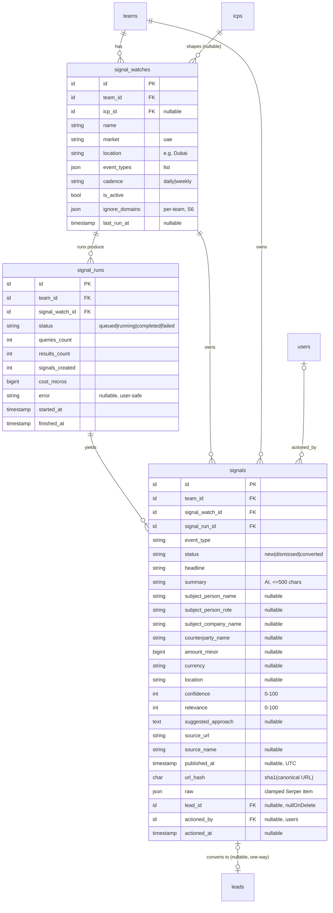

# Signals

> Status: **MVP (Signals v1 — S1 landed; S2–S6 planned)** · Owner: Product · Last updated: 2026-10-29

## Purpose

Surfaces a feed of **wealth / liquidity events** happening in the team's ICP
geography — a company sold, a founder exits, a big funding round, a founder or
executive relocating to Dubai — found with **Serper News**, classified and
summarised by AI, and shown to the team as **signals**. A team member can **dismiss**
a signal or **convert it into a standard `Lead`**, which then flows through the
existing Enrichment → Scoring → Leads Workspace pipeline.

It is **not** a "find rich people" search (queries look for _events_, not stated
intent), **not** a contact-finding tool (a signal stores a person's name, public role
and source URL only — never email or phone), **not** an outreach channel (UAE PDPL
means the suggested next step is LinkedIn or a referral, not cold email — ADR 0007),
and **not** a `LeadSourceProvider` (providers return company leads keyed for dedupe;
a signal is an _event about_ a person or company). Signals is its own module
(ADR 0002, ADR 0011) and hands off to Lead Sourcing **only on conversion**, via a
one-way FK (`signals.lead_id` → `leads`).

**Primary customer (v1):** a Dubai luxury real-estate agency. The feature is generic
— event types and query templates are **data** (config), so recruiters, B2B SaaS and
other verticals reuse it later with different templates.

## Code map

> S1 landed (✅). S2–S6 filled in with concrete class names as each phase lands.

- **Backend:** `app/Modules/Signals/…` (scaffolded in S1 via the `new-module` skill)
    - **Models (S1 ✅):** `SignalWatch`, `SignalRun`, `Signal` — all `BelongsToTeam`,
      typed casts (enums, `Carbon`, money as int minor units), relationships
      `watch → runs → signals`, `signal → lead` (one-way) and `signal → actionedBy`.
      Factories `SignalWatchFactory` / `SignalRunFactory` / `SignalFactory`
      (`database/factories`, with `inactive`/`weekly`, `running`/`completed`/`failed`
      and `acquisition`/`dismissed`/`converted` states).
    - **Enums (S1 ✅):** `SignalEventType` (`Acquisition`, `FundingRound`, `Relocation`;
      each with `label()` + `description()`), `SignalStatus` (`New`, `Dismissed`,
      `Converted`), `SignalWatchCadence` (`Daily`, `Weekly`; `staleAfterHours()` →
      24 / 168 for the S3 scheduler), `SignalRunStatus` (`Queued`, `Running`,
      `Completed`, `Failed`; `isTerminal()`/`isActive()` — mirrors `DiscoveryRunStatus`).
    - **Contracts (S2):** `NewsSearchClient` (`search(SignalQuery): list<NewsItem>`).
    - **Services (S2–S3):** `SignalQueryBuilder` (watch + active ICP →
      `list<SignalQuery>`, deterministic, no AI), `SerperNewsClient` (implements
      `NewsSearchClient`, reuses the `AbstractHttpLeadSourceProvider` hardening
      pattern — timeouts, retry-on-429/5xx, circuit breaker, `requireApiKey`),
      `SignalItemNormaliser` (URL canonicalisation → `url_hash`).
    - **Data / DTOs (S2–S4):** `SignalQuery` (`eventType`, `q`, `gl`, `hl`, `tbs`,
      `num`), `NewsItem` (`title`, `snippet`, `link`, `source`, `date`, `raw`),
      `ExtractedSignal` (AI output, schema-validated), `ConvertSignalData`
      (spatie/laravel-data).
    - **Actions (S3–S4):** `RunSignalWatchAction`, `TriggerSignalWatchAction`
      (run-now, rate-limited), `ConvertSignalToLeadAction`, `DismissSignalAction`,
      `RestoreSignalAction`.
    - **Jobs (S3):** `RunSignalWatchJob` (`ShouldBeUnique` per watch, `tries=3`,
      `backoff=[30,120,300]`, `timeout=120`, `failed()`), runs inside `TeamContext`.
    - **Events (S3–S4):** `SignalRunProgressed` + `SignalsDetected` (broadcast on
      `teams.{teamId}`), `SignalConverted`.
    - **Policies (S1 ✅):** `SignalWatchPolicy` (`view`/`create`/`update`/`delete`/`run`),
      `SignalPolicy` (`view`/`dismiss`/`restore`/`convert`) — both double-check `team_id`
      via `User::roleOn()`; view is every role, mutations are Owner/Admin/Member.
    - **Exceptions (S1 ✅):** `SignalsException extends DomainException`
      (`alreadyConverted()` 409, `watchInactive()`, `noSubjectToConvert()`), rendered
      centrally in `bootstrap/app.php`.
    - **Log channel (S1 ✅):** `signals` (daily, `config/logging.php`) — log IDs/counts
      only, never names or article text.
    - **Testing:** `app/Modules/Signals/Testing/FakeNewsSearchClient` (canned Dubai
      fixtures, bound in tests).
    - **Provider:** `Providers/SignalsServiceProvider` (routes, policies, bindings),
      registered via the Core base provider.
- **Routes (S5–S6):**
    - Web: `signals.index/dismiss/restore/convert`,
      `signal-watches.index/store/update/destroy/run`.
    - API (`auth:sanctum`, `/api/v1`, S6): `GET /signals`,
      `POST /signals/{id}/convert`, `POST /signals/{id}/dismiss`,
      `GET/POST/PATCH/DELETE /signal-watches`, `POST /signal-watches/{id}/run`.
    - Broadcast: reuses the `teams.{teamId}` private channel.
- **Frontend (S5):** `resources/js/Pages/Signals/{Index,Watches}.vue`,
  `resources/js/Components/Signals/{SignalCard,ConvertSignalModal}.vue`; nav entry;
  EN/AR strings in `lang/`; brand tokens only (CLAUDE.md §2a).
- **Shared:** `resources/js/types/signals.ts` (S5).
- **Tests:** `tests/Feature/Signals/*`, `tests/Unit/Signals/*`.
- **Config / env vars:** `config/signals.php` (S2) — Serper settings (reuse the
  ADR 0010 key/base URL by reference; own `timeout`, `connect_timeout`, `retries`,
  `backoff`), `results_per_query`, `recency` (`qdr:w`), `cost_micros_per_request`,
  `min_confidence`, `min_relevance`, `ignore_domains`, the per-event-type **query
  templates**, and `retention.{dismissed_days,unactioned_days}`. Every key documented
  in `.env.example`.

## MVP vs post-MVP

**v1 (S0–S6):** UAE-only, snippet-only Serper News watches; AI event extraction
(cheap tier) with confidence/relevance thresholds; the signals feed (EN/AR + RTL);
convert-to-lead into the existing pipeline with the UAE prior-consent flag;
dismiss/restore; API v1 parity; retention sweep + DSAR hook + per-team ignore list.
**Post-v1 (backlog, bottom of `signals-plan.md`):** UK Companies House streaming as a
second source; more event types (appointments, IPOs, DLD launches); Arabic-language
queries; full-article fetch; weekly email digest; learning from dismiss reasons;
vertical template packs; premium wealth data (Altrata).

## Data model

Three tables, all team-scoped. A `signal_watch` defines _what to watch_; each run of
it (`signal_run`) records cost and totals; each kept event is a `signal`, unique per
team on `url_hash` so one article never becomes two signals. A converted signal
points one-way at the `Lead` it created.

Indexes: unique `(team_id, url_hash)` (dedupe per team); `(team_id, status,
published_at)` (the feed). Money is integer minor units; timestamps UTC in the DB,
shown in the team timezone.

## Key flows

> Planned; sequence diagram added in S3 when the run exists.

**Watch run (S3).** `signals:dispatch-due` (hourly scheduler) queues a
`RunSignalWatchJob` for each active watch whose cadence is due (Daily: `last_run_at`
older than 24 h; Weekly: older than 7 days). The job runs inside `TeamContext` and
`RunSignalWatchAction`: (1) create the `signal_runs` row (Running) in a transaction;
(2) **outside any transaction** — `SignalQueryBuilder` turns the watch + active ICP
into queries → `SerperNewsClient` calls `/news` per query → collect items → **drop
items whose `url_hash` already exists for this team** → batch the rest (≤10) through
the `signals.extract_event` prompt (each item wrapped in `UntrustedContent`); (3)
keep items where `is_event && confidence ≥ min_confidence (60) && relevance ≥
min_relevance (40)`; (4) persist kept signals + run totals + `cost_micros` (Serper +
AI) in **one `DB::transaction()`**, using an upsert on `(team_id, url_hash)` so a
re-run is idempotent; (5) **`afterCommit`** fire `SignalsDetected` and set
`last_run_at`. Progress (`searching → analysing → saving → done`) broadcasts via
`SignalRunProgressed`. AI goes through `AiCreditGuard`, so an out-of-credit team gets
a clean Failed run, not a half-run. **Run-now** uses `TriggerSignalWatchAction`,
rate-limited to once / 15 min / watch. Never call Serper or the AI inside a
transaction.

**Conversion (S4).** `ConvertSignalToLeadAction`, in one `DB::transaction()`: lock
the signal (`lockForUpdate`); if already Converted, **return the existing lead**
(idempotent); build the `Lead` (`source = Signal`, fields from `ConvertSignalData`,
`has_personal_data = true` when a person is named, same `dedupe_key` as
`SourcedLead`); **dedupe** via `Enrichment\Services\LeadDeduplicator` — if the company
already exists for the team, **attach, never overwrite**; create a `LeadContact`
(name, title = role, email/phone **null**, `is_personal = true`, `source = 'signal'`,
`method = 'news_extraction'`); record a `LeadActivity` + audit entry; set the signal
Converted (`lead_id`, `actioned_by`, `actioned_at`); store
`raw.outreach_restriction = 'uae_prior_consent'` on UAE leads. **`afterCommit`:** queue
`EnrichLeadJob` for a new lead (scoring follows via the existing `LeadEnriched`
listener) and fire `SignalConverted`. Dismiss/restore are transactional and audited;
dismiss stores a reason enum (`NotRelevant`, `AlreadyKnown`, `NotAnEvent`) for tuning.

## External dependencies

- **Serper News** (`POST /news`), reusing the ADR 0010 account
  (`config/lead-sourcing.php` → `providers.web_search`): `q`, `gl=ae`, `hl=en`,
  `tbs=qdr:w`, `num`. **Returns at most ~10 items per query** regardless of `num`
  (see spike). Paid, metered to `signal_runs.cost_micros` (~$0.001/query). Own
  timeout/retry/circuit-breaker in `config/signals.php`; retry on 429/5xx only;
  missing key fails fast.
- **AI Platform** (cheap tier) — the `signals.extract_event` prompt via
  `PromptRegistry` + `AiClient`, with `UntrustedContent` wrapping and
  `JsonSchemaValidator`. Metered through `AiCreditGuard`.
- **ICP** — the active profile supplies default location (first Geography) and
  BuyingSignal keywords that may add queries.
- **Lead Sourcing / Enrichment / Scoring / Leads Workspace** — only at conversion
  (one-way): creates a `Lead` + `LeadContact`, triggers `EnrichLeadJob`, surfaces the
  origin panel. **Reverb** for progress.

## Serper News spike — findings (2026-10-29)

Ran every S2 template against `POST https://google.serper.dev/news` with
`gl=ae, hl=en, tbs=qdr:w, num=20`. Goal: confirm ≥ ~3 genuine Dubai/UAE events per
event type per week before writing code (S0 task 5).

### The plan's strict templates fail

7 of the 8 exact-phrase templates returned **0** results over the past week:

| Template (as written in S2)                                    | Results |
| -------------------------------------------------------------- | ------- |
| `"Dubai-based" company acquired`                               | 0       |
| `UAE startup "acquired by"`                                    | 0       |
| `"Dubai" founder "exits" OR "sells stake"`                     | 0       |
| `"Dubai-based" raises "Series B" OR "Series C" OR "Series D"`  | 0       |
| `UAE startup raises million funding`                           | 10      |
| `founder OR CEO OR entrepreneur "relocates to Dubai" OR …`     | 0       |
| `"family office" opens Dubai`                                  | 0       |
| `"moves headquarters to Dubai"`                                | 0       |

**Cause:** Serper `/news` with a tight `tbs=qdr:w` window plus multi-word **exact
phrases** (`"…"`) and `-based` constructions almost never matches a news headline.
The one template that worked used plain keywords.

### Loosened templates work — adopt these for S2

Plain-keyword variants returned 3–10 results each, mostly genuine events:

| Loosened template                      | Event type   | Results | Genuine events (examples)                                                                 |
| -------------------------------------- | ------------ | ------- | ----------------------------------------------------------------------------------------- |
| `Dubai company acquisition`            | Acquisition  | 10      | Amanat buys UK's Cornerstone Healthcare; OFG Education acquires Crown American; Sika/Duproof |
| `UAE acquisition deal`                 | Acquisition  | 10      | Apollo–Mubadala Capital; EDGE acquires Italy's CMD; UAE M&A hit $52.6bn (Khaleej Times)    |
| `UAE startup acquired`                 | Acquisition  | 5       | Sika/Duproof; FAB exploring Bandhan Bank stake                                             |
| `Dubai startup raises funding`         | FundingRound | 10      | Clinics On Cloud Series A from Dubai investors; BY Venture Partners closes $60M Fund III    |
| `UAE Series B funding`                 | FundingRound | 10      | OpenAI round led by UAE investors; Apollo/Mubadala $5bn; Phaze Ventures AI funds            |
| `Dubai startup Series A funding round` | FundingRound | 10      | BY Venture Partners $60M; Bites $40M Series A                                                |
| `Dubai founder relocates`              | Relocation   | 6       | "Why UK founders are moving their business to Dubai in 2026"; Dubai relocation enquiries    |
| `family office Dubai opens`            | Relocation   | 10      | Absa opens first Gulf office in Dubai; Procyon Metals; VIVOS Dubai office                    |
| `company relocates headquarters Dubai` | Relocation   | 3       | **Weak** — mostly non-UAE (Mott MacDonald NY, Axe Compute Miami); drop or rephrase          |

**Verdict: proceed.** Acquisition and FundingRound comfortably clear ~3 genuine
events/week; Relocation clears it via `Dubai founder relocates` + `family office
Dubai opens`. The literal HQ-relocation template is too noisy — replace it.

### What S2 must change

- **Drop exact-phrase quoting and `-based`** from the templates; use plain keywords.
  Keep template _breadth_ (several per event type) rather than one clever query.
- **`/news` returns ≤ ~10 items per query.** Set `results_per_query`/`num`
  expectations accordingly — coverage comes from more templates, not a bigger `num`.
- **Noisy domains / patterns to add to `ignore_domains` or down-rank:** cross-region
  funding listicles not about UAE (Indian/African "₹ crore" / African weekly
  round-ups), roundup/tracker pages (`vogue.com` "Funding Tracker", Techloy "Week 43"),
  generic market-update pages (`crowe.com`, economy "update" posts), and the existing
  Lead Sourcing aggregator denylist. The AI `relevance` score (is this a HNW buyer for
  _this_ team) is the main filter; `ignore_domains` handles the obvious portals.
- **AI must geo-qualify:** several keyword hits are non-UAE M&A/funding that merely
  mention UAE. The `signals.extract_event` prompt must set `is_event=false` or a low
  `relevance` when the subject isn't tied to the watched location.

Method: `POST https://google.serper.dev/news` with the ADR 0010 key, `num=20`, one
request per template. To reproduce, re-run the templates above against `/news` with
`gl=ae, hl=en, tbs=qdr:w`.

## Permissions

| Ability                                   | Owner | Admin | Member | Read-only |
| ----------------------------------------- | ----- | ----- | ------ | --------- |
| View signals + watches                    | ✅    | ✅    | ✅     | ✅        |
| Create/update/delete watches; run-now     | ✅    | ✅    | ✅     | ❌        |
| Dismiss / restore / convert a signal      | ✅    | ✅    | ✅     | ❌        |

Policies `SignalWatchPolicy` + `SignalPolicy` double-check `team_id` behind the
`BelongsToTeam` global scope (ADR 0006). Authoritative role via `User::roleOn($team)`.

## Known limitations / TODO

- **UAE-only, snippet-only, English-only** in v1 (ADR 0011). No full-article fetch,
  so amounts/names are best-effort from title + snippet.
- **Serper `/news` relative dates** ("3 days ago") parse best-effort to UTC; fall back
  to the run time when unparseable (S2 risk).
- **Query templates are the main quality lever** and are config, not code — tune per
  the spike before S2 and per dismiss reasons post-v1.
- **Retention** (hard-delete dismissed @ 90 days, unactioned @ 180 days) and the
  **per-team ignore list** and **DSAR hook** land in S6.
- **Logging:** channel `signals`; log IDs/counts only, never names or article text.
- **Runs have no policy of their own.** A `SignalRun` is only ever reached through its parent
  `SignalWatch` (the watch gates viewing), so S1 ships `SignalWatchPolicy` + `SignalPolicy` only.
  If a run is ever exposed on its own route, give it a `view` policy then.
- **Cross-team parent references** (`signal_watch_id`, `signal_run_id`, `icp_id`, `lead_id`) are
  plain FKs, not team-qualified at the DB level. Nothing in S1 can set them wrongly (no Actions
  yet); the S3 run and S4 conversion Actions **must resolve every parent through a team-scoped
  query** (e.g. load the lead only under the active team) so a signal can never point at another
  team's row.

## Changelog

| Date       | Phase | Change                                                                                                                                                               | Files                                                                                 |
| ---------- | ----- | -------------------------------------------------------------------------------------------------------------------------------------------------------------------- | ------------------------------------------------------------------------------------- |
| 2026-10-29 | S0    | Created the module doc: purpose, planned code map, data model (ER diagram for `signal_watches`/`signal_runs`/`signals`), key flows, external deps, permissions — and recorded the Serper News spike (strict templates fail; loosened plain-keyword templates return 3–10 genuine Dubai events/type/week; `/news` caps at ~10 results/query). ADR 0011 accepted. | `docs/modules/signals.md`, `docs/decisions/0011-signals-module.md`, `docs/compliance.md`, `docs/architecture.md`, `CLAUDE.md`, `mvp.md` |
| 2026-10-29 | S1    | Scaffolded the module (ADR 0002) and built the data model: 4 enums, 3 migrations (`signal_watches`/`signal_runs`/`signals`, all team-scoped, unique `(team_id, url_hash)` + feed index `(team_id, status, published_at)`, one-way `signals.lead_id → leads` `nullOnDelete`), 3 `BelongsToTeam` models + factories, `SignalWatchPolicy`/`SignalPolicy`, `SignalsException`, the `signals` log channel, and the `SignalsServiceProvider` (registered via Core base provider). Tests: enum coverage, cross-tenant isolation + auto-assign for all three models, per-team `url_hash` uniqueness, and `lead_id` nulling on lead delete. `signal_watches.ignore_domains` deferred to S6 per plan. No external calls. | `app/Modules/Signals/**`, `database/migrations/2026_10_29_18000{1,2,3}_*`, `database/factories/Signal*Factory.php`, `config/logging.php`, `bootstrap/providers.php`, `tests/{Unit,Feature}/Signals/*` |
