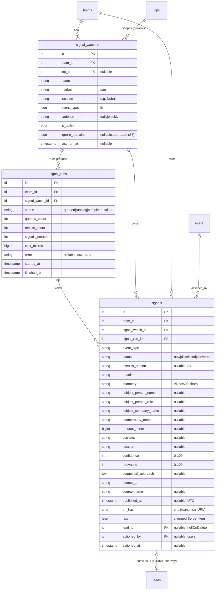

# Signals

> Status: **MVP (Signals v1 — S1–S3 landed; S4–S6 planned)** · Owner: Product · Last updated: 2026-10-29

## Purpose

Surfaces a feed of **wealth / liquidity events** happening in the team's ICP
geography — a company sold, a founder exits, a big funding round, a founder or
executive relocating to Dubai — found with **Serper News**, classified and
summarised by AI, and shown to the team as **signals**. A team member can **dismiss**
a signal or **convert it into a standard `Lead`**, which then flows through the
existing Enrichment → Scoring → Leads Workspace pipeline.

It is **not** a "find rich people" search (queries look for _events_, not stated
intent), **not** a contact-finding tool (a signal stores a person's name, public role
and source URL only — never email or phone), **not** an outreach channel (UAE PDPL
means the suggested next step is LinkedIn or a referral, not cold email — ADR 0007),
and **not** a `LeadSourceProvider` (providers return company leads keyed for dedupe;
a signal is an _event about_ a person or company). Signals is its own module
(ADR 0002, ADR 0011) and hands off to Lead Sourcing **only on conversion**, via a
one-way FK (`signals.lead_id` → `leads`).

**Primary customer (v1):** a Dubai luxury real-estate agency. The feature is generic
— event types and query templates are **data** (config), so recruiters, B2B SaaS and
other verticals reuse it later with different templates.

## Code map

> **The module is complete (S0–S6, 2026-10-29).** Anything described as "to come" below is
> post-v1 backlog, not unbuilt v1 scope.

- **Backend:** `app/Modules/Signals/…` (scaffolded in S1 via the `new-module` skill)
    - **Models (S1 ✅):** `SignalWatch`, `SignalRun`, `Signal` — all `BelongsToTeam`,
      typed casts (enums, `Carbon`, money as int minor units), relationships
      `watch → runs → signals`, `signal → lead` (one-way) and `signal → actionedBy`.
      Factories `SignalWatchFactory` / `SignalRunFactory` / `SignalFactory`
      (`database/factories`, with `inactive`/`weekly`, `running`/`completed`/`failed`
      and `acquisition`/`dismissed`/`converted` states).
    - **Enums (S1 ✅; S4 ✅):** `SignalDismissReason` (S4: `NotRelevant`, `AlreadyKnown`,
      `NotAnEvent`; `indicatesMisclassification()` so tuning reads intent, not raw counts),
      `SignalEventType` (`Acquisition`, `FundingRound`, `Relocation`;
      each with `label()` + `description()`), `SignalStatus` (`New`, `Dismissed`,
      `Converted`), `SignalWatchCadence` (`Daily`, `Weekly`; `staleAfterHours()` →
      24 / 168 for the S3 scheduler), `SignalRunStatus` (`Queued`, `Running`,
      `Completed`, `Failed`; `isTerminal()`/`isActive()` — mirrors `DiscoveryRunStatus`).
    - **Contracts (S2 ✅):** `NewsSearchClient` (`search(SignalQuery): list<NewsItem>`);
      real impl `SerperNewsClient`, test impl `FakeNewsSearchClient`.
    - **Services (S2 ✅; S3 to come):** `SignalQueryBuilder` (watch + active ICP →
      `list<SignalQuery>`, deterministic, no AI — watch location overrides ICP
      geography, event_types pick templates, buying-signal criteria append extra
      queries only when they map to a watched event type), `SerperNewsClient`
      (implements `NewsSearchClient`; reuses the `AbstractHttpLeadSourceProvider`
      hardening pattern — timeouts, retry-on-429/5xx, the shared
      `Core\Support\CircuitBreaker` with prefix `signals:cb` and key `signals_news`,
      fail-fast on a missing key — drops `ignore_domains`, collapses duplicate URLs,
      clamps all text incl. `raw`, rejects over-long/non-http(s) links, and fails on a
      malformed 200 body), `SignalItemNormaliser` (URL canonicalisation → `url_hash`:
      lower-cased host, `utm_*`/fragment stripped, query sorted).
    - **Data / DTOs (S2 ✅; S4 ✅):** `SignalQuery` (`eventType`, `q`, `gl`, `hl`,
      `tbs`, `num`), `NewsItem` (`title`, `snippet`, `link`, `urlHash`, `source`,
      `publishedAt` best-effort UTC, `raw`), `ExtractedSignal` (S3, AI output,
      schema-validated), `ConvertSignalData` (S4, spatie/laravel-data —
      `prefillFrom(Signal)` seeds the form, `fromValidated()` clamps to the columns,
      `rules()` keeps the S5 web and S6 API endpoints from drifting on what a
      conversion accepts; `companyName` required and never invented).
    - **Actions (S3 ✅; S4 ✅; S5 ✅):** `ListSignalsAction` (the server-driven feed,
      ordered by `published_at` — the feed is about when the _event_ happened, not when
      Alima found it — plus `counts()` for the tabs in one grouped query),
      `ListSignalWatchesAction` (all watches, with runs **capped per watch**),
      `SaveSignalWatchAction` (create/update, audited; an out-of-team ICP is dropped and
      logged; **reactivating a paused watch doesn't make it due**, so a month-old watch
      doesn't fire the moment it is switched on), `DeleteSignalWatchAction` (audited, and
      the audit row records the signals/runs going with the cascade — the only place
      those counts survive), `RunSignalWatchAction` (orchestrates one run),
      `TriggerSignalWatchAction` (run-now, rate-limited 1/15 min/watch via
      `RateLimiter`), `ConvertSignalToLeadAction` (S4 — one transaction with
      `attempts: 3`, lock → attach-or-create → `LeadDeduplicator` → contact →
      timeline/audit → mark converted → `afterCommit` enrich + `SignalConverted`; see
      "Key flows"), `DismissSignalAction` / `RestoreSignalAction` (S4 — transactional,
      audited, idempotent, and refused on a converted signal).
    - **Jobs (S3 ✅):** `RunSignalWatchJob` (`ShouldBeUnique` per watch, `tries=3`,
      `backoff=[30,120,300]`, `timeout=120`, `uniqueFor=600`, `failed()` marks the
      latest non-terminal run Failed), runs inside `TeamContext` with
      `Log::withContext(['team_id','signal_watch_id'])`.
    - **Console (S3 ✅; S6 ✅):** `DispatchDueSignalWatchesCommand` (`signals:dispatch-due`,
      scheduled hourly, `withoutOverlapping`) queues a run for each active watch whose
      cadence is due; `PruneSignalsCommand` (`signals:prune`, nightly at 03:20) is the
      retention sweep — chunked, idempotent, every team, counts-only logging, with a
      `--dry-run` because retention is irreversible.
    - **HTTP (S5 ✅ web; S6 ✅ API):**
        - `Http/Controllers/Concerns/ResolvesSignals` — the caller, their team, and a
          team-scoped read of the signal or watch. Reading inside `TeamContext` is what
          makes a cross-tenant request a **404 before any policy runs**; the policy
          still double-checks (ADR 0006).
        - Web: `SignalController` (`index`/`convert`/`dismiss`/`restore`),
          `SignalWatchController` (`index`/`store`/`storeDefault`/`update`/`destroy`/`run`).
        - API v1: `Api/V1/SignalController` (+ `show`), `Api/V1/SignalWatchController`
          (+ `show`) — same Actions behind both, so there is one definition of what
          converting or dismissing means. `run` answers **202** and returns immediately.
        - Requests: `ListSignalsRequest` (bounds the input; `SignalFilters` narrows it),
          `ConvertSignalRequest` (rules from `ConvertSignalData::rules()` plus a
          team-scoped `pipeline_stage_id`), `DismissSignalRequest`,
          `SaveSignalWatchRequest` (rules from `SignalWatchData::rules()` plus a
          team-scoped `icp_id`; **`market` is not accepted** — v1 is UAE-only).
        - Resources: `SignalResource` (no contact fields, because there are none; `raw`
          never leaves the server; `deletes_in_days` from the retention window),
          `SignalWatchResource` (event types with their labels and explainers; a computed
          `next_due_at`), `SignalRunResource`.
    - **Services (S6 ✅):** `SignalsPersonalDataExporter` — the DSAR hook (see
      `compliance.md` §5a); `SignalLeadOriginProvider` (S4, the lead-origin seam).
    - **Data / DTOs (S3 ✅; S5 ✅):** `ExtractedSignal` (the schema-validated AI output per
      item; `fromAiItem()` converts amount→minor units + resolves currency;
      `meetsThreshold()`), `SignalFilters` (the feed's tab + filter state — the one shape
      the request, the query and the Inertia props speak; unknown values are **dropped,
      not rejected**, so a shared link from last month still opens), `SignalWatchData`
      (`defaultWatch()` is the one-click first watch; `rules()` keeps the web and API
      endpoints from drifting).
    - **Events (S3 ✅; S4 ✅):** `SignalRunProgressed` (stages searching →
      analysing → saving → done), `SignalsDetected` (afterCommit, count) and
      `SignalConverted` (S4 — afterCommit; team, signal, lead and an `attached` flag,
      so a feed can drop the card and reporting can tell a new lead from a link to one
      the team already had) — all `ShouldBroadcast` on `teams.{teamId}`.
    - **Policies (S1 ✅):** `SignalWatchPolicy` (`view`/`create`/`update`/`delete`/`run`),
      `SignalPolicy` (`view`/`dismiss`/`restore`/`convert`) — both double-check `team_id`
      via `User::roleOn()`; view is every role, mutations are Owner/Admin/Member.
    - **Cross-module seam (S4 ✅):** `SignalLeadOriginProvider` implements
      `LeadsWorkspace\Contracts\LeadOriginProvider` and is bound over the Workspace's
      `NoLeadOrigin` default by `SignalsServiceProvider`, so the lead detail screen can
      show the event a lead came from **without the Workspace depending on Signals**.
      Keys on `raw.signal_id`, not the lead's `source`. Outside this module, S4 also
      added `LeadSource::Signal`, `LeadActivityType::SignalConverted`,
      `Core\Enums\OutreachRestriction` and `Market::outreachRestriction()`.
    - **Exceptions (S1 ✅):** `SignalsException extends DomainException`
      (`alreadyConverted()` 409, `watchInactive()`, `noSubjectToConvert()`,
      `runThrottled()` 429, and the three news-provider causes), rendered centrally in
      `bootstrap/app.php`. S4 uses `noSubjectToConvert()` for a conversion with no
      company name and `alreadyConverted()` for a dismiss/restore of a converted signal
      — and for the one conversion case that can't be made idempotent: a converted
      signal whose lead has been deleted.
    - **Log channel (S1 ✅):** `signals` (daily, `config/logging.php`) — log IDs/counts
      only, never names or article text.
    - **Testing:** `app/Modules/Signals/Testing/FakeNewsSearchClient` (canned Dubai
      fixtures, bound in tests).
    - **Provider:** `Providers/SignalsServiceProvider` (routes, policies, bindings),
      registered via the Core base provider.
- **Routes (S5 ✅ web, S6 ✅ API):**
    - Web: `signals.index/convert/dismiss/restore` at `/signals`, and
      `signal-watches.index/store/store-default/update/destroy/run` at
      **`/signals/watches`** — nested under `signals/` so the sidebar's `startsWith`
      match keeps Signals lit in its own settings. The route _names_ are the ones the
      plan specified.
    - API (`auth:sanctum`, `/api/v1`): `GET /signals`, `GET /signals/{id}`,
      `POST /signals/{id}/convert|dismiss|restore`,
      `GET/POST /signal-watches`, `GET/PATCH/DELETE /signal-watches/{id}`,
      `POST /signal-watches/{id}/run` (202).
    - `run` carries **two** limits on both web and API: the per-watch 15-minute window in
      `TriggerSignalWatchAction`, and a per-member `signals-run` throttle
      (`signals.run_rate_limit`, default 10/min). A run spends real money, and a token is
      easier to loop than a button.
    - Broadcast: reuses the `teams.{teamId}` private channel.
- **Frontend (S5 ✅):** `resources/js/pages/signals/{Index,Watches}.vue`,
  `resources/js/components/signals/{SignalCard,ConvertSignalModal,DismissSignalDialog}.vue`,
  a **Signals** sidebar entry (`Satellite`, `/signals`), and the lead-detail "The event"
  panel (S4). Brand tokens only; EN/AR at parity.
    - After the `brand-reviewer` pass: the tabs are **links, not `role="tab"`** (each one
      navigates, so it is shareable and the Filters button can live beside them);
      selected filter chips carry a **tick, not just a tint** (WCAG 1.4.1); focus moves
      to the list when a card leaves it, with an always-mounted live region; the card was
      **trimmed** (no redundant status badge, no "found by", relevance in the header, no
      tinted approach panel); counts use **count-neutral phrasing** so Arabic needs no
      dual/plural forms.
    - Two base components were extracted rather than copying `Input`'s class string a
      fifth time: `ui/native-select/NativeSelect.vue` and `ui/textarea/Textarea.vue`.
      ~15 older call sites across the app still hand-roll these — see "Known limitations".
- **Shared:** `resources/js/types/signals.ts` (S5).
- **Tests:** `tests/Feature/Signals/*`, `tests/Unit/Signals/*`.
- **Config / env vars:** `config/signals.php` (S2 ✅; `run_rate_limit` S5 ✅) — Serper settings (reuse the
  ADR 0010 key/base URL by reference; own `timeout`, `connect_timeout`, `retries`,
  `backoff`), `results_per_query`, `recency` (`qdr:w`), `cost_micros_per_request`,
  `min_confidence`, `min_relevance`, `ignore_domains`, the per-event-type **query
  templates**, and `retention.{dismissed_days,unactioned_days}`. Every key documented
  in `.env.example`.

## MVP vs post-MVP

**v1 (S0–S6):** UAE-only, snippet-only Serper News watches; AI event extraction
(cheap tier) with confidence/relevance thresholds; the signals feed (EN/AR + RTL);
convert-to-lead into the existing pipeline with the UAE prior-consent flag;
dismiss/restore; API v1 parity; retention sweep + DSAR hook + per-team ignore list.
**Post-v1 (backlog, bottom of `signals-plan.md`):** UK Companies House streaming as a
second source; more event types (appointments, IPOs, DLD launches); Arabic-language
queries; full-article fetch; weekly email digest; learning from dismiss reasons;
vertical template packs; premium wealth data (Altrata).

## Data model

Three tables, all team-scoped. A `signal_watch` defines _what to watch_; each run of
it (`signal_run`) records cost and totals; each kept event is a `signal`, unique per
team on `url_hash` so one article never becomes two signals. A converted signal
points one-way at the `Lead` it created.



Indexes: unique `(team_id, url_hash)` (dedupe per team); `(team_id, status,
published_at)` (the feed). Money is integer minor units; timestamps UTC in the DB,
shown in the team timezone.

`dismiss_reason` (S4) is nullable because the reason is **optional** - a member can
clear a card without justifying it - and is cleared again on restore. It is kept for
tuning, not for display: "not an event" across a week says the classifier is too
loose, "not relevant" says the queries or the relevance floor are.

**A converted signal leaves nothing of itself on the lead but a pointer.** The lead
carries `raw.signal_id` / `raw.event_type` / `raw.headline` and, where the market
requires it, `raw.outreach_restriction` - see the conversion flow below. The FK is
one-way and `nullOnDelete`, so Lead Sourcing never depends on Signals.

## Key flows

```mermaid
sequenceDiagram
    participant Sch as signals:dispatch-due (hourly)
    participant Job as RunSignalWatchJob
    participant Act as RunSignalWatchAction
    participant QB as SignalQueryBuilder
    participant Serper as SerperNewsClient
    participant AI as AiClient (signals.extract_event)
    participant DB as DB (signals/signal_runs)
    Sch->>Job: dispatch(teamId, watchId) for due active watches
    Job->>Act: handle(watch) in TeamContext
    Act->>DB: claim/create run (Running) [tx]
    Act->>QB: build(watch, activeIcp) → queries
    Act->>Serper: search(query) per query (outside tx)
    Serper-->>Act: NewsItem[] (clamped, ignore-domains dropped)
    Act->>DB: drop url_hashes already seen for this team
    Act->>AI: structured(batch ≤10, UntrustedContent)
    AI-->>Act: ExtractedSignal[] (schema-valid)
    Act->>DB: insertOrIgnore kept signals + run totals + last_run_at [one tx]
    Act-->>Job: afterCommit → SignalsDetected; progress → done
```

**Watch run (S3).** `signals:dispatch-due` (hourly scheduler) queues a
`RunSignalWatchJob` for each active watch whose cadence is due (Daily: `last_run_at`
older than 24 h; Weekly: older than 7 days). The job runs inside `TeamContext` and
`RunSignalWatchAction`: (1) create the `signal_runs` row (Running) in a transaction;
(2) **outside any transaction** — `SignalQueryBuilder` turns the watch + active ICP
into queries → `SerperNewsClient` calls `/news` per query → collect items → **drop
items whose `url_hash` already exists for this team** → batch the rest (≤10) through
the `signals.extract_event` prompt (each item wrapped in `UntrustedContent`); (3)
keep items where `is_event && confidence ≥ min_confidence (60) && relevance ≥
min_relevance (40)`; (4) persist kept signals + run totals + `cost_micros` (Serper +
AI) in **one `DB::transaction()`**, using an upsert on `(team_id, url_hash)` so a
re-run is idempotent; (5) **`afterCommit`** fire `SignalsDetected` and set
`last_run_at`. Progress (`searching → analysing → saving → done`) broadcasts via
`SignalRunProgressed`. AI goes through `AiCreditGuard`, so an out-of-credit team gets
a clean Failed run, not a half-run. **Run-now** uses `TriggerSignalWatchAction`,
rate-limited to once / 15 min / watch; it **opens a `queued` run row and then dispatches**,
so the screen that pressed the button has something to report the instant it redirects,
and `RunSignalWatchAction` adopts that row rather than opening a second. A refused press
(paused watch, throttle) opens nothing. Never call Serper or the AI inside a transaction.

**Conversion (S4).** `ConvertSignalToLeadAction`, in one `DB::transaction()`:

1. **Lock the signal** (`lockForUpdate`). Already Converted -> **return the lead it
   made** (idempotent; a double-click, a retried request and an impatient member all
   land on the same lead). A converted signal whose lead has since been **deleted** has
   a null `lead_id`, so there is nothing to hand back and nothing to re-create -
   `SignalsException::alreadyConverted()` says so plainly.
2. **Normalise through `SourcedLead`**, not by hand, so the lead is keyed, clamped and
   URL-filtered exactly as a discovered one (`source = Signal`, `dedupe_key` from
   `SourcedLead::dedupeKey()`, `source_url` from the signal, `collected_at = now()`).
3. **Attach or create.** `(team_id, dedupe_key)` is unique, so an existing row with
   that key is **filled in, never overwritten** (`fillGaps()` - empty columns only,
   each with a `field_sources` entry naming `signal` / `news_extraction`, per ADR
   0008). Then `Enrichment\Services\LeadDeduplicator::deduplicate()` catches the
   harder case: the same company already on file under a _different_ key (keyed by
   registry number while this one is keyed by name, say). Because `LeadSource::Signal`
   **ranks at the bottom**, a merge may only _fill_ the survivor's gaps - an article's
   spelling of a company never renames the registry record or the team's own import -
   and it may well be our own row that is merged away, in which case the signal points
   at the survivor.
4. **Create a `LeadContact`** for the named person: `name`, `title` = role, `email` and
   `phone` **null by construction** (Signals never holds either), `is_personal = true`,
   `source = 'signal'`, `method = 'news_extraction'`. Skipped - case-insensitively -
   when the lead already has a contact of that name, so a second signal about the same
   founder doesn't stack up duplicates.
5. **Re-stamp the origin** (`stampOrigin()`), merging into the lead's existing `raw`
   rather than replacing it. This is a **deliberate exception to "fill in, never
   overwrite"**: `raw` is one of the columns the de-duplicator merges, so a lead that
   already had a `raw` payload would keep it and silently lose both the `signal_id` the
   origin panel reads and - far worse - the outreach restriction. A compliance limit
   may be **added** to a lead but never dropped from one, so it is written last, after
   every merge has had its say. The **first** signal keeps the pointer: a lead already
   carrying a `signal_id` doesn't have the three origin keys overwritten, so the panel
   can't end up describing one event while the timeline says another.
6. **Record it:** a `LeadActivityType::SignalConverted` timeline entry (properties only
    - `signal_id`, `event_type`, `headline`, `attached`; the sentence is composed at
      render time, EN/AR) plus a `signals.converted` audit row carrying ids and flags,
      never the person's name. The member's optional note goes on via
      `CreateLeadNoteAction`.
7. **Mark the signal** Converted (`lead_id`, `actioned_by`, `actioned_at`), and
   `refresh()` the caller's model so a controller about to redirect isn't holding a
   signal that still says New.
8. **`afterCommit`:** queue `EnrichLeadJob` - **only when the resulting lead is still
   enrichment-`Pending`**, so attaching to a company the team already enriched doesn't
   spend on it again (scoring follows via the existing `LeadEnriched` ->
   `ScoreEnrichedLead` listener) - and fire `SignalConverted` (team, signal, lead,
   `attached`).

**The UAE outreach restriction comes from the watch's market, not the company's
country.** `Market::outreachRestriction()` (Core) returns `UaePriorConsent` for the UAE
and null for the UK, and the value is stored as `leads.raw.outreach_restriction` behind
`Core\Enums\OutreachRestriction`. The distinction matters: the restriction protects
the **person being approached**, who is where the watch was looking, and the company
they own may be registered elsewhere - keying it on the lead's country would quietly
drop the restriction the moment a Dubai founder's lead was filed under a UK holding
company, which is exactly the case it exists for. `LeadResource` sends it on **every**
lead, and `docs/modules/outreach.md` records what Phase 11 must do with it.

**Concurrency.** The conversion runs with `attempts: 3`, because this action takes row
locks in an order `LeadDeduplicator` doesn't know about - signal, then the attached
lead, _then_ the deduplicator's own id-ordered group lock - so a concurrent enrichment
deduping the same companies can deadlock with it. A **lost insert race** (two members
converting signals about the same new company at once; the row lock can't hold a row
that doesn't exist yet) surfaces as a `UniqueConstraintViolationException` and is
retried **outside** the transaction, because by then the transaction is doomed and a
failed statement poisons everything after it on some drivers - the same trap
`ImportLeadsAction` avoids the same way. The retry finds the winner and attaches.

**Dismiss / restore (S4).** Both transactional, audited and idempotent.
`DismissSignalAction` takes an optional `SignalDismissReason` (`NotRelevant`,
`AlreadyKnown`, `NotAnEvent`) and re-dismissing just updates the reason;
`RestoreSignalAction` takes Dismissed -> New and clears the reason **and** the
actioned-by/at stamps (a `New` row carrying someone's name reads as though they did
something to it). Neither works on a **Converted** signal: the lead is real and in
someone's pipeline, so "restoring" the card would invite a second conversion of the
same event.

**The lead's origin panel (S4) - a one-way seam.** Signals creates leads, so it already
knows about Lead Sourcing and the Workspace; the Workspace must not learn about Signals
in return just to render a panel. So the Workspace defines
`LeadsWorkspace\Contracts\LeadOriginProvider` (+ the `LeadOrigin` DTO and a
`NoLeadOrigin` default binding) and `SignalsServiceProvider` rebinds it to
`SignalLeadOriginProvider` - registered after the Workspace provider, so it wins. The
provider keys on **`raw.signal_id` alone, not the lead's `source`**: a signal attached
to a company the team already had leaves that lead's stronger attribution intact
(`source` stays `Import` or `Companies House`), but the event is still where the lead
came to the team's attention. It re-reads the signal row rather than trusting the `raw`
snapshot, is scoped by `team_id` beside the global scope, and returns null once the
retention sweep (S6) has removed the signal.

**The feed (S5).** `ListSignalsAction` is **server-driven**, like the leads list: the
tab, the filters and the page all live in the query string, so the screen never holds
more than a page of signals and a shared URL reproduces exactly what the sender saw.
Ordering is `published_at` descending (with the id as tie-break, because one run can
write a dozen signals sharing a fallback timestamp) — the feed is about **when the event
happened**, not when Alima happened to find it. `SignalFilters` narrows every value to
an enum, a bounded integer or a parsed date and **drops** what it no longer recognises,
so a link someone shared last month still opens the feed. A backwards date range is
swapped rather than 422'd. Tab counts come from one grouped query, not three pages.

Live arrivals reuse the S3 broadcasts: the feed listens for `signals.detected` on
`teams.{id}` and offers a "show them" banner rather than reordering under the member's
cursor, and the watch screen listens for `signal-run.progressed` so a run started there
updates in place.

`SignalRunProgressed` carries **`watch_id` as well as `run_id`, and the screen keys
progress by the watch**. "Run now" redirects as soon as the run is queued, so the card is
waiting on a run whose id it cannot know — keyed by run id, every stage arrived
unroutable and the card showed nothing at all until the run finished. A watch has at most
one live run (`ShouldBeUnique` on the job), so its id is an unambiguous key. The stage
text (`searching → analysing → saving → done`) and the percent are displayed on the card
through the shared `ui/progress` component; a single page-level `role="status"` region
announces the stage **with the watch's name**, because any of the cards could be the one
that moved. Scheduled runs don't pre-open a row — nobody is watching the moment one
starts — so their card lights up at the first broadcast instead.

**Watch settings (S5).** `ListSignalWatchesAction` returns every watch (a team has a
handful, not a page) with its **runs capped per watch** — a daily watch left alone for a
year has 365 and the screen shows five. A team with none is offered a **one-click default
watch** (`SignalWatchData::defaultWatch()`: the market's default location, all three
event types, daily), deliberately the broadest useful one, because a first watch that
finds nothing teaches the team the feature doesn't work. Deleting a watch **takes its
signals and runs with it** (both FKs cascade), which the confirmation says plainly; any
signal the team actually wanted is already a lead, and the lead survives.

**Retention (S6).** `signals:prune`, nightly at 03:20: dismissed signals go after
`retention.dismissed_days` (90), unactioned ones after `retention.unactioned_days` (180),
and **converted ones never** — they are the provenance of a real lead. Chunked at 500
rows, idempotent, sweeping every team (`withoutGlobalScopes()`, which is why it is a
scheduled command and not something a request can reach), logging counts and windows
only. Dated on **`created_at`, not `published_at`**: the promise is about how long Alima
holds the record. `--dry-run` reports without deleting. The feed shows
**"Deletes in N days"** on every unconverted signal, from the same window the sweep uses,
so retention never removes something a team assumed was kept.

**Data-subject requests (S6).** `SignalsPersonalDataExporter::export()` / `erase()`,
per team, matched on `subject_person_name` — see `compliance.md` §5a, including the two
deviations from the original design (a converted signal is **reported but not erased**,
and matches are candidates for a human rather than an automatic erasure).

**Per-team ignored sources (S6).** `signal_watches.ignore_domains` is normalised to bare
lower-case hosts by `SignalQueryBuilder` (a team types what they see — a pasted URL, a
`www.` prefix, mixed case) and **carried on the `SignalQuery`** rather than read from
config by the client, so the client holds no notion of which team asked and can't apply
one team's list to another's results. It is merged with the global
`signals.ignore_domains` in `SerperNewsClient`.

## External dependencies

- **Serper News** (`POST /news`), reusing the ADR 0010 account
  (`config/lead-sourcing.php` → `providers.web_search`): `q`, `gl=ae`, `hl=en`,
  `tbs=qdr:w`, `num`. **Returns at most ~10 items per query** regardless of `num`
  (see spike). Paid, metered to `signal_runs.cost_micros` (~$0.001/query). Own
  timeout/retry/circuit-breaker in `config/signals.php`; retry on 429/5xx only;
  missing key fails fast.
- **AI Platform** (cheap tier) — the `signals.extract_event` prompt via
  `PromptRegistry` + `AiClient`, with `UntrustedContent` wrapping and
  `JsonSchemaValidator`. Metered through `AiCreditGuard`.
- **ICP** — the active profile supplies default location (first Geography) and
  BuyingSignal keywords that may add queries.
- **Lead Sourcing / Enrichment / Scoring / Leads Workspace** — only at conversion
  (one-way): creates a `Lead` + `LeadContact`, triggers `EnrichLeadJob`, surfaces the
  origin panel. **Reverb** for progress.

## Serper News spike — findings (2026-10-29)

Ran every S2 template against `POST https://google.serper.dev/news` with
`gl=ae, hl=en, tbs=qdr:w, num=20`. Goal: confirm ≥ ~3 genuine Dubai/UAE events per
event type per week before writing code (S0 task 5).

### The plan's strict templates fail

7 of the 8 exact-phrase templates returned **0** results over the past week:

| Template (as written in S2)                                   | Results |
| ------------------------------------------------------------- | ------- |
| `"Dubai-based" company acquired`                              | 0       |
| `UAE startup "acquired by"`                                   | 0       |
| `"Dubai" founder "exits" OR "sells stake"`                    | 0       |
| `"Dubai-based" raises "Series B" OR "Series C" OR "Series D"` | 0       |
| `UAE startup raises million funding`                          | 10      |
| `founder OR CEO OR entrepreneur "relocates to Dubai" OR …`    | 0       |
| `"family office" opens Dubai`                                 | 0       |
| `"moves headquarters to Dubai"`                               | 0       |

**Cause:** Serper `/news` with a tight `tbs=qdr:w` window plus multi-word **exact
phrases** (`"…"`) and `-based` constructions almost never matches a news headline.
The one template that worked used plain keywords.

### Loosened templates work — adopt these for S2

Plain-keyword variants returned 3–10 results each, mostly genuine events:

| Loosened template                      | Event type   | Results | Genuine events (examples)                                                                    |
| -------------------------------------- | ------------ | ------- | -------------------------------------------------------------------------------------------- |
| `Dubai company acquisition`            | Acquisition  | 10      | Amanat buys UK's Cornerstone Healthcare; OFG Education acquires Crown American; Sika/Duproof |
| `UAE acquisition deal`                 | Acquisition  | 10      | Apollo–Mubadala Capital; EDGE acquires Italy's CMD; UAE M&A hit $52.6bn (Khaleej Times)      |
| `UAE startup acquired`                 | Acquisition  | 5       | Sika/Duproof; FAB exploring Bandhan Bank stake                                               |
| `Dubai startup raises funding`         | FundingRound | 10      | Clinics On Cloud Series A from Dubai investors; BY Venture Partners closes $60M Fund III     |
| `UAE Series B funding`                 | FundingRound | 10      | OpenAI round led by UAE investors; Apollo/Mubadala $5bn; Phaze Ventures AI funds             |
| `Dubai startup Series A funding round` | FundingRound | 10      | BY Venture Partners $60M; Bites $40M Series A                                                |
| `Dubai founder relocates`              | Relocation   | 6       | "Why UK founders are moving their business to Dubai in 2026"; Dubai relocation enquiries     |
| `family office Dubai opens`            | Relocation   | 10      | Absa opens first Gulf office in Dubai; Procyon Metals; VIVOS Dubai office                    |
| `company relocates headquarters Dubai` | Relocation   | 3       | **Weak** — mostly non-UAE (Mott MacDonald NY, Axe Compute Miami); drop or rephrase           |

**Verdict: proceed.** Acquisition and FundingRound comfortably clear ~3 genuine
events/week; Relocation clears it via `Dubai founder relocates` + `family office
Dubai opens`. The literal HQ-relocation template is too noisy — replace it.

### What S2 must change

- **Drop exact-phrase quoting and `-based`** from the templates; use plain keywords.
  Keep template _breadth_ (several per event type) rather than one clever query.
- **`/news` returns ≤ ~10 items per query.** Set `results_per_query`/`num`
  expectations accordingly — coverage comes from more templates, not a bigger `num`.
- **Noisy domains / patterns to add to `ignore_domains` or down-rank:** cross-region
  funding listicles not about UAE (Indian/African "₹ crore" / African weekly
  round-ups), roundup/tracker pages (`vogue.com` "Funding Tracker", Techloy "Week 43"),
  generic market-update pages (`crowe.com`, economy "update" posts), and the existing
  Lead Sourcing aggregator denylist. The AI `relevance` score (is this a HNW buyer for
  _this_ team) is the main filter; `ignore_domains` handles the obvious portals.
- **AI must geo-qualify:** several keyword hits are non-UAE M&A/funding that merely
  mention UAE. The `signals.extract_event` prompt must set `is_event=false` or a low
  `relevance` when the subject isn't tied to the watched location.

Method: `POST https://google.serper.dev/news` with the ADR 0010 key, `num=20`, one
request per template. To reproduce, re-run the templates above against `/news` with
`gl=ae, hl=en, tbs=qdr:w`.

## Permissions

| Ability                               | Owner | Admin | Member | Read-only |
| ------------------------------------- | ----- | ----- | ------ | --------- |
| View signals + watches                | ✅    | ✅    | ✅     | ✅        |
| Create/update/delete watches; run-now | ✅    | ✅    | ✅     | ❌        |
| Dismiss / restore / convert a signal  | ✅    | ✅    | ✅     | ❌        |

Policies `SignalWatchPolicy` + `SignalPolicy` double-check `team_id` behind the
`BelongsToTeam` global scope (ADR 0006). Authoritative role via `User::roleOn($team)`.

## Known limitations / TODO

- **UAE-only, snippet-only, English-only** in v1 (ADR 0011). No full-article fetch,
  so amounts/names are best-effort from title + snippet.
- **Serper `/news` relative dates** ("3 days ago") parse best-effort to UTC; fall back
  to the run time when unparseable (S2 risk).
- **Query templates are the main quality lever** and are config, not code — tune per
  the spike before S2 and per dismiss reasons post-v1.
- **ICP buying-signal → event-type matching** (`SignalQueryBuilder`) is intentionally
  **stem/substring, first-match-wins**: `rais` matches "raises/raised", `exit` matches
  "exits", and Acquisition is checked before FundingRound before Relocation. This keeps
  it deterministic and testable; a buying signal only ever adds a query for a **watched**
  event type. Word-boundary matching is a possible post-v1 refinement.
- **`CircuitBreaker` lives in `Core\Support`** (extracted from Lead Sourcing in S2) and
  takes a `prefix`, so Signals' breaker state (`signals:cb:*`) never shares Lead
  Sourcing's cache namespace (`lead_sourcing:cb:*`).
- **Retention, the per-team ignore list and the DSAR hook all shipped in S6** — see
  "Key flows" and `compliance.md` §5a.
- **No admin view of `signal_runs` yet.** S6 planned a read-only Filament view of run
  cost and failures; there is no Filament panel in the app yet (`app/Filament/` doesn't
  exist), so this is **deferred to Phase 19 (Admin)** as the plan allowed. Until then,
  run cost and failures are visible per watch on the settings screen, and failures leave
  a Sentry breadcrumb with the team and watch ids attached.
- **Serper sometimes returns a Google redirect, not the publisher's link.** Observed in real
  data: `link = https://google.com/goto?url=<opaque token>` (~280 chars) with
  `source = "Construction Week Online"`. The token is Google's own encoding, so **the publisher
  URL cannot be recovered locally** — there is nothing to unwrap. Three consequences, none of
  them yet addressed:
    1. **`url_hash` stops being the article's identity.** It is `sha1()` of the canonical URL, so
       for a redirected item it hashes the token. If Google varies that token between requests,
       the same article re-enters as a new signal on every run — a fresh Serper query and a fresh
       AI batch each time, which is exactly the spend the hash exists to prevent.
    2. **The per-team ignore list cannot match.** It compares hosts, and every redirected item's
       host is `google.com`; adding that would silently drop a large share of all results.
    3. The card links to a Google interstitial while naming the publisher, where
       `runbooks/signals-demo.md` promises "every signal links to the published source" — the link
       does still reach the article, so this is the mildest of the three.
       **Candidate fix** (not done, needs a decision): fall back to `sha1(source_name + normalised
       headline)` for the dedupe key when the host is a known redirector, and match the ignore list
       against `source_name` as well as the host.
- **`ui/spinner` names itself in English.** `Spinner.vue` hardcodes `role="status"` and
  `aria-label="Loading"`, so inside a button its name joins the button's ("Loading
  Running") and an Arabic UI gets an English word; several on one screen also each form a
  live region. The watch card passes `aria-hidden="true"` at its two call sites, since the
  adjacent text is the status — but the **base component should take an optional
  translated label and default to decorative**, which would fix ~14 call sites at once
  (`brand-reviewer`, 2026-10-30). Same family as the `ui/dialog` close button's
  untranslated `sr-only`.
- **Discovery and Business Intel show their stage text untranslated.** `lead-sourcing/Show.vue`
  and `business-intel/Review.vue` render `progress?.step` raw, where the watch card runs it
  through `t()`; the broadcast carries English. Pre-dates the progress work and needs the
  same 3–4 strings added per module.
- **`ui/progress` was extracted on 2026-10-30** — the same bar had been hand-rolled
  identically in `lead-sourcing/Show.vue` and `business-intel/Review.vue`, and the watch
  card made it a third copy. Both pages now use the component. It is **determinate only**:
  everything that uses it has a percent to report, and a watch waiting for a worker says so
  in words rather than with an indeterminate animation.
- **Two form base components were extracted in S5** (`ui/native-select`, `ui/textarea`)
  because four more call sites were about to copy `Input`'s class string. **~15 older
  call sites across the app still hand-roll a `<select>` or `<textarea>`** (Team.vue,
  LeadFilterBar, lead-sourcing/Index.vue, icp/Edit.vue and others) and silently drop
  `Input`'s `disabled:` and `aria-invalid:` styling. Retrofitting them is a small,
  app-wide follow-up, not a Signals one.
- **Brand items raised in the S5 review and deliberately left** (all app-wide, not
  Signals defects): `ui/input`'s focus ring uses `ring-ring/50`, which is below 3:1 on
  cream at 50% alpha (a token-layer fix); `ui/dialog`'s close button has a hard-coded
  English `sr-only` label; `ui/card` is `rounded-xl` (12px), which is not one of the
  brand's radius tokens; page headings are `text-3xl sm:text-4xl` rather than the book's
  H1 40/64; `text-xs`/`text-sm` metadata sits below the 16px mobile body minimum. The
  `info` status token also remains **pending brand-owner approval** (`brand-tokens.md`
  §7.6) and S5 adds more uses of it.
- **Arabic copy is machine-authored and wants a native-speaker pass.** The S5 review
  flagged specific phrasings worth revisiting (the "Who just came into money" headline,
  "أخبر أليما بالمكان", "راقب :location بالنيابة عني"). Counts are phrased
  count-neutrally so no dual/plural forms are needed.
- **Logging:** channel `signals`; log IDs/counts only, never names or article text.
- **Runs have no policy of their own.** A `SignalRun` is only ever reached through its parent
  `SignalWatch` (the watch gates viewing), so S1 ships `SignalWatchPolicy` + `SignalPolicy` only.
  If a run is ever exposed on its own route, give it a `view` policy then.
- **Accepted S3 cost trade-offs (revisit with the S6 ignore-list / post-v1 tuning):**
  (a) a **job retry** re-runs the search and re-pays for AI batches already done in the failed
  attempt — nothing is persisted per batch, so a transient error after some batches repeats that AI
  spend; (b) **non-event / below-threshold articles aren't remembered**, so each run re-sends the
  same persistent noise (round-ups, trackers) to the AI. A failed run now records its spend and
  advances `last_run_at` (so a failing watch backs off to cadence, not hourly), which bounds the
  bleed; a per-batch persist and a cheap "seen but rejected" store are the fuller fixes.
- **Cross-team parent references** (`signal_watch_id`, `signal_run_id`, `icp_id`, `lead_id`) are
  plain FKs, not team-qualified at the DB level. Nothing in S1 can set them wrongly (no Actions
  yet); the S3 run and S4 conversion Actions **must resolve every parent through a team-scoped
  query** (e.g. load the lead only under the active team) so a signal can never point at another
  team's row.

## Changelog

| Date       | Phase | Change                                                                                                                                                                                                                                                                                                                                                                                                                                                                                                                                                                                                                                                                                                                                                                                                                                                                                                                                                                                                                                                                                                                                                                                                                                                                                                                                                                                                                                                                                                                                                                                                                                                                                                                                                                                                                                                                                                                                                                                                                                                                                                                                                                                                                                                                                                                                                                                                                                                                                                                                                                                                                                                                                                                                                      | Files                                                                                                                                                                                                                                                                                                                                                                                                                                                                                                                                                                                                                                                                                                                                                                                                                                                                                                                                                                                                                      |
| ---------- | ----- | ----------------------------------------------------------------------------------------------------------------------------------------------------------------------------------------------------------------------------------------------------------------------------------------------------------------------------------------------------------------------------------------------------------------------------------------------------------------------------------------------------------------------------------------------------------------------------------------------------------------------------------------------------------------------------------------------------------------------------------------------------------------------------------------------------------------------------------------------------------------------------------------------------------------------------------------------------------------------------------------------------------------------------------------------------------------------------------------------------------------------------------------------------------------------------------------------------------------------------------------------------------------------------------------------------------------------------------------------------------------------------------------------------------------------------------------------------------------------------------------------------------------------------------------------------------------------------------------------------------------------------------------------------------------------------------------------------------------------------------------------------------------------------------------------------------------------------------------------------------------------------------------------------------------------------------------------------------------------------------------------------------------------------------------------------------------------------------------------------------------------------------------------------------------------------------------------------------------------------------------------------------------------------------------------------------------------------------------------------------------------------------------------------------------------------------------------------------------------------------------------------------------------------------------------------------------------------------------------------------------------------------------------------------------------------------------------------------------------------------------------------------- | -------------------------------------------------------------------------------------------------------------------------------------------------------------------------------------------------------------------------------------------------------------------------------------------------------------------------------------------------------------------------------------------------------------------------------------------------------------------------------------------------------------------------------------------------------------------------------------------------------------------------------------------------------------------------------------------------------------------------------------------------------------------------------------------------------------------------------------------------------------------------------------------------------------------------------------------------------------------------------------------------------------------------- |
| 2026-10-29 | S0    | Created the module doc: purpose, planned code map, data model (ER diagram for `signal_watches`/`signal_runs`/`signals`), key flows, external deps, permissions — and recorded the Serper News spike (strict templates fail; loosened plain-keyword templates return 3–10 genuine Dubai events/type/week; `/news` caps at ~10 results/query). ADR 0011 accepted.                                                                                                                                                                                                                                                                                                                                                                                                                                                                                                                                                                                                                                                                                                                                                                                                                                                                                                                                                                                                                                                                                                                                                                                                                                                                                                                                                                                                                                                                                                                                                                                                                                                                                                                                                                                                                                                                                                                                                                                                                                                                                                                                                                                                                                                                                                                                                                                             | `docs/modules/signals.md`, `docs/decisions/0011-signals-module.md`, `docs/compliance.md`, `docs/architecture.md`, `CLAUDE.md`, `mvp.md`                                                                                                                                                                                                                                                                                                                                                                                                                                                                                                                                                                                                                                                                                                                                                                                                                                                                                    |
| 2026-10-29 | S3    | AI event extraction & the scheduled watch run: `signals.extract_event` cheap-tier prompt (seeded + `ai-prompts.md`, geo-qualifying, injection-safe, LinkedIn/referral-only next step); `ExtractedSignal` DTO (amount→minor, currency resolve, threshold); `RunSignalWatchAction` (claim run → build queries → Serper → drop already-seen → batch AI → keep in-threshold events → one-tx `insertOrIgnore` persist + totals + `last_run_at` → afterCommit `SignalsDetected`); `RunSignalWatchJob` (`ShouldBeUnique`/retries/`failed()`, `TeamContext`, `Log::withContext`); `TriggerSignalWatchAction` (run-now, 15-min rate limit); `signals:dispatch-due` hourly scheduler; `SignalRunProgressed` + `SignalsDetected` Reverb events; AI credit via `AiCreditGuard`. Serper/AI never called inside a transaction. Tests (31): happy path, idempotent re-run, below-threshold drop, injection-as-data, schema-invalid retry-then-skip, non-retryable vs retryable provider failure, credit exhaustion, scheduler due-selection, run-now throttle, cross-tenant dedupe, job uniqueness/`failed()`, DTO mapping.                                                                                                                                                                                                                                                                                                                                                                                                                                                                                                                                                                                                                                                                                                                                                                                                                                                                                                                                                                                                                                                                                                                                                                                                                                                                                                                                                                                                                                                                                                                                                                                                                                                | `app/Modules/Signals/{Actions,Jobs,Console,Events,Data}/*`, `database/seeders/AiPromptTemplateSeeder.php`, `docs/ai-prompts.md`, `tests/{Unit,Feature}/Signals/*`, `tests/Feature/AiPlatform/PromptRegistryTest.php`                                                                                                                                                                                                                                                                                                                                                                                                                                                                                                                                                                                                                                                                                                                                                                                                       |
| 2026-10-29 | S4    | **Convert a signal into a standard Lead.** `ConvertSignalToLeadAction` (one transaction, `attempts: 3`): lock the signal -> already-Converted returns the same lead (idempotent double-click) -> normalise through `SourcedLead` so the lead is keyed/clamped like a discovered one -> attach to the team's existing row by `dedupe_key` (gap-fill only, each filled column stamped into `field_sources`) -> `LeadDeduplicator` for the same company under a different key -> `LeadContact` with name + public role and **email/phone null by construction** -> `stampOrigin()` re-asserts `raw.signal_id`/`event_type`/`headline` + the outreach restriction after the merge (a compliance limit may be added but never dropped; the first signal keeps the pointer) -> `SignalConverted` timeline entry + `signals.converted` audit (ids and flags, never the person) -> mark the signal converted -> **afterCommit** `EnrichLeadJob` (only for an enrichment-`Pending` lead) + `SignalConverted`. `ConvertSignalData` (prefill / clamp / shared `rules()`, `companyName` required and never invented, so a company-less relocation signal is refused with `noSubjectToConvert()`). `DismissSignalAction` + `RestoreSignalAction` with the new `SignalDismissReason` enum and a `signals.dismiss_reason` column; both refused on a converted signal. New `SignalConverted` event. **The UAE flag is keyed on the watch's market, not the company's country** (`Market::outreachRestriction()` + `Core\Enums\OutreachRestriction`), so a Dubai founder filed under a UK holding company keeps it; `LeadResource` sends it on every lead and `outreach.md` records what Phase 11 must do. Lead origin via the new one-way `LeadOriginProvider` seam (`SignalLeadOriginProvider` keys on `raw.signal_id`, not `source`, so an attached lead shows its event too) + the read-only **The event** panel and the restriction note on `leads/Show.vue`. Tests (48): creation/contact shape, idempotent re-convert, attach-by-key and merge-by-different-key, restriction kept on a GB-registered lead, first-signal-keeps-the-pointer, `field_sources` provenance, lost-insert-race fallback, afterCommit enrichment + no re-enrich, out-of-team stage dropped, cross-tenant attach and tampered-`raw` origin, dismiss/restore/refusals, enum coverage.                                                                                                                                                                                                                                                                                                                                                                                                           | `app/Modules/Signals/{Actions/ConvertSignalToLeadAction,Actions/DismissSignalAction,Actions/RestoreSignalAction,Data/ConvertSignalData,Enums/SignalDismissReason,Events/SignalConverted,Services/SignalLeadOriginProvider,Models/Signal,Providers/SignalsServiceProvider}.php`, `app/Modules/Core/Enums/{OutreachRestriction,Market}.php`, `app/Modules/LeadsWorkspace/{Contracts/LeadOriginProvider,Services/NoLeadOrigin,Data/LeadOrigin,Enums/LeadActivityType,Http/Controllers/Web/LeadController,Providers/LeadsWorkspaceServiceProvider}.php`, `app/Modules/LeadSourcing/{Enums/LeadSource,Http/Resources/LeadResource,Http/Controllers/Web/DiscoveryController}.php`, `database/migrations/2026_10_29_190001_*`, `database/factories/SignalFactory.php`, `resources/js/{pages/leads/Show.vue,components/leads/ActivityTimeline.vue,types/*}`, `lang/{en,ar}.json`, `docs/modules/{signals,lead-sourcing,leads-workspace,outreach}.md`, `tests/{Feature/Signals,Unit/Core,Unit/LeadSourcing,Feature/LeadSourcing}/*` |
| 2026-10-29 | S5    | **The Signals feed and watch settings (EN/AR, RTL).** Server-driven feed: `SignalFilters` (one shape for the request, the query and the props; unknown values **dropped, not rejected**, so a shared link still opens; a backwards date range is swapped), `ListSignalsAction` (ordered by `published_at` — the feed is about when the _event_ happened — plus one grouped query for the tab counts), `ListSignalWatchesAction` (runs capped per watch), `SaveSignalWatchAction` (audited; an out-of-team ICP is dropped and logged; **reactivating a paused watch doesn't make it due**, so a month-old watch doesn't fire the moment it is switched on), `DeleteSignalWatchAction`, `SignalWatchData` (`defaultWatch()` is the one-click first watch; `rules()` shared with the API so the two can't drift). Thin controllers behind `ResolvesSignals`, which resolves inside `TeamContext` so a cross-tenant id is a **404 before any policy runs**. 10 web routes; `run` carries a per-member `signals-run` throttle on top of the per-watch 15-minute window. Screens: `signals/Index.vue` (tabs with counts, collapsible filters, three distinct empty states, a live "new signals landed" banner over Reverb), `signals/Watches.vue` (per-watch stats, recent runs, live progress, create/edit and a removal confirmation that says what goes with it), `SignalCard`, `ConvertSignalModal`, `DismissSignalDialog`, and a **Signals** sidebar entry. 94 EN/AR strings at parity. **Reviewed** by `brand-reviewer`; its three blockers are fixed — tabs are **links, not `role="tab"`** (navigable, shareable, and the Filters button can sit beside them), selected filter chips carry a **tick, not just a tint** (WCAG 1.4.1), and focus moves to the list with an always-mounted live region when a card leaves it. Also from that review: the card was **trimmed** (no redundant status badge, no "found by", relevance in the header, no tinted approach panel), counts are **count-neutral** so Arabic needs no dual/plural forms, queued runs read `outline` not `warning`, Play mirrors under RTL, and `ui/native-select` + `ui/textarea` were extracted rather than copying `Input`'s class string a fifth time.                                                                                                                                                                                                                                                                                                                                                                                                                                                                                                                             | `app/Modules/Signals/{Actions,Data,Http}/**`, `config/signals.php`, `.env.example`, `resources/js/{pages/signals/*,components/signals/*,components/AppSidebar.vue,components/ui/{native-select,textarea}/*,types/signals.ts}`, `lang/{en,ar}.json`, `tests/Feature/Signals/{SignalFeedTest,SignalWatchSettingsTest}.php`                                                                                                                                                                                                                                                                                                                                                                                                                                                                                                                                                                                                                                                                                                   |
| 2026-10-29 | S6    | **API v1, retention, compliance hardening and the demo runbook.** 11 `/api/v1` routes (Sanctum) with full parity and the **same Actions** behind web and API — `run` answers **202** and returns, domain errors render the standard envelope (409 already-converted, 422 at the watch ceiling, 429 throttled). **`signals:prune`** nightly: chunked, idempotent, every team, counts-only logging, `--dry-run` because retention is irreversible; windows live in a new **`SignalRetention`** service that the feed's "Deletes in N days" reads too, so the promise on screen and the rule that deletes the row are one rule. **`SignalsPersonalDataExporter`** export/erase per team for Phase 15 (DSAR), with converted signals **reported but not erased** — they are a working lead's provenance. **Per-team ignore list** (`signal_watches.ignore_domains`, edited one host per line, normalised by the query builder and carried on the `SignalQuery` so the client can't cross teams). Audit entries on watch create/update/delete. Sentry breadcrumb on a failed run. `docs/runbooks/signals-demo.md`. **Post-review fixes — `laravel-module-reviewer` (2 blockers):** deleting a watch **cascaded to converted signals**, silently destroying the origin of leads the team was working and contradicting the module's own guarantee — the FKs are now `nullOnDelete` with nullable columns, so the **database** protects provenance, and the action deletes only un-converted signals; and `signals:prune` read ids then deleted by id alone, so a signal converted mid-sweep was removed anyway — the delete now re-applies its own status and age guards. Also: a `max_watches_per_team` ceiling (a watch is a standing instruction to spend money, and the run throttle does nothing about a team with two hundred of them), a cheap `CountSignalWatchesAction` for the feed, and the lead origin link pointed at a `?signal=` filter the feed doesn't have. **`security-review` (no blockers, 2 medium):** a tab/newline inside a host made `parse_url` yield `bayut_.com`, and a trailing-dot FQDN (`bayut.com.`) matched nothing — both walked past the ignore list S6 had just added and minted a fresh `url_hash` for the same article every run; hosts now go through one strict normaliser. Plus: the **canonical** URL is stored so userinfo (`https://gulfnews.com@evil.ae/…`) can't dress up a link, over-long links are rejected before parsing, the DSAR `LIKE` declares `ESCAPE` explicitly (SQLite has no default, so the tests were validating non-production behaviour), the suggested-approach line now also bans bare URLs and messaging handles, and the AI schema carries `maxItems`/`maxLength` so the schema is the guard. | `app/Modules/Signals/{Console/PruneSignalsCommand,Services/{SignalRetention,SignalsPersonalDataExporter,SerperNewsClient,SignalItemNormaliser,SignalQueryBuilder,SignalLeadOriginProvider},Http/Controllers/Api/V1/*,Actions/{CountSignalWatchesAction,DeleteSignalWatchAction,SaveSignalWatchAction},Data/ExtractedSignal,Exceptions/SignalsException,routes/api.php}`, `database/migrations/2026_10_29_20000{1,2}_*`, `database/seeders/AiPromptTemplateSeeder.php`, `config/signals.php`, `.env.example`, `docs/{compliance.md,runbooks/signals-demo.md}`, `tests/Feature/Signals/{SignalsApiTest,SignalsRetentionTest,SignalsPersonalDataTest,SignalIgnoreDomainsTest,SignalReviewFixesTest}.php`                                                                                                                                                                                                                                                                                                                      |
| 2026-10-30 | fix   | **"Run now" shows its work.** Pressing it gave almost no feedback: `TriggerSignalWatchAction` dispatched the job and returned, so **no run row existed** until a worker claimed it, and `SignalRunProgressed` was keyed by `run_id` — an id the card could not know, since the redirect happens before the run is opened. Every stage the backend had been broadcasting since S3 therefore arrived unroutable and was discarded, and the card sat unchanged until the run finished. Now: the action **opens a `queued` run inside a transaction and dispatches `afterCommit`** (`RunSignalWatchAction` adopts that row, so there is still one run per press, and a refused press leaves nothing behind); the event carries **`watch_id`**; and the card shows the stage text, the percent and a bar, with the button answering the press itself before the round trip finishes. A single page-level `role="status"` region announces stages with the watch's name. **`ui/progress`** was extracted (third identical copy — `lead-sourcing/Show.vue` and `business-intel/Review.vue` now use it), and the 4 stage strings were translated at last, since nothing had ever displayed them. Tests (7): the queued row and its reuse, nothing left behind by a paused or throttled press, every broadcast carrying its watch id, the worker adopting the queued row, and the queued run reaching the screen's props.                                                                                                                                                                                                                                                                                                                                                                                                                                                                                                                                                                                                                                                                                                                                                                                                                                                                                                                                                                                                                                                                                                                                                                                                                                                                                                                                            | `app/Modules/Signals/{Actions/TriggerSignalWatchAction,Actions/RunSignalWatchAction,Events/SignalRunProgressed,Jobs/RunSignalWatchJob}.php`, `resources/js/components/ui/progress/*`, `resources/js/pages/signals/Watches.vue`, `resources/js/pages/{lead-sourcing/Show,business-intel/Review}.vue`, `resources/js/types/signals.ts`, `lang/{en,ar}.json`, `tests/Feature/Signals/{TriggerSignalWatchActionTest,RunSignalWatchActionTest,SignalWatchSettingsTest}.php`                                                                                                                                                                                                                                                                                                                                                                                                                                                                                                                                                     |
| 2026-10-30 | fix   | **Converting a signal with a long article URL threw, and the lead kept a truncated link.** `signals.source_url` is 2048 wide; `leads.source_url` and `lead_contacts.source_url` were the default **255**. Serper answers some articles with a ~280-character Google redirect (`https://google.com/goto?url=<token>`), so `addContact()` — which wrote `$signal->source_url` **raw**, bypassing the clamp the lead's own value went through — died on `SQLSTATE[22001]`, making the signals a member most wanted the ones that could not be converted. The quieter half: `SourcedLead::safeUrl()` clamped to 255 to fit the column, so the lead stored a **cut URL that 404s** and the origin panel rendered it as a working link. Fixed by widening both columns to 2048 (neither is indexed; rollback **refuses** rather than truncating), giving `safeUrl()` a per-field limit so `website` stays at its own 255, and routing the contact and every `field_sources` entry through **one** `storedSourceUrl()` — the value as the lead actually stored it — so all three citations of an article agree. Tests (4): the long URL whole on both lead and contact, the 2048 clamp, `website` still held to 255, and a non-http URL still dropped however long. The redirect itself is a **separate, unfixed** problem — see "Known limitations".                                                                                                                                                                                                                                                                                                                                                                                                                                                                                                                                                                                                                                                                                                                                                                                                                                                                                                                                                                                                                                                                                                                                                                                                                                                                                                                                                                                                              | `database/migrations/2026_10_30_120001_widen_source_url_columns.php`, `app/Modules/LeadSourcing/Data/SourcedLead.php`, `app/Modules/Signals/Actions/ConvertSignalToLeadAction.php`, `tests/Unit/LeadSourcing/SourcedLeadTest.php`, `tests/Feature/Signals/ConvertSignalToLeadActionTest.php`                                                                                                                                                                                                                                                                                                                                                                                                                                                                                                                                                                                                                                                                                                                               |
| 2026-10-29 | S2    | Serper News client & ICP-driven query builder: `config/signals.php` (Serper reused from ADR 0010 by env reference, own HTTP/circuit-breaker/cost tuning, `results_per_query`/`recency`/thresholds/`ignore_domains`/retention, and the loosened UAE templates from the S0 spike); `SignalQuery`/`NewsItem` DTOs; `NewsSearchClient` contract; `SerperNewsClient` (POST `/news`, maps `news[]`, clamps text, rejects non-http(s) links, drops `ignore_domains`, collapses dup URLs, retry-on-429/5xx + circuit breaker + fail-fast key); `SignalQueryBuilder` (deterministic; location override, event-type templates, buying-signal→watched-event-type extra queries); `SignalItemNormaliser` (canonical URL → `url_hash`); `FakeNewsSearchClient`. Tests: builder table tests, client payload mapping/ignore-domains/non-http/dedupe/retry/circuit/missing-key/driver, URL canonicalisation. Every env key in `.env.example`. Serper faked in every test.                                                                                                                                                                                                                                                                                                                                                                                                                                                                                                                                                                                                                                                                                                                                                                                                                                                                                                                                                                                                                                                                                                                                                                                                                                                                                                                                                                                                                                                                                                                                                                                                                                                                                                                                                                                                   | `config/signals.php`, `.env.example`, `app/Modules/Signals/{Contracts,Data,Services,Testing,Providers,Exceptions}/*`, `tests/{Unit,Feature}/Signals/*`                                                                                                                                                                                                                                                                                                                                                                                                                                                                                                                                                                                                                                                                                                                                                                                                                                                                     |
| 2026-10-29 | S1    | Scaffolded the module (ADR 0002) and built the data model: 4 enums, 3 migrations (`signal_watches`/`signal_runs`/`signals`, all team-scoped, unique `(team_id, url_hash)` + feed index `(team_id, status, published_at)`, one-way `signals.lead_id → leads` `nullOnDelete`), 3 `BelongsToTeam` models + factories, `SignalWatchPolicy`/`SignalPolicy`, `SignalsException`, the `signals` log channel, and the `SignalsServiceProvider` (registered via Core base provider). Tests: enum coverage, cross-tenant isolation + auto-assign for all three models, per-team `url_hash` uniqueness, and `lead_id` nulling on lead delete. `signal_watches.ignore_domains` deferred to S6 per plan. No external calls.                                                                                                                                                                                                                                                                                                                                                                                                                                                                                                                                                                                                                                                                                                                                                                                                                                                                                                                                                                                                                                                                                                                                                                                                                                                                                                                                                                                                                                                                                                                                                                                                                                                                                                                                                                                                                                                                                                                                                                                                                                              | `app/Modules/Signals/**`, `database/migrations/2026_10_29_18000{1,2,3}_*`, `database/factories/Signal*Factory.php`, `config/logging.php`, `bootstrap/providers.php`, `tests/{Unit,Feature}/Signals/*`                                                                                                                                                                                                                                                                                                                                                                                                                                                                                                                                                                                                                                                                                                                                                                                                                      |
| 2026-10-30 | 15    | **`SignalsPersonalDataExporter` has a caller.** Compliance's `PersonalDataLocator` asks it on every name-matched data-subject request, closing this module's last open dependency on a later phase. Two things came out of wiring it up: its `LIKE ... ESCAPE '\'` was an **unterminated string literal in MySQL** (the backslash escapes the closing quote) — it passed every SQLite test and would have failed every production query, and is now `!`, the character `LeadQueryBuilder` settled on for the same reason; and the Phase 15 retention sweep now **deletes the signals attached to a lead it removes**, because `lead_id` is `nullOnDelete` and `signals:prune` never sweeps a converted signal, so one whose lead was deleted would have outlived it with a named individual still on it and nothing left to remove it.                                                                                                                                                                                                                                                                                                                                                                                                                                                                                                                                                                                                                                                                                                                                                                                                                                                                                                                                                                                                                                                                                                                                                                                                                                                                                                                                                                                                                                                                                                                                                                                                                                                                                                                                                                                                                                                                                                                      | `app/Modules/Signals/Services/SignalsPersonalDataExporter.php`, `app/Modules/Compliance/{Services/PersonalDataLocator,Services/LeadAnonymiser,Actions/PurgeExpiredDataAction,Actions/EraseSubjectDataAction}.php`                                                                                                                                                                                                                                                                                                                                                                                                                                                                                                                                                                                                                                                                                                                                                                                                          |
